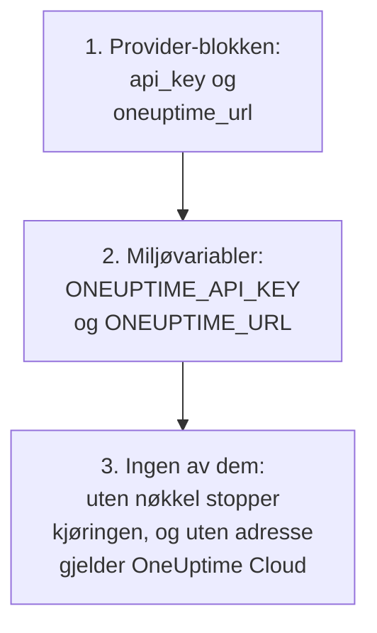
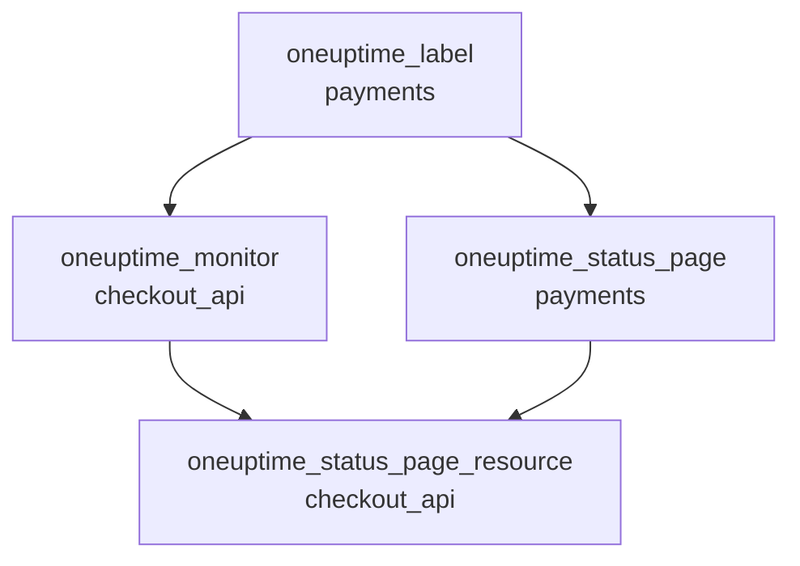

# Komplett guide

Denne guiden dekker det som kommer etter den første applyen din: hvordan provideren finner API-nøkkelen sin, hvordan du setter opp en konfigurasjon for ett eller flere prosjekter, hvordan ressurser henviser til hverandre, hvordan du leser poster du ikke administrerer, hvordan du holder staten trygg, og hvordan du oppgraderer. Ny med provideren? Start med [Hurtigstart](/docs/terraform/quick-start).

:::cards
- [Konfigurer provideren](#konfigurer-provideren): API-nøkkelen og adressen, og hvor provideren leser dem.
- [Sett opp en konfigurasjon](#sett-opp-en-konfigurasjon): Filer, prosjekter og mange ressurser fra én blokk.
- [Les det som allerede finnes](#les-det-som-allerede-finnes): Datakilder, og hvordan et oppslag finner sitt treff.
- [Hold staten trygg](#hold-staten-trygg): En ekstern backend, og hva du aldri skal committe.
:::

## Konfigurer provideren

Provideren tar to innstillinger. Hver av dem kommer fra provider-blokken, eller ellers fra en miljøvariabel:

| Innstilling | Miljøvariabel | Når ingen av dem er angitt |
| --- | --- | --- |
| `api_key` | `ONEUPTIME_API_KEY` | Provideren stopper før noe planlegges: `Missing API Key` |
| `oneuptime_url` | `ONEUPTIME_URL` | `https://oneuptime.com`, som er OneUptime Cloud |



`oneuptime_url` er adressen til OneUptime-en din, uten `/api`: provideren legger til `https://` når adressen ikke har et skjema, og `/api` til slutt. `api_key` er sensitiv, så Terraform skriver den aldri ut.

Nøkkelen må være en API-nøkkel til prosjektet du administrerer, med tillatelse til å opprette, lese, endre og slette hver type post i konfigurasjonen din: se [Opprett en API-nøkkel til prosjektet](/docs/terraform/quick-start#opprett-en-api-nøkkel-til-prosjektet). Master-API-nøkkelen til en selv-hostet OneUptime hører ikke til noe prosjekt, så en oppretting med den feiler med `ProjectId required`.

### Gi provideren nøkkelen

:::tabs
@tab Miljøvariabel
```bash
export ONEUPTIME_API_KEY="<your-api-key>"
# Only on a self-hosted OneUptime:
export ONEUPTIME_URL="https://oneuptime.example.com"
```

```hcl title="main.tf"
provider "oneuptime" {}
```
@tab Terraform-variabel
```hcl title="variables.tf"
variable "oneuptime_api_key" {
  description = "API key of the OneUptime project"
  type        = string
  sensitive   = true
}

provider "oneuptime" {
  api_key = var.oneuptime_api_key
}
```

```hcl title="terraform.tfvars"
oneuptime_api_key = "<your-api-key>"
```
:::

En miljøvariabel holder nøkkelen utenfor alle filer. En variabelfil er praktisk på din egen maskin: legg `terraform.tfvars` til i `.gitignore`. I en pipeline angir du `TF_VAR_oneuptime_api_key` i stedet for å skrive filen.

### Kjør den i CI/CD

Gi jobben nøkkelen som en hemmelighet, i miljøvariabelen `ONEUPTIME_API_KEY`:

:::tabs
@tab GitHub Actions
```yaml title=".github/workflows/oneuptime.yml"
name: OneUptime
on:
  push:
    branches: [main]

jobs:
  apply:
    runs-on: ubuntu-latest
    env:
      ONEUPTIME_API_KEY: ${{ secrets.ONEUPTIME_API_KEY }}
    steps:
      - uses: actions/checkout@v4
      - uses: hashicorp/setup-terraform@v3
      - run: terraform init -input=false
      - run: terraform plan -input=false -out=tfplan
      - run: terraform apply -input=false tfplan
```
@tab GitLab CI
```yaml title=".gitlab-ci.yml"
apply:
  image:
    name: hashicorp/terraform:latest
    entrypoint: [""]
  rules:
    - if: $CI_COMMIT_BRANCH == $CI_DEFAULT_BRANCH
  script:
    - terraform init -input=false
    - terraform plan -input=false -out=tfplan
    - terraform apply -input=false tfplan
```
:::

I GitHub legger du til hemmeligheten under **Settings → Secrets and variables → Actions**; i GitLab legger du til en maskert CI/CD-variabel med samme navn. Hold staten i en [ekstern backend](#hold-staten-trygg), slik at hver kjøring starter fra staten den forrige etterlot.

## Sett opp en konfigurasjon

Et oppsett som fungerer godt:

```text
oneuptime/
├── main.tf          # the terraform and provider blocks
├── variables.tf     # input variables
├── outputs.tf       # the IDs other configurations need
├── shared.tf        # labels, teams and monitor statuses
├── monitors.tf      # monitors and monitor groups
├── status-pages.tf  # status pages and their domains
└── on-call.tf       # on-call policies and escalation rules
```

- **Én konfigurasjon for hvert prosjekt.** En API-nøkkel hører til ett prosjekt, så en konfigurasjon administrerer naturlig ett.
- **Delte poster én gang.** Definer etiketter, team og monitorstatuser i én fil, og henvis til dem med adressen deres alle andre steder.

### Administrer flere prosjekter

For å administrere mer enn ett prosjekt fra én konfigurasjon gir du provideren et alias for hvert prosjekt, hvert med det prosjektets nøkkel. En ressurs angir med `provider` hvilket alias den bruker:

```hcl
provider "oneuptime" {
  alias   = "production"
  api_key = var.production_api_key
}

provider "oneuptime" {
  alias   = "staging"
  api_key = var.staging_api_key
}

resource "oneuptime_label" "staging_critical" {
  provider = oneuptime.staging

  name  = "critical"
  color = "#FF5733"
}
```

Deklarer `production_api_key` og `staging_api_key` som variabler som er merket `sensitive`, som ovenfor.

### Mange ressurser fra én blokk

`for_each` lager én ressurs for hver oppføring i et map. Disse monitorene deler kriteriene sine og skiller seg bare i navn og adresse:

```hcl
variable "websites" {
  type = map(string)
  default = {
    homepage = "https://example.com"
    docs     = "https://docs.example.com"
  }
}

resource "oneuptime_monitor" "website" {
  for_each = var.websites

  name                = "Website: ${each.key}"
  monitor_type        = "Website"
  monitoring_interval = "*/5 * * * *"

  monitor_steps = [{
    monitor_destination      = each.value
    monitor_destination_type = "URL"

    criteria = [
      {
        name                  = "Offline"
        filter_condition      = "Any"
        change_monitor_status = true
        monitor_status_id     = data.oneuptime_monitor_status.offline.id

        filters = [
          {
            check_on    = "Is Online"
            filter_type = "False"
          }
        ]
      }
    ]
  }]
}
```

Legg et nettsted til i mappet, og neste apply oppretter monitoren for det. Fjern ett, og den sletter den.

## Henvis til andre ressurser

En ressurs som nevner en annen ressurs' attributt, avhenger av den, og Terraform ordner arbeidet etter disse henvisningene. Her opprettes etiketten først og slettes sist, fordi monitoren og statussiden nevner den:



```hcl
resource "oneuptime_label" "payments" {
  name        = "payments"
  description = "Payment infrastructure"
  color       = "#2ECC71"
}

resource "oneuptime_monitor" "checkout_api" {
  name         = "Checkout API"
  description  = "Availability of the checkout API"
  monitor_type = "Manual"
  labels       = [oneuptime_label.payments.id]
}

resource "oneuptime_status_page" "payments" {
  name                  = "Payments Status"
  page_title            = "Payments Status"
  is_public_status_page = true
  labels                = [oneuptime_label.payments.id]
}

resource "oneuptime_status_page_resource" "checkout_api" {
  status_page_id = oneuptime_status_page.payments.id
  monitor_id     = oneuptime_monitor.checkout_api.id
  display_name   = "Checkout API"
}
```

Du trenger sjelden `depends_on`: legg den bare til for en rekkefølge Terraform ikke kan se ut fra attributtene. Lister med ID-er som `labels` er sett, så det endrer ingenting å bytte rekkefølgen.

## Les det som allerede finnes

Hver ressurs har en datakilde med samme navn. En datakilde leser en post som denne konfigurasjonen ikke administrerer, opprettet i dashbordet eller av en annen konfigurasjon, slik at du kan henvise til den uten å ta den over.

```hcl
data "oneuptime_label" "critical" {
  name = "critical"
}

data "oneuptime_monitor_status" "offline" {
  is_offline_state = true
}

data "oneuptime_status_page" "main" {
  id = "5f8a1b2c-3d4e-4f6a-8b9c-0d1e2f3a4b5c"
}

resource "oneuptime_monitor" "database" {
  name         = "Database Health"
  monitor_type = "Manual"
  labels       = [data.oneuptime_label.critical.id]
}
```

Slik finner et oppslag sitt treff:

| Du angir | Den finner | Feil |
| --- | --- | --- |
| `id` | Posten med den ID-en | `Not Found` når ingen post har den |
| Andre enkle argumenter, ett eller flere | Den ene posten som stemmer med alle | `Not Found` når ingen stemmer, `Ambiguous Match` når mer enn én stemmer |
| `id` og et annet argument, eller ingenting | Ingenting | `Invalid Lookup` |

Enkle argumenter er tekst, tall og sann eller usann: et navn, en prioritet, et flagg som `is_offline_state`. Lister, JSON-verdier, tidsstempler og hemmeligheter kan ikke brukes til oppslag. For å ta over en post i stedet for bare å lese den, [importerer du den](/docs/terraform/importing-resources).

## Hold staten trygg

Terraforms state inneholder ID-ene og attributtene til alt den administrerer, hemmeligheter inkludert. Hold den i en ekstern backend som låser den, slik at et team deler én state og to kjøringer aldri skriver den samtidig. Enhver standard backend virker, for eksempel en S3-bøtte:

```hcl
terraform {
  backend "s3" {
    bucket       = "my-terraform-state"
    key          = "oneuptime/production.tfstate"
    region       = "us-east-1"
    encrypt      = true
    use_lockfile = true
  }
}
```

`use_lockfile` krever Terraform 1.10 eller OpenTofu 1.10 eller nyere. Før dem låser S3-backenden med en DynamoDB-tabell (`dynamodb_table`).

- **Rediger aldri staten for hånd.** Bruk `terraform state mv` og `terraform state rm`.
- **Committ aldri `terraform.tfstate` eller en `.tfvars`-fil med en hemmelighet i.**

## Drift, og hva som ikke forårsaker den

`terraform plan` sammenligner OneUptime med konfigurasjonen din og viser det som er forskjellig. Noen forskjeller vises aldri:

- **Tidspunkter sammenlignes som øyeblikk.** `2030-06-01T02:00:00Z` og serverens måte å skrive det samme øyeblikket på er like.
- **Standardverdier som serveren legger til** i trinnene til en monitor, eller i en JSON-verdi, er ikke en forskjell fra det du skrev.
- **Det serveren holder oppdatert**, som den nåværende statusen til en monitor, er heller ikke en forskjell.

En verdi du beregner ved hver kjøring, er derimot det: `timestamp()` gir et nytt tidspunkt ved hver kjøring, så en plan viser det alltid. Skriv faste tidspunkter i stedet:

```hcl
resource "oneuptime_scheduled_maintenance_event" "database_upgrade" {
  title       = "Database upgrade"
  description = "Planned PostgreSQL upgrade"
  starts_at   = "2030-06-01T02:00:00Z"
  ends_at     = "2030-06-01T04:00:00Z"
}
```

## Oppgrader provideren

:::steps
### Les utgivelsesnotatene

[Terraform Registry](https://registry.terraform.io/providers/oneuptime/oneuptime) og [providerens utgivelser på GitHub](https://github.com/OneUptime/terraform-provider-oneuptime/releases) viser hva som er endret.

### Hev versjonsbegrensningen

`{{TERRAFORM_PROVIDER_VERSION}}` tar allerede alle {{TERRAFORM_PROVIDER_MAJOR}}.x-utgivelser. En ny hovedversjon krever en ny begrensning.

### Last ned den nye versjonen

```bash
terraform init -upgrade
```

### Planlegg før du bruker

Kjør `terraform plan`, og bruk bare når den er tom eller viser endringene du forventer.
:::

På en selv-hostet OneUptime oppgraderer du først OneUptime og deretter provideren: provideren kan ikke være nyere enn OneUptime-en din. Se [Selv-hostet oppsett](/docs/terraform/self-hosted).

## Neste steg

:::cards
- [Monitortrinn](/docs/terraform/monitor-steps): Bestem hva en monitor sjekker, og hva hvert resultat betyr.
- [Eksempler](/docs/terraform/examples): Ferdige konfigurasjoner for de vanlige ressursene.
- [Importere ressurser](/docs/terraform/importing-resources): Ta det du har laget i dashbordet, inn under Terraform.
- [Feilsøking](/docs/terraform/troubleshooting): Vanlige feil, og hvordan du retter dem.
:::
