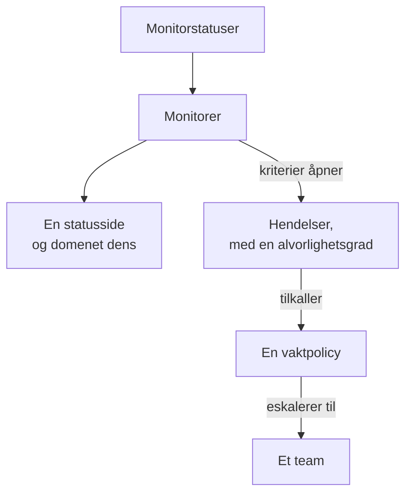

# Eksempler

Ferdige konfigurasjoner for ressursene de fleste prosjekter starter med. Hver blokk kan brukes som den er, oppå provider-oppsettet nedenfor, og de fleste kommer fra providerens ende-til-ende-tester, som bruker dem mot en ekte OneUptime ved hver endring.

:::cards
- [Monitorer](#monitorer): Nettsted-, API-, ping-, port-, SSL-sertifikat-, heartbeat- og manuelle monitorer.
- [Statussider](#statussider): En statusside med en gruppe og en monitor, og et eget domene.
- [Team og vakt](#team-og-vakt): Et team, og en vaktpolicy som tilkaller det.
- [Hendelser og vedlikehold](#hendelser-og-vedlikehold): Alvorlighetsgrader, tilstander, en erklært hendelse og et vedlikeholdsvindu.
:::



## Provider-oppsett

Hvert eksempel forutsetter dette oppsettet, med API-nøkkelen i miljøvariabelen `ONEUPTIME_API_KEY`:

```hcl title="main.tf"
terraform {
  required_providers {
    oneuptime = {
      source  = "oneuptime/oneuptime"
      version = "{{TERRAFORM_PROVIDER_VERSION}}"
    }
  }
}

provider "oneuptime" {
  # On a self-hosted OneUptime, add your OneUptime's address:
  # oneuptime_url = "https://oneuptime.example.com"
}
```

## Etiketter

Etiketter sorterer og filtrerer poster. De fleste ressurser tar et sett med etikett-ID-er i `labels`:

```hcl
resource "oneuptime_label" "production" {
  name        = "production"
  description = "Production infrastructure"
  color       = "#FF5733"
}
```

## Monitorer

Monitorene nedenfor setter statusen sin med tre av statusene alle prosjekter starter med, lest med datakilder:

```hcl
data "oneuptime_monitor_status" "operational" {
  name = "Operational"
}

data "oneuptime_monitor_status" "degraded" {
  name = "Degraded"
}

data "oneuptime_monitor_status" "offline" {
  name = "Offline"
}
```

Hver monitors `monitor_steps` sier hva den sjekker, og hvordan hvert resultat bedømmes: [Monitortrinn](/docs/terraform/monitor-steps) forklarer hvert attributt.

### Nettstedmonitor

Offline når nettstedet ikke svarer, online når det svarer med 200. Ende-til-ende-testen `35-monitor-with-steps` bruker en monitor med disse sjekkene:

```hcl
resource "oneuptime_monitor" "website" {
  name                = "Website"
  description         = "Homepage availability and status code"
  monitor_type        = "Website"
  monitoring_interval = "*/5 * * * *"
  labels              = [oneuptime_label.production.id]

  monitor_steps = [{
    monitor_destination      = "https://example.com"
    monitor_destination_type = "URL"
    request_type             = "GET"

    criteria = [
      {
        name                  = "Offline"
        description           = "The website does not respond"
        filter_condition      = "Any"
        change_monitor_status = true
        monitor_status_id     = data.oneuptime_monitor_status.offline.id

        filters = [
          {
            check_on    = "Is Online"
            filter_type = "False"
          }
        ]
      },
      {
        name                  = "Online"
        description           = "The website responds with 200"
        filter_condition      = "All"
        change_monitor_status = true
        monitor_status_id     = data.oneuptime_monitor_status.operational.id

        filters = [
          {
            check_on    = "Is Online"
            filter_type = "True"
          },
          {
            check_on    = "Response Status Code"
            filter_type = "Equal To"
            value       = "200"
          }
        ]
      }
    ]
  }]
}
```

### API-monitor

En `POST` med headere og en JSON-body, redusert når svaret er tregt. Ende-til-ende-testen `35-monitor-with-steps` bruker en lignende API-monitor:

```hcl
resource "oneuptime_monitor" "orders_api" {
  name         = "Orders API"
  description  = "Health check of the orders API"
  monitor_type = "API"

  monitor_steps = [{
    monitor_destination      = "https://api.example.com/v1/health"
    monitor_destination_type = "URL"
    request_type             = "POST"
    request_headers = {
      "Content-Type" = "application/json"
      "Accept"       = "application/json"
    }
    request_body = jsonencode({ check = "health" })

    criteria = [
      {
        name                  = "Offline"
        description           = "The API does not answer, or answers with an error"
        filter_condition      = "Any"
        change_monitor_status = true
        monitor_status_id     = data.oneuptime_monitor_status.offline.id

        filters = [
          {
            check_on    = "Is Online"
            filter_type = "False"
          },
          {
            check_on    = "Response Status Code"
            filter_type = "Greater Than Or Equal To"
            value       = "500"
          }
        ]
      },
      {
        name                  = "Slow"
        description           = "The API takes more than two seconds"
        filter_condition      = "All"
        change_monitor_status = true
        monitor_status_id     = data.oneuptime_monitor_status.degraded.id

        filters = [
          {
            check_on    = "Response Time (in ms)"
            filter_type = "Greater Than"
            value       = "2000"
          }
        ]
      },
      {
        name                  = "Online"
        description           = "The API answers in time"
        filter_condition      = "All"
        change_monitor_status = true
        monitor_status_id     = data.oneuptime_monitor_status.operational.id

        filters = [
          {
            check_on    = "Is Online"
            filter_type = "True"
          }
        ]
      }
    ]
  }]
}
```

### Ping-monitor

En Ping-monitor tar et vertsnavn eller en IP-adresse i stedet for en URL:

```hcl
resource "oneuptime_monitor" "gateway" {
  name         = "Gateway"
  description  = "The gateway answers ping"
  monitor_type = "Ping"

  monitor_steps = [{
    monitor_destination      = "gateway.example.com"
    monitor_destination_type = "Hostname"

    criteria = [
      {
        name                  = "Unreachable"
        filter_condition      = "Any"
        change_monitor_status = true
        monitor_status_id     = data.oneuptime_monitor_status.offline.id

        filters = [
          {
            check_on    = "Is Online"
            filter_type = "False"
          }
        ]
      },
      {
        name                  = "Reachable"
        filter_condition      = "All"
        change_monitor_status = true
        monitor_status_id     = data.oneuptime_monitor_status.operational.id

        filters = [
          {
            check_on    = "Is Online"
            filter_type = "True"
          }
        ]
      }
    ]
  }]
}
```

### Port-monitor

En Port-monitor legger til `port` som skal sjekkes, som et tall:

```hcl
resource "oneuptime_monitor" "database_port" {
  name         = "Database port"
  description  = "PostgreSQL accepts connections"
  monitor_type = "Port"

  monitor_steps = [{
    monitor_destination      = "db.example.com"
    monitor_destination_type = "Hostname"
    port                     = 5432

    criteria = [
      {
        name                  = "Closed"
        filter_condition      = "Any"
        change_monitor_status = true
        monitor_status_id     = data.oneuptime_monitor_status.offline.id

        filters = [
          {
            check_on    = "Is Online"
            filter_type = "False"
          }
        ]
      },
      {
        name                  = "Open"
        filter_condition      = "All"
        change_monitor_status = true
        monitor_status_id     = data.oneuptime_monitor_status.operational.id

        filters = [
          {
            check_on    = "Is Online"
            filter_type = "True"
          }
        ]
      }
    ]
  }]
}
```

### SSL-sertifikatmonitor

Offline når sertifikatet ikke er gyldig, redusert når det utløper om 14 dager eller mindre, slik en ny SSL-sertifikatmonitor er i dashbordet:

```hcl
resource "oneuptime_monitor" "certificate" {
  name         = "example.com certificate"
  description  = "The TLS certificate of example.com"
  monitor_type = "SSL Certificate"

  monitor_steps = [{
    monitor_destination      = "https://example.com"
    monitor_destination_type = "URL"

    criteria = [
      {
        name                  = "Not valid"
        description           = "Expired, self-signed, untrusted or not reachable"
        filter_condition      = "Any"
        change_monitor_status = true
        monitor_status_id     = data.oneuptime_monitor_status.offline.id

        filters = [
          {
            check_on    = "Is Not A Valid Certificate"
            filter_type = "True"
          }
        ]
      },
      {
        name                  = "Expires soon"
        description           = "Valid, and expires in 14 days or less"
        filter_condition      = "All"
        change_monitor_status = true
        monitor_status_id     = data.oneuptime_monitor_status.degraded.id

        filters = [
          {
            check_on    = "Is Valid Certificate"
            filter_type = "True"
          },
          {
            check_on    = "Expires In Days"
            filter_type = "Less Than Or Equal To"
            value       = "14"
          }
        ]
      },
      {
        name                  = "Valid"
        filter_condition      = "All"
        change_monitor_status = true
        monitor_status_id     = data.oneuptime_monitor_status.operational.id

        filters = [
          {
            check_on    = "Is Valid Certificate"
            filter_type = "True"
          }
        ]
      }
    ]
  }]
}
```

### Manuell monitor

En manuell monitor sjekker ingenting: du setter statusen dens selv. Den trenger ikke `monitor_steps`:

```hcl
resource "oneuptime_monitor" "payment_provider" {
  name         = "Payment provider"
  description  = "Set by hand during the provider's incidents"
  monitor_type = "Manual"
}
```

### Heartbeat-monitor

En monitor for innkommende forespørsler venter på forespørsler i stedet for å sende dem: her en sikkerhetskopijobb som melder seg hver natt. Den går offline når ingen forespørsel har kommet på 25 timer:

```hcl
resource "oneuptime_monitor" "nightly_backup" {
  name         = "Nightly backup"
  description  = "The backup job sends a heartbeat when it finishes"
  monitor_type = "Incoming Request"

  monitor_steps = [{
    criteria = [
      {
        name                  = "No heartbeat"
        filter_condition      = "Any"
        change_monitor_status = true
        monitor_status_id     = data.oneuptime_monitor_status.offline.id

        filters = [
          {
            check_on    = "Incoming Request"
            filter_type = "Not Recieved In Minutes"
            value       = "1500"
          }
        ]
      },
      {
        name                  = "Heartbeat received"
        filter_condition      = "All"
        change_monitor_status = true
        monitor_status_id     = data.oneuptime_monitor_status.operational.id

        filters = [
          {
            check_on    = "Incoming Request"
            filter_type = "Recieved In Minutes"
            value       = "1500"
          }
        ]
      }
    ]
  }]
}

output "nightly_backup_heartbeat_key" {
  value     = oneuptime_monitor.nightly_backup.incoming_request_secret_key
  sensitive = true
}
```

Jobben sender forespørselen sin til `https://oneuptime.com/heartbeat/YOUR_SECRET_KEY`, med nøkkelen som `terraform output -raw nightly_backup_heartbeat_key` skriver ut: se [Innkommende forespørsel-overvåking](/docs/monitor/incoming-request-monitor). Agenten til en servermonitor melder seg på samme måte, med `server_monitor_secret_key`.

### Monitorgruppe

En monitorgruppe viser et sett monitorer med én status:

```hcl
resource "oneuptime_monitor_group" "storefront" {
  name        = "Storefront"
  description = "Everything the shop needs"
}

resource "oneuptime_monitor_group_resource" "website" {
  monitor_group_id = oneuptime_monitor_group.storefront.id
  monitor_id       = oneuptime_monitor.website.id
}

resource "oneuptime_monitor_group_resource" "orders_api" {
  monitor_group_id = oneuptime_monitor_group.storefront.id
  monitor_id       = oneuptime_monitor.orders_api.id
}
```

## Statussider

### En statusside med en gruppe og en monitor

En statusside viser ressurser og kan sortere dem i grupper. Ende-til-ende-testen `42-status-page-resources` bruker dette oppsettet:

```hcl
resource "oneuptime_status_page" "public" {
  name                  = "Public Status"
  description           = "Customer-facing status page"
  page_title            = "System Status"
  page_description      = "Check our system status and incident history"
  is_public_status_page = true
}

resource "oneuptime_status_page_group" "services" {
  status_page_id = oneuptime_status_page.public.id
  name           = "Services"
}

resource "oneuptime_status_page_resource" "website" {
  status_page_id       = oneuptime_status_page.public.id
  status_page_group_id = oneuptime_status_page_group.services.id
  monitor_id           = oneuptime_monitor.website.id
  display_name         = "Website"
}
```

### Et eget domene

Tre ressurser jobber sammen: et domene i prosjektet ditt, statussiden og statussidens domene, som kobler dem sammen. Serveren fyller ut `full_domain` og CNAME-verifiseringstokenet: ikke angi dem. Ende-til-ende-testene `12-status-page-domain` og `25-status-page-with-domain` bruker dette oppsettet:

```hcl
resource "oneuptime_domain" "company" {
  domain = "example.com"
}

resource "oneuptime_status_page_domain" "status" {
  domain_id      = oneuptime_domain.company.id
  status_page_id = oneuptime_status_page.public.id
  subdomain      = "status"
}

output "status_page_address" {
  # The subdomain and the domain, such as status.example.com.
  value = oneuptime_status_page_domain.status.full_domain
}
```

Et nytt domene må bestå DNS-verifiseringen før statussiden svarer på det.

## Team og vakt

### Et team og medlemmene

```hcl
resource "oneuptime_team" "sre" {
  name        = "SRE"
  description = "Site reliability engineering"
}

variable "alice_user_id" {
  description = "Alice's user ID, the last part of the address of her page under Users"
  type        = string
}

resource "oneuptime_team_member" "alice" {
  team_id = oneuptime_team.sre.id
  user_id = var.alice_user_id
}
```

En person som allerede er med i prosjektet, blir med i teamet med en gang. Alle andre inviteres, og er med i teamet så snart de godtar. Ende-til-ende-testen `33-team-crud` bruker teamet.

### En vaktpolicy som tilkaller et team

Policyens første regel tilkaller teamet, og policyen begynner på nytt, opptil to ganger, når ingen bekrefter:

```hcl
resource "oneuptime_on_call_policy" "primary" {
  name                                             = "Primary on-call"
  description                                      = "First line for production incidents"
  repeat_policy_if_no_one_acknowledges             = true
  repeat_policy_if_no_one_acknowledges_no_of_times = 2
}

resource "oneuptime_escalation_rule" "first_line" {
  on_call_duty_policy_id    = oneuptime_on_call_policy.primary.id
  name                      = "Page the SRE team"
  description               = "Moves on after 5 minutes without an acknowledgement"
  order                     = 1
  escalate_after_in_minutes = 5
}

resource "oneuptime_team_on_call_duty_escalation_rule" "sre" {
  on_call_duty_policy_id                 = oneuptime_on_call_policy.primary.id
  on_call_duty_policy_escalation_rule_id = oneuptime_escalation_rule.first_line.id
  team_id                                = oneuptime_team.sre.id
}
```

En monitors kriterier tilkaller policyen via `on_call_policy_ids` på hendelsene de åpner: se [Hendelser og varsler](/docs/terraform/monitor-steps#hendelser-og-varsler).

## Hendelser og vedlikehold

### Alvorlighetsgrader og tilstander

Alvorlighetsgrader rangerer konsekvensene av en hendelse, og tilstander er trinnene i livsløpet dens. `order` er der hver av dem står i listen:

```hcl
resource "oneuptime_incident_severity" "sev1" {
  name        = "SEV-1"
  description = "Full outage, all hands"
  color       = "#E74C3C"
  order       = 1
}

resource "oneuptime_incident_state" "mitigated" {
  name        = "Mitigated"
  description = "Impact contained, fix in progress"
  color       = "#F39C12"
  order       = 3
}
```

`oneuptime_alert_severity` og `oneuptime_alert_state` virker på samme måte for varsler. Ende-til-ende-testene `03-incident-severity` og `04-incident-state` bruker dem.

### Erklær en hendelse

Det er som regel monitorer som åpner hendelser, men en hendelse er også en ressurs, noe som passer for en game day. Det er en ekte hendelse, så hold en øvelse unna statussidene dine:

```hcl
resource "oneuptime_incident" "drill" {
  title                     = "Disaster recovery drill"
  description               = "A game day: we fail over the database"
  incident_severity_id      = oneuptime_incident_severity.sev1.id
  is_visible_on_status_page = false

  should_status_page_subscribers_be_notified_on_incident_created = false
}
```

Ende-til-ende-testen `28-incident-crud` bruker en hendelse.

### Planlagt vedlikehold

Et vedlikeholdsvindu med faste tidspunkter, vist på statussidene dine:

```hcl
resource "oneuptime_scheduled_maintenance_event" "database_upgrade" {
  title                       = "Database maintenance"
  description                 = "Planned PostgreSQL upgrade: writes pause briefly"
  starts_at                   = "2030-06-01T02:00:00Z"
  ends_at                     = "2030-06-01T04:00:00Z"
  is_visible_on_status_page   = true
  monitors                    = [oneuptime_monitor.website.id]
  change_monitor_status_to_id = data.oneuptime_monitor_status.degraded.id
}
```

Tidspunkter er i RFC 3339, og det samme øyeblikket skrevet på en annen måte er ingen endring. Ende-til-ende-testen `30-scheduled-maintenance-crud` bruker vedlikeholdshendelser.

For å sette hendelsens monitorer i en status mens den pågår, knytter du dem til med `monitors` og setter `change_monitor_status_to_id` til en av monitorstatusene dine: monitorene bytter til den når hendelsen starter, og tilbake til operativ når den slutter. Terraform endrer `change_monitor_status_to_id` på stedet til hendelsen starter. Når hendelsen har startet, er monitorene allerede i den statusen, og en apply som endrer den, feiler med «Change Monitor Status to can no longer be changed: this event has already started.»

## Prober

En egen probe kjører sjekker fra nettverket ditt. Nøkkelen dens er hemmeligheten proben melder seg på med, så send den inn i en variabel:

```hcl
variable "probe_key" {
  description = "The key the probe signs in with"
  type        = string
  sensitive   = true
}

resource "oneuptime_probe" "eu_west" {
  key           = var.probe_key
  name          = "EU West"
  description   = "Probe in our eu-west-1 network"
  probe_version = "1.0.0"

  should_auto_enable_probe_on_new_monitors = true
}
```

Kjør proben med `PROBE_ID` satt til probens `id` og `PROBE_KEY` satt til nøkkelen: se [Egendefinerte probes](/docs/probe/custom-probe). Ende-til-ende-testen `23-probe-crud` bruker prober.

## Neste steg

:::cards
- [Monitortrinn](/docs/terraform/monitor-steps): Hvert attributt i sjekkene og kriteriene til en monitor.
- [Importere ressurser](/docs/terraform/importing-resources): Ta det du har laget i dashbordet, inn under Terraform.
- [Komplett guide](/docs/terraform/complete-guide): Datakilder, state, CI/CD og oppgraderinger.
:::
