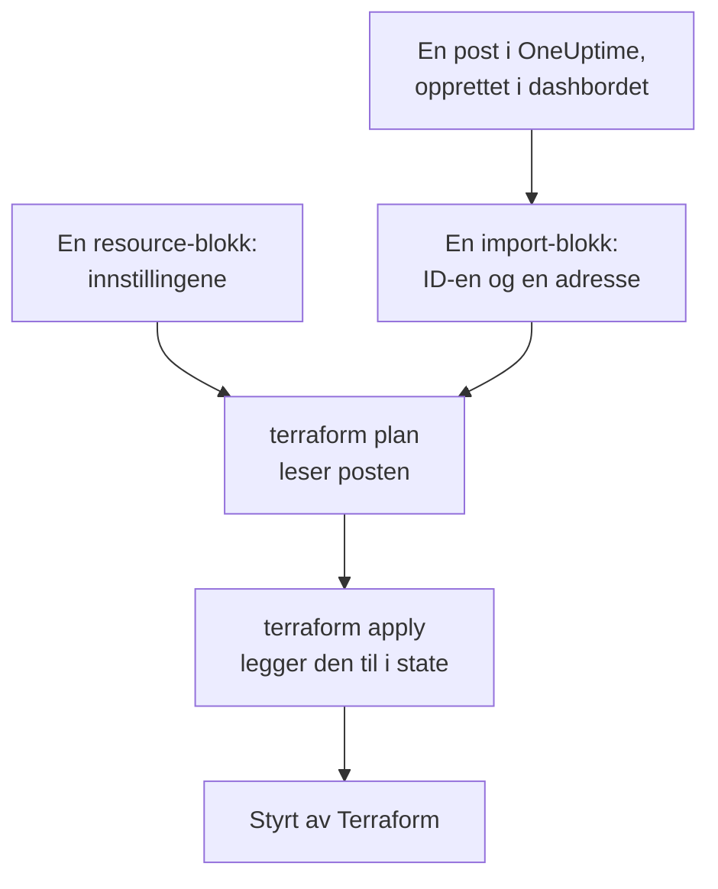
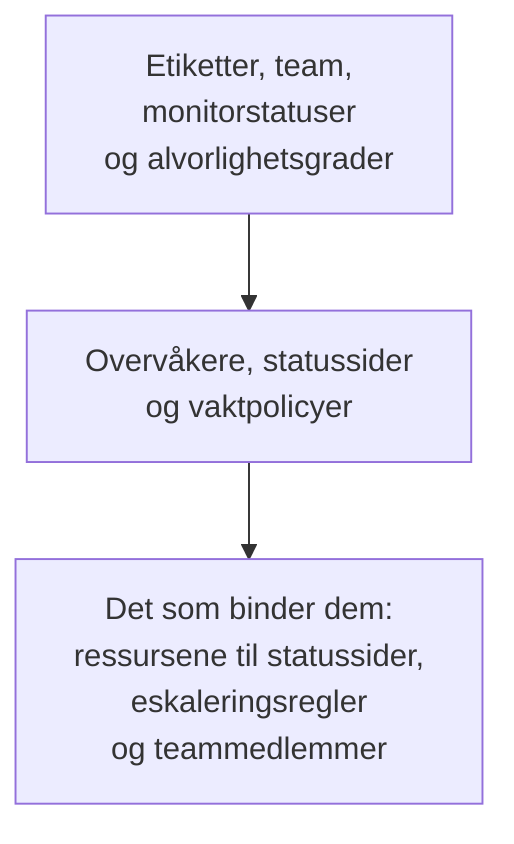

# Importere ressurser

Du trenger ikke begynne på nytt for å styre OneUptime med Terraform. Importer overvåkerne, statussidene, teamene og de andre postene du allerede har, så styrer Terraform dem derfra, slik de er. En import leser bare: ingenting endres i OneUptime før du tar i bruk en endring du har planlagt.

:::cards
- [Slik virker en import](#slik-virker-en-import): Hva en import leser, og hva du skriver.
- [Importer én ressurs](#importer-én-ressurs): Fra siden dens i dashbordet, i fire trinn.
- [Importer mange ressurser](#importer-mange-ressurser): Importblokker for en hel liste, og konfigurasjonen Terraform skriver for deg.
- [Slutt å styre en ressurs](#slutt-å-styre-en-ressurs): Gi den tilbake til dashbordet uten å slette den.
:::

## Slik virker en import

En import knytter en post som allerede finnes i OneUptime, til en `resource`-blokk i konfigurasjonen din. Du skriver en `import`-blokk med postens ID og adressen den skal til. Den neste `terraform plan` leser posten via ID-en og viser at den blir importert, sammen med hver forskjell mellom posten og konfigurasjonen din. `terraform apply` legger den til i Terraforms state, og derfra styres posten som alt annet Terraform har opprettet.



Skriv `resource`-blokken slik at den sier det posten allerede er. Der de er forskjellige, viser planen importen og en endring, og når du tar den i bruk, endres posten i OneUptime.

### Hva som kan importeres

Alle ressursene til provideren kan importeres via ID-en sin, unntatt `oneuptime_file`: OneUptimes API kan ikke lese en fil tilbake, så provideren svarer `Import Not Supported`. Datakilder importeres aldri. For å bruke en post i konfigurasjonen din uten å styre den, leser du den i stedet med en [datakilde](/docs/terraform/complete-guide#les-det-som-allerede-finnes).

## Før du begynner

- **Terraform 1.5 eller nyere, eller OpenTofu 1.6 eller nyere.** `import`-blokkene på denne siden krever disse versjonene. En eldre Terraform importerer fra [kommandolinjen](#importer-fra-kommandolinjen).
- **En API-nøkkel som kan lese det du importerer.** Importen leser hver post med providerens nøkkel, og å styre den etterpå krever også tillatelsene til å endre og slette den. Se [Opprett en API-nøkkel for prosjektet](/docs/terraform/quick-start#opprett-en-api-nøkkel-til-prosjektet).
- **Provideren i konfigurasjonen din**, satt opp som i [Hurtigstart](/docs/terraform/quick-start#pek-terraform-mot-oneuptime).

## Importer én ressurs

Dashbordet skriver konfigurasjonen for ressursen du ser på, med `import`-blokken dens, så du skriver sjelden en for hånd.

:::steps
### Åpne ressursens Terraform-side

Åpne overvåkeren, statussiden eller en annen ressurs i dashbordet. Åpne **Utvikler** i sidemenyen dens, og deretter **Terraform**.

### Kopier konfigurasjonen

Siden skriver ressursens `resource`-blokk ut fra de nåværende innstillingene dens, og en `import`-blokk med ID-en. Legg begge i en `.tf`-fil:

```hcl title="status-pages.tf"
resource "oneuptime_status_page" "public_status" {
  name       = "Public Status"
  page_title = "Acme Status"

  # Secrets are not shown here: master_password, embedded_overall_status_token.
  # Terraform leaves them as they are in OneUptime.
}

import {
  to = oneuptime_status_page.public_status
  id = "68a1b2c3-d4e5-4f6a-8b9c-0d1e2f3a4b02"
}
```

Den skriver innstillingene som avviker fra standardverdiene, og en kommentar etter hver ID nevner posten den peker på. Hemmeligheter vises aldri: de ressursen trenger, leses fra variabler merket `sensitive`, og kommentaren nevner de den utelater.

### Planlegg

Kjør `terraform plan`. Den slutter med `Plan: 1 to import, 0 to add, 0 to change, 0 to destroy.`: Terraform fant posten, og konfigurasjonen din stemmer med den.

### Ta i bruk

Kjør `terraform apply`. Statussiden er nå i Terraforms state, og den neste planen svarer `No changes.` Etterpå kan du slette `import`-blokken, eller beholde den som et notat om hvor ressursen kom fra: den gjør ingenting mer når ressursen først er styrt.
:::

### Skriv blokkene selv

Uten dashbordet skriver du begge blokkene selv. Start `resource`-blokken med attributtene ressursen trenger, og kjør `terraform plan`. Der konfigurasjonen din avviker fra posten, viser planen endringen ved siden av importen:

```text
  # oneuptime_label.critical will be updated in-place
  # (imported from "68a1b2c3-d4e5-4f6a-8b9c-0d1e2f3a4b03")
  ~ resource "oneuptime_label" "critical" {
      ~ color = "#FF5733" -> "#000000"
    }

Plan: 1 to import, 0 to add, 1 to change, 0 to destroy.
```

Kopier postens verdi inn i konfigurasjonen din (her `color = "#FF5733"`), og planlegg på nytt til planen viser importen og ingen endring. Postens ID finnes tre steder:

| Hvor | Hvordan |
| --- | --- |
| Ressursens side | Detaljkortet dens slutter med en linje **ID**. Klikk på ID-en, eller på kopieringsknappen ved siden av, for å kopiere hele ID-en. |
| Adressefeltet | ID-en kommer etter listens navn: `/dashboard/<project-id>/monitors/<monitor-id>`. |
| API-et | Hver post har ID-en sin i `_id`. |

## Importer mange ressurser

For å importere alle overvåkere, statussider eller andre ressurser av én type, begynner du fra listen deres.

:::steps
### Åpne listens Terraform-side

Åpne listen, og deretter **Utvikler** og **Terraform** i sidemenyen dens, for eksempel **Overvåkere → Utvikler → Terraform**.

### Kopier importblokkene

Siden skriver en `import`-blokk for hver post (de første 100), med en adresse laget av postens navn. Legg dem i en egen fil, som `imports.tf`:

```hcl title="imports.tf"
import {
  to = oneuptime_monitor.homepage
  id = "68a1b2c3-d4e5-4f6a-8b9c-0d1e2f3a4b01"
}

import {
  to = oneuptime_monitor.checkout_api
  id = "68a1b2c3-d4e5-4f6a-8b9c-0d1e2f3a4b05"
}
```

### La Terraform skrive konfigurasjonen

Kjør planen med et filnavn for konfigurasjonen Terraform skriver. Filen må ikke finnes ennå: Terraform skriver bare til en ny fil.

```bash
terraform plan -generate-config-out=monitors.tf
```

Terraform leser hver post og skriver en `resource`-blokk for hver `import`-blokk som ikke har en. Den advarer om at generering av konfigurasjon er eksperimentell, så les det den skrev.

### Gå gjennom og ta i bruk

Erstatt i den nye filen ID-ene til andre poster med referanser til ressursene deres, som `labels = [oneuptime_label.critical.id]`, slik at Terraform vet hvilken rekkefølge den skal jobbe i. Kjør `terraform plan` til den bare viser importene, og deretter `terraform apply`.
:::

### Et helt prosjekt

Importer et prosjekt liste for liste, og begynn med postene andre refererer til. Da kan hver ressursblokk referere til dem før seg via adresse i stedet for ID:



Poster som hvert prosjekt starter med, som monitorstatusene og alvorlighetsgradene for hendelser, er ofte bedre å lese med datakilder enn å importere: Terraform kan da referere til dem, men endrer eller sletter dem aldri. Prosjektet er importert når `terraform plan` svarer `No changes.`

## Importer fra kommandolinjen

`terraform import` importerer én ressurs om gangen og virker med alle versjoner av Terraform og OpenTofu. Skriv `resource`-blokken først, og kjør deretter kommandoen med blokkens adresse og postens ID:

```bash
terraform import oneuptime_status_page.public_status 68a1b2c3-d4e5-4f6a-8b9c-0d1e2f3a4b02
terraform import oneuptime_label.critical 68a1b2c3-d4e5-4f6a-8b9c-0d1e2f3a4b03
terraform import oneuptime_team.sre 68a1b2c3-d4e5-4f6a-8b9c-0d1e2f3a4b04
```

Hver av dem slutter med `Import successful!`. I motsetning til en `import`-blokk skriver kommandoen state med en gang, uten en plan du kan gå gjennom først: kjør `terraform plan` etterpå, og endre konfigurasjonen din til planen svarer `No changes.`

## Slutt å styre en ressurs

For å gi en ressurs tilbake til dashbordet uten å slette den, erstatter du `resource`-blokken dens med en `removed`-blokk som beholder posten:

```hcl
removed {
  from = oneuptime_team.sre

  lifecycle {
    destroy = false
  }
}
```

Planen sier at teamet ikke lenger styres av Terraform, og ødelegger ingenting. Ta den i bruk, og slett deretter `removed`-blokken. En `removed`-blokk med `destroy = false` krever Terraform 1.7 eller nyere, eller OpenTofu 1.10 eller nyere. På en eldre versjon kjører du i stedet `terraform state rm oneuptime_team.sre`.

> [!WARNING]
> Når du sletter en `resource`-blokk, slettes posten dens i OneUptime ved neste apply. Under Terraform gjør en `removed`-blokk uten `destroy = false` det samme: skriv alltid `lifecycle`-blokken.

## Greit å vite

- **En import endrer ingenting, men neste apply gjør det.** Når du tar i bruk en plan som viser en endring ved siden av en import, endres posten i OneUptime. Få først planen til å vise bare importen.
- **Hemmeligheter leses ikke tilbake.** En hemmelighet som OneUptime aldri sender tilbake, som `secret_value` for en overvåkerhemmelighet, er ikke i state etter en import. Hvis konfigurasjonen din angir den, viser den første planen den som en endring, og når du tar den i bruk, skrives hemmeligheten på nytt.
- **Én konfigurasjon for hver post.** En post som er importert i to konfigurasjoner, endres ved hver apply tilbake til det hver av dem sier.
- **Importerte poster er styrte poster.** `terraform destroy` sletter dem fra OneUptime, som postene Terraform har opprettet.

## Feilsøking

:::details Meldingen «Cannot import non-existent remote object»
Ingen post har den ID-en, eller providerens API-nøkkel får ikke lese den: OneUptime svarer likt i begge tilfeller. Kontroller ID-en, og at nøkkelen kan lese den typen post.
:::

:::details Meldingen «Import Not Supported»
`oneuptime_file` er den eneste ressursen som ikke kan importeres. Utelat den, og la Terraform opprette en ny fil i stedet.
:::

:::details Meldingen «Invalid ID format»
ID-en er ikke ID-en til en post, for eksempel et navn. En import tar ID-en, en UUID som `68a1b2c3-d4e5-4f6a-8b9c-0d1e2f3a4b02`: kopier den fra ressursens side.
:::

:::details Meldingen «Target generated file already exists»
`-generate-config-out` nevner en fil som allerede finnes. Nevn en ny fil, eller flytt innholdet i filen et annet sted og slett den.
:::

:::details Meldingen «Resource already managed by Terraform»
`terraform import` fikk en adresse som allerede er i state. Importer posten til en annen adresse, eller sjekk med `terraform state list` hva adressen inneholder.
:::

## Neste steg

:::cards
- [Komplett guide](/docs/terraform/complete-guide): Datakilder, referanser mellom ressurser, og state.
- [Monitortrinn](/docs/terraform/monitor-steps): Les og endre hva en importert overvåker sjekker.
- [Eksempler](/docs/terraform/examples): Ferdige konfigurasjoner for de vanlige ressursene.
- [Feilsøking](/docs/terraform/troubleshooting): Vanlige feil og hvordan du retter dem.
:::
