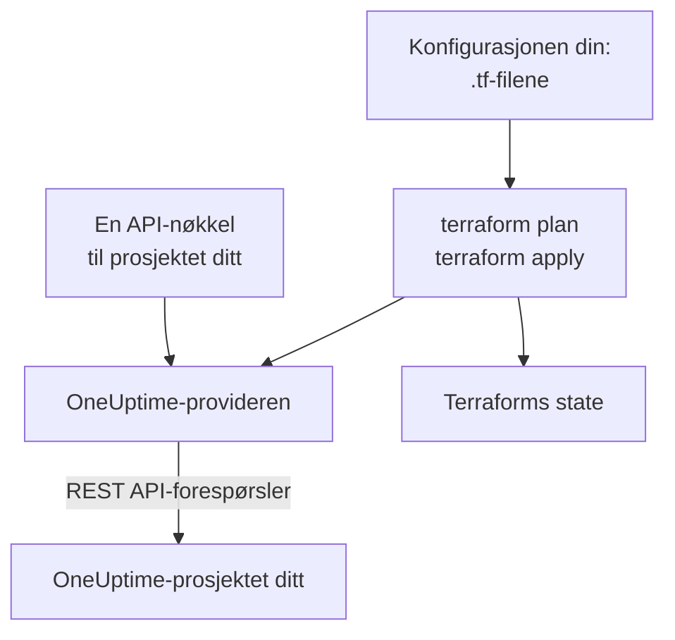

# Terraform – Oversikt

OneUptimes Terraform-provider administrerer OneUptime-prosjektet ditt som kode. Beskriv monitorer, statussider, vaktpolicyer, team, etiketter og de andre postene i prosjektet ditt i `.tf`-filer, se med `terraform plan` hva som vil endres, og gjennomfør endringen med `terraform apply`. Den virker med OneUptime Cloud og med en selv-hostet OneUptime, og med OpenTofu like godt som med Terraform.

:::cards
- [Slik virker provideren](#slik-virker-provideren): Konfigurasjonen din, planen og API-forespørslene bak dem.
- [Installer provideren](#installer-provideren): Provider-blokken, og hvilken versjon du skal velge.
- [La dashbordet skrive den](#la-dashbordet-skrive-den): Konfigurasjon og import-blokker for det du allerede har.
- [Hva du kan administrere](#hva-du-kan-administrere): Ressurser, datakilder og hvordan attributtene deres skrives.
:::

## Slik virker provideren

Provideren er et programtillegg som Terraform laster ned fra et registry. Ved `terraform apply` gjør den hver endring i planen om til en forespørsel til OneUptimes REST API, sendt med en API-nøkkel til prosjektet ditt. Terraform lagrer det den har opprettet i sin state, slik at neste plan bare viser det som er endret siden.



En API-nøkkel hører til ett prosjekt og avgjør hva Terraform kan lese og endre i det, så én konfigurasjon administrerer ett prosjekt. For å administrere flere gir du provideren et [alias](/docs/terraform/complete-guide#administrer-flere-prosjekter) for hvert prosjekt.

## Før du begynner

- **Terraform 1.5 eller nyere, eller OpenTofu 1.6 eller nyere.** `import`-blokkene som dashbordet skriver, krever disse versjonene.
- **En API-nøkkel til prosjektet ditt.** [Hurtigstart](/docs/terraform/quick-start#opprett-en-api-nøkkel-til-prosjektet) viser hvordan du oppretter en under **Prosjektinnstillinger → Avansert → API-nøkler**.
- **På OneUptime Cloud abonnementet Growth eller høyere.** Et prosjekts API-nøkler virker bare på det.

## Installer provideren

Legg provideren til i en `.tf`-fil. `terraform init` laster den ned fra Terraform Registry, og `tofu init` fra OpenTofu Registry:

```hcl title="main.tf"
terraform {
  required_providers {
    oneuptime = {
      source  = "oneuptime/oneuptime"
      version = "{{TERRAFORM_PROVIDER_VERSION}}"
    }
  }
}

provider "oneuptime" {
  # The API key comes from the ONEUPTIME_API_KEY environment variable.
  # On a self-hosted OneUptime, add your OneUptime's address:
  # oneuptime_url = "https://oneuptime.example.com"
}
```

Hold nøkkelen utenfor filene dine: eksporter den før du kjører Terraform, eller send den inn i en variabel som er merket `sensitive`. [Komplett guide](/docs/terraform/complete-guide#konfigurer-provideren) viser alle måtene å gi provideren nøkkelen og adressen på.

### Velg en versjon

Providerens versjoner følger OneUptimes: provider {{TERRAFORM_PROVIDER_MAJOR}}.x er laget fra OneUptime {{TERRAFORM_PROVIDER_MAJOR}}.x. Begrensningen over, `{{TERRAFORM_PROVIDER_VERSION}}`, tar den nyeste {{TERRAFORM_PROVIDER_MAJOR}}.x-utgivelsen, og det er den riktige for OneUptime Cloud. På en selv-hostet OneUptime bruker du den nyeste provideren som ikke er nyere enn OneUptime-en din: [Selv-hostet oppsett](/docs/terraform/self-hosted) viser hvordan du låser den.

## La dashbordet skrive den

Du trenger ikke å skrive en ressurs du allerede har, for hånd. Hver ressurs i OneUptime-dashbordet (en monitor, en statusside, en arbeidsflyt, en vaktpolicy og de andre) har en seksjon **Utvikler** i sidemenyen, sammenslått til du åpner den. Siden **Terraform** der skriver konfigurasjonen for deg, fylt ut fra ditt eget prosjekt.

:::steps
### Åpne ressursen

Åpne monitoren, statussiden eller den andre ressursen du vil at Terraform skal administrere.

### Åpne Terraform-siden dens

Åpne **Utvikler** og deretter **Terraform** i sidemenyen.

### Kopier konfigurasjonen

Siden skriver ressursens konfigurasjon ut fra de nåværende innstillingene, med en `import`-blokk. En kommentar etter hver ID nevner posten den peker på (`incident_severity_id = "..." # Critical Incident`).

### Planlegg og bruk

Kjør `terraform plan`: den viser at ressursen importeres, og at ingenting skal endres. Bruk den, og fra da av administrerer Terraform ressursen.
:::

Under konfigurasjonen har **Bygg videre på den** det folk ofte legger til ved siden av ressursen, med henvisning til adressen dens: et eierteam for en hendelse, en gruppe monitorer for en statusside, en eskaleringsregel for en vaktpolicy.

Listesidene (for eksempel **Hendelser** eller **Monitorer**) har den samme seksjonen. Der skriver siden **Terraform** en ny ressurs med feltene de fleste fyller ut, ut fra prosjektets egne poster: en hendelse med en av alvorlighetsgradene dine, en monitor med kriteriene en ny monitor får i dashbordet, koblet til statusene dine. Den gir ferdige **Vanlige oppsett** (en statusside med en gruppe og en monitor, en vaktpolicy som tilkaller et team, en ukentlig vaktrotasjon) og en `import`-blokk for hver ressurs du allerede har (de første 100), klar for `terraform plan -generate-config-out`. Begge sidene gir også provider-blokken for OneUptime-en din: riktig `oneuptime_url` og en versjonsbegrensning som passer til OneUptime-en din.

Hemmeligheter vises aldri på disse sidene. Når konfigurasjonen trenger en (for eksempel `Authorization`-headeren til en monitor), leser den den fra en Terraform-variabel som er merket `sensitive`. Hemmeligheter den ikke trenger, utelates, og Terraform lar dem være som de er i OneUptime.

Den samme seksjonen har en side **API** med `curl`-kommandoer for ressursen, og en side **AI-assistenter**, som kobler Claude, GitHub Copilot eller Cursor til [MCP-serveren](/docs/ai/mcp-server).

## Hva du kan administrere

Provideren har en ressurs for hver type post du kan opprette via OneUptime-API-et, med navnet `oneuptime_<name>`. Det er disse de fleste konfigurasjoner starter med:

| Ressurs | Hva det er |
| --- | --- |
| `oneuptime_monitor` | En monitor: nettsted, API, ping, port, SSL-sertifikat, server, innkommende forespørsel, manuell og alle andre typer |
| `oneuptime_monitor_status` | En monitorstatus, som Operational, Degraded eller Offline |
| `oneuptime_monitor_group` | En gruppe monitorer, vist med én status |
| `oneuptime_status_page` | En offentlig eller privat statusside |
| `oneuptime_status_page_domain` | Et eget domene for en statusside |
| `oneuptime_domain` | Et domene i prosjektet ditt, verifisert for statussider |
| `oneuptime_label` | En etikett, for å sortere og filtrere poster |
| `oneuptime_team`, `oneuptime_team_member` | Et team, og hvem som er med i det |
| `oneuptime_on_call_policy`, `oneuptime_escalation_rule` | En vaktpolicy, og reglene den tilkaller i rekkefølge |
| `oneuptime_incident`, `oneuptime_incident_severity`, `oneuptime_incident_state` | Hendelser, alvorlighetsgradene deres og tilstandene deres |
| `oneuptime_alert`, `oneuptime_alert_severity`, `oneuptime_alert_state` | Varsler, alvorlighetsgradene deres og tilstandene deres |
| `oneuptime_scheduled_maintenance_event` | Et planlagt vedlikeholdsvindu |
| `oneuptime_probe` | En egen probe, som sjekker fra nettverket ditt |

[Terraform Registry](https://registry.terraform.io/providers/oneuptime/oneuptime/latest/docs) viser hver ressurs med alle attributtene dens.

### Les det som allerede finnes

Hver ressurs har en datakilde med samme navn, som `data "oneuptime_label"`. En datakilde leser en post som denne konfigurasjonen ikke administrerer, for eksempel en som er opprettet i dashbordet. Slå den opp med `id`-en, eller med de andre enkle argumentene: hvert argument du angir, må stemme, og nøyaktig én post kan stemme med alle.

```hcl
data "oneuptime_monitor_status" "offline" {
  name = "Offline"
}

# Any plain argument works. Set several, and all of them must match.
data "oneuptime_monitor_status" "offline_state" {
  is_offline_state = true
}
```

Ingen treff, eller mer enn ett, er en feil og ikke et tomt eller tilfeldig svar. [Komplett guide](/docs/terraform/complete-guide#les-det-som-allerede-finnes) har reglene.

### Omdøpte ressurser

Ressursnavn holder ord som IoT og vCenter samlet: `oneuptime_iot_fleet` og `oneuptime_vcenter`, der eldre providere hadde `oneuptime_io_t_fleet` og `oneuptime_v_center` (og det samme for etikettreglene, eierne og feedene deres). De gamle navnene virker fortsatt som utfasede aliaser, og en plan som bruker et av dem, sier fra. For å bytte gir du ressursen nytt navn i konfigurasjonen og legger til en `moved`-blokk, så beholder Terraform den eksisterende ressursen i stedet for å erstatte den:

```hcl
# Was: resource "oneuptime_io_t_fleet" "factory"
resource "oneuptime_iot_fleet" "factory" {
  name = "Factory floor"
}

moved {
  from = oneuptime_io_t_fleet.factory
  to   = oneuptime_iot_fleet.factory
}
```

Å flytte en ressurs til en annen type krever Terraform 1.8 eller nyere. På en eldre motor beholder du det gamle navnet inntil videre: det fortsetter å virke.

## Slik skrives attributter

Attributtene følger OneUptime-API-et, i snake_case:

| Type verdi | Slik skriver du den | Eksempel |
| --- | --- | --- |
| Tekst, tall, sann eller usann | Som de er | `is_public_status_page = false` |
| En henvisning til en annen post | ID-en, vanligvis `id`-en til en annen ressurs | `incident_severity_id = oneuptime_incident_severity.sev1.id` |
| En liste med henvisninger | Et sett med ID-er, der rekkefølgen ikke betyr noe | `labels = [oneuptime_label.critical.id]` |
| En farge, et domene og andre innpakkede verdier | Den enkle verdien deres | `color = "#FF5733"` |
| En dato og et klokkeslett | Tekst i RFC 3339 | `starts_at = "2030-06-01T02:00:00Z"` |
| Sjekkene til en monitor | Typede nestede attributter: se [Monitortrinn](/docs/terraform/monitor-steps) | `monitor_steps = [{ ... }]` |
| Andre strukturerte innstillinger | JSON, skrevet med `jsonencode()` | `log_monitor = jsonencode({ ... })` |

To typer verdier tilhører serveren, og dem utelater du:

- **ID-er inne i en ressurs.** Trinnene og kriteriene til en monitor, og malene deres for hendelser og varsler, har ID-er som serveren gir og beholder ved hver apply, slik at hendelser fortsetter å peke på kriteriene som utløste dem.
- **Det serveren holder oppdatert.** Den nåværende statusen til en monitor, eller når den sist mottok et heartbeat, kan endres mellom `terraform plan` og slutten av `terraform apply`. Provideren beholder den planlagte verdien for alt du ikke har angitt, og neste refresh leser serverens, så dette får aldri en apply til å feile eller vises som en endring.

## Få hjelp

- Feil og ønsker om funksjoner: [github.com/OneUptime/oneuptime/issues](https://github.com/OneUptime/oneuptime/issues).
- Provideren genereres fra OneUptimes OpenAPI-spesifikasjon i [OneUptimes hovedrepository](https://github.com/OneUptime/oneuptime). Det publiserte provider-repositoryet er skrivebeskyttet, så rapporter problemer i hovedrepositoryet.

## Neste steg

:::cards
- [Hurtigstart](/docs/terraform/quick-start): Opprett en API-nøkkel, og bruk de første ressursene dine på ti minutter.
- [Komplett guide](/docs/terraform/complete-guide): Autentisering, prosjektoppsett, datakilder, state og oppgraderinger.
- [Monitortrinn](/docs/terraform/monitor-steps): Bestem hva en monitor sjekker, og hva hvert resultat betyr.
- [Eksempler](/docs/terraform/examples): Ferdige konfigurasjoner for de vanlige ressursene.
- [Importere ressurser](/docs/terraform/importing-resources): Ta det du har laget i dashbordet, inn under Terraform.
:::
