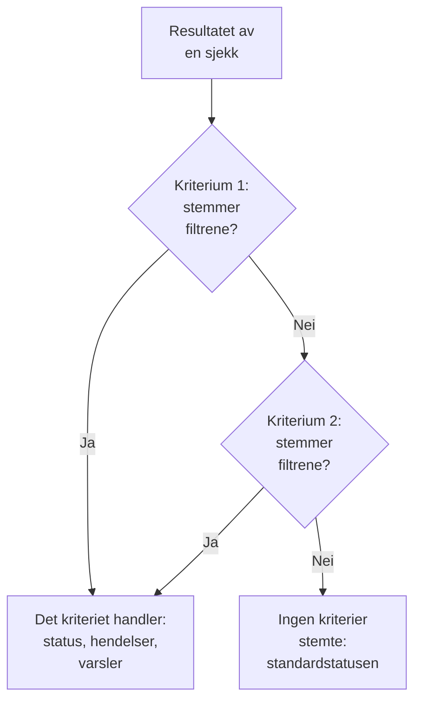
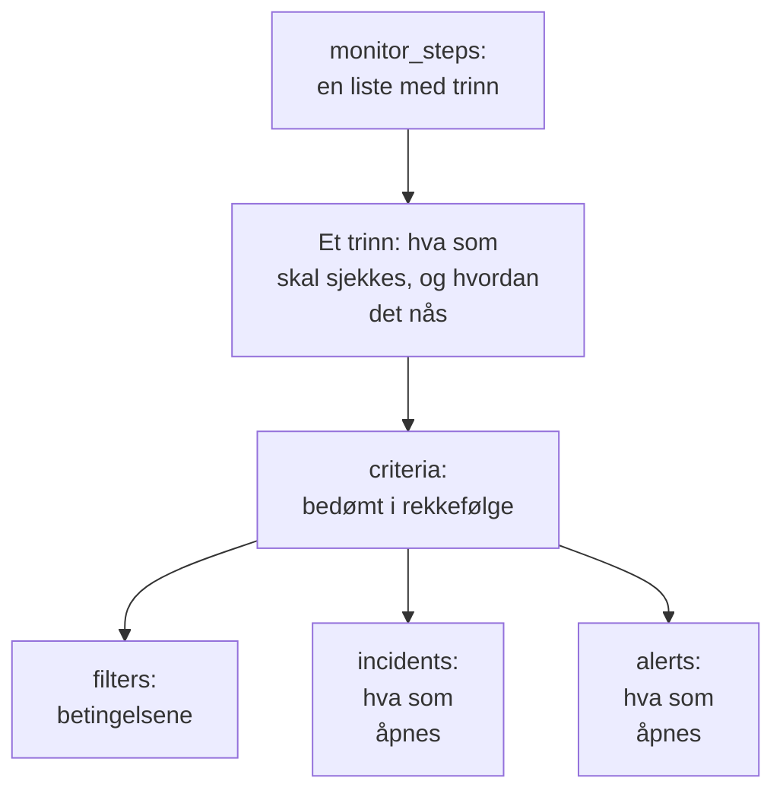

# Monitortrinn

`monitor_steps` er attributtet i `oneuptime_monitor` som sier hva en monitor sjekker, og hvordan hvert resultat bedømmes: adressen som skal sjekkes, forespørselen som skal sendes, og kriteriene som gjør et resultat om til en monitorstatus, en hendelse eller et varsel. Denne siden forklarer hver del av det.

:::cards
- [Slik bedømmes en sjekk](#slik-bedømmes-en-sjekk): Kriteriene i rekkefølge, og det første som stemmer.
- [Skriv trinnene](#skriv-trinnene): Formen deres, et komplett eksempel og de to reglene for verdier.
- [Filterreferanse](#filterreferanse): Hva et filter kan sjekke, og hvordan det sammenligner.
- [Vanlige feil](#vanlige-feil): Det som oftest går galt, og løsningen.
:::

## Slik bedømmes en sjekk

Hver sjekk gir et resultat: svaret fra en probe, returverdien fra et skript eller telemetrien sjekken leser. Trinnets kriterier bedømmer det så i sin rekkefølge. Det første kriteriet der filtrene stemmer, bestemmer hva som skjer: det kan endre monitorens status, åpne hendelser og åpne varsler. Kriteriene etter det blir ikke vurdert for den sjekken.



Rekkefølgen på kriteriene betyr altså noe: sett kriteriene som varsler, først, det mest alvorlige først, og det friske sist. [Attributter for et kriterium](#attributter-for-et-kriterium) forklarer hvorfor, og det ene unntaket.

## Skriv trinnene

`monitor_steps` er en liste med typede objekter som skrives rett i HCL. Det finnes ingen `jsonencode()`, ingen `{_type, value}`-innpakning, ingen camelCase-nøkkel og ingen ID å skrive: provideren gjør HCL-en din om til API-ets format, og serveren gir hvert trinn, kriterium, hendelsesmal og varselsmal sin ID. Den beholder de ID-ene ved hver apply ved å matche hvert kriterium og hver mal med den de erstatter, etter navn og ellers etter posisjon, slik at proberesultater blir hos trinnet sitt og hendelser fortsetter å peke på kriteriene som utløste dem.



Det minste nyttige trinnet sjekker én adresse og har ett kriterium med ett filter:

```hcl
resource "oneuptime_monitor" "example" {
  name         = "Example"
  description  = "The smallest monitor_steps"
  monitor_type = "Website"

  monitor_steps = [{
    monitor_destination      = "https://example.com"
    monitor_destination_type = "URL"
    request_type             = "GET"

    criteria = [
      {
        name             = "Check if online"
        description      = "The website responds"
        filter_condition = "All"

        filters = [
          {
            check_on    = "Is Online"
            filter_type = "True"
          }
        ]
      }
    ]
  }]
}
```

To regler gjelder overalt i `monitor_steps`:

- **Utelat det du ikke bruker.** Et attributt du ikke angir, sendes ikke til API-et. Skriv aldri `[]`, `{}` eller `""` som plassholder: provideren avviser tomme strenger, lister og maps, slik at en manglende verdi alltid betyr "ikke angitt".
- **Filterverdier er strenger.** `value` i et filter er en streng, selv for et tall: `value = "200"`, ikke `value = 200`. Numeriske innstillinger som `port` er tall.

:::details Bytte fra provider 1.x, der monitor_steps var JSON
I provider 1.x var `monitor_steps` en JSON-streng skrevet med `jsonencode({ _type = "MonitorSteps", value = { ... } })`. Skriv den om som de typede attributtene på denne siden: fjern innpakningene `_type` og `value`, skriv camelCase-nøklene i snake_case (`monitorDestination` blir `monitor_destination` og `monitor_destination_type`, `filterCondition` blir `filter_condition`, `checkOn` blir `check_on`), og slett hver `id`. Serveren gir nå alle ID-ene, noe som også gjør slutt på de hardkodede tilfeldige ID-ene fra issue [#2291](https://github.com/OneUptime/oneuptime/issues/2291). State som er lagret som en JSON-streng, oppgraderes ikke av seg selv: bruk den nye konfigurasjonen.
:::

### Et komplett eksempel

Denne nettstedmonitoren sjekker det nettstedmonitoren i providerens ende-til-ende-tester sjekker (testen `35-monitor-with-steps`): offline når nettstedet ikke svarer, online når det svarer med 200.

```hcl
resource "oneuptime_monitor_status" "operational" {
  name                 = "Operational"
  description          = "Monitor is operational"
  color                = "#2ecc71"
  priority             = 1
  is_operational_state = true
}

resource "oneuptime_monitor_status" "offline" {
  name                 = "Offline"
  description          = "Monitor is offline"
  color                = "#e74c3c"
  priority             = 3
  is_operational_state = false
}

resource "oneuptime_monitor" "website" {
  name         = "Website"
  description  = "Website monitor with explicit steps"
  monitor_type = "Website"

  monitor_steps = [{
    monitor_destination      = "https://example.com" # what to check
    monitor_destination_type = "URL"                 # URL, Hostname or IP
    request_type             = "GET"                 # the HTTP method

    criteria = [ # judged in order: the first match decides
      {
        name                  = "Offline"
        description           = "Check if website is offline"
        filter_condition      = "Any"
        change_monitor_status = true
        create_incidents      = false
        create_alerts         = false
        monitor_status_id     = oneuptime_monitor_status.offline.id

        filters = [
          {
            check_on    = "Is Online"
            filter_type = "False"
          }
        ]
      },
      {
        name                  = "Online"
        description           = "Check if website is online"
        filter_condition      = "All" # All: every filter, Any: at least one
        change_monitor_status = true
        create_incidents      = false
        create_alerts         = false
        monitor_status_id     = oneuptime_monitor_status.operational.id

        filters = [
          {
            check_on    = "Is Online"
            filter_type = "True"
          },
          {
            check_on    = "Response Status Code"
            filter_type = "Equal To"
            value       = "200" # a string, even for a number
          }
        ]
      }
    ]
  }]
}
```

Et kriterium henviser til en status via ressursen dens, slik `oneuptime_monitor_status.offline.id` gjør her, eller til en status prosjektet ditt allerede har, via en [datakilde](/docs/terraform/complete-guide#les-det-som-allerede-finnes).

## Attributter for et trinn

Hvert element i `monitor_steps` er én ting som skal sjekkes:

| Attributt | Type | Brukes av | Merknader |
| --- | --- | --- | --- |
| `monitor_destination` | string | Nettsted, API, Ping, IP, Port, SSL-sertifikat, NTP | URL-en, vertsnavnet eller IP-adressen som skal sjekkes. Krever `monitor_destination_type`. |
| `monitor_destination_type` | string | de samme | `URL`, `Hostname` eller `IP`, etter hva monitortypen tar: en URL for nettsted-, API- og SSL-sertifikatmonitorer; et vertsnavn eller en IP-adresse for Ping-, IP-, Port- og NTP-monitorer. |
| `port` | number | Port, NTP | TCP-porten som skal sjekkes, som `443`. For NTP UDP-porten tidsserveren svarer på: `123` når den ikke er angitt. |
| `request_type` | string | Nettsted, API | HTTP-metoden: `GET`, `POST`, `PUT`, `DELETE`, `HEAD` eller `PATCH`. Serveren bruker `GET` når den ikke er angitt. |
| `request_headers` | map(string) | Nettsted, API | Headere som skal sendes: `{ "Accept" = "application/json" }`. |
| `request_body` | string | API | Forespørselens body, som tekst. |
| `do_not_follow_redirects` | bool | Nettsted, API | Stopp ved det første svaret i stedet for å følge omdirigeringer. |
| `allow_self_signed_certificates` | bool | Nettsted, API | Godta et selvsignert TLS-sertifikat. |
| `tls_client_certificate` | string | Nettsted, API | Et klientsertifikat for gjensidig TLS: PEM eller en henvisning `{{monitorSecrets.name}}`. |
| `tls_client_key` | string (sensitiv) | Nettsted, API | Klientsertifikatets private nøkkel. Angi den sammen med sertifikatet. |
| `tls_client_key_passphrase` | string (sensitiv) | Nettsted, API | Passordfrasen til den private nøkkelen. |
| `request_timeout_in_ms` | number | Sjekker som en probe gjør | Hvor lenge ett forsøk kan ta, i millisekunder. Proben senker alt over 60000 til 60000. |
| `retry_count` | number | Sjekker som en probe gjør | Nye forsøk etter et mislykket første forsøk: `0` sjekker én gang, `3` opptil fire ganger. Proben senker alt over 3 til 3. |
| `custom_code` | string | Custom JavaScript Code, Synthetic | Skriptet trinnet kjører. |
| `screen_size_types` | list(string) | Synthetic | `Mobile`, `Tablet` og `Desktop`. |
| `browser_types` | list(string) | Synthetic | `Chromium` og `Firefox`. |
| `retry_count_on_error` | number | Synthetic | Nye forsøk når skriptet feiler: `0` kjører det én gang. |
| `criteria` | list (påkrevd) | Alle | Hvordan hvert resultat bedømmes: se [Attributter for et kriterium](#attributter-for-et-kriterium). |

### Innstillinger for hver monitortype

Monitortyper med mer å angi enn en adresse har innstillingene sine (en loggspørring, en databasetilkobling, en klynge å overvåke) i et eget attributt, som rå JSON skrevet med `jsonencode()`: `log_monitor`, `trace_monitor`, `llm_monitor`, `metric_monitor`, `exception_monitor`, `profile_monitor`, `dns_monitor`, `domain_monitor`, `dnssec_monitor`, `sql_monitor`, `database_monitor`, `external_status_page_monitor`, `network_device_monitor`, `kubernetes_monitor`, `docker_monitor`, `docker_swarm_monitor`, `host_monitor`, `podman_monitor`, `proxmox_monitor`, `vmware_monitor`, `ceph_monitor`, `storage_array_monitor` og `iot_monitor`.

JSON-en deres er den samme som dashbordets, med nøkler i camelCase. En ID i den skrives slik API-et skriver den: `{ _type = "ObjectID", value = "..." }`. En Logs-monitor som teller feil fra én tjeneste:

```hcl
resource "oneuptime_service" "checkout" {
  name = "checkout"
}

resource "oneuptime_monitor" "checkout_errors" {
  name         = "Checkout errors"
  monitor_type = "Logs"

  monitor_steps = [{
    log_monitor = jsonencode({
      attributes          = {}
      body                = "error"
      severityTexts       = ["Error"]
      telemetryServiceIds = [{ _type = "ObjectID", value = oneuptime_service.checkout.id }]
      lastXSecondsOfLogs  = 300
    })

    criteria = [
      {
        name             = "Errors found"
        filter_condition = "Any"

        filters = [
          {
            check_on    = "Log Count"
            filter_type = "Greater Than"
            value       = "0"
          }
        ]
      }
    ]
  }]
}
```

> [!TIP]
> Den enkleste måten å få denne JSON-en riktig på: sett opp monitoren i dashbordet, og åpne deretter seksjonen **Utvikler** og **Terraform** for den. Siden skriver monitorens `monitor_steps`, med `jsonencode()` og det hele.

## Attributter for et kriterium

Hvert element i `criteria` er én regel: når filtrene stemmer, gjør det regelen sier.

Kriteriene bedømmes fra toppen, og det første som stemmer, bestemmer, så sett kriteriene som varsler, først, det mest alvorlige først (kritisk, deretter advarsel), og det friske sist. Et friskt kriterium øverst er den vanligste måten å bygge en monitor som aldri varsler på: en bred regel som `Is Online` er `True`, eller en metrikkverdi `Greater Than` `0`, stemmer med nesten hver sjekk, og kriteriene under den blir aldri vurdert. Plassert sist stemmer den bare når ingenting over den stemte, og det er det du vil.

Grupperte metrikkmonitorer er det ene unntaket. Når spørringen til en metrikkmonitor er gruppert (`groupByAttributeKeys` angitt i JSON-en for `metric_monitor`, ved `metricViewConfig.queryConfigs[].metricQueryData.groupByAttributeKeys`), åpner monitoren ett varsel eller én hendelse for hver gruppe (hver vert, container eller monteringspunkt), og hvert kriterium bedømmes, så et kritisk kriterium og et advarselskriterium kan slå til for forskjellige verter på samme sjekk. En vert som bryter begge, tilkalles likevel bare én gang, av det første kriteriet som stemmer, så det mest alvorlige skal fortsatt stå først. Se [Metrikk-overvåking](/docs/monitor/metrics-monitor).

| Attributt | Type | Hva det er |
| --- | --- | --- |
| `name` | string (påkrevd) | Navnet dashbordet viser. |
| `description` | string | Beskrivelsen dashbordet viser. |
| `filter_condition` | string (påkrevd) | `All`: hvert filter må stemme. `Any`: ett er nok. |
| `filters` | list (påkrevd) | Betingelsene, minst én: se [Filterreferanse](#filterreferanse). |
| `change_monitor_status` | bool | Om et treff endrer monitorens status. |
| `monitor_status_id` | string | ID-en til `oneuptime_monitor_status` som det skal byttes til. Angi den når `change_monitor_status` er `true`. |
| `create_incidents` | bool | Om et treff åpner hendelser. |
| `incidents` | list | Hendelsene som skal åpnes. Utelat den med mindre `create_incidents = true`. |
| `create_alerts` | bool | Om et treff åpner varsler. |
| `alerts` | list | Varslene som skal åpnes. Utelat den med mindre `create_alerts = true`. |
| `is_enabled` | bool | `true` på serveren når den ikke er angitt. Angi `false` for å beholde et kriterium uten å bedømme med det. |
| `incident_grouping` | string (JSON) | Bare monitorer for innkommende forespørsler: én hendelse for hver verdi som finnes i forespørselen, som `jsonencode({ groupByJSONPath = "..." })`. |

### Hendelser og varsler

Et element i `incidents` tar `title` og `description` (begge påkrevd), `incident_severity_id`, `auto_resolve_incident`, `remediation_notes`, `on_call_policy_ids`, `label_ids`, `owner_team_ids`, `owner_user_ids`, `show_incident_on_status_page` og `is_private`. Et element i `alerts` tar de samme, med `alert_severity_id` og `auto_resolve_alert`, og uten `show_incident_on_status_page`.

Dette kriteriet markerer monitoren som offline, åpner en hendelse som tilkaller vaktpolicyen, og løser den når nettstedet er tilbake:

```hcl
criteria = [
  {
    name                  = "Offline"
    description           = "The site is unreachable"
    filter_condition      = "Any"
    change_monitor_status = true
    monitor_status_id     = oneuptime_monitor_status.offline.id
    create_incidents      = true

    filters = [
      {
        check_on    = "Is Online"
        filter_type = "False"
      }
    ]

    incidents = [
      {
        title                 = "Website is down"
        description           = "The website did not respond to the probe."
        incident_severity_id  = oneuptime_incident_severity.critical.id
        auto_resolve_incident = true
        on_call_policy_ids    = [oneuptime_on_call_policy.primary.id]
      }
    ]
  }
]
```

## Filterreferanse

Et filter har `check_on` (hva det ser på), `filter_type` (hvordan det sammenligner) og `value` (hva det sammenlignes med, som en streng; utelat den for sann-eller-usann-sjekker som `True` og `False`).

Et filter kan også bedømme et tidsvindu i stedet for den siste sjekken: angi `evaluate_over_time = true`, vinduets lengde i `evaluate_over_time_minutes` og i `evaluate_over_time_type` hvordan vinduet leses: `Average`, `Sum`, `Maximum Value`, `Minimum Value`, `All Values` eller `Any Value`.

`All Values` betyr at hver sjekk i vinduet brøt regelen, så det stemmer først når vinduet er dekket av data: en monitor som nettopp er opprettet, venter på at vinduet fylles, i stedet for å stemme på den første sjekken. Gi den et vindu på minst det dobbelte av monitorens `monitoring_interval`; ellers inneholder vinduet én sjekk, og "alle verdier" betyr det samme som "en hvilken som helst verdi". `Any Value` stemmer med vilje på én sjekk som bryter regelen.

`evaluate_over_time_no_data_policy` sier hva filteret gjør mens vinduet ikke har nok data: `Ignore` (standard) stemmer ikke, `Trigger` behandler de manglende dataene som feilen, slik et heartbeat gjør, og `Treat As Zero` sammenligner vinduet som én enkelt null.

### Hva et filter kan sjekke

`check_on`-verdiene hver monitortype bruker mest. Dashbordets kriterieredigering tilbyr de samme og viser alle:

| Monitortype | `check_on`-verdier |
| --- | --- |
| Nettsted / API | `Is Online`, `Response Time (in ms)`, `Response Status Code`, `Response Body`, `Response Header`, `Response Header Value`, `JavaScript Expression`, `Is Request Timeout` |
| Ping / IP | `Is Online`, `Response Time (in ms)`, `Packet Loss (in %)`, `Jitter (in ms)`, `Is Request Timeout` |
| Port | `Is Online`, `Response Time (in ms)` (dashbordets totale tilkoblingstid), `Port DNS Lookup Time (in ms)`, `Port TCP Connect Time (in ms)`, `Is Request Timeout` |
| SSL-sertifikat | `Is Valid Certificate`, `Is Not A Valid Certificate`, `Is Self Signed Certificate`, `Is Expired Certificate`, `Expires In Days`, `Expires In Hours` |
| Innkommende forespørsel | `Incoming Request`, `Request Body`, `Request Header`, `Request Header Value`, `JavaScript Expression` |
| Innkommende e-post | `Email Received`, `Email Subject`, `Email From Address`, `Email To Address`, `Email Body` |
| Server | `Is Online`, `CPU Usage (in %)`, `Memory Usage (in %)`, `Disk Usage (in %)` (med `disk_path`), `Server Process Name` |
| Logger | `Log Count` |
| Spor | `Span Count` |
| Unntak | `Exception Count` |
| Profiler | `Profile Count` |
| KI / LLM | `Bad AI Answers (in %)`, `Bad AI Answers`, `AI Answers` |
| Metrikker | `Metric Value` (metrikkfiltre kan ta JSON i `metric_monitor_options`) |
| Egendefinert kode / Synthetic | `Result Value` (kan sammenligne ett felt i de returnerte dataene, angitt i JSON-en i `custom_code_monitor_options`, f.eks. `jsonencode({ resultValuePath = "status" })` — se nedenfor), `Error`, `Execution Time (in ms)` |
| DNS | `DNS Is Online`, `DNS Response Time (in ms)`, `DNS Record Value`, `DNS Record Exists` |
| Domene | `Domain Expires In Days`, `Domain Is Expired`, `Domain Registrar`, `Domain Name Server` |
| DNSSEC | `DNSSEC Chain Is Valid`, `DNSSEC DS Record Exists At Parent`, `DNSSEC Signature Expires In Days` |
| SQL-spørring | `SQL Is Online`, `SQL Query Row Count`, `SQL Query Scalar Value` |
| Databasehelse | `Database Is Online`, `Database Metric` (med JSON i `database_monitor_options` som angir serien, f.eks. `jsonencode({ metricType = "oneuptime.monitor.database.connections.used.percent" })`), `Database Collection Error` |
| Ekstern statusside | `External Status Page Is Online`, `External Status Page Active Incidents`, `External Status Page Component Status` |
| NTP | `NTP Is Online`, `NTP Is Synchronized`, `NTP Stratum`, `NTP Clock Offset (in ms)`, `NTP Response Time (in ms)`, `NTP Root Dispersion (in ms)` (`NTP Is Online` og `NTP Is Synchronized` tar ingen `value`) |
| Nettverksenhet (SNMP) | `SNMP Device Is Online` (den svarer på ping eller SNMP), `SNMP Walk Is Succeeding` (false når den svarer, men ikke kan gjennomgås), `SNMP OID Value` (SNMP-filtre kan ta JSON i `snmp_monitor_options`) |

### Hvordan et filter sammenligner

| Type | `filter_type`-verdier |
| --- | --- |
| Sann eller usann | `True`, `False` |
| Tall | `Equal To`, `Not Equal To`, `Greater Than`, `Less Than`, `Greater Than Or Equal To`, `Less Than Or Equal To` |
| Tekst | `Contains`, `Not Contains`, `Starts With`, `Ends With`, `Is Empty`, `Is Not Empty` |
| Heartbeats | `Recieved In Minutes`, `Not Recieved In Minutes` (stavet slik API-et staver dem) |
| Serverprosesser | `Is Executing`, `Is Not Executing` |
| Skript | `Evaluates To True` |
| Avvik, for metrikker, logger og spor | `Anomalously High`, `Anomalously Low`, `Anomalous` |

Et filter som stemmer når et SSL-sertifikat utløper om 14 dager eller mindre:

```hcl
filters = [
  {
    check_on    = "Expires In Days"
    filter_type = "Less Than Or Equal To"
    value       = "14"
  }
]
```

Provideren sjekker `check_on`, `filter_type` og de andre faste listene når den planlegger, så en skrivefeil feiler før noe sendes til API-et. Verdiene er API-ets navn på valgene i dashbordets kriterieredigering.

### Sammenligne ett felt i resultatet fra et skript

Skriptet i en Egendefinert kode-overvåking eller en Synthetic-monitor returnerer `data`, og et filter `Result Value` sammenligner det. Når `data` er et objekt eller en matrise, angir `custom_code_monitor_options` det ene feltet i det som skal sammenlignes: **Feltsti** i dashbordets Result Value-filter. Bruk punktum for nestede felt og `[n]` for elementer i en matrise, og utelat attributtet for å sammenligne hele verdien:

```hcl
monitor_steps = [{
  custom_code = <<-EOT
    const response = await axios.get("https://api.example.com/health");
    // For example { status: "UP", checks: [{ name: "db", latency: 12 }] }
    return { data: response.data };
  EOT

  criteria = [
    {
      name             = "Unhealthy"
      filter_condition = "Any"
      filters = [
        {
          check_on                    = "Result Value"
          filter_type                 = "Not Equal To"
          value                       = "UP"
          custom_code_monitor_options = jsonencode({ resultValuePath = "status" })
        },
        {
          check_on                    = "Result Value"
          filter_type                 = "Greater Than"
          value                       = "500"
          custom_code_monitor_options = jsonencode({ resultValuePath = "checks[0].latency" })
        }
      ]
    }
  ]
}]
```

`Greater Than` og de andre tallbetingelsene stemmer bare med et felt som er et tall, og et felt som mangler i de returnerte dataene, stemmer bare med `Is Empty`. Se [Varsling på de returnerte dataene](/docs/monitor/custom-code-monitor#varsling-på-de-returnerte-dataene) for hvordan stier og betingelser virker.

## Vanlige feil

1. **Tomme plassholdere.** `incidents = []`, `request_headers = {}` og `description = ""` avvises: utelat attributtet i stedet.
2. **Et tall der det skal være en streng.** `value` i et filter er en streng, selv for et tall: `value = "200"`. Numeriske innstillinger som `port`, `retry_count`, `request_timeout_in_ms` og `evaluate_over_time_minutes` tar tall.
3. **Feil måltype.** `monitor_destination_type = "URL"` med et bart vertsnavn, eller `Hostname` med en full URL, får sjekken til å feile. Nettsted- og API-monitorer tar URL-er; Ping-, IP- og Port-monitorer tar vertsnavn eller IP-adresser.
4. **Et statusbytte uten status.** `change_monitor_status = true` uten `monitor_status_id` stemmer og har ingen status å bytte til.
5. **ID-er.** Ingen elementer i `monitor_steps` har et attributt `id`. Hvis du bytter fra den gamle JSON-en, sletter du dem: serveren gir ID-ene.
6. **JSON skrevet for hånd.** Skriv `log_monitor` og de andre innstillingene med `jsonencode()`, slik at Terraform setter dem i anførselstegn og skriver JSON-en på samme måte hver gang. For `metric_monitor` gir du hele objektet dashbordet skriver: serveren normaliserer det.

## Når ingen kriterier stemmer

En sjekk som ikke stemmer med noe kriterium, setter monitoren i standardstatusen: prosjektets operative status, den dashbordet velger for en ny monitor. Åpne hendelser der kriteriene har valgt automatisk løsning, løses også. For å bestemme hvert utfall selv avslutter du listen med et bredt friskt kriterium, slik eksemplene på denne siden gjør.

## En monitor uten trinn

`monitor_steps` er valgfritt, men en monitor som opprettes uten, har ingen kriterier å bedømme et resultat etter: prober hopper over en monitor uten trinn, og den blir værende i statusen den startet i. Staten din holder attributtet tomt, og planen forblir ren. En manuell monitor trenger aldri trinn: du setter statusen dens selv. Alle andre typer trenger minst ett trinn for å sjekke noe.

## Overføringsformatet

Bak provideren snakker API-et fortsatt sin egen JSON, der hvert rikt objekt er pakket inn som `{_type, value}`:

```json
{
  "_type": "MonitorSteps",
  "value": {
    "monitorStepsInstanceArray": [
      {
        "_type": "MonitorStep",
        "value": {
          "monitorDestination": { "_type": "URL", "value": "https://example.com" },
          "requestType": "GET",
          "monitorCriteria": {
            "_type": "MonitorCriteria",
            "value": { "monitorCriteriaInstanceArray": [ { "_type": "MonitorCriteriaInstance", "value": { "...": "..." } } ] }
          }
        }
      }
    ]
  }
}
```

Provideren bygger dette fra HCL-en din når den skriver, og leser det tilbake til HCL, uten det serveren administrerer (ID-ene og standardverdiene den legger til). Du møter det bare når du leser API-ets svar selv, for eksempel i et skript som leser `monitorSteps`.

## Neste steg

:::cards
- [Eksempler](/docs/terraform/examples): Ping-, port-, SSL-sertifikat- og API-monitorer, klare til bruk.
- [Komplett guide](/docs/terraform/complete-guide): Datakilder, state og oppgraderinger.
- [Metrikk-overvåking](/docs/monitor/metrics-monitor): Metrikkspørringer, gruppering og avvik.
- [Feilsøking](/docs/terraform/troubleshooting): Blant annet et inkonsistent resultat etter apply på en monitor.
:::
