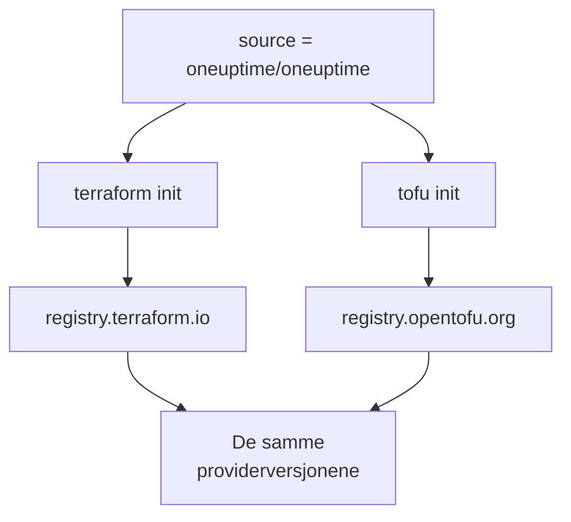

# OpenTofu

OneUptime-provideren virker med [OpenTofu](https://opentofu.org) slik den virker med Terraform. Den publiseres i [OpenTofu Registry](https://search.opentofu.org/provider/oneuptime/oneuptime/latest), og hver release består de samme ende-til-ende-testene under begge før den publiseres. Konfigurasjonen din endres ikke: kjør `tofu` overalt der denne dokumentasjonen kjører `terraform`.

:::cards
- [Bruk provideren med OpenTofu](#bruk-provideren-med-opentofu): Den samme konfigurasjonen, kjørt med `tofu`.
- [Hva som er annerledes enn Terraform](#hva-som-er-annerledes-enn-terraform): Registre, låsefiler, `.tofu`-filer og versjoner.
- [Flytt en konfigurasjon til OpenTofu](#flytt-en-konfigurasjon-til-opentofu): Bytt en eksisterende konfigurasjon i fire trinn.
- [En gjenbrukbar modul](#en-gjenbrukbar-modul): Overvåkere, en vaktpolicy og en statusside for én tjeneste.
:::

## Bruk provideren med OpenTofu

Du trenger OpenTofu 1.6 eller nyere. Deklarer provideren slik du ville gjort for Terraform:

```hcl title="main.tf"
terraform {
  required_providers {
    oneuptime = {
      source  = "oneuptime/oneuptime"
      version = "{{TERRAFORM_PROVIDER_VERSION}}"
    }
  }
}

provider "oneuptime" {
  # The API key comes from the ONEUPTIME_API_KEY environment variable.
  # On a self-hosted OneUptime, add your OneUptime's address:
  # oneuptime_url = "https://oneuptime.example.com"
}
```

Kjør den deretter med `tofu`:

```bash
export ONEUPTIME_API_KEY="<your-api-key>"
tofu init
tofu plan
tofu apply
```

`tofu init` laster ned provideren fra OpenTofu Registry. Alt i [Hurtigstart](/docs/terraform/quick-start), [Komplett guide](/docs/terraform/complete-guide), [Monitortrinn](/docs/terraform/monitor-steps), [Eksempler](/docs/terraform/examples) og [Importere ressurser](/docs/terraform/importing-resources) gjelder slik det er, og konfigurasjonen dashbordets **Terraform**-sider skriver, virker uendret.

### Hold registeret utenfor kildeadressen

`source = "oneuptime/oneuptime"` nevner ikke noe register, så hvert verktøy leser den fra sitt eget:



Utelat vertsnavnet. Med et vertsnavn bruker hvert verktøy det registeret: under `registry.terraform.io/oneuptime/oneuptime` laster også OpenTofu ned fra Terraform Registry, og Terraform avviser kopien fra OpenTofu Registry med `authentication signature from unknown issuer`.

## Hva som er annerledes enn Terraform

| Emne | Under OpenTofu |
| --- | --- |
| Registeret | `oneuptime/oneuptime` er `registry.opentofu.org/oneuptime/oneuptime`, som publiserer de samme versjonene som Terraform Registry. |
| Signaturer | `tofu init` sier at signaturvalideringen ble hoppet over: OpenTofu Registry har ingen signeringsnøkkel for denne provideren, så OpenTofu kontrollerer nedlastingen mot registerets sjekksummer. |
| `terraform`-blokken | Forblir `terraform`: den er en del av språket, og OpenTofu leser den slik den er. |
| `.tofu`-filer | OpenTofu 1.8 og nyere leser også `.tofu`-filer, og hopper over en `.tf`-fil som har en `.tofu`-fil med samme navn. Terraform leser bare `.tf`-filer. |
| `required_version` | OpenTofus versjoner starter på 1.6.0, så `>= 1.5.0`, skrevet for Terraform, tillater enhver OpenTofu. |
| Låsefilen | Nevner `registry.opentofu.org/oneuptime/oneuptime`. Et bytte av verktøy skriver om den oppføringen: commit endringen. |
| State | OpenTofu leser en state som Terraform har skrevet, slik den er. |
| Variabler | `TF_VAR_name` angir en variabel også under OpenTofu. |
| CLI-konfigurasjonsfilen | `~/.tofurc` eller `~/.terraformrc`, eller filen `TF_CLI_CONFIG_FILE` nevner. |
| En `removed`-blokk | `lifecycle`-blokken dens krever OpenTofu 1.10 eller nyere. Uten den glemmer OpenTofu ressursen og beholder posten, der Terraform ødelegger den. |
| Flytting til en ressurstype med nytt navn | En `moved`-blokk fra `oneuptime_io_t_fleet` til `oneuptime_iot_fleet`, eller mellom de andre typene med nytt navn, krever OpenTofu 1.12 eller nyere. |

## Flytt en konfigurasjon til OpenTofu

En konfigurasjon som Terraform styrer, flyttes til OpenTofu slik den er, med staten sin:

:::steps
### Installer OpenTofu

Installer OpenTofu: 1.6 er nok for provideren, og 1.12 eller nyere flytter også en ressurs til en type med nytt navn, som `oneuptime_io_t_fleet` til `oneuptime_iot_fleet`.

### Initialiser med tofu

Kjør `tofu init` i konfigurasjonens mappe. Den laster ned provideren fra OpenTofu Registry, og sier at den har endret låsefilen: providerens oppføring nevner nå OpenTofu Registry.

### Planlegg

Kjør `tofu plan`. Den leser staten Terraform etterlot, og svarer `No changes.`

### Commit låsefilen

Commit `.terraform.lock.hcl`, og kjør konfigurasjonen med `tofu` fra nå av, også i CI.
:::

## En gjenbrukbar modul

[`Examples/opentofu/`](https://github.com/OneUptime/oneuptime/tree/master/Examples/opentofu) i OneUptime-repositoriet inneholder konfigurasjoner som kan kjøres med en gang, og en modul som setter opp én tjeneste: en nettstedsovervåker for hver adresse du gir den, en etikett på alt den oppretter, en vaktpolicy med én eskaleringsregel, og en statusside som viser overvåkerne. Det er vanlig HCL, så den virker også under Terraform.

```hcl title="main.tf"
module "storefront" {
  source = "github.com/OneUptime/terraform-provider-oneuptime//modules/monitoring-and-incident-response?ref=vX.Y.Z"

  service_name          = "storefront"
  status_page_is_public = true

  monitors = {
    homepage = { url = "https://example.com" }
    checkout = { url = "https://example.com/checkout" }
    api      = { url = "https://api.example.com/health", expected_status_code = "204" }
  }
}
```

Erstatt `vX.Y.Z` med en publisert providerversjon, som den nyeste blant [providerens releaser](https://github.com/OneUptime/terraform-provider-oneuptime/releases): modulen publiseres sammen med provideren, og repositoriet dens endres ved hver release.

Modulen oppretter ikke monitorstatuser eller alvorlighetsgrader for hendelser. Den slår opp etter navn dem hvert prosjekt starter med: `Operational`, `Offline` og `Critical Incident`. Hvis prosjektet ditt har gitt dem nye navn, angir du `operational_monitor_status_name`, `offline_monitor_status_name` eller `incident_severity_name`.

Eskaleringsregelen dens varsler ingen før du sier hvem: legg til et team i den med modulens outputs:

```hcl title="main.tf"
resource "oneuptime_team" "storefront" {
  name = "Storefront"
}

resource "oneuptime_team_on_call_duty_escalation_rule" "storefront" {
  on_call_duty_policy_id                 = module.storefront.on_call_policy_id
  on_call_duty_policy_escalation_rule_id = module.storefront.escalation_rule_id
  team_id                                = oneuptime_team.storefront.id
}
```

## Neste steg

:::cards
- [Hurtigstart](/docs/terraform/quick-start): Opprett en API-nøkkel, og ta i bruk de første ressursene dine.
- [Registerbruk](/docs/terraform/registry): Hvordan versjoner nummereres, og låsefilen.
- [Selv-hostet oppsett](/docs/terraform/self-hosted): Din egen OneUptime, og et speil for frakoblede maskiner.
- [Feilsøking](/docs/terraform/troubleshooting): Vanlige feil og hvordan du retter dem.
:::
