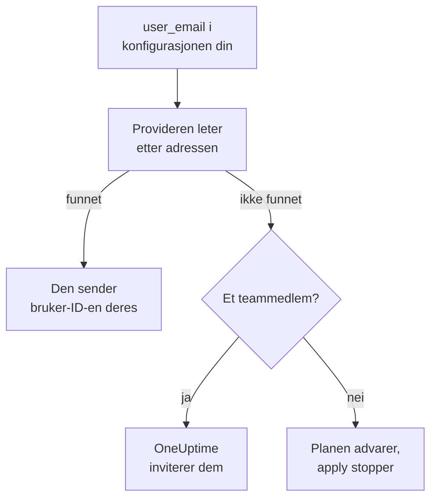

# Personer og team

Hold oversikt over hvem som er i prosjektet ditt, i Terraform-konfigurasjonen din: team og medlemmene deres, hvem som har vakt, og hvem som eier hva. Navngi hver person med e-postadressen deres: provideren finner dem og inviterer alle som er nye i prosjektet.

:::cards
- [Navngi personer med e-postadresse](#navngi-personer-med-e-postadresse): Attributtet ved siden av hver bruker-ID.
- [Ta inn nye personer](#ta-inn-nye-personer): Inviter noen, og gi dem et team, vakter og noe å eie.
- [Ta ut personer](#ta-ut-personer): Fjern noen, og se hva OneUptime fjerner sammen med dem.
- [Importer medlemmer du allerede har](#importer-medlemmer-du-allerede-har): Via teamet og adressen deres.
:::

## Slik virker det

Provideren slår opp adressen blant personene i prosjektet til API-nøkkelen: medlemmene, og personene som er invitert til det. Den sender API-et ID-en til personen den finner. Et teammedlem som navngis med en adresse ingen i prosjektet har, inviterer i stedet den adressen.



Bare API-nøkkelens eget prosjekt blir gjennomsøkt. Ingen utenfor det blir noen gang funnet, og provideren kan ikke se om en adresse har en konto andre steder.

## Før du begynner

- **En API-nøkkel som kan lese prosjektets team.** Provideren finner personer gjennom dem.
- **For å legge til noen nye, en nøkkel som kan invitere personer.** Se [Inviter personer](/docs/permissions/inviting-people).

## Navngi personer med e-postadresse

Hver ressurs som navngir en person, tar e-postadressen deres ved siden av bruker-ID-en. Oppgi én av de to:

| Bruker-ID | E-postadresse |
| --- | --- |
| `user_id` | `user_email` |
| `owner_users` | `owner_user_emails` |
| `assigned_to_user_id` | `assigned_to_user_email` |
| `override_user_id` | `override_user_email` |

Adressen blir funnet uansett store og små bokstaver, og holdes i state slik du skrev den. Bruker-ID-en fylles ut, så andre ressurser kan vise til den.

## Ta inn nye personer

Denne konfigurasjonen legger Alice, som er ny i prosjektet, til i et team, gir henne vakter fra første dag og gjør Bob, som allerede er i prosjektet, til eier av en monitor:

```hcl title="people.tf"
resource "oneuptime_team" "sre" {
  name        = "SRE"
  description = "Site reliability engineering"
}

# New to the project: OneUptime invites her.
resource "oneuptime_team_member" "alice" {
  team_id    = oneuptime_team.sre.id
  user_email = "alice@example.com"
}

resource "oneuptime_on_call_policy_schedule" "weekly" {
  name     = "SRE weekly"
  timezone = "UTC"
}

resource "oneuptime_on_call_schedule_layer" "weekly" {
  on_call_duty_policy_schedule_id = oneuptime_on_call_policy_schedule.weekly.id
  name                            = "Weekly"
  starts_at                       = "2030-01-07T09:00:00Z"
  hand_off_time                   = "2030-01-14T09:00:00Z"
}

# Named through her membership, so she is invited first.
resource "oneuptime_on_call_schedule_layer_user" "alice" {
  on_call_duty_policy_schedule_id       = oneuptime_on_call_policy_schedule.weekly.id
  on_call_duty_policy_schedule_layer_id = oneuptime_on_call_schedule_layer.weekly.id
  user_id                               = oneuptime_team_member.alice.user_id
}

resource "oneuptime_monitor" "api" {
  name         = "Public API"
  monitor_type = "Manual"
}

# In the project already: named by his address.
resource "oneuptime_monitor_user_owner" "api" {
  monitor_id = oneuptime_monitor.api.id
  user_email = "bob@example.com"
}
```

`terraform apply` inviterer Alice på e-post, slik en invitasjon fra dashbordet gjør. OneUptime oppretter en konto til henne hvis hun ikke har en. `has_accepted_invitation` forblir `false` til hun godtar, og at hun godtar, er ingen endring i planen. Den som allerede er i prosjektet, blir med i et nytt team med en gang.

For å sette noen denne konfigurasjonen inviterer på vakt, eller gjøre dem til eier, viser du til medlemskapet deres med `user_id = oneuptime_team_member.<name>.user_id`: Da inviterer Terraform dem før den navngir dem noe annet sted. En adresse ingen i prosjektet har, er en advarsel i planen og en feil i apply.

## Finn en person

Datakilden `oneuptime_user` slår opp en person via `email`, `name` eller `id`, og leser bruker-ID-en, navnet, om de har blitt med, og teamene de er i:

```hcl
data "oneuptime_user" "alice" {
  email = "alice@example.com"
}

output "alice_teams" {
  value = data.oneuptime_user.alice.team_ids
}
```

Andre datakilder finner en post via adressen til personen den nevner, ved siden av ID-en deres. Denne leser medlemskapet til Alice i SRE-teamet:

```hcl
data "oneuptime_team_member" "alice" {
  team_id    = oneuptime_team.sre.id
  user_email = "alice@example.com"
}
```

## Ta ut personer

Fjern personens medlemskap fra konfigurasjonen din, og bruk den. Ute av sitt siste team i prosjektet er de ute av prosjektet, og OneUptime tar dem ut av hver vaktplan, hver eskaleringsregel og hver stedfortreder, og fra det de eier: alt, unntatt hendelsene, varslene og vedlikeholdshendelsene som er over. Fjern blokkene som navngir dem i samme endring, ellers oppretter neste plan dem igjen for noen som ikke lenger er i prosjektet.

OneUptime-kontoen deres forblir deres: Det er bare prosjektet de forlater. Et team som må beholde et medlem, slipper ikke sitt siste medlem som har godtatt.

## Importer medlemmer du allerede har

Ingen skjerm viser ID-en til et medlemskap, så importer det via ID-en til teamet og adressen til personen:

```bash
terraform import oneuptime_team_member.alice 6b1d1c2e-4f3a-4b5c-8d6e-7f8091a2b3c4/alice@example.com
```

Adressen blir slik du skrev den, så skriv den slik konfigurasjonen din gjør. Medlemskapets egen ID importerer det også, og da leses adressen fra OneUptime, med små bokstaver.

Eiere og vaktrader importeres på samme måte, via det de hører til. Eieren av en monitor tar ID-en til monitoren og adressen til personen. En rad som nevner et team eller en vaktplan, som et eierteam eller teamet en eskaleringsregel varsler, tar begge ID-ene:

```bash
terraform import oneuptime_monitor_user_owner.api 68a1b2c3-d4e5-4f6a-8b9c-0d1e2f3a4b01/bob@example.com
terraform import oneuptime_escalation_rule_team.sre 68a1b2c3-d4e5-4f6a-8b9c-0d1e2f3a4b06/6b1d1c2e-4f3a-4b5c-8d6e-7f8091a2b3c4
```

## Når noen endrer adressen sin

En person som endrer adressen sin i OneUptime, forblir den samme personen for Terraform: Ingenting endres før du skriver den nye adressen, og da endres bare `user_email`.

## Feilsøking

:::details Planen sier at en adresse ikke er i dette prosjektet ennå
Ingen i prosjektet, eller invitert til det, har den adressen. Inviter personen først med et `oneuptime_team_member`. Hvis det medlemskapet er i samme konfigurasjon, viser du til det med `user_id = oneuptime_team_member.<name>.user_id` i stedet for adressen. Hvis de har endret adressen sin i OneUptime, bruker du den nye.
:::

:::details Apply sier at brukeren allerede er invitert til dette teamet
Personen er allerede i teamet. Importer det medlemskapet i stedet for å opprette det, som i [Importer medlemmer du allerede har](#importer-medlemmer-du-allerede-har).
:::

## Neste steg

:::cards
- [Importere ressurser](/docs/terraform/importing-resources): Ta resten av prosjektet ditt inn under Terraform.
- [Inviter personer](/docs/permissions/inviting-people): Slik virker invitasjoner i OneUptime.
- [Eksempler](/docs/terraform/examples): Ferdige konfigurasjoner for de vanlige ressursene.
:::
