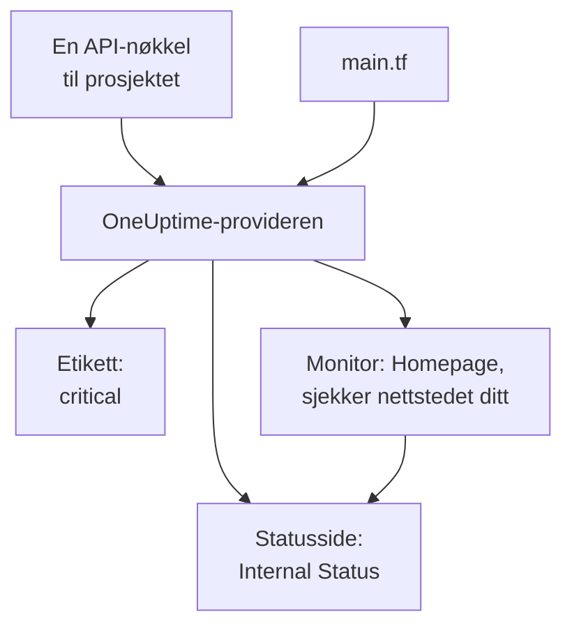

# Hurtigstart

Denne guiden tar deg fra ingenting til et OneUptime-prosjekt som administreres av Terraform, på omtrent ti minutter. Du oppretter en API-nøkkel, peker Terraform mot prosjektet ditt og bruker en etikett, en monitor som sjekker nettstedet ditt, og en privat statusside som viser den. Deretter endrer du en av dem og rydder opp.

:::cards
- [Før du begynner](#før-du-begynner): Terraform, et prosjekt og et abonnement med API-nøkler.
- [Opprett de første ressursene dine](#opprett-de-første-ressursene-dine): Fra en API-nøkkel til en brukt plan, i seks trinn.
- [Endre en ressurs](#endre-en-ressurs): Rediger konfigurasjonen, planlegg og bruk.
- [Feilsøking](#feilsøking): Feilene en første kjøring kan stoppe på.
:::



## Før du begynner

- **Terraform 1.5 eller nyere, eller OpenTofu 1.6 eller nyere.** Med OpenTofu kjører du `tofu` overalt der denne guiden kjører `terraform`.
- **Et OneUptime-prosjekt** på [oneuptime.com](https://oneuptime.com) eller på din egen OneUptime, der du kan opprette API-nøkler.
- **På OneUptime Cloud abonnementet Growth eller høyere.** Et prosjekts API-nøkler virker bare på det.

## Opprett de første ressursene dine

:::steps
### Opprett en API-nøkkel til prosjektet

Åpne **Prosjektinnstillinger → Avansert → API-nøkler** i OneUptime-dashbordet, og klikk på **Opprett API-nøkkel**. Gi den et **Navn**, som `terraform`, og velg **Prosjektadministrator** under **Tilgang**: Terraform oppretter, leser, endrer og sletter alle typer poster det administrerer, og **Prosjektadministrator** kan gjøre alt dette. For en mer begrenset nøkkel velger du **Velg tillatelser senere** og legger bare til tillatelsene du trenger, på nøkkelens side.

Nøkkelen utløper om et år. For å velge en annen dato åpner du **Flere felt** før du oppretter den, eller endrer datoen senere på nøkkelens side. Når nøkkelen er opprettet, åpnes siden dens: kopier **API-nøkkel** fra kortet **API-nøkkeldetaljer**.

### Gjør nøkkelen tilgjengelig for Terraform

Legg nøkkelen i miljøvariabelen `ONEUPTIME_API_KEY` i skallet du kjører Terraform i, slik at den aldri havner i en fil:

:::tabs
@tab Linux
```bash
export ONEUPTIME_API_KEY="<your-api-key>"
```
@tab macOS
```bash
export ONEUPTIME_API_KEY="<your-api-key>"
```
@tab Windows
```powershell
$env:ONEUPTIME_API_KEY = "<your-api-key>"
```
:::

### Pek Terraform mot OneUptime

Lag en tom mappe, og i den en fil med navnet `main.tf`:

```hcl title="main.tf"
terraform {
  required_providers {
    oneuptime = {
      source  = "oneuptime/oneuptime"
      version = "{{TERRAFORM_PROVIDER_VERSION}}"
    }
  }
}

provider "oneuptime" {
  # The API key comes from ONEUPTIME_API_KEY.
  # On a self-hosted OneUptime, add your OneUptime's address:
  # oneuptime_url = "https://oneuptime.example.com"
}
```

På en selv-hostet OneUptime leser du [Selv-hostet oppsett](/docs/terraform/self-hosted) før du velger en providerversjon.

### Beskriv ressursene dine

Legg disse blokkene til i `main.tf`. De leser to av monitorstatusene som alle prosjekter starter med, og oppretter en etikett, en monitor som sjekker `https://example.com` hvert femte minutt (sett inn ditt eget nettsted der), og en privat statusside som viser monitoren:

```hcl title="main.tf"
data "oneuptime_monitor_status" "operational" {
  name = "Operational"
}

data "oneuptime_monitor_status" "offline" {
  name = "Offline"
}

resource "oneuptime_label" "critical" {
  name        = "critical"
  description = "Resources that page on-call when down"
  color       = "#FF5733"
}

resource "oneuptime_monitor" "homepage" {
  name                = "Homepage"
  description         = "Checks that the homepage responds"
  monitor_type        = "Website"
  monitoring_interval = "*/5 * * * *"
  labels              = [oneuptime_label.critical.id]

  monitor_steps = [{
    monitor_destination      = "https://example.com"
    monitor_destination_type = "URL"
    request_type             = "GET"

    criteria = [
      {
        name                  = "Offline"
        description           = "The homepage does not respond"
        filter_condition      = "Any"
        change_monitor_status = true
        monitor_status_id     = data.oneuptime_monitor_status.offline.id

        filters = [
          {
            check_on    = "Is Online"
            filter_type = "False"
          }
        ]
      },
      {
        name                  = "Online"
        description           = "The homepage responds"
        filter_condition      = "All"
        change_monitor_status = true
        monitor_status_id     = data.oneuptime_monitor_status.operational.id

        filters = [
          {
            check_on    = "Is Online"
            filter_type = "True"
          }
        ]
      }
    ]
  }]
}

resource "oneuptime_status_page" "internal" {
  name                  = "Internal Status"
  description           = "Status of our internal services"
  page_title            = "Service Status"
  is_public_status_page = false
}

resource "oneuptime_status_page_resource" "homepage" {
  status_page_id = oneuptime_status_page.internal.id
  monitor_id     = oneuptime_monitor.homepage.id
  display_name   = "Homepage"
}

output "monitor_id" {
  value = oneuptime_monitor.homepage.id
}
```

Monitorens `monitor_steps` sier hva den sjekker, og hva hvert resultat betyr: etter hver sjekk setter det første kriteriet som stemmer, statusen dens. [Monitortrinn](/docs/terraform/monitor-steps) forklarer hver del.

### Planlegg og bruk

:::tabs
@tab Terraform
```bash
terraform init
terraform plan
terraform apply
```
@tab OpenTofu
```bash
tofu init
tofu plan
tofu apply
```
:::

`init` laster ned provideren. Planen slutter med `Plan: 4 to add, 0 to change, 0 to destroy.` Skriv `yes` for å bruke den; når den er ferdig, skriver Terraform ut ID-en til den nye monitoren.

### Sjekk dashbordet

I OneUptime-dashbordet:

- **Monitorer** viser `Homepage` med etiketten `critical`. Den første sjekken kommer inn i løpet av noen minutter.
- **Statussider** viser `Internal Status`, som viser `Homepage`.
- **Prosjektinnstillinger → Grunnleggende → Etiketter** viser `critical` i fargen du angav.

Kjør `terraform plan` igjen. Den svarer `No changes.`: OneUptime inneholder nøyaktig det konfigurasjonen sier.
:::

## Endre en ressurs

Endre konfigurasjonen, ikke dashbordet. Sett etikettens `color` til `"#2ECC71"` i `main.tf`, og planlegg og bruk deretter:

```bash
terraform plan
terraform apply
```

Planen slutter med `Plan: 0 to add, 1 to change, 0 to destroy.`: etiketten endres på stedet. En endring som noen gjør i dashbordet på en ressurs Terraform administrerer, vises i neste plan, og når du bruker den, settes det konfigurasjonen sier, tilbake.

## Rydd opp

Hvis dette var en prøvetur, sletter du det konfigurasjonen har opprettet:

```bash
terraform destroy
```

Det sletter etiketten, monitoren, statussiden og ressursen dens. De to monitorstatusene blir værende: datakildene leser dem bare.

## Feilsøking

:::details Meldingen «Missing API Key»
Provideren fant ingen API-nøkkel. Eksporter `ONEUPTIME_API_KEY` i skallet du kjører Terraform i, eller angi `api_key` i provider-blokken, og kjør kommandoen på nytt.
:::

:::details Meldingen «the OneUptime API returned status 400: Invalid API Key»
Nøkkelen er skrevet feil, utløpt eller slettet, eller den hører til en annen OneUptime enn den `oneuptime_url` peker på. Kopier nøkkelen på nytt fra siden dens, eller opprett en ny.
:::

:::details Meldingen «the OneUptime API returned status 402: API keys need the Growth plan»
På OneUptime Cloud virker et prosjekts API-nøkler bare på abonnementet Growth eller høyere. Oppgrader prosjektet under **Prosjektinnstillinger → Fakturering og fakturaer → Fakturering**, så virker den samme nøkkelen igjen.
:::

:::details Meldingen «the OneUptime API returned status 422: You do not have permissions to create Monitor»
Nøkkelen har ingen tillatelse for den typen post. Gi den **Prosjektadministrator** på nøkkelens side, eller tillatelsen meldingen nevner.
:::

:::details Meldingen «No monitor status matches {name = "Offline"}»
Prosjektets monitorstatuser har andre navn. Bruk navnene du ser under **Overvåkere → Innstillinger → Monitorstatus**, eller slå i stedet opp statusen med `is_offline_state = true`.
:::

## Neste steg

:::cards
- [Komplett guide](/docs/terraform/complete-guide): Autentisering, prosjektoppsett, datakilder, state og oppgraderinger.
- [Monitortrinn](/docs/terraform/monitor-steps): Bestem hva en monitor sjekker, og hva hvert resultat betyr.
- [Eksempler](/docs/terraform/examples): Ferdige konfigurasjoner for de vanlige ressursene.
- [Importere ressurser](/docs/terraform/importing-resources): Ta det du har laget i dashbordet, inn under Terraform.
:::
