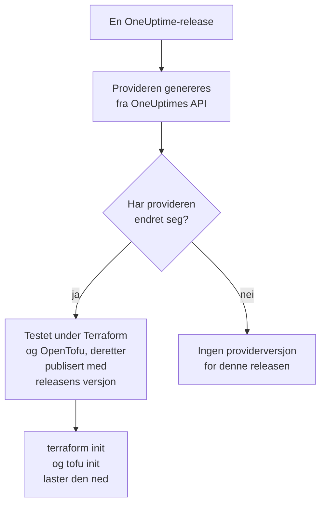

# Registerbruk

OneUptime-provideren publiseres i [Terraform Registry](https://registry.terraform.io/providers/oneuptime/oneuptime) og [OpenTofu Registry](https://search.opentofu.org/provider/oneuptime/oneuptime/latest). `terraform init` og `tofu init` laster den ned derfra: det er ingenting å installere for hånd. Denne siden dekker hva som publiseres, hvordan versjoner nummereres, og hvordan du går over til en nyere.

:::cards
- [Hva som publiseres](#hva-som-publiseres): Provideren for hver plattform, referansen og versjonene.
- [Hvordan versjoner nummereres](#hvordan-versjoner-nummereres): Versjonen til en provider er OneUptime-releasen som publiserte den.
- [Låsefilen](#låsefilen): Versjonen og sjekksummene hver maskin installerer.
- [Gå over til en nyere versjon](#gå-over-til-en-nyere-versjon): Les hva som endret seg, last den ned og planlegg.
:::

## Hva som publiseres

Hver OneUptime-release genererer provideren fra OneUptimes eget API. Når provideren har endret seg, publiserer releasen den, under releasens versjon, når den har bestått ende-til-ende-testene sine under Terraform og under OpenTofu:



| Hva | Hvor |
| --- | --- |
| Provideren, for Linux, macOS, Windows, FreeBSD, OpenBSD og Solaris | Lastes ned av `terraform init` og `tofu init`, med sjekksummer som OneUptime signerer |
| Referansen for hver ressurs og datakilde, med hvert av attributtene | Registerets dokumentasjon, gruppert etter produkt: overvåkere, statussider, hendelser, vakt og de andre |
| En guide til å bruke provideren med OpenTofu | Registerets guider |
| Hver versjon, nyeste først | Registerets versjonsliste |

Referansen forteller hva hvert attributt er. Denne dokumentasjonen viser hvordan du bruker dem sammen: begynn med [Terraform – Oversikt](/docs/terraform/index).

## Hvordan versjoner nummereres

Versjonen til en provider er versjonen til OneUptime-releasen som publiserte den: provider {{TERRAFORM_PROVIDER_MAJOR}}.0.20 kom med OneUptime {{TERRAFORM_PROVIDER_MAJOR}}.0.20. En release der provideren ikke endret seg, publiserer ingen, så versjonene har hull, og en begrensning som nevner én eksakt versjon, kan nevne en versjon som ikke finnes. Skriv et intervall i stedet:

| Du bruker | Begrensning | Terraform installerer |
| --- | --- | --- |
| OneUptime Cloud | `{{TERRAFORM_PROVIDER_VERSION}}` | Den nyeste {{TERRAFORM_PROVIDER_MAJOR}}.x-provideren |
| En selv-hostet OneUptime | Et intervall som slutter ved versjonen til installasjonen din, som `>= {{TERRAFORM_PROVIDER_MAJOR}}.0, <= {{TERRAFORM_PROVIDER_MAJOR}}.0.40` | Den nyeste provideren som ikke er nyere enn installasjonen din |

På en selv-hostet OneUptime kan en provider som er nyere enn installasjonen din, sende innstillinger installasjonen din ikke har ennå: [Selv-hostet oppsett](/docs/terraform/self-hosted#velg-providerversjonen) viser hvordan du skriver intervallet.

```hcl title="main.tf"
terraform {
  required_providers {
    oneuptime = {
      source  = "oneuptime/oneuptime"
      version = "{{TERRAFORM_PROVIDER_VERSION}}"
    }
  }
}
```

Kildeadressen nevner ikke noe register: Terraform leser den fra Terraform Registry, og OpenTofu fra OpenTofu Registry, som publiserer de samme versjonene.

## Låsefilen

`terraform init` registrerer versjonen den valgte, og sjekksummene for nedlastingene, i `.terraform.lock.hcl`. Commit den filen: hver maskin og hver CI-kjøring installerer da nøyaktig den versjonen, til du velger en annen. Sjekksummene dekker hver plattform registeret publiserer, så én låsefil fungerer like godt for Linux-, macOS- og Windows-maskiner.

```hcl title=".terraform.lock.hcl"
provider "registry.terraform.io/oneuptime/oneuptime" {
  version     = "{{TERRAFORM_PROVIDER_MAJOR}}.0.20"
  constraints = "{{TERRAFORM_PROVIDER_VERSION}}"
  hashes = [
    "h1:...",
    "zh:...",
  ]
}
```

Låsefilen nevner registeret. OpenTofu skriver `registry.opentofu.org/oneuptime/oneuptime` der Terraform skriver `registry.terraform.io/oneuptime/oneuptime`, så et bytte av verktøy endrer låsefilen: `init` erstatter oppføringen, og ber deg committe endringen.

## Gå over til en nyere versjon

:::steps
### Les hva som endret seg

[OneUptimes releaser](https://github.com/OneUptime/oneuptime/releases) sier hva hver release endret, provideren inkludert. [Providerens releaser](https://github.com/OneUptime/terraform-provider-oneuptime/releases) lenker til endringene siden den forrige.

### Last den ned

```bash
terraform init -upgrade
```

`init -upgrade` tar den nyeste versjonen begrensningen din tillater, viser den og oppdaterer `.terraform.lock.hcl`. Begrensningen `{{TERRAFORM_PROVIDER_VERSION}}` tar hver {{TERRAFORM_PROVIDER_MAJOR}}.x-release; en ny hovedversjon krever en ny begrensning.

### Planlegg før du tar i bruk

Kjør `terraform plan`, og ta bare i bruk når den er tom eller viser endringene du venter. Commit den oppdaterte låsefilen.
:::

På en selv-hostet OneUptime oppgraderer du OneUptime først, og hever deretter slutten av providerens intervall.

## Hvor koden ligger

Provideren genereres fra OneUptime-API-et i [OneUptimes hovedrepositorium](https://github.com/OneUptime/oneuptime), og hver versjon bygges fra releasen som publiserte den. Dens eget repositorium, [OneUptime/terraform-provider-oneuptime](https://github.com/OneUptime/terraform-provider-oneuptime), inneholder det generatoren skrev, så endringer gjøres i hovedrepositoriet: rapporter problemer, også de i dokumentasjonen, på [github.com/OneUptime/oneuptime/issues](https://github.com/OneUptime/oneuptime/issues).

## Neste steg

:::cards
- [Selv-hostet oppsett](/docs/terraform/self-hosted): Versjonsintervallet for din egen OneUptime, og et speil for frakoblede maskiner.
- [OpenTofu](/docs/terraform/opentofu): Den samme provideren og konfigurasjonen, med `tofu`.
- [Komplett guide](/docs/terraform/complete-guide): Autentisering, prosjektoppsett, datakilder, state og oppgraderinger.
- [Feilsøking](/docs/terraform/troubleshooting): Vanlige feil og hvordan du retter dem.
:::
