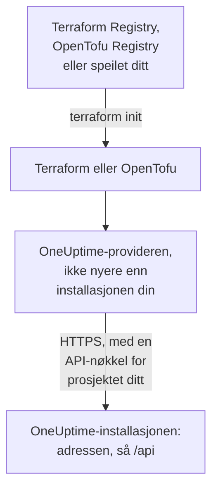

# Selv-hostet oppsett

Provideren virker med din egen OneUptime slik den virker med OneUptime Cloud: de samme ressursene, de samme attributtene og de samme API-nøklene for prosjektet. Det du selv må angi: adressen til OneUptime-installasjonen din, providerversjonen som passer til den, og, der du trenger dem, et speil for maskiner uten internettilgang og tillit til en privat sertifikatutsteder.

:::cards
- [Pek provideren mot OneUptime-installasjonen din](#pek-provideren-mot-oneuptime-installasjonen-din): Adressen, og en API-nøkkel for prosjektet ditt.
- [Velg providerversjonen](#velg-providerversjonen): Den nyeste provideren som ikke er nyere enn OneUptime-installasjonen din.
- [Uten internettilgang](#uten-internettilgang): Speil provideren inn i nettverket ditt.
- [TLS og sertifikater](#tls-og-sertifikater): En privat sertifikatutsteder, proxyer og vanlig HTTP.
:::



## Pek provideren mot OneUptime-installasjonen din

Sett `oneuptime_url` til adressen du åpner dashbordet på: skjemaet og verten, uten sti. Provideren legger til `https://` når adressen ikke har et skjema, og `/api` på slutten, så `https://oneuptime.example.com` sender hver forespørsel til `https://oneuptime.example.com/api`.

```hcl title="main.tf"
terraform {
  required_providers {
    oneuptime = {
      source  = "oneuptime/oneuptime"
      version = "{{TERRAFORM_PROVIDER_MATCHING}}"
    }
  }
}

provider "oneuptime" {
  oneuptime_url = "https://oneuptime.example.com"
  # The API key comes from the ONEUPTIME_API_KEY environment variable.
}
```

Adressen kan i stedet komme fra miljøvariabelen `ONEUPTIME_URL`, slik at én konfigurasjon kan peke mot flere installasjoner:

```bash
export ONEUPTIME_URL="https://oneuptime.example.com"
export ONEUPTIME_API_KEY="<your-api-key>"
```

Adressen er verten installasjonen din serveres på: `HOST` og `HTTP_PROTOCOL` i `config.env` med Docker Compose, og `host` og `httpProtocol` i values for Helm-chartet.

Nøkkelen er en API-nøkkel for prosjektet du styrer, opprettet i dashbordet til OneUptime-installasjonen din under **Prosjektinnstillinger → Avansert → API-nøkler**, som på OneUptime Cloud. Master-API-nøkkelen til en selv-hostet OneUptime hører ikke til noe prosjekt, så en opprettelse med den feiler med `ProjectId required`.

> [!TIP]
> OneUptime-installasjonen din skriver denne blokken for deg. Åpne en hvilken som helst ressurs eller liste i dashbordet, og deretter **Utvikler** og **Terraform** i sidemenyen: provider-blokken den viser, har adressen til installasjonen din, og et versjonsintervall som passer til den.

## Velg providerversjonen

Bruk den nyeste publiserte provideren som ikke er nyere enn OneUptime-installasjonen din. Providerversjoner følger OneUptimes: en OneUptime-release som endrer provideren, publiserer den under releasens eget versjonsnummer, og en provider som er nyere enn installasjonen din, kan sende innstillinger installasjonen din ikke har ennå.

Skriv derfor et intervall som slutter ved versjonen til installasjonen din, slik dashbordet gjør. Blokken ovenfor tar `{{TERRAFORM_PROVIDER_MATCHING}}`, intervallet for den OneUptime-installasjonen denne dokumentasjonen kommer fra: når du leser den på din egen installasjon, er det intervallet ditt. Ellers skriver du inn din egen versjon:

:::steps
### Finn versjonen til installasjonen din

Spør OneUptime-installasjonen din om den:

```bash
curl https://oneuptime.example.com/version
```

Svaret er JSON, som `{"version":"{{TERRAFORM_PROVIDER_MAJOR}}.0.40","commit":"..."}`. Som hovedadministrator kan du også åpne utgavemerket i toppfeltet i Admin-dashbordet: se [Finn den nåværende versjonen din](/docs/installation/upgrading#finn-den-nåværende-versjonen-din).

### Skriv den inn i intervallet

Intervallet starter ved hovedversjonen og slutter ved din. For en OneUptime {{TERRAFORM_PROVIDER_MAJOR}}.0.40:

```hcl title="main.tf"
terraform {
  required_providers {
    oneuptime = {
      source  = "oneuptime/oneuptime"
      version = ">= {{TERRAFORM_PROVIDER_MAJOR}}.0, <= {{TERRAFORM_PROVIDER_MAJOR}}.0.40"
    }
  }
}
```

Terraform tar den nyeste provideren i intervallet. En OneUptime-release som ikke endret provideren, publiserer ingen, og intervallet hopper over versjonene som ikke finnes.

### Last ned provideren

Kjør `terraform init`. Den viser versjonen den installerte, og registrerer den i `.terraform.lock.hcl`.
:::

Når du oppgraderer, oppgraderer du OneUptime først. Hev deretter slutten av intervallet til den nye versjonen, og kjør `terraform init -upgrade`.

## Uten internettilgang

Når maskinene som kjører Terraform, ikke kan nå registeret, kopierer du provideren inn i nettverket ditt én gang og lar Terraform peke mot kopien.

:::steps
### Speil provideren

Last ned provideren for hver plattform maskinene dine kjører, på en maskin med internettilgang, i en mappe med konfigurasjonen din. Uten `-platform` laster kommandoen bare ned provideren for sin egen plattform:

:::tabs
@tab Terraform
```bash
terraform providers mirror -platform=linux_amd64 -platform=darwin_arm64 /srv/terraform-mirror
```
@tab OpenTofu
```bash
tofu providers mirror -platform=linux_amd64 -platform=darwin_arm64 /srv/terraform-mirror
```
:::

Mappen inneholder provideren under registerets adresse, som `registry.terraform.io/oneuptime/oneuptime/`. Kopier den inn i nettverket ditt.

### La Terraform peke mot speilet

Skriv en CLI-konfigurasjonsfil som installerer OneUptime-provideren fra mappen, og alt annet som vanlig:

:::tabs
@tab Terraform
```hcl title="mirror.tfrc"
provider_installation {
  filesystem_mirror {
    path    = "/srv/terraform-mirror"
    include = ["registry.terraform.io/oneuptime/oneuptime"]
  }
  direct {
    exclude = ["registry.terraform.io/oneuptime/oneuptime"]
  }
}
```
@tab OpenTofu
```hcl title="mirror.tfrc"
provider_installation {
  filesystem_mirror {
    path    = "/srv/terraform-mirror"
    include = ["registry.opentofu.org/oneuptime/oneuptime"]
  }
  direct {
    exclude = ["registry.opentofu.org/oneuptime/oneuptime"]
  }
}
```
:::

Oppgi den i `TF_CLI_CONFIG_FILE`, som både Terraform og OpenTofu leser: `export TF_CLI_CONFIG_FILE=/etc/terraform/mirror.tfrc`.

### Initialiser

Kjør `terraform init`: den installerer provideren fra speilet. Den advarer om at låsefilen nå bare har sjekksummer for denne plattformen. For å registrere dem for alle plattformer kjører du `terraform providers lock` med de samme `-platform`-valgene på maskinen med internettilgang, og committer `.terraform.lock.hcl` sammen med konfigurasjonen din.
:::

Speil på nytt hver gang du hever versjonsintervallet.

## TLS og sertifikater

Provideren kontrollerer sertifikatet til OneUptime-installasjonen din mot tillitslageret på maskinen som kjører Terraform, og det finnes ingen innstilling for å hoppe over kontrollen. Når sertifikatet kommer fra en privat sertifikatutsteder, legger du til den utstederen i tillitslageret på hver maskin og CI-runner som kjører Terraform:

:::tabs
@tab Debian / Ubuntu
```bash
sudo cp my-ca.crt /usr/local/share/ca-certificates/
sudo update-ca-certificates
```
@tab RHEL / Fedora
```bash
sudo cp my-ca.crt /etc/pki/ca-trust/source/anchors/
sudo update-ca-trust
```
:::

På Linux, der du ikke kan endre tillitslageret, som i en CI-container, setter du `SSL_CERT_FILE` til en fil som inneholder utstederen din og de offentlige utstederne. På macOS og Windows legger du til utstederen i systemets sertifikatlager.

- **Proxyer.** Provideren sender forespørslene sine gjennom proxyen i `HTTPS_PROXY`, unntatt til vertene i `NO_PROXY`. En omvendt proxy foran OneUptime må sende hver `/api`-sti og headeren `APIKey` uendret gjennom.
- **Vanlig HTTP.** En `http://`-adresse virker, for en testinstallasjon. API-nøkkelen sendes med hver forespørsel, så bruk HTTPS til alt annet.

## Feilsøking

:::details Meldingen «x509: certificate signed by unknown authority»
Maskinen som kjører Terraform, stoler ikke på sertifikatet til OneUptime-installasjonen din: legg til sertifikatutstederen din slik [TLS og sertifikater](#tls-og-sertifikater) viser.
:::

:::details Meldingen «invalid character '<' looking for beginning of value»
En nettside svarte i stedet for API-et: `oneuptime_url` inneholder en sti, eller en proxy svarte. Sett den til bare adressen til OneUptime-installasjonen din.
:::

:::details Meldingen «no available releases match the given constraints»
Ingen publisert provider passer til versjonsbegrensningen, for eksempel en begrensning som nevner én versjon OneUptime aldri har publisert. Skriv et intervall, slik [Velg providerversjonen](#velg-providerversjonen) viser.
:::

:::details Meldingen «ProjectId required»
Nøkkelen er master-API-nøkkelen, som ikke hører til noe prosjekt. Opprett en API-nøkkel for prosjektet, under **Prosjektinnstillinger → Avansert → API-nøkler**.
:::

[Feilsøking](/docs/terraform/troubleshooting) har de andre feilene, og hva hver av dem betyr.

## Neste steg

:::cards
- [Hurtigstart](/docs/terraform/quick-start): Opprett en API-nøkkel, og ta i bruk de første ressursene dine.
- [Registerbruk](/docs/terraform/registry): Hvor provideren publiseres, og hvordan versjoner nummereres.
- [Feilsøking](/docs/terraform/troubleshooting): Vanlige feil og hvordan du retter dem.
- [Oppgradering](/docs/installation/upgrading): Oppgrader OneUptime-installasjonen din før du hever providerens intervall.
:::
