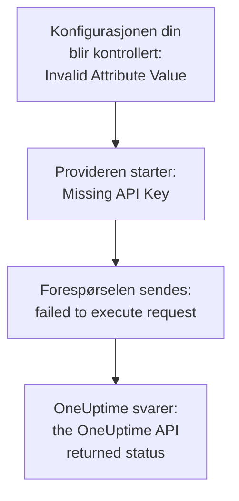

# Feilsøking

Slå opp meldingen Terraform skrev ut, eller det du så skje, i tabellen nedenfor: hver rad fører til løsningen. Avsnittene etter tabellen forklarer hver feil, gruppert etter hvor den kommer fra.

:::cards
- [Finn feilen din](#finn-feilen-din): Hver melding og hvert symptom på denne siden, med løsningen.
- [API-nøkler, tillatelser og abonnementer](#api-nøkler-tillatelser-og-abonnementer): Når OneUptime avviser providerens nøkkel.
- [Planer som ikke faller til ro](#planer-som-ikke-faller-til-ro): Endringer som kommer tilbake, og ressurser som forlater state.
- [Koble til en selv-hostet OneUptime](#koble-til-en-selv-hostet-oneuptime): Adressen, sertifikater og proxyer.
:::

## Finn feilen din

| Melding eller symptom | Hva du gjør |
| --- | --- |
| `Missing API Key` | Gi provideren nøkkelen sin: se [`Missing API Key` eller `Invalid API Key`](#missing-api-key-eller-invalid-api-key) |
| `Invalid API Key` | Kopier nøkkelen på nytt, eller opprett en ny: se [`Missing API Key` eller `Invalid API Key`](#missing-api-key-eller-invalid-api-key) |
| `ProjectId required` | Bruk en API-nøkkel for prosjektet, ikke en hovednøkkel: se [`ProjectId required`](#projectid-required) |
| `You do not have permissions to create Monitor` | Gi nøkkelen tillatelsen meldingen nevner: se [Nøkkelen mangler en tillatelse](#nøkkelen-mangler-en-tillatelse) |
| `API keys need the Growth plan` | Flytt prosjektet tilbake til abonnementet Growth: se [Betaling kreves](#betaling-kreves) |
| `402` for én ressurs eller én innstilling | Oppgrader abonnementet, eller la innstillingen stå på standardverdien: se [Betaling kreves](#betaling-kreves) |
| `This project has been blocked` | Be en hovedadministrator om å oppheve blokkeringen av prosjektet: se [Et blokkert prosjekt](#et-blokkert-prosjekt) |
| `references records that are not in this project` | Bruk ID-en til en post i ditt eget prosjekt: se [ID-er fra et annet prosjekt](#id-er-fra-et-annet-prosjekt) |
| `Not Found` eller `Ambiguous Match` fra en datakilde | Rett oppslagets argumenter: se [Oppslag som finner ingen eller flere](#oppslag-som-finner-ingen-eller-flere) |
| `Cannot import non-existent remote object` | Kontroller ID-en og nøkkelens tillatelser: se [Importere ressurser](/docs/terraform/importing-resources#feilsøking) |
| `Provider produced inconsistent result after apply` | Oppgrader provideren: se [Inkonsistent resultat etter apply](#inkonsistent-resultat-etter-apply) |
| En plan oppretter en ressurs du ikke har lagt til | Nøkkelen kan ikke lenger lese den, og OneUptime svarte `404`: gi nøkkelen lesetilgangen tilbake, og importer deretter ressursen med `terraform import`: se [En ressurs forlater state, og neste apply oppretter den på nytt](#en-ressurs-forlater-state-og-neste-apply-oppretter-den-på-nytt) |
| En `priority` eller `order` endres etter apply | Gi hver av dem et nummer ingen andre har: se [En prioritet eller rekkefølge som flytter seg](#en-prioritet-eller-rekkefølge-som-flytter-seg) |
| `Invalid Configuration for Read-Only Attribute` | Fjern attributtet fra konfigurasjonen: se [Skrivebeskyttede attributter](#skrivebeskyttede-attributter) |
| `has been renamed to` | Gi ressurstypen nytt navn, med en `moved`-blokk: se [En ressurstype med nytt navn](#en-ressurstype-med-nytt-navn) |
| En overvåker laget med Terraform viser aldri sjekkene sine | Oppgrader OneUptime: se [Overvåkere fra før trinn-ID-er](#overvåkere-fra-før-trinn-id-er) |
| `must contain at least 1 elements` | Utelat attributtet i stedet for å la det stå tomt: se [Tomme verdier](#tomme-verdier) |
| JSON fra dashbordet i en `.tf`-fil | Skriv det som HCL: se [JSON fra dashbordet](#json-fra-dashbordet) |
| `no available releases match the given constraints` | Bruk et versjonsintervall, ikke én eksakt versjon: se [En versjon som aldri ble publisert](#en-versjon-som-aldri-ble-publisert) |
| `x509: certificate signed by unknown authority` | Stol på sertifikatutstederen din: se [Sertifikater](#sertifikater) |
| `invalid character '<' looking for beginning of value` | La `oneuptime_url` peke på selve OneUptime-installasjonen din: se [En nettside i stedet for API-et](#en-nettside-i-stedet-for-api-et) |
| `connection refused` eller `Client.Timeout exceeded` | Kontroller adressen, nettverket og en eventuell proxy: se [Tilkoblinger som feiler](#tilkoblinger-som-feiler) |

## Slik leser du en feil

En feil nevner trinnet som feilet, og meldingen sier hvor den kommer fra:



- En feil som kommer før en eneste forespørsel, som `Invalid Attribute Value`, handler om konfigurasjonen din: provideren kontrollerer den før den snakker med OneUptime.
- `failed to execute request` betyr at forespørselen aldri fikk svar: se [Koble til en selv-hostet OneUptime](#koble-til-en-selv-hostet-oneuptime).
- `the OneUptime API returned status` er OneUptimes svar: statusen og meldingen etter den sier hva OneUptime avviste.

Provideren nevner hva den holdt på med: `Unable to create monitor` og `Unable to update monitor` for en endring, og `Unable to parse label response` når den leser en ressurs. En lesing som OneUptime avviser, rapporteres med sammendraget `Parse Error`, men meldingen etter den er OneUptimes svar, ikke et problem med tolkningen.

## API-nøkler, tillatelser og abonnementer

### `Missing API Key` eller `Invalid API Key`

`Missing API Key` stopper provideren før den sender noen forespørsel: verken `api_key` i provider-blokken eller miljøvariabelen `ONEUPTIME_API_KEY` er angitt. Eksporter variabelen i skallet du kjører Terraform i, eller send nøkkelen i en variabel merket `sensitive`.

`Invalid API Key` er OneUptimes svar på en nøkkel den ikke kjenner: en som er skrevet feil, utløpt eller slettet, eller en fra en annen OneUptime enn den `oneuptime_url` peker på. Kopier nøkkelen på nytt fra siden dens under **Prosjektinnstillinger → Avansert → API-nøkler**, eller opprett en ny.

### `ProjectId required`

Provideren trenger en API-nøkkel for prosjektet den styrer: det er derfra prosjektet kommer. Master-API-nøkkelen til en selv-hostet OneUptime hører ikke til noe prosjekt, så alle opprettelser med den feiler med `ProjectId required`. Opprett en API-nøkkel for prosjektet, som i [Opprett en API-nøkkel for prosjektet](/docs/terraform/quick-start#opprett-en-api-nøkkel-til-prosjektet), og bruk den i stedet.

### Nøkkelen mangler en tillatelse

`You do not have permissions to create Monitor` og lignende meldinger kommer med status `422`: nøkkelen får ikke gjøre det med den typen post. De nevner tillatelsene som ville gitt lov til det. Åpne nøkkelens side under **Prosjektinnstillinger → Avansert → API-nøkler** og gi den én av dem, eller **Prosjektadministrator**. En import krever bare tillatelsen til å lese.

### Betaling kreves

- **402 Payment Required på hver forespørsel** — `API keys need the Growth plan...`: på OneUptime Cloud er prosjektet under **Growth**, og et prosjekts API-nøkler - også providerens - slutter å virke under det. Hvert kall provideren gjør, blir avvist, også `terraform plan`, til prosjektet er tilbake på Growth; da virker den samme nøkkelen igjen, uten at du må endre noe i konfigurasjonen din. Oppgrader under **Prosjektinnstillinger → Fakturering og fakturaer → Fakturering**, eller styr prosjektet i dashbordet så lenge. Se [API-nøkler og SCIM under abonnementet sitt](/docs/api-reference/api-reference#api-nøkler-og-scim-under-abonnementet-sitt).
- **402 Payment Required** — du har nådd en grense i OneUptime-abonnementet ditt, eller konfigurasjonen slår på en innstilling abonnementet ditt ikke omfatter (en privat statusside, e-postrapporter, et offentlig dashbord, en IP-tillatelsesliste...), enten `terraform apply` oppretter ressursen med den eller endrer den senere. Terraform viser OneUptimes melding slik den er. Oppgrader abonnementet, eller skjær ned på konfigurasjonen.

Å sette en slik innstilling tilbake til standardverdien, som slår funksjonen av, virker på alle abonnementer, så en konfigurasjon som slår av betalte funksjoner, kan tas i bruk etter at en prøveperiode er over eller abonnementet er nedgradert.

Det samme gjelder ressursene abonnementet ditt selger, og som et prosjekt beholder etter at det er nedgradert - SSO-leverandører, SCIM-tilkoblinger, API-nøkler, vaktplaner, og regler og sammendrag for Slack og Microsoft Teams: under abonnementet (mens prosjektet fortsatt er på Growth, som providerens egen API-nøkkel trenger) kan de prosjektet allerede har, fortsatt leses (så `terraform plan` og `import` virker), slettes (så det går an å fjerne dem fra konfigurasjonen, eller kjøre `terraform destroy`) og slås av der de har et attributt `is_enabled`. Å opprette dem, endre dem eller slå dem på igjen svarer fortsatt 402.

Andre ressurser abonnementet ditt selger, som maler, egendefinerte felter og overvåkergrupper, krever fortsatt abonnementet for å bli lest, så en plan som oppdaterer dem, svarer 402; de kan likevel slettes, for eksempel med `terraform destroy -refresh=false`.

En API-nøkkels tillatelser slettes ikke én og én under Growth, siden det å slette en blokkerende tillatelse ville gitt nøkkelen mer tilgang: kjør `terraform state rm` på tillatelsesressursene, ødelegg deretter nøkkelen, og tillatelsene dens forsvinner med den.

### Et blokkert prosjekt

`This project has been blocked. Please contact your administrator.` kommer med status `403`: en hovedadministrator har blokkert prosjektet, og til blokkeringen er opphevet, handler ingen andre enn en hovedadministrator i det, heller ikke prosjektets API-nøkler.

## Poster og oppslag

### ID-er fra et annet prosjekt

Hver ID en ressurs nevner - etikettene til en overvåker, statussiden til en statussidegruppe, nettstedet til en nettverksenhet, teamene til en eskaleringsregel - må være en post i prosjektet API-nøkkelen din hører til. En ID for en post i et annet prosjekt, en ID som ikke finnes, og en ID for en post nøkkelen ikke får lese, får alle det samme svaret, som nevner feltet og ID-en:

```text
This network device references records that are not in this project: Network Site "…". Please pick values from this project and try again.
```

Det betyr som regel at en ID er kopiert fra konfigurasjonen eller staten til et annet prosjekt, eller at posten er slettet utenfor Terraform. Referer til posten via ressursen dens eller en datakilde i den samme konfigurasjonen (`oneuptime_label.critical.id`) i stedet for en bokstavelig ID, og ta i bruk på nytt. En person som er oppgitt som bruker, må være medlem av prosjektet.

### Oppslag som finner ingen eller flere

En datakilde finner nøyaktig én post, eller den stopper planen. `Not Found` sier at ingen post har den `id`-en, eller at ingen passer til argumentene du har angitt; `Ambiguous Match` sier at flere gjør det. Rett argumentene, angi flere av dem for å snevre oppslaget inn til én, eller slå opp posten via `id`. [Les det som allerede finnes](/docs/terraform/complete-guide#les-det-som-allerede-finnes) har reglene.

## Planer som ikke faller til ro

### Inkonsistent resultat etter apply

`Provider produced inconsistent result after apply` betyr at provideren returnerte andre verdier enn den hadde planlagt. Eldre providere gjorde det med verdier serveren beregner: standardverdier serveren legger til inne i `monitor_steps`, tidsstempler serveren skrev på en annen måte, innpakkede verdier som `probe_version`, og attributter serveren holder oppdatert, som når en overvåker for innkommende forespørsler sist mottok heartbeat. De leste også et desimaltall som null når API-et sendte det som tekst, så hver apply av en fargeregel for statussidestolper feilet på `uptime_percent_greater_than_or_equal_to`. Nåværende providere håndterer alt dette: tidsstempler sammenlignes som tidspunkter, lister med etiketter er mengder, tall leses tilbake slik du skrev dem, og et attributt du ikke har angitt, beholder den planlagte verdien til neste oppdatering leser serverens.

:::steps
1. Oppgrader provideren: behold `version = "{{TERRAFORM_PROVIDER_VERSION}}"` i providerkravet, og kjør `terraform init -upgrade`.
2. Ta i bruk på nytt. En ressurs som den mislykte apply-en etterlot merket som tainted, erstattes én gang, og planene er tomme etter det. For i stedet å beholde ressursen slik den er, fjerner du først merkingen via adressen: `terraform untaint oneuptime_status_page_history_chart_bar_color.operational`.
:::

Hvis en nåværende provider fortsatt feiler på denne måten, rapporter det på [github.com/OneUptime/oneuptime/issues](https://github.com/OneUptime/oneuptime/issues), med providerversjonen, ressurstypen, den minste `resource`-blokken som feiler, og hele feilen. Feilen nevner attributtet hvis verdi endret seg, og det er det mest nyttige å sende.

### En ressurs forlater state, og neste apply oppretter den på nytt

En lesing via ID svarer `404` både for en post som ikke finnes, og for en som API-nøkkelen ikke får lese: API-et sier ingenting om en post det ikke viser deg. Terraform tar en `404` ved oppdatering for en ressurs som er slettet utenfor Terraform. Den fjerner ressursen fra state, og neste `terraform apply` oppretter den på nytt, ved siden av den som fortsatt er der.

Det skjer når nøkkelen som styrer en ressurs, ikke lenger kan lese den: lesetillatelsen dens er begrenset til etiketter ressursen ikke har, eller til ressursene teamene dens eier, eller en blokkering tar ressursen bort - eller ressursens etiketter eller eiere har endret seg.

**Før du planlegger:**

- Gi nøkkelen, for hver ressurstype den styrer, en lesetillatelse som når hver ressurs den styrer: med omfanget **Alle**, eller begrenset til etiketter de ressursene har. En nøkkels tillatelser til å oppdatere og slette når bare det den får lese.
- Les planen før du tar den i bruk: en ressurs som er planlagt opprettet, og som du ikke har lagt til, er en nøkkelen ikke lenger kan lese.

**Når state allerede har mistet en ressurs:** gi nøkkelen lesetilgangen tilbake, og [importer](/docs/terraform/importing-resources) deretter ressursen i stedet for å ta i bruk, slik at Terraform tar over den som finnes, i stedet for å opprette en til. Hvis en kopi allerede er opprettet, sletter du den du ikke vil ha.

### En prioritet eller rekkefølge som flytter seg

Monitorstatuser, tilstander og alvorlighetsgrader for hendelser og varsler, og de andre listene du setter i rekkefølge i dashbordet, har hvert nummer én gang. Et nummer ingen andre har, beholdes slik det er skrevet. Et nummer en annen allerede har, overtas, og de som står i veien, flytter seg én plass ned, slik en dra-handling i dashbordet gjør. Så to av dem som er konfigurert med det samme nummeret, bytter plass ved hver apply.

Gi hver av dem sitt eget nummer med mellomrom mellom dem, som `101`, `102` og `103`, og endre rekkefølgen på dem Terraform styrer, i Terraform, ikke ved å dra dem i dashbordet.

### Skrivebeskyttede attributter

`Invalid Configuration for Read-Only Attribute` stopper planen når en konfigurasjon angir et attributt bare OneUptime skriver. Hvem som opprettet en post, og hvem som arkiverte, løste eller kvitterte for den, registreres fra forespørselen: personen som er logget inn, og ingen for en forespørsel med en API-nøkkel, og det er slik Terraform logger inn. Så `created_by_user_id`, og alle andre attributter som slutter på `_by_user_id`, kan leses fra en ressurs eller en datakilde, men ikke angis. Det samme gjelder `archived_at`: å angi `is_archived` registrerer når ressursen ble arkivert, og å ta den i bruk på nytt uendret beholder det tidspunktet. Fjern attributtet fra ressursblokken; ingenting annet ved ressursen endres.

### En ressurstype med nytt navn

`has been renamed to` advarer om at en ressurstype har fått nytt navn. Ressurstyper holder nå ord som IoT og vCenter hele: `oneuptime_iot_fleet` og `oneuptime_vcenter`, der eldre providere delte dem (`oneuptime_io_t_fleet`, `oneuptime_v_center`). De gamle navnene virker fortsatt som utgåtte aliaser. For å bytte uten å erstatte noe gir du ressursen nytt navn i konfigurasjonen din og forteller Terraform at den er flyttet:

```hcl
resource "oneuptime_iot_fleet" "factory" {
  name = "Factory floor"
}

moved {
  from = oneuptime_io_t_fleet.factory
  to   = oneuptime_iot_fleet.factory
}
```

`terraform plan` viser da flyttingen og ingen annen endring. Flytting mellom ressurstyper krever Terraform 1.8 eller nyere, eller OpenTofu 1.12 eller nyere; på en eldre versjon beholder du det gamle navnet, som fortsatt virker. Datakilder har fått nye navn på samme måte: endre navnet, og ingenting annet.

### Overvåkere fra før trinn-ID-er

ID-ene inne i en overvåkers trinn - for hvert trinn, kriterium, og hver hendelses- og varselmal - er serveren sine å gi. Eldre OneUptime-versjoner ga bare kriterier ID-er, og et nytt sett ved hver skriving, så en overvåker som ble skrevet via API-et, slik hver overvåker provideren laget ble, ble lagret med et trinn uten ID. Probene sjekket den fortsatt og statusen endret seg fortsatt, men overvåkerens side fant ikke sjekkene dens, hendelsene dens kunne ikke løse seg selv, og hver `terraform apply` som endret `monitor_steps`, rev åpne hendelser løs fra kriteriene sine.

Den nåværende OneUptime gir hver av dem en ID ved opprettelse, beholder dem ved hver apply, og fyller inn de manglende på eksisterende overvåkere når den oppgraderes. Ingenting endres i konfigurasjonen din: det er fortsatt ingen ID-er å skrive. En hendelse som den gamle oppførselen lot stå åpen, lukkes ved overvåkerens neste gjenoppretting, så lenge kriteriet som åpnet den, fortsatt finnes; en hendelse der en tidligere apply erstattet kriteriet, må løses én gang for hånd.

## Konfigurasjon som provideren avviser

### Tomme verdier

Provideren avviser en tom liste, et tomt map eller en tom tekst i `monitor_steps` og delene dens, som `monitor_steps = []`, `request_headers = {}` eller `request_body = ""`:

```text
Attribute monitor_steps list must contain at least 1 elements, got: 0
```

Utelat attributtet i stedet: et attributt som ikke er der, er ikke angitt. [Monitortrinn](/docs/terraform/monitor-steps) viser hva hver del tar.

### JSON fra dashbordet

JSON-en som dashbordet og API-et viser for en ressurs, er det API-et sender, ikke Terraform-konfigurasjon: attributtnavn er snake_case i Terraform, verdier skrives annerledes, og mange felter tilhører serveren. Limt inn i en `.tf`-fil virker den ikke.

- For å ta over ressursen [importerer du den](/docs/terraform/importing-resources): dashbordets side **Terraform** skriver konfigurasjonen for deg.
- For å skrive en ny begynner du fra [Eksempler](/docs/terraform/examples).
- For en overvåkers trinn skriver du det typede attributtet `monitor_steps` som [Monitortrinn](/docs/terraform/monitor-steps) beskriver: dropp `{_type, value}`-innpakningene, skriv camelCase-nøklene i snake_case, og utelat hver `id`.

## Versjoner og registeret

### En versjon som aldri ble publisert

`no available releases match the given constraints` betyr at ingen publisert versjon passer til versjonsbegrensningen. Ikke alle OneUptime-releaser publiserer en provider: en release der provideren ikke endret seg, publiserer ingen, så en begrensning som nevner én eksakt versjon, kan nevne en versjon som ikke finnes. Bruk et intervall i stedet:

```hcl
terraform {
  required_providers {
    oneuptime = {
      source  = "oneuptime/oneuptime"
      version = "{{TERRAFORM_PROVIDER_VERSION}}"
    }
  }
}
```

På en selv-hostet OneUptime avgrenser du intervallet til versjonen av OneUptime-installasjonen din, slik [Selv-hostet oppsett](/docs/terraform/self-hosted#velg-providerversjonen) viser. [Registerbruk](/docs/terraform/registry#hvordan-versjoner-nummereres) forklarer hvordan versjoner nummereres.

## Koble til en selv-hostet OneUptime

### Sertifikater

`x509: certificate signed by unknown authority` betyr at maskinen som kjører Terraform, ikke stoler på sertifikatet OneUptime-installasjonen din viser, som regel et fra en privat sertifikatutsteder. Provideren kontrollerer det mot tillitslageret på den maskinen. Legg til sertifikatutstederen din der, på hver maskin og CI-runner som kjører Terraform: se [TLS og sertifikater](/docs/terraform/self-hosted#tls-og-sertifikater). Det finnes ingen innstilling for å hoppe over kontrollen.

### En nettside i stedet for API-et

`invalid character '<' looking for beginning of value` betyr at en nettside svarte der provideren ventet API-et: `oneuptime_url` har en sti etter verten, som `/dashboard`, eller en proxy foran OneUptime svarte i stedet. Sett `oneuptime_url` til bare adressen til OneUptime-installasjonen din, som `https://oneuptime.example.com`: provideren legger selv til `/api`.

### Tilkoblinger som feiler

`failed to execute request` med `connection refused`, `no such host` eller `Client.Timeout exceeded` betyr at det ikke kom noe svar tilbake. Kontroller at adressen og porten er riktige og kan nås fra der Terraform kjører, og angi `HTTPS_PROXY` hvis maskinen når internett gjennom en proxy. Provideren venter opptil 60 sekunder på hvert svar. Den prøver en lesing eller en sletting opptil tre ganger når det ikke kommer noe svar, eller svaret er `429`, `502`, `503` eller `504`, men aldri en opprettelse eller en endring: når en opprettelse feiler på denne måten, ser du i dashbordet før du tar i bruk på nytt, i tilfelle den ble laget.

## Få flere detaljer

Provideren skriver advarslene sine til Terraforms logg. Kjør kommandoen med `TF_LOG_PROVIDER=WARN` for å se dem, og med `TF_LOG_PATH` for å lagre dem i en fil:

```bash
TF_LOG_PROVIDER=WARN TF_LOG_PATH=terraform.log terraform plan
```

`OneUptime rejected a column in the select; dropping it and retrying` nevner en kolonne som OneUptime ikke ville sende til providerens nøkkel, som regel fordi en tillatelse mangler. Det attributtet blir stående tomt i state, så det kan vises som en endring i hver plan.

## Står du fortsatt fast?

Opprett et issue på [github.com/OneUptime/oneuptime/issues](https://github.com/OneUptime/oneuptime/issues) med providerversjonen (`terraform version` viser den etter `init`), ressursblokken og hele feilen. Provideren genereres fra OneUptimes kode, så issues for den holdes i hovedrepositoriet.

## Neste steg

:::cards
- [Importere ressurser](/docs/terraform/importing-resources): Ta over det du har laget i dashbordet, og rett importfeil.
- [Selv-hostet oppsett](/docs/terraform/self-hosted): Adressen, versjonen og sertifikatene til din egen OneUptime.
- [Komplett guide](/docs/terraform/complete-guide): Autentisering, datakilder, state og oppgraderinger.
- [Monitortrinn](/docs/terraform/monitor-steps): Hvert attributt i sjekkene til en overvåker.
:::
