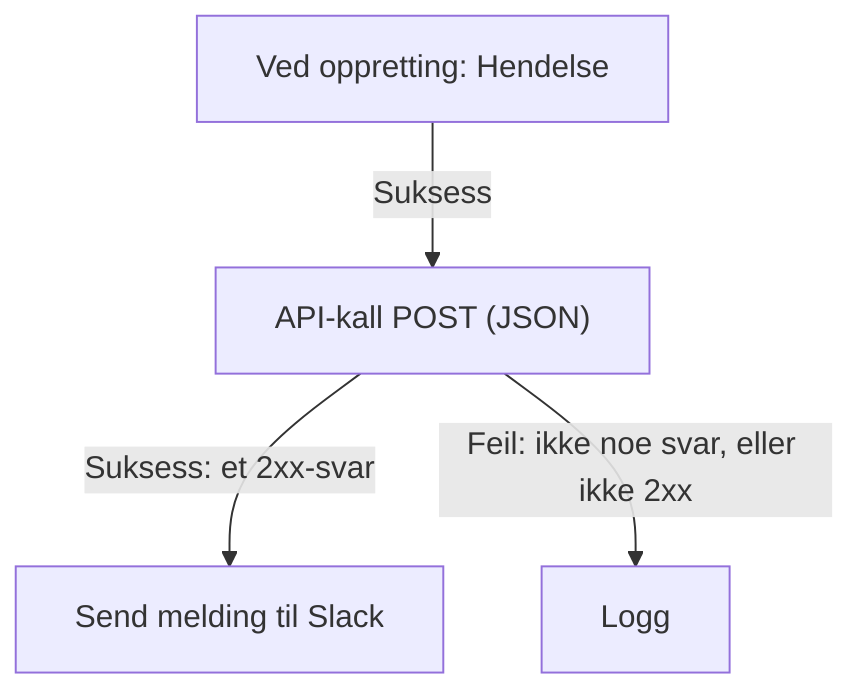

# Arbeidsflyt-komponenter

Komponenter er blokkene du legger til etter triggeren. Hver gjør én ting — sender en melding, kaller et API, sjekker en betingelse, endrer en OneUptime-post — og tar deretter én av utgangene sine til blokkene som er koblet til den. Denne siden er katalogen: hva hver blokk trenger, hva den returnerer, og når den tar hver utgang.

Du trenger sjelden å ha den åpen mens du bygger. Innstillingene til hver blokk slutter med **How to use**: hva blokken gjør, trinnene for å konfigurere den, et eksempel bygget ut fra din egen arbeidsflyt og feilene folk ofte gjør. Se [Opprette en arbeidsflyt](/docs/workflows/authoring) om å legge til og koble sammen blokker.

:::cards
- [Send en melding](#slack): Slack, Microsoft Teams, Discord, Telegram, IRC, Mattermost og e-post.
- [Kall et API](#api): Send en forespørsel til et hvilket som helst HTTP-API, og les svaret.
- [Legg til logikk](#conditions): Forgren på en verdi, omform data, vent eller logg.
- [Arbeid med OneUptime-poster](#oneuptime-datakomponenter): Finn, opprett, oppdater og slett monitorer, hendelser og mer.
:::

## Hvilken komponent bør jeg bruke?

| For å …                                                       | Bruk                                                              |
| ------------------------------------------------------------- | ----------------------------------------------------------------- |
| Poste i et chatverktøy                                        | [Slack](#slack), [Microsoft Teams](#microsoft-teams), [Discord](#discord), [Telegram](#telegram), [IRC](#irc) eller [Mattermost](#mattermost) |
| Sende en e-post gjennom din egen e-postserver                 | [Email](#email)                                                   |
| Tilkalle en person, et team eller den som har vakt | [Paging](#paging) |
| Kalle et hvilket som helst annet API eller din egen tjeneste  | [API](#api)                                                       |
| Oppsummere, klassifisere eller skrive utkast til tekst        | [Generate Text with AI](#generate-text-with-ai)                   |
| Ta den ene eller den andre veien avhengig av en verdi         | [Conditions](#conditions)                                         |
| Ta én av flere veier avhengig av en verdi                     | [Switch / Case](#switch-case)                                     |
| Fortsette bare når noen linjer JavaScript sier det            | [Check With JavaScript](#check-with-javascript)                   |
| Omforme data mellom to blokker                                | [JSON](#json) eller [Custom Code](#custom-code)                   |
| Vente før neste blokk                                         | [Sleep](#sleep)                                                   |
| Starte en annen arbeidsflyt                                   | [Execute Workflow](#execute-workflow)                             |
| Lese eller endre hendelser, monitorer og andre poster         | [OneUptime-datakomponenter](#oneuptime-datakomponenter)           |
| Åpne, bekrefte og løse hendelser eller varsler for et annet verktøys problemer | [Hendelser og varsler fra andre verktøy](#hendelser-og-varsler-fra-andre-verktøy) |
| Bekrefte eller lukke et Zabbix-problem                        | [Zabbix](#zabbix)                                                 |
| Be et menneske godkjenne en rettelse i en OpenStack-sky       | [Propose an OpenStack fix](#propose-an-openstack-fix)             |

En dedikert blokk slår en generell: Slack-blokken kjenner grensene til Slack, og en postblokk kjenner feltene til posten, så du får tydeligere feil og logger enn fra en **API**-blokk som gjør den samme jobben.

## Slik fungerer hver blokk

En blokk kjører når blokken før den tar utgangen som er koblet til den. Den leser innstillingene sine, gjør jobben sin og tar deretter én av utgangene sine. Bare blokkene som er koblet til den utgangen, kjører etterpå.



- **Innstillinger** er det du fyller ut. Innstillinger merket **(Valgfritt)** kan stå tomme. Mindre brukte innstillinger er foldet sammen under **Flere felt**.
- **Utdata** er punktene på den nederste kanten. De fleste blokker har **Suksess** og **Feil**; [Conditions](#conditions) har **Ja** og **Nei**, og [Switch / Case](#switch-case) har én for hvert av tilfellene sine, i tillegg til **Standard**.
- **Returns** er verdiene en blokk gir videre til senere blokker, som et API sin **Svartekst**. En senere blokk leser en med `{{local.components.<block ID>.returnValues.<value ID>}}`; knappen **{ }** i en innstilling setter den inn for deg. Se [Variabler](/docs/workflows/variables#komponentutdata-data-fra-tidligere-blokker).

En blokk som tar **Feil**, gir feilen videre til blokkene som er koblet til **Feil**, og kjøringen fortsetter der. Er ingenting koblet til **Feil**, mislykkes kjøringen: det den ellers holdt på med, kjører videre, deretter slutter den med statusen **Feil**, og blokkens oppføring under kjøringens **Trinn** sier hvorfor. En påkrevd innstilling som er latt stå tom, eller en innstilling som aldri kan virke, stopper derimot kjøringen med en feil.

## API

Gjør en HTTP-forespørsel til en hvilken som helst URL. Det finnes én blokk per metode: **API-kall GET (JSON)**, **API-kall POST (JSON)**, **API-kall PUT (JSON)**, **API-kall PATCH (JSON)** og **API-kall DELETE (JSON)**.

| Innstilling         | Hva den gjør                                                                                                                         |
| ------------------- | ------------------------------------------------------------------------------------------------------------------------------------ |
| **URL**             | Adressen som skal kalles, `http` eller `https`.                                                                                      |
| **Forespørselstekst**    | JSON-en som skal sendes. Vanligvis er det bare `POST`-, `PUT`- og `PATCH`-forespørsler som trenger en.                              |
| **Forespørselshoder** | Headere som skal sendes med, som en API-nøkkel. Under **Flere felt**. Verdiene deres er skjult i kjøringens logg.                    |
| **Tillat selvsignerte sertifikater** | Under **Flere felt**, av som standard. Når den er på, tar blokken ethvert sertifikat serveren viser, så et selvsignert fungerer, men den kontrollerer verken vertsnavnet eller gyldighetsdatoene, og alle på nettverksstien kan lese forespørselen, headere inkludert, og endre svaret. |
| **CA-sertifikat** | Under **Flere felt**, så lenge **Tillat selvsignerte sertifikater** er av. Sertifikatet, i PEM, til CA-en som signerte serverens sertifikat, eller serverens eget når det er selvsignert. Blokken stoler da bare på det sertifikatet, og kontrollerer fortsatt vertsnavnet og gyldighetsdatoene. |

| Utgang      | Når                                                                                            |
| ----------- | ---------------------------------------------------------------------------------------------- |
| **Suksess** | Serveren svarte med en 2xx-status.                                                             |
| **Feil**   | Forespørselen mislyktes: serveren kunne ikke nås, eller den svarte med en annen status.        |

Uansett returnerer blokken **Svarstatus**, **Svarhoder** og **Svartekst**, pluss **Feil** med årsaken når den mislyktes. Les et felt i et JSON-svar ved å legge navnet til referansen, som i `{{local.components.api-get-1.returnValues.response-body.id}}`.

En blokk leser høyst 10 MB av et svar. Et større svar leses ikke: blokken tar **Feil**, med årsaken.

Omdirigeringer følges ikke, så pek blokken mot adressen som svarer. Forespørsler sendes fra OneUptime: en URL som peker til en privat nettverksadresse, avvises med mindre en administrator av en selvhostet installasjon tillater det, og kjøringen stopper med årsaken. Se [Utgående nettverkstilgang](/docs/workflows/configuration#utgående-nettverkstilgang).

En server med et sertifikat den har signert selv, eller som din egen CA har signert, avvises til blokken stoler på den: blokken tar **Feil**, ingenting sendes, og **Feil** sier hva du må endre. Lim inn sertifikatet som signerte det, i **CA-sertifikat**: CA-ens, eller serverens eget når det er selvsignert. Blokken kontrollerer da serverens sertifikat mot det, vertsnavn og gyldighetsdatoer inkludert, så en server som bare utgir seg for å være din, fortsatt avvises. Slå på **Tillat selvsignerte sertifikater** bare når du ikke kan lime inn et. Begge gjelder bare forespørselen til denne blokken, aldri en annen blokk, en annen forespørsel fra OneUptime eller tilkoblingen til en utgående proxy. En server med et slikt sertifikat står som regel i ditt eget nettverk, og blokken når det bare hvis en administrator av en selvhostet installasjon tillater private nettverksadresser, som beskrevet over.

**API-kall GET etter ID (JSON)** leser ett element ut fra en ID som kom et annet sted fra, for eksempel issue-nøkkelen et webhook sendte. Sett `{id}` i **URL** der ID-en skal stå, som i `https://your-domain.atlassian.net/rest/api/3/issue/{id}`, og ID-en i **ID**. Blokken setter bare inn ID-en når den er en enkel ID, høyst 200 bokstaver, sifre, bindestreker og understreker, og prosentkoder den likevel: alt annet, for eksempel `x/../users`, tar **Feil** før noen forespørsel sendes, så tekst utenfra ikke kan sende forespørselen et annet sted. Ellers virker den som **API-kall GET (JSON)** og returnerer de samme verdiene.

## AI

### Generate Text with AI

Generer ett tekstsvar ut fra en prompt og valgfri JSON-kontekst. Blokken bruker prosjektets standard-LLM-leverandør, eller installasjonens globale leverandør når prosjektet ikke har noen. Leverandører konfigureres sentralt under **Prosjektinnstillinger → KI → LLM-leverandører**; nøklene og endepunktene deres er aldri innstillinger på blokken.

| Innstilling               | Hva den gjør                                                                                                                                                      |
| ------------------------- | ----------------------------------------------------------------------------------------------------------------------------------------------------------------- |
| **Systeminstruksjoner**   | Valgfri veiledning om modellens rolle, tone og begrensninger.                                                                                                    |
| **Prompt**                | Oppgaven. Den sendes nøyaktig slik du skriver den, så Markdown går fint, og den kan inneholde variabler og verdier fra tidligere blokker.                          |
| **Kontekst**               | Valgfri JSON som du bevisst sender med. Den legges til etter en tydelig markør for slutten av meldingen og behandles som upålitelige data.                         |
| **Temperatur**           | Under **Flere felt**. Variasjon fra `0` til `1`; standardverdien er `0.2`, for forutsigbar automatisering. Nåværende Claude-modeller, Opus 4.7 og nyere og alle Claude 5-modeller, velger sin egen sampling: OneUptime utelater **Temperatur** fra forespørslene deres, så den har ingen virkning på dem. |
| **Maksimalt antall utdatatokener** | Under **Flere felt**. Fra `1` til `4096`; standardverdien er `1024`.                                                                                             |

System Instructions, Prompt og den serialiserte Context er til sammen begrenset til 50 000 tegn. Et bilde som er innebygd i dem som base64, som et skjermbilde fra en syntetisk monitor i beskrivelsen av en hendelse, erstattes av en kort merknad som `[image omitted: PNG, 340 KB]` før de måles, fordi modellen leser tekst, ikke bilder. Kjøringens logg sier hva som ble utelatt. Forespørselen til leverandøren varer høyst 60 sekunder og forsøkes én gang. Høyst tre AI-forespørsler fra arbeidsflyter kan kjøre samtidig per prosjekt.

Den returnerer **Svar** (den genererte teksten), **Leverandør** og **Modell** (det som svarte), **Tokener totalt** og **Fullføringstokener** (forbruket slik leverandøren rapporterte det), **LLM-logg-ID** (kallets oppføring i AI-loggene) og **Feil**.

Koble **Suksess** til blokkene som bruker svaret, og **Feil** til en reserveløsning: feil i validering, tilgang, leverandør, budsjett, fakturering og tidsavbrudd tar alle den veien. Blokken sender ingen verktøy, så modellen kan ikke selv spørre OneUptime, kalle API-er eller endre data.

> [!WARNING]
> Modellens utdata er upålitelig tekst. Gå gjennom den før den når kunder, og la aldri fri AI-tekst alene avgjøre en destruktiv handling. Se [AI-komponenter](/docs/workflows/configuration#ai-komponenter) for hva som sendes til leverandøren, hva som logges, og hva det koster.

## Slack

Post en melding i en Slack-kanal via en innkommende webhook.

| Innstilling                    | Hva den gjør                                                                                                                                                                                                 |
| ------------------------------ | ------------------------------------------------------------------------------------------------------------------------------------------------------------------------------------------------------------ |
| **URL for innkommende webhook for Slack** | Webhooken for kanalen det skal postes i. Den må begynne med `https://hooks.slack.com/services/`. Slacks veiledning for å [opprette en](https://api.slack.com/messaging/webhooks) tar noen minutter.          |
| **Meldingstekst**               | Teksten som skal sendes. Den sendes nøyaktig slik du skriver den, så bruk Slacks egen formatering: `*bold*`, `_italic_`, `~strikethrough~` og `<https://example.com|a link>`. En tekst som er lengre enn én Slack-seksjon (3000 tegn), sendes som flere; utover ti seksjoner kuttes den og slutter med "… (truncated — see OneUptime for the full text)". |

**Suksess** utløses når Slack tok imot meldingen, og **Feil** når Slack avviste den, med Slacks årsak i **Feil**. Disse blokkene poster gjennom webhooken i innstillingene sine, ikke gjennom prosjektets Slack-tilkobling.

## Microsoft Teams

Post en melding i en Microsoft Teams-kanal. Blokken heter **Send melding til Teams**.

| Innstilling                    | Hva den gjør                                                                                                                                                                                                                                  |
| ------------------------------ | --------------------------------------------------------------------------------------------------------------------------------------------------------------------------------------------------------------------------------------------- |
| **Teams-webhook-URL for innkommende meldinger** | Webhooken for kanalen det skal postes til, en `https`-URL på `office.com`, `office365.com`, `logic.azure.com` eller `environment.api.powerplatform.com`. Microsofts veiledning viser hvordan du [oppretter en med Teams Workflows](https://support.microsoft.com/en-us/teams/apps-service/create-incoming-webhooks-with-workflows-for-microsoft-teams). |
| **Meldingstekst**               | Teksten som skal sendes. En melding som er større enn det en innkommende webhook tar imot (omtrent 12 000 tegn, målt slik den sendes), kuttes og slutter med "… (truncated — see OneUptime for the full text)".                                |

## Discord

Post en melding i en Discord-kanal via en innkommende webhook.

| Innstilling                      | Hva den gjør                                                                                                                                       |
| -------------------------------- | -------------------------------------------------------------------------------------------------------------------------------------------------- |
| **Discord-webhook-URL for innkommende meldinger** | Webhooken for kanalen, en `https`-URL på `discord.com` eller `discordapp.com`.                                                                     |
| **Meldingstekst**                 | Teksten som skal sendes. En melding på mer enn 2000 tegn, Discords grense, kuttes og slutter med "… (truncated — see OneUptime for the full text)". |

## Telegram

Send en melding til en Telegram-chat med en bot.

| Innstilling            | Hva den gjør                                                                                                                                       |
| ---------------------- | -------------------------------------------------------------------------------------------------------------------------------------------------- |
| **Telegram-bottoken** | Tokenet BotFather ga boten din, som `123456789:ABCdef…`. Et token i en hvilken som helst annen form stopper kjøringen, uten at tokenet skrives i loggen. |
| **Chat-ID**            | Chatten det skal postes i: ID-en, eller en kanals `@username`. Legg først boten til i gruppen eller kanalen. For å skrive til en person må personen ha startet en chat med boten. |
| **Meldingstekst**       | Teksten som skal sendes. En melding på mer enn 4096 tegn, Telegrams grense, kuttes og slutter med "… (truncated — see OneUptime for the full text)". |

Når Telegram avviser meldingen, utløses **Feil** med Telegrams årsak.

## IRC

Post en melding i en IRC-kanal på et hvilket som helst IRC-nettverk: Libera.Chat, OFTC eller din egen server. IRC har ingen webhooker, så blokken kobler seg selv til serveren, går inn i kanalen, sender meldingen og forlater den igjen.

| Innstilling      | Hva den gjør                                                                                                                                                                                                                                       |
| ---------------- | -------------------------------------------------------------------------------------------------------------------------------------------------------------------------------------------------------------------------------------------------- |
| **IRC-server**   | Vertsnavnet til serveren, som `irc.libera.chat`. Bare navnet: ingen `ircs://` og ingen port.                                                                                                                                                       |
| **Kanal**      | Kanalen det skal postes i, som `#ops`. Det må være en kanal: et kallenavn som skrives her, avvises i stedet for å få en privat melding.                                                                                                             |
| **Meldingstekst** | Teksten som skal sendes. Hver linje sendes som sin egen IRC-melding, og en lang linje deles slik at den passer. En melding sendes som høyst 15 IRC-linjer: en lengre kuttes, og den siste linjen sier det. IRC har ingen Markdown, så teksten sendes slik den er skrevet; IRCs egne formateringskoder, som fet skrift og farger, virker. |

Under **Flere felt**:

| Innstilling                              | Hva den gjør                                                                                                                                                                                                       |
| ---------------------------------------- | ------------------------------------------------------------------------------------------------------------------------------------------------------------------------------------------------------------------ |
| **Kallenavn**                             | Hvem meldingen er fra. Standard er `OneUptime`. Er kallenavnet opptatt, prøver blokken det med en understrek eller et tall lagt til, og deretter med et slikt tegn i stedet for de siste tegnene, for en server som ikke tar et lengre kallenavn. |
| **Port**                                 | Porten til serveren. Standard er `6697`, eller `6667` med **Slå av TLS** slått på.                                                                                                                                |
| **Slå av TLS**                          | Blokken kobler til over TLS og sjekker sertifikatet til serveren. Slå dette på bare for en server som ikke tilbyr TLS; et eventuelt passord sendes da ukryptert. For å stole på et sertifikat fra din egen sertifikatutsteder setter en selvhostet installasjon i stedet `NODE_EXTRA_CA_CERTS`. |
| **Kanalnøkkel**                          | Nøkkelen til en kanal som har en (modus `+k`).                                                                                                                                                                     |
| **Send uten å bli med**                 | Poster uten å gå inn i kanalen, slik at kanalen ikke ser blokken komme og gå. Virker bare der kanalen tar imot meldinger utenfra (ingen modus `+n`).                                                               |
| **Serverpassord**                      | Et passord som serveren eller bounceren din ber om ved tilkobling.                                                                                                                                                 |
| **SASL-brukernavn** og **SASL-passord**   | Logg inn på kontoen din på nettverk som bruker SASL, som Libera.Chat, som krever det for tilkoblinger fra visse sky- og VPN-adresser. Fyll ut begge eller ingen.                                                    |

**Suksess** utløses når serveren har tatt imot hver linje. Blokken sjekker det ved å be serveren svare på en ping etter den siste linjen: en server svarer i rekkefølge, så en eventuell avvisning av meldingen kommer først. En bouncer som ZNC svarer selv på pingen, så blokken lytter et sekund lenger etter svaret fra nettverket bak den.

**Feil** utløses når serveren ikke kan nås, avviser tilkoblingen, kallenavnet, et passord eller kanalen, eller avviser meldingen. Den gir videre årsaken, med serverens egne ord der den ga dem. En manglende **IRC-server**, **Kanal** eller **Meldingstekst**, eller en innstilling som aldri kunne virke, stopper derimot kjøringen.

Hver kjøring av blokken er sin egen tilkobling, og IRC-nettverk begrenser hvor ofte én adresse kan koble til: en rekke meldinger kan avvises med en årsak som "Reconnecting too fast", og tar **Feil** som enhver annen avvisning. For en arbeidsflyt som kan utløses mange ganger i minuttet, samler du det den har å si, i én melding, eller sender det gjennom din egen server.

Oppbevar passordene i [hemmelige globale variabler](/docs/workflows/variables#globale-variabler), og bruk variabelen i innstillingen; de er skjult i kjøringenes logger uansett. Tilkoblinger til loopback- (`localhost`, `127.0.0.1`), link-local- og skymetadata-adresser avvises. I OneUptime Cloud avvises også en server på en privat nettverksadresse, eller et navn som peker til en. Selvhostede installasjoner kan nå en IRC-server på sitt eget nettverk, med mindre `DATA_SOURCE_BLOCK_PRIVATE_ADDRESSES` er satt til `true`.

## Mattermost

Post en melding i en Mattermost-kanal via en innkommende webhook, i Mattermost Cloud eller på din egen server.

| Innstilling                         | Hva den gjør                                                                                                                                                                                                                                                                       |
| ----------------------------------- | ---------------------------------------------------------------------------------------------------------------------------------------------------------------------------------------------------------------------------------------------------------------------------------- |
| **Mattermost-webhook-URL for innkommende meldinger** | Webhooken det skal postes via, slik Mattermost viser den under Integrations, Incoming Webhooks: serverens adresse, deretter `/hooks/` og ID-en til webhooken. Mattermosts veiledning viser hvordan du [oppretter en](https://docs.mattermost.com/developers/integrate/webhooks/incoming). |
| **Meldingstekst**                    | Teksten som skal sendes. Den sendes nøyaktig slik du skriver den, og Mattermost forstår Markdown: `**bold**`, `_italic_`, lenker, tabeller og emojier som `:rotating_light:`. Et Mattermost-innlegg rommer 16 383 tegn: en lengre melding kuttes slik at den passer, og slutter med "… (truncated — see OneUptime for the full text)". |

Under **Flere felt**:

| Innstilling  | Hva den gjør                                                                                                                                                                                                  |
| ------------ | ------------------------------------------------------------------------------------------------------------------------------------------------------------------------------------------------------------- |
| **Kanal**  | Poster et annet sted enn i webhookens egen kanal: kanalens navn slik det står i URL-en, for eksempel `town-square`, eller `@` og et brukernavn for å sende en direktemelding. En webhook som er låst til kanalen sin, avviser alle andre. |
| **Brukernavn** | Navnet det skal postes under. Mattermost bruker det bare der en systemadministrator lar integrasjoner overstyre brukernavn.                                                                                   |
| **Ikon-URL** | Bildet det skal postes med, en `https`-adresse. Mattermost bruker det bare der en systemadministrator lar integrasjoner overstyre profilbilder.                                                               |

**Suksess** utløses når Mattermost tok imot meldingen. **Feil** utløses når serveren ikke kan nås eller Mattermost avviser meldingen, og gir videre Mattermosts årsak. En manglende **Mattermost-webhook-URL for innkommende meldinger** eller **Meldingstekst**, en URL som ikke tilhører en innkommende webhook, eller en innstilling som aldri kunne virke, stopper derimot kjøringen.

Oppbevar webhook-URL-en i en [hemmelig global variabel](/docs/workflows/variables#globale-variabler): alle som har den, kan poste i kanalen. Den er skjult i kjøringenes logger uansett. Meldingen sendes fra OneUptime, og en omdirigering følges ikke. En webhook på en loopback- (`localhost`, `127.0.0.1`), link-local- eller skymetadata-adresse avvises, og det samme gjelder en webhook på en privat nettverksadresse, med mindre en administrator av en selvhostet installasjon tillater det med `ALLOW_PRIVATE_NETWORK_WEBHOOKS` eller `PRIVATE_NETWORK_WEBHOOK_ALLOWLIST`. Se [Tilgang til privat nettverk](/docs/self-hosted/private-network-access).

## Email

Send en e-post gjennom en SMTP-server som du angir på blokken. Blokken heter **Send e-post**.

| Innstilling                             | Hva den gjør                                                                                          |
| --------------------------------------- | ----------------------------------------------------------------------------------------------------- |
| **E-post fra**                          | Avsenderen, for eksempel `Alerts <alerts@company.com>`.                                               |
| **Til e-post**                            | Mottakerens adresse. Skill flere adresser med komma eller semikolon.                                  |
| **Emne**                             | Emnelinjen.                                                                                           |
| **E-postinnhold**                          | Meldingen, sendt som HTML.                                                                            |
| **SMTP-vert** og **SMTP-port**          | E-postserveren det skal kobles til.                                                                   |
| **SMTP-brukernavn** og **SMTP-passord**  | Valgfrie. Fyll ut begge eller ingen.                                                                  |
| **Bruk implisitt TLS**                    | Slå på for implisitt TLS, vanligvis på port 465. La den være av for STARTTLS, vanligvis på port 587.   |

**Suksess** utløses når SMTP-serveren tok imot meldingen. **Feil** utløses når SMTP-verten avvises, serveren ikke kan nås, eller den avviser meldingen, og gir videre feilmeldingen. En manglende **Til e-post**, **E-post fra**, **SMTP-vert** eller **SMTP-port** stopper derimot kjøringen.

Blokken kobler seg direkte til serveren i innstillingene sine. Den bruker ikke prosjektets [SMTP](/docs/emails/smtp)-innstillinger eller OneUptimes egen e-postserver, og e-postene den sender, vises ikke i varslingsloggene. For å sjekke hva den gjorde, ser du på arbeidsflytens [Kjøringer](/docs/workflows/runs-and-logs).

Tilkoblinger til loopback- (`localhost`, `127.0.0.1`), link-local- og skymetadata-adresser avvises. I OneUptime Cloud avvises også en SMTP-vert på en privat nettverksadresse, eller et navn som peker til en. Selvhostede installasjoner kan nå en e-postserver på sitt eget nettverk, med mindre `DATA_SOURCE_BLOCK_PRIVATE_ADDRESSES` er satt til `true`. En avvist vert tar utgangen **Feil**, og ingenting sendes.

## Paging

Tilkall personer fra en arbeidsflyt: hver person får en oppringning, en SMS, en pushvarsling eller en e-post, slik personens egne vaktregler sier, til noen bekrefter. Det finnes en blokk for hver måte å si hvem som skal tilkalles på. Søk etter `page` i panelet **Legg til komponent**.

| Blokk                       | Hvem den tilkaller |
| --------------------------- | ------------------ |
| **Tilkall brukere**              | Personene du navngir. |
| **Tilkall et team**             | Alle medlemmer av et team. |
| **Tilkall den som har vakt** | Den som har vakt i en vaktplan når blokken kjører. |
| **Start en vaktpolicy**  | En vaktpolicy, som tilkaller gjennom eskaleringsreglene sine og gjentar seg slik den er satt opp. |

De tre første tilkaller alle de navngir samtidig, og ingen andre etterpå. Bruk **Start en vaktpolicy** for eskalering.

Vil du bare tilkalle når noe er sant, setter du [If / Else](#conditions) foran blokken og kobler utgangen som skal tilkalle, til den. Med mer enn to veier tar [Switch / Case](#switch-case) en vei for hver verdi, og hver vei kan tilkalle noen andre.

```mermaid title="Tilkall den som har vakt, men bare ved kritiske hendelser"
flowchart TB
    trigger["Ved oppretting: Hendelse"] -->|"Suksess"| check["Hvis / Ellers"]
    check -->|"Ja"| page["Tilkall den som har vakt"]
```

Når du oppretter en arbeidsflyt, har malene under **Vakt** denne klar, og en som tilkaller etter alvorlighetsgrad med **Valg / Sak**. Dialogen **Opprett en arbeidsflyt** spør hvem hver av en mals tilkallingsblokker tilkaller, så arbeidsflyten åpnes med det valgt. En tilkallingsblokk du legger til i Byggeren, sier **Click to set up** til du velger hvem den tilkaller.

| Innstilling | Hva den gjør |
| ----------- | ------------ |
| **Brukere**, **Team**, **Vaktplaner** eller **Vaktpolicyer** | Hvem som tilkalles: hver blokk har den som hører til navnet sitt. Velg etter navn, eller trykk på **{ }** på slutten av raden for å legge til en verdi fra en tidligere blokk. En verdi kan inneholde én ID eller flere og, for **Brukere**, en e-postadresse. |
| **Tilkallingen gjelder** | Hva tilkallingen gjelder: **Et nytt varsel**, **En hendelse** eller **Et varsel**. Å bekrefte tilkallingen bekrefter også den. |
| **Tittel** og **Melding** | For et nytt varsel. OneUptime oppretter et varsel av dem, og det blir værende blant varslene dine som alle andre. |
| **Hendelse-ID** eller **Varsel-ID** | For en hendelse eller et varsel som allerede finnes, vanligvis det arbeidsflyten startet på: `{{local.components.incident-on-create-1.returnValues.model._id}}`. |
| **Tilkall som** | For en hendelse eller et varsel som allerede finnes, under **Flere felt**. **Mottakere** tar seg av den. **Observatører** holdes orientert mens andre håndterer den: når de bekrefter tilkallingen sin, betyr det bare at de har sett den, og hendelsen eller varselet blir ikke bekreftet. |
| **Alvorlighetsgrad** | For et nytt varsel, under **Flere felt**. Den avgjør hvilke av hver persons vaktregler som tilkaller personen. Står den tom, er det prosjektets mest alvorlige. |

En blokk som legges til i en arbeidsflyt som starter på en hendelse eller et varsel, er allerede satt til å tilkalle om den posten, så den bare spør hvem som skal tilkalles.

**Suksess** kjører så snart minst én person er tilkalt, eller én policy har startet. **Feil** kjører når ingen ble tilkalt, og blokkens verdi **Feil** sier hvorfor, for eksempel at ingen har vakt i vaktplanen. **Sammendrag** sier i én setning hvem som ble tilkalt og hvem som ble utelatt, klar til å legge ut i en kanal, og **Tilkalte brukere** lister opp personene som ble tilkalt.

En person som er borte, tilkalles ikke: i stedet tilkalles den personens brukeroverstyring navngir som dekning. En person som en vaktpolicy eller en annen tilkalling allerede tilkaller om det samme, tilkalles ikke igjen og står fortsatt under **Tilkalte brukere**: ender den tilkallingen uten vedkommendes svar, tilkaller blokkens tilkalling vedkommende selv. En tilkalling navngir høyst 100 personer, team og vaktplaner. Se [Slik nås hver person](/docs/on-call/escalation-rules#slik-nås-hver-person).

En tilkalling uten en vaktpolicy bak seg står sammen med kjøringene til policyene som **Direkte tilkalling**: i vaktloggene for hendelsen eller varselet, i feeden og Slack- eller Microsoft Teams-kanalen dens, og i loggene til hver person som ble tilkalt. Den står åpen i 30 minutter, og deretter så lenge det fortsatt går ut tilkallinger. Har ingen bekreftet innen da, avsluttes den uten å tilkalle noen andre.

> [!WARNING]
> **Kjør arbeidsflyt** tilkaller personer på ordentlig, enten arbeidsflyten er slått på eller av, og det gjør **Run just this step** også. Oppgi deg selv mens du tester.

## Custom Code

Kjør noen linjer JavaScript når de andre blokkene ikke kan gjøre det du trenger. Blokken heter **Kjør egen JavaScript**.

| Innstilling         | Hva den gjør                                                                                                                         |
| ------------------- | ------------------------------------------------------------------------------------------------------------------------------------ |
| **JavaScript-kode** | Koden din. Det den returnerer med `return`, blir blokkens **Verdi**. Den kan bruke `await`.                                         |
| **Argumenter**       | Et JSON-objekt med verdier til koden, som leser dem som `args`. Sett variabler og verdier fra tidligere blokker her; selve koden kan ikke lese dem. |

```json title="Arguments"
{ "title": "{{local.components.incident-on-create-1.returnValues.model.title}}" }
```

```javascript title="JavaScript Code"
const words = args.title.split(" ");

return {
  shortTitle: words.slice(0, 5).join(" "),
  wordCount: words.length,
};
```

En senere blokk leser den korte tittelen som `{{local.components.javascript-1.returnValues.returnValue.shortTitle}}`.

Koden kjører i en sandkasse med `args`, `console.log` (skrevet til kjøringens logg), `axios` for HTTP-forespørsler, `crypto` og `sleep`. Den har ikke noe filsystem og ingen prosess, og forespørslene dens følger de samme adressereglene som API-blokken. Den har 5 sekunder som standard; en selvhostet installasjon endrer det med `WORKFLOW_SCRIPT_TIMEOUT_IN_MS`.

**Suksess** utløses med den returnerte **Verdi**, og **Feil** når koden kaster en feil eller går tom for tid, med meldingen i **Feil**. For tyngre skript bruker du heller en [Runbook](/docs/runbooks/index).

## Check With JavaScript

Kjør noen linjer JavaScript, og ta så **Ja** eller **Nei** etter det de returnerer: en [Custom Code](#custom-code)-blokk og en [If / Else](#conditions) etter den, i én blokk. Bruk den når én sammenligning ikke er nok til å avgjøre, for eksempel for å lese hva et annet verktøy sendte, og hoppe over det arbeidsflyten skal la være.

| Innstilling         | Hva den gjør |
| ------------------- | ------------ |
| **JavaScript-kode** | Koden din. `return true` tar **Ja**. For også å gi verdier videre returnerer du et objekt med `proceed: true`, verdiene og en `reason`. |
| **Argumenter**       | Et JSON-objekt med verdier til koden, som leser dem som `args`, som i **Kjør egen JavaScript**. |

```javascript title="JavaScript Code"
if (args.environment !== "production") {
  return { proceed: false, reason: "Not production, so nothing was sent." };
}

return { proceed: true, title: args.title.toUpperCase() };
```

Bare `true`, eller et objekt der `proceed` er `true`, tar **Ja**: alt annet tar **Nei**, også et tall eller en tekst. Blokken returnerer **Verdi**, det koden returnerte, som en senere blokk leser som `{{local.components.javascript-check-1.returnValues.returnValue.title}}`, og **Årsak**, kodens `reason` eller det den returnerte, i én setning, som kjøringens fane **Trinn** viser ved siden av utgangen som ble tatt.

Koden kjører slik **Kjør egen JavaScript** kjører den: i den samme sandkassen, med de samme `args`, `console.log` og `axios`, og med den samme tidsgrensen. Når den kaster en feil eller går tom for tid, tar blokken **Feil**.

## JSON

Konverter mellom tekst og JSON, eller kombiner to JSON-objekter.

| Blokk            | Tar                                      | Returnerer                                                                                                 |
| ---------------- | ---------------------------------------- | ---------------------------------------------------------------------------------------------------------- |
| **JSON til tekst** | **JSON**, et objekt                      | **Tekst**: objektet som en streng. Nyttig når neste blokk forventer tekst.                                  |
| **Tekst til JSON** | **Tekst**, som kan gå over flere linjer   | **JSON**: det tolkede objektet, slik at du kan lese feltene. Bruk den på JSON som kom som tekst.            |
| **Slå sammen JSON**   | **JSON 1** og **JSON 2**                 | **JSON**: ett objekt med nøklene fra begge. Der begge har en nøkkel, vinner **JSON 2**.                     |

**Tekst til JSON** tar **Feil** når teksten ikke er JSON. En manglende inndata, eller en inndata til **Slå sammen JSON** som ikke er et objekt, stopper kjøringen.

## Conditions

Forgren på en sammenligning. I panelet **Legg til komponent** heter denne blokken **Hvis / Ellers**, under **Populære**. Bruk [Switch / Case](#switch-case) for å velge mellom mer enn to veier.

Innstillingene leses som en setning: **Hvis** *verdi som skal sjekkes* *sammenligning* *verdi det sammenlignes med*, fortsett på **Ja**, ellers på **Nei**. Under innstillingene leses betingelsen tilbake med ord, slik at du kan se at den sier det du mener. På lerretet viser blokken også betingelsen sin, for eksempel *Hvis environment is equal to “production”*.

| Innstilling        | Hva den gjør                                                                                                                             |
| ------------------ | ---------------------------------------------------------------------------------------------------------------------------------------- |
| **Verdi som skal sjekkes** | Vanligvis en verdi fra en tidligere blokk. Trykk på **{ }** i feltet for å velge en, eller skriv `{{`.                                   |
| **Sammenligning**     | Hvordan det skal sammenlignes, med ord. Sammenligningene står nedenfor.                                                                  |
| **Sammenlign med**   | Det som skal sammenlignes med, skrevet eller valgt på samme måte. **er tom**, **er ikke tom**, **er sann** og **er usann** bruker det ikke. |
| **Sammenlign som**     | Foldet bort under sammenligningen: **Tekst**, **Antall** eller **Sann / Usann**. Velg **Tekst** for å sortere datoer skrevet `2026-10-01`, eller **Antall** for å gjøre `200` og `200.0` like. |

Sammenligningene:

- **er lik** og **er ikke lik**;
- for tekst: **inneholder**, **inneholder ikke**, **starter med** og **slutter med**;
- for tall: **er større enn**, **er større enn eller lik**, **er mindre enn** og **er mindre enn eller lik**;
- **er tom** og **er ikke tom**, som sjekker om verdien i det hele tatt er der;
- **er sann** og **er usann**.

Tallsammenligningene sammenligner tall, og tekstsammenligningene sammenligner tekst, så du trenger sjelden **Sammenlign som**. Slik sammenlignes verdiene:

- Som tekst teller store og små bokstaver: `Error` er ikke `error`.
- Som tall teller tekst som ikke er et tall, som `0`. Innstillingene gjør oppmerksom på en slik skrevet verdi.
- Som sann eller usann teller bare `true` som sann.
- **er tom** oppfylles av ingenting i det hele tatt, blank tekst, en tom liste eller et tomt objekt, eller en verdi den tidligere blokken ikke hadde, som et felt webhooken ikke sendte. `0` og `false` er verdier, så de er ikke tomme.

**Ja** kjører når betingelsen er oppfylt, og **Nei** når den ikke er det. Blokker som ble satt opp før innstillingene fikk disse navnene, kjører nøyaktig som før. Ett gammelt valg tilbys ikke lenger: å sammenligne en verdi som **Null** eller **Udefinert**, som ignorerte hva verdien inneholdt. En blokk som fortsatt bruker det, sier det når du åpner den; velg **er tom** for å sjekke etter en manglende verdi.

## Switch / Case

Ta én av flere veier avhengig av en verdi. I panelet **Legg til komponent** heter denne blokken **Valg / Sak**, under **Populære**.

Den sammenligner én verdi med hvert av tilfellene sine etter tur, ovenfra, og fortsetter langs det første tilfellet som passer, eller langs **Standard** når ingen passer. Bare én vei kjører: en verdi som passer med to tilfeller, tar det første av dem.

| Innstilling        | Hva den gjør |
| ------------------ | ------------ |
| **Verdi som skal sjekkes** | Verdien hvert tilfelle sammenlignes med, vanligvis fra en tidligere blokk. Trykk på **{ }** i feltet for å velge en, eller skriv `{{`. |
| **Tilfeller**          | En sammenligning og en verdi for hver vei, sjekket ovenfra. Trykk på **Legg til tilfelle** for å legge til ett til, og dra et tilfelle i håndtaket for å flytte det. En blokk kan ha maks 25 tilfeller. |

Hvert tilfelle er en utgang på lerretet, oppkalt etter verdien sin: et tilfelle som spør **er lik** `production`, er utgangen *production*, og ett som spør **er større enn** `500`, er *is greater than 500*. **Standard** er alltid den siste utgangen. Koble hver utgang til det som skal kjøre etterpå.

Et tilfelle passer nøyaktig når en [If / Else](#conditions) med samme sammenligning og verdi ville tatt **Ja**: sammenligningene er de samme, og verdiene sammenlignes på samme måte. **Sammenlign som** er foldet bort under tilfellene, med et valg for hvert tilfelle.

Når du fjerner et tilfelle som har en tilkobling, viser innstillingene hvilke blokker det førte til, og **Gjenopprett** henter tilfellet tilbake. Når du lagrer, fjernes tilkoblingen sammen med tilfellet. Byggerens kontroller gjør oppmerksom på et tilfelle som ingenting er koblet til, og på et tilfelle som aldri blir valgt fordi et tilfelle over det spør om det samme.

En kjøring som tar en utgang som ingenting er koblet til, **Standard** medregnet, slutter der uten feil. Fanen **Trinn** for kjøringen viser hvilket tilfelle som passet og hvorfor, for eksempel *Case 2 matched: the value is equal to “staging”. Case 1 did not.*

## Sleep

Sett kjøringen på pause før neste blokk, for å gi et annet system et øyeblikk til å ta igjen eller for å følge opp senere.

**Dager**, **Timer**, **Minutter** og **Sekunder** legges sammen. Den lengste ventetiden er 30 dager: en lengre kuttes til 30 dager, og kjøringens logg sier det.

Mens den venter, legges kjøringen til side med status **Venter** og plukkes opp igjen når tiden er ute, så en lang ventetid holder ingenting opp. En kjøring der arbeidsflyten i mellomtiden ble slått av eller arkivert, avbrytes når den våkner. En testkjøring, startet mens arbeidsflyten var av, avbrytes ikke fordi den er av.

## Log

Skriv en verdi til kjøringens logg. Den endrer ingenting andre steder, noe som gjør den til den enkleste måten å se hva en verdi inneholdt.

**Verdi** er det som skal skrives. Den kan gå over flere linjer og inneholde verdier fra tidligere blokker, som `{{local.components.webhook-1.returnValues.request-body}}`. Blokken tar **Ut** når den er ferdig.

## Execute Workflow

Start en annen arbeidsflyt i samme prosjekt. Arbeidsflyten din fortsetter uten å vente på at den andre blir ferdig.

| Innstilling   | Hva den gjør                                                                                                                              |
| ------------- | ----------------------------------------------------------------------------------------------------------------------------------------- |
| **Arbeidsflyt**  | Arbeidsflyten som skal startes. Den må være aktivert og, for å ta imot argumenter, ha en **Manuell**-trigger.                              |
| **Argumenter** | JSON som skal sendes med. Manual-triggeren i den andre arbeidsflyten gir hver nøkkel videre som en verdi for seg: med `{"customerId": "42"}` leser den `{{local.components.manual-1.returnValues.customerId}}`. |

**Ut** utløses så snart den andre arbeidsflyten står i kø. **Feil** utløses når det ikke går: den finnes ikke, er slått av eller arkivert, eller å starte den ville gitt en løkke.

Bruk den til å dele felles logikk: bygg en «post i hendelseskanalen»-arbeidsflyt én gang, og start den fra hver arbeidsflyt som trenger den. En kjede av arbeidsflyter som starter hverandre, kan ikke gå i ring tilbake til seg selv og er høyst 10 ledd dyp. Se [Konfigurasjon og sikkerhet](/docs/workflows/configuration#grense-for-å-kalle-andre-arbeidsflyter).

## Hendelser og varsler fra andre verktøy

Hold én hendelse, eller ett varsel, for hvert problem et annet verktøy forteller deg om, koblet sammen via verktøyets egen ID for det. **Hendelse fra et annet verktøy** og **Varsel fra et annet verktøy** er det malene for Zabbix, Huntress, Jira og Dynamics 365 er bygget på, og de virker for ethvert verktøy som kan kalle en arbeidsflyts [Webhook-trigger](/docs/workflows/triggers#webhook). I panelet **Legg til komponent** ligger de under **Fra andre verktøy**.

Hver kjøring gir blokken én hendelse: **Hva som skjedde**, og **Ekstern ID**, verktøyets ID for problemet. Blokken leter etter posten som har den ID-en, og gjør det **Hva som skjedde** sier:

| What Happened | Hva blokken gjør |
| ------------- | ---------------- |
| `open`, `problem`, `firing`, `triggered` eller `created` | Åpner en hendelse, eller oppretter et varsel, fra **Tittel**, **Beskrivelse** og **Alvorlighetsgrad**, med mindre en post allerede har ID-en. |
| `acknowledge` eller `acknowledged` | Flytter posten til din første bekreftede tilstand, med **Notat** som årsak i historikken dens. |
| `resolve`, `resolved`, `recovery`, `ok` eller `closed` | Flytter posten til din første løste tilstand, med **Notat** som årsak i historikken dens. |
| `note`, `update` eller `comment` | Legger **Notat** til posten som et privat notat. |
| Navnet på en av tilstandene dine | Flytter posten til den tilstanden. Skriv `state:` foran et navn som er ett av disse ordene, for eksempel `state: Open`. |

| Utgang | Når |
| ------ | --- |
| **Åpnet**, eller **Opprettet** på blokken for varsler | Den åpnet en ny post. Koble en tilkallingsblokk hit, så bare et nytt problem tilkaller noen. |
| **Oppdatert** | Den flyttet posten til en annen tilstand eller la til notatet. |
| **Uendret** | Det var ingenting å gjøre: ingen post har ID-en, posten er allerede i den tilstanden eller lenger, eller **Hva som skjedde** er tom. |
| **Feil** | Den kunne ikke lese eller endre posten. Er ingenting koblet hit, mislykkes kjøringen. |

En post beveger seg bare fremover, og en løst post ikke i det hele tatt, så når begge verktøyene endrer den, gjør ingen av dem om det det andre gjorde. Den lagrer ID-en i et egendefinert felt, `externalId`, med mindre **Felt for ekstern ID** nevner et annet, og bare det feltet skrives, så postens andre egendefinerte felt beholder verdiene sine. En ID som en post har, åpnes aldri igjen, heller ikke når posten er løst: bruk en ID som er ny for hvert problem, slik en Zabbix-hendelses-ID eller et Huntress-rapportnummer er. For heller å handle på en post ut fra dens egen ID, slik Jira-malene gjør med ID-en en issues etiketter bærer, setter du den i **Hendelse-ID** eller **Varsel-ID**.

**Alvorlighetsgrad** nevner en av alvorlighetsgradene dine ved navn eller ID, uavhengig av store og små bokstaver, eller ved plassen den har blant dem: `most severe`, `middle` eller `least severe`. Slik fordeles et verktøys egne nivåer over alvorlighetsgradene du selv har gitt navn. Står den tom, eller nevner den ingen av dem, er det din mest alvorlige, og kjøringens logg sier det. En ny hendelse holdes unna statussidene dine, og abonnentene deres får ikke beskjed, fordi et annet verktøys tekst er skrevet for det verktøyets brukere: slå på **Vis på statussider** for å vise den.

Under **Flere felt** er **Årsak** årsaken i postens historikk når den flytter seg, og **Notat** legges da til ved siden av som et privat notat, for et verktøy som sier noe når det bekrefter eller løser. **Egendefinerte felt** gir en ny post flere egendefinerte felt, som et JSON-objekt, **Etiketter** ID-ene til etikettene dens, atskilt med komma, og **Berørte ressurser** ressursene den handler om, som på **Opprett Hendelse (én post)**. **Notat i stedet for å løse** legger til notatet og lar teamet ditt løse posten. Blokken returnerer **Sammendrag**, det den gjorde, i én setning, og posten, så en senere blokk leser ID-en dens som `{{local.components.incident-from-another-tool-1.returnValues.record._id}}`.

## Zabbix

Bekreft eller lukk et problem i Zabbix, eller legg til en melding på det, gjennom Zabbix' API. Blokken heter **Oppdater Zabbix-problem**, og [Zabbix-malene](/docs/integrations/zabbix) sender med den det som skjer i OneUptime, tilbake til Zabbix.

| Innstilling | Hva den gjør |
| ----------- | ------------ |
| **Zabbix-URL** | Adressen du åpner Zabbix på, for eksempel `https://zabbix.example.com`. Forespørsler går til dens `api_jsonrpc.php`. |
| **API-token** | Et API-token for en Zabbix-bruker som kan bekrefte, kommentere og lukke problemer. Oppbevar det i en hemmelig variabel. |
| **Hendelses-ID** | Problemets hendelses-ID, som regel den en hendelse eller et varsel lagrer i de egendefinerte feltene sine. |
| **Hva som skal gjøres** | `acknowledge`, `close` eller `message`. Står den tom, oppdateres ikke Zabbix. |
| **Melding** | Det Zabbix lagrer på problemet, høyst 2 048 tegn: en lengre melding blir kortet ned. |
| **Zabbix 6.0** | Under **Flere felt**. Zabbix 6.0 leser tokenet fra forespørselens body, ikke fra `Authorization`-headeren: slå dette på for den, og av igjen når du oppgraderer, for Zabbix 7.2 og nyere avviser et token i body. |

For å bekrefte eller lukke leser blokken problemet først. Et problem Zabbix allerede har løst, eller allerede har bekreftet når det er alt du ber om, blir latt være som det er, og blokken tar **Uendret**, som den gjør for et problem Zabbix ikke har, eller som tokenets bruker ikke kan se. Et problem der triggeren ikke tillater at problemer lukkes manuelt, blir bekreftet i stedet, og meldingen sier at det forblir åpent til Zabbix ser at det kommer seg.

**Oppdatert** utløses når Zabbix tok imot oppdateringen, og **Feil** når Zabbix ikke kunne nås eller avviste den, med Zabbix' begrunnelse: Zabbix besvarer en avvist forespørsel med en suksessstatus, så blokken leser hva Zabbix svarte i stedet for statusen. Den returnerer **Sammendrag**, det den gjorde, i én setning.

## OpenStack

### Propose an OpenStack fix

Ber et menneske godkjenne én endring i OpenStack-skyen et varsel eller en hendelse gjelder. Blokken gjør aldri selve endringen. Rettelsen venter på varselet eller hendelsen, og i kanalene den poster til, som en OneUptime AI foreslår, uansett hvilken rettelsesmodus skyen har. En arbeidsflyt kan ikke godkjenne det den selv foreslår.

Den trenger ingen AI-modell, og den følger de samme reglene som en rettelse OneUptime AI foreslår: kommandopolicyen, agentens skrivemål og beskyttede mål, og agentens lesing av hva endringen berører. En evakuering av en vert som fortsatt er oppe, eller en som agenten ikke kan lese i sin helhet, blir ikke foreslått.

| Innstilling | Hva den gjør |
| -------------------- | ---- |
| **Varsel-ID** | Varselet rettelsen gjelder, som regel ID-en triggeren din returnerte. Fyll ut denne eller **Hendelse-ID**, så kommer skyen fra det posten er koblet til. |
| **Hendelse-ID** | Hendelsen rettelsen gjelder, som regel ID-en triggeren din returnerte. Fyll ut denne eller **Varsel-ID**. |
| **Kommando** | Endringen som skal foreslås, i den ene skrivemåten OneUptime tar imot. Se [endringene en rettelse kan gjøre](/docs/telemetry/openstack#rettelser). Den kan bruke verdier fra tidligere blokker, og leses etter at de er fylt ut. |
| **Hvorfor** | Det personen som godkjenner den, leser først. Står den tom, sier den hvilken arbeidsflyt som ba om det. |
| **ID for OpenStack-sky** | Under **Flere felt**. Bare for en post som er koblet til mer enn én sky, eller til ingen. |

Den returnerer **Forslags-ID** (rettelsen som venter på godkjenning), **Nivå** (Safe eller Riskier, slik OneUptime leser kommandoen) og **Venter allerede** (sann når den samme endringen i den skyen allerede ventet, så det ikke ble lagt til en til).

**Suksess** utløses når et menneske er spurt, uten å vente på svaret. **Feil** utløses når ingenting ble foreslått, med årsaken i **Feil**: kommandoen avvises, rettelser er ikke tillatt i den skyen ennå, eller et prosjekts arbeidsflyter har foreslått 20 rettelser den siste timen.

Malen [Propose taking a failing OpenStack compute service out of scheduling](/docs/workflows/authoring) er et sted å begynne.

## OneUptime-datakomponenter

For hver type post i OneUptime (monitorer, hendelser, varsler, statussider, vaktpolicyer og mange flere) har panelet **Legg til komponent** disse komponentene: under **OneUptime-ressurser** klikker du på posttypen (**Bla gjennom alle ressurser** har de som ikke vises), eller du søker etter navnet på typen. Hver tittel genereres ut fra posttypen, så settet for Monitor lyder:

| Komponent                | Hva den gjør                                                                   |
| ------------------------ | ------------------------------------------------------------------------------ |
| **Finn Monitor (én post)**     | Leser én post som samsvarer med spørringen.                                    |
| **Finn Monitorer (flere poster)**   | Leser en liste med poster som samsvarer med spørringen.                        |
| **Opprett Monitor (én post)**   | Legger til én post ut fra et JSON-objekt.                                      |
| **Opprett Monitorer (flere poster)** | Legger til flere poster ut fra en JSON-matrise.                                |
| **Oppdater Monitor (én post)**   | Bruker dataene som skal skrives, på én samsvarende post.                       |
| **Oppdater Monitorer (flere poster)** | Bruker dataene som skal skrives, på samsvarende poster, opptil **Grense**.      |
| **Slett Monitor (én post)**   | Sletter én samsvarende post.                                                   |
| **Slett Monitorer (flere poster)** | Sletter samsvarende poster, opptil **Grense**.                                  |

Det samme settet gir deg fire triggere — **Ved oppretting: Monitor**, **Ved oppdatering: Monitor**, **Ved oppretting eller oppdatering: Monitor** og **Ved sletting: Monitor**. Se [Triggere](/docs/workflows/triggers#oneuptime-begivenhetstriggere).

En type tilbyr bare komponentene modellen dens tillater. En skrivebeskyttet type har de to Find-komponentene og ingenting annet, så finner du ikke **Slett Monitor (én post)** i panelet, tillater ikke den typen det.

Slik leser og endrer en arbeidsflyt OneUptime-data. For eksempel kan en webhook fra CI-verktøyet ditt bruke **Opprett Hendelse (én post)** til å åpne en hendelse med detaljene om feilen.

Disse komponentene handler som Prosjektadministrator for prosjektet til arbeidsflyten: det en Prosjektadministrator ikke har lov til, eller som planen din ikke inkluderer, avvises, og kjøringens logg sier hvorfor. Se [Hva arbeidsflyttrinn kan gjøre](/docs/workflows/configuration#hva-arbeidsflyttrinn-kan-gjøre).

### Erklær en hendelse ut fra en mal

**Opprett Hendelse (én post)** kan erklære hendelsen ut fra en av [hendelsesmalene](/docs/incidents/settings#hendelsesmaler) dine: velg den under **Hendelsesmal**, trinnets første innstilling. Malen fyller ut alle feltene **JSON-objekt** utelater — tittelen, beskrivelsen, alvorlighetsgraden, starttilstanden, monitorene og andre ressurser, vaktpolicyene, etikettene, statussidene og de egendefinerte feltene — og eierne av malen blir eierne av hendelsen. Alt du angir i **JSON-objekt**, går foran malens, også tilstanden, så med en valgt mal trenger **JSON-objekt** bare det som skal være annerledes, og kan stå tomt.

Hendelsen registrerer malen den ble erklært ut fra, i `createdIncidentTemplateId`. Den kolonnen setter OneUptime selv: et trinn som sender den i **JSON-objekt**, avvises, og kjøringsloggen viser deg til **Hendelsesmal**. En mal fra et annet prosjekt, eller en som er slettet, får trinnet til å ta utgangen **Feil**, og på en plan som ikke inkluderer hendelsesmaler, avvises trinnet med planen som kreves. Se [Slik brukes en mal](/docs/incidents/settings#slik-brukes-en-mal).

### Knytte til ressursene det gjelder

**Opprett Hendelse (én post)** og **Opprett Varsel (én post)** har en innstilling **Berørte ressurser**: vertene, nettverksenhetene, klyngene, databasene eller tjenestene posten gjelder, etter navn, adresse eller ID, skilt med komma — skrevet inn eller hentet fra et tidligere trinn, som verten et varsel fra et annet verktøy navngir. Hver oppføring letes etter i alle typer ressurser posten kan holde, som hel verdi og uten hensyn til store og små bokstaver: etter navn, en nettverksenhet også etter adressen den polles på eller DNS-navnet sitt, en vert etter navnet agenten dens rapporterer eller en av IP-adressene dens, og en skyressurs etter leverandørens ID. Hver ressurs en oppføring treffer, knyttes til, ved siden av det **JSON-objekt** og malen allerede knytter til, opptil 50 fra de første 25 oppføringene.

En oppføring som ikke treffer noe, stopper ikke trinnet: posten opprettes likevel, og kjøringsloggen sier hva hver oppføring knyttet til og hvilke som ikke traff noe. Arkiverte ressurser knyttes ikke til. Monitorer slås ikke opp: navngi dem i **JSON-objekt** (`monitors` på en hendelse, `monitorId` på et varsel), fordi det å knytte en monitor til en hendelse setter overvåkingen dens på pause.

### Hvem som eier den fra starten

**Opprett Hendelse (én post)** og **Opprett Varsel (én post)** har innstillingene **Eierbrukere** og **Eierteam**: personene og teamene som eier posten fra den opprettes. Velg dem, eller ta dem fra et tidligere trinn: en brukers id eller e-postadresse, et teams id, flere skilt med komma, eller en liste. Postens eiere får høre at den er opprettet omtrent ett minutt etter opprettelsen, alle eierne den har da: de som velges her, er alltid blant dem, mens eiere som et senere trinn legger til, går glipp av det når det trinnet kjører mer enn ett minutt senere, og Prosjekteiere får beskjed i stedet.

Trinnet spør, som Prosjektadministrator for prosjektet til arbeidsflyten, om det kan legge dem til før posten lagres: eiere det ikke kan legge til, gjør at opprettelsen avvises. Den som ikke er medlem av prosjektet, eller et team som ikke er ett av prosjektets, utelates, og kjøringsloggen sier det: posten opprettes likevel. Eiere som legges til på denne måten, får ikke beskjed om at de er lagt til: beskjeden om at posten er opprettet, er den de får.

## Arbeide med poster

Hvert felt på en datakomponent bruker postens egne **kolonne**navn — de samme navnene som API-et, ikke etikettene i dashbordets skjema. ID-kolonnen er `_id`. Stavemåten `id` godtas som alias overalt der du kan skrive et kolonnenavn, men `_id` er det en post returnerer, så det er det du skal lese på vei ut:

```json
{ "_id": "00000000-0000-0000-0000-000000000000" }
```

**Spørring** avgjør hvilke poster komponenten jobber med. Nøkler er kolonner, verdier er det som skal samsvare:

```json
{ "monitorType": "Website", "isEnabled": true }
```

En spørring er alltid begrenset til prosjektet arbeidsflyten kjører i. Du kan ikke nå et annet prosjekts poster, og du trenger ikke selv legge prosjektet til i spørringen.

**JSON-objekt** på Create One, **JSON-matrise** på Create Many og **Data (JSON-objekt)** på Update-komponentene bærer feltene som skal skrives, med de samme nøklene:

```json
{ "name": "Checkout API", "monitorType": "Website" }
```

En nøkkel som ikke er en kolonne, ignoreres i stedet for å bli avvist — kjøringens logg nevner de som ble droppet, så se der når et felt ikke lander. **Felt som sendes videre**, på Find-komponentene og triggerne, velges fra en liste; **Rediger som JSON** der viser de samme kolonnenøklene med verdien `true`: `{"_id": true, "name": true}`. Feltene til en relatert post står under nøkkelen dens, som i `{"monitor": {"name": true}}`: `{"monitor": true}` sender bare ID-en dens videre.

**Egendefinerte felt** er én kolonne, `customFields`, som rommer verdien til hvert egendefinerte felt under navnet på feltet. Update-komponentene endrer bare de egendefinerte feltene du nevner, og alle andre beholder verdien sin:

```json
{ "customFields": { "Notification Count": 1 } }
```

setter **Notification Count** og lar de andre egendefinerte feltene på posten være som de var. Sett et egendefinert felt til `null` for å tømme det, eller sett selve `customFields` til `null` for å tømme alle. To arbeidsflyter som oppdaterer forskjellige egendefinerte felt på samme post i samme øyeblikk, lander begge. Det gjelder bare Update-komponentene: OneUptime-API-et skriver `customFields` i sin helhet, så en forespørsel til det må ha med hvert egendefinerte felt du vil beholde.

Hvert egendefinerte felt i prosjektet vises som et eget felt der en komponent nevner feltene til en post: i feltene en komponent skriver, med typens egen inndata og en nedtrekksliste sine egne alternativer; i betingelsene for en spørring; i verdiene et senere trinn kan bruke; og i feltene en utløser overvåker, slik at en arbeidsflyt kan kjøre når ett egendefinert felt endres. Et egendefinert filfelt lastes opp til en post, så det er den eneste typen som blir værende i JSON.

Du skriver sjelden disse nøklene selv. I komponentens innstillinger viser **Add a field** (eller **Add a condition** på en spørring) modellens kolonner etter navn, med typen verdi hver tar. Søk etter navn, etter kolonnenøkkel eller etter hva feltet gjør, og trykk på **Enter** for å legge til det beste treffet. Ved oppretting kommer feltene posten ikke kan opprettes uten, først, deretter modellens hovedfelt (de den fyller ut selv hvis du utelater dem) og så resten.

Et felt som peker på en annen post, for eksempel alvorlighetsgraden til en hendelse, viser prosjektets poster etter navn: Velg én, så skrives ID-en for deg. En liste over poster, for eksempel etikettene til en hendelse, fungerer på samme måte. Klikk på `{ }` ved siden av listen for å bruke en verdi fra et tidligere trinn i stedet.

Felt som OneUptime fyller ut selv, tilbys ikke når du skriver en post: postens `_id`, **Opprettet den**, **Oppdatert den**, **Opprettet av bruker**, slugger, postnumre og varslingsstatuser. Hvem som opprettet, arkiverte eller løste en post, og når, er aldri noe en arbeidsflyt setter: en post som en arbeidsflyt oppretter, er opprettet av ingen, en verdi en arbeidsflyt sender for et av de feltene ved siden av andre felt, ignoreres, og en Update som ikke sender noe annet, mislykkes med en melding som nevner dem. En oppdatering tilbyr bare felt som kan endres etter at en post finnes. En spørring tilbyr fortsatt ID-en, tidsstemplene og **Opprettet av bruker**, fordi de er nyttige å filtrere på. **Deleted At** tilbys ingen steder: poster slettes helt, så det er alltid tomt.

**Hopp over** og **Grense** er to tallfelt på Find Many, Update Many og Delete Many, under **Flere felt** — `Skip: 0` med `Limit: 100` tar de første hundre treffene. **Grense** er `10` som standard, og på Update Many og Delete Many begrenser den hvor mange poster som faktisk skrives, ikke bare hvor mange som kommer tilbake. Så `Items Deleted: 10` betyr at ti poster ble slettet, ikke at ti samsvarte. Øk **Grense** når du vil endre mer enn ti.

Delete One og Delete Many etter spørring tømmer aldri en historikk. På en monitors statushendelser og på tilstandshistorikken for hendelser, varsler, vedlikeholdshendelser og episoder fjerner de aldri en posts gjeldende tilstand, og de beholder hver statushendelse for en monitor som dekker en del av de siste 90 dagene, slik at en statusside aldri viser en monitor grå. Kjøringens logg sier hvor mange som ble beholdt. For å slette én bestemt hendelse spør du etter den med dens `_id`.

**Suksess** og **Feil** sier om spørringen kjørte, ikke hva den fant. En spørring som ikke samsvarer med noe, returnerer `0` og går likevel ut via **Suksess** — det er ikke en feil. For å forgrene på om noe samsvarte, leser du det returnerte antallet i en **Hvis / Ellers**-blokk.

## Neste trinn

:::cards
- [Variabler](/docs/workflows/variables): Send verdier mellom blokker, og hold hemmeligheter utenfor dem.
- [Kjøringer](/docs/workflows/runs-and-logs): Se hva hver blokk mottok og returnerte i en kjøring.
- [Konfigurasjon og sikkerhet](/docs/workflows/configuration): Grenser, tillatelser og hva trinn kan gjøre.
:::
