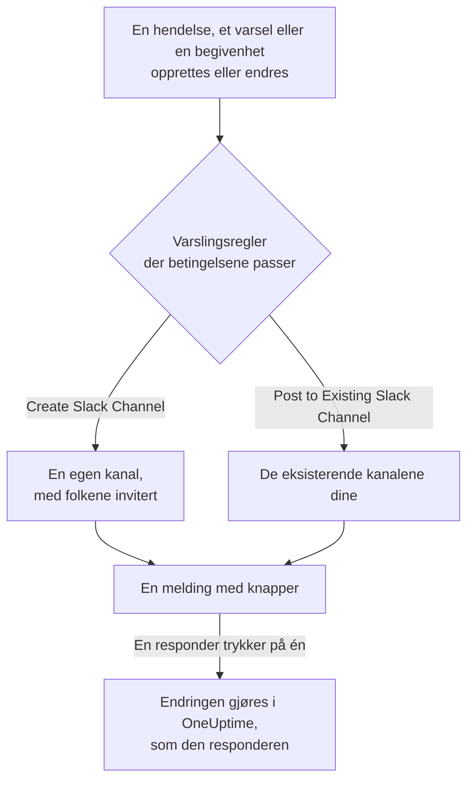

# Slack

Koble OneUptime til Slack for å publisere hendelser, varsler, episoder, planlagt vedlikehold, monitorer og vaktoppdateringer i kanalene dine, gi hver hendelse sin egen kanal og la responders handle uten å forlate Slack: bekrefte, løse, legge til notater, tilkalle vakten og opprette hendelser.

:::cards
- [Koble til Slack](#koble-til-slack): Installer OneUptime i workspacet ditt, og koble deretter til din egen konto.
- [Varslingsregler](#varslingsregler): Bestem hvilke hendelser som publiseres hvor, og hvilke som får sin egen kanal.
- [Opprett hendelser og vedlikehold fra Slack](#opprett-hendelser-og-vedlikehold-fra-slack): `/incident` og `/maintenance`, som deg selv.
- [Handle på hendelser, varsler og begivenheter fra Slack](#handle-på-hendelser-varsler-og-begivenheter-fra-slack): Knappene i meldingene fra OneUptime.
:::

## Slik fungerer det

To tilkoblinger får dette til å fungere:

- **Prosjektets tilkobling**, gjort én gang: OneUptime-appen installert i Slack-workspacet ditt. Den publiserer meldingene, oppretter kanalene og inviterer folk.
- **Hver persons egen tilkobling**: personens Slack-konto koblet til personens OneUptime-konto. Knapper, kommandoer og emoji-reaksjoner handler som den personen, med personens tillatelser i prosjektet.

## Før du begynner

- **En rolle som kan koble til prosjektet:** **Project Owner**, **Project Admin** eller **Project Member**. Å avinstallere appen krever **Project Owner** eller **Project Admin**.
- **Et Slack-workspace** der du kan installere apper.
- **Growth-planen på OneUptime Cloud** for varslingsregler og sammendrag. Se [Varslingsregler under Growth-planen](#varslingsregler-under-growth-planen).
- **På en selvdriftet server,** først en Slack-app som er satt opp for den. Se [Slack-integrasjon](/docs/self-hosted/slack-integration).

## Koble til Slack

:::steps
### Installer OneUptime i Slack-workspacet ditt

Gå til **Prosjektinnstillinger** > **Arbeidsområde** > **Slack**, og klikk på **Connect with Slack**. Velg workspacet, og gi OneUptime tillatelse. Slack sender deg tilbake til samme side, som nå viser hvilket workspace prosjektet er koblet til. Til et workspace er koblet til, inneholder seksjonen **Arbeidsområde** i menyene Hendelser, Varsler, Planlagt vedlikehold, Monitorer og Vakttjeneste **Koble til Slack eller Teams**, som også fører hit.

### Koble til din egen Slack-konto

Å installere appen kobler til kontoen til den som installerte den. Alle andre kobler til sin egen Slack-konto under **Brukerinnstillinger** > **Arbeidsområde** > **Slack** med **Connect my account with Slack**, for å handle på hendelser og få direktemeldinger som seg selv. Den seksjonen vises så snart prosjektet er koblet til Slack.

### Legg til en varslingsregel

Gå til **Hendelser** > **Arbeidsområde** > **Slack**. Seksjonen **Arbeidsområde** viser bare chat-workspacene prosjektet ditt har koblet til, så **Slack** vises der så snart det er koblet til. Opprett en regel, for eksempel en som oppretter en Slack-kanal for hver nye hendelse og inviterer hendelsens eiere. Se [Varslingsregler](#varslingsregler).

### Test regelen

Klikk på **Testregel** i regelens rad. En testmelding kommer i kanalene regelen nevner. Se [Teste en regel](#teste-en-regel).
:::

## Varslingsregler

En varslingsregel sier hvilke hendelser som publiseres i Slack, og hvor. Hvert produkt har sine egne regler, under **Arbeidsområde** > **Slack** i sin meny:

| Produkt | Faner på produktets **Slack**-side |
| --- | --- |
| **Hendelser** | **Hendelser**, **Hendelse Episoder**, **Summary** |
| **Varsler** | **Varsler**, **Varsel Episoder**, **Summary** |
| **Planlagt vedlikehold** | Én liste med regler |
| **Monitorer** | Én liste med regler |
| **Vakttjeneste** | Én liste med regler |

Å opprette en regel går gjennom fire trinn:

| Trinn | Hva du angir |
| --- | --- |
| **Grunnleggende** | **Regelnavn** og **Regelbeskrivelse**. |
| **Betingelser** | Hvilke hendelser regelen utløses for, for eksempel etter alvorlighetsgrad, tilstand, etikett, monitor eller ord i tittelen. Uten betingelser utløses den for hver hendelse. Med to eller flere sier **Samsvarsbetingelse** om alle må passe, eller om én er nok. |
| **Mål** | Hvor den publiserer: **Post to Existing Slack Channel** med kanalnavnene, **Create Slack Channel** med navnet på den nye kanalen og hvem som inviteres, eller begge. |
| **Video Call** | Bare hendelser og varsler: start en samtale for hver. Se [Videosamtaler](/docs/workspace-connections/video-calls). |

En kanal som regelen oppretter, får navnet sitt fra **New Slack Channel Name** etterfulgt av postens nummer, som `oneuptime-incident-42`, og bare en opprettet kanal får folkene regelen inviterer: postens eiere, valgte team og brukere og, for hendelser og varsler, de vakthavende etter hvert som de tilkalles. En privat hendelse, et privat varsel eller en privat episode får en privat kanal. Hver senere oppdatering av posten — en tilstandsendring, et notat, en ny eier — publiseres i kanalene dens og i de eksisterende kanalene reglene dens nevner. En hendelse, et varsel eller en episode som ble opprettet allerede løst, får ingen egen kanal; opprettelsesmeldingen går likevel til kanalene reglene dine nevner. Se [Erklært allerede bekreftet eller løst](/docs/incidents/declaring-incidents#erklært-allerede-bekreftet-eller-løst).

**Prosjektinnstillinger** > **Arbeidsområde** > **Slack** viser kanalene OneUptime kan se, med **Send test** ved siden av hver. OneUptime blir selv med i en offentlig kanal første gang den publiserer der. En privat kanal vises, og kan motta publiseringer, først etter at OneUptime-appen er invitert inn i den i Slack.

## Teste en regel

**Testregel** i en regels rad publiserer en testmelding for den regelen i kanalene den nevner, så du ser at den kommer frem. Hvis regelen oppretter en kanal for hver hendelse, oppretter testen også en og inviterer regelens folk inn i den.

I likhet med **Send test** ved siden av en kanal i **Prosjektinnstillinger** > **Arbeidsområde** > **Slack** krever den tillatelse til å opprette varslingsregler: **Project Owner**, **Project Admin**, **Project Member**, **Settings Admin**, **Settings Member**, eller **Create Workspace Notification Rule** og **Read Workspace Notification Rule** i en egendefinert rolle. For en som bare kan se reglene, som en **Viewer**, er **Testregel** låst, og verktøytipset sier hva som kreves; API-et avviser testen med "You do not have permission to send test notifications in this project." På OneUptime Cloud krever det **Growth**-planen å teste en regel, på samme måte som å legge til en.

På OneUptime Cloud krever **Send test** ved siden av en kanal også **Growth**-planen, siden det å publisere i en kanal er det regler og sammendrag gjør. **Send test nå** på et sammendrag krever tillatelse til å opprette sammendrag (**Create Workspace Notification Summary** og **Read Workspace Notification Summary** i en egendefinert rolle) og, på OneUptime Cloud, **Growth**-planen; for alle andre er den låst, og verktøytipset sier hva som kreves. En MCP-klient som er koblet til med skrivebeskyttet tilgang, kan ikke sende noen test.

## Sammendrag

Fanen **Summary** i **Hendelser** > **Arbeidsområde** > **Slack** (og i **Varsler**) publiserer et gjentakende sammendrag i kanalene du nevner: hvor mange hendelser eller varsler det var, hvor raskt de ble bekreftet og løst, og en liste med lenker. Et nytt sammendrag sendes hver uke og dekker de siste 7 dagene. La **Send første rapport kl.** stå tomt, så sendes det første kl. 09:00 i starten av neste uke, dag eller måned; skjemaet sier når.

Et sammendrag sendes etter klokken i sin **Tidssone**, som starter med din. Det holder klokkeslettet sitt der hele året: et som er satt til 09:00 i Berlin, sendes fortsatt kl. 09:00 i Berlin etter overgangen til sommertid, og datoene i meldingen er også Berlins. Via API-et sender du `timezone` som et IANA-tidssonenavn, som `Europe/Berlin`. Et sammendrag som opprettes uten tidssone, tar tidssonen fra profilen til den som opprettet det, eller UTC når en API-nøkkel oppretter det.

Skjemaet for et sammendrag har fire trinn: **Grunnleggende informasjon** (navnet og kanalene), **Tidsplan**, **Innhold** (**Hva som skal inkluderes**) og **Filtre** (hvilke hendelser eller varsler det teller).

## Varslingsregler under Growth-planen

På OneUptime Cloud hører varslingsregler og sammendrag til **Growth**-planen og høyere. Et prosjekt under den beholder reglene og sammendragene det allerede har, og de fortsetter å publisere i Slack. Derfor viser hvert produkts **Slack**-side (Hendelser, Varsler, Planlagt vedlikehold, Vakttjeneste, Monitorer) planmerknaden med dem under (**Varslingsregler som fortsatt er satt opp**, **Sammendrag som fortsatt er satt opp**): slett en regel, eller slå av eller slett et sammendrag. Å legge til eller endre regler og sammendrag krever **Growth**.

## Bli tilkalt i Slack

For å bli tilkalt med direktemelding når du har vakt, legger du til Slack som en av varselmetodene dine:

:::steps
1. Koble til din egen Slack-konto (se [Koble til Slack](#koble-til-slack)).
2. Gå til **Brukerinnstillinger** > **Varselmetoder**, åpne fanen **Workspace Apps**, og klikk på **Add Slack Account**.
3. Klikk på **Send Test Message** i raden. Meldingen kommer i direktemeldingene dine i Slack.
:::

Å legge den til setter den straks inn i vaktreglene dine, så tilkallinger når deg i Slack fra da av. Endre hvilke tilkallinger den får, under **Brukerinnstillinger** > **Vaktregler**.

## Lagre meldinger som notater

Reager på en melding i kanalen til en hendelse, et varsel, en episode eller en planlagt vedlikeholdsbegivenhet, så lagrer OneUptime den som et notat på den posten og bekrefter med et svar i tråden:

| Reaksjon | Lagret som |
| --- | --- |
| 📌 En tegnestift-emoji, eller Slacks egen **Pin to channel** | Et privat notat, som bare teamet ditt ser |
| 📢 En megafon- eller høyttaler-emoji | Et offentlig notat, vist på statussiden. Bare hendelser og planlagte vedlikeholdsbegivenheter. |

Notatet lagres som deg, med dine tillatelser, så din egen Slack-konto må være koblet til. En melding lagres bare én gang, uansett hvor mange som reagerer.

## Spør OneUptime AI fra Slack

Spør om logger, traces, målinger, hendelser og monitorer på vanlig språk. Nevn OneUptime med @ i en kanal, eller send den en direktemelding, så svarer den i tråden; svar der for å spørre om mer. `/oneuptime ask which monitors are down?` publiserer svaret i kanalen. Begge krever at din egen Slack-konto er koblet til, og at AI er slått på for prosjektet. Svar i Slack leser bare: bruk knappene for å endre noe. Se [Spør AI](/docs/ai/ask-ai).

## Opprett hendelser og vedlikehold fra Slack

`/incident` og `/maintenance` åpner et skjema som du fyller ut og sender inn som deg selv: som OneUptime-kontoen Slack-kontoen din er koblet til (se [Koble til Slack](#koble-til-slack)), med den kontoens tillatelser i prosjektet. Hvis Slack-kontoen din ikke er koblet til, eller OneUptime-kontoen din ikke lenger er medlem av prosjektet, sier OneUptime i en direktemelding hva du skal gjøre, og ingen skjemaer åpnes. Snarveiene **Create New Incident** og **Create Scheduled Event** åpner de samme skjemaene.

- **Hvem som kan bruke dem.** De som kan opprette en hendelse eller en planlagt vedlikeholdsbegivenhet i OneUptime: **Project Owner**, **Project Admin**, **Project Member**, **Incident Admin** og **Incident Member** for en hendelse (**Create Incident** i en egendefinert rolle), og **Scheduled Maintenance Admin** og **Scheduled Maintenance Member** for en begivenhet (**Create Scheduled Maintenance**). Alle andre får beskjed om det i en direktemelding, og ingen skjemaer åpnes.
- **Hva et skjema tilbyr.** Hver liste — alvorlighetsgrader, monitorer, monitorstatuser, vaktpolicyer og etiketter — inneholder det du har lov til å lese, slik som den samme listen i OneUptime: med en rolle som er begrenset til noen etiketter, monitorene og vaktpolicyene som har de etikettene. En liste du ikke kan lese i det hele tatt, utelates fra skjemaet. Arkiverte vaktpolicyer tilbys aldri.
- **Hva et skjema kan nevne.** Hendelsen eller begivenheten opprettes med dine egne tillatelser og krediteres deg. En monitor, vaktpolicy, etikett, alvorlighetsgrad eller status du ikke kan lese, eller en fra et annet prosjekt, avvises som en prosjektet ikke har, selv fra et skjema som ble åpnet før tilgangen din endret seg, og ingenting opprettes. OneUptime forteller deg hvorfor i en direktemelding.

**Execute On-Call Policy** på en hendelse, et varsel eller en episode fungerer på samme måte: den krever tillatelse til å kjøre en vaktpolicy (**Project Owner**, **Project Admin**, **Project Member**, **On-Call Admin** og **On-Call Member**, eller **Create On-Call Duty Policy Execution Log** i en egendefinert rolle) og til å lese den hendelsen, det varselet eller den episoden, og den tilbyr de aktive vaktpolicyene du kan lese.

## Handle på hendelser, varsler og begivenheter fra Slack

Knappene i OneUptimes Slack-meldinger handler også som deg: som OneUptime-kontoen Slack-kontoen din er koblet til, med den kontoens tillatelser i prosjektet. **Acknowledge**, **Resolve**, **Change State**, **Add Note** og **Execute On-Call Policy** på en hendelse, et varsel eller en episode, og **Mark as Ongoing**, **Mark as Complete**, **Change State** og **Add Note** på en planlagt vedlikeholdsbegivenhet, gjør hver den endringen som samme handling gjør i OneUptime, og den krediteres deg der: postens tilstandstidslinje og feed viser at du endret tilstanden, og notatet er ditt. Et notat som lagres fra en melding med en emoji-reaksjon, publiseres på samme måte.

- **Hvem som kan bruke dem.** De som kan gjøre den samme endringen i OneUptime. Å bekrefte, løse eller endre tilstanden til en hendelse krever tillatelse til å endre tilstanden: **Project Owner**, **Project Admin**, **Project Member**, **Incident Admin** og **Incident Member**, eller **Create Incident State Timeline** i en egendefinert rolle. Et varsel, en episode eller en planlagt vedlikeholdsbegivenhet krever den samme tillatelsen for sin egen type (**Create Alert State Timeline**, for eksempel), og et notat krever tillatelse til å publisere den typen notat. Alle andre får beskjed om det i en direktemelding, og ingenting endres.
- **Hvilke poster.** De du kan lese, som i OneUptime: med en rolle som er begrenset til noen etiketter, hendelsene, varslene, episodene og begivenhetene som har dem. En knapp på en hvilken som helst annen post, eller på en fra et annet prosjekt, får til svar at posten "was not found in this project, or you do not have access to it.", og ingenting endres. På OneUptime Cloud avvises en endring som prosjektets plan ikke omfatter, med planen den krever.
- **Hva Change State tilbyr.** Tilstandene du kan lese som posten kan gå videre til, i prosjektets rekkefølge: ingen før tilstanden den er i, for en episode som for en hendelse, et varsel eller en planlagt vedlikeholdsbegivenhet, siden en tilstandsendring aldri flytter en post opp igjen i listen (se [Rekkefølgen er en reell begrensning, ikke en visningspreferanse](/docs/incidents/states-and-severities#rekkefølgen-er-en-reell-begrensning-ikke-en-visningspreferanse)). Når du ikke kan lese noen, får du beskjeden "No incident states are available to you in this project. Ask a project admin for access to them."; når posten er i den siste tilstanden den kan nå, får du beskjeden "There is no later state to move this incident to." Ingen av dem åpner et tomt skjema.

## Koble fra

- **Disconnect** kobler bare fra din egen Slack-konto, og fjerner samtidig Slack-varselmetoden din.
- **Uninstall OneUptime from Slack**, på **Prosjektinnstillinger** > **Arbeidsområde** > **Slack**, kobler fra prosjektet. OneUptime slutter å publisere i Slack, og menyene **Arbeidsområde** slutter å vise det. Varslingsreglene og sammendragene beholdes til du kobler til igjen.

> [!WARNING]
> Å avinstallere kobler også fra hvert medlems egen Slack-konto i prosjektet, og fjerner Slack-varselmetodene og vaktreglene som brukte dem. De som ble tilkalt i Slack, tilkalles via de andre varselmetodene sine til de legger til Slack igjen.

## Feilsøking

:::details En regel publiserer ingenting
Sjekk regelens betingelser med **Testregel**: hvis testen kommer frem, passet ikke regelens betingelser på hendelsen. Hvis den ikke gjør det, sier Slack-siden hvorfor. For en privat kanal må du først invitere OneUptime-appen inn i den i Slack. Hver melding OneUptime publiserer, og hver melding Slack avviste, vises i **Prosjektinnstillinger** > **Varsler** > **Varsellogger**, på fanen **Arbeidsområde**.
:::

:::details Slack ble ikke koblet til
Når Slack sender deg tilbake uten en tilkobling, sier siden du startet fra **Slack ble ikke koblet til**, og én setning sier hvorfor: du mangler tillatelsen, lenken var brukt eller utløpt, du logget på et annet workspace, eller serveren er ikke satt opp for Slack. Se [Tilkoblingen ble ikke fullført](/docs/self-hosted/slack-integration#tilkoblingen-ble-ikke-fullført) for hver setning og hva du skal gjøre.
:::

:::details En knapp eller kommando sier at Slack-kontoen min ikke er koblet til
Koble den til under **Brukerinnstillinger** > **Arbeidsområde** > **Slack** med **Connect my account with Slack**. Hvis du ikke lenger er medlem av prosjektet, sier OneUptime det i stedet, og handler ikke på noe for deg.
:::

:::details Varsler kommer frem, men knapper og kommandoer gjør ingenting
På en selvdriftet server må Slack kunne nå OneUptime for knapper, skjemaer og kommandoer; varsler trenger bare utgående tilgang. Se [Nettverkstilgang for selvdriftede installasjoner](/docs/self-hosted/slack-integration#nettverkstilgang-for-selvdriftede-installasjoner).
:::

## Neste steg

:::cards
- [Microsoft Teams](/docs/workspace-connections/microsoft-teams): De samme varslene og handlingene i Microsoft Teams.
- [Videosamtaler](/docs/workspace-connections/video-calls): Gi hver hendelse en samtale, publisert med oppdateringene.
- [Slack-integrasjon](/docs/self-hosted/slack-integration): Sett opp Slack-appen på en selvdriftet server.
- [Opprette en hendelse](/docs/incidents/declaring-incidents): Alle måtene en hendelse starter på, og hva som kjører når den gjør det.
:::
