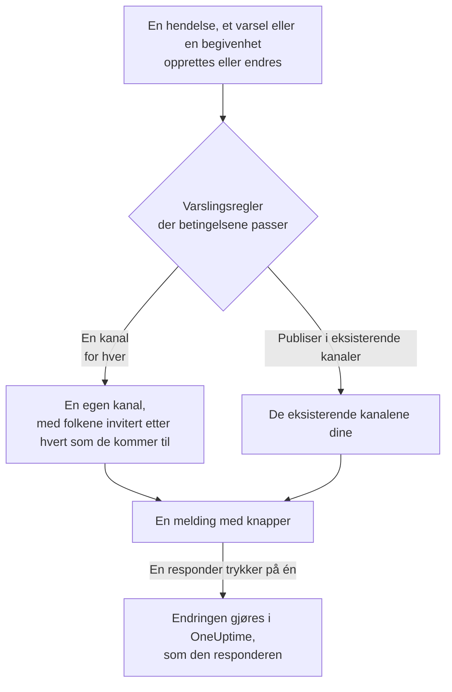

# Slack

Koble OneUptime til Slack for å publisere hendelser, varsler, episoder, planlagt vedlikehold, monitorer og vaktoppdateringer i kanalene dine, gi hver hendelse sin egen kanal og la responders handle uten å forlate Slack: bekrefte, løse, legge til notater, tilkalle vakten og opprette hendelser.

:::cards
- [Koble til Slack](#koble-til-slack): Installer OneUptime i workspacet ditt, og koble deretter til din egen konto.
- [Be alle om å koble til kontoen sin](#be-alle-om-å-koble-til-kontoen-sin): Send på én gang en melding til hvert medlem som ikke har koblet til kontoen sin.
- [Varslingsregler](#varslingsregler): Bestem hvilke hendelser som publiseres hvor, og hvilke som får sin egen kanal.
- [Hvem som er i kanalen til en post](#hvem-som-er-i-kanalen-til-en-post): Se hvem som er i den, bli med og legg til personer, fra siden til posten.
- [Kommandoen /oneuptime](#kommandoen-oneuptime): Erklær hendelser, planlegg vedlikehold, se hvem som har vakt, og spør AI.
- [Vakt-brukergrupper](#vakt-brukergrupper): Hold en brukergruppe lik dem som har vakt, og tilkall den.
- [Handle på hendelser, varsler og begivenheter fra Slack](#handle-på-hendelser-varsler-og-begivenheter-fra-slack): Knappene i meldingene fra OneUptime.
:::

## Slik fungerer det

To tilkoblinger får dette til å fungere:

- **Prosjektets tilkobling**, gjort én gang: OneUptime-appen installert i Slack-workspacet ditt. Den publiserer meldingene, oppretter kanalene og inviterer folk.
- **Hver persons egen tilkobling**: personens Slack-konto koblet til personens OneUptime-konto. Knapper, kommandoer og emoji-reaksjoner handler som den personen, med personens tillatelser i prosjektet.

Ett Slack-workspace kan være koblet til mer enn ett prosjekt, for eksempel produksjon og staging. En knapp eller et skjema handler i prosjektet til posten det gjelder. En kommando eller en melding til OneUptime handler i prosjektet til kanalen den skrives i, for eksempel en hendelses kanal, ellers i det ene prosjektet Slack-kontoen din er koblet til i. Når ingenting viser hvilket, spør OneUptime hvilket prosjekt du mener, med en knapp for hvert prosjekt du er med i, og fortsetter der når du har valgt. I en samtale med OneUptime AI gjelder valget ditt resten av tråden.

## Før du begynner

- **En rolle som kan koble til prosjektet:** **Prosjekteier**, **Prosjektadministrator** eller **Prosjektmedlem**. Å avinstallere appen krever **Prosjekteier** eller **Prosjektadministrator**.
- **Et Slack-workspace** der du kan installere apper.
- **Growth-planen på OneUptime Cloud** for varslingsregler og sammendrag. Se [Varslingsregler under Growth-planen](#varslingsregler-under-growth-planen).
- **På en selvdriftet server,** først en Slack-app som er satt opp for den. Se [Slack-integrasjon](/docs/self-hosted/slack-integration).

## Koble til Slack

:::steps
### Installer OneUptime i Slack-workspacet ditt

Gå til **Prosjektinnstillinger** > **Arbeidsområde** > **Slack**, og klikk på **Connect with Slack**. Velg workspacet, og gi OneUptime tillatelse. Slack sender deg tilbake til samme side, som nå viser hvilket workspace prosjektet er koblet til. Til et workspace er koblet til, inneholder seksjonen **Arbeidsområde** i menyene Hendelser, Varsler, Planlagt vedlikehold, Monitorer og Vakttjeneste **Koble til Slack eller Teams**, som også fører hit.

### Koble til din egen Slack-konto

Å installere appen kobler til kontoen til den som installerte den. Alle andre kobler til sin egen Slack-konto under **Brukerinnstillinger** > **Arbeidsområde** > **Slack** med **Connect my account with Slack**, for å handle på hendelser og få direktemeldinger som seg selv. Den seksjonen vises så snart prosjektet er koblet til Slack. For å få med et helt team på én gang, se [Be alle om å koble til kontoen sin](#be-alle-om-å-koble-til-kontoen-sin).

### Legg til en varslingsregel

Gå til **Hendelser** > **Arbeidsområde** > **Slack**. Seksjonen **Arbeidsområde** viser bare chat-workspacene prosjektet ditt har koblet til, så **Slack** vises der så snart det er koblet til. Opprett en regel, for eksempel en som oppretter en Slack-kanal for hver nye hendelse med alle som jobber med den: de varslede, hendelseslederen og eierne. Se [Varslingsregler](#varslingsregler).

### Test regelen

Klikk på **Testregel** i regelens rad. En testmelding kommer i kanalene regelen nevner. Se [Teste en regel](#teste-en-regel).
:::

## Be alle om å koble til kontoen sin

Ingen kan koble til Slack-kontoen til noen andre, heller ikke en administrator: hver person logger på med sin egen. For å få med et helt team ber en **Prosjekteier** eller **Prosjektadministrator** alle på én gang under **Prosjektinnstillinger** > **Arbeidsområde** > **Slack**. Kortet **Members' Slack accounts** viser hvor mange medlemmer som har koblet til kontoen sin. **Ask everyone to connect** sender hvert medlem som ikke har gjort det, en direktemelding fra OneUptime i Slack, med en knapp **Connect Slack account** som kobler til kontoen med ett klikk.

- **Hvem som får en melding.** Hvert medlem av prosjektet som ikke har koblet til Slack-kontoen sin, og som OneUptime finner i Slack ut fra e-postadressen til vedkommende. Den som er blitt bedt om det de siste 24 timene, blir ikke bedt igjen, så ber du igjen dagen etter, får bare de som fortsatt ikke har koblet til kontoen sin, en påminnelse.
- **Hva kortet sier.** Hvor langt utsendingen har kommet mens meldingene går ut, og deretter hvem som ba om det, og hvor mange medlemmer som fikk en melding. Medlemmer OneUptime ikke fant i Slack ut fra e-postadressen, nevnes ved navn på kortet: de kobler til kontoen sin selv under **Brukerinnstillinger** > **Arbeidsområde** > **Slack**.
- **Hva knappen kobler til.** Slack-kontoen til den som trykker på knappen og logger på, til vedkommendes egen OneUptime-konto. En melding som sendes videre til noen andre, kobler ingenting til medlemmet den ble sendt til.

## Varslingsregler

En varslingsregel sier hvilke hendelser som publiseres i Slack, og hvor. Hvert produkt har sine egne regler, under **Arbeidsområde** > **Slack** i sin meny:

| Produkt | Faner på produktets **Slack**-side |
| --- | --- |
| **Hendelser** | **Hendelser**, **Hendelse Episoder**, **Sammendrag** |
| **Varsler** | **Varsler**, **Varsel Episoder**, **Sammendrag** |
| **Planlagt vedlikehold** | Én liste med regler |
| **Monitorer** | Én liste med regler |
| **Vakttjeneste** | Én liste med regler |

Å opprette en regel går gjennom fire trinn:

| Trinn | Hva du angir |
| --- | --- |
| **Grunnleggende** | **Regelnavn** og **Regelbeskrivelse**. |
| **Betingelser** | Hvilke hendelser regelen gjelder for, for eksempel etter alvorlighetsgrad, tilstand, etikett, monitor eller ord i tittelen. De kontrolleres når en hendelse opprettes, og på nytt ved hver oppdatering OneUptime publiserer om den, så en regel for bekreftede hendelser virker når en hendelse bekreftes. En ny regel gjelder for hver hendelse, for eksempel **Alle hendelser**. For å snevre den inn velger du **Bare hendelser som oppfyller betingelsene** og legger til betingelsene. Med to eller flere sier **Samsvarsbetingelse** om alle må passe, eller om én er nok. |
| **Mål** | Hvor den publiserer: **Publiser i eksisterende kanaler** med kanalnavnene, **Opprett en kanal for hver hendelse** (eller varsel, episode, planlagt vedlikehold, monitor eller vaktretningslinje) med hvem som blir med i den, eller begge. Under steget sier **Hva denne regelen gjør** det i setninger, som regelens kort. |
| **Video Call** | Bare hendelser og varsler: start en samtale for hver. Se [Videosamtaler](/docs/workspace-connections/video-calls). |

En kanal som regelen oppretter, får navn etter posten sin: hendelse INC-42 får `inc-42`, varsel ALT-7 får `alt-7`, og i et prosjekt uten nummerprefikser får hendelse 42 `incident-42`. Tekst i **Prefiks for kanalnavn** settes foran, så `prod-` gir `prod-inc-42`, og skjemaet viser navnet mens du skriver. For en planlagt vedlikeholdshendelse tar prefikset plassen til nummerprefikset: SM-5 får `sm-5`, og `maint-` gir `maint-5`. Slack tar små bokstaver, tall, `-` og `_`, opptil 80 tegn. Finnes det allerede en kanal med det navnet, for eksempel et annet prosjekts eller en arkivert kanal, legger OneUptime til `-2`, `-3` og så videre.

En regel oppretter kanalen sin første gang en hendelse samsvarer med den: når hendelsen opprettes, eller senere, når en oppdatering får den til å samsvare mens den fortsatt er åpen. En regel for bekreftede hendelser oppretter kanalen når hendelsen bekreftes. En privat hendelse, et privat varsel eller en privat episode får en privat kanal.

**Hvem som blir med i kanalen** viser hvem regelen legger til i kanalen sin, hver etter hvert som de kommer til posten, ikke bare når kanalen opprettes: **Vakthavende, etter hvert som de varsles**, **Hendelsesleder og andre hendelsesroller, etter hvert som de tildeles** (hendelser og hendelsesepisoder) og **Eiere, etter hvert som de legges til**, alle krysset av for en ny regel, og personene, teamene og vaktplanene i **Inviter også** når kanalen opprettes. Hendelseslederen tildeles vanligvis når noen første gang bekrefter hendelsen, og blir med i kanalen da. En regel som ble lagret før hendelsesroller fikk sin egen boks, legger dem til når den legger til eierne eller de vakthavende, og boksen vises krysset av. En eksisterende kanal en regel publiserer i, får ingen.

For en vaktplan i **Inviter også** blir den som ifølge siden til vaktplanen har vakt i den når kanalen opprettes, med i kanalen uten å bli tilkalt. For å legge til personer bare i kanalene til enkelte hendelser gir du en annen regel disse betingelsene og disse personene, med samme **Prefiks for kanalnavn** som den første: regler som samsvarer med en hendelse når kanalen dens opprettes, deler den kanalen, og hver av dem legger til sine egne personer.

Hver senere oppdatering av posten — en tilstandsendring, et notat, en ny eier — publiseres i kanalene dens, og i de eksisterende kanalene reglene dens nevner så lenge betingelsene deres stemmer. Med **Arkiver kanalen når hendelsen er løst** slått på, eller motstykket for varsler, episoder, planlagt vedlikehold, monitorer og vaktretningslinjer, arkiverer regelen som opprettet en kanal, den når posten er løst, fullført eller slettet, uansett hva betingelsene da sier. En hendelse, et varsel eller en episode som ble opprettet allerede løst, får ingen egen kanal; opprettelsesmeldingen går likevel til kanalene reglene dine nevner. Se [Erklært allerede bekreftet eller løst](/docs/incidents/declaring-incidents#erklært-allerede-bekreftet-eller-løst).

En hendelse, et varsel, en episode eller en planlagt vedlikeholdshendelse med sin egen kanal har **Åpne i Slack** øverst på siden sin i OneUptime, ved siden av tilstandsknappene. Den åpner kanalen i en ny fane, i Slack-appen eller i nettleseren. En post med to egne kanaler viser begge under knappen. En post med kanaler i både Slack og Microsoft Teams har i stedet én knapp, **Åpne kanal**, som viser alle. De eksisterende kanalene reglene dine publiserer i, tilbys ikke.

En kanal holder seg lesbar: hver begivenhet publiseres én gang, og postens første tilstand står i meldingen som kunngjør posten, ikke i en egen melding. En kjøring av en vaktretningslinje er én melding som redigeres etter hvert som kjøringen eskalerer: hvem som ble tilkalt, hvor ofte og hvordan, hvem som ikke ble det og hvorfor, og hvem som bekreftet. En ny melding publiseres bare når noen må handle: en eskaleringsregel nådde ingen, eller kjøringen endte uten at noen bekreftet. En person som ikke har koblet Slack-kontoen sin til OneUptime, legges til gjennom Slack-kontoen med vedkommendes e-postadresse. En person OneUptime ikke finner på noen av de to måtene, eller som er gjest i Slack, kan ikke legges til i en kanal; OneUptime sier det én gang per kanal, i én melding som nevner alle og redigeres når listen vokser. Send dem lenken **Connect Slack account** fra meldingen, så kobler de til kontoen sin i ett trinn. At postens eiere eller statussidens abonnenter fikk beskjed, står i feeden dens i OneUptime.

**Prosjektinnstillinger** > **Arbeidsområde** > **Slack** viser kanalene OneUptime kan se, med **Send test** ved siden av hver. OneUptime blir selv med i en offentlig kanal første gang den publiserer der. En privat kanal vises, og kan motta publiseringer, først etter at OneUptime-appen er invitert inn i den i Slack.

## Hvem som er i kanalen til en post

En hendelse, et varsel, en episode eller en planlagt vedlikeholdshendelse med sin egen Slack-kanal har kortet **Slack-kanal** på siden sin i OneUptime. Kortet viser kanalen, som en lenke som åpner den i Slack, om den er privat, og hvem som er i den, deg først. Fra kortet, uten en Slack-administrator:

- **Bli med i kanalen** legger deg til når du ikke er i kanalen.
- **Legg til personer** åpner en liste over prosjektets personer og team: velg en person for å legge vedkommende til, eller et team for å legge til alle i det.

OneUptime-appen legger dem til, slik den legger til personene i kanalen til en regel. Appen blir værende i kanalene den oppretter, så dette virker også for en privat kanal som alle har forlatt.

- **Hvem som kan legge til personer.** Den som kan redigere posten: **Prosjekteier**, **Prosjektadministrator**, **Prosjektmedlem**, **Hendelsesadministrator** og **Hendelsesmedlem** for en hendelse, eller **Edit Incident** i en egendefinert rolle, og den samme tillatelsen for et varsel, en episode eller en vedlikeholdshendelse (for eksempel **Edit Alert**). Alle andre ser hvem som er i kanalen, og hvordan de kommer inn.
- **Hvem som kan legges til.** Noen OneUptime finner i Slack: gjennom Slack-kontoen vedkommende har koblet til, eller ellers gjennom e-postadressen Slack har for vedkommende. Kortet nevner hvem det ikke kunne legge til, og hvorfor, for eksempel en gjest som Slack holder utenfor kanalen.
- **Hva som registreres.** Hvem som ble lagt til, og av hvem, i feeden til posten (**Kanalmedlem lagt til**) og under **Prosjektinnstillinger** > **Varsler** > **Varsellogger**, på fanen **Arbeidsområde**.
- **Å ta noen ut.** OneUptime legger bare til: fjern noen fra kanalen i Slack.

## Teste en regel

**Testregel** i en regels rad publiserer en testmelding for den regelen i kanalene den nevner, så du ser at den kommer frem. Hvis regelen oppretter en kanal for hver hendelse, oppretter testen også en og inviterer regelens folk inn i den.

I likhet med **Send test** ved siden av en kanal i **Prosjektinnstillinger** > **Arbeidsområde** > **Slack** krever den tillatelse til å opprette varslingsregler: **Prosjekteier**, **Prosjektadministrator**, **Prosjektmedlem**, **Innstillingsadministrator**, **Innstillingsmedlem**, eller **Create Workspace Notification Rule** og **Read Workspace Notification Rule** i en egendefinert rolle. For en som bare kan se reglene, som en **Leser**, er **Testregel** låst, og verktøytipset sier hva som kreves; API-et avviser testen med "You do not have permission to send test notifications in this project." På OneUptime Cloud krever det **Growth**-planen å teste en regel, på samme måte som å legge til en.

På OneUptime Cloud krever **Send test** ved siden av en kanal også **Growth**-planen, siden det å publisere i en kanal er det regler og sammendrag gjør. **Send test nå** på et sammendrag krever tillatelse til å opprette sammendrag (**Create Workspace Notification Summary** og **Read Workspace Notification Summary** i en egendefinert rolle) og, på OneUptime Cloud, **Growth**-planen; for alle andre er den låst, og verktøytipset sier hva som kreves. En MCP-klient som er koblet til med skrivebeskyttet tilgang, kan ikke sende noen test.

## Sammendrag

Fanen **Sammendrag** i **Hendelser** > **Arbeidsområde** > **Slack** (og i **Varsler**) publiserer et gjentakende sammendrag i kanalene du nevner: hvor mange hendelser eller varsler det var, hvor raskt de ble bekreftet og løst, og en liste med lenker. Et nytt sammendrag sendes hver uke og dekker de siste 7 dagene. La **Send første rapport kl.** stå tomt, så sendes det første kl. 09:00 i starten av neste uke, dag eller måned; skjemaet sier når.

Et sammendrag sendes etter klokken i sin **Tidssone**, som starter med din. Det holder klokkeslettet sitt der hele året: et som er satt til 09:00 i Berlin, sendes fortsatt kl. 09:00 i Berlin etter overgangen til sommertid, og datoene i meldingen er også Berlins. Via API-et sender du `timezone` som et IANA-tidssonenavn, som `Europe/Berlin`. Et sammendrag som opprettes uten tidssone, tar tidssonen fra profilen til den som opprettet det, eller UTC når en API-nøkkel oppretter det.

Skjemaet for et sammendrag har fire trinn: **Grunnleggende informasjon** (navnet og kanalene), **Tidsplan**, **Innhold** (**Hva som skal inkluderes**) og **Filtre** (hvilke hendelser eller varsler det teller).

## Varslingsregler under Growth-planen

På OneUptime Cloud hører varslingsregler og sammendrag til **Growth**-planen og høyere. Et prosjekt under den beholder reglene og sammendragene det allerede har, og de fortsetter å publisere i Slack. Derfor viser hvert produkts **Slack**-side (Hendelser, Varsler, Planlagt vedlikehold, Vakttjeneste, Monitorer) planmerknaden med dem under (**Varslingsregler som fortsatt er satt opp**, **Sammendrag som fortsatt er satt opp**): slett en regel, eller slå av eller slett et sammendrag. Å legge til eller endre regler og sammendrag krever **Growth**.

## Bli tilkalt i Slack

For å bli tilkalt med direktemelding når du har vakt, legger du til Slack som en av varselmetodene dine:

:::steps
1. Koble til din egen Slack-konto (se [Koble til Slack](#koble-til-slack)).
2. Gå til **Brukerinnstillinger** > **Varselmetoder**, åpne fanen **Workspace Apps**, og klikk på **Add Slack Account**.
3. Klikk på **Send Test Message** i raden. Meldingen kommer i direktemeldingene dine i Slack.
:::

Å legge den til setter den straks inn i vaktreglene dine, så tilkallinger når deg i Slack fra da av. Endre hvilke tilkallinger den får, under **Brukerinnstillinger** > **Vaktregler**.

## Lagre meldinger som notater

Reager på en melding i kanalen til en hendelse, et varsel, en episode eller en planlagt vedlikeholdsbegivenhet, så lagrer OneUptime den som et notat på den posten og bekrefter med et svar i tråden:

| Reaksjon | Lagret som |
| --- | --- |
| 📌 En tegnestift-emoji, eller Slacks egen **Pin to channel** | Et privat notat, som bare teamet ditt ser |
| 📢 En megafon- eller høyttaler-emoji | Et offentlig notat, vist på statussiden. Bare hendelser og planlagte vedlikeholdsbegivenheter. På en privat hendelse et privat notat, og bekreftelsen sier hvorfor. |

Notatet beholder meldingen slik Slack viste den: formateringen, lenkene og koden, personene og kanalene den nevner, ved navn, og filene og bildene som lenker til dem. Et offentlig notat utelater filene og bildene, siden de bare åpnes for teamet ditt.

Det er ordene til den som skrev meldingen: OneUptime-navnet deres når Slack-kontoen deres er koblet til, ellers navnet Slack viser. Et privat notat plasseres på tidslinjen der meldingen ble lagt ut, uansett hvor lenge etterpå det lagres. Et offentlig notat plasseres når det lagres, altså når statussiden viser det. Tidslinjen sier hvem som lagret det. Notatet legges ikke ut igjen i kanalen, der meldingen allerede står.

Notatet lagres som deg, med dine tillatelser. Hvis Slack-kontoen din ikke er koblet til ennå, ber OneUptime deg koble den til, i en melding bare du ser, med en knapp som lagrer meldingen så snart du har gjort det. En melding lagres bare én gang, uansett hvor mange som reagerer.

## Kommandoen /oneuptime

OneUptime har én kommando i Slack, `/oneuptime`. Ordet du skriver etter den, sier hva som skal skje; alt annet etter den er et spørsmål til OneUptime AI.

| Kommando | Hva den gjør |
| --- | --- |
| `/oneuptime help` | Viser kommandoene, med eksempler. |
| `/oneuptime incident [title or number]` | Åpner hendelsesskjemaet med tittelen fylt ut. Nummeret til en hendelse, som `42` eller `INC-42`, viser i stedet den hendelsen: se [Håndter en hendelse fra Slack](#håndter-en-hendelse-fra-slack). |
| `/oneuptime maintenance [title]` | Åpner skjemaet for planlagt vedlikehold med tittelen fylt ut. |
| `/oneuptime oncall` | Viser hvem som har vakt akkurat nå i hver vaktplan du kan se, til når, og hvem som er neste. |
| `/oneuptime page [who] [message]` | Tilkaller personene du nevner med @, om meldingen din, eller åpner et skjema der du velger hvem som skal tilkalles. Se [Tilkall noen fra Slack](#tilkall-noen-fra-slack). |
| `/oneuptime ask [question]`, eller et hvilket som helst spørsmål | OneUptime AI svarer om logger, traces, målinger, hendelser og monitorer. |

Svarene på `help` og `oncall` er meldinger bare du ser, under kommandoen. Et første ord som ligner en feilstavet kommando, som `incidnet`, får kommandoen det ligner, ikke et svar fra OneUptime AI. Skjemaene for hendelser og vedlikehold handler som deg: se [Opprett hendelser og vedlikehold fra Slack](#opprett-hendelser-og-vedlikehold-fra-slack).

> [!NOTE]
> `/oneuptime incident` og `/oneuptime maintenance` erstatter `/incident` og `/maintenance`, som kunne kollidere med kommandoer med samme navn i andre Slack-apper. En Slack-app som er opprettet fra et tidligere manifest, beholder dem, og de åpner de samme skjemaene, til appen blir oppdatert: se [Apper opprettet fra et eldre manifest](/docs/self-hosted/slack-integration#apper-opprettet-fra-et-eldre-manifest).

## Startsiden til OneUptime i Slack

Åpne OneUptime under **Apps** i sidefeltet i Slack: fanen **Home** viser hva som skjer i prosjektet, slik du har lov til å se det, og leses på nytt hver gang du åpner den.

- **Vakten din.** Vaktplanene du har vakt i nå, og til når, eller ellers neste vakt.
- **Det som er åpent.** De nyeste åpne hendelsene og varslene du har lov til å lese, hver med en lenke til siden sin i OneUptime.
- **Knappene.** **Declare incident**, **Schedule maintenance** og **Page someone** åpner de samme skjemaene som `/oneuptime incident`, `/oneuptime maintenance` og `/oneuptime page`, og **Who's on call** svarer som `/oneuptime oncall`.

Startsiden leser som deg, så den trenger din egen tilkoblede Slack-konto. Til den er koblet til, har startsiden knappen **Connect Slack account**, og den viser deg startsiden din så snart du har koblet den til.

I et Slack-workspace som er koblet til mer enn ett prosjekt, viser startsiden ett prosjekt om gangen. Er Slack-kontoen din koblet til i to eller flere av dem, viser menyen **Switch project** ved siden av prosjektets navn de andre du er medlem av. Velg ett for å se startsiden til det, og deretter åpner startsiden på det, så lenge du fortsatt er medlem der. Til du velger ett, viser den det av prosjektene dine som ble koblet til Slack først.

Når noen legger til OneUptime i en kanal, publiserer den en hilsen der: hvordan man stiller den et spørsmål, og hvor man legger til en varslingsregel som publiserer i kanalen. Første gang du åpner fanen **Messages**, ønsker den deg velkommen der: hva den gjør i Slack, og hvordan du kommer i gang.

## Spør OneUptime AI fra Slack

Spør om logger, traces, målinger, hendelser og monitorer på vanlig språk. Nevn OneUptime med @ i en kanal, eller send den en direktemelding, så svarer den i tråden. `/oneuptime ask which monitors are down?` publiserer svaret i kanalen. Begge krever at din egen Slack-konto er koblet til, og at AI er slått på for prosjektet. Svar i Slack leser bare: bruk knappene for å endre noe. Se [Spør AI](/docs/ai/ask-ai).

OneUptime svarer bare på det som er rettet til den.

- **I din egen samtale svarer du bare.** Et spørsmål du stiller i en kanal, ikke i en tråd, starter en samtale i tråden under det: svar der for å spørre om mer uten å nevne OneUptime igjen, og alle andre blir med ved å nevne den.
- **I alle andre tråder nevner du OneUptime.** Under en hendelses melding, for eksempel, nevner du den hver gang: det folk skriver til hverandre der, får ikke noe svar.
- **Hvis Slack-kontoen din ikke er koblet til.** OneUptime ber deg én gang i hver samtale om å koble den til, i en melding bare du ser, med en knapp **Connect Slack account**.

## Opprett hendelser og vedlikehold fra Slack

`/oneuptime incident` og `/oneuptime maintenance` åpner et skjema som du fyller ut og sender inn som deg selv: som OneUptime-kontoen Slack-kontoen din er koblet til (se [Koble til Slack](#koble-til-slack)), med den kontoens tillatelser i prosjektet. Hvis Slack-kontoen din ikke er koblet til, eller OneUptime-kontoen din ikke lenger er medlem av prosjektet, sier OneUptime hva du skal gjøre der du kjørte kommandoen, i en melding bare du ser, og ingen skjemaer åpnes. Snarveiene **Create New Incident** og **Create Scheduled Event** åpner de samme skjemaene.

- **Hvem som kan bruke dem.** De som kan opprette en hendelse eller en planlagt vedlikeholdsbegivenhet i OneUptime: **Prosjekteier**, **Prosjektadministrator**, **Prosjektmedlem**, **Hendelsesadministrator** og **Hendelsesmedlem** for en hendelse (**Create Incident** i en egendefinert rolle), og **Vedlikeholdsadministrator** og **Vedlikeholdsmedlem** for en begivenhet (**Create Scheduled Maintenance**). Alle andre får beskjed om det der de kjørte den, og ingen skjemaer åpnes.
- **Hva et skjema tilbyr.** Hver liste — alvorlighetsgrader, monitorer, monitorstatuser, vaktpolicyer og etiketter — inneholder det du har lov til å lese, slik som den samme listen i OneUptime: med en rolle som er begrenset til noen etiketter, monitorene og vaktpolicyene som har de etikettene. En liste du ikke kan lese i det hele tatt, utelates fra skjemaet. Arkiverte vaktpolicyer tilbys aldri.
- **Hva et skjema kan nevne.** Hendelsen eller begivenheten opprettes med dine egne tillatelser og krediteres deg. En monitor, vaktpolicy, etikett, alvorlighetsgrad eller status du ikke kan lese, eller en fra et annet prosjekt, avvises som en prosjektet ikke har, selv fra et skjema som ble åpnet før tilgangen din endret seg, og ingenting opprettes. OneUptime forteller deg hvorfor i kanalen, i en melding bare du ser.

**Execute On-Call Policy** på en hendelse, et varsel eller en episode fungerer på samme måte: den krever tillatelse til å kjøre en vaktpolicy (**Prosjekteier**, **Prosjektadministrator**, **Prosjektmedlem**, **Vaktadministrator** og **Vaktmedlem**, eller **Create On-Call Duty Policy Execution Log** i en egendefinert rolle) og til å lese den hendelsen, det varselet eller den episoden, og den tilbyr de aktive vaktpolicyene du kan lese.

## Tilkall noen fra Slack

`/oneuptime page @nawaz The checkout API is throwing 500s` tilkaller Nawaz med en gang. Han får en telefonsamtale, en SMS, en pushvarsling eller en e-post, slik hans egne vaktregler sier, og hver av dem forteller ham hvem som tilkalte ham, gjennom hvilket team eller hvilken vaktplan, og meldingen din. Hvor du kjører kommandoen, avgjør hva tilkallingen gjelder:

- **I en hendelses eller et varsels egen kanal**, den OneUptime opprettet for den, gjelder tilkallingen den hendelsen eller det varselet, og ingenting nytt opprettes. En melding er valgfri der: `/oneuptime page @nawaz` er nok. Personene du tilkaller, tilkalles til en av dem svarer, fra tilkallingen eller ved å bekrefte hendelsen eller varselet; bekrefter noen andre, stopper ikke tilkallingen, men løses den, stopper den.
- **Alle andre steder**, for eksempel i en annen kanal, en direktemelding, appens fane **Home** eller kanalen til en løst hendelse eller et løst varsel, oppretter OneUptime et varsel med meldingen din som tittel og tilkaller til noen bekrefter varselet. Skjemaet sier det, og det gjør også svaret bare du ser, før noen tilkalles.
- **Hvem som tilkalles med en gang.** Personene du nevner med @, og dem som har vakt i vaktplanene en brukergruppe du nevner med @, følger (se [Vakt-brukergrupper](#vakt-brukergrupper)), når en melding følger etter dem, eller uten melding i en hendelses eller et varsels egen kanal. OneUptime kjenner igjen en person på OneUptime-kontoen vedkommendes Slack-konto er koblet til, eller ellers på e-postadressen Slack har for vedkommende. Ingen utenfor prosjektet tilkalles.
- **Alt annet åpner et skjema.** Uten noen nevnt med @, uten melding der tilkallingen trenger en, med `@here`, med en brukergruppe som ikke følger noen vaktplan du kan se, eller med en person OneUptime ikke kjenner igjen, åpnes skjemaet **Page someone** med det du skrev ferdig utfylt, og det sier hvem det ikke kunne velge. I en hendelses eller et varsels egen kanal åpnes det med den hendelsen eller det varselet. Velg personer, et team, en vaktplan, som tilkaller den som har vakt i den nå, eller en vaktpolicy, som tilkaller gjennom eskaleringsreglene sine, og send det inn. Et navn du skriver først, som i `/oneuptime page Primary The disk is full`, velger vaktplanen, teamet eller policyen med det navnet.
- **Hvor det vises.** Kanalen viser tilkallingen som én melding som holdes oppdatert: hvem som ble tilkalt og hvordan, hvert team med navnet og personene sine etter, meldingen din, og hvem som bekreftet. Der OneUptime ikke kan poste, for eksempel i en privat kanal den ikke er invitert til, sier en melding bare du ser hvem som ble tilkalt, med en lenke til hendelsen eller varselet.
- **Hvem som kan tilkalle.** I en hendelses eller et varsels egen kanal alle som kan kjøre en vaktpolicy (**Prosjekteier**, **Prosjektadministrator**, **Prosjektmedlem**, **Vaktadministrator** og **Vaktmedlem**, eller **Create On-Call Duty Policy Execution Log** i en egendefinert rolle) og lese den hendelsen eller det varselet. Alle andre steder oppretter tilkallingen et varsel, så den krever også tillatelse til å opprette et: **Prosjekteier**, **Prosjektadministrator** og **Prosjektmedlem**, eller **Vaktmedlem** sammen med **Varselmedlem** (**Create On-Call Duty Policy Execution Log** og **Create Alert** i en egendefinert rolle). Å tilkalle personer, et team eller en vaktplan direkte, uten en vaktpolicy bak tilkallingen, krever også tilgang til alle vaktpolicyene i prosjektet. Alle andre får beskjed om det der de kjørte kommandoen, og ingen tilkalles. På OneUptime Cloud krever tilkalling Growth-planen: under den sier OneUptime hvilken plan som kreves, og ingen tilkalles.

## Vakt-brukergrupper

Hold en Slack-brukergruppe, for eksempel `@payments-oncall`, lik dem som har vakt i én eller flere vaktplaner, slik at alle kan nevne den med @ for å nå dem. OneUptime endrer medlemmene i gruppen ved hver overlevering og hver overstyring, og sjekker den hvert 15. minutt.

:::steps
### Koble en brukergruppe til en vaktplan

Åpne vaktplanen under **Vakttjeneste** > **Vaktplaner**. Klikk **Koble til brukergruppe** i kortet **Slack-brukergrupper**, og velg en av brukergruppene i arbeidsområdet ditt, eller **Opprett en ny brukergruppe** med et navn og et alias. Medlemmene byttes straks ut med dem som har vakt.

### Koble den også til den sekundære vaktplanen

For en gruppe med både primær og sekundær vakt kobler du den samme gruppen til på siden til den sekundære vaktplanen. En gruppe kan følge så mange vaktplaner du vil.
:::

- **Hva kortet viser.** Hvem som er i hver gruppe nå, de andre vaktplanene den følger, og om den er **Oppdatert**. En som har vakt, men ikke kan legges i gruppen, nevnes med årsaken: OneUptime finner en person gjennom den tilkoblede Slack-kontoen, eller ellers gjennom e-postadressen Slack har for vedkommende, og Slack holder gjester utenfor brukergrupper.
- **Ingen har vakt.** Slack kan ikke beholde en brukergruppe uten medlemmer, så OneUptime slår av gruppen til noen har vakt, og slår den så på igjen.
- **Tilkall gruppen.** `/oneuptime page @payments-oncall The checkout API is down` tilkaller dem som har vakt i vaktplanene gruppen følger. Se [Tilkall noen fra Slack](#tilkall-noen-fra-slack).
- **Hva Slack krever.** Brukergrupper hører til de betalte abonnementene til Slack, og et arbeidsområde kan la bare eierne og administratorene endre dem: kortet sier hvilket, og hva du gjør. Hvis Slack ble koblet til før OneUptime kunne holde brukergrupper oppdatert, kobler du det til igjen én gang under **Prosjektinnstillinger** > **Arbeidsområde** > **Slack**.
- **Hvem som kan koble til en.** Rollene som kan redigere vaktplaner: **Prosjekteier**, **Prosjektadministrator**, **Prosjektmedlem**, **Vaktadministrator** og **Vaktmedlem**, eller **Edit On-Call Duty Policy Schedule** i en egendefinert rolle. På OneUptime Cloud krever det abonnementet **Growth** å koble til en.
- **Koble fra.** OneUptime slutter å endre gruppen. Gruppen og medlemmene blir værende i Slack som de er.

## Håndter en hendelse fra Slack

Meldingen til en hendelse har fire knapper, **Acknowledge Incident**, **Resolve Incident**, **Add Note** og **View Incident**, og resten i menyen, knappen med tre prikker etter dem:

| Menypunkt | Hva det gjør |
| --- | --- |
| **Change Severity** | Setter alvorlighetsgraden til hendelsen. |
| **Change Incident State** | Flytter hendelsen til en senere tilstand. |
| **Assign Role** | Gir noen en rolle i hendelsen, som **Incident Commander**. En rolle for én person går over til vedkommende. |
| **Page Someone** | Tilkaller personer, et team, den som har vakt i en vaktplan nå, eller en vaktpolicy om hendelsen, med en valgfri melding. Personer tilkalles til en av dem svarer; en policy tilkaller til noen bekrefter hendelsen. |
| **Edit Custom Fields** | Setter de egendefinerte feltene til hendelsen, hvert fylt ut med det hendelsen har. Et felt som står tomt, tømmes. |

`/oneuptime incident 42` viser hendelse 42, med disse knappene og menyen, i en melding bare du ser. Skriv nummeret slik OneUptime viser det: `42`, `#42` eller `INC-42`. I den egne kanalen til en hendelse viser `/oneuptime incident` alene den hendelsen.

- **Hvem som kan bruke dem.** De som kan gjøre den samme endringen i OneUptime. **Change Severity** og **Edit Custom Fields** krever tillatelse til å redigere hendelsen: **Prosjekteier**, **Prosjektadministrator**, **Prosjektmedlem**, **Hendelsesadministrator** og **Hendelsesmedlem**, eller **Edit Incident** i en egendefinert rolle. **Assign Role** krever **Create Incident Member**, og **Delete Incident Member** for å flytte en rolle for én person. **Page Someone** krever det samme som **Execute On-Call Policy**. Alle andre får vite hvorfor, og ingen skjema åpnes.
- **Hva skjemaene tilbyr.** Det du kan lese i prosjektet. Et egendefinert felt som kopieres fra monitoren til hendelsen, er utelatt, siden det ville blitt kopiert på nytt, og et skjema rommer 40 felt: rediger resten i OneUptime.
- **Hva som skjer.** Skjemaet lukkes, og endringen gjøres som deg, som i OneUptime: feeden til hendelsen, og kanalene til hendelsen med den, sier hva som endret seg, hvert egendefinert felt med sin nye verdi. En verdi som ikke passer til feltet, som tekst for et tall, nevnes under feltet, og skjemaet blir stående åpent. **Page Someone** sier hvem som ble tilkalt, eller hvorfor ingen ble det; en hendelse som allerede er løst, tilkaller ingen.
- **Meldinger fra før menyen.** De beholder knappen **Execute On-Call Policy**, og den virker fortsatt: **Page Someone** tilkaller også en vaktpolicy. Varsler og episoder beholder sine.

## Handle på hendelser, varsler og begivenheter fra Slack

Knappene i OneUptimes Slack-meldinger handler også som deg: som OneUptime-kontoen Slack-kontoen din er koblet til, med den kontoens tillatelser i prosjektet. **Acknowledge**, **Resolve**, **Change State**, **Add Note** og **Execute On-Call Policy** på en hendelse, et varsel eller en episode, og **Mark as Ongoing**, **Mark as Complete**, **Change State** og **Add Note** på en planlagt vedlikeholdsbegivenhet, gjør hver den endringen som samme handling gjør i OneUptime, og den krediteres deg der: postens tilstandstidslinje og feed viser at du endret tilstanden, og notatet er ditt. Et notat som lagres fra en melding med en emoji-reaksjon, publiseres på samme måte.

- **Hvem som kan bruke dem.** De som kan gjøre den samme endringen i OneUptime. Å bekrefte, løse eller endre tilstanden til en hendelse krever tillatelse til å endre tilstanden: **Prosjekteier**, **Prosjektadministrator**, **Prosjektmedlem**, **Hendelsesadministrator** og **Hendelsesmedlem**, eller **Create Incident State Timeline** i en egendefinert rolle. Et varsel, en episode eller en planlagt vedlikeholdsbegivenhet krever den samme tillatelsen for sin egen type (**Create Alert State Timeline**, for eksempel), og et notat krever tillatelse til å publisere den typen notat. Alle andre får beskjed om det, og ingenting endres.
- **Hvilke poster.** De du kan lese, som i OneUptime: med en rolle som er begrenset til noen etiketter, hendelsene, varslene, episodene og begivenhetene som har dem. En knapp på en hvilken som helst annen post sier hvorfor, og ingenting endres: på en hendelse rollen din ikke når, "your access in this project does not include this incident. Ask a project admin for access to it."; på en privat hendelse du ikke er eier av, "this incident is private, so only its owners and the project's owners and admins can see it. Ask one of them to add you as an owner."; og på en som er slettet siden, "the incident was not found. It may have been deleted." På OneUptime Cloud avvises en endring som prosjektets plan ikke omfatter, med planen den krever.
- **Hva Change State tilbyr.** Tilstandene du kan lese som posten kan gå videre til, i prosjektets rekkefølge: ingen før tilstanden den er i, for en episode som for en hendelse, et varsel eller en planlagt vedlikeholdsbegivenhet, siden en tilstandsendring aldri flytter en post opp igjen i listen (se [Rekkefølgen er en reell begrensning, ikke en visningspreferanse](/docs/incidents/states-and-severities#rekkefølgen-er-en-reell-begrensning-ikke-en-visningspreferanse)). Når du ikke kan lese noen, får du beskjeden "No incident states are available to you in this project. Ask a project admin for access to them."; når posten er i den siste tilstanden den kan nå, får du beskjeden "There is no later state to move this incident to." Ingen av dem åpner et tomt skjema.
- **Add Note på en privat hendelse eller episode.** En privat hendelse eller episode tar ingen offentlige notater, så skjemaet spør ikke om notattype og legger til et privat notat. Et skjema som ble åpnet før den ble gjort privat, legger også til et privat notat, og sier det. Se [Private hendelser tar bare private notater](/docs/incidents/notes-owners-and-feed#private-hendelser-tar-bare-private-notater).
- **Hvor du får svar.** Under meldingen med knappen, i en melding bare du ser; i en direktemelding bare hvis Slack avviser det. En knapp som trykkes for sent, sier hvem som kom først, og når, for eksempel "Incident INC-2 was already acknowledged by Simon Lee at 6:07 PM."
- **Hvis Slack-kontoen din ikke er koblet til.** Svaret ber deg koble den til, med en knapp **Connect Slack account**. Knappen åpner dine egne Slack-innstillinger i OneUptime og kobler til kontoen din i ett trinn, etter at du har logget inn i OneUptime om nødvendig. Deretter fullfører OneUptime det du trykket på, som deg, og svarer under den samme meldingen; for en knapp som åpner et skjema, eller en kommando, ber det deg trykke på den eller kjøre den igjen. Knappen virker én gang, i 30 minutter, og bare for Slack-kontoen som trykket på den: logget inn i Slack som noen andre kobler den ikke til noe.

## Koble fra

- **Koble fra** kobler bare fra din egen Slack-konto, og fjerner samtidig Slack-varselmetoden din.
- **Uninstall OneUptime from Slack**, på **Prosjektinnstillinger** > **Arbeidsområde** > **Slack**, kobler fra prosjektet. OneUptime slutter å publisere i Slack, og menyene **Arbeidsområde** slutter å vise det. Varslingsreglene og sammendragene beholdes til du kobler til igjen.

> [!WARNING]
> Å avinstallere kobler også fra hvert medlems egen Slack-konto i prosjektet, og fjerner Slack-varselmetodene og vaktreglene som brukte dem. De som ble tilkalt i Slack, tilkalles via de andre varselmetodene sine til de legger til Slack igjen.

## Dine Slack-data

OneUptime leser bare det fra Slack som disse funksjonene trenger, med tillatelsene du gir når du installerer den:

- **Meldinger til OneUptime.** En melding som nevner den med @, en du sender den i en direktemelding, og svarene dine i en samtale med den, sammen med de tidligere meldingene i den tråden eller direktemeldingen, slik at OneUptime AI kan svare. Slack sender den også de andre meldingene i kanalene og gruppemeldingene den er med i; OneUptime verken svarer på dem eller tar vare på dem.
- **Meldinger du lagrer som notater.** En melding du reagerer på med 📌 eller 📢, eller fester, i kanalen til en hendelse, et varsel, en episode eller en planlagt vedlikeholdsbegivenhet, lagret som et notat på den posten med navnet til den som skrev den.
- **Navn på kanaler og personer.** Kanalene den kan publisere i, så du kan velge dem, navnene til personer, for å vise hvem som skrev eller gjorde noe, og hvem som er i den egne kanalen til en post, lest når siden til posten viser det.
- **E-postadresser.** E-postadressen Slack har for en person, for å koble personens Slack-konto til OneUptime-kontoen når vedkommende ikke har koblet den til selv: for å tilkalle vedkommende, sette vedkommende i en vakt-brukergruppe, legge vedkommende til i kanalen til en post eller be vedkommende koble den til.
- **Brukergrupper.** Brukergruppene i arbeidsområdet ditt, så du kan velge én for en vaktplan, og personene i en du kobler til, for å holde den lik dem som har vakt.

Det OneUptime tar vare på av dette — navnet på arbeidsområdet, kanalene, Slack-kontoene folk kobler til, notatene og brukergruppene — lagres sammen med prosjektet ditt. [Personvernerklæringen](https://oneuptime.com/legal/privacy) forklarer hvordan OneUptime behandler dataene dine.

## Feilsøking

:::details En regel publiserer ingenting
Sjekk regelens betingelser med **Testregel**: hvis testen kommer frem, passet ikke regelens betingelser på hendelsen. Hvis den ikke gjør det, sier Slack-siden hvorfor. For en privat kanal må du først invitere OneUptime-appen inn i den i Slack. Hver melding OneUptime publiserer, og hver melding Slack avviste, vises i **Prosjektinnstillinger** > **Varsler** > **Varsellogger**, på fanen **Arbeidsområde**.
:::

:::details Noen mangler i en regels kanal
Regelens kort sier under **Deretter** hvem regelen inviterer. Hver type person blir med etter hvert som de kommer til posten: de varslede når de varsles, hendelseslederen når den tildeles, en eier når den legges til, og de som allerede var på posten da kanalen ble opprettet. Den som OneUptime ikke kan finne i Slack, verken gjennom kontoen vedkommende har koblet til eller gjennom e-postadressen, kan ikke legges til; OneUptime nevner personen i kanalen, med en lenke for å koble til kontoen. Vil du legge til noen nå, trykker du **Legg til personer** på kortet **Slack-kanal** til posten.
:::

:::details Alle har forlatt en privat kanal
Åpne hendelsen, varselet, episoden eller vedlikeholdshendelsen i OneUptime, og trykk **Bli med i kanalen** på kortet **Slack-kanal**, deretter **Legg til personer** for å hente de andre tilbake. Det krever tillatelse til å redigere posten, ikke en Slack-administrator: OneUptime-appen er fortsatt i kanalen og legger dem til. Sier kortet at OneUptime ikke kan se kanalen, er kanalen slettet, eller appen er fjernet fra den: Noen i kanalen kan legge appen til igjen ved å skrive `/invite @OneUptime`.
:::

:::details Slack ble ikke koblet til
Når Slack sender deg tilbake uten en tilkobling, sier siden du startet fra **Slack ble ikke koblet til**, og én setning sier hvorfor: du mangler tillatelsen, lenken var brukt eller utløpt, du logget på et annet workspace, eller serveren er ikke satt opp for Slack. Se [Tilkoblingen ble ikke fullført](/docs/self-hosted/slack-integration#tilkoblingen-ble-ikke-fullført) for hver setning og hva du skal gjøre.
:::

:::details En knapp eller kommando sier at Slack-kontoen min ikke er koblet til
Trykk på **Connect Slack account** i det svaret for å koble den til i ett trinn, eller koble den til under **Brukerinnstillinger** > **Arbeidsområde** > **Slack** med **Connect my account with Slack**. Hvis du ikke lenger er medlem av prosjektet, sier OneUptime det i stedet, og handler ikke på noe for deg.
:::

:::details OneUptime svarer ikke på et svar i en tråd
Et svar som ikke nevner OneUptime, blir bare besvart i din egen samtale med OneUptime AI: tråden under et spørsmål du stilte den i en kanal. I alle andre tråder, som den under en hendelses melding, nevner du OneUptime med @. Hvis Slack-kontoen din ikke er koblet til, ber OneUptime deg om å koble den til én gang i hver samtale, ikke ved hver melding: trykk på **Connect Slack account** i den meldingen, eller koble den til under **Brukerinnstillinger** > **Arbeidsområde** > **Slack**. Se [Spør OneUptime AI fra Slack](#spør-oneuptime-ai-fra-slack).
:::

:::details Varsler kommer frem, men knapper og kommandoer gjør ingenting
På en selvdriftet server må Slack kunne nå OneUptime for knapper, skjemaer og kommandoer; varsler trenger bare utgående tilgang. Se [Nettverkstilgang for selvdriftede installasjoner](/docs/self-hosted/slack-integration#nettverkstilgang-for-selvdriftede-installasjoner).
:::

## Neste steg

:::cards
- [Microsoft Teams](/docs/workspace-connections/microsoft-teams): De samme varslene og handlingene i Microsoft Teams.
- [Videosamtaler](/docs/workspace-connections/video-calls): Gi hver hendelse en samtale, publisert med oppdateringene.
- [Slack-integrasjon](/docs/self-hosted/slack-integration): Sett opp Slack-appen på en selvdriftet server.
- [Opprette en hendelse](/docs/incidents/declaring-incidents): Alle måtene en hendelse starter på, og hva som kjører når den gjør det.
:::
