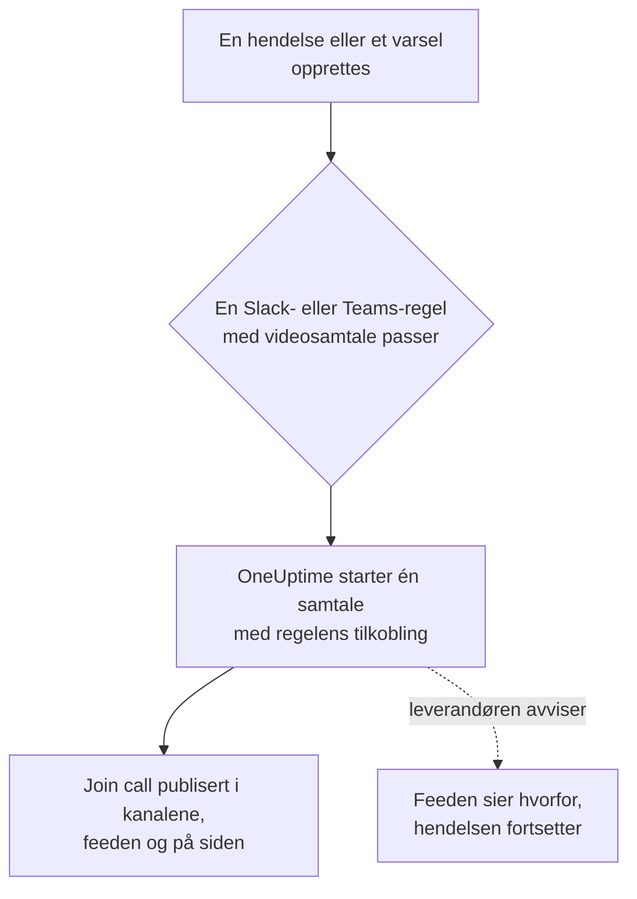

# Videosamtaler

Gi hver hendelse og hvert varsel sin egen samtale. Når en varslingsregel for Slack eller Microsoft Teams utløses for en ny hendelse eller et nytt varsel, starter OneUptime et eget møte (et Zoom-møte, et Google Meet, et Microsoft Teams-møte eller huddlen i hendelsens Slack-kanal) og publiserer en **Join call**-knapp overalt der hendelsens oppdateringer går. Responders blir med med ett klikk, og ingen må opprette et møte klokken 3 om natten og sende lenken rundt.

:::cards
- [Slik fungerer det](#slik-fungerer-det): En regel starter samtalen, og responders blir med der de er.
- [Koble til med ett klikk](#koble-til-med-ett-klikk): Zoom, Google Meet eller Microsoft Teams, ved å logge på.
- [Leverandører](#leverandører): Tjenesteidentiteten til din egen app, en fast møtelenke eller en Slack-huddle.
- [Starte en samtale manuelt](#starte-en-samtale-manuelt): Fra siden til en hendelse eller et varsel.
- [Transkripsjoner av samtaler](#transkripsjoner-av-samtaler): Hva som ble sagt i en hendelses samtale, og rotårsaken OneUptime AI leser i den.
:::

## Slik fungerer det



:::steps
### Koble til en leverandør

Gå til **Prosjektinnstillinger** > **Arbeidsområde** > **Video Calls**, og koble til Zoom, Google Meet eller Microsoft Teams, eller legg til en fast møtelenke. På OneUptime Cloud er det ett klikk å koble til Zoom, Google Meet eller Microsoft Teams: logg på, og gi OneUptime tillatelse til å opprette møter (se [Koble til med ett klikk](#koble-til-med-ett-klikk)). Slack-huddles trenger ikke noe utover prosjektets Slack-tilkobling.

### Slå det på i en regel

Åpne en varslingsregel for Slack eller Microsoft Teams for hendelser eller varsler (**Hendelser** > **Arbeidsområde** > **Slack**, for eksempel). I regelens trinn **Video Call** slår du på **Start a video call for the incident** og velger hvor samtalen holdes.

### Bli med med ett klikk

Når regelen utløses, starter OneUptime én samtale for hendelsen og publiserer den med en **Join call**-knapp i kanalene hendelsens oppdateringer går til, og i hendelsens feed. Hendelsens side viser samtalen i kortet **Video Call** og en **Bli med i samtalen**-knapp i toppteksten.
:::

Regelens betingelser bestemmer hvilke hendelser som får en samtale. For en bro bare ved Sev1-hendelser gir du regelen en betingelse på **Alvorlighetsgrad**. Samtaler starter for hendelser og varsler som opprettes som pågående. En hendelse som opprettes allerede løst, får ingen samtale.

### Én samtale per hendelse

En samtale startes én gang per hendelse for hvert sted en samtale holdes. Regler som velger samme tilkobling, deler én samtale, og en regel starter aldri en ny samtale for en hendelse som allerede har én fra den tilkoblingen. Regler som velger forskjellige steder, starter hver sin samtale, for eksempel et Zoom-møte for responders og huddlen i hendelsens Slack-kanal.

### Når en samtale ikke kan starte

Å opprette en hendelse venter aldri på en leverandør av videosamtaler. Samtalen startes etter at hendelsen er opprettet, så en treg eller feilende leverandør forsinker aldri hendelsen eller vakttilkallingene.

Hvis leverandøren avviser (en utløpt hemmelighet, en manglende tillatelse, en slettet vert), sier hendelsens feed at regelens samtale ikke kunne startes, med leverandørens begrunnelse, så responders vet at de skal starte en fra hendelsens side. Regelens kjøring vises i workspacets varsellogger som **Start videosamtale**, og tilkoblingens rad i **Prosjektinnstillinger** > **Arbeidsområde** > **Video Calls** viser feilen til en samtale starter igjen.

### Private hendelser

Et møte får navn etter hendelsen det gjelder, med nummer og tittel, og beskrivelsen lenker tilbake til hendelsen. For en privat hendelse utelates tittelen, fordi alle som inviteres til møtet, kan lese navnet.

## Koble til med ett klikk

På OneUptime Cloud tar det ett klikk å koble til Zoom, Google Meet eller Microsoft Teams, og ingenting må settes opp hos leverandøren:

:::steps
1. Gå til **Prosjektinnstillinger** > **Arbeidsområde** > **Video Calls**, og klikk på **Koble til** ved Zoom, Google Meet eller Microsoft Teams.
2. Klikk på **Continue to Zoom** (eller Google, eller Microsoft), logg på, og gi OneUptime tillatelse til å opprette møter.
3. Du kommer tilbake til siden for videosamtaler med tilkoblingen opprettet. **Start a test meeting** sjekker den fra ende til ende; velg deretter tilkoblingen i en varslingsregel for Slack eller Microsoft Teams.
:::

Hvert møte opprettes som kontoen du logger på med, som er vert for det. Logg på med en delt konto, som incidents@example.com, i stedet for din egen, så samtaler fortsetter å starte når folk slutter. Tilkoblingens rad viser hvilken konto den er pålogget som.

| Leverandør | Logg på med | Hva OneUptime kan gjøre |
| --- | --- | --- |
| Zoom | En Zoom-bruker. Møter med en Basic-bruker (gratis) som vert avsluttes etter 40 minutter. | Opprette møter for den brukeren (`meeting:write:meeting`) og lese hvem det er (`user:read:user`). For [transkripsjoner av samtaler](#transkripsjoner-av-samtaler): lese transkripsjonene av skyopptakene av brukerens møter (`cloud_recording:read:list_recording_files`, `cloud_recording:read:meeting_transcript`). |
| Google Meet | En Google-konto som kan bruke Google Meet. | Opprette Meet-rom som den kontoen (`meetings.space.created`) og lese e-postadressen. |
| Microsoft Teams | En jobb- eller skolekonto med Microsoft Teams. Personlige Microsoft-kontoer kan ikke opprette Teams-møter. | Opprette nettmøter som den kontoen (den delegerte tillatelsen `OnlineMeetings.ReadWrite`) og forbli pålogget (`offline_access`). For [opptak og transkripsjon av hendelsessamtaler](#ta-opp-og-transkribere-hver-samtale): legge møtene i kontoens kalender (`Calendars.ReadWrite`) og lese transkripsjonene deres (`OnlineMeetingTranscript.Read.All`, som en administrator godkjenner). |

En tilkobling som er laget ved å logge på, har fortsatt innstillingene som bestemmer hvem som venter: **Who can join** for Google Meet og **Who skips the lobby** for Microsoft Teams. Endre dem med **Rediger** i tilkoblingens rad.

En Zoom-tilkobling som ble logget inn før OneUptime leste transkripsjoner av samtaler, starter samtaler som før, men kan ikke lese transkripsjonene deres før den logges inn på nytt: **Reconnect** på raden ber Zoom om tillatelsene til transkripsjoner.

En Microsoft Teams-tilkobling som ble logget inn mens **Ta opp og transkriber hendelsessamtaler** var slått av, starter samtaler som før, uten opptak. Når innstillingen er slått på, ber **Reconnect** på raden Microsoft også om tillatelsene til kalender og transkripsjoner.

### Forbli pålogget

OneUptime lagrer påloggingens oppdateringstoken, kryptert, og fornyer det minst én gang i uken, så det aldri utløper på grunn av manglende bruk, uansett hvor lenge prosjektet går uten en hendelse. Hvis påloggingen slutter å fungere (kontoen fjernet OneUptime, ble slettet eller suspendert, eller organisasjonens policy ber den logge på igjen), viser tilkoblingens rad **Fungerer ikke** med begrunnelsen den dagen OneUptime oppdager det, ikke ved neste hendelse. **Reconnect** i raden logger på igjen.

Tilkoblinger som er pålogget som samme konto, deler én pålogging, i alle prosjekter: Zoom beholder bare én pålogging per konto, så å koble til den samme Zoom-brukeren igjen erstatter den for alle.

### Koble til på nytt og fjerne

**Reconnect** i en tilkoblings rad logger på igjen, som samme konto eller en annen. Bruk den etter at kontoen har fjernet OneUptime, eller for å flytte hendelsesmøter til en annen konto.

Å slette en tilkobling trekker tilbake OneUptimes tilgang hos Zoom og Google så snart ingen annen tilkobling bruker påloggingen. For Microsoft fjerner du OneUptime under kontoens **My Apps** (myapps.microsoft.com). Å fjerne OneUptime fra Zoom-kontoen din i Zoom App Marketplace sletter påloggingen fra alle tilkoblinger som er pålogget som den kontoen, og de viser **Fungerer ikke** til de kobles til på nytt.

### Hvis Microsoft ber om en administrator

Noen Microsoft 365-organisasjoner lar bare administratorer godkjenne apper. Hvis Microsoft sier at du trenger godkjenning fra en administrator, ber du en Microsoft 365-administrator om å koble til Microsoft Teams, eller om å godkjenne OneUptime i [Microsoft Entra-administrasjonssenteret](https://entra.microsoft.com/) under **Enterprise applications** > **Admin consent requests**. Et prosjekt som tar opp Teams-samtalene sine, trenger denne godkjenningen i hver organisasjon, én gang: bare en administrator kan la en app lese møtetranskripsjoner.

### Bruk din egen app i stedet

For å koble til med en tjenesteidentitet i stedet for en persons pålogging — en Zoom-app av typen Server-to-Server OAuth, en Google-tjenestekonto med domenedekkende delegering eller en Microsoft Entra-appregistrering — klikker du på **Use your own Zoom app** (eller Google, eller Microsoft) i dialogen Koble til. [Leverandører](#leverandører) forklarer hver av dem. På en selvdriftet server uten ett-klikks-apper satt opp åpner **Koble til** dette skjemaet direkte; se [Koble til med ett klikk på en selvdriftet server](#koble-til-med-ett-klikk-på-en-selvdriftet-server) for å sette dem opp.

## Starte en samtale manuelt

Kortet **Video Call** på siden til en hendelse eller et varsel har **Start call** (eller **Start another** når det finnes én). Velg en av prosjektets tilkoblinger, huddlen i hendelsens Slack-kanal, eller lim inn en egen møtelenke. Samtalen publiseres i hendelsens kanaler og feed, slik som en samtale en regel starter.

**Fjern** på kortet tar en samtale av hendelsens side. Selve møtet slettes ikke, og alle med lenken kan fortsatt bli med.

Å starte og fjerne samtaler krever tillatelse til å jobbe med hendelser (eller varsler): **Prosjekteier**, **Prosjektadministrator**, **Prosjektmedlem**, **Hendelsesadministrator** eller **Hendelsesmedlem**, eller **Create Incident Video Call** og **Delete Incident Video Call** i en egendefinert rolle. Alle som kan lese hendelsen, ser samtalene.

## Transkripsjoner av samtaler

Det de ansvarlige sier i en samtale, hva de har sjekket, hva de mistenker og hva de har bestemt, er den beste oversikten over hvordan en hendelse ble håndtert, og det er borte når samtalen slutter. En hendelses samtale tar vare på transkripsjonen sin, og OneUptime AI leser den for å finne rotårsaken samtalen peker på. Ingenting av det den leser, når hendelsen før en ansvarlig bruker det.

:::steps
### Hent transkripsjonen etter samtalen

På hendelsens kort **Video Call** leser **Hent fra Zoom**, **Hent fra Google Meet** eller **Hent fra Microsoft Teams** transkripsjonen av et møte OneUptime startet der (for Microsoft Teams et møte den startet mens hver samtale tas opp og transkriberes). For alle andre samtaler tar **Legg til transkripsjon** filen møteverktøyet lagret (`.vtt`, `.srt` eller `.txt`, opptil 5 MB), eller den innlimte transkripsjonen. Med [hver samtale tatt opp og transkribert](#ta-opp-og-transkribere-hver-samtale) henter OneUptime den selv når samtalen er over.

### OneUptime AI leser den

I løpet av et minutt eller to viser hendelsens kort **AI Investigation** **Foreslått rotårsak**, merket **Ikke bekreftet**, med linjene i transkripsjonen den bygger på, sitert med tid og taler. Under, slått sammen, står resten av det samtalen sa: funn, delt opp i **Bekreftet i samtalen** og **Hypoteser**, deretter hva som ble prøvd, beslutninger, oppfølginger og åpne spørsmål. Det OneUptime AI leste, publiseres også i hendelsens feed, og derfra i hendelsens Slack- og Microsoft Teams-kanaler.

### Bruk den, eller avvis den

**Bruk som rotårsak** åpner forslaget, med sitater og alt, i rotårsakens editor. Endre det du trenger, og lagre: Det blir hendelsens rotårsak som din egen endring, notert i feeden. **Lukk** legger forslaget til side, og **Angre** henter det tilbake.
:::

OneUptime AI foreslår bare en årsak når samtalen nevner en, med linjene som sier det, og siterer de linjene slik transkripsjonen har dem. Når samtalen ikke avklarte årsaken, sier kortet **Det ble ikke sagt nok i samtalen til å foreslå en rotårsak** i stedet for å gjette.

### Ta opp og transkribere hver samtale

For at ingen skal måtte huske å ta opp en samtale eller hente transkripsjonen, slår du på **Ta opp og transkriber hendelsessamtaler** under **Prosjektinnstillinger** > **Arbeidsområde** > **Video Calls**. Så lenge den er slått på:

- OneUptime ber Zoom om å ta opp i skyen hvert hendelsesmøte den starter, Google Meet om å transkribere det og Microsoft Teams om å ta det opp og transkribere det automatisk. Meldingen som publiserer samtalen, sier fra om det før noen blir med.
- Når samtalen er over, henter OneUptime transkripsjonen selv, slik **Hent fra Zoom** ville gjort, og OneUptime AI leser den. Inntil da sier kortet **Video Call** at det venter.
- Det OneUptime AI leste, går til hendelsens feed og dens Slack- og Microsoft Teams-kanaler: den foreslåtte rotårsaken, merket som ikke bekreftet, deretter hva som ble bekreftet, prøvd og bestemt, oppfølgingene og de åpne spørsmålene.
- Når hendelsen løses før transkripsjonen er kommet, venter det automatiske utkastet til etteranalyse på den, slik at det leser hva som ble sagt i samtalen: opptil seks timer mens leverandøren lager transkripsjonen, og én time når det ennå ikke er tegn til en.

Innstillingen er slått av som standard, fordi den tar opp mennesker: alle i disse samtalene ser at de blir tatt opp eller transkribert, så sjekk at organisasjonen deres tillater det. Zoom tar bare vare på en transkripsjon når kontoen tar opp i skyen med lydtranskripsjon slått på, og Google Meet bare i en Google Workspace-utgave som har transkripsjoner. Slack-huddles og møtelenker tas ikke opp, og det gjør heller ikke samtaler for varsler: legg til transkripsjonene deres manuelt.

Microsoft lar apper lese transkripsjoner bare fra Teams-møter som står i en kalender, så OneUptime legger hvert hendelsesmøte i organisatorens kalender og slår på automatisk opptak og transkripsjon i møtealternativene. Til det trenger tilkoblingen to Microsoft Graph-tillatelser til, `Calendars.ReadWrite` og `OnlineMeetingTranscript.Read.All`: legg dem til i appregistreringen deres (se [Microsoft Teams](#microsoft-teams)), eller bruk **Reconnect** på en tilkobling som er laget ved å logge på. Organisatorens Teams-møtepolicy må tillate skyopptak, transkripsjon og automatisk opptak, og organisasjonen deres må ikke ha slått av tilgangen apper har til transkripsjoner. En samtale OneUptime ikke kan legge i kalenderen, starter likevel, uten opptak, og kortet **Video Call** sier hvorfor.

### Hva hver leverandør tar vare på

| Samtale | Hvordan den får transkripsjonen sin | Hva den trenger |
| --- | --- | --- |
| Zoom | **Hent fra Zoom** | Et møte tatt opp i skyen med lydtranskripsjon slått på, eller med AI Companions møtesammendrag slått på. Tilkoblingen trenger scopene for transkripsjoner (se [Zoom](#zoom)), og en som ble logget inn før dem, trenger **Reconnect**. Zoom lager en transkripsjon etter møtet, vanligvis innen dobbelt så lang tid som møtet varte. |
| Google Meet | **Hent fra Google Meet** | Transkripsjoner slått på i samtalen, i en Google Workspace-utgave som har dem. Ingenting annet å sette opp: OneUptime leser transkripsjonene av møtene den opprettet. Google tar vare på en transkripsjon som apper kan lese, i 30 dager. |
| Microsoft Teams | **Hent fra Microsoft Teams** | Et møte OneUptime startet mens [hver samtale tas opp og transkriberes](#ta-opp-og-transkribere-hver-samtale): Microsoft lar apper lese transkripsjoner bare fra møter som står i en kalender, og tar vare på et møte i 60 dager. For alle andre Teams-møter **Legg til transkripsjon**: i Teams åpner du møtets sammendrag, deretter transkripsjonen, og laster den ned som en `.vtt`-fil. |
| Møtelenke eller Slack-huddle | **Legg til transkripsjon** | Transkripsjonen møteverktøyet, eller notatene fra huddlen, tar vare på. |

### Hvem kan gjøre hva

Å hente, legge til, erstatte og fjerne en transkripsjon, få den lest på nytt og avvise et forslag krever tillatelse til å starte hendelsens samtaler: **Prosjekteier**, **Prosjektadministrator**, **Prosjektmedlem**, **Hendelsesadministrator** eller **Hendelsesmedlem**, eller **Create Incident Video Call** i en egendefinert rolle. **Bruk som rotårsak** krever tillatelse til å redigere hendelsens rotårsak. Alle som kan lese hendelsen, ser transkripsjonene av samtalene dens og hva OneUptime AI leste i dem.

### Hva OneUptime AI leser

Å lese en transkripsjon er AI-arbeid som en undersøkelse: Det kjører bare mens AI er slått på for prosjektet, og teller med i prosjektets AI-bruk og daglige grenser (se [Kostnadskontroll](/docs/ai/ai-sre#kostnadskontroll)). En lang transkripsjon leses i deler. Når AI er slått av, beholdes transkripsjonen, og kortet sier at den ikke ble lest. Å fjerne en transkripsjon fjerner det OneUptime AI leste i den, og beholder hendelsens rotårsak. Et AI-utkast til etteranalyse leser også hva som ble sagt i hendelsens samtaler (se [Etteranalyser](/docs/incidents/postmortems)).

## Leverandører

Denne delen handler om å koble til en leverandør med tjenesteidentiteten til din egen app: en Zoom-app av typen Server-to-Server OAuth, en Google-tjenestekonto, en Microsoft Entra-appregistrering. En tjenesteidentitet er aldri avhengig av en person, så den fortsetter å fungere uansett hvem som slutter. For å koble til ved å logge på i stedet, se [Koble til med ett klikk](#koble-til-med-ett-klikk).

Påloggingsinformasjon krypteres ved lagring og returneres aldri av API-et. Når du redigerer en tilkobling, beholder et felt for påloggingsinformasjon som står tomt, den lagrede verdien.

**Start test meeting** i tilkoblingsskjemaet, og **Test** i en tilkoblings rad, oppretter et ekte møte med tilkoblingens innstillinger og viser lenken. Det er den ene sjekken som beviser at påloggingsinformasjonen, tillatelsen hos leverandøren og verten fungerer sammen. Ingenting publiseres noe sted.

Å koble til en leverandør krever **Prosjekteier**, **Prosjektadministrator** eller **Innstillingsadministrator**, eller **Create Video Call Connection** og **Edit Video Call Connection** i en egendefinert rolle.

### Zoom

OneUptime oppretter et Zoom-møte for hver hendelse via en Zoom-app av typen **Server-to-Server OAuth**, med en lisensiert Zoom-bruker du velger som vert.

:::steps
1. I [Zoom App Marketplace](https://marketplace.zoom.us/) velger du **Develop** > **Build App** og oppretter en app av typen **Server-to-Server OAuth**. Å opprette en krever en administrator av Zoom-kontoen, eller en rolle som tillater Server-to-Server OAuth-apper.
2. På appens side **Scopes** legger du til **meeting:write:meeting:admin** (opprette et møte for en bruker). En app som ble opprettet før de detaljerte scopene, kan bruke **meeting:write:admin** i stedet. For å la OneUptime lese [transkripsjoner av samtaler](#transkripsjoner-av-samtaler) også legger du til **cloud_recording:read:list_recording_files:admin** og **cloud_recording:read:meeting_transcript:admin** (eller **recording:read:admin** i en app som ble opprettet før de detaljerte scopene).
3. Klikk på **Activate** for å aktivere appen, og kopier deretter **Account ID**, **Client ID** og **Klienthemmelighet** fra appens side **App Credentials** inn i tilkoblingsskjemaet.
4. Angi **Meeting host**: e-postadressen til en lisensiert Zoom-bruker, helst en tjenestekonto som incidents@example.com, så møter fortsetter å fungere når folk slutter. Møter med en Basic-bruker (gratis) som vert avsluttes etter 40 minutter.
5. Responders blir med uten å vente på verten, fordi verten er en tjenestekonto som aldri blir med. Sørg for at innstillingen **Waiting room** på Zoom-kontoen din ikke er låst til på, ellers kommer ingen inn.
:::

| Felt | Hvor du finner det |
| --- | --- |
| Account ID | Appens side **App Credentials** |
| Client ID | Appens side **App Credentials** |
| Client secret | Appens side **App Credentials** |
| Meeting host | E-postadressen til den lisensierte Zoom-brukeren som er vert for hvert møte |

### Google Meet

OneUptime oppretter et Google Meet for hver hendelse med Google Meet REST API, via en Google Cloud-tjenestekonto som opptrer som en Google Workspace-bruker med domenedekkende delegering.

:::steps
1. I [Google Cloud-konsollen](https://console.cloud.google.com/) velger eller oppretter du et prosjekt og aktiverer **Google Meet REST API** for det.
2. Under **IAM & Admin** > **Service accounts** oppretter du en tjenestekonto. Åpne den, gå til **Keys** > **Add key** > **Create new key**, velg **JSON**, og lim inn den nedlastede filen i tilkoblingsskjemaet som **Service account JSON key**.
3. I [Google Administrasjonskonsoll](https://admin.google.com/) åpner du **Security** > **Access and data control** > **API controls** > **Manage Domain Wide Delegation** og klikker på **Add new**. Angi tjenestekontoens numeriske **Client ID** og scopet `https://www.googleapis.com/auth/meetings.space.created`.
4. Angi i **Create meetings as** Google Workspace-brukeren tjenestekontoen opptrer som: en egen konto som incidents@example.com. Hvert møte eies av denne brukeren.
:::

**Who can join** bestemmer hvem som blir med uten å spørre: med **People in your organization join directly, others ask to join** (standarden) ber folk utenfor Google Workspace-et ditt om å bli med, og noen i samtalen slipper dem inn. Med **Anyone with the link joins directly** venter ingen.

Domenedekkende delegering kan ta noen minutter før den fungerer. Hvis testen rett etter at du la til delegeringen melder at Google ikke lot tjenestekontoen opptre som brukeren, venter du noen minutter og tester igjen.

### Microsoft Teams

OneUptime oppretter et Microsoft Teams-møte for hver hendelse med Microsoft Graph, via en Microsoft Entra-appregistrering som organiserer møter på vegne av en lisensiert Teams-bruker.

:::steps
1. I [Microsoft Entra-administrasjonssenteret](https://entra.microsoft.com/) åpner du **App registrations** > **New registration** og registrerer en app med én leier. Kopier **Directory (tenant) ID** og **Application (client) ID**.
2. Under **API permissions** legger du til Microsoft Graph-tillatelsen av typen **application** **OnlineMeetings.ReadWrite.All** (og, for også å [ta opp og transkribere hendelsessamtaler](#ta-opp-og-transkribere-hver-samtale), **Calendars.ReadWrite** og **OnlineMeetingTranscript.Read.All**), og klikker deretter på **Grant admin consent**.
3. Under **Certificates & secrets** oppretter du en klienthemmelighet og limer inn **Value**, ikke Secret ID, i tilkoblingsskjemaet som **Klienthemmelighet**.
4. Velg organisatoren: en lisensiert Teams-bruker, helst en tjenestekonto. Kopier brukerens **Object ID** fra **Users** i Entra-administrasjonssenteret inn i **Organizer object ID**.
5. Gi appen tillatelse til å opprette møter for organisatoren med en tilgangspolicy for programmer. I Teams PowerShell kjører du, etter `Connect-MicrosoftTeams`, de to kommandoene nedenfor.
:::

```powershell
New-CsApplicationAccessPolicy -Identity OneUptime-Meetings -AppIds "<application-client-id>"
Grant-CsApplicationAccessPolicy -PolicyName OneUptime-Meetings -Identity "<organizer-object-id>"
```

Policyen kan ta opptil 30 minutter før den trer i kraft. Inntil da melder testen at appen ikke har lov til å opprette møter for organisatoren.

Den samme policyen lar appen lese transkripsjonene av organisatorens møter. `Calendars.ReadWrite` lar en app endre alle kalendere i organisasjonen deres: for å begrense tillatelsen til organisatorens kalender gir du den med [RBAC for programmer i Exchange Online](https://learn.microsoft.com/exchange/permissions-exo/application-rbac), avgrenset til organisatoren, i stedet for under **API permissions**.

**Who skips the lobby** bestemmer hvem som blir med uten å vente: med **People in your organization skip the lobby** (standarden) venter alle andre i lobbyen til noen i møtet slipper dem inn. Med **Everyone skips the lobby** venter ingen.

### Møtelenke

En fast møtelenke er det samme rommet for hver hendelse: et personlig Zoom-møterom, et gjentakende Microsoft Teams- eller Google Meet-møte, et personlig Webex-rom eller et Jitsi-rom. Ingenting opprettes per hendelse, så det er ingenting å godkjenne.

:::steps
1. Opprett et møte som aldri utløper, i verktøyet teamet ditt allerede bruker.
2. Lim inn https-lenken for å bli med i tilkoblingsskjemaet som **Meeting link**.
:::

Hver hendelse og hvert varsel som startes med denne tilkoblingen, deler rommet, så to samtidige hendelser deler det også. Sørg for at møtet lar folk bli med uten verten.

### Slack-huddles

En Slack-regel kan i stedet starte huddlen i hendelsens Slack-kanal. Det er ingenting å koble til: velg **Slack huddle** i regelens trinn **Video Call**.

Huddlen holdes i kanalen regelen oppretter for hendelsen, eller, når regelen i stedet publiserer i eksisterende kanaler, i den første av dem. Regelen må altså opprette en kanal eller publisere i en eksisterende. Knappen **Bli med i huddle** åpner kanalens huddle i Slack. Den første responderen som åpner den, starter huddlen, og alle etter blir med i den. Slack gir ikke en app noen måte å starte en huddle på, så ingen er i huddlen før noen åpner den.

En Slack-huddle er bare for Slack-regler. En Microsoft Teams-regel starter samtalene sine med en av prosjektets tilkoblinger for videosamtaler.

## Bruke API-et

En samtale er en post på hendelsen (`IncidentVideoCall`) eller varselet (`AlertVideoCall`). Opprett en med hendelsens `_id` og én av disse:

- `videoCallConnectionId`: start et nytt møte med den tilkoblingen.
- `provider` satt til `SlackHuddle`: huddlen i hendelsens Slack-kanal.
- `joinUrl` (og eventuelt `title`): en egen møtelenke.

```json
{
  "data": {
    "projectId": "<project-id>",
    "incidentId": "<incident-id>",
    "videoCallConnectionId": "<connection-id>"
  }
}
```

`POST /api/video-call-connection/test` starter et testmøte med en lagret tilkobling (`{ "connectionId": "..." }`) eller med innstillinger som ikke er lagret ennå (`{ "provider": "Zoom", "config": { ... }, "secrets": { ... } }`), og returnerer møtets `joinUrl`.

En tilkoblings `authMethod` sier hvordan den logger på: `OAuth` for en som er laget ved å logge på, `AppCredentials` for en med påloggingsinformasjonen til din egen app, og ingenting for en møtelenke. En tilkobling som er laget ved å logge på, opprettes bare ved å logge på, i dashbordet. Via API-et kan du gi den nytt navn og endre `config`, og `connectedAccount` sier hvilken konto den er pålogget som.

## Koble til med ett klikk på en selvdriftet server

OneUptime Cloud har egne Zoom-, Google- og Microsoft-apper for tilkobling med ett klikk. En selvdriftet server tilbyr det for hver leverandør du setter opp appen for. Uten den åpner **Koble til** skjemaet for din egen app.

Opprett én OAuth-app per leverandør, og registrer denne omdirigerings-URI-en på den, med serverens vert:

| Leverandør | Omdirigerings-URI | Miljøvariabler | Helm-verdier |
| --- | --- | --- | --- |
| Zoom | `https://<host>/api/video-call-oauth/zoom/callback` | `ZOOM_APP_CLIENT_ID`, `ZOOM_APP_CLIENT_SECRET`, `ZOOM_APP_WEBHOOK_SECRET_TOKEN` | `zoomApp.clientId`, `zoomApp.clientSecret`, `zoomApp.webhookSecretToken` |
| Google Meet | `https://<host>/api/video-call-oauth/google-meet/callback` | `GOOGLE_MEET_APP_CLIENT_ID`, `GOOGLE_MEET_APP_CLIENT_SECRET` | `googleMeetApp.clientId`, `googleMeetApp.clientSecret` |
| Microsoft Teams | `https://<host>/api/video-call-oauth/microsoft-teams/callback` | `MICROSOFT_TEAMS_MEETINGS_APP_CLIENT_ID`, `MICROSOFT_TEAMS_MEETINGS_APP_CLIENT_SECRET` | `microsoftTeamsMeetingsApp.clientId`, `microsoftTeamsMeetingsApp.clientSecret` |

- **Zoom**: i [Zoom App Marketplace](https://marketplace.zoom.us/) velger du **Develop** > **Build App** og oppretter en **General App**, administrert av brukere. Under **Basic Information** legger du til omdirigerings-URI-en som OAuth Redirect URL på både fanen **Development** og **Production** og i OAuth-tillatelseslisten, og på fanen **Production** setter du endepunkt-URL-en for **Deauthorization Notification** til `https://<host>/api/video-call-oauth/zoom/events`. Under **Scopes** legger du til `meeting:write:meeting` og `user:read:user`. For å la den lese [transkripsjoner av samtaler](#transkripsjoner-av-samtaler) legger du også til `cloud_recording:read:list_recording_files` og `cloud_recording:read:meeting_transcript`. **Secret Token** under **Features** > **Access** er `ZOOM_APP_WEBHOOK_SECRET_TOKEN`. **Development**-påloggingsinformasjonen fungerer bare for brukere av din egen Zoom-konto; **Production**-påloggingsinformasjonen fungerer for alle når Zoom har gjennomgått og publisert appen.
- **Google Meet**: i [Google Cloud-konsollen](https://console.cloud.google.com/) aktiverer du **Google Meet REST API**, konfigurerer OAuth-samtykkeskjermen (**Google Auth Platform**) med scopene `openid`, `email` og `https://www.googleapis.com/auth/meetings.space.created`, og oppretter en OAuth-klient av typen **Web application** med omdirigerings-URI-en. Publiser appen til produksjon: en app som blir stående i test, mister påloggingene sine etter sju dager. Google gjennomgår apper som ber om Meet-scopet; til det har skjedd, ser folk en advarsel før de logger på.
- **Microsoft Teams**: i [Microsoft Entra-administrasjonssenteret](https://entra.microsoft.com/) registrerer du en app for **Accounts in any organizational directory**, legger til omdirigerings-URI-en som en **Web**-omdirigerings-URI, legger til de delegerte Microsoft Graph-tillatelsene `openid`, `profile`, `email`, `offline_access` og `OnlineMeetings.ReadWrite` (samt `Calendars.ReadWrite` og `OnlineMeetingTranscript.Read.All`, som et prosjekt som [tar opp og transkriberer samtalene sine](#ta-opp-og-transkribere-hver-samtale), ber om), og oppretter en klienthemmelighet. Bruk en egen registrering, ikke den til Microsoft Teams-boten (`MICROSOFT_TEAMS_APP_CLIENT_ID`). Til appen har en verifisert utgiver, trenger de fleste organisasjoner en administrator som gir samtykke til den.

Klient-ID-ene er offentlige: de sendes til dashbordet så det vet hvilke leverandører som kobles til med ett klikk. Hold hemmelighetene og webhookens hemmelige token hemmelige. Workeren fornyer daglig påloggingene som skal fornyes, så den trenger de samme verdiene som appen.

## Feilsøking

:::details Ingen samtale ble startet for en hendelse
Sjekk at regelen passet på hendelsen (**Testregel**), at trinnet **Video Call** er slått på, og at hendelsen ble opprettet som pågående: en hendelse som opprettes allerede løst, får ingen samtale. En regel som allerede startet en samtale for hendelsen med den tilkoblingen, starter ikke en til.
:::

:::details Feeden sier at samtalen ikke kunne startes
Leverandøren avviste, og feeden gir begrunnelsen. Start en samtale fra hendelsens side i mellomtiden. Kjør deretter **Test** i tilkoblingens rad: den viser samme begrunnelse mens du retter oppsettet hos leverandøren, for eksempel en utløpt klienthemmelighet eller en manglende tillatelse.
:::

:::details En tilkobling viser Fungerer ikke
Påloggingen sluttet å fungere: kontoen fjernet OneUptime, ble slettet eller suspendert, eller må logge på igjen. Klikk på **Reconnect** i raden. Inntil da kan samtalene den skulle starte, ikke starte.
:::

:::details Folk venter i en lobby eller et venterom
Endre **Who can join** (Google Meet) eller **Who skips the lobby** (Microsoft Teams) med **Rediger** i tilkoblingens rad. For Zoom sørger du for at kontoens innstilling **Waiting room** ikke er låst til på.
:::

:::details Hent fra Zoom finner ingen transkripsjon
Zoom tar bare vare på en transkripsjon av et møte tatt opp i skyen med lydtranskripsjon slått på, eller med AI Companions møtesammendrag slått på, og lager den etter at møtet er slutt. Kortet sier hvilket: prøv igjen senere, eller slå på ett av dem for hendelsesmøtene dine. I mellomtiden tar **Legg til transkripsjon** en transkripsjon du har lagret.
:::

:::details Kortet Video Call venter fortsatt på en transkripsjon
Når samtalen er over, spør OneUptime Zoom, Google Meet eller Microsoft Teams etter den med noen minutters mellomrom, sjeldnere jo eldre samtalen blir, i tre dager etter at samtalen startet. Transkripsjonen kommer noen minutter etter at leverandøren har laget den, og Zoom bruker opptil omtrent dobbelt så lang tid som samtalen varte. **Hent fra Zoom** spør med en gang. Når leverandøren ikke tar vare på noen transkripsjon, sier kortet det: sjekk at Zoom-kontoen tar opp i skyen med lydtranskripsjon slått på, at Google Workspace-utgaven deres har transkripsjoner, eller at Teams-organisatorens møtepolicy tillater automatisk opptak.
:::

:::details En Microsoft Teams-samtale ble ikke tatt opp
OneUptime kunne ikke legge møtet i organisatorens kalender, så den startet samtalen på vanlig måte, uten opptak, og kortet **Video Call** sier hvorfor. Som regel mangler tilkoblingen `Calendars.ReadWrite` eller `OnlineMeetingTranscript.Read.All`: legg dem til i appregistreringen og gi administratorsamtykke, eller bruk **Reconnect** på en tilkobling som er laget ved å logge på. Samtaler som startes etter det, blir tatt opp.
:::

:::details OneUptime AI kunne ikke lese en transkripsjon
Kortet sier hvorfor: AI er slått av for prosjektet, prosjektet har nådd en daglig AI-grense, eller AI-leverandøren avviste. Når det er fikset, leser **Prøv igjen** på kortet den på nytt.
:::

## Neste steg

:::cards
- [Slack](/docs/workspace-connections/slack): Reglene som starter samtaler, og kanalene de publiserer i.
- [Microsoft Teams](/docs/workspace-connections/microsoft-teams): De samme reglene og samtalene i Microsoft Teams.
- [Microsoft Teams-integrasjon](/docs/self-hosted/microsoft-teams-integration): Sett opp Teams-boten på en selvdriftet server.
- [Opprette en hendelse](/docs/incidents/declaring-incidents): Hva som skjer når en hendelse starter.
:::
