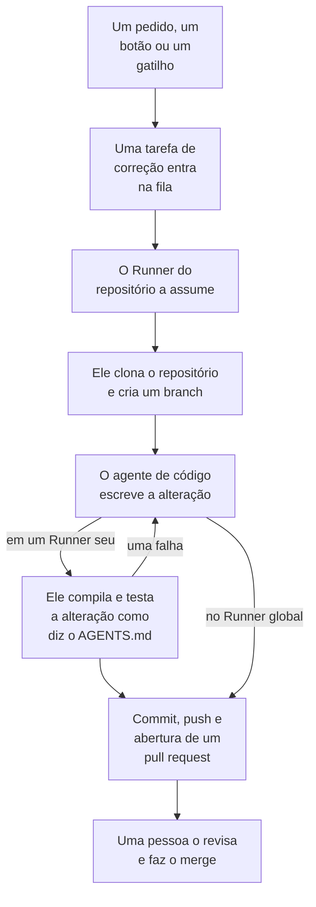

# Código

Código é onde você pede à OneUptime AI que trabalhe nos seus repositórios, como pediria a um agente de programação: corrigir um bug, escrever testes, explicar o código, fazer uma alteração. Ele abre na caixa onde você pede, com o repositório e o branch escolhidos nela e todas as tarefas abaixo; a página de uma tarefa é uma conversa em que você pode responder. O OneUptime também inicia tarefas por conta própria, a partir de exceções, traces e investigações. Um [Runner](/docs/runbooks/agents) clona o repositório, escreve a alteração em um novo branch, compila e testa a alteração e abre um pull request. Uma pessoa revisa e faz o merge de cada um: o Runner pode enviar branches e abrir pull requests, nada além disso.

:::cards
- [Pedir à IA em um repositório](#pedir-à-ia-em-um-repositório): Um pedido com as suas próprias palavras, com o contexto de que ele precisa.
- [A conversa de uma tarefa](#a-conversa-de-uma-tarefa): O que a IA fez, o que ela alterou e a sua resposta.
- [Como funciona uma execução de correção](#como-funciona-uma-execução-de-correção): De um clique a um pull request, passo a passo.
- [Onde as tarefas de correção começam](#onde-as-tarefas-de-correção-começam): As tarefas que o OneUptime inicia, e o que cada pull request faz.
- [Telemetria de produção em uma correção](#telemetria-de-produção-em-uma-correção): O que uma correção lê da produção enquanto escreve a alteração.
- [Revisão de produção de pull requests](#revisão-de-produção-de-pull-requests): O que a produção diz do código que cada pull request altera.
- [Conectar um repositório](#conectar-um-repositório): GitHub, GitLab, Forgejo ou Gitea, ou qualquer servidor Git.
- [Antes de começar](#antes-de-começar): Um modelo, um repositório conectado e um Runner.
- [Quando uma correção falha](#quando-uma-correção-falha): O que acontece com uma execução que falha, trava ou fica esperando.
:::

> [!TIP]
> Você também pode iniciar isso pelo GitHub. Mencione a GitHub App do OneUptime em uma issue ou em um pull request e ela implementa, revisa ou avalia ali mesmo: veja [GitHub App](/docs/ai/github-app). É o mesmo agente, o mesmo Runner e os mesmos orçamentos; só o gatilho muda.

## Pedir à IA em um repositório

:::steps
### Abra o Código

Abra **Produtos → Código**. Ele abre em **O que a IA deve fazer?**: a caixa onde você pede, com todas as tarefas abaixo, as mais recentes primeiro. Se ainda não houver nenhum repositório, ele oferece **Conectar o GitHub** no lugar, com GitLab, Forgejo ou Gitea e qualquer servidor Git abaixo (veja [Conectar um repositório](#conectar-um-repositório)). **Repositórios**, no menu lateral, lista os repositórios em que a IA pode trabalhar, e agrupa em **Não conectado** os que o OneUptime não alcança mais. A página de cada repositório tem a mesma caixa para aquele repositório.

### Escolha o repositório e o branch

A caixa começa no repositório que você escolheu por último. Escolha outro na linha de baixo dela e, ao lado, o branch de onde a tarefa parte: o branch principal do repositório, marcado como **Padrão**, até você escolher outro. A IA cria o branch dela a partir do que você escolher e abre o pull request dela para ele.

### Diga o que você quer

Escreva a alteração, o bug ou a pergunta com as suas próprias palavras. Enquanto nada tiver sido pedido, o Código sugere algumas em **Experimente pedir**.

### Adicione contexto

Clique em **Adicionar contexto** para dar à IA o que ela precisa: um arquivo ou uma pasta do repositório, uma nota, um link ou um registro do projeto. O OneUptime lê cada registro quando você envia o pedido, com as suas permissões, e guarda o que a IA recebeu.

### Inicie a tarefa

Clique em **Iniciar tarefa** ou pressione Enter. A página da tarefa abre, e o trabalho da IA aparece ali à medida que acontece.
:::

| Contexto | O que a IA recebe |
| --- | --- |
| **Arquivo ou pasta** | Um caminho no repositório, que a IA lê primeiro. |
| **Nota** | Um texto que você cola: um erro, uma especificação, uma linha de log. |
| **Link** | Um endereço web, como referência. |
| **Incidente** ou **Alerta** | O estado, a descrição e a causa raiz dele, como estão quando você envia o pedido. |
| **Exceção** | A mensagem e o stack trace dela. |
| **Monitor** | O tipo, o status e a descrição dele. |
| **Traço** | Os spans dele: nomes, tempos e erros. |
| **Registros** | As 20 linhas de log mais recentes que contêm a sua busca, da última hora, do último dia ou da última semana. |
| **Perfil de desempenho** | Para onde vai o tempo de uma função nos perfis do serviço dela: quem a chama, o que ela chama e as linhas mais quentes dela. |

Um pedido leva no máximo 10 itens de contexto. Tokens, chaves, senhas e endereços de e-mail no que o OneUptime lê são ocultados antes que a IA os veja, como em todo lugar em que a OneUptime AI lê os seus dados.

## A conversa de uma tarefa

A página de uma tarefa é uma conversa: o que foi pedido e o contexto adicionado, depois a vez da IA – os passos que ela dá à medida que os dá (os arquivos que leu e editou, o que procurou, os comandos que executou), a resposta dela, os arquivos que alterou com o diff deles, e o pull request. O topo da página diz onde a tarefa trabalha (o repositório dela e o branch de onde partiu), quantas linhas ela alterou, com um botão para o pull request dela, e como a tarefa está:

| Estado | O que significa |
| --- | --- |
| **Na fila** | Espera que um Runner a assuma. |
| **Trabalhando…** | A IA está trabalhando nela. **Parar** a interrompe; o que ela enviou continua no branch. |
| **Aguardando você** | A IA fez uma pergunta. Responda na caixa abaixo. |
| **Concluído** | A IA terminou: a resposta dela, e o pull request quando alterou código. |
| **Falhou** | A vez não pôde terminar, e diz por quê. **Tentar novamente** pede o mesmo outra vez. |
| **Parado** | Alguém a interrompeu. **Tentar novamente** pede o mesmo outra vez. |

Para continuar, escreva na caixa embaixo, que fica à vista enquanto a conversa rola: responda à IA, adicione contexto ou peça alterações. Cada resposta é a próxima vez da mesma tarefa: ela trabalha no mesmo branch e envia para o mesmo pull request enquanto ele estiver aberto. Uma tarefa faz uma vez de cada vez, então a caixa espera enquanto a IA trabalha. O **Registro** de cada vez é o registro literal do que ela fez. Em uma tarefa com mais de uma vez, um seletor no topo da página **Registro** passa de uma vez para outra.

Quem pode ler um repositório lê as tarefas dele. Pedir à IA, responder e parar uma tarefa exigem permissão para editar o repositório, assim como ver o diff de uma alteração: os demais veem quais arquivos mudaram. As tarefas que o OneUptime inicia por conta própria (abaixo) também ficam no repositório delas, como conversas em que você pode responder.

## Como funciona uma execução de correção



1. Você clica em **Iniciar tarefa** no Código, ou em **Corrigir com IA** em uma exceção não resolvida, ou outro botão ou gatilho inicia uma tarefa (veja [Onde as tarefas de correção começam](#onde-as-tarefas-de-correção-começam)).
2. A tarefa entra na fila do repositório dela, e o Runner em que o repositório trabalha a assume: o que ele escolhe, senão o Runner padrão do projeto, senão um Runner global (veja [Escolha o Runner do repositório](#escolha-o-runner-do-repositório)).
3. O Runner busca o contexto da tarefa. Para um pedido, são as palavras dele, o contexto adicionado e a conversa até ali; para uma exceção, o tipo, a mensagem e o stack trace dela.
4. Ele clona o repositório em um espaço de trabalho próprio e cria um branch. Uma correção de uma exceção se chama `oneuptime-fix-exception-` seguido dos primeiros caracteres do id da execução. Um pedido parte do branch escolhido quando foi feito, e o pull request dele abre para esse branch. Uma resposta trabalha, em vez disso, no branch do pull request aberto da tarefa.
5. Um agente de código, movido pelo provedor de LLM do seu projeto, lê o código e escreve a alteração. O servidor do OneUptime faz as chamadas ao LLM, então o Runner nunca tem a chave de API do seu provedor, e cada chamada é medida e listada nos logs de IA. Uma correção de uma exceção, de um trace lento ou de um incidente também lê dados de produção enquanto trabalha: as exceções, os traces, os logs e as métricas dos serviços do repositório (veja [Telemetria de produção em uma correção](#telemetria-de-produção-em-uma-correção)).
6. Em um Runner próprio, o agente de código compila e testa a alteração como diz o `AGENTS.md` do repositório antes de qualquer commit, e corrige o que falha (veja [Verificação antes do pull request](#verificação-antes-do-pull-request)).
7. O Runner faz o commit, envia o branch, abre o pull request (para um pedido, só quando alterou código) e apaga o espaço de trabalho.

A página de onde a tarefa foi iniciada mostra o status dela ao vivo. Toda tarefa aparece no repositório dela, em **Produtos → Código**: a página dela é a conversa, e o **Registro** de cada vez tem uma linha para cada arquivo que o Runner leu ou escreveu e cada comando que executou.

Cada execução fica dentro de orçamentos que o servidor impõe: no máximo **40 chamadas ao LLM** e **100.000 tokens de saída**. As consultas de telemetria de produção de uma execução são descontadas dessas mesmas 40 chamadas. Uma execução que atinge um deles termina com um resumo do trabalho feito até ali em vez de ficar em loop. As execuções de correção também contam para os limites diários de IA do projeto, quando o projeto os define.

## Onde as tarefas de correção começam

| Onde | Clique | O pull request |
| --- | --- | --- |
| A página **AI Assistance** de uma exceção | **Corrigir com IA** | Corrige o bug por trás da exceção. |
| A página **AI Assistance** de uma exceção | **Generate Regression Test** | Adiciona um teste que reproduz a exceção e falha até o bug ser corrigido. |
| A página **AI Assistance** de uma exceção | **Melhorar o tratamento de erros** | Para um erro esperado, como uma entrada inválida: tira os dados do usuário da mensagem, valida a entrada mais cedo e marca o erro como tratado, sem mudar o comportamento. |
| A etapa **Remediação** do cartão **OneUptime AI** de um incidente ou de um alerta | **Abrir pull request de correção** | Corrige a causa raiz que a investigação publicou (veja [Correções de código automáticas a partir de investigações](#correções-de-código-automáticas-a-partir-de-investigações)). |
| Um trace que vale a pena corrigir | **Acelerar com IA** | Corrige o padrão lento que o botão indica, como uma consulta N+1 ou chamadas que poderiam rodar em paralelo. |
| A página **Registros** de um serviço | **Melhorar os registros** | Torna os logs do serviço estruturados, com a severidade certa e ligados aos traces dele, sem mudar o comportamento. |
| A página **Traços** de um serviço | **Melhorar o rastreamento** | Adiciona spans e atributos onde falta tracing no serviço, sem mudar o comportamento. |
| Uma função em **Perfis de desempenho** | **Corrigir com IA** | Faz a função realizar o mesmo trabalho com menos tempo ou memória, com o perfil dela como evidência. |

Esses botões só aparecem onde podem iniciar uma tarefa. Com a IA desativada para o projeto, nenhum deles aparece e o menu lateral de uma exceção não tem **AI Assistance**. **Melhorar os registros** e **Melhorar o rastreamento** aparecem assim que um repositório é conectado e nada impede a IA de trabalhar nele (como o plano, os créditos de IA esgotados ou nenhum Runner online), e **Acelerar com IA** só em um trace que vale a pena corrigir (veja [Explorador de traços](/docs/telemetry/traces-explorer)). O botão **Corrigir com IA** de uma função só aparece no código próprio da aplicação que ocupa pelo menos 5% do tempo ou da memória do perfil, ou cuja participação cresceu 3 pontos ou mais desde a janela com que é comparada (veja [Profiling contínuo](/docs/telemetry/profiles)).

Para abrir a página **AI Assistance** de uma exceção, abra a exceção em **Produtos → Observabilidade → Exceções** e escolha **AI Assistance** no menu lateral. Uma exceção resolvida ou arquivada precisa primeiro ser marcada como não resolvida.

A OneUptime AI também inicia tarefas de correção por conta própria: a partir de uma investigação que encontra uma alteração de código, de uma que termina sem conclusão porque faltou telemetria, e dos AI Insights sobre exceções e traces lentos. Cada uma tem a própria chave; veja [Correções de código automáticas](/docs/ai/ai-sre#correções-automáticas-de-código).

## Telemetria de produção em uma correção

O OneUptime guarda o que o seu código faz em produção, então uma correção não precisa partir apenas de um stack trace. Enquanto o agente de código trabalha, ele pode consultar a telemetria de produção dos serviços do repositório:

| O que ele lê | Para quê |
| --- | --- |
| **Exceções** | Os grupos de exceções lançadas em determinados arquivos ou em uma função: com que frequência nos últimos dias, desde qual versão, e o trace de uma ocorrência recente. |
| **Traços** | O perfil de latência e de erros de um endpoint ou de uma operação, e os spans de um trace. |
| **Registros** | As linhas de log de um serviço, por período, severidade, texto ou trace. |
| **Métricas** | Uma métrica que um serviço reporta, ao longo do tempo; sem um nome, as métricas que ele reporta. |
| **Incidentes** | Os incidentes que afetaram os serviços, ou para os quais uma correção do OneUptime foi aberta neste repositório, com a causa raiz e o post-mortem deles. |
| **Implantações** | As implantações recentes e outras mudanças dos serviços, cada uma com o veredito do OneUptime sobre se ela prejudicou o serviço dela. |

| Tarefa | O que ela verifica |
| --- | --- |
| **Corrigir com IA** em uma exceção | Com que frequência ela é lançada agora e desde qual versão, os logs e o trace de uma ocorrência. |
| **Acelerar com IA** | O volume e a lentidão da operação em todos os traces dela, não só no que foi analisado. Ela não muda nada quando a operação já não está lenta. |
| **Abrir pull request de correção**, e as correções abertas automaticamente a partir de investigações | As implantações anteriores ao incidente, os erros, os logs e as operações lentas dele, e se a causa já tinha ocorrido antes. |
| `@oneuptime review` pelo GitHub | O que a produção diz sobre o código alterado (veja [Avaliações com contexto de produção](/docs/ai/github-app#avaliações-com-contexto-de-produção)). |

A descrição do pull request diz o que o agente consultou e o que isso mostrou. As outras tarefas, como testes de regressão e melhorias de registros ou de rastreamento, não consultam a produção.

O que o agente pode ler é decidido pelo servidor do OneUptime, a partir da própria tarefa:

- **Somente leitura.** As consultas rodam no servidor do OneUptime, nunca no Runner, que não tem nenhuma credencial capaz de ler telemetria. Nada do que elas fazem pode mudar o seu projeto.
- **Este projeto, e apenas os serviços deste repositório.** Você não os associa: são os serviços para os quais o OneUptime encontra este repositório, do mesmo jeito que encontra o repositório de uma correção - os stack traces das exceções deles passam pelos arquivos dele, eles têm o mesmo nome que ele, ou ele é o único repositório do projeto. A telemetria de outro serviço não pode ser lida.
- **Nenhum incidente privado**, e tokens, chaves, senhas e endereços de e-mail são ocultados antes que o agente veja um resultado, como em todo lugar em que a OneUptime AI lê os seus dados.
- **Limitado.** No máximo **12** consultas por execução, cada uma descontada das 40 chamadas da execução.

Quando nenhum serviço corresponde ao repositório, a tarefa roda sem telemetria de produção, como antes.

## Revisão de produção de pull requests

O OneUptime sabe o que o seu código faz em produção, então pode revisar um pull request com o que ninguém vê ao ler o diff. Ative **Revisar pull requests com base na produção**, em **Mais configurações** na página **Configurações** de um repositório em Código, e cada pull request que alguém com acesso de escrita abre ou atualiza recebe um comentário que diz o que a produção mostra do código que ele altera. O comentário é editado no lugar a cada push, e a página **Revisões de produção** do repositório em Código guarda cada revisão, com **Revisar novamente**.

Funciona em repositórios do GitHub, GitLab, Forgejo e Gitea. O GitHub avisa o OneUptime quando um pull request é aberto ou muda; um repositório do GitLab, Forgejo ou Gitea é lido a cada minuto, com o token de acesso dele, em busca dos pull requests que mudaram. No GitLab, cada palavra é a do GitLab: um merge request, e o interruptor se chama **Revisar merge requests com base na produção**.

| O que ela lê | Do código que o pull request altera |
| --- | --- |
| **Exceções** | As exceções lançadas nas linhas, funções e arquivos alterados nos últimos 7 dias, com as novas e as não tratadas marcadas. |
| **Operações** | As operações rastreadas que executam o código alterado na última hora: seus spans, seus erros e seu p95. |
| **Funções custosas** | As funções do código alterado que ocupam uma parte dos perfis dos serviços na última hora. |
| **Incidentes** | Os incidentes dos serviços dos últimos 30 dias que ainda estão abertos, ou cuja causa raiz ou post-mortem cita o código alterado. Nunca um incidente privado. |
| **Implantações** | As implantações dos serviços dos últimos 7 dias que o OneUptime suspeita de uma regressão. |

Quando a produção diz algo, a OneUptime AI lê isso ao lado do diff e acrescenta **O que observar**: alguns pontos curtos, cada um apoiado nos fatos. Ela lê com o provedor de LLM padrão do projeto, a menos que **Provedor LLM da revisão de produção**, em **Mais configurações** na página **Configurações** do repositório, escolha outro provedor do projeto ou um global. Ela só roda enquanto a IA está ativada no projeto, no máximo 10 vezes por dia para um pull request e 100 para um repositório, e é medida como toda chamada de IA; os fatos são lidos sempre, sem ela. Quando a produção não mostra nada sobre a alteração, o OneUptime não publica nenhum comentário.

- **Apenas agregados.** O comentário contém contagens, durações e nomes de código: nunca a mensagem de uma exceção, uma linha de log, o título de um incidente ou dados pessoais.
- **Repositórios públicos recebem um link.** Qualquer pessoa pode ler os pull requests de um repositório público, então ali o comentário só aponta para a revisão no OneUptime, que só os membros do projeto podem abrir. **Comentário da revisão de produção**, em **Mais configurações** na página **Configurações** do repositório, pode publicar **Apenas um link para a revisão** em todos, ou **A revisão, mesmo em um repositório público**.
- **Colaboradores externos não podem iniciar uma.** Um pull request só é revisado sozinho quando o autor, e quem fez push nele, podem escrever no repositório; no GitLab, Forgejo e Gitea, só o de um branch do próprio repositório. O de qualquer outra pessoa - um colaborador externo, um fork, um bot - é revisado quando alguém com acesso de escrita pede: **Revisar um pull request**, na página **Revisões de produção** do repositório, recebe o número dele, e no GitHub um comentário `@oneuptime production review` nele faz o mesmo. **Revisar novamente**, na página de uma revisão, pede de novo.
- **O token comenta.** No GitLab, Forgejo e Gitea o comentário é publicado com o token de acesso do repositório, como a conta dele. Um token do Forgejo ou Gitea precisa, para isso, de acesso de escrita às issues. Quando o servidor recusa o comentário - um token sem esse acesso, ou uma discussão bloqueada -, a revisão fica só em Código, e a página dela diz isso.
- **Somente leitura.** Uma revisão não clona nada e não executa nada do pull request. O diff e o título dele são dados para a OneUptime AI, nunca instruções: a IA não tem ferramentas, e o que ela escreve é colocado no comentário como texto.

No GitHub, cada revisão também adiciona um check ao commit mais recente do pull request, **OneUptime production review**, com o título **Something in production is worth a look** ou, quando a produção não mostra nada, **Nothing in production runs through these changes**, com a revisão ou o link dela. Ele nunca faz um pull request falhar: termina como neutro ou bem-sucedido, então nenhuma regra de branch espera por ele. Ele precisa da permissão **Checks** da GitHub App com **Read & write** (veja [Defina as permissões](/docs/self-hosted/github-integration#defina-as-permissões)); sem ela, uma revisão publica só o comentário.

O interruptor vem ativado para os repositórios conectados a partir de agora, pelo GitHub App ou por uma conexão do GitLab, Forgejo ou Gitea. Um repositório conectado antes de ele existir o mantém desativado até você ativá-lo.

## Verificação antes do pull request

Um repositório diz como é compilado e testado em um `AGENTS.md` na raiz, o arquivo que os agentes de código leem. Antes de mudar qualquer coisa, o agente de código lê o `AGENTS.md` do repositório (ou o `CLAUDE.md` dele, quando não há `AGENTS.md`) a partir do branch de onde a tarefa parte, e trabalha como ele diz. Sem nenhum dos dois, ele descobre como a partir do `CONTRIBUTING.md` do repositório, do README, dos scripts do pacote, do `Makefile` ou dos workflows de CI. Não há nada a configurar no OneUptime.

| Onde a IA trabalha | O que ela faz com o build e os testes do repositório |
| --- | --- |
| Um dos seus Runners | Compila e testa a alteração antes de o pull request abrir, corrige o que falha e verifica de novo, e diz no resumo quais verificações executou. Cada comando que executa tem 2 minutos, ou até 10 para uma instalação, um build ou uma suíte de testes lenta, sem as credenciais do próprio Runner no ambiente. |
| **Runner global** | Não executa nenhum comando: escreve a mudança e abre o pull request, e a CI do seu repositório a verifica. |

Nada de um pull request que vem de um fork é lido como instruções do repositório: uma revisão recusa esse pull request, e uma avaliação lê o branch base.

### Comandos definidos em um repositório

O Código não pede mais comandos de configuração, build e teste, mas um repositório que os tem, definidos antes ou pela API ou pelo Terraform, os mantém. Eles aparecem somente leitura no cartão **Comandos de build e teste**, em **Mais configurações** na página **Configurações** do repositório, e **Remover comandos** remove os três. Enquanto algum deles estiver definido, cada execução de correção em um Runner próprio também verifica a própria alteração com eles antes de o pull request abrir:

1. Quando o agente de código termina, os comandos são executados em ordem na raiz do repositório, no Runner, no espaço de trabalho clonado. Cada um tem até 15 minutos e roda com `CI=true`, para que nada fique esperando uma resposta; a primeira falha interrompe a rodada.
2. Em caso de falha, o final da saída do comando que falhou volta para o mesmo agente de código como tarefa de reparo, com instruções para corrigir a própria alteração em vez de enfraquecer ou pular testes, e os comandos são executados de novo. Ele faz no máximo **2** tentativas de reparo. Elas compartilham o orçamento de LLM da execução, e as mudanças delas vão no mesmo commit da correção.
3. O resultado, aprovado, falhou ou ignorado (nenhum comando definido, ou um Runner global), é escrito em uma seção Verification da descrição do pull request e registrado no pull request da tarefa.

Uma alteração que continua sem passar na verificação não é descartada: o pull request abre mesmo assim, com uma seção "Verification failed" bem marcada que nomeia o comando que falhou e termina com a saída dele. O trabalho é mantido, e quem revisa decide. Um repositório sem comandos definidos é informado como ignorado, em vez de sugerir um build verde.

Os comandos são configurações do repositório que a sua equipe escreve, executadas no seu próprio Runner: o mesmo modelo de confiança dos passos Bash de um runbook. A IA nunca os escreve nem os altera. Um Runner global, que o OneUptime executa para todos os projetos, nunca os executa: em um Runner global, a correção é escrita e aberta para revisão, a verificação é informada como ignorada e a CI do seu repositório verifica a mudança. [Execute um Runner próprio](#execute-um-runner-próprio) para que as correções sejam compiladas e testadas antes de o pull request abrir.

## Depois do merge de uma correção

Fazer o merge de uma correção não corrige nada até ela rodar. Assim que um pull request de correção passa pelo merge, o OneUptime espera um deploy registrado que o contenha (veja [Deploys e alterações](/docs/telemetry/change-events)) e observa nesse deploy aquilo para o que a correção servia. O pull request da tarefa no Code diz como foi, assim como a página **AI Assistance** da exceção, os registros de IA do incidente e o insight de IA de onde veio a correção:

| Uma correção de | O que é observado | Funcionou | Não funcionou |
| --- | --- | --- | --- |
| Uma exceção | Se a exceção acontece de novo | **Corrigido em produção** | **Ainda acontece após a correção** |
| Um trace lento ou um insight de latência | O p99 da operação que a correção nomeia | **Mais rápido em produção** | **Ainda lento após a correção** |
| A causa raiz de um incidente ou de um alerta | Se o monitor dele gera outro | **Corrigido em produção** | **Aconteceu de novo após a correção** |
| Telemetria, logging ou tracing que faltavam | O que a correção adiciona, e o resto da telemetria do serviço | **Chegando em produção** | **A telemetria parou após a correção** |

Até um deploy entregá-la, a correção mostra **Mesclado, aguardando um deploy**, depois **Implantado, em observação em produção** enquanto é observada. Uma que nenhum deploy registrado contém em 14 dias, ou sobre a qual a produção não pode dizer nada, mostra **Não verificado em produção**. [Correções automáticas de código](/docs/ai/ai-sre#correções-automáticas-de-código) traz as regras. Um teste de regressão, um tratamento de erros melhor, uma revisão e uma solicitação no Code não são observados: a produção não consegue mostrar o que eles mudam.

## Conectar um repositório

Abra **Repositórios** no menu lateral do Código e clique em **Conectar repositórios**: o Código pergunta onde está o seu código e conecta cada lugar do seu jeito. O que a IA faz num repositório depende de onde ele está:

| Onde está o código | Como se conecta | O que a IA faz lá |
| --- | --- | --- |
| **GitHub** | A GitHub App do OneUptime, instalada nos repositórios que ela escolhe. | Tudo o que esta página descreve, com os comandos do GitHub (veja [GitHub App](/docs/ai/github-app)) e um check em cada [revisão de produção](#revisão-de-produção-de-pull-requests). |
| **GitLab**, no GitLab.com ou no seu | Um token de acesso: um token pessoal, de grupo ou de projeto com os escopos `api` e `write_repository`, e pelo menos o papel Developer. | Tarefas e correções, cada alteração num merge request; as [revisões de produção](#revisão-de-produção-de-pull-requests); o seletor de branch; o código por onde passa um stack trace ou um perfil; os commits de um deploy; se uma correção foi mesclada e o que a produção mostrou depois que ela foi entregue. |
| **Forgejo ou Gitea**, no Codeberg ou no seu | Um token de acesso com acesso de leitura e escrita aos repositórios e às issues, e de leitura ao usuário. | O mesmo que no GitLab, cada alteração num pull request. |
| **Qualquer servidor Git**, por HTTPS | O endereço com que você clona o repositório, um nome de usuário e uma senha ou token de acesso que possa ler o repositório e enviar para ele. | A IA clona o repositório e envia cada alteração para um novo branch, que a resposta dela nomeia: você abre o pull request. No Bitbucket e no Azure DevOps, ela leva até onde você o abre. |

Comandos em comentários precisam da GitHub App, por isso só funcionam, por enquanto, em repositórios do GitHub, e as **Configurações** do repositório dizem isso. Um servidor Git não tem pull requests, então também não tem revisão de produção.

Para GitLab, Forgejo ou Gitea, insira o endereço do servidor (GitLab.com e Codeberg vêm preenchidos) e o token, e escolha os repositórios a conectar: a lista oferece só aqueles para os quais o token pode enviar, e conectar mais depois pode reaproveitar o token. O OneUptime verifica cada token com o servidor dele antes de guardá-lo, guarda-o criptografado e nunca mais o mostra. As **Configurações** do repositório mostram o servidor, a conta e os últimos caracteres do token, com **Substituir o token de acesso**. Quando o servidor recusa um token expirado ou revogado, os repositórios dele mostram **Token recusado** e a IA para de trabalhar neles, até que substituir o token conecte de novo todos os repositórios que o usam. Em um repositório do GitLab, as configurações falam em merge requests, como o GitLab: **Merge requests**, **Merge requests de correção de IA** e **Máximo de merge requests de correção abertos**.

### Um servidor Git numa rede privada

O OneUptime Cloud só alcança servidores Git na internet, nunca um endereço privado, de loopback ou link-local. Conecte um servidor que só a sua rede alcança como **Qualquer servidor Git**: o Código diz que não consegue alcançá-lo, e **Conectar mesmo assim** o conecta para um dos seus próprios Runners nessa rede. Escolha esse Runner no cartão **Runner** do repositório (veja [Escolha o Runner do repositório](#escolha-o-runner-do-repositório)). Um Runner global nunca trabalha nele, e o OneUptime não lê nada dele no servidor, então o seletor de branch oferece só o branch principal. Um OneUptime auto-hospedado, e o Runner global dele, alcançam os servidores Git da própria rede.

## Antes de começar

Uma tarefa precisa de três coisas. A caixa de pedidos do Código e a página **AI Assistance** da exceção verificam as três antes de oferecer o início, e dizem o que falta.

| O quê | OneUptime Cloud | Auto-hospedado |
| --- | --- | --- |
| Um provedor de LLM | Nada a configurar: um projeto sem provedor próprio usa o provedor global, pago com os créditos de IA do projeto. Um provedor seu, em **Configurações do projeto → IA → Provedores LLM**, tem prioridade. | Defina uma vez as variáveis de ambiente `GLOBAL_LLM_PROVIDER_*` no servidor, ou adicione um provedor ao projeto. |
| Um repositório conectado pela GitHub App | **Produtos → Código**, depois **Conectar o GitHub**. Se a app já estiver instalada na conta do GitHub, clique em **Conectar uma instalação existente** em vez disso: instalá-la de novo não a conecta. Requer o plano Growth. | O mesmo, assim que a sua instância tiver uma GitHub App (veja [Integração com o GitHub](/docs/self-hosted/github-integration)). |
| Ou um repositório no GitLab, Forgejo ou Gitea, ou em qualquer servidor Git | **Repositórios** no Código, depois **Conectar repositórios** (veja [Conectar um repositório](#conectar-um-repositório)). Requer o plano Growth. | O mesmo, sem GitHub App para configurar. |
| Um Runner que executa correções de código por IA | Nada a operar: um repositório que não escolhe nenhum trabalha no Runner padrão do projeto ou, sem ele, nos Runners globais do OneUptime. | Nada a operar: o Runner global incluído (`global-runner` no Docker Compose, `globalRunner` no chart Helm, ativado por padrão), e todo Runner global que um administrador principal adiciona, executam correções de código por IA em todo repositório que trabalha em um Runner global. |

Em uma instância auto-hospedada, o provedor global é um bloco do `config.env` (Docker Compose) ou dos seus valores do Helm. Para um Ollama auto-hospedado:

```bash
GLOBAL_LLM_PROVIDER_TYPE=Ollama
# An address the OneUptime server can reach, never localhost.
GLOBAL_LLM_PROVIDER_BASE_URL=http://ollama:11434
GLOBAL_LLM_PROVIDER_MODEL_NAME=llama3.1
# No GLOBAL_LLM_PROVIDER_API_KEY needed — Ollama is keyless.
```

Qualquer provedor compatível funciona: veja [Provedores LLM](/docs/ai/llm-provider) para todos eles e cada variável de ambiente.

Você não associa repositórios a serviços. Quando uma tarefa começa, o OneUptime encontra o repositório comparando os caminhos de arquivo do stack trace da exceção com os seus repositórios conectados. Quando nada corresponde, ele recorre a um repositório com o mesmo nome do serviço e, depois, ao único repositório do projeto, quando há só um. A página **AI Assistance** mostra qual repositório ele encontrou.

### Escolha o Runner do repositório

Cada repositório escolhe o Runner em que a IA trabalha nele: na página **Configurações** dele em Código, abra **Mais configurações**, clique em **Editar** no cartão **Runner** e escolha um. Um repositório que não escolhe nenhum trabalha no [Runner padrão](/docs/runbooks/agents#o-runner-padrão-do-projeto) do projeto, a primeira opção, marcada como **Padrão do projeto**, e acompanha a mudança quando outro Runner se torna o padrão. Em um projeto sem Runner padrão, ele trabalha no **Runner global**, que o OneUptime executa para todos os projetos. Para manter um repositório no **Runner global** enquanto o projeto tem um Runner padrão, escolha-o.

| Runner | O que ele faz com uma tarefa |
| --- | --- |
| **Runner global** | Escreve a mudança e abre o pull request sem compilá-la nem testá-la: a CI do seu repositório verifica a mudança. |
| Um dos seus Runners | Também compila e testa a mudança como diz o `AGENTS.md` do repositório, em um host que você controla. |

Só o Runner em que um repositório trabalha recebe as tarefas dele e um token para ele. Em um projeto que desativa **Usar Runners globais** em **Runbooks → Agentes de runbook**, cada repositório precisa de um dos Runners do próprio projeto: o que ele escolhe, ou o Runner padrão do projeto. A página de um Runner lista os repositórios que trabalham nele.

### Execute um Runner próprio

Para executar um Runner em outro lugar, por exemplo em uma máquina perto dos seus repositórios:

:::steps
### Crie o Runner

Crie um Runner em **Runbooks → Agentes de runbook** e clique em **Mostrar instruções de configuração** na linha dele. O comando inclui a chave secreta do Runner, que só um Project Owner, Project Admin ou Runbook Admin pode ler. Ele se parece com isto:

```bash
docker run --name oneuptime-runner --restart unless-stopped \
  -e ONEUPTIME_RUNNER_ID=<runner-id> \
  -e ONEUPTIME_RUNNER_KEY=<runner-key> \
  -e ONEUPTIME_URL=<your-oneuptime-url> \
  -d oneuptime/runner:release
```

### Escolha-o para o repositório

Na página **Configurações** do repositório em Código, abra **Mais configurações**, clique em **Editar** no cartão **Runner** e escolha o Runner. O Runner percebe a mudança no próximo heartbeat, em cerca de um minuto; não há nada para reiniciar.

### Verifique se ele se conecta

O Runner aparece como conectado na página **Runbooks → Agentes de runbook** em um ou dois minutos. Se não aparecer, leia o log do contêiner (`docker logs oneuptime-runner`) em busca de um erro de credenciais ou de rede.
:::

Qualquer forma de executar o contêiner funciona (Docker Compose, Kubernetes e assim por diante), desde que ele tenha estas variáveis e consiga alcançar a sua instância do OneUptime por HTTPS:

| Variável | O que é |
| --- | --- |
| `ONEUPTIME_RUNNER_ID` | O id do Runner, do painel. |
| `ONEUPTIME_RUNNER_KEY` | A chave secreta do Runner. |
| `ONEUPTIME_URL` | O endereço da sua instância do OneUptime (`https://oneuptime.com` no OneUptime Cloud). |

> [!NOTE]
> Antes do OneUptime 12, as correções de código por IA rodavam em um componente AI Agent separado (a imagem `oneuptime/ai-agent` com variáveis `AI_AGENT_*`). Ele foi incorporado ao Runner: se você ainda executa um, o [guia de atualização da v11 para a v12](/docs/installation/upgrading) explica como substituí-lo.

## Correções de código automáticas a partir de investigações

Quando uma [investigação de IA](/docs/ai/ai-sre) publica uma análise de causa raiz em um incidente ou um alerta, e a classificação cuidadosa dela recomenda uma mudança no código, a etapa **Remediação** do cartão **OneUptime AI** oferece **Abrir pull request de correção**: uma tarefa de correção cujo contexto inteiro é a análise publicada. Ela não é oferecida quando a solução é operacional, apenas de infraestrutura, externa, uma negação esperada, um erro do usuário ou inconclusiva. As correções elegíveis acontecem sem o clique enquanto **Corrigir novos incidentes automaticamente** estiver ativado em **Incidentes → IA → Configurações** (e **Corrigir novos alertas automaticamente** em **Alertas → IA → Configurações**). A correção começa desativada, inclusive em projetos novos. Sem regras de IA, cada correção elegível é aberta; com regras, só uma para o que corresponde a uma regra, quando a regra tem **Pull requests de correção** ativado (uma regra nova tem), nos repositórios de código que ela nomeia.

Enquanto a correção estiver ativada, uma investigação que termina com uma causa raiz segura e comprovada, que uma alteração de código pode corrigir, coloca na fila a mesma tarefa de correção que o botão cria. A decisão é uma classificação restrita que o servidor verifica, nunca um padrão buscado no texto da análise: só um veredito positivo de correção de código abre um pull request. Falta de evidências, uma solução fora do código e uma classificação que falhou terminam todas sem fazer nada.

Todo o resto é igual ao botão:

- O pull request abre pronto para revisão, escrito a partir da análise publicada, e precisa de um repositório conectado, um dos que as regras correspondentes nomeiam quando nomeiam algum, e de um Runner online para trabalhar nele: o que o repositório escolhe, ou um Runner global.
- Ele conta para o limite diário de tarefas de correção daquele sinal (**Daily Incident AI Fix Task Limit** ou **Daily Alert AI Fix Task Limit**, em **Mais configurações** na página de configurações de IA dele) e para o teto de pull requests abertos do repositório, quando algum deles está definido. Sem definição, nenhum deles limita nada.
- Cada gatilho procura primeiro uma tarefa de correção já na fila ou em execução para o mesmo incidente ou alerta, então um gatilho automático e um clique normalmente viram uma única tarefa, não dois pull requests. A verificação é uma leitura antes da escrita, não um bloqueio, então dois gatilhos no mesmo instante ainda podem passar os dois.
- A execução é escrita pelo sistema, não é atribuída a ninguém, e nada é mesclado sozinho.

## Quando uma correção falha

:::details A execução falha
A correção não pôde ser aplicada, o repositório ou o branch de onde um pedido partiu não pôde ser acessado, ou a chamada ao LLM falhou. A conversa da tarefa, e a página de onde ela foi iniciada, mostram o motivo e oferecem tentar de novo. O **Registro** da vez tem o log completo da execução.
:::

:::details O Runner para no meio de uma execução
Uma execução cujo heartbeat está em silêncio há mais de 12 minutos é encerrada com um erro. Ela nunca volta para a fila sozinha, porque o Runner pode já ter enviado parte de um branch de correção; inicie-a de novo de onde você a iniciou. Um comando que o agente de código executa mantém o heartbeat enquanto roda, então um build ou uma suíte de testes longa não é confundido com um Runner parado.
:::

:::details Nenhum Runner assume a tarefa
Uma tarefa que espera mais de 30 minutos enquanto o Runner que deve assumi-la não está conectado - o que o repositório dela escolhe, o Runner padrão do projeto para um repositório que não escolhe nenhum, ou um Runner global - falha, com uma mensagem que diz qual, então ela nunca aparece em andamento para sempre. Quando um Runner está online mas ocupado, as tarefas na fila esperam a vez delas. Um Runner anterior a Código nunca recebe um pedido de Código: atualize um Runner que você mesmo executa junto com o servidor.
:::

## Privacidade

O clone do seu repositório fica em um espaço de trabalho dentro do contêiner do Runner e é apagado quando a execução termina, com sucesso ou não. O Runner nunca tem a chave de API do seu provedor de LLM: o servidor do OneUptime faz as chamadas ao LLM por ele, e também executa as consultas de telemetria de produção. O OneUptime não guarda o seu repositório e não treina com o seu código. O log da tarefa guarda os primeiros 300 caracteres da saída de cada passo, para você poder verificar o que o Runner fez, e isso pode incluir trechos de código. Execute um Runner auto-hospedado com o seu próprio provedor de LLM (Ollama local incluído), e o seu código nunca sai da sua infraestrutura.

## Próximos passos

:::cards
- [GitHub App](/docs/ai/github-app): Peça uma alteração, uma revisão ou uma avaliação pelo próprio GitHub.
- [AI SRE](/docs/ai/ai-sre): As investigações cujas análises as tarefas de correção podem transformar em pull requests.
- [Agentes de runbook](/docs/runbooks/agents): O worker que realiza cada execução de correção.
:::
