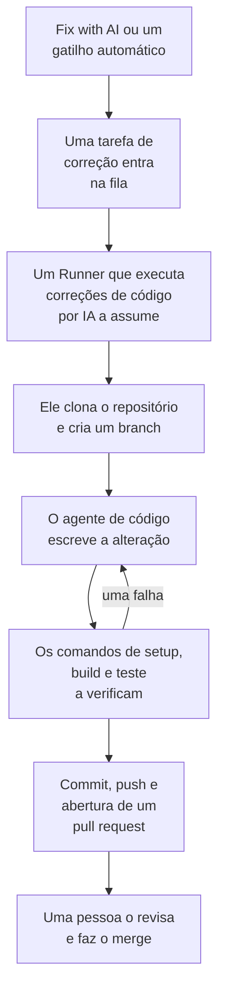

# Tarefas de correção

Uma tarefa de correção é um pull request que a OneUptime AI escreve no seu código. Você inicia uma a partir de uma exceção, um trace, um serviço ou uma investigação, ou o OneUptime inicia uma por conta própria; um [Runner](/docs/runbooks/agents) clona o repositório, escreve a alteração em um novo branch, compila e testa a alteração e abre um pull request. Uma pessoa revisa e faz o merge de cada um: o Runner pode enviar branches e abrir pull requests, nada além disso.

:::cards
- [Como funciona uma execução de correção](#como-funciona-uma-execução-de-correção): De um clique a um pull request, passo a passo.
- [Onde as tarefas de correção começam](#onde-as-tarefas-de-correção-começam): Os botões que iniciam uma, e o que cada pull request faz.
- [Antes de começar](#antes-de-começar): Um modelo, um repositório conectado e um Runner.
- [Quando uma correção falha](#quando-uma-correção-falha): O que acontece com uma execução que falha, trava ou fica esperando.
:::

> [!TIP]
> Você também pode iniciar isso pelo GitHub. Mencione a GitHub App do OneUptime em uma issue ou em um pull request e ela implementa, revisa ou avalia ali mesmo: veja [GitHub App](/docs/ai/github-app). É o mesmo agente, o mesmo Runner e os mesmos orçamentos; só o gatilho muda.

## Como funciona uma execução de correção



1. Você clica em **Fix with AI** em uma exceção não resolvida, ou outro botão ou gatilho inicia uma tarefa (veja [Onde as tarefas de correção começam](#onde-as-tarefas-de-correção-começam)).
2. A tarefa entra na fila, e um Runner disponível com **Executa correções de código por IA** ativado a assume.
3. O Runner busca o contexto da tarefa. Para uma exceção, são o tipo, a mensagem e o stack trace dela.
4. Ele clona o repositório em um espaço de trabalho próprio e cria um branch. Uma correção de uma exceção se chama `oneuptime-fix-exception-` seguido dos primeiros caracteres do id da execução.
5. Um agente de código, movido pelo provedor de LLM do seu projeto, lê o código e escreve a alteração. O servidor do OneUptime faz as chamadas ao LLM, então o Runner nunca tem a chave de API do seu provedor, e cada chamada é medida e listada nos logs de IA.
6. Se o repositório tiver comandos de verificação, um Runner próprio compila e testa a alteração antes de fazer qualquer commit, e devolve uma falha ao agente de código para ser corrigida (veja [Verificação antes do pull request](#verificação-antes-do-pull-request)).
7. O Runner faz o commit, envia o branch, abre o pull request e apaga o espaço de trabalho.

A página de onde a tarefa foi iniciada mostra o status dela ao vivo. Toda tarefa aparece em **Produtos → Código → Tarefas**: abra uma para ver a **Visão geral**, os **Registros** (uma linha para cada arquivo que o Runner leu ou escreveu e cada comando que executou) e os **Pull Requests**.

Cada execução fica dentro de orçamentos que o servidor impõe: no máximo **40 chamadas ao LLM** e **100.000 tokens de saída**. Uma execução que atinge um deles termina com um resumo do trabalho feito até ali em vez de ficar em loop. As execuções de correção também contam para os limites diários de IA do projeto, quando o projeto os define.

## Onde as tarefas de correção começam

| Onde | Clique | O pull request |
| --- | --- | --- |
| A página **AI Assistance** de uma exceção | **Fix with AI** | Corrige o bug por trás da exceção. |
| A página **AI Assistance** de uma exceção | **Generate Regression Test** | Adiciona um teste que reproduz a exceção e falha até o bug ser corrigido. |
| A página **AI Assistance** de uma exceção | **Improve Error Handling** | Para um erro esperado, como uma entrada inválida: tira os dados do usuário da mensagem, valida a entrada mais cedo e marca o erro como tratado, sem mudar o comportamento. |
| O cartão **AI Investigation** de um incidente ou de um alerta | **Open Fix PR from this analysis** | Corrige a causa raiz que a investigação publicou (veja [Correções de código automáticas a partir de investigações](#correções-de-código-automáticas-a-partir-de-investigações)). |
| Um trace | **Fix performance with AI** | Corrige o padrão lento encontrado no trace, como consultas N+1 ou um único span lento dominante. |
| A página **Registros** de um serviço | **Improve Logging** | Torna os logs do serviço estruturados, com a severidade certa e ligados aos traces dele, sem mudar o comportamento. |
| A página **Traços** de um serviço | **Improve Tracing** | Adiciona spans e atributos onde falta tracing no serviço, sem mudar o comportamento. |

Para abrir a página **AI Assistance** de uma exceção, abra a exceção em **Produtos → Observabilidade → Exceções** e escolha **AI Assistance** no menu lateral. Uma exceção resolvida ou arquivada precisa primeiro ser marcada como não resolvida.

A OneUptime AI também inicia tarefas de correção por conta própria: a partir de uma investigação que encontra uma alteração de código, de uma que termina sem conclusão porque faltou telemetria, e dos AI Insights sobre exceções e traces lentos. Cada uma tem a própria chave; veja [Correções de código automáticas](/docs/ai/ai-sre#correções-automáticas-de-código).

## Verificação antes do pull request

Um repositório de código pode ter até três comandos de verificação na página **Configurações** dele, em **Repositórios de código**:

| Comando | Exemplo | Quando é executado |
| --- | --- | --- |
| **Setup Command** | `npm ci` | Primeiro, para instalar as dependências. |
| **Build Command** | `npm run build` | Depois do setup. |
| **Test Command** | `npm test` | Por último. |

Quando algum deles está definido, cada execução de correção verifica a própria alteração antes de o pull request abrir:

1. Quando o agente de código termina, os comandos são executados em ordem na raiz do repositório, no Runner, no espaço de trabalho clonado. Cada um tem até 15 minutos e roda com `CI=true`, para que nada fique esperando uma resposta; a primeira falha interrompe a rodada.
2. Em caso de falha, o final da saída do comando que falhou volta para o mesmo agente de código como tarefa de reparo, com instruções para corrigir a própria alteração em vez de enfraquecer ou pular testes, e os comandos são executados de novo. Ele faz no máximo **2** tentativas de reparo. Elas compartilham o orçamento de LLM da execução, e as mudanças delas vão no mesmo commit da correção.
3. O resultado, aprovado, falhou ou ignorado (nenhum comando definido, ou um Runner compartilhado), é escrito em uma seção Verification da descrição do pull request e registrado no pull request da tarefa.

Uma alteração que continua sem passar na verificação não é descartada: o pull request abre mesmo assim, com uma seção "Verification failed" bem marcada que nomeia o comando que falhou e termina com a saída dele. O trabalho é mantido, e quem revisa decide. Um repositório sem comandos definidos é informado como ignorado, em vez de sugerir um build verde.

Os comandos são configurações do repositório que a sua equipe escreve, executadas no seu próprio Runner: o mesmo modelo de confiança dos passos Bash de um runbook. A IA nunca os escreve nem os altera. Os Runners compartilhados do OneUptime nunca os executam: em um Runner compartilhado, a correção é escrita e aberta para revisão, a verificação é informada como ignorada e a CI do seu repositório verifica a mudança. [Execute um Runner próprio](#execute-um-runner-próprio) para que as correções sejam compiladas e testadas antes de o pull request abrir.

## Antes de começar

Uma tarefa de correção precisa de três coisas. A página **AI Assistance** da exceção verifica as três antes de oferecer o início, e diz o que falta.

| O quê | OneUptime Cloud | Auto-hospedado |
| --- | --- | --- |
| Um provedor de LLM | Nada a configurar: um projeto sem provedor próprio usa o provedor global, pago com os créditos de IA do projeto. Um provedor seu, em **Configurações do projeto → IA → Provedores LLM**, tem prioridade. | Defina uma vez as variáveis de ambiente `GLOBAL_LLM_PROVIDER_*` no servidor, ou adicione um provedor ao projeto. |
| Um repositório conectado pela GitHub App | **Produtos → Código → Tarefas**, depois **Repositórios de código** e **Connect with GitHub App**. Se a app já estiver instalada na conta do GitHub, clique em **Conectar uma instalação existente** em vez disso: instalá-la de novo não a conecta. Requer o plano Growth. | O mesmo, assim que a sua instância tiver uma GitHub App (veja [Integração com o GitHub](/docs/self-hosted/github-integration)). |
| Um Runner que executa correções de código por IA | Nada a operar: os Runners compartilhados do OneUptime fazem isso. | O serviço `runner` do Docker Compose, ou o Runner do chart Helm (`runner.enabled`, ativado por padrão), se registra sozinho e executa correções de código por IA. |

Em uma instância auto-hospedada, o provedor global é um bloco do `config.env` (Docker Compose) ou dos seus valores do Helm. Para um Ollama auto-hospedado:

```bash
GLOBAL_LLM_PROVIDER_TYPE=Ollama
# An address the OneUptime server can reach, never localhost.
GLOBAL_LLM_PROVIDER_BASE_URL=http://ollama:11434
GLOBAL_LLM_PROVIDER_MODEL_NAME=llama3.1
# No GLOBAL_LLM_PROVIDER_API_KEY needed — Ollama is keyless.
```

Qualquer provedor compatível funciona: veja [Provedores LLM](/docs/ai/llm-provider) para todos eles e cada variável de ambiente.

Você não associa repositórios a serviços. Quando uma tarefa começa, o OneUptime encontra o repositório comparando os caminhos de arquivo do stack trace da exceção com os seus repositórios conectados. Quando nada corresponde, ele recorre a um repositório com o mesmo nome do serviço e, depois, ao único repositório do projeto, quando há só um. A página **AI Assistance** mostra qual repositório ele encontrou.

### Execute um Runner próprio

Para executar um Runner em outro lugar, por exemplo em uma máquina perto dos seus repositórios:

:::steps
### Crie o Runner

Crie um Runner em **Runbooks → Agentes de runbook** e clique em **Mostrar instruções de configuração** na linha dele. O comando inclui a chave secreta do Runner, que só um Project Owner, Project Admin ou Runbook Admin pode ler. Ele se parece com isto:

```bash
docker run --name oneuptime-runner --restart unless-stopped \
  -e ONEUPTIME_RUNNER_ID=<runner-id> \
  -e ONEUPTIME_RUNNER_KEY=<runner-key> \
  -e ONEUPTIME_URL=<your-oneuptime-url> \
  -d oneuptime/runner:release
```

### Ative as correções de código por IA

Ative **Executa correções de código por IA** no Runner. Fica desativado por padrão, e o Runner percebe a mudança no próximo heartbeat, em cerca de um minuto; não há nada para reiniciar.

### Verifique se ele se conecta

O Runner aparece como conectado na página **Runbooks → Agentes de runbook** em um ou dois minutos. Se não aparecer, leia o log do contêiner (`docker logs oneuptime-runner`) em busca de um erro de credenciais ou de rede.
:::

Qualquer forma de executar o contêiner funciona (Docker Compose, Kubernetes e assim por diante), desde que ele tenha estas variáveis e consiga alcançar a sua instância do OneUptime por HTTPS:

| Variável | O que é |
| --- | --- |
| `ONEUPTIME_RUNNER_ID` | O id do Runner, do painel. |
| `ONEUPTIME_RUNNER_KEY` | A chave secreta do Runner. |
| `ONEUPTIME_URL` | O endereço da sua instância do OneUptime (`https://oneuptime.com` no OneUptime Cloud). |

> [!NOTE]
> Antes do OneUptime 12, as correções de código por IA rodavam em um componente AI Agent separado (a imagem `oneuptime/ai-agent` com variáveis `AI_AGENT_*`). Ele foi incorporado ao Runner: se você ainda executa um, o [guia de atualização da v11 para a v12](/docs/installation/upgrading) explica como substituí-lo.

## Correções de código automáticas a partir de investigações

Quando uma [investigação de IA](/docs/ai/ai-sre) publica uma análise de causa raiz em um incidente ou um alerta, e a classificação cuidadosa dela recomenda uma mudança no código, o cartão da investigação oferece **Open Fix PR from this analysis**: uma tarefa de correção cujo contexto inteiro é a análise publicada. O botão fica oculto quando a solução é operacional, apenas de infraestrutura, externa, uma negação esperada, um erro do usuário ou inconclusiva. As correções elegíveis acontecem sem o clique enquanto a chave **Abrir um pull request de correção quando uma investigação encontra uma alteração de código** estiver ativada. Ela faz parte da correção: fica sob **Corrigir novos incidentes automaticamente** em **Incidentes → IA → Configurações** (e sob **Corrigir novos alertas automaticamente** em **Alertas → IA → Configurações**), é ativada quando a correção é ativada e só abre pull requests enquanto a correção estiver ativada. Ambas começam desativadas, inclusive em projetos novos.

Enquanto ela estiver ativada, uma investigação que termina com uma causa raiz segura e comprovada, que uma alteração de código pode corrigir, coloca na fila a mesma tarefa de correção que o botão cria. A decisão é uma classificação restrita que o servidor verifica, nunca um padrão buscado no texto da análise: só um veredito positivo de correção de código abre um pull request. Falta de evidências, uma solução fora do código e uma classificação que falhou terminam todas sem fazer nada.

Todo o resto é igual ao botão:

- O pull request abre pronto para revisão, escrito a partir da análise publicada, e precisa de um repositório conectado pela GitHub App e de um Runner com **Executa correções de código por IA** ativado.
- Ele conta para o limite diário de tarefas de correção daquele sinal (**Daily Incident AI Fix Task Limit** ou **Daily Alert AI Fix Task Limit**, em **Mais configurações** na página de configurações de IA dele) e para o teto de pull requests abertos do repositório, quando algum deles está definido. Sem definição, nenhum deles limita nada.
- Cada gatilho procura primeiro uma tarefa de correção já na fila ou em execução para o mesmo incidente ou alerta, então um gatilho automático e um clique normalmente viram uma única tarefa, não dois pull requests. A verificação é uma leitura antes da escrita, não um bloqueio, então dois gatilhos no mesmo instante ainda podem passar os dois.
- A execução é escrita pelo sistema, não é atribuída a ninguém, e nada é mesclado sozinho.

## Quando uma correção falha

:::details A execução falha
A correção não pôde ser aplicada, o repositório não pôde ser acessado ou a chamada ao LLM falhou. A página de onde a tarefa foi iniciada mostra o motivo e oferece tentar de novo. A página **Registros** da tarefa tem o log completo da execução.
:::

:::details O Runner para no meio de uma execução
Uma execução cujo heartbeat está em silêncio há mais de 12 minutos é encerrada com um erro. Ela nunca volta para a fila sozinha, porque o Runner pode já ter enviado parte de um branch de correção; inicie-a de novo de onde você a iniciou.
:::

:::details Nenhum Runner assume a tarefa
Uma tarefa que espera mais de 30 minutos enquanto nenhum Runner com **Executa correções de código por IA** está conectado falha, com uma mensagem para verificar o Runner, então ela nunca aparece em andamento para sempre. Quando um Runner está online mas ocupado, as tarefas na fila esperam a vez delas.
:::

## Privacidade

O clone do seu repositório fica em um espaço de trabalho dentro do contêiner do Runner e é apagado quando a execução termina, com sucesso ou não. O Runner nunca tem a chave de API do seu provedor de LLM: o servidor do OneUptime faz as chamadas ao LLM por ele. O OneUptime não guarda o seu repositório e não treina com o seu código. O log da tarefa guarda os primeiros 300 caracteres da saída de cada passo, para você poder verificar o que o Runner fez, e isso pode incluir trechos de código. Execute um Runner auto-hospedado com o seu próprio provedor de LLM (Ollama local incluído), e o seu código nunca sai da sua infraestrutura.

## No roadmap

Planejado, e **ainda não disponível**:

- **Suporte ao GitLab.** Os repositórios se conectam apenas pela GitHub App.
- **Mais telemetria em uma correção.** Levar para a correção os traces, os logs e as métricas em torno de uma exceção, além do stack trace.

## Próximos passos

:::cards
- [GitHub App](/docs/ai/github-app): Peça uma alteração, uma revisão ou uma avaliação pelo próprio GitHub.
- [AI SRE](/docs/ai/ai-sre): As investigações cujas análises as tarefas de correção podem transformar em pull requests.
- [Agentes de runbook](/docs/runbooks/agents): O worker que realiza cada execução de correção.
:::
