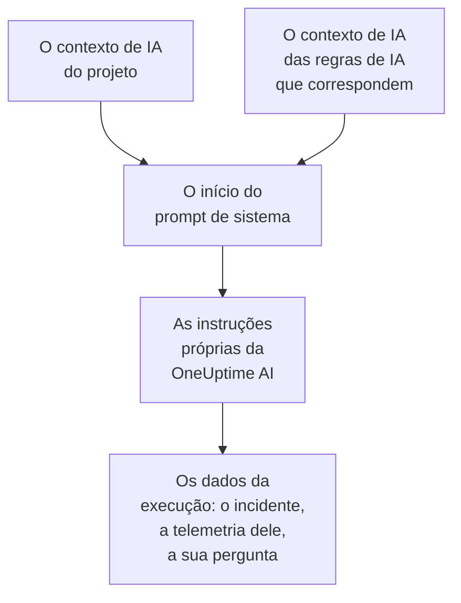

# Contexto de IA

O contexto de IA é o que a sua equipe escreve para a OneUptime AI sobre os seus próprios sistemas: como eles se encaixam, de quem é cada sintoma, onde estão os logs e as palavras que a sua equipe usa. A OneUptime AI o lê primeiro em toda investigação, toda correção, todo rascunho de post-mortem e toda conversa do Pergunte à IA, e assim começa pelo que a sua equipe já sabe.

:::cards
- [Escrever o contexto de IA](#escrever-o-contexto-de-ia): Um cartão nas configurações de IA do projeto.
- [As notas próprias de uma regra de IA](#as-notas-próprias-de-uma-regra-de-ia): Notas sobre o que uma regra abrange.
- [O que o lê](#o-que-o-lê): Os recursos que o leem, e os que não o leem.
- [O que uma execução leu](#o-que-uma-execução-leu): Cada execução mostra as notas que recebeu.
:::

## Como funciona

A OneUptime AI coloca o contexto de IA bem no início do seu prompt de sistema, antes das próprias instruções e dos dados da execução: primeiro as notas do projeto, depois as das regras de IA que correspondem. Ela as lê como o conhecimento de fundo da sua equipe. Elas não são prova do que está acontecendo agora, e nunca mudam as regras próprias da OneUptime AI.

Como as notas vêm primeiro e continuam iguais de uma execução para a outra, elas fazem parte do início do prompt que os provedores guardam em cache. Com a Anthropic, a OneUptime marca o prompt de sistema para o cache; a OpenAI, o Azure OpenAI e os outros provedores que guardam em cache o início repetido de um prompt fazem isso por conta própria. Notas que não mudaram custam menos para ser lidas de novo.

## Escrever o contexto de IA

:::steps
### Abrir AI Features
Abra **Configurações do projeto → IA → AI Features**. O cartão **Contexto de IA** fica abaixo de **Habilitar IA**.

### Escrever as notas
Clique em **Adicionar contexto de IA**, ou em **Editar** quando já houver notas. Escreva em Markdown, ou clique em **Começar com uma estrutura** para ter um título para cada tipo de nota.

### Salvá-las
Clique em **Salvar alterações**. O cartão mostra as notas, o tamanho delas e mais ou menos quantos tokens um modelo lê para elas.
:::

Escreva o que você contaria a alguém que acabou de entrar na equipe:

| Tipo de nota | Por exemplo |
| --- | --- |
| Como os seus sistemas se encaixam | `checkout-api` serve a página de pagamento e depende de `payments-db`. |
| De quem é cada sintoma | Um 502 na página de pagamento é da equipe de Pagamentos: verifique `payments-db` primeiro. |
| Onde estão os logs | Os logs do pagamento ficam no Loki em `app=checkout`. |
| As palavras da sua equipe | PSP é o nosso provedor de serviços de pagamento. |

> [!WARNING]
> Não coloque segredos: qualquer pessoa que possa ver o que uma execução de IA fez pode ler as notas que ela recebeu.

## As notas próprias de uma regra de IA

Uma regra de IA pode ter notas próprias sobre os incidentes ou alertas que ela abrange: os serviços de um produto, os responsáveis por eles, onde ficam os logs. Escreva-as no campo **Contexto de IA** da regra, em **Mais campos**, depois de **Provedor LLM**. Uma regra que só executa os seus runbooks todas as vezes não pede nada à OneUptime AI, então não tem contexto de IA para escrever.

- Uma investigação lê as notas do projeto e depois as de cada regra de IA habilitada que investiga e corresponde ao incidente ou ao alerta, na ordem dos nomes das regras.
- Uma correção lê as notas do projeto e depois as da sua própria regra.
- A conversa sobre um incidente ou um alerta lê as mesmas notas que a investigação dele.

## O que o lê

| Recurso | O que ele lê |
| --- | --- |
| As investigações do AI SRE, e as novas verificações delas quando um novo alerta é aberto | As notas do projeto, e as das regras de IA que correspondem |
| As correções que uma regra de IA inicia: os planos, comandos e servidores MCP delas | As notas do projeto, e as da regra |
| O Pergunte à IA, e a conversa sobre um incidente ou um alerta | As notas do projeto; em um incidente ou um alerta, também as das regras de IA que correspondem |
| As respostas no Slack e no Microsoft Teams | As notas do projeto |
| Os rascunhos de post-mortem, de incidentes e de episódios | As notas do projeto |
| A triagem do AI Insights e a dos casos de segurança | As notas do projeto |

As chamadas que só reformulam ou julgam o que recebem não o leem: os rascunhos de notas e de notas públicas, os resumos de chamadas, o resumo, a confiança e a nota de uma investigação, e o título de uma conversa. Nem os prompts que as pessoas escrevem por conta própria, na etapa de IA de um workflow.

## Limites

| O quê | No máximo |
| --- | --- |
| O contexto de IA do projeto | 20.000 caracteres |
| O contexto de IA de uma regra de IA | 5.000 caracteres |
| Todo o contexto de IA que uma execução lê | 30.000 caracteres |

O formulário conta os caracteres enquanto você digita e recusa salvar acima do limite, e a API também. Uma execução lê primeiro as notas do projeto e depois as de cada regra que corresponde, na ordem dos nomes delas. Uma regra cujas notas levariam a execução além de 30.000 caracteres fica de fora por inteiro, e a atividade da execução diz isso.

A contagem de tokens é uma estimativa: o tamanho das notas em bytes UTF-8 dividido por 4, arredondado para cima. Cada modelo conta tokens do seu jeito, então a contagem de um provedor pode ser diferente, principalmente para um texto que não está em inglês.

## O que uma execução leu

Cada execução registra palavra por palavra as notas que leu. A atividade dela diz **Lido o contexto de IA do projeto**, ou de quantas regras de IA também leu as notas, com mais ou menos quantos tokens foram. **Visualizar** abre as notas como a execução as leu: primeiro as do projeto, depois as de cada regra sob o nome dela, mesmo depois que forem alteradas. Quando as notas de uma regra ficaram de fora pelo limite da execução, um aviso diz isso.

## Quem pode alterá-lo

- **Project Owner** e **Project Admin** podem alterar o contexto de IA do projeto. **Project Member**, **Viewer** e **Read Project** podem lê-lo.
- As notas de uma regra de IA fazem parte da regra: quem pode alterar a regra pode alterá-las.
- As notas só são lidas para o próprio projeto: nenhuma execução lê o contexto de IA de outro projeto.

Pela API ou pelo Terraform, as notas do projeto são o campo `aiContext` do projeto, e as de uma regra de IA, o próprio `aiContext` da regra.

## Próximos passos

:::cards
- [AI SRE](/docs/ai/ai-sre): Deixe a OneUptime AI investigar cada novo incidente e alerta.
- [Pergunte à IA](/docs/ai/ask-ai): Pergunte sobre os dados do seu projeto em uma conversa.
- [Provedores de LLM](/docs/ai/llm-provider): Escolha o modelo que lê as notas.
:::
