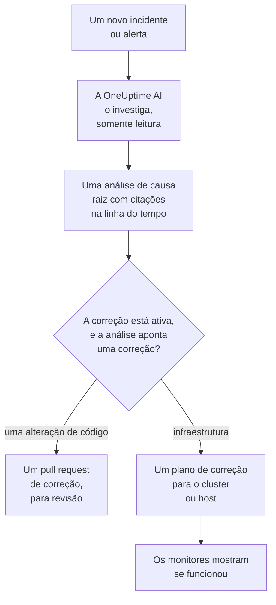
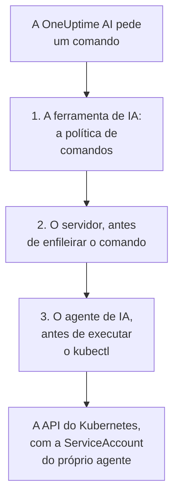

# AI SRE

A OneUptime AI é a sua engenheira de confiabilidade de sites (SRE) com IA. No momento em que um novo incidente ou alerta é declarado, ela entra em ação, investiga-o com a sua própria telemetria (logs, métricas, traces, exceções, monitores e alterações recentes) e publica uma análise de causa raiz com citações na linha do tempo do incidente ou do alerta, normalmente antes de a pessoa de plantão terminar de ler o aviso.

Cada afirmação da análise traz uma citação com link direto para os dados exatos que a sustentam, e a própria investigação é **estritamente somente leitura**: enquanto investiga, a OneUptime AI nunca pode alterar nada no seu projeto.

:::cards
- [Como funciona](#como-funciona): De um novo incidente a uma análise com citações, e a uma correção quando você permite.
- [Habilitar as investigações de IA](#habilitar-as-investigações-de-ia): Os interruptores e o que eles exigem.
- [Acesso ao cluster: deixe a OneUptime AI executar o kubectl](#acesso-ao-cluster-deixe-a-oneuptime-ai-executar-o-kubectl): Investigar, e corrigir, dentro do Kubernetes.
- [Controle de custos](#controle-de-custos): Limites para incidentes, para alertas e para o projeto inteiro.
:::

## Como funciona

A OneUptime AI faz três coisas para um novo incidente ou alerta, e cada uma tem o próprio interruptor:

- **Ela investiga** (ativado por padrão). Lê a sua telemetria, e os clusters e hosts em que um agente de IA é executado, e publica uma análise de causa raiz com citações. Uma investigação não altera nada.
- **Ela corrige** (desativado por padrão). Quando a correção está ativada, uma análise confiante vira uma correção: um pull request com uma alteração no seu código, ou um plano de comandos para um cluster ou host, executado do jeito que o agente de IA daquele cluster ou host permite.
- **Ela aprende.** As páginas AI Insights dizem o que continua dando errado, a partir de tudo o que foi registrado.



Uma análise que não encontra nenhuma causa é publicada discretamente, sem acionar ninguém (veja [Modo silencioso](#modo-silencioso)), e nada é corrigido sem uma causa.

## O que a investigação publica

Quando uma investigação termina, a OneUptime AI publica uma análise de causa raiz com estas seções:

- **Summary**: uma ou duas frases que uma pessoa acionada consegue ler em cinco segundos.
- **Most likely root cause**: a hipótese, apenas com a confiança que as evidências sustentam, com cada afirmação factual citada. Se a telemetria não for suficiente, a IA diz isso claramente e lista o que verificou em vez de adivinhar.
- **Evidence**: as principais descobertas que sustentam ou descartam a hipótese, cada uma citada.
- **Suggested next steps**: ações concretas para a pessoa de plantão.

Para incidentes, a análise é publicada no feed do incidente **e** como nota interna do incidente (onde quem responde colabora). Para alertas, ela é publicada no feed do alerta.

Enquanto a investigação é executada, a página do incidente ou do alerta mostra um painel **AI Investigation** ao vivo que narra cada etapa (quais ferramentas foram executadas, o que encontraram e quanto tempo levaram), para que você possa acompanhar o raciocínio. Se uma investigação falha, o painel mostra o motivo da falha em vez de uma lacuna silenciosa.

Uma investigação é executada até terminar: ela **não tem limite de tempo** nem um orçamento pequeno de consultas, então pode executar todas as consultas e todos os comandos kubectl ou de infraestrutura de que precisar. Uma saída de comando longa (um `kubectl describe node` de um nó muito carregado, os logs de um pod) nunca é cortada: a OneUptime AI a lê uma página por vez. Se quiser uma parada definitiva, defina um **limite de tempo de investigação** por tipo de sinal (veja **Controle de custos** abaixo).

### Quando os registros não tinham nada a dizer

Uma investigação que não conseguiu determinar uma causa, e não encontrou nenhuma linha de registro em nenhuma das suas pesquisas, diz por quê no cartão **AI Investigation**, sob o seu relatório, com o caminho a seguir:

- **Nenhum registro para ler**: nenhum registro chegou ao OneUptime desde a hora anterior ao início do incidente ou do alerta. **Configurar os registros** abre o guia de configuração dos registros: envie os registros dos seus serviços ao OneUptime, e a próxima investigação poderá usá-los.
- **Nenhum registro sobre este incidente** (para um alerta, **Nenhum registro sobre este alerta**): registros chegaram ao OneUptime, e nenhuma pesquisa da investigação encontrou nada sobre ele. **Configurar os registros** ajuda quando um serviço envolvido ainda não envia seus registros, e **Encontrar falhas não registradas** abre **Registros → IA**, que encontra as falhas que seu código não registra e adiciona o registro com um pull request.

O OneUptime decide isso a partir do que sabe, nunca do que a análise diz: o mesmo veredito verificado pelo servidor do [modo silencioso](#modo-silencioso), as próprias pesquisas de registros da investigação e uma leitura de se algum registro chegou ao projeto nesse período. Uma investigação que encontrou a causa, ou uma linha de registro, não diz nada disso.

## O que uma investigação lê

Uma investigação parte do incidente ou do alerta e da infraestrutura à qual está vinculado: os hosts, os hosts Docker e Podman, os clusters Kubernetes, os bancos de dados e os serviços que seus monitores observam. Um monitor de site, de API ou sintético observa aquilo a que você o vincula em **Monitor → Visão geral → Recursos Vinculados**, então vincule-o aos hosts que servem o que ele verifica, e cada investigação dos incidentes dele começa ali. Antes de tudo isso, ela lê o [contexto de IA](/docs/ai/ai-context) do projeto: o que a sua equipe escreveu para a OneUptime AI sobre os seus próprios sistemas, com as notas das regras de IA que correspondem.

- Os alertas nessa infraestrutura abertos nos 30 minutos antes do incidente, ou ainda abertos, os mais novos primeiro, como o alerta de CPU alta do host por trás de um site lento. Alertas privados ficam de fora.
- As métricas da própria infraestrutura, lidas como as pessoas as leem. Métricas de host como `system.cpu.utilization` e `system.memory.utilization` são reportadas uma vez por estado, e os estados somam 100%, então uma média de todos não diz nada. A OneUptime AI as lê um estado de cada vez (CPU ocupada é user mais system), e qualquer métrica por contêiner, por ponto de montagem ou por qualquer outro atributo.
- Os contêineres de um host Docker ou Podman: os mais ocupados por CPU, memória ou reinicializações, e os que pararam de enviar dados. Um contêiner parado não envia nada em vez de zero, então os números do host inteiro o escondem.
- As alterações registradas nas 2 horas antes do incidente ou do alerta (deploys, rollouts do Kubernetes, alterações de configuração e as correções que o OneUptime executou) e quais delas a telemetria dos serviços vinculados torna suspeitas: um serviço que ficou mensuravelmente pior logo depois de uma alteração. Veja [Deploys e alterações](/docs/telemetry/change-events).

A atividade da investigação no cartão **AI Investigation** diz quantos alertas abertos ou recentes ela leu e em quais recursos.

### Verificado de novo quando um novo alerta abre

Uma investigação começa no momento em que um incidente é declarado, e um alerta de host que precisa de alguns minutos de métricas pode abrir depois. Quando um alerta abre na infraestrutura vinculada ao incidente em até 30 minutos depois do incidente, depois que a investigação a leu, e o incidente ainda está aberto, a OneUptime AI verifica o incidente mais uma vez com esse alerta em mãos. A nova análise começa com **Checked again** e o alerta que motivou a verificação, e a atividade dela também diz isso. Se uma regra de IA fez a OneUptime AI esperar antes de investigar o incidente, esses minutos são contados a partir de quando a investigação dele terminou (veja [Esperar antes de investigar](#esperar-antes-de-investigar)).

Isso acontece no máximo uma vez por incidente, com os mesmos interruptores e limites de uma nova investigação: **Habilitar IA**, _Investigar novos incidentes_, os créditos de IA e os limites diários e de simultaneidade. Não há nada para ligar. Uma verificação de acompanhamento nunca executa a remediação automática de novo e nunca é acompanhada por outra, e a investigação de um alerta não é verificada de novo.

## Converse com a OneUptime AI sobre o incidente

O cartão **AI Investigation** termina com uma conversa, **Ask OneUptime AI**, compartilhada por todos que podem ver o incidente ou o alerta. É um único cartão, aconteça o que acontecer acima dele: abaixo de um relatório você faz perguntas de acompanhamento, e quando nenhuma investigação automática foi executada (ou ela parou antes do relatório) a primeira sugestão é **What is the root cause?**, que faz a OneUptime AI investigar sob demanda.

- **Faça perguntas de acompanhamento**: "quais pods usam mais memória?", "o que mudou logo antes de isso começar?", "tem mais alguma coisa afetada?". A OneUptime AI parte do relatório, consulta dados novos (e executa comandos kubectl ou de infraestrutura somente leitura onde tem acesso, nos clusters e recursos que você pode ver) e cita cada afirmação.
- **Peça que ela aja**: "reconheça este incidente", "publique uma atualização de status dizendo que estamos investigando", "acione o plantão de banco de dados", "aumente a severidade". Ela usa as mesmas ações do Pergunte à IA e sempre age **com as suas próprias permissões**, então nunca pode fazer mais do que você poderia.
- **Escolha como ela age** com o interruptor da caixa de mensagem, que diz ao lado o que o modo escolhido significa: _Auto-run_ (o padrão: ela age na hora diante de um pedido claro), _Ask to act_ (ela mostra primeiro um cartão de aprovação, que qualquer pessoa no incidente pode aprovar ou recusar) ou _Somente leitura_.
- **Uma única conversa compartilhada.** Cada pergunta mostra quem a fez, todos veem a mesma conversa ao vivo e qualquer pessoa pode interromper uma resposta em andamento. Gráficos e tabelas de uma resposta são mostrados para quem perguntou; os demais veem a resposta com citações. Cada resposta lista as suas **Fontes**, e uma fonte com página própria (logs, métricas, um monitor) abre essa página. Uma conversa longa abre nas mensagens mais recentes, com um botão acima delas (por exemplo **Show 6 earlier messages**) que traz o restante de volta.

Um incidente ou alerta que a OneUptime AI não investigou nem corrigiu porque a IA estava desativada para ele — desativada no projeto, _Investigar novos incidentes_ (ou alertas) desativado quando foi criado, nenhuma regra de IA que investiga correspondendo a ele ou sua gravidade abaixo do mínimo — recebe em vez disso um cartão de uma linha: **A investigação com IA está desativada** (ou **A IA está desativada neste projeto**, enquanto estiver; **A investigação com IA estava desativada** quando voltar a estar ativada) e o porquê. Sua seta, **O que você pode fazer**, abre o que ativar, com um link para onde isso se altera para quem pode alterar e quem pode alterar para os demais; uma alteração vale só para incidentes e alertas novos, não para este. Enquanto a IA estiver ativada, **Ask OneUptime AI** na linha abre a conversa, e uma conversa que alguém já começou aparece sozinha sob a linha. O cartão **Remediação** não aparece então: a linha diz por que nada foi corrigido.

## Habilitar as investigações de IA

As investigações autônomas ficam **ativadas por padrão em projetos novos**. O mesmo vale para os rascunhos de post-mortem e os AI Insights. A correção começa desativada, e os pull requests que fazem parte dela só são abertos enquanto ela estiver ativada (veja [Correções automáticas de código](#correções-automáticas-de-código)). Um projeto criado antes desse padrão mantém a configuração dele; ative as investigações como no passo 3, ou com **Ativar** na página **Agente de IA** de qualquer cluster Kubernetes (Project Owner ou Project Admin). Para verificar ou alterar:

:::steps
1. **Configure um provedor de LLM.** Instalações auto-hospedadas usam a própria chave (ou rodam totalmente isoladas com o Ollama local): veja [Provedores de LLM](/docs/ai/llm-provider). Usuários do OneUptime Cloud podem usar o provedor global pré-configurado, cobrado como tokens de IA medidos, então o projeto precisa de créditos de IA: uma pessoa proprietária do projeto ou alguém com **Manage Billing** os adiciona em **Configurações do projeto → IA → Créditos de IA**, onde a **Recarga automática** evita que eles acabem.
2. **Confirme que a IA está habilitada no projeto** (ela está, por padrão): **Habilitar IA**, em **Configurações do projeto → IA → AI Features**.
3. **Escolha por tipo de sinal** (os dois ativados em projetos novos):
   - Incidentes: **Incidentes → IA → Configurações**: ative _Investigar novos incidentes_.
   - Alertas: **Alertas → IA → Configurações**: ative _Investigar novos alertas_.
:::

Cada comportamento da IA nessas páginas é um interruptor que é salvo assim que você o aciona; não existe botão Salvar. A página de incidentes tem três, em **O que o OneUptime AI faz**: _Investigar novos incidentes_, _Corrigir novos incidentes automaticamente_ e _Redigir um post-mortem quando um incidente é resolvido_. A página de alertas tem os mesmos, sem o post-mortem. _Corrigir novos incidentes automaticamente_ (e _Corrigir novos alertas automaticamente_) começa **desativado**, inclusive em projetos novos: ele permite que a OneUptime AI altere a sua infraestrutura, então é o projeto que o ativa; veja [Quais incidentes são investigados e corrigidos](#quais-incidentes-são-investigados-e-corrigidos). Os pull requests que ele abre, uma correção do seu código e a telemetria que faltou a uma investigação, fazem parte dele, e cada regra de IA os define: sem regras, os dois são abertos, e uma regra pode desativar qualquer um deles em **Mais campos** (veja [Correções automáticas de código](#correções-automáticas-de-código)). Project Owners e Project Admins podem alterá-los; para todas as outras pessoas, cada interruptor fica bloqueado e informa a permissão de que precisa.

As páginas só dizem duas coisas quando elas são verdadeiras. Se **Habilitar IA** estiver desativado, nada nelas é executado, e a página diz isso no topo, com o próprio interruptor Habilitar IA para quem pode alterá-lo (Project Owners e qualquer pessoa com Manage Billing); as demais pessoas são informadas de quem pode. Se o projeto não tiver nenhum provedor de LLM que a OneUptime AI possa usar (nenhum, ou provedores mas nenhum definido como padrão), a página também diz isso, com um link para **Configurações do projeto → IA → Provedores LLM**. No OneUptime Cloud, o provedor global conta, então nada é dito ali.

Incidentes e alertas são configurados de forma independente, então você pode dar a cada tipo de sinal o próprio limite de concorrência, orçamento diário de tokens, orçamento de tarefas de correção e as próprias regras. Nenhum desses limites se aplica até você defini-lo: eles ficam recolhidos em **Mais configurações** no fim de cada página; veja **Controle de custos** abaixo. Alterar uma configuração de IA dos alertas não altera a configuração correspondente dos incidentes, e vice-versa.

A correção se apoia nas investigações: enquanto **Corrigir novos incidentes automaticamente** (ou alertas) estiver ativado, uma investigação que identifica com confiança uma alteração de código em um repositório abre automaticamente um pull request de correção; veja **Correções automáticas de código** abaixo.

## Acesso ao cluster: deixe a OneUptime AI executar o kubectl

De início, uma investigação só pode usar a telemetria que os seus agentes enviam. Para um sinal do Kubernetes, isso muitas vezes não basta: "pods presos em Pending" é um problema de agendamento que se diagnostica descrevendo o pod e lendo os eventos dele, não olhando para uma métrica. O **Agente de IA do Kubernetes** permite que a OneUptime AI faça exatamente isso e, se você permitir, que corrija o que encontrar.

A página de cada cluster tem uma seção **IA** no menu lateral:

- **Agente**: a página **Agente de IA** do cluster: se o agente está conectado, o que a IA pode fazer no cluster e tudo o que precisa de atenção, cada item com o passo que o resolve. A mesma explicação aparece no painel de investigação do incidente quando a IA teve de investigar apenas com dados do OneUptime.
- **Insights**: a página **Insights de IA** do cluster: o que a OneUptime AI descobriu sobre o cluster, o que continua dando errado e por quê, e o que fazer a respeito (veja [O que a IA aprendeu em um cluster](#o-que-a-ia-aprendeu-em-um-cluster)).
- **Registros**: a página **Registros de IA** do cluster: tudo o que a OneUptime AI fez no cluster, do mais recente para o mais antigo (veja [Tudo o que a IA fez em um cluster](#tudo-o-que-a-ia-fez-em-um-cluster)).

A **Visão geral** do cluster termina com um cartão **Agente de IA** que resume a página do agente de IA: se o agente está conectado, se **Investigar com o kubectl** está ativado, como as correções são executadas (**Desativado**, **Pedir aprovação**, **Automático** ou **Ignorar aprovação**) e o que precisa de atenção, com um link para a página do agente de IA, onde eles são alterados.

### O agente de IA do Kubernetes: ativado por padrão, somente leitura

O chart do [agente Kubernetes do OneUptime](/docs/telemetry/kubernetes-agent) executa por padrão o agente de IA do Kubernetes: um pod pequeno (`component=ai-agent`, imagem `oneuptime/kubernetes-ai-agent`) com uma ServiceAccount **somente leitura**. Ele se conecta com a chave de API que o chart já usa, então não há nada a configurar no painel: em um minuto, a página do agente de IA do cluster o mostra como **Conectado** e **Investigar com o kubectl** fica ativado, a menos que alguém já tenha escolhido ali configurações de IA para o cluster, que são mantidas como estão.

Em um agente instalado antes de existir o agente de IA do Kubernetes, atualize primeiro o índice de charts e depois faça o upgrade:

```bash
helm repo update
helm upgrade kubernetes-agent oneuptime/kubernetes-agent \
  --namespace oneuptime-agent --reset-then-reuse-values \
  --set aiAgent.enabled=true
```

`kubernetes-agent` em `oneuptime-agent` são o nome da release e o namespace usados pelas instruções de instalação do painel; se você instalou o agente com outros nomes, use os seus (`helm list -A | grep kubernetes-agent` os mostra). Sem `helm repo update`, o Helm pode resolver o chart a partir do qual você instalou, que não conhece `aiAgent` e falha com `Additional property aiAgent is not allowed`. Em um OneUptime auto-hospedado, atualize o OneUptime antes do chart: veja [Atualizar o agente](/docs/telemetry/kubernetes-agent#atualizando-o-agente). Para executar o chart sem o agente de IA, passe `--set aiAgent.enabled=false`.

**Testar conexão**, no menu **⋯** ao lado do status do agente na página do agente de IA, executa `kubectl version` e `kubectl auth can-i --list` pelo agente e mostra os resultados: o que ele consegue alcançar e o que pode fazer. Se a página disser que o agente não está conectado, leia o log dele com `kubectl logs -n oneuptime-agent -l component=ai-agent --tail=100`. Uma chave com um **Nome do serviço fixado** não consegue registrar o agente: dê ao chart uma chave sem ele. Quando o servidor recusa um registro, o log diz se a recusa se resolve sozinha (um pod anterior do agente que ainda se reporta, ou o antigo Runner do cluster ainda sendo desligado durante um upgrade) ou o que é preciso mudar. **Redefinir agente**, no mesmo menu, faz o servidor esquecer a chave do agente depois que você confirma; o pod se reconecta sozinho em poucos minutos.

O agente de IA do Kubernetes não é um Runner e nunca aparece em Runbooks → Agentes de runbook. Ele só usa a própria ServiceAccount, então o OneUptime nunca lhe entrega uma credencial, ele nunca é usado como host Bash/SSH para runbooks e nunca é aceito como Runner de comandos de uma regra de IA.

### O que a IA pode fazer: definido pelo agente

O que a OneUptime AI pode fazer em um cluster é definido onde o agente é executado, no chart, com dois valores:

- `aiAgent.investigation`: `true`: a IA pode executar kubectl somente leitura no cluster enquanto investiga. `false`: ela continua investigando, com os dados que o OneUptime já tem.
- `aiAgent.fixes`: como a IA aplica uma correção: `off`, `ask-for-approval`, `automatic` ou `bypass-approval` (veja [Como as correções funcionam](#como-as-correções-funcionam)). Todos os níveis exceto `off` dão ao agente de IA acesso de escrita; com `off` ele não tem nenhum e recusa ele mesmo qualquer escrita.

O agente de IA informa os dois ao OneUptime a cada heartbeat, e o OneUptime os aplica ao cluster. **O que a IA pode fazer**, na página do agente de IA do cluster, os mostra (**Ativado** e o nível de correções, em verde sempre que estão ativados) sem como alterá-los ali; **Alterar** mostra cada opção com o `helm upgrade` exato que a define. Uma alteração feita em qualquer outro lugar (na página do agente de IA, pela API ou pelo Terraform) é recusada enquanto o agente os define.

Uma release que não define nenhum dos dois valores deixa o agente usar os padrões dele (investigação ativada; correções desativadas, ou ask-for-approval com o antigo `aiAgent.remediation.enabled=true`). O OneUptime só aplica esses padrões a um cluster cujas configurações de IA ninguém escolheu na página do agente de IA dele: as configurações escolhidas ali são mantidas como estão, e a página mostra o comando que as leva para o chart. O mesmo vale para um cluster cujo agente de IA é antigo demais para informá-las: atualizar o chart com os dois valores as leva.

### Deixar a IA corrigir o que encontra

As correções ficam desativadas até você ativá-las com `aiAgent.fixes`, o que também dá ao agente de IA acesso de escrita, de preferência só nos namespaces que a IA pode corrigir e com as operações de nó desativadas:

```bash
helm repo update
helm upgrade kubernetes-agent oneuptime/kubernetes-agent \
  --namespace oneuptime-agent --reset-then-reuse-values \
  --set aiAgent.enabled=true \
  --set aiAgent.investigation=true \
  --set aiAgent.fixes=ask-for-approval \
  --set "aiAgent.remediation.namespaces={web,api}" \
  --set aiAgent.remediation.nodeOperations=false
```

Ou no cluster inteiro:

```bash
helm repo update
helm upgrade kubernetes-agent oneuptime/kubernetes-agent \
  --namespace oneuptime-agent --reset-then-reuse-values \
  --set aiAgent.enabled=true \
  --set aiAgent.investigation=true \
  --set aiAgent.fixes=ask-for-approval \
  --set-json 'aiAgent.remediation.namespaces=[]'
```

Substitua `{web,api}` pelos namespaces que a IA pode corrigir. Cada namespace da lista já precisa existir: o chart cria um RoleBinding em cada um e nunca cria um namespace, então um que esteja faltando faz falhar a instalação ou o upgrade inteiro (o coletor incluído) com `namespaces "api" not found`. Crie-o antes, ou tire-o da lista; tire um namespace da lista antes de excluí-lo. Omitir a flag em um upgrade mantém a lista guardada na release, então, para voltar ao cluster inteiro, passe `--set-json 'aiAgent.remediation.namespaces=[]'` (Helm 3.10+), como faz o segundo comando, e não `={}`, que o Helm lê como um nome vazio e o chart recusa. `--set aiAgent.remediation.namespaces=null` não redefine uma lista guardada com `--reuse-values`: o Helm mantém a lista guardada. `aiAgent.remediation.nodeOperations=false` mantém as correções longe dos nós; defina-o como `true` para deixar a IA isolar, liberar, drenar e aplicar taints em nós (um drain, um taint ou um patch de um nó continua esperando por uma pessoa).

Use `automatic` ou `bypass-approval` no lugar de `ask-for-approval` para mais autonomia, e `--set aiAgent.fixes=off` para desativar as correções de novo, o que também remove o acesso de escrita. As correções também precisam de dois interruptores do projeto. **Corrigir novos incidentes automaticamente** (em **Incidentes → IA → Configurações**) e **Corrigir novos alertas automaticamente** (em **Alertas → IA → Configurações**) começam desativados: até que um esteja ativado, nada novo daquele tipo é corrigido. **Habilitar IA** (**Configurações do projeto → IA → AI Features**) fica ativado, a menos que alguém o tenha desativado; ele desativa toda a IA do projeto, seja qual for a configuração de um agente.

### Em quais incidentes as correções de um cluster agem

Enquanto **Corrigir novos incidentes automaticamente** estiver ativado e nenhuma regra de IA estiver configurada, a OneUptime AI corrige cada novo incidente ao qual o cluster está vinculado, no modo que a página do agente de IA dele define, e o mesmo vale para alertas com **Corrigir novos alertas automaticamente**. Com regras, ela só corrige os incidentes que correspondem a uma regra que corrige com a OneUptime AI (veja [Quais incidentes são investigados e corrigidos](#quais-incidentes-são-investigados-e-corrigidos)). Ela não toca no que não está vinculado, por mais clara que esteja a causa no cluster. Um incidente ou alerta está vinculado a um cluster quando:

- a telemetria que o gerou cita o cluster (um monitor de métricas, logs ou traces sobre os dados do cluster);
- o monitor dele é um monitor Kubernetes do cluster;
- o monitor dele está vinculado ao cluster em **Monitor → Visão geral → Recursos Vinculados**, que é a forma de vincular um monitor de site, de API ou sintético ao cluster que serve o que ele verifica;
- o Pergunte à IA o declarou na página do cluster, ou o vinculou ao cluster quando solicitado;
- alguém escolheu o cluster em **Outros recursos afetados** ao declará-lo (escolher um monitor vinculado o adiciona ali para você).

Cada incidente e cada alerta diz no cartão **Remediação** se estava vinculado a um cluster e o que as correções do cluster fizeram; veja [O que a remediação automática fez](#o-que-a-remediação-automática-fez). O mesmo vale para um recurso de infraestrutura e o agente de IA dele.

### Quem pode alterar

Enquanto o agente de IA do Kubernetes define a investigação e as correções, quem as altera é quem pode alterar os valores do chart no cluster; o OneUptime recusa uma alteração feita em qualquer outro lugar. As regras abaixo valem para o que continua no OneUptime (a lista de permissões do kubectl e o vínculo ao Runner anterior dentro do cluster) e para a investigação e as correções de um cluster cujas configurações ainda são definidas no OneUptime (veja [O que a IA pode fazer: definido pelo agente](#o-que-a-ia-pode-fazer-definido-pelo-agente)).

Ativar as correções (qualquer passagem de **Desativado** para outro modo) e afrouxá-las (passar para **Automático** ou **Ignorar aprovação**, escrever a lista de permissões do kubectl ou vincular um Runner) exige um Project Owner, um Project Admin ou a permissão **Edit AI Rule**, as mesmas pessoas que podem criar uma regra de IA que corrige sem perguntar. **Redefinir agente** exige as mesmas pessoas que ativar as correções. Restringi-las (**Desativado**, voltar para **Pedir aprovação**, limpar a lista de permissões ou o vínculo do Runner) está aberto a qualquer pessoa que possa editar o cluster, assim como **Testar conexão** e aprovar uma correção que a OneUptime AI propõe para ele. Tudo isso exige permissão para editar exatamente esse cluster: uma permissão restrita a alguns rótulos, ou aos clusters que pertencem a você ou às suas equipes, só alcança esses clusters, e uma entrada de bloqueio com rótulos remove os clusters que os carregam.

### O que uma investigação pode executar

Com acesso, uma investigação executa kubectl **somente leitura** pelo agente de IA (`get`, `describe`, `logs`, `events`, `top`, `rollout status/history`, `auth can-i`), tantos comandos quantos precisar, e cita cada comando como qualquer outra evidência. A saída nunca é cortada: o agente guarda até um megabyte dela, e a OneUptime AI lê uma saída longa uma página por vez. Três verificações independentes a mantêm somente leitura: a política que classifica cada comando, o servidor que se recusa a enfileirar qualquer outra coisa para uma investigação e o agente de IA, que verifica de novo a mesma política antes de iniciar o kubectl. "Somente leitura: nada foi alterado nos seus sistemas" continua literalmente verdadeiro.



### Como as correções funcionam

As **Correções** na página do agente de IA têm quatro configurações (o `aiAgent.fixes` do chart: `off`, `ask-for-approval`, `automatic`, `bypass-approval`):

- **Desativado**: a IA apenas investiga.
- **Pedir aprovação**: depois da análise de causa raiz, a OneUptime AI faz o diagnóstico com o kubectl e monta o menor plano de kubectl que trata a causa, por exemplo `kubectl rollout restart deployment/web -n web`. O plano aparece no incidente com a justificativa, o efeito esperado e o rollback; uma pessoa o aprova com um clique, e o OneUptime executa exatamente esses comandos. Se os monitores não se recuperarem, o rollback é executado e a OneUptime AI monta mais um plano, de novo para aprovação, com a tentativa que falhou à vista, para seguir outro caminho ou dizer o que uma pessoa deveria examinar.
- **Automático**: as alterações seguras são executadas sozinhas; uma alteração mais arriscada, nunca. Quando a rodada só encontrou correções mais arriscadas, ela termina propondo exatamente essas para aprovação com um clique. Quando também executou uma correção segura, a mais arriscada fica na análise e só é proposta se a verificação mostrar que a correção segura não recuperou os monitores, pela rodada de acompanhamento, que pede aprovação. Coloque o formato de um comando mais arriscado na lista de permissões da página do agente de IA e ele também passa a ser executado sozinho. O modo automático também resolve o sinal assim que a verificação confirma que os monitores se recuperaram, e tem um disjuntor de três correções sem supervisão por cluster por hora: acima disso, ou enquanto outra rodada sem supervisão da OneUptime AI ainda estiver alterando ou verificando o mesmo cluster, uma rodada propõe o plano para aprovação em vez de executá-lo.
- **Ignorar aprovação**: a IA não pergunta. Toda alteração que a política permite, inclusive as mais arriscadas, é executada sozinha, assim como a rodada de acompanhamento depois de uma verificação que falhou; o sinal se resolve sozinho assim que a verificação confirma a recuperação. O que precisa de uma pessoa em todos os modos (abaixo) continua esperando por ela. Uma rodada também propõe o plano para aprovação em vez de executá-lo, e explica o motivo no incidente, quando:
  - o disjuntor por hora (três correções sem supervisão por cluster por hora) foi acionado ou não pode ser verificado;
  - outra rodada sem supervisão da OneUptime AI ainda está alterando o mesmo cluster, ou ainda verificando uma correção nele (um alerta e um incidente do mesmo monitor são o caso comum), ou isso não pode ser verificado;
  - é a rodada de acompanhamento depois de uma correção cujo rollback não terminou.

**Primeiro o rollback.** Quando o OneUptime marcou um rollout do Kubernetes no cluster como suspeito do incidente (veja [Deploys e alterações](/docs/telemetry/change-events)), a OneUptime AI tenta revertê-lo antes de qualquer outra correção. O OneUptime monta o `kubectl rollout undo` a partir da alteração registrada, nunca a partir do que o modelo escreve, e ele é executado ou espera aprovação como qualquer alteração segura no modo do cluster. Ele não é oferecido quando o Deployment mudou de novo depois desse rollout, porque a reversão desfaria então também a alteração posterior.

**Workloads declarados pelo Argo CD, Flux ou Helm.** Muitos clusters declaram os seus workloads no git e deixam o Argo CD ou o Flux aplicá-lo, ou instalam-nos com o Helm, e uma alteração kubectl no que está declarado ali não dura: o Argo CD a reverte em segundos quando a Application tem o self-heal ativado (senão, na próxima sincronização), o Flux na próxima reconciliação e uma release do Helm no próximo upgrade. Por isso, antes que a OneUptime AI execute ou proponha uma alteração kubectl, a OneUptime lê com kubectl somente leitura, pelo agente de IA do cluster, o objeto que ela altera (no caso de um ReplicaSet, o seu Deployment) e quem o declara: o Argo CD (a anotação `argocd.argoproj.io/tracking-id`, o rótulo `argocd.argoproj.io/instance` ou o seu field manager), o Flux (os rótulos `kustomize.toolkit.fluxcd.io/*` ou `helm.toolkit.fluxcd.io/*`) ou uma release do Helm (a anotação `meta.helm.sh/release-name` ou o rótulo `app.kubernetes.io/managed-by: Helm`). Uma alteração que o Argo CD ou o Flux reverte — `rollout undo` (incluindo a reversão primeiro), `scale` (quando o git fixa o número de réplicas), `set image/env/resources`, `patch`, excluir um workload — nunca é executada sozinha, em nenhum modo, nem com Ignorar aprovação nem pela lista de permissões: ela é proposta para aprovação com um clique como **correção temporária**, e o plano indica a correção duradoura, a mesma alteração no git (o manifesto, os values do Helm ou o overlay do Kustomize de onde o workload sai). O Argo CD e o Helm não mexem no que o git não declara, como um `rollout restart`, um `rollout pause` ou uma anotação adicionada, então essa alteração é executada conforme o modo do cluster. Uma Kustomization do Flux remove até isso na próxima reconciliação, então ali uma pausa, um rótulo ou uma anotação também são uma correção temporária. Com o Flux, um reinício ainda é executado conforme o modo: quando o Flux remove a sua anotação, os pods reiniciam mais uma vez, mas o reinício não é desfeito. Excluir um pod com falha é executado conforme o modo, seja quem for que declare o workload: o git nunca declara um pod, e o seu ReplicaSet o substitui. Uma release do Helm só reverte uma alteração no próximo upgrade, então ali a alteração também é executada conforme o modo do cluster, e o plano diz que ela é temporária.

**A verificação percebe uma correção revertida.** A OneUptime lê o objeto que uma correção kubectl altera logo antes e logo depois de ela ser executada, e de novo a cada dois ou três minutos enquanto a janela de verificação está aberta. Uma correção que voltou aos valores antigos (revertida pelo Argo CD, pelo Flux, por um upgrade do Helm, por um operador ou por um autoscaler) faz a verificação falhar na hora, e a nota diz quem a reverteu e onde fica a alteração duradoura. A sua reversão não é executada: o cluster já a desfez, e desfazê-la poderia reaplicar a correção. Uma alteração que o Argo CD ou o Flux reverte é julgada no fim da sua janela, e não assim que os monitores se recuperam. Um reinício não deixa nada para vigiar: os seus pods já foram substituídos, aconteça o que acontecer depois com a sua anotação.

Uma alteração **segura** atinge exatamente um objeto nomeado: `rollout restart/undo/pause/resume`, `scale` (para qualquer valor exceto 0), excluir um pod nomeado, `cordon`/`uncordon`, e `label`/`annotate` em um Pod, Deployment, StatefulSet, DaemonSet, ReplicaSet, Job ou CronJob nomeado com uma chave comum (não uma reservada como `*.kubernetes.io/…` ou `*.k8s.io/…`). Todo o resto que a política permite é **mais arriscado**: os mesmos verbos em um tipo sem nome (`rollout restart deployment`), em vários objetos, com um seletor ou com `--all`; `scale` para 0; excluir um job; `taint`; `drain`; `patch`; `set image/env/resources`; `create`; excluir com `--force`; e labels ou anotações em qualquer outro tipo ou com uma chave reservada.

Alguns limites valem em **todos** os modos, Ignorar aprovação incluído, e nenhuma entrada da lista de permissões os altera:

- Uma escrita em **kube-system**, **kube-public** ou **kube-node-lease** sempre precisa de uma pessoa. Um recurso personalizado é julgado pelo namespace em que é escrito, mesmo um cujo nome pareça um tipo nativo com escopo de cluster (`nodes.example.com`, `namespaces.example.com`).
- Um `drain`, um `taint` ou um `patch` de um nó sempre precisa de uma pessoa. Drenar um nó despeja pods de todos os namespaces (os três acima e o do próprio agente incluídos), e um taint `NoExecute` também os despeja, seja ele aplicado por `kubectl taint` ou por um `patch` do nó.
- O agente de IA nunca altera nada no próprio namespace (uma correção ali poderia reduzir a zero o agente do Kubernetes, ou o próprio agente de IA), nem nada fora dos namespaces em que o chart dele o deixa escrever (`aiAgent.remediation.namespaces`), nem um nó quando o chart dele desativou as operações de nó (`aiAgent.remediation.nodeOperations=false`). O OneUptime lê esse escopo do que o agente de IA informa e recusa uma correção assim quando a OneUptime AI a propõe e de novo quando alguém a aprova, então ela nunca chega ao agente de IA como uma correção que falhou; o agente de IA também a recusa, antes de iniciar o `kubectl`.
- Comandos destrutivos (abaixo) nunca são executados, nem com a aprovação de uma pessoa.

A lista de permissões do modo automático é comparada palavra por palavra com o comando analisado, não como texto livre: `*` representa exatamente uma palavra (uma imagem, um nome), nunca objetos, flags ou um segundo `-n` a mais, e cada flag que o comando usa precisa estar escrita na entrada. `kubectl set image deployment/web * -n web` permite uma imagem nova para `web` em `web`, nada além disso. Uma entrada precisa escrever o verbo por extenso (e o subcomando de `rollout`, `set` ou `create`) em vez de usar `*` no lugar dele, e precisa ter mais de uma palavra depois do `kubectl` inicial opcional; uma entrada que viola essas regras, como `scale` ou `kubectl *`, nunca poderia pré-aprovar uma alteração e é recusada ao ser salva.

:::details Comandos que nunca são executados, e como um comando é lido
Alguns comandos **nunca** são executados, seja qual for o modo e mesmo com a aprovação de uma pessoa. A política de comandos os recusa, e ela é aplicada três vezes (pela ferramenta do servidor, pelo ponto de passagem obrigatório onde o servidor enfileira e pelo agente de IA antes de iniciar o `kubectl`): `exec`, `attach`, `cp`, `port-forward`, `proxy`, `debug`, `run`, `edit`, `apply`, `replace`, `diff`, plugins do kubectl e qualquer outro verbo que não esteja na lista dela, qualquer entrada por arquivo (`-f`, `-k`) ou formato de saída que leia um arquivo (`-o jsonpath-file=`, `-o go-template-file=`, `-o custom-columns-file=`, `--template`, e um `-o jsonpath`/`go-template`/`custom-columns` sem o seu modelo em linha), flags de credenciais, de personificação (`--as`, `--as-group`, `--as-uid`, `--as-user-extra`), de seleção de cluster, `--kuberc`, de API bruta e de log detalhado, objetos Secret com **qualquer** verbo (a OneUptime AI nunca lê, altera, exclui nem cria um Secret, e `create secret`, `create token` e `set env --resolve` são recusados junto com eles), tudo o que concede RBAC (`create role`, `create clusterrole`, `create rolebinding`, `create clusterrolebinding`, `set subject`), `certificate approve`, `set serviceaccount`, `create deployment`, `create cronjob` ou `create job` com `--image` (`create job --from=cronjob/…` continua sendo uma alteração mais arriscada), `expose --overrides` ou `--override-type` (a sobrescrita pode fazer o kubectl criar um Job, um ClusterRoleBinding ou qualquer outro tipo de objeto em vez de um Service), um corpo de `patch` que não seja JSON (o kubectl o leria como YAML, cujas tags podem escrever um campo que nenhuma verificação vê), patches que alteram a ServiceAccount, os volumes ou as configurações de segurança de um modelo de pod (portas do host, a exclusão do namespace de usuário `hostUsers` e a classe de runtime `runtimeClassName` incluídas), patches que substituem uma parte inteira de um modelo de pod em vez de definir campos nela (um strategic-merge `$patch: replace`, um merge patch que define uma lista `containers` inteira, ou um JSON patch que substitui ou remove a especificação do pod), o que descartaria essas configurações sem nomeá-las, um label ou anotação em objetos Namespace escolhidos por `--all` ou por um seletor em vez de pelo nome, qualquer escrita (`patch`, `label`, `annotate`, `set`) em objetos RBAC, CustomResourceDefinitions, APIServices, configurações de webhooks de admissão ou políticas de admissão, escritas com `--all-namespaces`, `delete --all`, e excluir namespaces, nós, volumes, CRDs ou cluster roles. As flags são analisadas do jeito que o kubectl as analisa, para que uma flag ou um tipo proibido não consiga se esconder atrás de outro: flags curtas combinadas são separadas letra por letra (`-As` é detectada), flags de valor opcional (`--cascade`, `--dry-run`, `--validate`) nunca engolem a palavra seguinte, e toda flag exceto `-n`/`--namespace`, `--request-timeout` e `--match-server-version` precisa vir depois do verbo (e depois do subcomando de `rollout`, `set`, `create`, `auth`, `cluster-info` e `top`), porque o kubectl escolhe o comando antes de analisar as flags. O agente de IA traz o próprio kubectl com versão fixa (v1.36.5) e desativa o kuberc, para que um arquivo kuberc não consiga acrescentar padrões ou aliases a um comando depois que a política o verificou. Ele entrega a cada comando um kubeconfig privado para a própria ServiceAccount, que aponta para o arquivo de token montado, nunca uma cópia do token.
:::

### O que o RBAC do agente de IA limita, e o que não limita

:::details O que o RBAC do chart concede
O RBAC do chart é uma camada separada da política, e limita **onde** o agente de IA pode escrever, não o que uma escrita pode fazer. O acesso somente leitura (get/list/watch, logs de pods) é concedido no cluster inteiro. `aiAgent.remediation.enabled` acrescenta patch/update em Deployments, StatefulSets, DaemonSets, ReplicaSets e o sub-recurso scale deles, Jobs, CronJobs, Pods e HPAs; create em Jobs e HPAs; e delete apenas em Pods e Jobs. `aiAgent.remediation.nodeOperations` (ativado por padrão) acrescenta cordon, uncordon, taint e drain em nós, no cluster inteiro; defina-o como `false` e o chart não concede RBAC de nós e informa isso ao agente de IA (`ONEUPTIME_KUBECTL_ALLOW_NODE_OPERATIONS=false`), que então recusa cordon, uncordon, drain, taint e label/annotate/patch em um nó antes de iniciar o kubectl; e, como o agente de IA informa o interruptor, o OneUptime já recusa uma correção assim quando ela é proposta ou aprovada. Ele nunca concede Secrets, `exec`, `attach`, `port-forward`, tokens de ServiceAccount, personificação, CRDs nem escritas de RBAC, então excluir qualquer outro tipo, ou aplicar um label a um Service, ConfigMap, Ingress, Namespace ou PVC, falha no servidor de API com `Forbidden` mesmo quando uma pessoa aprovou. As duas camadas não são cópias uma da outra: para o RBAC, `apply`, `edit`, `replace`, escritas com `--all-namespaces` e `delete --all` são chamadas comuns de patch, update e delete, e só a política as impede.
:::

:::warning O que o acesso de escrita significa
Tenha clareza, porém, sobre o que esse acesso de escrita significa: **patch/update em workloads, pods e CronJobs, e create em Jobs, em um namespace equivale a executar qualquer imagem como qualquer ServiceAccount desse namespace e ler os Secrets dele.** Um modelo de pod pode nomear qualquer imagem, ServiceAccount e volume de Secret, e o RBAC não tem um verbo "patch, mas não o modelo de pod"; o fato de nenhuma regra nomear `exec` ou Secrets não muda isso. É por isso que a política recusa alterar com qual ServiceAccount, configurações de segurança, volumes, comando ou ligação de Secrets um pod é executado (patches de segurança do modelo de pod, patches que substituem a especificação do pod ou uma lista `containers` inteira, `set serviceaccount`, `create … --image`, `expose --overrides`, corpos de patch que não são JSON), por que os namespaces protegidos sempre precisam de uma pessoa, e por que existe `aiAgent.remediation.namespaces`. A política **não** recusa alterar uma imagem: `set image`, ou um patch de um campo de imagem, é uma alteração mais arriscada (a imagem nova é executada como a própria ServiceAccount do workload, com os Secrets dela) que uma pessoa aprova, a menos que o cluster ignore as aprovações ou que a lista de permissões dele nomeie o comando. Sem `aiAgent.remediation.namespaces`, o papel de escrita é vinculado no cluster inteiro (kube-system, kube-public, kube-node-lease e o namespace do próprio agente incluídos, já que o RBAC não consegue deixar namespaces de fora de um vínculo no cluster inteiro), e ali quem segura a linha são a política e o agente de IA, não o RBAC. Com ele, o chart vincula o papel exatamente nos namespaces que você lista, o OneUptime recusa uma escrita em qualquer outro lugar quando ela é proposta ou aprovada, e o agente de IA a recusa de novo antes de iniciar o kubectl.
:::

### O que a IA aprendeu em um cluster

A página **Insights de IA** do cluster (IA → Insights) diz o que vale a pena saber sobre o cluster a partir dos últimos 30 dias: não um registro do que a IA fez, mas o que ela descobriu:

- **O que a OneUptime AI encontrou**: as poucas coisas que mais importam, a mais importante primeiro, cada uma com os incidentes e alertas por trás e um próximo passo:
  - um problema que continua voltando: com que frequência (conta cada incidente e alerta que ele gerou, investigado ou não) e que parte do total isso representa, se é novo nesta semana ou está piorando, a hora do dia em que costuma começar (no seu próprio fuso horário), as partes do cluster que ele atinge, o que a última investigação encontrou e o primeiro passo que o relatório dela sugere;
  - uma correção que não resolveu o problema, e correções esperando a sua aprovação;
  - um risco detectado antes que alguém fosse acionado: um [insight](#insights-detecção-proativa) aberto de severidade High ou Medium sobre a própria telemetria do cluster;
  - o nó, pod, namespace ou workload por trás de vários problemas diferentes, com link para a própria página dele no cluster;
  - o que a IA corrigiu sozinha e se a correção se manteve, e, quando a sua equipe aprovou todas as correções que a IA propôs, que a IA poderia aplicar sozinha correções como essas;
  - um problema que continuava voltando e parou depois de uma correção.

  Quando nada se destaca, a página diz isso.
- **Outros problemas**: todo o resto que a IA examinou, agrupado pelo que o gerou (um monitor é um problema, por mais pods ou nós para os quais tenha disparado), o mais frequente primeiro: com que frequência, quais namespaces, workloads, pods ou nós ele atinge, o que a última investigação encontrou e sugere, o que aconteceu com as correções que a IA propôs, e o que a sua equipe e a avaliação disseram das descobertas. Um problema que apareceu mais de uma vez é marcado como **Recorrente**, **Novo nesta semana** ou **Piorando**.
- **Onde os problemas acontecem**: as partes do cluster que mais apareceram, e em quantos problemas diferentes.
- **Detectado antes que alguém fosse acionado**: os outros insights abertos que os detectores registraram sobre a própria telemetria do cluster.
- **O que a OneUptime AI fez aqui**: a nota de rodapé: quantas investigações, correções e comandos houve e quantos falharam, investigações por dia, onde foram parar as correções que a IA propôs e se as aplicadas resolveram o problema, e o que deu errado no próprio trabalho da IA (investigações que falharam, comandos que o agente nunca pegou, descobertas que a sua equipe rejeitou), cada um com onde olhar.

Com **Habilitar IA** desativado no projeto, ou sem nenhum provedor de LLM que a OneUptime AI possa usar, a página diz isso no topo: nada novo é investigado, então nada novo aparece.

Tudo na página vem do que o OneUptime já registrou (os incidentes e alertas, as investigações deles e o que concluíram, os vereditos sobre elas, as correções e os comandos), e nenhum modelo é chamado para montá-la: as palavras que são da própria IA (uma descoberta, um passo sugerido) foram escritas pela investigação que as encontrou e são mostradas como dela. Qualquer pessoa que possa ver o cluster pode ver a página, e ela só cita incidentes e alertas que essa pessoa pode ler.

### Tudo o que a IA fez em um cluster

A página **Registros de IA** do cluster (IA → Registros) é o registro de tudo o que a OneUptime AI fez ali, do mais recente para o mais antigo: cada investigação com o incidente ou alerta e o resumo dela, cada correção que ela propôs ou executou com o status, e cada comando kubectl (de investigação ou de correção) com o comando, o status e quando foi executado. O resumo de uma investigação é o TL;DR dela ou, quando não foi possível escrever um TL;DR, o resumo com que o relatório dela começa. Esta página se chamava antes AI Insights; um favorito do endereço antigo dela agora abre a página AI Insights, que traz um link para cá.

### Pelo Runner anterior dentro do cluster

Clusters configurados com um chart anterior (`aiAccess.enabled=true`) chegam à OneUptime AI pelo Runner anterior dentro do cluster até que o chart seja atualizado. O upgrade substitui esse Runner pelo agente de IA do Kubernetes e leva as configurações dele: veja [Atualizar o agente](/docs/telemetry/kubernetes-agent#atualizando-o-agente).

Um Runner fora do cluster já não chega a ele: fazia isso com uma credencial de runbook do Kubernetes, e as credenciais de runbook foram removidas. Um cluster que não executa o chart do agente do Kubernetes obtém o kubectl da OneUptime AI instalando-o: o agente de IA do Kubernetes do chart é o caminho de entrada.

## Acesso à infraestrutura: Docker, Podman, Swarm, Proxmox, VMware, Ceph, bancos de dados e hosts

O mesmo tipo de acesso existe para o resto da sua infraestrutura. Um agente de IA de recurso (imagem `oneuptime/resource-ai-agent`) é executado ao lado do coletor de um host Docker ou Podman, de um cluster Docker Swarm, de um cluster Proxmox, de um VMware vCenter, de um cluster Ceph ou de um servidor de banco de dados (ou sozinho em um host Linux) e deixa a OneUptime AI executar ali comandos somente leitura enquanto investiga (`docker logs`, `pvesh get`, `govc vm.info`, `ceph health detail`, um catálogo fixo de diagnósticos de banco de dados, `systemctl status`, `journalctl`, …) e, só quando você inicia o agente com `ONEUPTIME_AI_ALLOW_WRITES=true` e um nível de correções (`ONEUPTIME_AI_FIXES`), aplicar correções com os mesmos quatro modos e as mesmas três verificações de um cluster Kubernetes. Como em um cluster, o que a IA pode fazer em um recurso assim é definido onde o agente dele é executado (`ONEUPTIME_AI_INVESTIGATION`, `ONEUPTIME_AI_FIXES`) e mostrado como somente leitura na página do agente de IA dele. Cada recurso desses tem as mesmas páginas **Agente de IA**, **Insights** e **Registros**. Veja [Agentes de IA para a infraestrutura](/docs/ai/infrastructure-ai-agents) para saber como instalá-los, o que cada um pode executar e o modelo de segurança deles.

## Modo silencioso

Uma investigação que não consegue determinar uma causa publica a análise na linha do tempo **sem** acionar o seu workspace do Slack/Teams nem o plantão. Uma não resposta nunca deveria acionar ninguém: a análise está lá quando alguém olhar, mas ninguém é acordado por um "inconclusivo". As análises confiantes notificam o workspace normalmente.

Se uma análise conta como confiante é decidido por um sinal verificado pelo servidor, não pelo que o texto da análise diz: uma investigação que não reuniu evidências (nenhuma consulta de telemetria bem-sucedida, nenhuma citação) é sempre tratada como inconclusiva e, nos demais casos, uma verificação separada e restrita classifica a análise. Se essa própria verificação falhar, a OneUptime AI pende para o lado de notificar: o modo silencioso falha fazendo mais barulho, nunca em silêncio.

## Correções automáticas de código

Uma análise confiante que recomenda uma alteração de código em um repositório pode ir um passo além de notificar: ela abre a correção. Os pull requests de correção fazem parte da correção: só são abertos enquanto **Corrigir novos incidentes automaticamente** (em **Incidentes → IA → Configurações**) ou **Corrigir novos alertas automaticamente** (em **Alertas → IA → Configurações**) estiver ativado, e a correção começa **desativada**, inclusive em projetos novos. Sem regras de IA, eles são abertos para toda investigação que se qualificar; com regras, cada regra decide para o que corresponde a ela, com **Pull requests de correção** em **Mais campos**, ativado em uma regra nova. Nada é aberto até que o projeto tenha um repositório conectado e um Runner com a capacidade de correção de código. Uma investigação que se qualifica enfileira automaticamente a mesma tarefa de correção que o botão **Open Fix PR from this analysis** no painel de investigação: uma tarefa de agente de IA que transforma a análise publicada em um pull request, pronto para revisão. O botão usa a mesma recomendação e fica oculto nas análises cujo remédio é operacional, só de infraestrutura, externo, uma recusa esperada, um erro do usuário ou inconclusivo.

Os **Pull requests de telemetria**, ao lado em **Mais campos** de uma regra e também ativados em uma regra nova, servem para as investigações que terminam inconclusivas porque faltavam os logs, traces ou métricas de que precisavam: a OneUptime AI abre um pull request que adiciona essa instrumentação nos caminhos de código envolvidos, para a sua equipe revisar. Eles precisam de um repositório conectado (veja [Conectar um repositório](/docs/ai/ai-agent#conectar-um-repositório)), e também só são abertos enquanto a correção estiver ativada.

Um pull request não altera nada até que a sua equipe faça o merge, mas a correção faz mais do que abri-los. Para receber os pull requests sem que a OneUptime AI altere os seus clusters ou hosts, ative a correção, mantenha as **Correções** desativadas na página **Agente de IA** de cada cluster Kubernetes e de cada host (desativado é o padrão delas) e não adicione nenhuma regra de IA: com a correção ativada e sem regras, a OneUptime AI só corrige onde a página de um agente de IA permite. Com regras configuradas, um pull request só é aberto para um incidente (ou alerta) que corresponde a uma regra, quando uma regra correspondente tem esse pull request ativado, e só nos repositórios de código que as regras correspondentes nomeiam; uma regra correspondente que não nomeia nenhum permite todos os repositórios conectados.

Pela API ou pelo Terraform, a correção é o campo `enableAutomaticIncidentRemediation` do projeto (`enableAutomaticAlertRemediation` para alertas), e cada regra de IA tem `openCodeFixPullRequests` e `openTelemetryPullRequests`, ambos `true` a menos que você os defina, e `codeRepositories`, vazio para todos os repositórios conectados. Os campos do projeto que guardavam os dois pull requests antes deixaram de existir; veja [a nota de atualização](/docs/installation/upgrading#os-interruptores-de-pull-request-passaram-para-as-regras-de-remediação-automática).

A mesma classificação restrita e verificada pelo servidor que decide a confiança também decide se uma alteração no repositório é adequada. Só uma classificação positiva como correção de código oferece ou abre automaticamente o pull request. Uma investigação que não reuniu evidências verificadas pelo servidor, que recomenda um remédio que não é de código ou cuja classificação falhou nunca abre um: a criação de PRs sempre falha no sentido de não fazer nada. Todo o resto é igual ao botão manual: o pull request é aberto pronto para revisão, precisa de um repositório conectado e de um Runner com a capacidade de correção de código, conta no limite diário de tarefas de correção daquele tipo de sinal e no limite de PRs abertos do repositório quando algum deles está definido, e no máximo uma tarefa de correção por incidente ou alerta pode estar ativa por vez. A investigação em si continua somente leitura: a correção é executada como uma tarefa de agente separada e totalmente registrada. Veja [Código](/docs/ai/ai-agent) para saber como os pull requests de correção funcionam, inclusive a verificação de build e testes executada antes de cada pull request ser aberto.

**Verificado em produção.** Fazer o merge de uma correção não corrige a exceção; executá-la, sim. Depois que uma correção de IA de uma exceção é mesclada, o OneUptime espera um deploy registrado do serviço da exceção que contenha o commit da correção (veja [Deploys e alterações](/docs/telemetry/change-events)) e então observa a exceção nesse deploy. Se a exceção acontecer de novo, a correção é marcada como **Ainda acontece após a correção** e a exceção é reaberta. Se ela ficar ausente por pelo menos um dia, e por tempo suficiente para que, na taxa da semana anterior à correção, ela tivesse acontecido pelo menos 3 vezes, a correção é marcada como **Corrigido em produção** e a exceção é resolvida. Uma correção que nenhum deploy registrado contenha em até 14 dias, ou uma exceção rara demais para que 7 dias sem ocorrências signifiquem algo, é marcada como **Não verificado em produção**. A tarefa de correção da exceção mostra qual foi o caso.

**As outras correções são julgadas pelo que corrigem.** Uma correção de um trace lento ou de um insight de latência, uma correção da causa raiz encontrada por uma investigação e uma melhoria da telemetria esperam pelo mesmo deploy e depois são julgadas pelo que deviam fazer:

- **Uma operação lenta** — o p99 dela na correção implantada em relação à semana anterior ao merge, depois que a correção roda um dia com pelo menos 100 spans, lido na versão do deploy quando a telemetria do serviço a informa. Pelo menos um quinto mais rápida é **Mais rápido em produção**, e o insight de latência que pediu a correção é resolvido; nada mais rápida é **Ainda lento após a correção**, e o insight volta a precisar de atenção.
- **A causa raiz de um incidente ou de um alerta** — o monitor que o gerou. Qualquer incidente ou alerta que ele gere depois do deploy é **Aconteceu de novo após a correção**, anotado no feed de ambos; tranquilo por um dia, e por tempo suficiente para que, no ritmo dos 30 dias anteriores à correção, ele tivesse gerado 3, é **Corrigido em produção**, anotado no feed do incidente investigado. Enquanto um dos incidentes dele continua aberto, um monitor não gera outro, então esse tempo não conta.
- **Telemetria, logging ou tracing que faltavam** — o que as mudanças da correção adicionam e a semana anterior ao merge não trazia: o nome de um span, a chave de um atributo, a mensagem de um log. Assim que algo disso chega da correção implantada, ou um serviço que não enviava spans nem logs começa a enviá-los, e a correção roda um dia, ela é **Chegando em produção**; um serviço que enviava spans ou logs regularmente e não envia nenhum depois do deploy é **A telemetria parou após a correção**.

Uma correção sobre a qual nada se pode dizer em até 7 dias depois do deploy (14 para a causa raiz de um incidente) é **Não verificado em produção**. O Code mostra o veredito de cada pull request de correção, assim como os registros de IA do incidente e o insight que pediu a correção.

## Quais incidentes são investigados e corrigidos

Dois interruptores na página de configurações de IA de cada tipo de sinal decidem o que a OneUptime AI faz sozinha com um novo incidente: _Investigar novos incidentes_ (ativado por padrão) e _Corrigir novos incidentes automaticamente_ (desativado por padrão); os alertas têm o próprio par. As **Regras de IA**, recolhidas em **Mais configurações** na mesma página, restringem os dois: em quais incidentes novos a OneUptime AI trabalha e o que ela faz com cada um. A maioria dos projetos não precisa de nenhuma.

- Sem regras, a OneUptime AI investiga imediatamente cada novo incidente e, enquanto _Corrigir novos incidentes automaticamente_ estiver ativado, corrige cada um nos clusters Kubernetes e hosts aos quais ele está vinculado, no modo que a página do agente de IA de cada um define, e pode escolher o runbook do projeto que se encaixa, que ela propõe para a sua aprovação.
- Com regras, a OneUptime AI só investiga os incidentes que correspondem a pelo menos uma regra habilitada, e só corrige aqueles que correspondem a uma regra que corrige, cada um do jeito que as regras correspondentes dizem. Os outros dizem isso: um incidente fora das regras no cartão **AI Investigation** dele (**This incident was outside the AI rules that investigate at creation**), onde você ainda pode perguntar à OneUptime AI sobre ele, e um ao qual só corresponderam regras que não corrigem no cartão **Remediação** dele. Regras que não podem ser lidas nunca impedem uma investigação: o incidente é investigado como se não houvesse nenhuma. Quando todas as regras habilitadas dizem **Não corrigir**, nada é corrigido, e _Corrigir novos incidentes automaticamente_ diz isso sob a sua chave.

Uma regra de IA faz três perguntas, uma por etapa:

1. **Corresponder**: a quais incidentes ela corresponde: **Todos os incidentes**, onde uma regra nova começa, ou **Somente os incidentes que atendem às condições** sobre monitores, severidades, labels, labels de monitor, título e descrição, as mesmas condições das outras regras de incidentes e alertas do projeto.
2. **Investigar**: quando a OneUptime AI investiga o que corresponde à regra: **Imediatamente**, ou **Só se ainda estiver aberto após uma espera** (veja [Esperar antes de investigar](#esperar-antes-de-investigar)).
3. **Correção**: o que a OneUptime AI faz depois de investigar. **Não corrigir**: ela publica o que encontra e não muda nada. **Perguntar antes de corrigir**: nada é executado até que alguém aprove a correção com um clique. **Corrigir sem perguntar**: a OneUptime AI corrige na hora onde quer que as configurações do agente de IA permitam (um cluster ou host configurado para pedir aprovação continua pedindo) e inicia os runbooks que você escolheu. Uma regra nova pergunta antes de corrigir.

Não há correção sem investigação, então toda regra criada no painel investiga. Uma regra que era uma regra de remediação automática antes de os dois tipos de regra virarem um só, ou que um cliente de API ou Terraform cria sem dizer, pode só corrigir: a coluna **Investiga e corrige** dela diz **Não investiga**, a etapa **Investigar** dela diz isso, e **Investigar também** a torna uma regra como qualquer outra. Uma regra assim nunca decide quais incidentes são investigados: a OneUptime AI investiga o que corresponde a ela quando outra regra investiga, ou quando nenhuma regra habilitada investiga. Uma regra que não investiga nem corrige é recusada.

A OneUptime AI corrige pelo agente de IA no cluster ou host que o incidente afeta, com o runbook do projeto que se encaixa nele, quando há um, e com um pull request quando a correção é uma alteração no seu código. O que a maioria das regras nunca muda fica recolhido em **Mais campos**, no fim da última etapa da regra; os runbooks, o Runner e os dois pull requests são só para uma regra que corrige:

- **Repositórios de código**: os repositórios que o OneUptime AI pode ler enquanto investiga e corrige, e nos quais pode abrir pull requests. Sem nenhum escolhido (**Todos os repositórios conectados**), ele pode usar todos os repositórios conectados ao projeto.
- **Servidores MCP**: os [servidores MCP externos](/docs/ai/external-mcp-servers) que o OneUptime AI pode usar para a regra: só as ferramentas deles que leem enquanto investiga, e também as outras quando corrige. Sem nenhum escolhido (**Todos os servidores MCP**), ele pode usar todos os servidores ativados do projeto, e cada alteração feita por eles aguarda aprovação; escolha alguns para que ele use apenas esses e para que uma regra que corrige sem perguntar faça as alterações deles por conta própria.
- **Provedor LLM**: o provedor LLM que a OneUptime AI usa para a regra: a investigação, e os runbooks que ela escolhe, os comandos que compõe, as correções por meio de servidores MCP, os pull requests e o trabalho do agente de IA no cluster ou host. Sem nenhum escolhido, é o provedor padrão do projeto, senão o global (veja [Qual provedor LLM uma regra usa](#qual-provedor-llm-uma-regra-usa)). Uma regra que só corrige e está definida como **Executá-los sempre** não usa IA, então não tem nenhum.
- **Runbooks**: os runbooks que a OneUptime AI pode executar para a regra. Sem nenhum escolhido (**Qualquer runbook**), ela pode escolher qualquer runbook habilitado do projeto; escolha alguns para que ela execute só esses. Um runbook que ela escolhe entre todos é sempre proposto para aprovação. Um que ela escolhe entre os runbooks da própria regra começa na hora em uma regra que corrige sem perguntar, a menos que outra regra correspondente pergunte antes, que o agente de IA já esteja corrigindo o incidente em um cluster ou host, ou que a regra já tenha iniciado o máximo de runbooks que pode iniciar em uma hora.
- **Executá-los sempre**: a regra inicia cada runbook que cita para cada incidente que abrange, sempre do mesmo jeito, em vez de a OneUptime AI decidir. Aparece assim que a regra cita runbooks.
- **Runner**: onde a OneUptime AI executa comandos Bash para a regra. A lista mostra os seus próprios Runners e **Runner global**: uma regra nova começa no Runner padrão do projeto, o primeiro da lista, ou em **Runner global** quando o projeto não tem um padrão. Um Runner global é compartilhado por todos os projetos e nunca executa um shell, então em **Runner global** a OneUptime AI não executa comandos Bash próprios para a regra; escolha um dos seus Runners para que ela os execute dentro da sua rede. Em um projeto que não usa Runners globais, ou em um servidor que não executa nenhum, o campo mostra **Nenhum Runner** no lugar. Os comandos no cluster Kubernetes ou host afetado sempre passam pelo agente de IA dele, seja qual for a escolha da regra. Escolher um dos seus Runners é o que permite que a OneUptime AI execute comandos nele: um Runner não tem interruptor para isso.
- **Pull requests de correção** e **Pull requests de telemetria**: se o OneUptime AI abre um pull request de correção, ou um que adiciona a telemetria que falta, para os incidentes que correspondem à regra (veja [Correções automáticas de código](#correções-automáticas-de-código)). Os dois vêm ativados em uma regra nova.

Quando várias regras correspondem, cada uma é executada: a OneUptime AI investiga o incidente uma vez, depois da mais curta das esperas delas, e o corrige uma vez, e cada regra que executa os seus runbooks sempre os executa. Se qualquer regra correspondente que corrige com a OneUptime AI perguntar antes de corrigir, todas as correções da OneUptime AI para o incidente perguntam antes, e a linha dela no cartão **Remediação** cita essa regra. Uma regra correspondente que não corrige não acrescenta nada à correção.

Uma regra salva antes de as regras serem simplificadas continua fazendo o que fazia. Uma que fazia a IA montar comandos em Runners, ou escolher um dos runbooks do projeto, aparece como **OneUptime AI: comandos nos Runners** ou **OneUptime AI: escolhe um runbook** e continua fazendo isso; ela não ativa as correções de clusters e hosts nem as faz perguntar. As outras configurações dela (a lista de permissões de comandos, os Runners de comandos, a janela de verificação) são mantidas e são definidas pela API ou pelo Terraform. Ao editá-la, você vê o que ela faz, e **Corrigir como uma regra nova** faz com que ela corrija como uma regra nova, perguntando antes até que você escolha outra coisa.

Pela API, uma regra de IA é um `AutoRemediationRule`, em `/api/auto-remediation-rule`: a rota, as permissões e os ids que as regras de remediação automática tinham. `investigates` e `fixes` dizem o que ela faz (`false` e `true` se você não os definir, então um cliente mais antigo continua criando regras que só corrigem), e `onlyIfOpenAfterMinutes` é a espera dela. No Terraform é `oneuptime_ai_rule`; `oneuptime_auto_remediation_rule` continua funcionando, mas está obsoleto. A rota e o recurso do Terraform próprios das regras de investigação não existem mais: veja [a nota de atualização](/docs/installation/upgrading#as-regras-de-investigação-e-as-regras-de-remediação-automática-agora-são-regras-de-ia).

**Comandos em Runners.** Um comando que a OneUptime AI compõe para uma regra que escolhe um **Runner**, ou para uma regra salva para compor comandos em Runners, é um comando Bash que roda no próprio host desse Runner, com o que o host pode alcançar. A OneUptime AI não compõe mais comandos SSH: um comando assim chegava a outro host com uma credencial de runbook, e as credenciais de runbook foram removidas, então um plano salvo que ainda contém um não é aprovado e nunca é executado. Um comando kubectl roda pelo agente de IA do Kubernetes do cluster, ou pelo Runner anterior dentro do cluster, com a própria ServiceAccount (veja [Acesso ao cluster](#acesso-ao-cluster-deixe-a-oneuptime-ai-executar-o-kubectl)).

### Qual provedor LLM uma regra usa

Toda regra da OneUptime AI — regras de IA e regras de post-mortem — pode escolher, em **Mais campos**, o **Provedor LLM** que a OneUptime AI usa para o que a regra inicia: um dos provedores do próprio projeto ou um global. A maioria das regras não escolhe nenhum. O que uma regra inicia usa, nesta ordem:

1. o provedor que a regra escolhe;
2. sem ele, o provedor padrão do projeto, o definido como padrão em **Configurações do projeto → IA → Provedores LLM**;
3. sem padrão, o provedor global.

Um campo vazio nomeia o provedor que ele representa, e a linha recolhida de **Mais campos** da regra também, quando há mais de um provedor para escolher.

- **Tudo o que a regra inicia.** O provedor de uma regra de IA escreve a investigação, a nova verificação quando um novo alerta é aberto e a avaliação quando o incidente é resolvido; **Investigar agora**, e pedir à OneUptime AI que inicie uma investigação, também o usam. Numa regra que corrige, ele também elabora as correções da regra e abre os pull requests dela, e uma rodada posterior de uma correção usa o provedor da rodada anterior. O provedor de uma regra de post-mortem escreve o rascunho e escolhe o modelo dele.
- **Várias regras.** Quando várias regras que investigam correspondem, decide a primeira delas por nome que escolhe um provedor. Quando várias regras que corrigem correspondem, cada uma elabora as próprias correções com o próprio provedor, e o que elas compartilham — o trabalho do agente de IA no cluster ou host, e os pull requests — usa a primeira delas por nome que escolhe um. Uma regra correspondente que não escolhe nenhum nunca esconde a escolha de outra. Para um post-mortem, a regra que decide os modelos decide o provedor.
- **Um provedor que não pode mais ser usado.** Excluir um provedor o tira de toda regra que o escolheu. O trabalho enfileirado antes disso, e um provedor que o projeto não pode mais usar, voltam ao provedor padrão do projeto, senão ao global. Um provedor global pago com créditos de IA volta apenas ao provedor padrão próprio do projeto quando os créditos acabam ou o limite diário de gastos com IA do projeto o interrompe; sem um padrão próprio, o trabalho para.
- **A execução diz qual.** Uma execução cuja regra escolheu um provedor diz na sua atividade qual provedor usou, ou qual usou no lugar dele, e por quê. Um rascunho de post-mortem diz isso no feed do incidente.
- **Quem pode escolher um.** Escolher um provedor exige permissão para ler os provedores LLM do projeto. Um papel personalizado que edita regras mas não lê nenhum provedor não pode escolher um, e uma edição que ele faz mantém o provedor que a regra escolheu.

Pela API ou pelo Terraform, o provedor de cada regra é o seu `llmProviderId`, vazio para nenhum, e uma execução de IA registra o provedor que a sua regra escolheu no próprio `llmProviderId`.

### Esperar antes de investigar

Muitos incidentes acabam em poucos minutos: uma verificação que oscila, um deploy que se recupera sozinho. Uma regra de IA pode fazer a OneUptime AI esperar antes de investigar os incidentes com que ela corresponde, e investigar só os que ainda estiverem abertos quando a espera terminar. Em **Quando investigar**, cada regra escolhe uma de duas opções:

- **Imediatamente**: a OneUptime AI começa assim que o incidente é declarado. Uma regra nova começa assim, e toda regra salva antes de as regras poderem esperar mantém isso.
- **Só se ainda estiver aberto após uma espera**: a OneUptime AI espera o valor **Espera (minutos)** da regra, de 1 a 1440 (um dia), contado a partir de quando o incidente é declarado. Um incidente resolvido durante a espera não é investigado, e o cartão **AI Investigation** dele diz por quê: **Resolved before the investigation started**. Na API e no Terraform, a espera é o campo `onlyIfOpenAfterMinutes` da regra; vazio significa sem espera.

Enquanto um incidente espera, o cartão **AI Investigation** dele mostra **Aguardando** e a hora em que a OneUptime AI vai investigá-lo se ele ainda estiver aberto, e a coluna **Investiga e corrige** da tabela de regras diz quando cada regra investiga. Quem pode editar o incidente pode iniciar a investigação antes com **Investigar agora** no cartão, ou pedindo à OneUptime AI que a inicie. Ela começa na hora, digam o que disserem as regras, o piso de severidade ou o período de espera, desde que a IA esteja ativada, tenha um provedor de LLM e créditos de IA, e nenhum limite tenha sido atingido.

- **Várias regras.** Quando várias regras habilitadas correspondem, decide a espera mais curta, e uma regra correspondente que investiga imediatamente significa imediatamente.
- **Mudanças durante a espera.** Quando a severidade, os rótulos, os monitores, o título ou a descrição do incidente mudam enquanto ele espera, a espera segue as regras com que ele corresponde então: uma severidade cuja regra espera menos, ou nada, encerra a espera antes.
- **Quando a espera termina.** O incidente é verificado como um novo: os interruptores, as regras, o piso de severidade, o período de espera e os limites. Se as regras com que ele corresponde agora esperam mais, ele continua esperando até lá. Se ele não corresponder mais a nenhuma regra, ou outra coisa o impedir, ele não é investigado, e o cartão dele diz por quê, marcado com **Decisão registrada ao fim da espera**.
- **A correção não espera.** A remediação automática começa quando o incidente é declarado, como quando nenhuma investigação é enfileirada, e a investigação depois da espera nunca a inicia de novo (veja [A remediação automática espera pela análise](#a-remediação-automática-espera-pela-análise)).
- **Um novo alerta depois.** A verificação de acompanhamento conta os 30 minutos dela a partir de quando a investigação terminou, não de quando o incidente foi declarado (veja [Verificado de novo quando um novo alerta abre](#verificado-de-novo-quando-um-novo-alerta-abre)).

Os alertas funcionam da mesma forma, em **Alertas → IA → Configurações**, contando a partir de quando o alerta é criado.

## A remediação automática espera pela análise

Quando o projeto corrige novos incidentes ou alertas automaticamente (**Corrigir novos incidentes automaticamente** e **Corrigir novos alertas automaticamente**, com as regras de IA em **Mais configurações** em **Incidentes → IA → Configurações** e **Alertas → IA → Configurações**), a correção espera pela investigação, **primeiro a análise de causa raiz**:

- Quando um novo incidente ou alerta **enfileira uma investigação de IA**, a remediação automática desse incidente ou alerta é adiada até a investigação **se concluir**, com qualquer resultado final: a análise é publicada, a execução falha depois das novas tentativas, ela expira na fila ou fica obsoleta. Só então as regras de IA são executadas, para que o planejador da remediação sempre tenha a análise de causa raiz publicada como entrada, em vez de correr contra ela.
- Quando **nenhuma investigação é enfileirada** (investigações desativadas, ou um piso de severidade, um período de espera ou um orçamento que você definiu a pulou), a remediação dispara imediatamente quando o incidente ou alerta é criado, exatamente como antes. A remediação automática nunca depende de a faixa de investigações de IA estar habilitada.
- Quando uma regra de IA faz a OneUptime AI **esperar antes de investigar** (veja [Esperar antes de investigar](#esperar-antes-de-investigar)), a remediação não espera junto: ela dispara quando o incidente ou alerta é criado, como quando nenhuma investigação é enfileirada.
- Um incidente ou alerta **criado já resolvido** não é investigado nem corrigido: ele já tinha acabado antes de ser registrado. O cartão **AI Investigation** dele diz isso, e você ainda pode perguntar à OneUptime AI sobre ele. Veja [Declarado já reconhecido ou resolvido](/docs/incidents/declaring-incidents#declarado-já-confirmado-ou-resolvido).

Uma investigação que falha, expira ou fica obsoleta também libera a remediação: o adiamento atrasa a remediação até o resultado ser conhecido; ele nunca a cancela.

Enquanto a remediação espera, o cartão **Remediação** do incidente ou alerta diz isso, e mostra o que aconteceu assim que a investigação se conclui.

A remediação automática depende de dois interruptores. **Corrigir novos incidentes automaticamente** (ou alertas), desativado até o projeto ativá-lo: com ele desativado, nenhum incidente (ou alerta) novo é corrigido. E **Habilitar IA** (**Configurações do projeto → IA → AI Features**), o interruptor principal de IA do projeto: com ele desativado, nenhuma regra de IA é executada (nem mesmo uma que inicia um runbook sem IA) e nenhum cluster ou recurso é corrigido.

## O que a remediação automática fez

Cada incidente e cada alerta tem um cartão **Remediação** que diz o que a remediação automática fez com ele, inclusive quando não fez nada. Cada vez que o mecanismo avalia o incidente ou alerta, ele registra uma linha para cada forma pela qual ele pode ser corrigido:

- **Cada cluster Kubernetes ao qual ele está vinculado**: a OneUptime AI iniciou uma correção (e se ela pede aprovação ou é executada sozinha); as correções estão desativadas no cluster; as correções estão ativadas mas bloqueadas, com o motivo e o próximo passo que a página do agente de IA do cluster indica; o cluster já tem uma correção para ele; ou a correção não pôde começar.
- **Cada recurso de infraestrutura ao qual ele está vinculado**: o mesmo, e que outro recurso vinculado ficou com a única correção de IA que um incidente recebe.
- **As regras de IA**: com regras configuradas, nenhuma correspondeu (e quantas foram verificadas), ou só corresponderam regras que não corrigem, então nada foi corrigido; ou o que cada regra correspondente fez: fez a OneUptime AI corrigir o incidente (perguntando antes ou não), propôs ou iniciou um runbook, fez a IA montar comandos ou escolher um runbook, ou não conseguiu, e por quê.
- **O projeto**: **Corrigir novos incidentes automaticamente** (ou alertas) está desativado; **Habilitar IA** está desativado, então nada é executado; o incidente já tem o máximo de correções que pode receber; ou a avaliação parou em um erro.

Quando o incidente não está vinculado a nenhum cluster nem a nenhum recurso de infraestrutura, o cartão diz isso em uma linha (o motivo mais comum de nada ter sido corrigido), com o que fazer: adicione em **Recursos afetados** o host, o cluster ou o banco de dados a que ele se refere, e o OneUptime AI tenta de novo enquanto o incidente estiver aberto, como faria com um novo. Um incidente com monitores também recebe um link para cada um deles, onde você pode vinculá-los ao que monitoram para que o próximo incidente que gerarem fique vinculado. Cada linha tem um link para onde aquilo é alterado: a página do agente de IA do cluster ou do recurso, as configurações de IA do incidente (ou do alerta), onde ficam o interruptor de correção e as regras dele, **Habilitar IA** ou os provedores de LLM. Incidentes e alertas criados antes de isso ser registrado só mostram o cartão quando algo foi proposto. Quando a IA estava totalmente desativada para um incidente, a linha do cartão **AI Investigation** diz por que nada foi corrigido, e o cartão **Remediação** não aparece.

## OneUptime AI responde primeiro

Uma regra de plantão de incidentes ou alertas pode deixar a OneUptime AI atender o chamado primeiro. Em **Mais campos**, responda **Quando esta regra deve acionar?** com **Depois que a OneUptime AI tentar**. Quando a OneUptime AI pode corrigir o assunto de um incidente ou alerta correspondente, as políticas da regra esperam enquanto a IA investiga, corrige e confere a correção, por no máximo o tempo definido em **Aguardar a OneUptime AI por até (minutos)**: 10 minutos por padrão, de 1 a 30. Se a correção da IA for verificada, a OneUptime AI resolve o registro e ninguém é acionado.

Caso contrário, a regra aciona na hora, e o feed do registro diz por quê, quando uma pessoa criou o registro, ele tem a maior gravidade do projeto, 3 ou mais outros alertas e incidentes foram abertos nos 5 minutos anteriores, a OneUptime AI não pode investigá-lo ou corrigi-lo automaticamente, nenhum monitor está vinculado a ele, ou nenhum cluster Kubernetes ou recurso vinculado tem um agente de IA em **Automático** ou **Ignorar aprovação**.

Enquanto a IA segura um chamado, o cartão **AI Investigation** mostra quando o acionamento começa, com **Acionar agora** para quem quiser uma pessoa nisso na hora. A cada minuto, o OneUptime confere cada chamado que a IA segura e começa a acionar na hora, dizendo por quê, quando:

- a investigação não começa, espera por uma regra de IA ou não termina;
- a IA não encontra correção que possa executar sozinha, ou a correção precisa da aprovação de uma pessoa;
- a correção da IA não recupera os monitores;
- alguém pressiona **Acionar agora**, o registro chega à maior gravidade ou muitos registros abrem ao mesmo tempo;
- a IA ou a correção automática é desligada, ou a regra deixa de permitir que a IA responda primeiro.

Os logs de execução da política mostram como cada espera terminou. Pela API ou pelo Terraform, o `whenToPage` da regra é `After OneUptime AI` e o `aiHoldTimeInMinutes` é o tempo de espera.

## O que a OneUptime AI aprendeu, e tudo o que ela fez

A seção **IA** dos menus laterais de Incidentes e Alertas abre em duas páginas que olham para trás, para o que a OneUptime AI fez por aquele tipo de sinal. Nenhuma das duas altera nada: ambas mostram apenas o que foi registrado, e apenas para os incidentes (ou alertas) que você pode ver.

- **Insights** (**Incidentes → IA → Insights**, **Alertas → IA → Insights**): a mesma página AI Insights que um cluster tem (veja [O que a IA aprendeu em um cluster](#o-que-a-ia-aprendeu-em-um-cluster)), sobre os incidentes (ou alertas) dos últimos 30 dias, calculada no servidor a partir do que foi registrado:
  - **O que a OneUptime AI encontrou**: as poucas coisas que mais importam, cada uma com os incidentes por trás e um próximo passo: um incidente que continua voltando (com que frequência e que parte do total isso representa, se é novo nesta semana ou está piorando, quando costuma começar, os monitores que o geraram, o que a IA encontrou e o passo que ela sugere), uma correção que não ajudou ou que espera aprovação, os incidentes que a IA não examinou e por quê (com o caminho para a configuração que decide isso, para quem pode alterá-la), o serviço ou monitor por trás de vários problemas diferentes, o que a IA corrigiu sozinha e, quando a sua equipe aprovou todas as correções que a IA propôs, a forma de deixar a IA aplicar sozinha correções como essas.
  - **Outros problemas**: o resto do que a IA examinou, agrupado pelo monitor que o gerou (pelo título quando não há um), o mais frequente primeiro: com que frequência, os monitores por trás, quais hosts, pods ou outras partes ele atinge, o que a última investigação encontrou e sugere, o que aconteceu com as correções que a IA propôs, e o que a sua equipe e a avaliação automática acharam das descobertas.
  - **Monitores que continuam falhando** e **Serviços que continuam falhando**: os monitores por trás da maior parte dos incidentes dos 30 dias, e os serviços afetados pela maior parte deles, investigados ou não.
  - **O que a OneUptime AI fez aqui**: a nota de rodapé: quantas investigações houve e quantos dos incidentes criados nos 30 dias a IA investigou, as correções e os comandos e quantos falharam, investigações por dia, onde foram parar as correções e os pull requests de correção, e por que a IA não investigou os outros, com o caminho para as configurações de IA que decidem isso.

  Ver os números das correções exige permissão para ler as sugestões de remediação automática; sem ela, eles são omitidos, não mostrados como zero.
- **Registros** (**Incidentes → IA → Registros**, **Alertas → IA → Registros**): cada investigação, correção, pull request de correção e comando, do mais recente para o mais antigo, cada um com link para o incidente ou alerta dele. O resumo de uma investigação é o TL;DR dela ou, quando não foi possível escrever um TL;DR, o resumo com que o relatório dela começa. Filtre por um tipo, e use **Carregar entradas mais antigas** para voltar. Os comandos exigem permissão para ler os jobs dos Runners, e as correções, permissão para ler as sugestões de remediação automática; a página diz quais tipos ela omite para o seu papel.

As configurações de IA e as regras de IA ficavam antes em `…/settings/ai` e `…/settings/auto-remediation-rules`, e depois as regras em `…/ai/auto-remediation-rules`; esses endereços continuam funcionando e abrem **IA → Configurações**, onde as regras ficam agora, em **Mais configurações**.

## Controle de custos

Todos os limites abaixo são opcionais, e nenhum se aplica até você defini-lo: com a investigação automática ativada, cada novo incidente e alerta é investigado, seja qual for a severidade, e nada limita quantas investigações ou tarefas de correção são executadas. O volume de alertas pode ser bem maior que o de incidentes, então esses são os controles a usar quando você quer um teto.

Eles ficam recolhidos em **Mais configurações** no fim da página de configurações de IA de cada tipo de sinal, junto com as regras de IA (veja [Quais incidentes são investigados e corrigidos](#quais-incidentes-são-investigados-e-corrigidos)) e, na página de incidentes, as regras de post-mortem (veja [Post-mortem automático](#post-mortem-automático)), em **Incidentes → IA → Configurações** e **Alertas → IA → Configurações**, em três seções que são editadas cada uma em uma página: **Quais incidentes são investigados** (ou alertas: o piso de severidade e o período de espera), **Limites de investigação** (o limite de concorrência e o limite de tempo) e **Limites diários** (os limites de tokens e de tarefas de correção). Recolhida, **Mais configurações** cita as tabelas de regras dela e as três seções e diz o que os padrões fazem (cada incidente ou alerta é investigado, seja qual for a severidade, cada um é corrigido enquanto a correção estiver ativada, cada incidente resolvido recebe um rascunho de post-mortem, e nada limita o quanto a OneUptime AI faz) e, assim que uma regra ou um limite é definido, mostra a tabela ou a seção que o contém. Aberta, é um único cartão: cada tabela e cada conjunto de limites é uma seção dele, com título próprio e um botão **Editar** ou **Criar**, separada da seguinte por um divisor.

| Controle | Comportamento |
| --- | --- |
| Piso de severidade | Só são investigados os incidentes ou alertas com severidade igual ou acima de uma mínima. Não definido (o padrão) significa **todas as severidades**. |
| Período de espera para reinvestigação | Um incidente ou alerta repetido de um monitor que foi investigado dentro do período de espera não é investigado de novo: a primeira análise vale. Não definido (o padrão) ou 0 significa **sem período de espera**: cada incidente e alerta é investigado. No máximo 1440 minutos (um dia). |
| Limite de concorrência | Quantas investigações deste tipo de sinal são executadas ao mesmo tempo. Incidentes e alertas têm pools separados. Não definido (o padrão) significa **sem limite**: cada investigação começa na hora. Um limite que você define é de pelo menos 1, sem máximo; só então as investigações na fila esperam por uma vaga livre, e elas expiram depois de 30 minutos. |
| Limite de tempo de investigação | Opcional. Interrompe uma investigação depois desse número de minutos e relata o que ela encontrou. Não definido (o padrão) significa **sem limite de tempo**: a investigação é executada até terminar, com apenas uma proteção contra descontrole de 100 chamadas ao LLM e 300 chamadas a ferramentas. Uma investigação concluída gasta ainda uma minúscula chamada de classificação de confiança (no máximo 20 tokens de saída), medida e contada no limite diário de tokens. |
| Limite diário de tokens | Máximo opcional de tokens por dia UTC para o trabalho autônomo de IA ligado a este tipo de sinal, incluindo investigações, remediação e tarefas de correção de acompanhamento. O uso de incidentes e o de alertas são contados separadamente. Quando um limite é atingido, só o trabalho de IA daquele tipo de sinal é pausado até o dia seguinte: o chat de IA interativo nunca é bloqueado. Não definido (o padrão) significa **sem limite**; defina **0** para pausar essa faixa. |
| Limite diário de tarefas de correção | Máximo de tarefas de correção ligadas a incidentes ou alertas criadas por dia UTC. Cada tipo de sinal tem o próprio limite. Não definido (o padrão) significa **sem limite**; defina 0 para pausar as tarefas de correção dessa faixa. |

O trabalho de IA fora de incidentes e alertas (a triagem de insights e as tarefas de correção de exceções, insights e regressões de desempenho) não tem configuração própria nem nenhum dos limites da tabela; só os limites diários do próprio projeto (abaixo) se aplicam a ele. Os pull requests dele contam no **Máximo de pull requests de correção abertas** de um repositório, em **Mais configurações** na página **Configurações** do repositório: **Pull requests de correção de IA** fica em **Sem limite** até você escolher **Um limite**, ou **Nenhum**, que bloqueia os pull requests de correção de IA nesse repositório.

### Como os tokens são contados

Cada limite de tokens desta página conta os tokens de uma chamada pelo que eles custam, assim como os Registros de IA e, no OneUptime Cloud, os créditos de IA. Um token que o modelo lê pela primeira vez, e cada token que ele escreve, conta como um. Uma investigação ou uma resposta do Pergunte à IA são muitas chamadas, e cada chamada envia a conversa inteira de novo: o provedor serve a parte que já viu a partir do seu cache de prompts, por uma fração do preço. Um token lido desse cache, ou gravado nele, conta pelo que o modelo da chamada cobra por ele em comparação com um token novo: no Claude e nos modelos atuais da OpenAI, um token lido conta como um décimo de token (um vigésimo no Claude Opus 5.5 e no Sonnet 5.5, metade no gpt-4o), e um token gravado no cache da Anthropic, ou no da OpenAI a partir do GPT-5.6, como um e um quarto. Um modelo cujo preço de cache o OneUptime não conhece conta um token lido como um décimo de token e um gravado como um e um quarto.

Os Registros de IA (**Configurações do projeto → IA → Registros de IA**) listam cada chamada com os tokens que contam e, abaixo deles, quantos tokens ela usou no total e quantos deles vieram do cache ou foram gravados nele. Com a Anthropic, incluindo o Claude no Microsoft Foundry, o OneUptime marca o prompt do sistema, as ferramentas e a conversa para o cache, de modo que cada chamada de uma investigação lê dele tudo o que vem antes dos seus resultados de ferramentas mais recentes. A OpenAI e o Azure OpenAI fazem cache de um prompt repetido por conta própria.

### Os limites diários do próprio projeto

Acima de todos os limites da tabela, um projeto pode limitar o que a OneUptime AI usa em um dia, seja o que for que ela esteja fazendo: Pergunte à IA, investigações, rascunhos de post-mortem, pull requests de correção, triagem de insights, workflows, runbooks e perguntas no Slack ou no Microsoft Teams, todos igualmente. Os limites ficam em **Configurações do projeto → IA → AI Features**, recolhidos em **Mais configurações**, na seção **Limites diários** dela:

- **Limite diário de tokens de IA**: o máximo de tokens que a IA do projeto pode usar por dia, por qualquer provedor de LLM.
- **Limite diário de gastos de IA (USD)**, no OneUptime Cloud: o máximo de créditos de IA, em dólares americanos inteiros, que a IA do projeto pode gastar por dia. Só conta a IA cobrada dos créditos de IA do projeto, então ele nunca interrompe a IA que roda no próprio provedor de LLM do projeto. Instalações auto-hospedadas não cobram pela IA, então não o oferecem.

Não definido (o padrão) significa **sem limite**. Um limite é um número inteiro de pelo menos 1; para desativar a IA, use **Habilitar IA**. Um dia é um dia UTC, como nos limites de incidentes e alertas: o uso é contado a partir da meia-noite UTC, e a contagem recomeça na meia-noite UTC seguinte. Recolhida, a seção diz o que se aplica e quanto a IA usou hoje, por exemplo "No máximo 200.000 tokens por dia. Usados hoje: 45.210 tokens." Só uma pessoa proprietária do projeto ou alguém com **Manage Billing** pode alterar os limites: as mesmas pessoas que podem desativar a IA.

Quando um limite é atingido, o novo trabalho de IA para até a meia-noite UTC. Uma chamada que já está em andamento termina, e cada chamada depois dela é recusada com uma frase que diz qual limite foi atingido, quanto foi usado, e quem pode alterá-lo e onde: "A project owner or someone with Manage Billing can raise or remove the limit in Project Settings → AI → AI Features → More settings." O Pergunte à IA, um botão **Generate with AI**, um workflow, uma etapa de runbook, e o Slack e o Microsoft Teams respondem com essa frase, e cada chamada recusada aparece nos Registros de IA (**Configurações do projeto → IA → Registros de IA**) com o status **Budget Exceeded**. Investigações automáticas, rascunhos de post-mortem e a triagem de insights nem chegam a começar. Um incidente ou alerta criado nesse meio-tempo diz isso no cartão de investigação de IA dele, com um link para os limites para as pessoas que podem alterá-los. Os limites diários de tokens de incidentes e alertas continuam valendo abaixo do limite do projeto: a IA para no que for atingido primeiro.

#### Quando um limite é atingido

**As pessoas proprietárias do projeto recebem um e-mail.** A primeira vez que um limite interrompe a OneUptime AI em um dia UTC, cada pessoa proprietária do projeto recebe um e-mail: qual limite, quanto o projeto usou dele hoje, quando ele é redefinido, e um link para **Configurações do projeto → IA → AI Features**, onde é possível aumentá-lo ou removê-lo. Ele chega uma vez por dia para cada limite: o limite de tokens e o limite de gastos enviam cada um o seu, e nada mais é enviado naquele dia, por mais chamadas que sejam recusadas. É o mesmo e-mail que as pessoas proprietárias recebem sobre o faturamento, e aparece como esses nos logs de e-mail do projeto.

**Incidentes e alertas pulados são investigados depois da redefinição.** Um incidente ou alerta que não foi investigado porque um limite foi atingido é investigado assim que o limite deixa de interromper a IA: depois da meia-noite UTC, ou assim que uma pessoa proprietária aumenta ou remove o limite. Apenas enquanto ele ainda estiver aberto e tiver menos de um dia, e uma única vez. Valem as configurações do momento, como para um novo incidente ou alerta: enquanto Habilitar IA ou a investigação automática estiver desativado, não houver provedor de LLM ou crédito de IA, ou o limite diário de tokens de incidentes ou de alertas estiver atingido, ele continua esperando; o piso de severidade e o período de espera ainda podem pulá-lo, e então o cartão dele diz por quê. Um registro que foi resolvido nesse meio-tempo, ou que alguém pediu à OneUptime AI para investigar nesse meio-tempo, não é investigado de novo. Alguns são retomados a cada cinco minutos, os mais recentes primeiro, e só enquanto a fila de investigações do projeto não tiver mais nada esperando, para que novos incidentes e alertas venham primeiro; se o limite for atingido de novo, os demais esperam pela próxima redefinição.

### Quando os créditos de IA acabam

No OneUptime Cloud, a OneUptime AI no provedor global é paga com os créditos de IA do projeto, em **Configurações do projeto → IA → Créditos de IA**. O que acontece quando eles acabam depende da **Recarga automática**, na mesma página:

- **Recarga automática ativada**: a chamada de IA que primeiro encontra os créditos esgotados adiciona o valor definido na recarga automática, cobrando o cartão do projeto, e então é executada. Chamadas que chegam no mesmo instante cobram o cartão uma única vez. Ativar a recarga automática enquanto os créditos estão abaixo do limite mínimo dela os adiciona na hora, do mesmo jeito que faz a recarga automática do saldo de SMS e chamadas.
- **Recarga automática desativada**: a OneUptime AI para. Cada chamada de IA é recusada informando quem pode adicionar créditos, e onde: "A project owner or someone with Manage Billing can add AI credits in Project Settings → AI → AI Credits." Cada chamada recusada aparece nos Registros de IA (**Configurações do projeto → IA → Registros de IA**) com o status **Insufficient Balance**. Investigações automáticas e rascunhos de post-mortem não são iniciados, e as páginas dos agentes de IA e Código dizem que o projeto está sem créditos de IA.
- **A recarga automática não conseguiu cobrar o cartão** (não há método de pagamento, ou o cartão foi recusado): a OneUptime AI para do mesmo jeito, e as pessoas proprietárias recebem o e-mail que diz que a recarga falhou. A recarga automática tenta cobrar o cartão de novo uma hora depois. Adicionar créditos manualmente, ou salvar a recarga automática de novo, tenta na hora. Até lá, **Créditos de IA** diz isso no topo para todos que a abrem: uma pessoa proprietária do projeto ou alguém com **Manage Billing** é convidado a verificar o método de pagamento ou adicionar créditos, e as demais pessoas são informadas de quem pode fazer isso.

**As pessoas proprietárias do projeto recebem um e-mail** na primeira vez que a OneUptime AI para por falta de créditos: quando a chamada que gasta os últimos termina, ou quando uma chamada de IA é recusada ou uma investigação é pulada. O e-mail diz o que fazer e tem um link para **Créditos de IA**. Ele chega uma vez a cada vez que os créditos acabam; depois que créditos são adicionados, a próxima vez que acabarem envia outro.

## Confiança e segurança

- **Somente leitura, sempre.** Investigações autônomas são executadas com um conjunto selecionado de ferramentas somente leitura (consultas de métricas, logs, traces, exceções e alterações, incluindo `baseline_anomaly`, que avalia uma métrica em relação à faixa normal aprendida para cada hora da semana). A IA não pode reconhecer, resolver, acionar nem modificar nada a partir de uma investigação.
- **As citações são geradas no servidor** a partir de chamadas de ferramentas que realmente foram executadas: o modelo não consegue inventar uma citação para dados que nunca leu.
- **Trilha de auditoria completa.** Cada investigação é registrada como uma execução de IA com uma trilha ordenada de eventos (cada chamada ao LLM e cada chamada de ferramenta), e cada chamada ao LLM é medida na página de Registros de IA (**Configurações do projeto → IA → Registros de IA**) com a contagem de tokens e o custo.
- **Segredos são ocultados** dos resultados das ferramentas antes de qualquer coisa ser enviada ao LLM (tokens, credenciais, padrões de chaves).
- **Imagens ficam fora do que o modelo lê.** Uma imagem incorporada no texto de um incidente ou alerta - a captura de tela de um monitor sintético na descrição, uma imagem colada em uma nota - são centenas de kilobytes de base64 que o modelo não consegue ler e que seriam cobrados a cada chamada. No lugar dela vai uma nota curta, como `[image omitted: JPEG, 340 KB]`, e a atividade da investigação diz o que foi omitido. Uma descrição, causa raiz ou nota com mais de 4.000 caracteres é cortada do mesmo jeito, terminando com uma nota que diz quanto falta (16.000 caracteres em um rascunho de post-mortem ou de nota). As pessoas continuam vendo todas as imagens: só muda o que o modelo lê.
- **Auto-hospedado = nenhuma saída de dados para terceiros.** Com o seu próprio provedor de LLM (incluindo o Ollama local), a telemetria nunca sai da sua infraestrutura.
- **O que ela escreve não age sobre nada.** A OneUptime AI escreve a partir da sua telemetria, e a telemetria pode conter texto feito para direcioná-la. Aonde quer que vá o Markdown dela - o relatório no feed e a nota interna, um rascunho de post-mortem, as notas, atualizações de status e descrições de incidentes que ela escreve, e as respostas dela no Slack e no Microsoft Teams - ele mantém títulos, listas, tabelas e código, mas uma menção do Slack como `<!channel>` nele não notifica ninguém, uma imagem aparece como um link, um link mostra as palavras e o endereço dele como foram escritos (um endereço sozinho continua sendo um link que mostra para onde leva), e uma tag HTML aparece como texto.

## Post-mortem automático

Separadamente das investigações, a OneUptime AI pode redigir um post-mortem automaticamente quando um incidente é resolvido. Ele tem o próprio interruptor (**Redigir um post-mortem quando um incidente é resolvido**, na página de configurações de IA de incidentes, **Incidentes → IA → Configurações**), então você pode investigar sem redigir, ou redigir sem investigar. Ele fica **ativado por padrão em projetos novos**; um projeto criado antes desse padrão mantém a configuração dele. O rascunho nunca sobrescreve uma nota de post-mortem existente, e não é escrito em um post-mortem que já está com **Publicar na Página de status** ativado: ali ele iria para a página de status sem revisão, e os assinantes seriam avisados. Ele é escrito com o provedor de LLM do projeto, ou com o que a regra de post-mortem correspondente escolhe (veja [Qual provedor LLM uma regra usa](#qual-provedor-llm-uma-regra-usa)), e aparece na aba de post-mortem do incidente para revisão humana.

As **Regras de post-mortem**, recolhidas em **Mais configurações** na mesma página, decidem quais incidentes resolvidos recebem um rascunho e quais modelos de post-mortem ele pode seguir. Sem regras, cada incidente resolvido recebe um, na estrutura padrão da OneUptime AI. Com regras, decide a primeira regra habilitada que corresponde ao incidente, a partir do topo da lista; um incidente ao qual nenhuma regra corresponde não recebe rascunho, e nenhum incidente recebe enquanto as regras não puderem ser lidas. Veja [Escolher quais incidentes recebem um rascunho, e o modelo dele](/docs/incidents/postmortems#escolher-quais-incidentes-recebem-um-rascunho-e-o-modelo-dele).

## Insights: detecção proativa

As investigações reagem a incidentes e alertas. Os **Insights de IA** procuram problemas antes que alguém seja acionado: a cada 15 minutos, detectores determinísticos varrem a sua telemetria em busca de problemas que (ainda) não dispararam um monitor. **Não há IA no ciclo de vigilância**: os detectores são verificações estatísticas com limites fixos, então a parte sempre ativa do recurso não gasta tokens e não consegue alucinar uma descoberta. Os limites são conservadores de propósito: um insight significa que algo realmente mudou, não que um número oscilou.

O que os detectores vigiam:

| Detector | Dispara quando | Severidade |
| ------------------------- | ------------------------------------------------------------------------------------------------------------------------------------------------------------------------------------------------------------------------------------------------------------------------------------------ | ------------------------------------------------------------------------------------------------------- |
| Novas exceções | Uma exceção vista pela primeira vez nas últimas 24 horas já ocorreu 3+ vezes | Medium; High a partir de 50+ ocorrências |
| Picos de exceções | Uma exceção já conhecida salta para 10+ ocorrências na última hora, a 5×+ a taxa horária normal dela, incluindo uma exceção adormecida há muito tempo que desperta | Medium; High a partir de 10× |
| Picos de logs de erro | O volume de logs Error/Fatal de todo o projeto chega a 100+ na última hora, a 3×+ a média horária do dia anterior; o insight cita os serviços que mais contribuem | Medium; High a partir de 10× |
| Regressões de latência de traces | A latência p99 de um serviço na última hora é de pelo menos 1 segundo e 2×+ a p99 dele nas 24 horas anteriores, com tráfego suficiente para ser relevante. O detector aprofunda em um trace lento representativo e registra o que encontrou (padrões de consulta N+1, spans lentos dominantes) como evidência no insight | Medium; High a partir de 4× |
| Deriva de métricas | A média de uma métrica nesta semana mudou 50%+ em relação à mesma métrica na semana passada | Sempre Low: a direção da deriva não diz nada sobre se a mudança é ruim, então a deriva nunca é corrigida automaticamente |
| Regressões de deploy | Um serviço ficou mensuravelmente pior nos 30 minutos depois de um deploy registrado do que nos 30 minutos anteriores, pelos limites que fazem uma investigação considerar uma alteração suspeita (veja [Deploys e alterações](/docs/telemetry/change-events)). O insight aponta o deploy: a versão, o commit e o que mudou | Medium; High quando dois sinais mudaram ou um décimo dos spans falhou |

Cada descoberta vira um **insight** em uma caixa de entrada silenciosa: **Produtos → AI → Insights** no painel. A caixa de entrada começa pelo que olhar primeiro: a descoberta aberta que mais importa (a mais grave, a vista mais recentemente) com a conclusão da triagem dela, o serviço por trás da maioria das descobertas abertas quando um se destaca, e quantas são novas nesta semana. Os insights **nunca acionam ninguém e nunca abrem incidentes**; eles esperam até alguém olhar. Uma descoberta recorrente atualiza o insight existente dela (última vez vista, contagem de ocorrências) em vez de acumular duplicatas, uma descoberta que você dispensa fica fora da sua caixa de entrada por 7 dias, e cada varredura registra no máximo 10 insights novos por projeto.

Quando há um provedor de LLM configurado, cada novo insight também recebe uma **análise de triagem**: uma investigação de IA somente leitura e com citações (o mesmo mecanismo, a mesma trilha de auditoria e o mesmo orçamento por execução das investigações autônomas) que avalia a causa raiz provável, o raio de impacto e a única próxima ação que vale a pena. A triagem de insights não está ligada a um incidente ou alerta, então nunca consome o orçamento de tokens de incidentes nem o de alertas. O resultado é salvo na página do insight. Sem provedor, você ainda recebe os insights; só fica sem a triagem por IA.

Opcionalmente, a OneUptime AI também pode abrir um **pull request de correção** para os tipos de insight com as evidências mais fortes: exceções novas e em pico (pelo pipeline existente de correção de exceções) e regressões de latência de traces (com base nas evidências de spans registradas no insight). Picos de logs de erro, deriva de métricas e regressões de deploy nunca são corrigidos automaticamente. Todo PR de correção automática é aberto pronto para revisão e exige revisão humana: o merge automático não existe. O trabalho de IA fora de incidentes e alertas não tem limite diário de tarefas de correção, então o único teto que esses pull requests encontram é o limite de PRs abertos do repositório, se você definir um. Enquanto a própria seção de IA de Exceções estiver ativada, as exceções novas ou que dispararam são analisadas e corrigidas lá, no lugar disso, como dizem as regras de IA dela: veja [Rastreamento de exceções](/docs/telemetry/exceptions#encontrar-e-corrigir-exceções-novas-ou-em-alta-com-ia).

As três configurações ficam **ativadas por padrão em projetos novos** (um projeto criado antes desse padrão mantém a configuração dele), em **Produtos → AI → Insights → Configurações**. Cada uma é um interruptor que é salvo assim que você o aciona:

1. **Vigiar a telemetria em busca de problemas**: ativa o ciclo de vigilância, a caixa de entrada e a triagem.
2. **Abrir um pull request de correção quando um insight aponta para o seu código**: ativa a criação de tarefas de correção para os insights elegíveis. Isso exige a mesma configuração que o fluxo manual "Fix with AI": um repositório conectado e um provedor de LLM.
3. **Arquivar exceções esperadas**: os grupos de exceções que a triagem classifica como recusas esperadas (logins recusados, limites do plano, scanners que acionam uma validação intencional) são arquivados, para que deixem de aparecer como não resolvidos. Erros de usuário e condições de infraestrutura nunca são, e você pode trazer de volta um grupo arquivado pela aba **Arquivado**.

Com **Habilitar IA** desativado, os insights continuam sendo encontrados (os detectores não usam IA), mas nenhum passa por triagem, é arquivado ou corrigido; a página de configurações diz isso no topo. Sem um provedor de LLM que a OneUptime AI possa usar, ela diz que os insights não passam por triagem.

Todo insight tem os botões **Confirmar** e **Dispensar**: use-os mesmo quando não agir sobre a descoberta. Os seus votos de confirmar e dispensar são a forma de medir a precisão de cada detector, e é essa precisão medida que decide quais tipos de insight ganham mais automação com o tempo. Dispensar também mantém a mesma descoberta fora da sua caixa de entrada pelos 7 dias seguintes.

## Requisitos e limites

- É preciso ter um provedor de LLM configurado (específico do projeto ou o provedor global da nuvem).
- As investigações disparam apenas para incidentes e alertas **recém-criados**: ativar os interruptores não investiga sinais históricos.
- A verificação `baseline_anomaly` precisa de cerca de duas semanas de histórico de métricas antes que as linhas de base por hora da semana dela sejam confiáveis; antes disso, ela informa "insufficient baseline data" em vez de adivinhar.
- No OneUptime Cloud com o provedor global, as investigações consomem tokens de IA medidos (veja **Configurações do projeto → IA → Créditos de IA**). Use a sua própria chave de provedor para um uso sem medição, ou limite quanto a IA pode gastar por dia com um limite diário de gastos de IA (Configurações do projeto → IA → AI Features → Mais configurações).

## Solução de problemas

:::details Um incidente não foi investigado
O cartão **AI Investigation** dele diz por quê: a IA está desativada no projeto, não há provedor de LLM ou crédito de IA, um limite foi atingido, o incidente ficou fora das regras de IA ou abaixo do piso de severidade, o monitor dele foi investigado dentro do período de espera, ele foi criado já resolvido, ou ele foi resolvido durante a espera de uma regra de IA. Enquanto uma regra faz a OneUptime AI esperar, o cartão diz em vez disso quando ela vai investigar. Peça à OneUptime AI no cartão para investigá-lo agora. Quando a IA estava desativada para o incidente e nada foi corrigido, o cartão é uma linha: abra nele **O que você pode fazer** para ver o que ativar.
:::

:::details A análise diz que não conseguiu encontrar uma causa
A investigação encontrou poucas evidências: ela diz o que verificou. Confirme que o serviço envia os logs, traces ou métricas em que a causa apareceria, e dê ao cluster ou host um agente de IA para que a OneUptime AI possa olhar lá dentro. Enquanto a correção estiver ativada, a OneUptime AI abre um pull request que adiciona o que estava faltando, a menos que as regras de IA correspondentes desativem **Pull requests de telemetria**.
:::

:::details Nada foi corrigido
O cartão **Remediação** do incidente tem uma linha para cada forma pela qual ele poderia ter sido corrigido, com o motivo de não ter sido e um link para onde isso é alterado: correção desativada, nenhum cluster ou host vinculado ao incidente, correções desativadas na página do agente de IA, ou nenhuma regra de IA correspondente. Quando a IA estava totalmente desativada para o incidente, a linha do cartão **AI Investigation** diz isso em seu lugar.
:::

:::details A OneUptime AI parou de funcionar por hoje
Um limite diário ou os créditos de IA se esgotaram. A recusa diz qual e quem pode alterá-lo; veja [Controle de custos](#controle-de-custos).
:::

## Próximos passos

:::cards
- [Agentes de IA para a infraestrutura](/docs/ai/infrastructure-ai-agents): Deixe a OneUptime AI olhar dentro do Docker, Proxmox, VMware, Ceph, bancos de dados e hosts.
- [Código](/docs/ai/ai-agent): Como um pull request de correção é escrito e verificado.
- [Pergunte à IA](/docs/ai/ask-ai): Pergunte sobre qualquer coisa do seu projeto, de qualquer página.
:::
