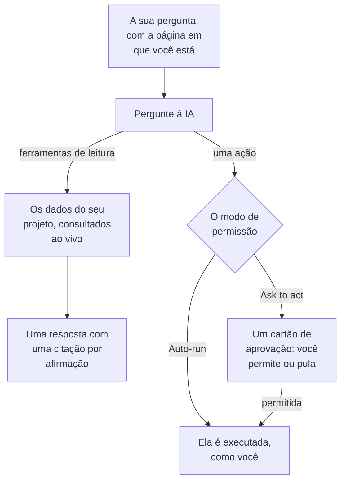

# Pergunte à IA

Pergunte à IA é o chat do OneUptime sobre os dados do seu projeto. Pergunte sobre logs, traces, métricas, exceções, incidentes, alertas, monitores, plantão, páginas de status, SLOs, runbooks ou fluxos de trabalho: ele consulta o seu projeto ao vivo, apoia cada afirmação com uma citação e, quando você permite, age por você.

:::cards
- [Abrir o Pergunte à IA](#abrir-o-pergunte-à-ia): Pelo cabeçalho, pelo teclado, por um gráfico ou pelo menu de produtos.
- [O que ele vê](#o-que-ele-vê): Os dados que ele lê para responder a você.
- [Ações e modos de permissão](#ações-e-modos-de-permissão): Escolha se ele pode agir e quando pergunta antes.
- [As ações são feitas como você](#as-ações-são-feitas-como-você): As suas permissões, o seu nome em cada mudança.
:::

## Como o Pergunte à IA responde

O Pergunte à IA responde só com o que as suas ferramentas retornam: ele executa consultas no seu projeto em vez de responder de memória. Cada fato de uma resposta traz um chip de citação que mostra a consulta por trás dele e abre os dados lidos. Quando você pede para mudar algo, o modo de permissão da conversa decide se ele pergunta antes. Antes da sua pergunta, ele lê o [contexto de IA](/docs/ai/ai-context) do projeto: o que a sua equipe escreveu para a OneUptime AI sobre os seus próprios sistemas.

No modo **Somente leitura** as ações nunca são oferecidas ao modelo, então a conversa só lê.

## Perguntas sobre o OneUptime

Perguntar à IA também responde a perguntas sobre o próprio OneUptime: «Como recebo um SMS quando o meu site cai?», «O que é um episódio?», «Onde adiciono um segundo número de telefone?». As respostas vêm desta documentação, a cópia que o seu OneUptime serve, por isso funciona sem acesso à internet e não envia nada para nenhum sítio novo. Lê a página no seu idioma quando está traduzida, cita a página e a secção de cada passo e diz que a documentação não cobre algo em vez de adivinhar.

Uma resposta a um «como faço» termina com um botão que abre a página do seu projeto onde o faz, como **Criar monitor** ou **Métodos de notificação**. Só abre páginas que o OneUptime tem: as que a pesquisa (`Ctrl` + `K`) encontra.

## Abrir o Pergunte à IA

| Onde | Como |
| --- | --- |
| Qualquer página | Clique em **Pergunte à IA** no cabeçalho, ou pressione `Ctrl` + `I` (`Cmd` + `I` em um Mac). Enquanto você digita em uma caixa de texto ou em um editor, essas teclas continuam sendo o atalho de itálico do editor. |
| A paleta de comandos | Pressione `Ctrl` + `K` (`Cmd` + `K` em um Mac) e escolha **Pergunte à IA**. |
| Um padrão de erro dos logs, ou as conclusões de um gráfico | Clique em **Explicar com IA**: o Pergunte à IA abre com as evidências como uma pergunta que você pode editar antes de enviar. |
| O menu de produtos | Abra **Produtos → IA → Chat**. O Pergunte à IA abre ao lado da página em que você estava. Cada conversa tem o próprio endereço, então você pode salvá-la nos favoritos e voltar a ela. |

O Pergunte à IA abre na lateral da janela, e a página abre espaço para ele: nada fica escondido atrás, então você pode continuar trabalhando na página, ir para outras páginas e perguntar de novo. Arraste a borda para deixá-lo mais largo ou mais estreito. Pressione `Esc` dentro dele, ou clique em **Pergunte à IA** de novo, para devolver à página a janela inteira. Com ele aberto, `Ctrl` + `I` (`Cmd` + `I` em um Mac) vai da página para a caixa em que você digita, e de lá o fecha. A conversa fica onde você parou: abra o Pergunte à IA de novo para continuar. Se você o fechar enquanto ele ainda responde, um lembrete no canto avisa quando a resposta está pronta, e a abre. Em um tablet ou celular, onde não há espaço para os dois, ele abre sobre a página, e em um celular ocupa a tela inteira.

Em um incidente ou alerta, o cartão **OneUptime AI** tem uma conversa própria, **Perguntar à OneUptime AI**, compartilhada com todos que podem ver aquele incidente ou alerta: veja [Conversar com o OneUptime AI sobre o incidente](/docs/ai/ai-sre#converse-com-a-oneuptime-ai-sobre-o-incidente).

## O que ele vê

O Pergunte à IA lê o seu projeto com as suas próprias permissões, então vê o que você pode ver e nada mais.

| Área | O que o Pergunte à IA lê |
| --- | --- |
| Telemetria | Busca e histogramas de logs, agregações de traces e árvores de spans, métricas, exceções, eventos de segurança, monitoramento de usuários reais e Web Vitals, mudanças recentes e verificações de anomalias contra linhas de base aprendidas. |
| Infraestrutura | Hosts, Docker, Podman, Kubernetes, Docker Swarm, Proxmox, VMware vCenter, Ceph, storage arrays, funções serverless, ambientes de nuvem, frotas de IoT e dispositivos de rede: o que está no inventário, o estado de conexão informado, tendências de métricas, contagens de logs por gravidade e resumos das operações de traces. Uma consulta cobre tanto a telemetria que cita um serviço quanto a que cita um recurso de infraestrutura. |
| Resposta a incidentes | Incidentes e alertas, com filtros de estado ("o que está ativo agora?"), as linhas do tempo de atividade (mudanças de estado, notas internas e públicas, o feed) e os responsáveis, e uma busca em incidentes anteriores para reaproveitar como foram resolvidos. |
| Plantão | Quem está de plantão agora, políticas e cadeias de escalonamento, e se os acionamentos recentes foram entregues e confirmados. |
| O trabalho da própria IA | Os resultados das investigações do AI SRE e do AI Insights, para que "o que a IA encontrou?" seja respondido a partir da análise publicada em vez de ser refeito. |
| Plataforma | Monitores (com filtros de status), manutenção programada, páginas de status e seus anúncios, SLOs, runbooks, execuções de fluxos de trabalho, saúde das sondas, equipes e o código dos repositórios conectados no GitHub, GitLab, Forgejo, Gitea e Azure DevOps (veja [O que a IA lê num repositório Git](/docs/ai/ai-agent#o-que-a-ia-lê-num-repositório-git)). |

## Contexto da página

O Pergunte à IA sabe de qual página você o abriu. Na página de um incidente, "por que isso aconteceu?" significa aquele incidente: a área de escrita mostra um chip com o assunto da página, e as perguntas que ele sugere são as daquela página. Remova o chip para perguntar sobre o projeto todo, e adicione-o de volta do mesmo jeito. Abra o Pergunte à IA em outra página e o contexto vai junto. A conversa também lembra o primeiro assunto no servidor, então uma pergunta de acompanhamento dias depois ainda entende "este incidente".

Em um incidente, um alerta, um monitor ou um evento de manutenção programada, as perguntas também seguem a situação desse registro, lida sempre que o Pergunte à IA se abre nele. Um incidente resolvido pergunta como foi a resposta e o que impediria que ele se repetisse, um alerta resolvido se foi um problema real e com que frequência alertas como ele disparam, e um monitor que não está operacional pergunta por quê. Um evento de manutenção que ainda não começou pergunta se os monitores dele estão saudáveis antes do início, e um que já terminou se eles voltaram ao normal.

Listas de infraestrutura e páginas de recursos sugerem perguntas para o tipo de recurso que você está vendo. Abra um cluster do Kubernetes e pergunte "Quais métricas mudaram nas últimas 24 horas?", ou abra um host do Docker e pergunte "Resuma a gravidade dos logs e os erros de traces das últimas seis horas." Os links das evidências levam de volta à página do recurso. As leituras respeitam as suas permissões de projeto, recursos e telemetria, incluindo as restrições por responsável e por rótulos.

Na página de um item filho, o contexto também registra o pod, o contêiner, a VM, o processo ou o outro item que você selecionou. As ferramentas de infraestrutura leem a telemetria do recurso pai; elas não conseguem medir um item filho só pelo nome. O Pergunte à IA diz isso e não adivinha um namespace do Kubernetes que a página não informa. Um estado de conexão não é a saúde de uma carga de trabalho, e a falta de telemetria não significa que um recurso está saudável.

## Comandos na sua infraestrutura

Aberto na página de um recurso cujo agente de IA está conectado (um host, um host Docker ou Podman, um cluster Docker Swarm, um cluster Proxmox, um VMware vCenter, um cluster Ceph, um servidor de banco de dados ou um cluster Kubernetes), o Pergunte à IA executa comandos nele por meio desse agente quando você pede: "execute `uptime` neste host" ou "mostre as últimas 100 linhas de `journalctl -u nginx`". Ele responde com o que voltou, citado como qualquer outra evidência. Aberto em um incidente ou alerta, ele alcança os recursos vinculados.

- Ele executa somente os comandos somente leitura que uma investigação de IA pode executar nesse tipo de recurso (consulte [Agentes de IA para a infraestrutura](/docs/ai/infrastructure-ai-agents)), quantos a resposta precisar, verificados pela OneUptime e de novo pelo agente, em qualquer modo de permissão. Uma alteração por meio do agente, como reiniciar um serviço, nunca é executada pelo Pergunte à IA: em vez disso, ele dá a você o comando exato, e o agente só faz alterações quando a OneUptime AI corrige um incidente ou alerta, de acordo com as próprias configurações de correção do recurso. As ações do próprio Pergunte à IA, como executar um runbook, seguem o modo de permissão da conversa, descrito abaixo.
- Ele alcança apenas os recursos que você pode ver, e apenas enquanto a investigação de IA estiver ativada para o recurso.
- Quando não consegue executar um comando ali (nenhum agente está conectado, o agente está offline ou a investigação de IA está desativada para o recurso), ele avisa, junto com o que mudar, e responde com os dados do seu projeto.

## Ações e modos de permissão

Cada conversa tem um modo de permissão, que você escolhe na área de escrita, ao lado da caixa onde digita:

| Modo | O que acontece |
| --- | --- |
| **Perguntar antes de agir** | O padrão. O Pergunte à IA propõe cada ação em um cartão de aprovação, e nada é executado até você escolher **Permitir** ou **Pular** para ela, ou **Negar tudo**. |
| **Execução automática** | As ações são executadas assim que o modelo as pede, ainda limitadas ao que a sua função pode fazer. Use com cuidado. |
| **Somente leitura** | As ações não são oferecidas ao modelo: o Pergunte à IA só pode ler. |

O que o Pergunte à IA pode fazer quando um modo permite:

- Criar um incidente ou alerta, confirmar ou resolver incidentes e alertas, e mudar a gravidade de um incidente.
- Vincular um incidente ou alerta à infraestrutura e aos serviços a que ele se refere. Um incidente ou alerta criado na página de um recurso, como a de um host, fica vinculado a esse recurso, e o cartão de aprovação mostra o que cada ação vincula. O OneUptime AI investiga e corrige aquilo a que um incidente ou alerta está vinculado.
- Registrar um problema de que alguém já está cuidando, ou que já acabou: um incidente ou alerta que ele cria pode começar confirmado ou resolvido, e aí não aciona ninguém. O cartão de aprovação diz qual dos dois. Veja [Declarado já confirmado ou resolvido](/docs/incidents/declaring-incidents#declarado-já-confirmado-ou-resolvido).
- Publicar uma nota interna em um incidente ou alerta. Notas internas nunca aparecem em uma página de status.
- Publicar uma atualização de status pública em um incidente. É uma ação separada, porque avisa os assinantes da página de status.
- Acionar uma política de plantão, executar um runbook ou iniciar uma investigação de IA de um incidente ou alerta.
- Configurar tudo a partir de uma frase: um monitor de site ou de API, quem é acionado, uma página de status e os monitores que ela mostra, tudo em um único cartão de aprovação. Veja [Configurar tudo](#configurar-tudo).
- Propor uma mudança de código: fazer commit em um novo branch de um repositório no GitHub, GitLab, Forgejo ou Gitea e abrir um pull request (um merge request no GitLab). Ele nunca escreve no branch padrão nem em um branch protegido, então uma pessoa ainda faz o merge da mudança. O Ask AI escreve cada arquivo inteiro, a partir do arquivo como o leu pela última vez, e lê o branch principal de um repositório, a menos que lhe peçam outro. Se um arquivo mudou no branch depois que o Ask AI o leu, o cartão o nomeia antes que você aprove o commit ou o pull request, por exemplo "Este arquivo mudou em fix/login depois que a IA o leu, e a versão da IA desfaz essa mudança: src/billing/charge.ts." O cartão também nomeia um arquivo que o Ask AI leu só em outro branch, onde ele é diferente, um arquivo que o Ask AI nunca leu mas substitui, e um arquivo que o OneUptime não conseguiu verificar. O Ask AI lê um arquivo longo por partes, então o cartão também nomeia um arquivo do qual o Ask AI leu só uma parte, por exemplo "A IA leu só uma parte deste arquivo, e a versão da IA o substitui por inteiro: src/billing/charge.ts." Depois que o Ask AI leu o arquivo inteiro, de uma vez ou em várias leituras, o cartão não diz nada dele. Uma resposta posterior tem as palavras das anteriores, não os arquivos que elas leram, então o cartão também nomeia um arquivo que o Ask AI leu só em uma resposta anterior, por exemplo "A IA leu este arquivo em uma resposta anterior e não tem mais o texto dele, e a versão da IA o substitui por inteiro: src/billing/charge.ts." Uma resposta muito longa também deixa de fora seus resultados mais antigos, para caber no que o modelo consegue considerar de uma vez, então o cartão também nomeia um arquivo que o Ask AI leu antes na mesma resposta se esse resultado ficou de fora, por exemplo "A IA leu este arquivo anteriormente nesta resposta e não tem mais o texto dele, e a versão da IA o substitui por inteiro: src/billing/charge.ts." Se o Ask AI leu o arquivo em várias partes e não tem mais todas elas, o cartão também diz isso, por exemplo "A IA leu este arquivo e não tem mais parte do texto dele, e a versão da IA o substitui por inteiro: src/billing/charge.ts." Quando o Ask AI lê o arquivo de novo na resposta que o altera, o cartão não diz nada sobre ele. Um arquivo novo nunca conta. Para manter o que outra pessoa mudou, pule a ação e peça ao Ask AI que leia os arquivos de novo. Em Execução automática, em que ninguém aprova as ações, o Ask AI não faz uma alteração assim: ele lê os arquivos de novo e faz a alteração sobre eles como estão agora. Se um arquivo mudar enquanto o cartão espera por você, aprová-lo não muda nada, e o Ask AI propõe a alteração de novo. Um pull request que você aprovar mesmo assim cita esses arquivos na descrição, para quem for revisá-lo. O Ask AI nunca vê valores que parecem segredos ou dados pessoais, como endereços IP, endereços de e-mail e chaves: no lugar deles, ele lê um marcador de posição como `[redacted-ip]`. Por isso o cartão também nomeia um arquivo em que a versão do Ask AI escreve esses marcadores, por exemplo "Valores que parecem segredos ou dados pessoais foram ocultados da IA, e a versão da IA deste arquivo escreve marcadores de posição no lugar deles: config/servers.ts." Um marcador que o arquivo do branch já tem não conta. O Ask AI não consegue escrever esses valores de volta, então em Execução automática ele não faz essa alteração e, em vez disso, diz o que você deve mudar.

Peça um incidente quando os usuários forem afetados, e um alerta quando algo precisar primeiro da atenção da sua equipe, como a memória de um host que não para de subir. Os dois são criados uma vez e não vigiam nada: para ser alertado toda vez que a memória de um host passar de 75%, crie um [monitor de host](/docs/monitor/host-monitor#modelos-de-alerta-prontos) a partir do modelo de memória dele, com 75% como limite. O Pergunte à IA configura apenas monitores de site e de API (veja [Configurar tudo](#configurar-tudo)). Quando você pede de outro tipo, ele diz isso, verifica o valor atual e oferece criar um alerta se ele já tiver passado.

## As ações são feitas como você

Toda ação do Pergunte à IA é feita como você: ele faz a mesma mudança que o painel faz para a mesma ação, com as suas próprias permissões no projeto, e a mudança é creditada a você. Confirmar um incidente pelo chat cria a mesma mudança de estado que o painel de estado do incidente, então a linha do tempo e o feed do incidente mostram que você mudou o estado dele. Um acionamento enviado pelo chat mostra você como quem o disparou.

- **O que cada ação precisa.** A permissão que o painel pede para a mesma mudança. Criar um incidente ou alerta precisa da permissão para criá-lo: uma função que possa, ou **Create Incident** ou **Create Alert** em uma função personalizada. Confirmar ou resolver um incidente precisa da permissão para mudar o estado dele: **Proprietário do projeto**, **Administrador do projeto**, **Membro do projeto**, **Administrador de incidentes** e **Membro de incidentes**, ou **Create Incident State Timeline** em uma função personalizada; um alerta precisa da mesma permissão para alertas (**Create Alert State Timeline**). Criar um incidente ou alerta que começa confirmado ou resolvido precisa das duas: a permissão para criá-lo e a permissão para mudar o estado dele. Acionar uma política de plantão precisa da permissão para executá-la (**Execute On-Call Policies**), e executar um runbook precisa da permissão para iniciar execuções de runbooks: uma função que executa runbooks, para os runbooks que os seus rótulos alcançam, ou **Create Runbook Execution** em uma função personalizada, que alcança todos os runbooks do projeto. Mudar a gravidade de um incidente, iniciar uma investigação de IA de um incidente ou alerta e escrever código em um repositório conectado precisam da permissão para mudar aquele incidente, alerta ou repositório. Uma ação que você não pode fazer é recusada, e a IA diz qual permissão é necessária. Quando você tem a permissão mas uma equipe da qual faz parte a bloqueia, a IA diz isso: um bloqueio em alguns rótulos recusa essa ação no Pergunte à IA para todos os registros, não só para os que têm esses rótulos.
- **Quais registros.** Os que você pode mudar, como em todo o OneUptime: com uma função limitada a alguns rótulos, ou aos registros que são seus, uma ação em qualquer outro registro não muda nada. Um runbook só é executado quando a sua permissão para iniciar execuções de runbooks o alcança. No OneUptime Cloud, uma ação que o plano do projeto não inclui é recusada indicando o plano necessário.
- **Quando uma ação é recusada.** Nada muda, e a IA diz claramente que a ação não foi feita, e por quê, em vez de tentar de novo. Entre as etapas da resposta, a da ação diz que ela não foi feita, e por quê: sua função não permite, uma equipe da qual você faz parte a bloqueia, ou o plano do projeto não a inclui.
- **Slack, Microsoft Teams e investigações de IA.** As respostas da IA no Slack e no Microsoft Teams, e as investigações autônomas de IA, só leem: elas não fazem nenhuma dessas ações. Quando você pede uma mudança lá, a IA diz como fazê-la pelo chat: `/oneuptime incident` declara um incidente, `/oneuptime incident 42` mostra o incidente 42 com seus botões, `/oneuptime page` aciona alguém (no Microsoft Teams, as mesmas palavras escritas para o bot do OneUptime), e os botões das mensagens do OneUptime também agem como você (veja [Slack](/docs/workspace-connections/slack#agir-sobre-incidentes-alertas-e-eventos-pelo-slack) e [Microsoft Teams](/docs/workspace-connections/microsoft-teams#agir-sobre-incidentes-alertas-e-eventos-pelo-microsoft-teams)). Para qualquer outra mudança, ela leva ao Pergunte à IA com um link, que propõe a mudança para você aprovar. Perguntada no canal próprio de um incidente ou de um alerta, ela entende que você fala desse incidente ou desse alerta.

## Configurar tudo

O Pergunte à IA configura, a partir de uma frase, o que as configurações guiadas configuram: "Monitore example.com a cada minuto e me mande um SMS se ele cair."

- **Um plano, uma aprovação.** O Pergunte à IA propõe cada parte em um único cartão de aprovação, cada uma em palavras simples: um monitor de site ou de API, a primeira política de plantão do projeto, uma página de status e os monitores que ela mostra. O cartão termina com "Nada mais muda." Escolha **Pular** em qualquer parte que você não quiser e execute o resto. Nada é criado antes disso.
- **Sempre pergunta.** A configuração espera sua aprovação em todos os modos, inclusive em **Execução automática**, porque cria coisas que acionam pessoas e que seus clientes veem. **Somente leitura** não a oferece.
- **Os registros das configurações guiadas.** O monitor é o que **Saber quando meu site ou API cair** cria para o mesmo endereço: os padrões de Criar monitor, abrindo um incidente quando o endereço não responde ou responde com erro, verificado a cada 5 minutos, a menos que você peça outro dos intervalos de Criar monitor. Ele é seu, então você recebe um e-mail quando o status dele muda. A página de status é a que **Publique uma página de status** cria: pública assim que é criada, mostrando o status, a disponibilidade e o histórico de cada monitor.
- **Quem é acionado.** Em um projeto que ainda não aciona ninguém, o Pergunte à IA propõe a primeira política de plantão do projeto, "Default on-call policy", que aciona você, e os membros e equipes que você nomear, a cada novo incidente e a cada novo alerta. Um projeto que já aciona pessoas mantém suas próprias políticas e regras de plantão, e o Pergunte à IA diz isso em vez de criar outra.
- **O que falta.** O Pergunte à IA nunca adiciona um número de telefone nem o aplicativo móvel: você os adiciona e verifica em **Configurações do usuário → Métodos de notificação**. Se você pedir para receber SMS sem um número verificado, o cartão diz isso e a resposta leva à página. Uma parte que o Pergunte à IA não consegue criar não é proposta, por exemplo quando sua função não permite, o endereço não é um endereço ou os monitores não existem: a resposta diz o que é preciso.
- **O que cada parte precisa.** Um monitor precisa de permissão para criar monitores. O acionamento precisa de permissão para criar políticas de plantão, suas regras de escalonamento e regras de plantão de incidentes e alertas. Uma página de status precisa de permissão para criar páginas de status e adicionar monitores a elas. Os limites do plano do projeto se aplicam, como nas configurações guiadas.
- **Depois, teste.** Quando o plano roda, cada cartão abre o que foi criado, e **Testar esta política** (ou **Enviar uma chamada de teste para mim**, para um monitor sozinho) abaixo da resposta envia uma chamada de teste que você confirma pela mensagem. Se uma parte falhar, a resposta diz o que foi criado e o que não foi.
- **Quem é avisado.** Pergunte "quem é avisado quando example.com cai?" e o Pergunte à IA responde a partir da mesma cadeia que a página do monitor mostra, nomeando cada quebra.

## Conduzir uma conversa

- **Pare-o.** Enquanto o Pergunte à IA trabalha, o botão de enviar vira um botão de parar. Pare uma execução a qualquer momento e pergunte outra coisa na hora.
- **Acompanhe o trabalho.** Enquanto ele responde, uma linha diz o que está fazendo agora, como pesquisar logs. Clique no número de etapas ao lado para ver cada etapa.
- **Escolha o modelo.** Quando o seu projeto pode usar mais de um provedor de LLM, o seletor de provedor da área de escrita lista os provedores de LLM do seu projeto e os globais, com o padrão marcado. Uma conversa nova usa o padrão.
- **Avalie uma resposta.** **Boa resposta** e **Resposta ruim** são salvos com a mensagem, para que a qualidade das respostas possa ser medida ao longo do tempo.
- **Veja o custo.** Abaixo de cada resposta, as fontes se abrem nas consultas que ela executou, e as da resposta mais recente também dizem quantas consultas ela executou, os tokens e o custo. Cada chip de citação em uma resposta abre os dados por trás dela.
- **Guarde uma cópia.** **Baixar conversa** salva o fio com **Baixar como Markdown**, para ler ou colar em um ticket, ou com **Baixar como PDF**, para entregar a alguém.
- **Continue de onde parou.** **Todas as conversas**, no cabeçalho do Pergunte à IA, lista as suas conversas, das mais recentes às mais antigas, para abrir de novo ou excluir. O início de uma conversa nova mostra as três últimas.

## Requisitos

- **Um provedor de LLM.** O Pergunte à IA usa o provedor de LLM padrão do projeto (veja [Provedores de LLM](/docs/ai/llm-provider)). No OneUptime Cloud ele funciona de imediato com o provedor global, pago com os créditos de IA do projeto; uma instalação auto-hospedada configura um provedor, ou as variáveis de ambiente do provedor global. As respostas são tão boas quanto o modelo: um modelo auto-hospedado pequeno sem chamadas de ferramentas confiáveis responde mal.
- **O plano Growth, no OneUptime Cloud.** Um projeto com um plano inferior vê que a IA não está incluída no plano, com um link para **Configurações do projeto → Cobrança e faturas → Cobrança**.
- **IA ligada para o projeto.** **Habilitar IA**, em **Configurações do projeto → IA → Recursos de IA**, desliga todos os recursos de IA do projeto, inclusive o Pergunte à IA. Ela fica ligada a menos que alguém a desligue.

O Pergunte à IA conta para os limites diários de IA do próprio projeto quando o projeto os define (Configurações do projeto → IA → AI Features → Mais configurações): quando um é atingido, o Pergunte à IA mostra uma frase que diz qual limite foi atingido, que o OneUptime AI recomeça à meia-noite UTC e quem pode aumentar ou remover o limite. Os proprietários do projeto recebem um e-mail na primeira vez que um limite é atingido a cada dia. Os limites diários de incidentes e alertas nunca param o Pergunte à IA. Veja [os limites diários do próprio projeto](/docs/ai/ai-sre#os-limites-diários-do-próprio-projeto).

## Solução de problemas

:::details O Pergunte à IA diz que a IA não está disponível
O Pergunte à IA diz o motivo antes de você digitar: o plano do projeto não inclui IA, **Habilitar IA** está desligado ou o projeto não tem provedor de LLM. Cada aviso leva à página em que isso se muda.
:::

:::details Uma ação foi recusada
O Pergunte à IA diz qual permissão a ação precisa, ou qual equipe a bloqueia. Peça a alguém que possa fazer a mudança, ou peça a um proprietário do projeto que dê a permissão à sua função. Nada foi alterado.
:::

:::details As respostas são vagas ou nunca usam dados
Verifique o modelo por trás do provedor. O Pergunte à IA precisa de um modelo que chame ferramentas de forma confiável; modelos locais pequenos muitas vezes respondem sem executar uma única consulta. Veja [Provedores de LLM](/docs/ai/llm-provider).
:::

## Próximos passos

:::cards
- [AI SRE](/docs/ai/ai-sre): Deixe o OneUptime AI investigar cada novo incidente e alerta.
- [Provedores de LLM](/docs/ai/llm-provider): Escolha o modelo que o Pergunte à IA e os outros recursos de IA usam.
- [Servidor MCP](/docs/ai/mcp-server): Pergunte sobre o OneUptime pelo Claude, Cursor ou VS Code.
:::
