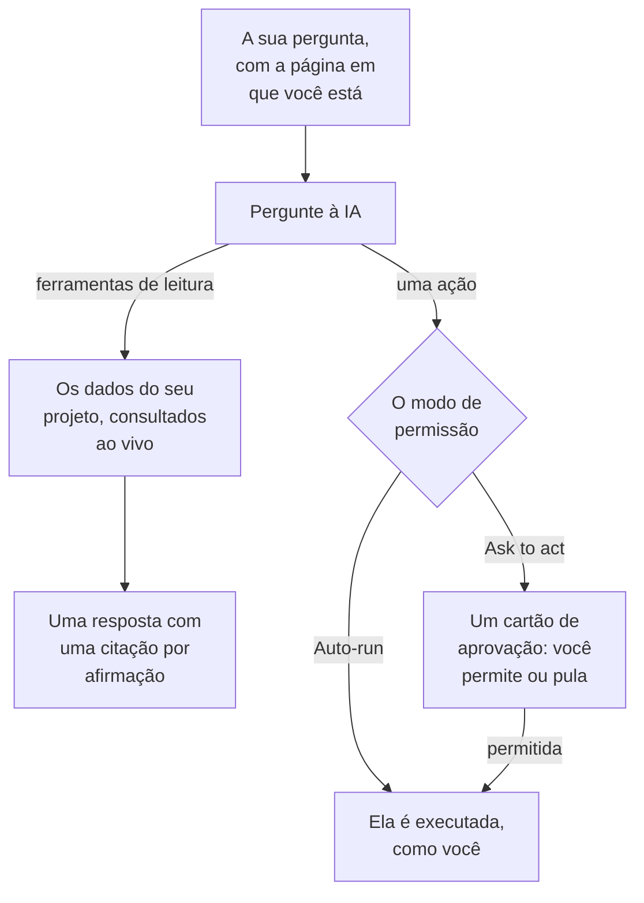

# Pergunte à IA

Pergunte à IA é o chat do OneUptime sobre os dados do seu projeto. Pergunte sobre logs, traces, métricas, exceções, incidentes, alertas, monitores, plantão, páginas de status, SLOs, runbooks ou fluxos de trabalho: ele consulta o seu projeto ao vivo, apoia cada afirmação com uma citação e, quando você permite, age por você.

:::cards
- [Abrir o Pergunte à IA](#abrir-o-pergunte-à-ia): Pelo cabeçalho, pelo teclado, por um gráfico ou pela própria página.
- [O que ele vê](#o-que-ele-vê): Os dados que ele lê para responder a você.
- [Ações e modos de permissão](#ações-e-modos-de-permissão): Escolha se ele pode agir e quando pergunta antes.
- [As ações são feitas como você](#as-ações-são-feitas-como-você): As suas permissões, o seu nome em cada mudança.
:::

## Como o Pergunte à IA responde

O Pergunte à IA responde só com o que as suas ferramentas retornam: ele executa consultas no seu projeto em vez de responder de memória. Cada fato de uma resposta traz um chip de citação que mostra a consulta por trás dele e abre os dados lidos. Quando você pede para mudar algo, o modo de permissão da conversa decide se ele pergunta antes. Antes da sua pergunta, ele lê o [contexto de IA](/docs/ai/ai-context) do projeto: o que a sua equipe escreveu para a OneUptime AI sobre os seus próprios sistemas.

No modo **Somente leitura** as ações nunca são oferecidas ao modelo, então a conversa só lê.

## Abrir o Pergunte à IA

| Onde | Como |
| --- | --- |
| Qualquer página | Clique em **Ask AI** no cabeçalho, ou pressione `Ctrl` + `I` (`Cmd` + `I` em um Mac). Enquanto você digita em uma caixa de texto ou em um editor, essas teclas continuam sendo o atalho de itálico do editor. |
| A paleta de comandos | Pressione `Ctrl` + `K` (`Cmd` + `K` em um Mac) e escolha **Ask AI**. |
| Um padrão de erro dos logs, ou as conclusões de um gráfico | Clique em **Explain with AI**: o Pergunte à IA abre com as evidências como uma pergunta que você pode editar antes de enviar. |
| A própria página | Abra **Produtos → AI → Chat** para um espaço de trabalho em página inteira. Cada conversa ali tem o próprio endereço, então você pode salvar um fio nos favoritos ou colá-lo no canal de um incidente. |

Em um incidente ou alerta, o cartão **AI Investigation** tem uma conversa própria, **Ask OneUptime AI**, compartilhada com todos que podem ver aquele incidente ou alerta: veja [Conversar com o OneUptime AI sobre o incidente](/docs/ai/ai-sre#converse-com-a-oneuptime-ai-sobre-o-incidente).

## O que ele vê

O Pergunte à IA lê o seu projeto com as suas próprias permissões, então vê o que você pode ver e nada mais.

| Área | O que o Pergunte à IA lê |
| --- | --- |
| Telemetria | Busca e histogramas de logs, agregações de traces e árvores de spans, métricas, exceções, eventos de segurança, monitoramento de usuários reais e Web Vitals, mudanças recentes e verificações de anomalias contra linhas de base aprendidas. |
| Infraestrutura | Hosts, Docker, Podman, Kubernetes, Docker Swarm, Proxmox, VMware vCenter, Ceph, storage arrays, funções serverless, ambientes de nuvem, frotas de IoT e dispositivos de rede: o que está no inventário, o estado de conexão informado, tendências de métricas, contagens de logs por gravidade e resumos das operações de traces. Uma consulta cobre tanto a telemetria que cita um serviço quanto a que cita um recurso de infraestrutura. |
| Resposta a incidentes | Incidentes e alertas, com filtros de estado ("o que está ativo agora?"), as linhas do tempo de atividade (mudanças de estado, notas internas e públicas, o feed) e os responsáveis, e uma busca em incidentes anteriores para reaproveitar como foram resolvidos. |
| Plantão | Quem está de plantão agora, políticas e cadeias de escalonamento, e se os acionamentos recentes foram entregues e confirmados. |
| O trabalho da própria IA | Os resultados das investigações do AI SRE e do AI Insights, para que "o que a IA encontrou?" seja respondido a partir da análise publicada em vez de ser refeito. |
| Plataforma | Monitores (com filtros de status), manutenção programada, páginas de status e seus anúncios, SLOs, runbooks, execuções de fluxos de trabalho, saúde das sondas, equipes e o código dos repositórios conectados. |

## Contexto da página

O Pergunte à IA sabe de qual página você o abriu. Na página de um incidente, "por que isso aconteceu?" significa aquele incidente, e a área de escrita mostra um chip com o assunto da página; remova-o para perguntar sobre o projeto todo. Se você for para outra página com o painel aberto, o contexto vai junto. A conversa também lembra o primeiro assunto no servidor, então uma pergunta de acompanhamento dias depois ainda entende "este incidente".

Listas de infraestrutura e páginas de recursos sugerem perguntas para o tipo de recurso que você está vendo. Abra um cluster do Kubernetes e pergunte "Quais métricas mudaram nas últimas 24 horas?", ou abra um host do Docker e pergunte "Resuma a gravidade dos logs e os erros de traces das últimas seis horas." Os links das evidências levam de volta à página do recurso. As leituras respeitam as suas permissões de projeto, recursos e telemetria, incluindo as restrições por responsável e por rótulos.

Na página de um item filho, o contexto também registra o pod, o contêiner, a VM, o processo ou o outro item que você selecionou. As ferramentas de infraestrutura leem a telemetria do recurso pai; elas não conseguem medir um item filho só pelo nome. O Pergunte à IA diz isso e não adivinha um namespace do Kubernetes que a página não informa. Um estado de conexão não é a saúde de uma carga de trabalho, e a falta de telemetria não significa que um recurso está saudável.

## Comandos na sua infraestrutura

Aberto na página de um recurso cujo agente de IA está conectado (um host, um host Docker ou Podman, um cluster Docker Swarm, um cluster Proxmox, um VMware vCenter, um cluster Ceph, um servidor de banco de dados ou um cluster Kubernetes), o Pergunte à IA executa comandos nele por meio desse agente quando você pede: "execute `uptime` neste host" ou "mostre as últimas 100 linhas de `journalctl -u nginx`". Ele responde com o que voltou, citado como qualquer outra evidência. Aberto em um incidente ou alerta, ele alcança os recursos vinculados.

- Ele executa somente os comandos somente leitura que uma investigação de IA pode executar nesse tipo de recurso (consulte [Agentes de IA para a infraestrutura](/docs/ai/infrastructure-ai-agents)), no máximo 30 por resposta por meio de cada tipo de agente, verificados pela OneUptime e de novo pelo agente, em qualquer modo de permissão. Uma alteração por meio do agente, como reiniciar um serviço, nunca é executada pelo Pergunte à IA: em vez disso, ele dá a você o comando exato, e o agente só faz alterações quando a OneUptime AI corrige um incidente ou alerta, de acordo com as próprias configurações de correção do recurso. As ações do próprio Pergunte à IA, como executar um runbook, seguem o modo de permissão da conversa, descrito abaixo.
- Ele alcança apenas os recursos que você pode ver, e apenas enquanto a investigação de IA estiver ativada para o recurso.
- Quando não consegue executar um comando ali (nenhum agente está conectado, o agente está offline ou a investigação de IA está desativada para o recurso), ele avisa, junto com o que mudar, e responde com os dados do seu projeto.

## Ações e modos de permissão

Cada conversa tem um modo de permissão, que você escolhe na área de escrita, ao lado da caixa onde digita:

| Modo | O que acontece |
| --- | --- |
| **Ask to act** | O padrão. O Pergunte à IA propõe cada ação em um cartão de aprovação, e nada é executado até você escolher **Allow** ou **Pular** para ela, ou **Deny all**. |
| **Auto-run** | As ações são executadas assim que o modelo as pede, ainda limitadas ao que a sua função pode fazer. Use com cuidado. |
| **Somente leitura** | As ações não são oferecidas ao modelo: o Pergunte à IA só pode ler. |

O que o Pergunte à IA pode fazer quando um modo permite:

- Criar um incidente, confirmar ou resolver incidentes e alertas, e mudar a gravidade de um incidente.
- Publicar uma nota interna em um incidente ou alerta. Notas internas nunca aparecem em uma página de status.
- Publicar uma atualização de status pública em um incidente. É uma ação separada, porque avisa os assinantes da página de status.
- Acionar uma política de plantão, executar um runbook ou iniciar uma investigação de IA de um incidente ou alerta.
- Propor uma mudança de código: fazer commit em um novo branch de um repositório conectado e abrir um pull request. Ele nunca escreve no branch padrão nem em um branch protegido, então uma pessoa ainda faz o merge da mudança.

## As ações são feitas como você

Toda ação do Pergunte à IA é feita como você: ele faz a mesma mudança que o painel faz para a mesma ação, com as suas próprias permissões no projeto, e a mudança é creditada a você. Confirmar um incidente pelo chat cria a mesma mudança de estado que o painel de estado do incidente, então a linha do tempo e o feed do incidente mostram que você mudou o estado dele. Um acionamento enviado pelo chat mostra você como quem o disparou.

- **O que cada ação precisa.** A permissão que o painel pede para a mesma mudança. Confirmar ou resolver um incidente precisa da permissão para mudar o estado dele: **Project Owner**, **Project Admin**, **Project Member**, **Incident Admin** e **Incident Member**, ou **Create Incident State Timeline** em uma função personalizada; um alerta precisa da mesma permissão para alertas (**Create Alert State Timeline**). Acionar uma política de plantão precisa da permissão para executá-la (**Create On-Call Duty Policy Execution Log**), e executar um runbook precisa da permissão para iniciar execuções de runbooks: uma função que executa runbooks, para os runbooks que os seus rótulos alcançam, ou **Create Runbook Execution** em uma função personalizada, que alcança todos os runbooks do projeto. Mudar a gravidade de um incidente, iniciar uma investigação de IA de um incidente ou alerta e escrever código em um repositório conectado precisam da permissão para mudar aquele incidente, alerta ou repositório. Uma ação que você não pode fazer é recusada, e a IA diz qual permissão é necessária. Quando você tem a permissão mas uma equipe da qual faz parte a bloqueia, a IA diz isso: um bloqueio em alguns rótulos recusa essa ação no Pergunte à IA para todos os registros, não só para os que têm esses rótulos.
- **Quais registros.** Os que você pode mudar, como em todo o OneUptime: com uma função limitada a alguns rótulos, ou aos registros que são seus, uma ação em qualquer outro registro não muda nada. Um runbook só é executado quando a sua permissão para iniciar execuções de runbooks o alcança. No OneUptime Cloud, uma ação que o plano do projeto não inclui é recusada indicando o plano necessário.
- **Quando uma ação é recusada.** Nada muda, e a IA diz claramente que a ação não foi feita, e por quê, em vez de tentar de novo.
- **Slack, Microsoft Teams e investigações de IA.** As respostas da IA no Slack e no Microsoft Teams, e as investigações autônomas de IA, só leem: elas não fazem nenhuma dessas ações. Para agir pelo Slack ou pelo Microsoft Teams, use os botões das mensagens do OneUptime, que também agem como você (veja [Slack](/docs/workspace-connections/slack#agir-sobre-incidentes-alertas-e-eventos-pelo-slack) e [Microsoft Teams](/docs/workspace-connections/microsoft-teams#agir-sobre-incidentes-alertas-e-eventos-pelo-microsoft-teams)).

## Conduzir uma conversa

- **Pare-o.** Enquanto o Pergunte à IA trabalha, o botão de enviar vira um botão de parar. Pare uma execução a qualquer momento e pergunte outra coisa na hora.
- **Escolha o modelo.** O seletor de provedor da área de escrita lista os provedores de LLM do seu projeto e os globais, com o padrão marcado. Uma conversa nova usa o padrão.
- **Avalie uma resposta.** **Good answer** e **Poor answer** são salvos com a mensagem, para que a qualidade das respostas possa ser medida ao longo do tempo.
- **Veja o custo.** O rodapé da resposta mais recente mostra o custo, os tokens e quantas consultas ela executou, e cada consulta é um chip de citação que abre os dados por trás dela.
- **Guarde uma cópia.** **Download conversation** salva o fio com **Download as Markdown**, para ler ou colar em um ticket, ou com **Download as PDF**, para entregar a alguém.

## Requisitos

- **Um provedor de LLM.** O Pergunte à IA usa o provedor de LLM padrão do projeto (veja [Provedores de LLM](/docs/ai/llm-provider)). No OneUptime Cloud ele funciona de imediato com o provedor global, pago com os créditos de IA do projeto; uma instalação auto-hospedada configura um provedor, ou as variáveis de ambiente do provedor global. As respostas são tão boas quanto o modelo: um modelo auto-hospedado pequeno sem chamadas de ferramentas confiáveis responde mal.
- **O plano Growth, no OneUptime Cloud.** Um projeto com um plano inferior vê que a IA não está incluída no plano, com um link para **Configurações do projeto → Cobrança e faturas → Cobrança**.
- **IA ligada para o projeto.** **Habilitar IA**, em **Configurações do projeto → IA → AI Features**, desliga todos os recursos de IA do projeto, inclusive o Pergunte à IA. Ela fica ligada a menos que alguém a desligue.

O Pergunte à IA conta para os limites diários de IA do próprio projeto quando o projeto os define (Configurações do projeto → IA → AI Features → Mais configurações): quando um é atingido, o Pergunte à IA mostra uma frase que diz qual limite foi atingido, que o OneUptime AI recomeça à meia-noite UTC e quem pode aumentar ou remover o limite. Os proprietários do projeto recebem um e-mail na primeira vez que um limite é atingido a cada dia. Os limites diários de incidentes e alertas nunca param o Pergunte à IA. Veja [os limites diários do próprio projeto](/docs/ai/ai-sre#os-limites-diários-do-próprio-projeto).

## Solução de problemas

:::details O Pergunte à IA diz que a IA não está disponível
O painel diz o motivo antes de você digitar: o plano do projeto não inclui IA, **Habilitar IA** está desligado ou o projeto não tem provedor de LLM. Cada aviso leva à página em que isso se muda.
:::

:::details Uma ação foi recusada
O Pergunte à IA diz qual permissão a ação precisa, ou qual equipe a bloqueia. Peça a alguém que possa fazer a mudança, ou peça a um proprietário do projeto que dê a permissão à sua função. Nada foi alterado.
:::

:::details As respostas são vagas ou nunca usam dados
Verifique o modelo por trás do provedor. O Pergunte à IA precisa de um modelo que chame ferramentas de forma confiável; modelos locais pequenos muitas vezes respondem sem executar uma única consulta. Veja [Provedores de LLM](/docs/ai/llm-provider).
:::

## Próximos passos

:::cards
- [AI SRE](/docs/ai/ai-sre): Deixe o OneUptime AI investigar cada novo incidente e alerta.
- [Provedores de LLM](/docs/ai/llm-provider): Escolha o modelo que o Pergunte à IA e os outros recursos de IA usam.
- [Servidor MCP](/docs/ai/mcp-server): Pergunte sobre o OneUptime pelo Claude, Cursor ou VS Code.
:::
