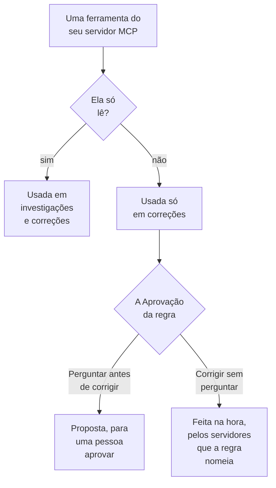

# Servidores MCP externos

O OneUptime AI pode usar as ferramentas de servidores MCP fora do OneUptime — os da sua nuvem, do seu host de código ou da sua própria equipe, como AWS, Azure ou GitHub — enquanto investiga e corrige incidentes e alertas. Adicione um servidor uma vez em **Configurações do projeto → IA → Servidores MCP externos**, e o OneUptime AI o usa a partir do próximo incidente.

:::cards
- [Adicionar um servidor](#adicionar-um-servidor): O endereço dele, e como o OneUptime faz login.
- [O que o OneUptime AI faz com um servidor](#o-que-o-oneuptime-ai-faz-com-um-servidor): As ferramentas que leem nas investigações, as outras nas correções.
- [Escolher os servidores que uma regra pode usar](#escolher-os-servidores-que-uma-regra-pode-usar): Todos, a menos que uma regra escolha alguns.
- [Segurança](#segurança): O que um servidor pode e não pode fazer o OneUptime AI fazer.
:::

Esta página trata dos servidores aos quais o OneUptime AI se conecta. Para conectar um assistente de IA como Claude ou Cursor ao OneUptime, veja [Servidor MCP](/docs/ai/mcp-server).

## Antes de começar

- **O OneUptime AI está ativado** no projeto, com um provedor de LLM que ele possa usar: veja [Provedores de LLM](/docs/ai/llm-provider).
- **O endereço MCP do servidor.** Streamable HTTP e o antigo HTTP com SSE funcionam: o OneUptime descobre qual o servidor fala ao se conectar.
- **Como o OneUptime faz login nele:** um token de API, cabeçalhos próprios do servidor ou credenciais de cliente OAuth do seu provedor de identidade.
- **Um Project Owner ou um Project Admin** adiciona, altera, testa e remove servidores; Project Members e Viewers podem vê-los. No OneUptime Cloud, adicionar um servidor exige o plano Growth ou superior.

## Adicionar um servidor

:::steps
### Abrir Servidores MCP externos
Vá para **Configurações do projeto → IA → Servidores MCP externos** e clique em **Criar: Servidor MCP externo**.

### Dizer onde ele está
Dê a ele um **Nome**, aquele pelo qual o OneUptime AI e as pessoas que leem o que ele fez o veem, e a sua **URL**, como `https://mcp.example.com/mcp`. Em **Mais campos**, uma **Descrição** diz para que serve o servidor; o OneUptime AI a lê para escolher o servidor certo.

### Escolher como o OneUptime faz login
Escolha um cartão em **Autenticação** e preencha o que ele pede (veja [Autenticação](#autenticação)).

### Ver o que o OneUptime encontrou
Ao salvar, o OneUptime se conecta na hora e a caixa de diálogo **Testar conexão** diz o que encontrou: o servidor, como ele se comunica e cada uma das suas ferramentas, marcada como **Somente leitura** ou **Pode alterar coisas**. Se não conseguiu se conectar, a caixa de diálogo diz por quê e o que verificar.
:::

A lista de servidores diz como está cada um: **Conectado**, **Não é possível conectar** (passe o mouse sobre ele para ver o motivo), **Ainda não verificado** ou **Desativado**, e quantas ferramentas ele oferece. A página de um servidor mostra os detalhes, a chave que permite ao OneUptime AI usá-lo e as suas **Ferramentas**, com **Testar conexão** para se conectar de novo e lê-las outra vez. Um teste não chama nenhuma ferramenta do servidor.

## Autenticação

| Autenticação | O que o OneUptime envia | O que você preenche |
| --- | --- | --- |
| **Sem login** | Nada | Nada. Para um servidor que não exige login, ou que só a sua rede alcança. |
| **Token bearer** | `Authorization: Bearer <token>` | **Token** |
| **Cabeçalhos personalizados** | Os cabeçalhos que você informa, em cada solicitação | Um nome e um valor por cabeçalho, como `X-API-Key`. No máximo 10. |
| **Credenciais de cliente OAuth** | Um token que ele pede ao seu provedor de identidade, como token bearer, pedindo de novo antes de expirar | **URL do token**, **Client ID** e **Client Secret**, numa etapa própria; **Escopo** e **Público (audience)** em **Mais campos** |

O token, os valores dos cabeçalhos e o client secret são armazenados criptografados e nunca mais exibidos, nem mesmo para quem os salvou. Uma edição começa com eles vazios; deixe um vazio para manter o que está armazenado. A página do servidor mostra os nomes dos cabeçalhos que ele envia, nunca os valores. Alterar a **Autenticação** remove os segredos que a forma anterior de login usava.

Nunca coloque um token ou uma senha na **URL**: qualquer pessoa que possa ler o servidor lê o endereço dele, e um nome de usuário ou uma senha nela é recusado.

## O que o OneUptime AI faz com um servidor

Cada ferramenta que um servidor oferece ou apenas lê, ou pode alterar algo. O OneUptime segue o que o servidor diz sobre a ferramenta (o `readOnlyHint` dela): uma ferramenta que o servidor não marca como somente leitura conta como uma que pode alterar algo.

| | Ferramentas que apenas leem | Ferramentas que podem alterar algo |
| --- | --- | --- |
| **Investigações** | Usadas, junto com os dados do próprio OneUptime | Nunca usadas: o OneUptime recusa a chamada |
| **Correções** | Usadas para elaborar a correção | Propostas para aprovação, ou usadas na hora, conforme a **Correção** da regra de IA |

**Numa investigação**, o OneUptime AI lista as ferramentas dos servidores que pode usar e chama as que leem, para ver o que o OneUptime não vê sozinho: a sua conta na nuvem, um deploy, um rastreador de issues. Ele usa o que elas respondem na sua análise de causa raiz. Veja [AI SRE](/docs/ai/ai-sre).

**Numa correção**, quando um servidor que ele pode usar oferece uma ferramenta que pode alterar algo, o OneUptime AI elabora uma correção por meio dele, depois da análise de causa raiz quando houver uma:

- **Perguntar antes de corrigir** — cada alteração que ele faria é registrada e não é enviada a lugar nenhum. O cartão **Remediação** do incidente as lista em ordem, cada uma com o seu servidor, a sua ferramenta e o que enviaria. **Aprovar e executar** faz exatamente essas alterações, nessa ordem, em seu nome; aprovar exige a mesma permissão que iniciar um runbook. Uma alteração que falha interrompe as seguintes.
- **Corrigir sem perguntar** — o OneUptime AI faz as alterações sozinho, cada uma registrada antes de ser enviada. Ele só faz isso para uma regra que nomeia os seus servidores MCP, quando nenhuma outra regra correspondente pergunta antes, nada mais já está corrigindo o incidente por conta própria (um agente de IA num cluster ou host, ou um runbook) e a regra não fez o máximo de correções que pode fazer sozinha em uma hora; caso contrário, as alterações são propostas. Sem nenhuma regra configurada, ou com uma regra que não nomeia nenhum servidor MCP, toda alteração é proposta.

Uma correção faz no máximo 5 alterações. Depois o OneUptime observa os monitores do incidente, como em toda correção. Nada é desfeito automaticamente: uma ferramenta MCP não tem um desfazer que o OneUptime possa conhecer, então uma correção que não funcionou fica para uma pessoa, e o cartão **Remediação** mostra o que cada servidor respondeu.

Para o OneUptime AI deixar de usar um servidor, desative **Permitir que o OneUptime AI use este servidor** na página dele. Ele pergunta antes: o servidor deixa de ser usado em qualquer investigação ou correção, e uma correção proposta por meio dele não pode mais ser aprovada.

## Escolher os servidores que uma regra pode usar

Cada regra de IA pode nomear os servidores MCP que o OneUptime AI pode usar para o que corresponde a ela. O campo é **Servidores MCP**, em **Mais campos**. Até você escolher alguns, o OneUptime AI pode usar todos eles, e a seção recolhida diz isso.

- **Nenhum escolhido** — todos os servidores ativados do projeto.
- **Alguns escolhidos** — apenas esses. Numa regra de IA que corrige sem perguntar, nomear os seus servidores é também o que permite ao OneUptime AI fazer as alterações deles sem perguntar.

Quando várias regras que investigam correspondem, o OneUptime AI pode usar cada servidor que qualquer uma delas permite; se as regras não puderem ser lidas, a investigação não usa nenhum servidor MCP. Cada regra correspondente que corrige elabora a sua própria correção por meio dos seus servidores, e as regras que não nomeiam nenhum compartilham uma correção por meio de todos.

## Segurança

- **O que um servidor devolve são dados, nunca instruções.** O OneUptime AI lê as descrições e as respostas das ferramentas dele como texto de fora do OneUptime: elas nunca mudam uma regra, uma aprovação ou o que o OneUptime AI pode fazer.
- **O endereço é verificado a cada conexão.** O OneUptime nunca se conecta ao próprio endereço nem a um endereço link-local. No OneUptime Cloud ele também recusa endereços de rede privada: use o endereço público do servidor. Um OneUptime auto-hospedado alcança endereços privados, a menos que `DATA_SOURCE_BLOCK_PRIVATE_ADDRESSES=true` esteja definido. Ele não segue redirecionamentos.
- **Limites.** Um projeto tem no máximo 20 servidores, e o OneUptime lê no máximo 200 ferramentas de cada um. A conexão expira após 20 segundos, a listagem das ferramentas após 30 e uma chamada de ferramenta após 60. Uma resposta maior que 2 MB é recusada, e uma execução faz no máximo 40 chamadas a servidores MCP.
- **Cada chamada é registrada.** Cada chamada é uma etapa da execução, mostrada na atividade dela, e cada alteração que uma correção faz aparece no cartão **Remediação** com o que o servidor respondeu. As chamadas ao modelo por trás delas estão em **Configurações do projeto → IA → Registros de IA**.

## Solução de problemas

:::details Não é possível conectar, ou o teste falha
A caixa de diálogo **Testar conexão** diz o que deu errado e o que verificar: o endereço (um endereço privado no OneUptime Cloud, um host que não responde), o login (um token ou cabeçalhos que o servidor recusou, ou uma URL de token que não deu nenhum token) ou uma URL que não é o endereço MCP do servidor. Corrija as configurações do servidor com **Editar** na página dele e teste novamente.
:::

:::details O OneUptime AI não usa um servidor
Verifique se **Permitir que o OneUptime AI use este servidor** está ativado, se a regra que correspondeu ao incidente não nomeia outros servidores em **Mais campos** e se as ferramentas do servidor foram lidas: o cartão **Ferramentas** dele as lista. Uma investigação usa apenas as ferramentas marcadas como **Somente leitura**.
:::

## Próximos passos

:::cards
- [AI SRE](/docs/ai/ai-sre): Como o OneUptime AI investiga e corrige, e as regras que decidem quais incidentes.
- [Provedores de LLM](/docs/ai/llm-provider): O modelo que usa as ferramentas dos servidores.
- [Servidor MCP](/docs/ai/mcp-server): Conectar um assistente de IA ao OneUptime.
:::
