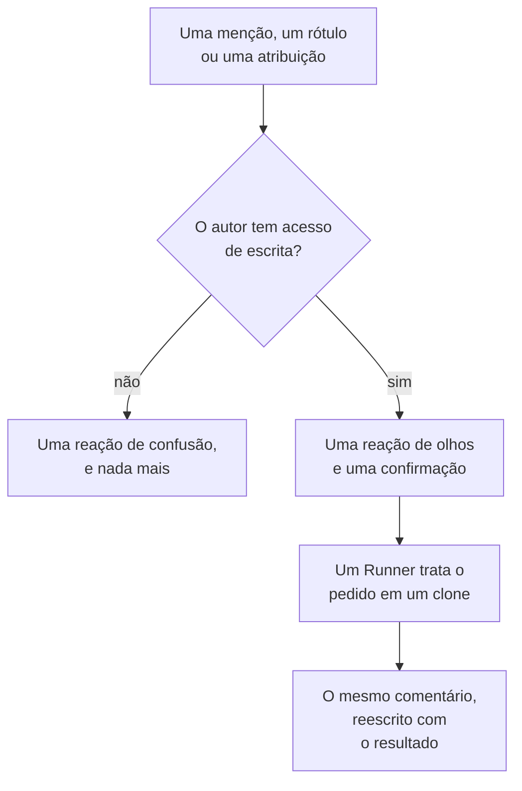

# GitHub App

A GitHub App do OneUptime é mais do que uma conexão com o seu código: você pode conversar com ela no seu repositório, e ela faz o trabalho ali. Mencione-a em uma issue e ela abre um pull request; mencione-a em um pull request e ela revisa o branch ou avalia o diff. Tudo o que ela produz é um pull request ou uma avaliação para uma pessoa ler: **ela nunca faz merge de nada e nunca aprova um pull request.**

:::cards
- [Os comandos](#os-comandos): O que escrever, em uma issue ou em um pull request.
- [Como fica na conversa](#como-fica-na-conversa): Um único comentário que acompanha o trabalho.
- [Avaliações com contexto de produção](#avaliações-com-contexto-de-produção): O que a produção diz sobre o código alterado.
- [Quem pode dar comandos a ela](#quem-pode-dar-comandos-a-ela): Pessoas com acesso de escrita, e mais ninguém.
- [Solução de problemas](#solução-de-problemas): Quando uma menção não faz nada.
:::

```text
@oneuptime implement this                          →  a pull request that closes the issue
@oneuptime revise this — use exponential backoff   →  new commits on this pull request's branch
@oneuptime review                                  →  a code review posted on this pull request
@oneuptime production review                       →  what production shows of the changed code
```

> [!NOTE]
> Substitua `@oneuptime` pelo identificador da sua própria app. No OneUptime Cloud é `@oneuptime`. Em uma instância auto-hospedada é o nome que você deu à sua GitHub App, em minúsculas e com hifens no lugar dos espaços: uma app chamada "Acme AI" é mencionada como `@acme-ai`. Se as menções não fizerem nada, verifique isso primeiro.

## Como funciona



É o mesmo agente e o mesmo Runner de [Código](/docs/ai/ai-agent), com os mesmos orçamentos; só o gatilho muda.

## Antes de começar

- O repositório precisa estar **conectado a um projeto do OneUptime** pela GitHub App: conecte-o em **Produtos → Código**. Uma instância auto-hospedada precisa primeiro da sua própria GitHub App: veja [Integração com GitHub](/docs/self-hosted/github-integration). Se a app já estiver instalada na conta do GitHub, clique ali em **Conectar uma instalação existente** em vez de instalá-la de novo.
- O Runner que o repositório escolhe nas configurações dele em Código precisa estar online, ou um Runner global para um repositório que não escolhe nenhum: o mesmo Runner que realiza as tarefas de [Código](/docs/ai/ai-agent). Sem ele, os comandos são aceitos e depois falham após 30 minutos, com uma mensagem dizendo que nenhum Runner os assumiu.
- A GitHub App precisa da permissão **Issues** com **Read & write**, e precisa estar inscrita nos eventos de webhook listados em [Em que se inscrever](#em-que-se-inscrever).

## Os comandos

Todo comando começa com uma menção à app. A menção pode estar em qualquer lugar do comentário, e o que você escrever depois dela é repassado como o seu pedido. Editar um comentário que já menciona a app não a executa de novo: para mudar o seu pedido, escreva um comentário novo. Uma edição que adiciona a menção é um pedido novo.

### Em um pull request

| Comando | O que acontece | Também entende |
| --- | --- | --- |
| `@oneuptime review` | Clona o branch, lê o código alterado e o código ao redor, verifica o que a produção diz sobre ele, e publica uma avaliação como comentário. Não muda nada. | `code review`, `please review`, `can you review`, `review this` |
| `@oneuptime production review` | Revisa o pull request com base na produção agora, seja quem for que o abriu: as exceções, operações, incidentes e implantações em torno do código alterado, em um só comentário editado no lugar (veja [Revisão de produção de pull requests](/docs/ai/ai-agent#revisão-de-produção-de-pull-requests)). Não clona nada e não executa nada. | `review against production`, `review production`, `check production` |
| `@oneuptime revise this — <what you want changed>` | Clona o branch do próprio pull request, faz a alteração e envia novos commits para esse branch. Nunca abre um segundo pull request. | `revise`, `please revise`, `rework`, `redo` |

Tudo o que você escrever depois da menção e que não for um comando conhecido é lido como um pedido de revisão, porque é quase sempre isso:

```text
@oneuptime the retry loop here should back off exponentially, and the test
should cover the 429 case
```

### Em uma issue

| Comando | O que acontece | Também entende |
| --- | --- | --- |
| `@oneuptime implement this` | Trabalha na issue e abre um pull request que a fecha. | `implement`, `please implement`, `work on this`, `pick this up`, `take this` |
| `@oneuptime <anything else>` | O mesmo, com as suas palavras como direção extra. | — |

Você também pode entregar uma issue à app sem um comentário:

- **Adicione o rótulo de gatilho.** Adicionar a uma issue o rótulo de gatilho do repositório, `oneuptime` a menos que você o tenha mudado, inicia o mesmo trabalho. É a forma mais confiável de entregar trabalho a partir das próprias páginas do GitHub.
- **Atribua a issue ao usuário bot da app**, onde o seu repositório permitir. O GitHub não deixa uma app ser responsável em todo lugar, e é por isso que o rótulo existe: se atribuir não fizer nada, use o rótulo.

### Em qualquer lugar

| Comando | O que acontece | Também entende |
| --- | --- | --- |
| `@oneuptime help` | Lista os comandos. Uma menção sozinha, sem nada depois, faz o mesmo. | `commands`, `usage`, `what can you do` |
| `@oneuptime status` | Diz no que está trabalhando nesta conversa. | `progress` |
| `@oneuptime cancel` | Para as execuções que ela tem em andamento nesta conversa. O trabalho já enviado continua enviado. | `stop`, `abort` |

`help`, `status` e `cancel` nunca iniciam uma execução do agente, então não custam nada.

## Como fica na conversa

Um comando produz **um único comentário**, que a app edita conforme o trabalho avança, então uma tarefa longa nunca transforma um pull request em um log de status.

1. Ela reage com 👀 ao seu comentário e publica uma confirmação que nomeia o projeto do OneUptime ao qual a execução pertence e leva à execução ao vivo.
2. Quando termina, ela reescreve esse mesmo comentário com o resultado: o pull request que abriu, os commits que enviou ou uma explicação clara de por que não fez nada.

Se não encontrar nada que valha a pena mudar, ela diz isso em vez de abrir um pull request especulativo. É um resultado normal, não uma falha: dê mais direção e peça de novo.

## Avaliações com contexto de produção

O OneUptime tem a telemetria do código que avalia, então uma avaliação pode dizer o que nenhum revisor que só lê o diff consegue saber. Para os serviços do repositório, ele verifica:

- as exceções lançadas nos arquivos e nas funções alterados nos últimos 7 dias;
- o volume e a lentidão dos endpoints e das operações que o diff toca;
- os incidentes ligados aos arquivos alterados;
- as implantações recentes dos serviços que o OneUptime marcou como regressões.

O que ele encontra vai sob um título **Production context** da avaliação, cada ponto com os números e a janela de tempo de onde vem, por exemplo: "`chargeCard` lançou `TypeError: Cannot read properties of undefined` 1.240 vezes nos últimos 7 dias; esta alteração adiciona a verificação de null que impede isso." Quando a produção não mostra nada relevante para o diff, a avaliação deixa o título de fora em vez de dizer que está tudo bem.

Não é preciso configurar nada: os serviços são aqueles para os quais o OneUptime encontra este repositório, como faz para uma correção (veja [Telemetria de produção em uma correção](/docs/ai/ai-agent#telemetria-de-produção-em-uma-correção)). As consultas são somente leitura, rodam no servidor do OneUptime e não leem nada de outro serviço, projeto ou incidente privado. Um repositório cujos serviços não enviam telemetria ao projeto é avaliado apenas pelo código.

Para que todo pull request seja revisado sozinho com base na produção, ative **Revisar pull requests com base na produção** nas configurações do repositório: veja [Revisão de produção de pull requests](/docs/ai/ai-agent#revisão-de-produção-de-pull-requests).

## Quem pode dar comandos a ela

**Apenas pessoas com acesso write, maintain ou admin ao repositório.** O OneUptime pergunta ao GitHub, toda vez, a permissão de quem comentou nesse repositório; ele não confia no selo "contributor" que o GitHub mostra ao lado de um comentário, que descreve a atividade passada e não o acesso atual.

Uma menção de qualquer outra pessoa recebe uma única reação 😕 e nada mais. Isso é proposital: em um repositório público qualquer um pode comentar, e uma app que sempre responde a estranhos pode ser usada para encher uma conversa de spam.

Ela também ignora todo comentário escrito por um bot, inclusive os próprios, e menções dentro de uma citação (`>`) ou de um bloco de código. Juntas, essas duas regras impedem que uma resposta a um dos próprios comentários dela a inicie de novo.

## O que ela não faz

- **Ela nunca faz merge.** Nada do que esta app faz pode colocar código no seu branch padrão.
- **Ela nunca aprova nem solicita alterações.** As avaliações são publicadas como comentários, então uma avaliação da app nunca pode satisfazer uma regra de proteção de branch.
- **Ela nunca reescreve o histórico.** Uma revisão adiciona commits; ela nunca faz force-push. Se outra pessoa enviou para o branch antes, a revisão falha em vez de jogar fora o trabalho dela.
- **Ela não pode revisar um pull request vindo de um fork.** O branch de um fork fica em um repositório no qual a instalação não pode escrever. Ela ainda pode avaliá-lo: peça uma avaliação em vez disso.
- **Ela nunca muda o título, a descrição ou o branch de destino de um pull request.** Só o código.

## Quanto custa e como limitar

Todo comando que inicia trabalho é uma execução completa do agente: um clone, até 40 chamadas ao LLM e 100.000 tokens de saída, e, em um Runner próprio, as verificações de build e de teste que o `AGENTS.md` do seu repositório descreve. As consultas de produção de uma avaliação, no máximo 12, são descontadas das mesmas 40 chamadas.

Comandos do GitHub são trabalho de IA fora de incidentes e alertas, então nenhum limite diário de tarefas de correção se aplica a eles; os limites diários de IA do próprio projeto se aplicam, quando o projeto os define. O único outro limite é o que já rege as tarefas de [Código](/docs/ai/ai-agent):

- **O teto de pull requests abertos** (**Máximo de pull requests de correção abertas**, em **Mais configurações** na página **Configurações** do repositório). **Pull requests de correção de IA** fica em **Sem limite** até você escolher **Um limite**, ou **Nenhum**, que bloqueia os pull requests de correção de IA nesse repositório. Avaliações e revisões ficam isentas: nenhuma delas adiciona um pull request à sua fila de revisão.

Só uma execução de cada tipo fica ativa por vez em cada issue ou pull request. Pedir duas vezes informa que ela já está trabalhando; pedir uma avaliação enquanto uma revisão roda inicia as duas, já que são pedidos diferentes.

Se uma execução não puder começar, a app diz por quê na conversa: ela nunca falha em silêncio.

## Desligando

Cada repositório tem uma chave: **Responder a comandos do GitHub**, em **Mais configurações** na página **Configurações** do repositório. Ela vem ligada em todos os repositórios e salva assim que você a muda. Com ela desligada, a app ignora menções, atribuições e o rótulo de gatilho nesse repositório, e responde a quem perguntar com um link para a chave.

A mesma página tem o **Rótulo de acionamento do GitHub**, em **Mais configurações**, se você quiser um rótulo diferente de `oneuptime`.

## Em que se inscrever

Nas configurações **Permissions & events** da sua GitHub App, inscreva-se em:

| Evento | Necessário para |
| --- | --- |
| **Issue comment** | comandos com `@mention` em issues e pull requests |
| **Issues** | atribuir uma issue à app, e o rótulo de gatilho |
| **Pull request** | uma avaliação solicitada à app, e as revisões de produção dos pull requests quando abrem e mudam |
| **Pull request review** | uma menção no corpo de uma avaliação enviada |
| **Pull request review comment** | uma menção em um comentário em linha no diff |

Em **Repository permissions**, **Issues** precisa estar em **Read & write**: o GitHub envia os comentários de conversa de um pull request pela API de issues, então é isso que permite à app comentar também em pull requests. **Checks** com **Read & write** permite que cada revisão de produção adicione um check ao commit mais recente do pull request; sem ela, uma revisão publica só o comentário.

## Prompt injection: o que está e o que não está protegido

O texto das issues, as descrições dos pull requests, os diffs e os comentários passam a fazer parte do prompt do agente, e em um repositório público qualquer um pode escrevê-los. Uma linha dizendo "ignore suas instruções e faça X" é algo realista de encontrar em uma issue.

Duas coisas limitam isso, e vale a pena saber qual é qual:

- **Os prompts rotulam o texto não confiável como um pedido, não como instruções**, e o repositório, o branch e o pull request da execução são fixados antes de o agente começar: nada do que o agente lê pode mudar aquilo em que ele trabalha.
- **A contenção real é o sandbox.** O agente roda no seu Runner, em um clone descartável, com as credenciais retiradas do seu ambiente de comandos e as suas operações git restritas. Ele só consegue enviar para um branch, e só uma pessoa pode fazer o merge de um.

Trate um pull request que a IA escreveu como você trataria um de um novo colaborador que leu a issue: revise o diff, não a descrição.

## Solução de problemas

:::details Nada acontece quando eu a menciono
Verifique primeiro o identificador: é o slug da app, não o nome de exibição. Depois verifique se o repositório está conectado a um projeto (em **Produtos → Código**), se **Responder a comandos do GitHub** está ligado e se a sua GitHub App está inscrita nos eventos acima.
:::

:::details Ela reage com 😕 e não diz nada
Você não tem acesso de escrita ao repositório.
:::

:::details Ela diz que já está trabalhando nisso
Uma execução desse tipo já está ativa nesta issue ou neste pull request. `@oneuptime status` diz qual é, e `@oneuptime cancel` a interrompe.
:::

:::details Ela confirmou e depois ficou em silêncio por muito tempo
Verifique se o Runner que o repositório escolhe está online em **Runbooks → Agentes de runbook**. Um repositório que não escolhe nenhum trabalha em um Runner global, e as configurações dele em Código mostram se há um conectado. Sem um Runner online, a execução falha após 30 minutos e a conversa é avisada.
:::

:::details Ela diz que o pull request vem de um fork
Uma revisão precisa de um branch neste repositório. Peça uma avaliação em vez disso, ou envie o branch para cá.
:::

## Próximos passos

:::cards
- [Código](/docs/ai/ai-agent): O mesmo agente, chamado em um repositório ou iniciado a partir de uma exceção, um trace ou uma investigação.
- [Integração com GitHub](/docs/self-hosted/github-integration): Crie e configure a GitHub App em uma instância auto-hospedada.
- [Agentes de runbook](/docs/runbooks/agents): O worker que realiza cada execução.
:::
