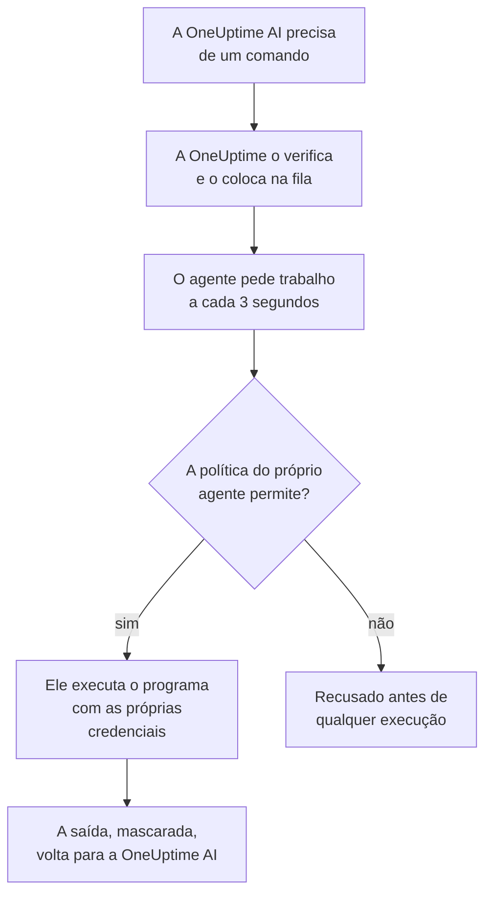

# Agentes de IA para a infraestrutura

A OneUptime AI pode olhar além da sua telemetria enquanto investiga um incidente ou alerta. Um pequeno agente instalado ao lado de um dos seus recursos (um host Docker ou Podman, um cluster Docker Swarm, um cluster Proxmox, um VMware vCenter, um cluster Ceph, um servidor de banco de dados ou um host Linux) executa os comandos somente leitura que a OneUptime AI pede, como `docker logs --tail 200 web`, `pvesh get /cluster/status`, `ceph health detail`, `db long-queries --min-seconds 30` ou `journalctl -u nginx -n 200 --no-pager`, e devolve a saída, de modo que a análise de causa raiz cita o que o próprio recurso diz. Se você permitir, o mesmo agente também aplica correções (reiniciar um contêiner, iniciar uma VM, marcar um OSD de volta como in), cada uma classificada em um nível por uma política de comandos e, a menos que você escolha outra coisa, aprovada antes por uma pessoa. O Pergunte à IA, aberto na página do recurso, executa os mesmos comandos somente leitura quando você pede (consulte [Pergunte à IA](/docs/ai/ask-ai)).

Para investigar uma conta da AWS, uma assinatura do Azure ou um projeto do Google Cloud, não é preciso agente: a OneUptime os lê em tempo real, pela conexão somente leitura com que foram conectados. Só as correções precisam de um, o agente de IA de nuvem, que roda na própria conta e é configurado com um único comando na página da conta (consulte [Em uma conta de nuvem](#em-uma-conta-de-nuvem)).

Esses agentes são os **agentes de IA de recursos**. A página de cada recurso no painel tem uma seção **IA** com três páginas:

- **Insights**: o que a OneUptime AI descobriu sobre o recurso nos últimos 30 dias, ou seja, os problemas que voltam sempre e por quê, com o que a IA encontrou e o passo que ela sugere, as partes do recurso por trás da maioria deles, as correções que não ajudaram ou que aguardam aprovação, o que a IA corrigiu sozinha e os riscos detectados antes que alguém fosse acionado, com o que a própria IA fez ali como nota de rodapé. Funciona como a de um cluster; veja [O que a IA aprendeu em um cluster](/docs/ai/ai-sre#o-que-a-ia-aprendeu-em-um-cluster).
- **Registros**: tudo o que a OneUptime AI fez no recurso, do mais recente para o mais antigo: cada investigação com o seu incidente ou alerta e o seu resumo, cada correção que ela propôs ou executou e cada comando que enviou pelo agente. (Esta página se chamava Insights antes.)
- **Agente de IA**: se o agente está conectado, o que a IA pode fazer no recurso (investigar, e como as correções são executadas), tudo o que precisa de atenção com o passo que resolve e, no menu **⋯** ao lado do status do agente, **Testar conexão** e **Redefinir agente**.

A **Visão geral** do recurso termina com um cartão **Agente de IA** que resume a página do agente de IA: se o agente está conectado, se a investigação está ativada, como as correções são executadas (**Desativado**, **Pedir aprovação**, **Automático** ou **Ignorar aprovação**) e o que precisa de atenção, com um link para a página do agente de IA, onde tudo isso é alterado.

:::cards
- [Recursos compatíveis](#recursos-compatíveis): Onze tipos de recurso, uma única imagem.
- [Instalar um agente de IA](#instalar-um-agente-de-ia): Ao lado de um coletor que você já executa, em um host Linux ou em uma conta de nuvem com um único comando.
- [Como as correções funcionam](#como-as-correções-funcionam): O que pode rodar sozinho, o que espera por uma pessoa e o que nunca roda.
- [Modelo de segurança](#modelo-de-segurança): Três verificações em cada comando e nenhuma credencial vinda da OneUptime.
:::

## Como funciona

O agente nunca espera uma conexão da OneUptime: ele chama a OneUptime, pede trabalho e executa apenas o que a sua própria cópia da política de comandos permite, com as credenciais que já tem.



## Como se relaciona com o agente de IA do Kubernetes

Os clusters Kubernetes têm um agente próprio, o agente de IA do Kubernetes, instalado pelo chart Helm do agente do Kubernetes; veja [Acesso ao cluster: deixe a OneUptime AI executar o kubectl](/docs/ai/ai-sre#acesso-ao-cluster-deixe-a-oneuptime-ai-executar-o-kubectl). Nada nesta página o altera. Os agentes de IA de recursos seguem o mesmo desenho:

- **Os mesmos níveis e modos.** Todo comando é **Read**, **SafeWrite**, **RiskyWrite** ou **Denied**, e as correções são **Desativado**, **Pedir aprovação**, **Automático** ou **Ignorar aprovação**, com o mesmo significado que em um cluster.
- **As mesmas três verificações.** A mesma política de comandos é aplicada pelas ferramentas de IA da OneUptime, de novo quando a OneUptime coloca o comando na fila, e mais uma vez pelo agente antes de executar qualquer coisa.
- **A mesma regra sobre credenciais.** O agente usa apenas o que o seu próprio ambiente e as suas montagens lhe dão. A OneUptime nunca lhe envia uma credencial.
- **Os mesmos padrões.** As investigações de IA vêm ativadas por padrão: um recurso começa com a investigação ativada e as correções desativadas, como um cluster, então a OneUptime AI investiga com o agente assim que ele se conecta, e não altera nada até que alguém permita as correções (veja [Conectar à OneUptime](#conectar-à-oneuptime)).

O que muda:

- **Uma única imagem para todo recurso.** `oneuptime/resource-ai-agent` atende aos onze tipos de recurso, e `ONEUPTIME_AI_AGENT_RESOURCE_TYPE` diz qual deles um agente atende. Ele roda ao lado do coletor do recurso como mais um contêiner, ou na conta de nuvem que atende, e não a partir de um chart Helm.
- **O acesso de escrita é uma variável de ambiente.** É `ONEUPTIME_AI_ALLOW_WRITES=true` no agente que permite que ele aplique correções, e `ONEUPTIME_AI_WRITE_TARGETS` limita quais contêineres, serviços, VMs, OSDs, sessões ou units elas podem tocar. Em um cluster, isso fica a cargo do RBAC do chart e de `aiAgent.remediation.namespaces`.

Assim como o agente de IA do Kubernetes, um agente de IA de recursos não é um Runner. Ele nunca aparece em Runbooks → Agentes de runbook e nunca é usado como host Bash ou SSH para runbooks.

## Recursos compatíveis

| Recurso | `ONEUPTIME_AI_AGENT_RESOURCE_TYPE` | Agente | Registra-se como (a variável do coletor) | Executa | Chega ao recurso por meio de |
| -------------------- | ---------------------------------- | --------------------- | ----------------------------------------------------------------------------------------------- | -------------------------------------------------------------------------------------------------------------------------------------------------- | -------------------------------------------------------------------------- |
| Host Docker | `docker` | Agente de IA do Docker | `DOCKER_HOST_NAME` | `docker` | o socket do Docker, `/var/run/docker.sock` |
| Host Podman | `podman` | Agente de IA do Podman | `PODMAN_HOST_NAME` | `docker`, pela API compatível com Docker do Podman | o socket do Podman, `/run/podman/podman.sock` |
| Cluster Docker Swarm | `docker-swarm` (ou `swarm`) | Agente de IA do Docker Swarm | `DOCKER_SWARM_CLUSTER_NAME` | `docker` | o socket do Docker de um nó manager |
| Cluster Proxmox | `proxmox` | Agente de IA do Proxmox | `PROXMOX_CLUSTER_NAME` | comandos `pvesh`, enviados à API do Proxmox VE (não há nenhum binário `pvesh` no agente) | `https://PVE_HOST:8006/api2/json`, com um token de API do Proxmox |
| VMware vCenter | `vmware` (ou `vcenter`) | Agente de IA do VMware | `VMWARE_VCENTER_NAME` | `govc` | a API do vCenter, com um usuário do vSphere |
| Cluster Ceph | `ceph` | Agente de IA do Ceph | `CEPH_CLUSTER_NAME` | `ceph` | os monitores, com um `ceph.conf` e o keyring do cliente próprio do agente |
| Servidor de banco de dados | `database` (ou `db`) | Agente de IA de banco de dados | `DATABASE_SERVER_ID`, ou `DATABASE_SYSTEM` + `DATABASE_SERVER_ADDRESS` + `DATABASE_SERVER_PORT` | `db`: uma operação de um catálogo fixo de diagnósticos, nunca SQL | o próprio driver do banco de dados, com um login do banco |
| Host | `host` | Agente de IA do host | `HOST_NAME` (vazio: o próprio hostname do host) | `systemctl`, `journalctl`, `df`, `free`, `uptime`, `ps`, `ss`, `ip`, `dmesg`, `lsblk`, `cat`, `top`, `uname`, `hostnamectl`, `timedatectl`, `kill` | `nsenter` nos namespaces do host, a partir de um contêiner privilegiado |
| Conta da AWS | `aws` | Agente de IA de nuvem | `AWS_ACCOUNT_ID` (vazio: a conta em que ele roda) | `cloud`: uma operação de um catálogo fixo, nunca um comando `aws` | as APIs da AWS, com funções do IAM próprias |
| Assinatura do Azure | `azure` | Agente de IA de nuvem | `AZURE_SUBSCRIPTION_ID` (o comando de configuração o define) | `cloud`: uma operação de um catálogo fixo, nunca um comando `az` | o Azure Resource Manager, como a identidade gerenciada do seu Container App |
| Projeto do Google Cloud | `gcp` (ou `google-cloud`) | Agente de IA de nuvem | `GOOGLE_CLOUD_PROJECT` (vazio: o projeto em que ele roda) | `cloud`: uma operação de um catálogo fixo, nunca um comando `gcloud` | as APIs do Google Cloud, como uma conta de serviço própria |

Servidores de banco de dados: o agente de IA de banco de dados tem diagnósticos para PostgreSQL, MySQL (e MariaDB e Percona Server), Redis (e Valkey, KeyDB e Dragonfly) e MongoDB. Para qualquer outro mecanismo, ele não executa nada e informa isso na página do agente de IA do banco de dados.

**Testar conexão**, no menu **⋯** ao lado do status do agente na página do agente de IA, executa estes comandos somente leitura pelo agente e mostra a saída deles no cartão do agente:

| Recurso | O que Testar conexão executa |
| -------------------- | ---------------------------------------------------- |
| Host Docker | `docker version`, `docker info` |
| Host Podman | `docker version`, `docker info` |
| Cluster Docker Swarm | `docker version`, `docker node ls` |
| Cluster Proxmox | `pvesh get /version`, `pvesh get /cluster/status` |
| VMware vCenter | `govc about` |
| Cluster Ceph | `ceph health`, `ceph versions` |
| Servidor de banco de dados | `db ping`, `db version` |
| Host | `uptime`, `systemctl list-units --failed --no-pager` |
| Conta da AWS | `cloud whoami` |
| Assinatura do Azure | `cloud whoami` |
| Projeto do Google Cloud | `cloud whoami` |

Em um worker do Docker Swarm, `docker node ls` falha: o agente de IA do Docker Swarm precisa rodar em um nó manager. Um agente iniciado em um worker não se registra no cluster até que o seu nó seja manager, e o instalador do Docker Swarm o deixa de fora em um nó que não é manager.

Em uma conta de nuvem, `cloud whoami` mostra a conta em que o agente de IA de nuvem atua e com qual identidade ele está conectado, se ele pode alterar alguma coisa, as mudanças que pode fazer e a tag que exige, se houver.

## Instalar um agente de IA

Todo agente de IA de recursos é a mesma imagem, `oneuptime/resource-ai-agent:release`. Ao lado de um coletor ou em um host, ele não precisa de nada no painel: assim que roda, registra-se na OneUptime e aparece na página do agente de IA do recurso em até um minuto. O de uma conta de nuvem roda na própria conta, a partir de um único comando que a página da conta escreve para ele (consulte [Em uma conta de nuvem](#em-uma-conta-de-nuvem)).

### Ao lado de um coletor

Para Docker, Podman, Docker Swarm, Proxmox, VMware, Ceph e servidores de banco de dados, o agente roda ao lado do coletor que você já usa para aquele recurso e compartilha o `.env` dele: já tem `ONEUPTIME_URL`, a chave de ingestão e o nome do recurso. O `docker-compose.yml` de cada coletor traz o agente como mais um serviço, e o `install.sh` dele o inicia.

| Recurso | Coletor | Serviço do agente de IA (e contêiner) | Onde é configurado |
| -------------------- | ----------------------------------------------------------- | --------------------------------- | ------------------------------------------------------------------------------------- |
| Host Docker | [Agente Docker](/docs/telemetry/docker-host#agente-de-ia) | `oneuptime-docker-ai-agent` | `agents/DockerAgent/docker-compose.yml`; `install.sh` o inicia como um segundo contêiner |
| Host Podman | [Agente Podman](/docs/telemetry/podman-host#agente-de-ia) | `oneuptime-podman-ai-agent` | `agents/PodmanAgent/docker-compose.yml`; `install.sh` o inicia como um segundo contêiner |
| Cluster Docker Swarm | [Agente Docker Swarm](/docs/telemetry/docker-swarm#agente-de-ia) | `oneuptime-docker-swarm-ai-agent` | `agents/DockerSwarmAgent/docker-compose.yml`, em um nó manager |
| Cluster Proxmox | [Agente Proxmox](/docs/telemetry/proxmox#agente-de-ia) | `oneuptime-proxmox-ai-agent` | `agents/ProxmoxAgent/docker-compose.yml` |
| VMware vCenter | [Agente VMware](/docs/telemetry/vmware#agente-de-ia) | `oneuptime-vmware-ai-agent` | `agents/VMwareAgent/docker-compose.yml` |
| Cluster Ceph | [Agente Ceph](/docs/telemetry/ceph#agente-de-ia) | `oneuptime-ceph-ai-agent` | `agents/CephAgent/docker-compose.yml`, com o cliente Ceph próprio do agente em `./ceph` |
| Servidor de banco de dados | [Agente de banco de dados](/docs/telemetry/databases#agente-de-ia) | `oneuptime-database-ai-agent` | `agents/DatabaseAgent/docker-compose.yml` |

Um coletor instalado antes de o agente de IA existir ainda não o executa. Execute de novo o `install.sh` dele: agora ele também inicia o agente de IA (os instaladores de Proxmox, VMware, Ceph, banco de dados e Docker Swarm baixam o `docker-compose.yml` atual, que tem o serviço do agente de IA). Se você gerencia os arquivos por conta própria, adicione o serviço do `docker-compose.yml` do coletor ao seu e execute `docker compose up -d`. A página do agente de IA do recurso mostra o serviço exato para aquele recurso, com o nome já preenchido.

Sem os instaladores, o agente de IA do Docker é um único `docker run`:

```bash
docker run -d \
  --name oneuptime-docker-ai-agent \
  --user 0:0 \
  --restart unless-stopped \
  --read-only --tmpfs /tmp \
  -v /var/run/docker.sock:/var/run/docker.sock:ro \
  -e ONEUPTIME_URL="https://oneuptime.com" \
  -e ONEUPTIME_SERVICE_TOKEN="YOUR_TELEMETRY_INGESTION_TOKEN" \
  -e ONEUPTIME_AI_AGENT_RESOURCE_TYPE=docker \
  -e DOCKER_HOST_NAME="my-docker-host" \
  oneuptime/resource-ai-agent:release
```

`DOCKER_HOST_NAME` precisa ser o nome que o agente Docker informa. Os instaladores de Docker e Podman aceitam `--no-ai-agent` (ou `ONEUPTIME_INSTALL_AI_AGENT=false`) para deixar o agente de IA de fora, assim como o instalador do Docker Swarm. Para rodar um coletor sem ele mais tarde, exclua o serviço do agente de IA do `docker-compose.yml`, ou remova o contêiner dele com `docker rm -f`.

### Agente de IA do host

Um host Linux que reporta pelo [Coletor OpenTelemetry no host](/docs/telemetry/host-otel-collector) não tem nenhum contêiner da OneUptime ao lado do qual ficar, então o agente de IA do host vem com o seu próprio instalador (`agents/HostAIAgent`):

```bash
curl -fsSL https://raw.githubusercontent.com/OneUptime/oneuptime/master/agents/HostAIAgent/install.sh -o install.sh
sudo bash install.sh
```

Ele pede a URL da sua OneUptime, a chave de ingestão de telemetria do projeto e o nome do host, grava `/opt/oneuptime-host-ai-agent/.env` e `docker-compose.yml` e inicia o contêiner `oneuptime-host-ai-agent`. Adicione `--systemd` para executá-lo em vez disso sob a unit do systemd `oneuptime-host-ai-agent`. Ele precisa do Docker (o mecanismo do sistema, não o Docker rootless) com o plugin Compose; o Podman em modo rootful pode executar o mesmo contêiner.

O agente de IA do host executa os **programas do próprio host**: todo comando roda como `nsenter --target 1 --mount --uts --ipc --net --pid -- PROGRAM ARGS`, que entra nos namespaces do init do host. Isso exige `pid: host`, `privileged: true` e root; veja [O socket do Docker e o agente de IA do host são root no host](#o-socket-do-docker-e-o-agente-de-ia-do-host-são-root-no-host). Deixe `HOST_NAME` vazio para usar o hostname da máquina, que é o que o coletor informa como `host.name`, a menos que você o tenha mudado; caso contrário, defina-o como o nome mostrado em **Hosts**.

### Em uma conta de nuvem

Uma conta da AWS, uma assinatura do Azure ou um projeto do Google Cloud não tem um coletor ao lado do qual um agente possa ficar, e a OneUptime a lê sem nenhum (consulte [Contas de nuvem](#contas-de-nuvem)). O agente de IA de nuvem dela, que faz as correções, roda na própria conta e é configurado na página da conta com um único comando, sem arquivo compose e sem `.env`:

1. Em Nuvem → Contas, abra a conta e selecione **Permitir que a IA corrija problemas** no cartão **Agente de IA** da **Visão geral** dela.
2. Responda à única pergunta, **Até onde a IA pode ir?**: **Perguntar antes**, o padrão, define **Correções** como **Pedir aprovação**, e **Corrigir problemas seguros por conta própria** as define como **Automático**. **Mais campos** guarda o resto: quais mudanças a IA pode fazer, os recursos que ela nunca deve alterar, alterar apenas recursos com a tag `oneuptime-ai=allow`, **Ignorar aprovação**, a leitura dos logs da conta e as variáveis do agente para executá-lo em outro lugar.
3. Execute o comando que ela mostra no shell da própria nuvem, conectado a essa conta. Ele escreve a função do agente a partir das mudanças ativadas e inicia o agente, que se conecta sozinho em poucos minutos: não há nada para colar de volta. Se o agente não se conectar, o log dele diz por quê (consulte [Logs e status](#logs-e-status)).

| Nuvem | Executar em | O que o comando cria |
| -------------------- | ------------------ | ------------------------------------------------------------------------------------------------------------------------------------------------------------------------------------------------------------------ |
| Conta da AWS | AWS CloudShell | Uma pilha do CloudFormation, `oneuptime-ai-agent`, que executa uma tarefa do ECS Fargate. A função da tarefa só pode assumir a função de escrita `OneUptimeAiAgentWrite`, que tem as permissões das mudanças ativadas. A chave com que ele se conecta fica no Secrets Manager, que só o ECS lê. |
| Assinatura do Azure | Azure Cloud Shell | Um Container App, `oneuptime-ai-agent`, no grupo de recursos `oneuptime-ai-agent`. A identidade gerenciada dele tem uma função personalizada na assinatura, com as permissões das mudanças ativadas. A chave com que ele se conecta é um segredo do Container Apps. |
| Projeto do Google Cloud | Google Cloud Shell | Um serviço do Cloud Run, `oneuptime-ai-agent`, com CPU sempre alocada, executado como a conta de serviço `oneuptime-ai-agent`, que tem um papel personalizado no projeto, com as permissões das mudanças ativadas. A chave com que ele se conecta fica no Secret Manager, que só essa conta de serviço pode ler. |

O comando só funciona na conta para a qual foi escrito: na AWS ele não cria nada em um shell conectado a outra conta, e os comandos do Azure e do Google Cloud nomeiam a assinatura ou o projeto em cada chamada. Ele define `ONEUPTIME_AI_INVESTIGATION=true`, `ONEUPTIME_AI_FIXES` a partir da sua resposta, `ONEUPTIME_AI_ALLOW_WRITES=true` e `ONEUPTIME_AI_CLOUD_ACCOUNT_ID` como a conta para a qual foi escrito. O agente se registra como a conta em que a nuvem dele diz que ele está e nunca adiciona uma conta à OneUptime: iniciado em uma conta diferente da do comando, ele é recusado, e a conta para a qual o comando foi escrito diz por quê na página dela; iniciado em uma conta que nenhuma conexão do projeto lê, ele também é recusado, e o log dele diz isso.

Para alterar qualquer coisa, execute o comando de novo: abra **Permitir que a IA corrija problemas** outra vez, ou selecione **Alterar** na página **Agente de IA** da conta, e execute o comando que ela escreve. A função sempre tem apenas as mudanças ativadas. A seção **IA** de uma conta de nuvem tem duas páginas, **Registros** e **Agente de IA**, e o custo do agente está em [Conectar uma conta de nuvem](/docs/telemetry/cloud-accounts#permitir-que-a-ia-corrija-problemas). Em **Atividade**, o **Feed** da conta registra quando o agente se conecta ou é redefinido, e cada alteração no que o OneUptime AI pode fazer nela, com quem a fez.

### Conectar à OneUptime

O agente se registra com a **mesma identidade que o coletor informa** (`DOCKER_HOST_NAME`, `PROXMOX_CLUSTER_NAME`, `CEPH_CLUSTER_NAME`, …; `ONEUPTIME_AI_AGENT_RESOURCE_NAME` a substitui), então atende exatamente ao recurso que a telemetria do coletor criou. Quando a OneUptime ainda não tem nenhum recurso com esse nome, o registro o cria, de modo que um nome diferente do do coletor gera um segundo recurso vazio em vez de um erro. Um banco de dados se registra por `DATABASE_SERVER_ID` quando ele está definido e, caso contrário, pelo seu mecanismo, endereço e porta; um `DATABASE_SERVER_ID` que não seja um banco de dados deste projeto é recusado.

Se o coletor ainda usa o nome padrão (`docker-host`, `podman-host`, `docker-swarm`, `proxmox-cluster`, `vmware-vcenter`, `ceph`), todo recurso instalado com esse padrão reporta para o mesmo recurso na OneUptime, e os comandos para ele poderiam chegar a qualquer um deles. O agente avisa sobre isso no log; dê a cada recurso um nome único, tanto no coletor quanto no agente.

Ele se autentica com a chave de ingestão de telemetria do projeto (a primeira definida entre `ONEUPTIME_API_KEY`, `ONEUPTIME_TELEMETRY_INGESTION_KEY` e `ONEUPTIME_SERVICE_TOKEN`, que os coletores já definem) e recebe uma chave própria. Todas as suas chamadas são `POST`s HTTPS para `<ONEUPTIME_URL>/resource-ai-agent-ingest/…`: ele se registra uma vez ao iniciar, envia um heartbeat a cada 30 segundos (conta como online por 5 minutos após o último), pede trabalho a cada 3 segundos e se desconecta ao parar. Um segundo agente com a mesma identidade é recusado enquanto o primeiro está online: um contêiner que para de forma limpa se desconecta, então o substituto é aceito na hora, e após uma falha ou um kill o substituto assume assim que o antigo passa 40 segundos sem enviar nada desde a primeira recusa. Se ainda for recusado depois de 10 minutos, outro agente ativo usa a mesma identidade: o agente registra um erro dizendo isso e passa a perguntar só a cada 5 minutos, até que você dê a cada recurso o seu próprio nome ou pare o outro agente. Um projeto comporta no máximo 250 agentes de IA de recursos, e no máximo 30 novos se registram por hora. Quando se chega aos 250, os agentes sem notícias há 7 dias são removidos para abrir espaço para um novo (o recurso mantém as suas configurações de IA, e um agente desses que volte simplesmente se registra de novo).

A **Investigação** fica ativada para todo recurso desde o início, então a OneUptime AI investiga com o agente assim que ele se conecta. Além disso, o que a IA pode fazer no recurso é uma configuração do próprio agente (veja [O que a IA pode fazer, definido pelo agente](#o-que-a-ia-pode-fazer-definido-pelo-agente)). Um agente que não define nenhuma das duas configurações usa os seus padrões: ativa a **investigação** para o seu recurso e, se permitir escritas (`ONEUPTIME_AI_ALLOW_WRITES=true`), define **Correções** como **Pedir aprovação** e, caso contrário, como **Desativado**. Esses padrões valem apenas para um recurso cujas configurações de IA ninguém escolheu na página do agente de IA: as configurações que alguém salvou ali ficam como estão até que a configuração do agente as defina, então um recurso cujo interruptor **Investigar** alguém desligou continua desligado. Um agente anterior a essas configurações não informa nenhuma das duas, e a página do agente de IA as define, como antes.

**Redefinir agente**, no mesmo menu **⋯** da página do agente de IA, faz a OneUptime esquecer a chave do agente assim que você confirma; quem a tinha fica bloqueado, e o agente verdadeiro se registra de novo em poucos minutos. O agente precisa de um servidor da OneUptime da mesma versão da sua imagem, ou mais recente.

### O que a IA pode fazer, definido pelo agente

A investigação e as correções são definidas onde o agente roda (no `.env` que ele compartilha com o coletor ou no ambiente do seu contêiner), e a OneUptime segue essas definições:

| Variável | Padrão | O que faz |
| ---------------------------- | ------- | ----------------------------------------------------------------------------------------------------------------------------------------------------------------------------------------------------------------------------------------------------- |
| `ONEUPTIME_AI_INVESTIGATION` | vazio | `true` permite que a IA execute os comandos somente leitura abaixo enquanto investiga; `false` a limita aos dados que a OneUptime já tem. Vazio: ativada. |
| `ONEUPTIME_AI_FIXES` | vazio | Como a IA pode aplicar uma correção: `off`, `ask-for-approval`, `automatic` ou `bypass-approval` (veja [Modos de correção](#modos-de-correção)). Qualquer modo que não seja `off` também precisa de `ONEUPTIME_AI_ALLOW_WRITES=true`, e `off` mantém o agente somente leitura mesmo com ela. Vazio: `ask-for-approval` quando o agente permite escritas e, caso contrário, `off`. |

Por exemplo, para deixar a IA aplicar correções com uma pessoa aprovando cada uma:

```bash
ONEUPTIME_AI_INVESTIGATION=true
ONEUPTIME_AI_FIXES=ask-for-approval
ONEUPTIME_AI_ALLOW_WRITES=true
```

Depois reinicie o agente (`docker compose up -d`, ou execute de novo o `install.sh` do coletor com essas variáveis definidas para um host Docker ou Podman). O agente informa as duas ao se registrar e a cada heartbeat, e a OneUptime as aplica ao recurso na hora. A página do agente de IA do recurso então as mostra somente leitura: **Alterar** mostra estas linhas para a opção que você escolher em vez de salvar qualquer coisa, e a OneUptime recusa uma alteração feita em qualquer outro lugar (a API, o Terraform, um administrador master) enquanto o agente as define. A lista de comandos permitidos continua na página. Um valor que o agente não consegue ler deixa essa configuração desativada, e o agente registra qual.

## O que uma investigação pode executar

Uma investigação só executa comandos **Read**: eles olham o recurso e não alteram nada. A OneUptime AI vê os recursos vinculados ao incidente ou alerta (pelos monitores e pela telemetria deles, no máximo 10 por sinal) cujo agente de IA está conectado (uma conta de nuvem não precisa de nenhum) e cujo interruptor **Investigar** está ativado, e executa quantos comandos a investigação precisar (até 200 por investigação, uma proteção contra um loop descontrolado), cada um citado como qualquer outra evidência. Todo comando é um programa com os seus argumentos, nunca por um shell, então pipes, redirecionamentos, `;`, `&&`, `$(…)` e `sudo` são recusados com uma mensagem que diz isso. Um comando tem 30 segundos por padrão e no máximo 2 minutos, e a sua saída é limitada a 1024 KB no agente. Nada dessa saída é cortado antes de chegar à OneUptime AI: uma saída longa é mostrada uma página por vez (os primeiros 40.000 caracteres e depois o restante sob demanda). Se um agente não pegar um comando, a OneUptime AI para de enviar comandos a esse recurso pelo resto da investigação.

O que cada tipo de recurso pode ler está abaixo. É a mesma lista que a própria IA recebe; tudo o que não estiver nela é recusado.

### Hosts Docker e Podman

- Contêineres: `docker ps -a` (também `-q`, `-n`, `-l`, `-s`, `--no-trunc`, `--filter`, `--format json`), `docker container inspect web`, `docker inspect --type container web`, `docker top web`, `docker port web`, `docker diff web`. Os valores de ambiente na saída do inspect voltam mascarados.
- Logs e atividade: `docker logs --tail 200 web` ou `docker logs --since 30m web`; é obrigatório um `--tail` de no máximo 2000 ou um `--since` (sem `--tail`, `--since` precisa ser uma duração de no máximo 24h), e `-f` nunca é permitido; `docker stats --no-stream`; `docker events --since 30m --until 0s` (os dois limites são obrigatórios, `--until` como duração, para que a janela sempre se feche no passado).
- O mecanismo: `docker info`, `docker version`, `docker system df` (`-v` só como tabela: `-v --format json` imprime a linha de comando de cada etapa do build), `docker images`, `docker image inspect nginx:1.27`, `docker network ls`, `docker network inspect bridge`, `docker volume ls`, `docker volume inspect data`.
- Só `--format json` (ou `table` para listas), nunca um template Go, e nenhuma das flags globais do docker (`-H`, `--context`, `--config`, …): elas apontariam a CLI para outro mecanismo.

Um host Podman executa a mesma CLI `docker` e a mesma política, pela API compatível com Docker do Podman.

### Clusters Docker Swarm

- Nós: `docker node ls`, `docker node ps node-1`, `docker node inspect node-1 --pretty`.
- Serviços: `docker service ls`, `docker service ps web --no-trunc`, `docker service inspect web --pretty` (os valores de ambiente voltam mascarados), `docker service logs --tail 200 web` (é obrigatório um `--tail` de no máximo 2000 ou um `--since`, que sozinho precisa ser uma duração de no máximo 24h; nunca `-f`).
- Stacks: `docker stack ls`, `docker stack ps shop`, `docker stack services shop`.
- O próprio mecanismo do manager: `docker ps -a`, `docker container inspect web`, `docker logs --tail 200 web`, `docker stats --no-stream`, `docker info`, `docker version`, `docker network ls` e o restante das leituras de um host Docker.

### Clusters Proxmox

Não há `pvesh` no agente. Um comando é escrito na gramática do `pvesh` (`get` ou `ls` e um caminho da API, com as opções como `--name value`), e o agente o transforma em exatamente um `GET` para a API do Proxmox VE com o seu próprio token. `--output-format json|json-pretty|text` escolhe a saída; query strings não são aceitas, e uma escrita precisa nomear o seu nó (nunca `localhost`).

- O cluster: `pvesh get /version`, `pvesh get /cluster/status`, `pvesh get /cluster/resources --type vm`, `pvesh get /cluster/ha/status/current`, `pvesh get /cluster/log --max 50`, `pvesh get /cluster/tasks`, `pvesh get /nodes` e as listas de replicação, backup, pools e armazenamento.
- Um nó: `pvesh get /nodes/pve1/status`, `pvesh get /nodes/pve1/services`, `pvesh get /nodes/pve1/storage`, `pvesh get /nodes/pve1/disks/list`, `pvesh get /nodes/pve1/rrddata --timeframe hour`, além da rede, da replicação, das atualizações do APT e do status do Ceph dele.
- Tarefas e logs: `pvesh get /nodes/pve1/tasks --errors 1 --limit 20`, o status e o log de uma tarefa, `pvesh get /nodes/pve1/syslog --limit 200`, `pvesh get /nodes/pve1/journal --lastentries 200`.
- Convidados (`qemu` para VMs, `lxc` para contêineres): `pvesh get /nodes/pve1/qemu`, `pvesh get /nodes/pve1/lxc`, `pvesh get /nodes/pve1/qemu/101/status/current`, `pvesh get /nodes/pve1/qemu/101/config` (segredos como as senhas do cloud-init voltam mascarados), as alterações pendentes, os snapshots, `pvesh get /nodes/pve1/qemu/101/rrddata --timeframe hour` e as informações do agente convidado do QEMU, como `pvesh get /nodes/pve1/qemu/101/agent/get-fsinfo`.
- Nunca: nada em `/access` (usuários, tokens de API, ACLs), os consoles (`vncproxy`, `termproxy`, `spiceproxy`), o monitor do QEMU, as chamadas de exec e de arquivos do agente convidado.

### VMware vCenter

Primeiro vem o comando, depois as flags e por fim os nomes ou caminhos do inventário (o govc ignora flags escritas depois de um argumento); `-dc DATACENTER` escolhe um datacenter.

- `govc about`, `govc datacenter.info`, `govc ls /DC/vm`, `govc find . -type m -runtime.powerState poweredOff`: a versão e o inventário do vCenter (`find` filtra apenas por nomes, tipos, integridade e propriedades de runtime; `ls -json` é recusado, porque carrega todas as propriedades de cada objeto que lista).
- `govc vm.info web-01`, `govc host.info esx-01`, `govc datastore.info datastore1`, `govc pool.info /DC/host/cluster1/Resources`: estado de energia, host, sistema operacional convidado, endereço IP, VMware Tools, capacidade. `vm.info` é só texto: `-json` e `-e` são recusados porque imprimem a `extraConfig` da VM, onde ficam os dados do cloud-init e as senhas.
- `govc events -n 50 /DC/vm/web-01`, `govc tasks -n 50`: eventos e tarefas recentes (no máximo 500, nunca `-f`).
- `govc metric.sample -n 12 /DC/vm/web-01 cpu.usage.average`, `govc metric.ls /DC/vm/web-01`, `govc object.collect -s /DC/vm/web-01 runtime.powerState` (apenas propriedades de runtime e de integridade), `govc host.service.ls -host esx-01`, `govc host.date.info -host esx-01`, `govc tags.ls`.
- Nunca: as flags de conexão, credenciais, TLS e depuração (`-u`, `-k`, `-cert`, `-debug`, `-dump`, …), as operações no convidado (`guest.*`), o acesso a arquivos dos datastores, `esxcli`, `env` e qualquer comando fora da lista.

### Clusters Ceph

- O cluster: `ceph status` (ou `ceph -s`), `ceph health detail`, `ceph df detail`, `ceph versions`, `ceph progress`, `ceph quorum_status`, `ceph log last 100`.
- Os OSDs: `ceph osd tree`, `ceph osd df`, `ceph osd perf`, `ceph osd stat`, `ceph osd dump`, `ceph osd blocked-by`, `ceph osd find 3`, `ceph osd metadata 3`, `ceph osd ok-to-stop 3`, `ceph osd safe-to-destroy 3`.
- Pools e placement groups: `ceph osd pool ls detail`, `ceph osd pool stats`, `ceph osd pool get rbd size`, `ceph pg stat`, `ceph pg dump_stuck`, `ceph pg 1.2f query`, `ceph pg ls-by-osd 3`.
- Daemons, falhas e cephadm: `ceph mon stat`, `ceph mgr services`, `ceph mgr module ls`, `ceph fs status`, `ceph mds stat`, `ceph balancer status`, `ceph crash ls`, `ceph crash stat`, `ceph orch ps`, `ceph orch ls`, `ceph orch host ls`, `ceph orch device ls`.
- Adicione `--format json` (ou `-f json`, `json-pretty`, `plain`) para ter uma saída estruturada. Nenhuma outra opção é aceita (nunca `-c`, `--keyring`, `--id`, `--admin-daemon`, `-i`, `-o` ou `-w`), e `auth`, `config-key`, `config`, `tell` e `daemon` nunca são executados.

### Servidores de banco de dados

`db` não é um programa: ele nomeia uma operação de um catálogo fixo de diagnósticos, que o agente executa pelo próprio driver do banco de dados em uma sessão somente leitura, com um limite de tempo em cada instrução. A OneUptime AI nunca escreve SQL, um comando do Redis ou código de shell do MongoDB. As flags existem só na forma longa (`--limit 20` ou `--limit=20`).

- `db ping`, `db version`: se o servidor responde, a sua versão e o seu uptime.
- `db sessions --limit 20` (também `--state active`, `--user`, `--database`; `db current-ops` é o mesmo): as sessões e o que cada uma executa.
- `db long-queries --min-seconds 30`, `db blocking`, `db locks`: as instruções lentas, e quem espera por um lock e quem o detém.
- `db replication`, `db connections`, `db database-sizes`, `db table-sizes --limit 20`, `db top-statements --limit 10`: o atraso de replicação, as conexões em relação ao limite, para onde vão o espaço e o tempo.
- `db settings work_mem` (ou todas as configurações): nunca uma configuração de credenciais como `requirepass`.
- Relatórios do mecanismo: `db slowlog`, `db info memory`, `db innodb-status`, `db memory`, `db keyspace`.

O texto das consultas na saída é normalizado (todo literal de string e de número vira `?`), então os dados dos seus clientes em uma instrução nunca chegam à OneUptime.

### Hosts

- Serviços: `systemctl status nginx --no-pager -n 50`, `systemctl is-active nginx`, `systemctl list-units --failed --no-pager`, `systemctl list-timers --all`, `systemctl show nginx -p ActiveState,SubState,Result,NRestarts` (`-p` é obrigatório, e só são permitidas propriedades do estado da unit: nunca `Environment` e nunca um arquivo de unit).
- Logs: `journalctl -u nginx -n 200 --no-pager`; toda leitura precisa de `-n` (no máximo 2000) ou `--since`, nunca `-f`; também `-p err`, `-k`, `-b`, `--until`, `-g`, `-t`, `-o short-iso|json`; `journalctl --list-boots`, `journalctl --disk-usage`.
- Recursos: `uptime`, `free -m`, `df -h`, `df -i`, `lsblk -f`, `uname -a`, `hostnamectl`, `timedatectl`, `dmesg -T --level=err,warn`.
- Processos: `ps aux --sort=-%cpu`, `top -b -n 1 -o %MEM`. As senhas nas linhas de comando voltam mascaradas.
- Rede: `ss -tulpn`, `ss -s`, `ip -br addr`, `ip route`, `ip route get 1.1.1.1`.
- Contadores do kernel: `cat /proc/loadavg`, `cat /proc/meminfo`, `cat /proc/pressure/memory`, `cat /etc/os-release`; `cat` lê apenas uma lista curta de arquivos de `/proc` e `/etc/os-release`, nada mais.
- Um programa por comando, nomeado sem caminho: nunca um shell, `sudo` ou qualquer outro programa.

### Contas de nuvem

A própria OneUptime lê uma conta da AWS, uma assinatura do Azure ou um projeto do Google Cloud, em tempo real, pela conexão somente leitura da conta (consulte [Conectar uma conta de nuvem](/docs/telemetry/cloud-accounts)): essas leituras rodam na OneUptime e não precisam de agente, então uma investigação lê uma conta vinculada quer um agente de IA de nuvem rode nela, quer não. Um comando é `cloud`, uma operação de um catálogo fixo e o id de um recurso, exatamente como o inventário da conta o lista: um ARN como `arn:aws:ecs:us-east-1:123456789012:service/prod/web`, um ID de recurso do Azure como `/subscriptions/00000000-0000-0000-0000-000000000000/resourceGroups/prod/providers/Microsoft.Web/sites/web` ou um nome completo de recurso do Google Cloud como `//run.googleapis.com/projects/my-project/locations/us-central1/services/web`. Nunca há um comando `aws`, `az` ou `gcloud`, e as flags são apenas longas, cada uma informada uma só vez.

- `cloud describe RESOURCE`: as configurações e o status do recurso em tempo real. Na AWS, um recurso que não seja um serviço do ECS, uma instância do EC2, uma instância do RDS, um cluster do Aurora, um grupo do Auto Scaling, uma função do Lambda, um alias do Lambda, uma fila do SQS, um grupo de destino ou um balanceador de carga é lido da cópia que a OneUptime guarda da última leitura da conta, marcado como NOT LIVE.
- `cloud recent-events RESOURCE [--hours N] [--limit N]`: o que a plataforma fez com o recurso recentemente, ou seja, implantações e eventos de serviço, eventos do RDS, atividades de escalonamento, integridade do recurso e entradas do log de atividades (`--hours` é 6 por padrão, até 72).
- `cloud target-health RESOURCE`: só na AWS, quais backends um grupo de destino ou um balanceador de carga considera íntegros, e por que os outros não são.
- `cloud quota-usage RESOURCE [--limit N]`: o uso da conta em relação aos limites dela para o serviço do recurso, na região do recurso.
- `cloud read-logs RESOURCE [--filter TEXT] [--minutes N] [--limit N]`: as linhas de log do recurso, as mais recentes primeiro, só as que contêm `--filter` quando ele é informado (`--minutes` é 60 por padrão, até 1440). As linhas de log podem conter dados de clientes, então esta leitura fica desativada até que alguém ative **Permitir que a IA leia os registros desta conta durante as investigações**, em **Mais campos** de **Permitir que a IA corrija problemas**, o que é salvo na hora, sem nenhum comando para executar.
- `cloud whoami`: uma leitura que roda no agente de IA de nuvem, ou seja, a conta em que ele atua, se ele pode alterar alguma coisa e quais mudanças. **Testar conexão**, no menu **⋯** ao lado do status do agente, a executa.
- `cloud dry-run CHANGE RESOURCE [--flag value]`: a outra leitura que roda no agente de IA de nuvem, ou seja, uma mudança escrita exatamente como seria executada e verificada sem ser feita. O agente a verifica como faria antes de fazê-la (o seu acesso de escrita, as mudanças que pode fazer, a conta, a tag exigida, o estado do recurso e os limites de um escalonamento), lê o valor que ela substituiria e para antes da chamada que a faria. Ele responde se a mudança seria executada, o que ela substituiria e como seria desfeita, ou por que seria recusada.

`--limit` é 50 linhas por padrão, no máximo 200. A resposta de uma leitura é cortada em 64 KB, no fim de uma linha, e uma conta aceita no máximo 30 leituras em tempo real por minuto. Pergunte à IA, aberto na página de um recurso de nuvem, executa essas leituras na conta do recurso.

## Como as correções funcionam

As correções ficam desativadas até que você as ative, e isso exige duas configurações no agente: `ONEUPTIME_AI_FIXES` com um modo diferente de `off` (veja [O que a IA pode fazer, definido pelo agente](#o-que-a-ia-pode-fazer-definido-pelo-agente)) e `ONEUPTIME_AI_ALLOW_WRITES=true` (veja [Acesso de escrita no agente](#acesso-de-escrita-no-agente)). Qualquer uma delas sozinha não muda nada. Um agente anterior a `ONEUPTIME_AI_FIXES` usa em vez disso as **Correções** da página do agente de IA do recurso. As correções também precisam que a IA esteja habilitada para o projeto (**Habilitar IA** em Configurações do projeto → IA → AI Features), o que acontece a menos que alguém a tenha desativado. Desativá-la interrompe na hora qualquer comando que a OneUptime AI envie, incluindo o próximo comando de um plano aprovado e uma reversão; só **Testar conexão**, no menu **⋯** ao lado do status do agente, continua funcionando. Dois interruptores do projeto decidem se algo novo é corrigido: **Corrigir novos incidentes automaticamente** (em **Incidentes → IA → Configurações**) e **Corrigir novos alertas automaticamente** (em **Alertas → IA → Configurações**) começam desativados, e até que um esteja ativado, nada novo daquele tipo é corrigido. A linha **Correções** da página **Agente de IA** mostra como os dois estão, com um link para cada um que estiver desativado.

### Modos de correção

As correções têm os mesmos quatro modos que em um cluster Kubernetes; `ONEUPTIME_AI_FIXES` os escreve como `off`, `ask-for-approval`, `automatic` e `bypass-approval`:

- **Desativado**: a IA só investiga.
- **Pedir aprovação**: depois da análise de causa raiz, a OneUptime AI faz o diagnóstico com comandos de leitura e monta o menor plano que trata a causa, por exemplo `docker restart web`. O plano aparece no incidente ou alerta com a sua justificativa, o efeito esperado e o rollback; uma pessoa o aprova com um clique, e a OneUptime executa exatamente esses comandos.
- **Automático**: mudanças seguras (**SafeWrite**) rodam sozinhas; uma mudança mais arriscada (**RiskyWrite**) é proposta para aprovação, a menos que a lista de comandos permitidos do recurso nomeie exatamente a sua forma.
- **Ignorar aprovação**: toda mudança que a política permite, incluindo as mais arriscadas, roda sozinha. O que sempre precisa de uma pessoa continua esperando por uma.

Depois que uma correção roda, a OneUptime observa os monitores do incidente ou alerta. Se eles não se recuperarem, o rollback do plano é executado e a OneUptime AI monta mais um plano, com a tentativa que falhou diante de si: no máximo duas rodadas por incidente ou alerta. No modo **Automático**, essa segunda rodada pede aprovação; em **Ignorar aprovação**, ela também roda sozinha. As correções sem supervisão têm um disjuntor de três por recurso por hora: acima disso, ou enquanto outra rodada sem supervisão da OneUptime AI ainda estiver alterando ou verificando o mesmo recurso, uma rodada propõe o seu plano para aprovação em vez de executá-lo.

Um incidente ou alerta recebe uma única faixa de correção de IA. Quando ele está vinculado a um cluster Kubernetes com as correções ativadas, roda a rodada do cluster e nenhuma rodada de recurso. Caso contrário, a rodada fica com o primeiro recurso vinculado com as correções ativadas e um agente pronto, nesta ordem: host Docker, host Podman, cluster Docker Swarm, cluster Proxmox, VMware vCenter, cluster Ceph, servidor de banco de dados, host, conta da AWS, assinatura do Azure, projeto do Google Cloud. A rodada só altera esse recurso.

### Seguro, mais arriscado e nunca

| Nível | O que significa | Roda |
| -------------- | ------------------------------------------------------------------------------------------------------------------------------------- | ------------------------------------------------------------------------------------------------------------ |
| **Read** | Olha o recurso e não altera nada | Em investigações e rodadas de correção, sempre |
| **SafeWrite** | Uma mudança reversível em exatamente um objeto com nome: reiniciar um contêiner, iniciar uma VM, marcar um OSD como in, reiniciar uma unit | Sozinha em **Automático** e **Ignorar aprovação**; após aprovação em **Pedir aprovação** |
| **RiskyWrite** | Uma mudança que pode derrubar algo ou alterar o que roda: parar, matar, desligar, escalar para zero, uma imagem nova, vários objetos de uma vez | Sozinha em **Ignorar aprovação**, ou em **Automático** quando a lista de permitidos a nomeia; caso contrário, após aprovação |
| **Denied** | Todo o resto, sobretudo qualquer coisa que execute código, apague dados, leia credenciais ou que a política não conheça | Nunca, nem quando uma pessoa a aprova |

Algumas mudanças mais arriscadas **sempre precisam de uma pessoa** em todos os modos, incluindo Ignorar aprovação, e nenhuma entrada da lista de permitidos muda isso; elas estão marcadas como tal nas tabelas abaixo.

### Correções em hosts Docker e Podman

| | Comandos |
| ------------------- | ----------------------------------------------------------------------------------------------------------------------------------------------------------------------------------------------------------------------------------------------------------------------------------------------------- |
| **Seguro** | `docker restart web` (`-t 30` é aceito), `docker start web`, `docker unpause web`: um contêiner |
| **Mais arriscado** | `docker stop web`, `docker kill -s TERM web` (TERM, INT, HUP, QUIT, USR1, USR2 ou KILL), `docker pause web`, `docker update --memory 1g web` (também `--memory-swap`, `--memory-reservation`, `--cpus`, `--cpu-shares`, `--restart`, `--pids-limit`) e `docker restart web api` (vários contêineres) |
| **Sempre uma pessoa** | — |
| **Nunca** | `docker exec web sh`, `docker run nginx`, `docker rm web`, `docker system prune`, `docker cp web:/etc/passwd .`, `docker compose up -d`, create, build, pull, push, login, commit, save, load, alterações de redes e volumes, comandos de swarm e qualquer outra flag de `update` |

### Correções em clusters Docker Swarm

| | Comandos |
| ------------------- | --------------------------------------------------------------------------------------------------------------------------------------------------------------------------------------------------------------------------------------------------------------------------------------------------------------------------------------- |
| **Seguro** | `docker service update --force web` (um reinício gradual), `docker service rollback web`, `docker service scale web=3` (para 1 ou mais): um serviço |
| **Mais arriscado** | `docker service scale web=0`, `docker service update --image nginx:1.27 web`, `docker service update --replicas 5 web`, `docker service update --limit-memory 1g web` (também os limites de CPU, as reservas e a política de atualização), `docker node update --availability active node-1` |
| **Sempre uma pessoa** | `docker node update --availability drain node-1`, `docker node update --availability pause node-1` |
| **Nunca** | `docker service rm web`, `docker stack deploy -c stack.yml shop`, `docker secret ls`, `docker node rm node-1`, `docker service update --env-add A=b web` (ambiente, montagens, secrets, redes, portas, usuário), configs, promoção e labels de nós, e `docker restart web`: alterar um contêiner no manager não é uma correção do Swarm |

Logo antes de uma mudança rodar, os agentes de IA do Docker, do Podman e do Docker Swarm consultam o alvo dela no mecanismo e recusam uma mudança cujo alvo a torna mais do que diz o seu nível: parar ou matar um contêiner iniciado com `--rm` (o docker o apagaria junto com os seus volumes anônimos), iniciar um contêiner avulso parado criado por `docker compose run` (o job dele rodaria de novo) e qualquer atualização, escala ou rollback de um serviço de job do Swarm (`replicated-job` ou `global-job`: cada um roda o job de novo). Uma mudança assim fica a cargo de uma pessoa, não importa quem a aprovou.

### Correções em clusters Proxmox

Uma correção é `create` e um caminho da API: um `POST` para a API do Proxmox VE. `{type}` é `qemu` para uma VM e `lxc` para um contêiner. O agente acompanha a tarefa que uma correção inicia até que ela pare, então um convidado que não inicia é informado como uma correção que falhou, com o log da tarefa.

| | Comandos |
| ------------------- | -------------------------------------------------------------------------------------------------------------------------------------------------------------------------------------------------------------------------------------------------------------------------------------------------------------------------------------------------------------------------------------------------------------------------------------------------------------------------------------------------------------------------- |
| **Seguro** | `pvesh create /nodes/pve1/qemu/101/status/start`, `pvesh create /nodes/pve1/lxc/102/status/start`, `pvesh create /nodes/pve1/qemu/101/status/resume`, `pvesh create /nodes/pve1/qemu/101/status/reboot`: um convidado |
| **Mais arriscado** | `pvesh create /nodes/pve1/qemu/101/status/shutdown`, `pvesh create /nodes/pve1/qemu/101/status/stop`, `pvesh create /nodes/pve1/qemu/101/status/suspend`, `pvesh create /nodes/pve1/qemu/101/status/reset` e `pvesh create /nodes/pve1/services/pveproxy/restart` (início, reinício ou recarga de pveproxy, pvedaemon, pvestatd, pve-ha-lrm, pve-ha-crm, spiceproxy, pvescheduler, pve-firewall, chrony, cron ou postfix) |
| **Sempre uma pessoa** | `pvesh create /nodes/pve1/qemu/101/migrate --target pve2`, `pvesh create /nodes/pve1/services/corosync/restart` (e iniciar, reiniciar ou recarregar o `pve-cluster`) |
| **Nunca** | `pvesh set /nodes/pve1/qemu/101/config --memory 4096` (qualquer alteração de configuração), `pvesh delete /nodes/pve1/qemu/101`, `pvesh create /nodes/pve1/services/pveproxy/stop` (parar um serviço do nó), `pvesh create /nodes/pve1/status --command reboot` (reinício ou desligamento do nó), `pvesh create /nodes/pve1/stopall`, `pvesh create /nodes/pve1/qemu/101/snapshot --snapname before`, `pvesh get /access/users`, `pvesh create /nodes/pve1/qemu/101/vncproxy`, `pvesh create /nodes/pve1/qemu/101/agent/exec --command ls` |

### Correções no VMware vCenter

Toda VM é nomeada com exatidão (de preferência pelo caminho completo do inventário, já que o govc aplica um nome simples a todas as VMs que o têm, em qualquer pasta) e todo host ESXi apenas pelo nome, já que um caminho pode nomear um cluster inteiro. Sem curingas e sem referências de objetos gerenciados (`vm-42`), com as flags antes dos nomes.

| | Comandos |
| ------------------- | -------------------------------------------------------------------------------------------------------------------------------------------------------------------------------------------------------------------------------------------------------------------------------------------------------------------------------------------------------------- |
| **Seguro** | `govc vm.power -on /DC/vm/web-01`, `govc vm.power -r /DC/vm/web-01` (uma reinicialização ordenada do convidado pelo VMware Tools): uma VM, nomeada pelo caminho do inventário |
| **Mais arriscado** | `govc vm.power -s web-01` (desligamento do convidado), `govc vm.power -off web-01`, `govc vm.power -reset web-01`, `govc vm.power -suspend web-01` (`-force` só com `-off` ou `-reset`), `govc vm.power -on web-01 web-02` (várias VMs), `govc vm.power -on web-01` (um nome simples: todas as VMs chamadas web-01), `govc host.maintenance.exit esx-01` |
| **Sempre uma pessoa** | `govc vm.migrate -host esx-02 web-01`, `govc host.maintenance.enter esx-01` |
| **Nunca** | `govc vm.destroy web-01` (e create, clone, change, register), `govc snapshot.create -vm web-01 before`, `govc guest.run -vm web-01 ls`, `govc vm.info -e web-01`, `govc env`, `govc host.esxcli -host esx-01 system version get`, dispositivos e discos, acesso a arquivos dos datastores, adicionar, remover, reiniciar e desligar hosts, permissões, papéis, sessões e licenças |

### Correções em clusters Ceph

Toda correção nomeia um OSD (`3` ou `osd.3`), um PG (`1.2f`), um daemon (como `ceph orch ps` o lista), um serviço ou um relatório de falha.

| | Comandos |
| ------------------- | -------------------------------------------------------------------------------------------------------------------------------------------------------------------------------------------------------------------------------------------------------------------------------------------------------------------------------------------- |
| **Seguro** | `ceph osd in 3`, `ceph osd unset noout` (também norebalance, nobackfill, norecover, noscrub, nodeep-scrub, pause), `ceph orch daemon restart osd.3`, `ceph pg scrub 1.2f`, `ceph pg deep-scrub 1.2f` e o arquivamento de um relatório de falha |
| **Mais arriscado** | `ceph osd out 3`, `ceph osd down 3`, `ceph osd set noout`, `ceph osd reweight 3 0.8`, `ceph pg repair 1.2f`, `ceph mgr fail`, `ceph orch daemon stop osd.3`, `ceph orch restart rgw.default`, `ceph crash archive-all`, `ceph balancer on` |
| **Sempre uma pessoa** | `ceph osd set pause` (ele para toda a E/S dos clientes), `ceph osd pool set rbd size 3` (e `min_size`) |
| **Nunca** | `ceph osd purge 3` (e destroy, rm, lost, alterações do mapa CRUSH), `ceph osd pool delete rbd` (e criar, renomear ou qualquer outra configuração de pool), `ceph auth ls`, `ceph config-key ls`, `ceph tell osd.3 injectargs --debug-osd 20`, `ceph --id admin status`, `config`, `daemon`, alterações de fs e mon, `mgr module enable`, `orch apply`, `crash rm` |

### Correções em servidores de banco de dados

`12345` abaixo é um id de sessão como `db sessions` o imprime: o pid do PostgreSQL, o id da processlist do MySQL, o id de cliente do Redis ou o opid do MongoDB. O agente consulta a sessão primeiro e nunca toca na própria conexão, em uma thread do servidor ou de replicação, nem em uma sessão que não existe.

| | Comandos |
| ------------------- | ----------------------------------------------------------------------------------------------------------------------------------------------------------------------------------------------------- |
| **Seguro** | `db cancel-query 12345`: cancela a instrução que uma sessão está executando; a sessão continua conectada (PostgreSQL, MySQL/MariaDB, MongoDB) |
| **Mais arriscado** | `db terminate-session 12345`: desconecta uma sessão e desfaz a sua transação aberta (PostgreSQL, MySQL/MariaDB, Redis) |
| **Sempre uma pessoa** | — |
| **Nunca** | `db query "SELECT 1"`, `db sql DROP TABLE users`: nada de SQL, nenhuma alteração de configuração (`ALTER SYSTEM`, `SET GLOBAL`, `CONFIG SET`), nenhum `FLUSHALL`, nenhum `SHUTDOWN`, nenhuma alteração de esquema, dados, usuários ou replicação |

### Correções em hosts

As units são nomeadas pelo nome completo: `systemctl restart nginx` reinicia `nginx.service`.

| | Comandos |
| ------------------- | -------------------------------------------------------------------------------------------------------------------------------------------------------------------------------------------------------------------------------------------------------------------------------------------------------------------------------------------------------------------- |
| **Seguro** | `systemctl restart nginx`, `systemctl start nginx`, `systemctl reload nginx`, `systemctl reset-failed nginx` (também `try-restart` e `reload-or-restart`): uma unit do tipo service, socket, timer ou path |
| **Mais arriscado** | `systemctl stop nginx`, `systemctl restart nginx php-fpm` (várias units), `journalctl --vacuum-size=500M` (também `--vacuum-time`, `--vacuum-files`) e `systemctl reset-failed` sem uma unit |
| **Sempre uma pessoa** | `systemctl restart sshd` e qualquer outra alteração em uma unit protegida (ssh, `systemd-*`, udev, dbus, polkit, NetworkManager, networking, getty e autovt, docker, containerd, podman, kubelet, o firewall, `user@` e as units de atualização de pacotes como `apt-daily-upgrade` e `unattended-upgrades`), `systemctl restart docker`, `systemctl restart local-fs.target` (qualquer unit `.target`, `.mount`, `.automount` ou `.swap`), `kill -TERM 4242` (enviar um sinal a um processo) |
| **Nunca** | `systemctl enable nginx` (e disable, mask, edit), `systemctl daemon-reload`, `systemctl reboot` (e poweroff, halt, suspend, rescue e as units deles como `reboot.target` e `runlevel6.target`), `systemctl start debug-shell` (um shell de root sem senha), `systemctl cat nginx`, `systemctl show nginx -p Environment`, `journalctl -f -u nginx`, `ip link set eth0 down`, `kill -9 1`, `cat /etc/shadow`, `bash -c uptime`, `sudo systemctl restart nginx`, `dmesg --clear`, `ss -K` |

### Correções em contas de nuvem

Uma mudança nomeia um recurso pelo id dele, como faz uma leitura, e só roda em um recurso que o inventário da conta lista, de modo que a OneUptime AI nunca altera o que a OneUptime não sabe que existe. Antes de fazer uma mudança, o agente lê o valor que ela substitui, como a contagem antes de um escalonamento ou a versão antes de uma reversão, e a OneUptime escreve a reversão da mudança a partir desse valor, de modo que uma correção que não ajudou é desfeita com exatidão. Um recurso cujas tags dizem que ele é declarado por código (uma pilha do CloudFormation, Terraform, Pulumi e similares) só recebe a correção como proposta para aprovação, em qualquer modo, porque o próximo apply restauraria o valor antigo; o plano nomeia o código que o controla. O nível de uma mudança depende do tipo de recurso que ela altera:

| Mudança | AWS | Azure | Google Cloud |
| -------------------- | --------------------------------------------- | --------------------------------------------------------------------------- | -------------------------------------------------- |
| `restart-service` | Seguro: serviço do ECS | Mais arriscado: App Service ou Function App, Container App | — |
| `start-instance` | Seguro: instância do EC2, instância do RDS | Seguro: máquina virtual | Seguro: VM do Compute Engine |
| `scale-out` | Seguro: serviço do ECS, grupo do Auto Scaling | Seguro: plano do App Service, conjunto de dimensionamento de VMs | Seguro: serviço do Cloud Run, grupo gerenciado de instâncias |
| `scale-in` | Mais arriscado: serviço do ECS, grupo do Auto Scaling | Mais arriscado: plano do App Service, conjunto de dimensionamento de VMs | Mais arriscado: serviço do Cloud Run, grupo gerenciado de instâncias |
| `reboot-instance` | Mais arriscado: instância do EC2, instância do RDS | Mais arriscado: máquina virtual, servidor flexível do PostgreSQL, servidor flexível do MySQL | Mais arriscado: VM do Compute Engine, instância do Cloud SQL |
| `roll-back-service` | Mais arriscado: serviço do ECS, alias do Lambda | Mais arriscado: App Service ou Function App, Container App | Mais arriscado: serviço do Cloud Run |
| `set-concurrency` | Mais arriscado: função do Lambda | — | Mais arriscado: serviço do Cloud Run |
| `fail-over-database` | Sempre uma pessoa: cluster do Aurora, instância do RDS | Sempre uma pessoa: grupo de failover do SQL | Sempre uma pessoa: instância do Cloud SQL |
| `stop-instance` | Sempre uma pessoa: instância do EC2 | Sempre uma pessoa: máquina virtual | Sempre uma pessoa: VM do Compute Engine |
| `redrive-queue` | Sempre uma pessoa: fila do SQS | — | — |

`scale-out` fica dentro do máximo do grupo e, onde a plataforma não define nenhum, no máximo dobra a contagem; `scale-in` nunca fica abaixo do mínimo nem chega a zero. `roll-back-service` passa para a versão que rodava antes, ou para a que `--to` nomeia; em um App Service, ele troca de volta um slot de implantação (`--slot`). Por extenso, uma mudança fica assim: `cloud scale-out arn:aws:ecs:us-east-1:123456789012:service/prod/web --count 4`.

**Nunca**, mesmo quando uma pessoa aprova: excluir ou encerrar qualquer coisa, IAM, grupos de segurança e regras de firewall, segredos e chaves, conteúdo de armazenamento e de banco de dados, tipos de instância, snapshots e restaurações, limpar uma fila, o mínimo ou o máximo de um grupo, e qualquer coisa que não esteja na tabela.

Antes que alguém aprove uma correção que altera uma conta de nuvem, a OneUptime simula cada mudança proposta, e o cartão da correção no incidente ou alerta mostra a resposta abaixo da mudança: ela seria executada, com a chamada que faria e como desfazê-la; seria recusada, e por quê; ou a simulação não pôde ser concluída. **Repetir a simulação** verifica de novo. Uma simulação não altera nada: o agente para antes da chamada que faria a mudança, e na AWS a sessão da função de escrita que ele usa só pode ler.

### A lista de comandos permitidos

No modo **Automático**, a **Lista de comandos permitidos** do recurso, na página do agente de IA, deixa que os comandos mais arriscados que você nomear rodem sem aprovação. Ela é comparada palavra por palavra com o comando, não como texto:

- `*` substitui exatamente **uma palavra inteira** (um nome, um id, um valor), nunca parte de uma palavra nem palavras ou flags a mais. `docker update --memory * web` permite qualquer limite de memória para `web`; `docker stop web-*` não corresponde a nada, porque `*` nunca substitui parte de uma palavra.
- Toda palavra do comando precisa estar na entrada, flags incluídas, e a entrada precisa ter pelo menos duas palavras depois do programa. `*` não pode substituir o verbo: `docker *` e `docker * web` são recusados quando você os salva.
- Uma entrada que nunca pode pré-aprovar uma mudança é recusada: um comando somente leitura (leituras nunca precisam de aprovação), um comando que a política nega ou um comando para outro tipo de recurso. Uma lista tem no máximo 50 entradas de no máximo 500 caracteres.
- Uma entrada com um `*` no lugar do alvo (`docker stop *` pré-aprova parar **todos os** contêineres) pede a sua confirmação antes de ser salva.
- Um caminho do Proxmox é uma única palavra, então não pode conter um `*`: escreva uma entrada por convidado, como `pvesh create /nodes/pve1/qemu/100/status/shutdown`.
- Nada na lista de permitidos se sobrepõe a uma mudança que sempre precisa de uma pessoa nem a um comando que a política nega.

Uma entrada válida por recurso: `docker stop web` (Docker e Podman), `docker service update --image nginx:1.27 web` (Docker Swarm), `pvesh create /nodes/pve1/qemu/100/status/shutdown` (Proxmox), `govc vm.power -off web-01` (VMware), `ceph osd out 3` (Ceph), `db terminate-session 12345` (bancos de dados), `systemctl stop nginx` (hosts), `cloud scale-in arn:aws:ecs:us-east-1:123456789012:service/prod/web --count 2` (AWS), `cloud restart-service /subscriptions/00000000-0000-0000-0000-000000000000/resourceGroups/prod/providers/Microsoft.Web/sites/web` (Azure), `cloud reboot-instance //compute.googleapis.com/projects/my-project/zones/us-central1-a/instances/web-1` (Google Cloud).

### Quem pode alterá-la

Enquanto o agente define a investigação e as correções, elas são alteradas onde ele roda, seja você quem for, e o que vem a seguir vale apenas para a lista de comandos permitidos. Para um agente anterior a essas configurações, que as deixa para a página do agente de IA: ativar as correções (qualquer mudança a partir de **Desativado**, incluindo para **Pedir aprovação**) e afrouxá-las (passar para **Automático** ou **Ignorar aprovação**, ou adicionar uma entrada à lista de permitidos) exige um Project Owner, um Project Admin ou a permissão **Edit AI Rule**, as mesmas pessoas que podem criar uma regra de IA que corrige sem perguntar. **Redefinir agente** exige essas mesmas pessoas. Restringir (**Desativado**, um modo menos autônomo, remover entradas da lista de permitidos) e o interruptor **Investigar** ficam abertos a qualquer pessoa que possa editar o recurso, assim como **Testar conexão** e aprovar uma correção que a OneUptime AI propõe para ele. Tudo isso exige permissão para editar exatamente esse recurso: uma permissão restrita a alguns rótulos, ou aos recursos que pertencem a você ou às suas equipes, só alcança esses recursos, e uma entrada de bloqueio com rótulos remove os recursos que os carregam.

## Acesso de escrita no agente

Não importa o que diga a página do agente de IA, o próprio agente recusa toda mudança a menos que tenha sido iniciado com acesso de escrita. O ambiente dele decide:

| Variável | Padrão | O que faz |
| -------------------------------- | ------- | -------------------------------------------------------------------------------------------------------------------------------------------------------------------------------------------------------------------------------------------------- |
| `ONEUPTIME_AI_ALLOW_WRITES` | `false` | É `true` que permite ao agente executar mudanças. Qualquer outro valor (não definido, `false`, um erro de digitação, `yes`) o mantém somente leitura, e o agente registra um aviso para um valor que não seja `true` nem `false`. |
| `ONEUPTIME_AI_WRITE_TARGETS` | vazio | Globs separados por vírgula dos alvos que uma mudança pode tocar; `*` corresponde a qualquer sequência de caracteres, e a comparação diferencia maiúsculas de minúsculas. Vazio significa qualquer alvo, exceto os protegidos. Quando está definida, uma mudança que não nomeia os seus alvos é recusada. |
| `ONEUPTIME_AI_PROTECTED_TARGETS` | vazio | Globs separados por vírgula dos alvos que a OneUptime AI nunca deve alterar, além dos que o agente protege por conta própria. A comparação não diferencia maiúsculas de minúsculas. |
| `ONEUPTIME_AI_CLOUD_OPERATIONS` | vazio | Só para um agente de IA de nuvem: as mudanças que ele pode fazer, separadas por vírgula, como `restart-service,scale-out`. Vazio: todas as mudanças do catálogo, cada uma com o seu nível. Um nome que o agente não conhece fica de fora, com um aviso no log dele. |
| `ONEUPTIME_AI_CLOUD_REQUIRED_TAG` | vazio | Só para um agente de IA de nuvem: uma tag no formato `key=value`, como `oneuptime-ai=allow`. O agente então só altera recursos que têm essa tag (como um rótulo no Google Cloud), e na AWS a função de escrita dele só permite as mudanças nesses recursos. Um valor que não esteja no formato `key=value` recusa toda mudança. |

Defina-as no `.env` que o agente compartilha com o coletor (ou no ambiente do contêiner dele) e reinicie-o com `docker compose up -d`. Uma lista com mais de 64 entradas, ou com uma entrada de mais de 256 caracteres, mantém o agente somente leitura até ser corrigida. As de um agente de IA de nuvem vêm do comando de configuração dele, como **Quais alterações a IA pode fazer (os níveis de risco delas continuam valendo)**, **Recursos que a IA nunca deve alterar** e a tag em **Mais campos** de **Permitir que a IA corrija problemas** as definem: execute o comando de novo para alterá-las.

O agente informa essas configurações à OneUptime a cada heartbeat, então a OneUptime já recusa uma correção fora delas quando a OneUptime AI a propõe, e de novo quando alguém a aprova; ela nunca chega ao agente como uma correção que falhou. O agente também a recusa, antes de executar qualquer coisa.

### Alvos de escrita por recurso

| Recurso | Os alvos de uma mudança, como `ONEUPTIME_AI_WRITE_TARGETS` os vê | Exemplo |
| ----------------------- | ---------------------------------------------------------------------------------------------------------------------------------------------------------------------------------------------------- | ----------------------- |
| Hosts Docker e Podman | nomes ou ids de contêineres, como o comando os escreve | `web-*,api-*` |
| Clusters Docker Swarm | nomes de serviços (`web`, não `web=3`) e nomes de nós | `web_*,api_*` |
| Clusters Proxmox | o VMID de um convidado (`101`); um serviço do nó como `<node>/<service>` (`pve1/pveproxy`) | `100,101,pve1/pveproxy` |
| VMware vCenter | nomes de VMs e de hosts ou caminhos do inventário, exatamente como o comando os escreve; liste as duas formas se você usar caminhos | `web-*,/DC/vm/web/*` |
| Clusters Ceph | `osd.3` (quer o comando tenha escrito `3` ou `osd.3`), um nome de pool, um id de PG, um nome de daemon, um nome de serviço, `mgr.NAME`, `crash/ID` e `cluster` para mudanças em todo o cluster, como `ceph osd set noout` | `osd.*,cluster` |
| Servidores de banco de dados | `session:<id>` | `session:*` |
| Hosts | nomes completos de units (`nginx.service`), `pid:<pid>` para um processo, `journal` para uma limpeza do journal | `nginx.service,app-*` |
| Contas de nuvem | o id do recurso: um ARN, um ID de recurso do Azure em letras minúsculas ou um nome completo de recurso do Google Cloud | `arn:aws:ecs:*:123456789012:service/prod/*` |

### O que o agente protege por conta própria

A OneUptime AI nunca altera o próprio agente nem aquilo em que ele roda, diga o que disser `ONEUPTIME_AI_WRITE_TARGETS`:

- **Docker, Podman e Docker Swarm:** o contêiner do próprio agente (por nome e por id) e o seu serviço do Swarm, e os contêineres dos agentes Docker, Podman e Docker Swarm da OneUptime, ou seja, os coletores, o poller de inventário do Swarm e os agentes de IA deles. Até encontrar o próprio contêiner, o agente recusa toda mudança.
- **VMware vCenter:** a VM com o nome do host em `VCENTER_ENDPOINT` (e o seu nome curto), normalmente o próprio appliance do vCenter, qualquer que seja o caminho do inventário com que um comando o nomeie. O agente só conhece o appliance por esse nome: quando `VCENTER_ENDPOINT` é um endereço IP (o agente então avisa ao iniciar), ou a VM do appliance tem outro nome, coloque essa VM em `ONEUPTIME_AI_PROTECTED_TARGETS`.
- **Servidores de banco de dados:** a sessão do próprio agente.
- **Hosts:** toda unit da OneUptime (`oneuptime-*`, incluindo a do próprio agente de IA do host), o coletor do OpenTelemetry (`otelcol-contrib.service`, `otelcol.service`), o mecanismo Docker em que ele roda (`docker.service`, `docker.socket`, `containerd.service`) e o processo do próprio agente e os processos acima dele.
- **Proxmox:** o agente não consegue saber em qual convidado roda. Se ele roda em uma VM ou contêiner do mesmo cluster, coloque esse VMID em `ONEUPTIME_AI_PROTECTED_TARGETS`; faça o mesmo com a VM do agente no VMware.
- **Contas de nuvem:** tudo o que o comando de configuração dele criou: na AWS, a pilha `oneuptime-ai-agent`, o cluster e o serviço do ECS dela e as funções `OneUptimeAiAgentTask` e `OneUptimeAiAgentWrite`; no Azure, o grupo de recursos `oneuptime-ai-agent`; no Google Cloud, o serviço do Cloud Run e a conta de serviço `oneuptime-ai-agent`.

## Credenciais e privilégio mínimo

O agente usa apenas as credenciais do seu próprio ambiente e das suas montagens, em geral as do coletor, do mesmo `.env`. Um job que carrega uma credencial é recusado: a OneUptime nunca envia nenhuma. Não importa o que a política de comandos permita, o próprio recurso só deixa o agente fazer o que aquela credencial pode, então a credencial é o limite rígido. Dê às investigações uma identidade somente leitura e às correções uma identidade separada com exatamente os direitos de que precisam.

| Recurso | O que o agente usa | Para investigações | Para correções |
| ---------------------------- | --------------------------------------------------------------------------------------------------------------------------------------------------------------------------------------------------------------------------------------- | --------------------------------------------------------------------- | ---------------------------------------------------------------------------------------------------------------------------------------------------------------------------------------------------------------------------- |
| Docker, Podman, Docker Swarm | O socket do mecanismo, montado no contêiner (`DOCKER_HOST` muda onde ele fica) | Não existe socket somente leitura: deixe `ONEUPTIME_AI_ALLOW_WRITES` sem definir | `ONEUPTIME_AI_WRITE_TARGETS` com os contêineres ou serviços que a IA pode alterar |
| Cluster Proxmox | `PVE_API_TOKEN_ID` / `PVE_API_TOKEN_SECRET` (o token do coletor), ou `ONEUPTIME_AI_PVE_API_TOKEN_ID` / `ONEUPTIME_AI_PVE_API_TOKEN_SECRET` quando definidas; `PVE_HOST`, `PVE_PORT`, `PVE_VERIFY_SSL`, `PVE_CA_FILE` | O token `PVEAuditor` do coletor | Um token próprio do agente com `VM.PowerMgmt` (por exemplo, o papel `PVEVMUser`) em `/vms`, ou melhor, em um pool ou em VMIDs específicos; `Sys.Modify` em um nó só se a IA puder reiniciar serviços do nó |
| VMware vCenter | `VCENTER_USERNAME` / `VCENTER_PASSWORD` (o usuário do coletor), ou `ONEUPTIME_AI_VCENTER_USERNAME` / `ONEUPTIME_AI_VCENTER_PASSWORD` quando definidas; `VCENTER_ENDPOINT`, `VCENTER_INSECURE_SKIP_VERIFY`, `VCENTER_CA_FILE`, `GOVC_DATACENTER` | O usuário do coletor com o papel **Read-Only** | Um usuário próprio do agente com `VirtualMachine.Interact.PowerOn`, `PowerOff`, `Reset` e `Suspend`, concedidos apenas nas pastas que a IA pode corrigir; `Host.Config.Maintenance` e os privilégios de migração só se você quiser essas correções |
| Cluster Ceph | O keyring do seu próprio cliente, `client.oneuptime-ai`, e um `ceph.conf` mínimo, montados em `/etc/ceph` (`CEPH_CLIENT_ID`, `CEPH_CONF`, `CEPH_KEYRING`) | `mon 'allow r' mgr 'allow r' osd 'allow r'`, nunca o keyring de administrador | As caps de leitura mais entradas `allow command` exatamente para as correções (o README do agente Ceph as lista) |
| Servidor de banco de dados | `DATABASE_USERNAME` / `DATABASE_PASSWORD` (o login do coletor), ou `ONEUPTIME_AI_DATABASE_USERNAME` / `ONEUPTIME_AI_DATABASE_PASSWORD` quando definidas; `DATABASE_ENDPOINT` e as configurações de TLS | O login de monitoramento do coletor (`pg_monitor` no PostgreSQL) | Um login próprio do agente que possa enviar sinais a outras sessões: `pg_signal_backend` (PostgreSQL), `CONNECTION_ADMIN` (MySQL 8), `+client\|kill` (ACL do Redis), a ação `killop` (MongoDB) |
| Host | Nada: ele roda com privilégios como root nos namespaces do host | Deixe `ONEUPTIME_AI_ALLOW_WRITES` sem definir | `ONEUPTIME_AI_WRITE_TARGETS` com as units que a IA pode alterar |
| Contas de nuvem | A identidade de onde ele roda: na AWS, a função da tarefa do ECS dele, que só pode assumir a função de escrita em `ONEUPTIME_AI_AWS_WRITE_ROLE_ARN`; no Azure, a identidade gerenciada do Container App dele; no Google Cloud, a conta de serviço do serviço do Cloud Run dele | Nada: a OneUptime lê a conta pela conexão somente leitura dela | A função que o comando de configuração dele escreve: as permissões das mudanças ativadas e as leituras de que elas precisam, nada mais. Na AWS, cada mudança assume `OneUptimeAiAgentWrite` com uma política de sessão só para aquela mudança, no único recurso dela |

Os READMEs dos coletores têm os comandos exatos: os comandos `pveum` para um token de correções do Proxmox ([ProxmoxAgent](https://github.com/OneUptime/oneuptime/tree/master/agents/ProxmoxAgent)), o papel de correções do vSphere ([VMwareAgent](https://github.com/OneUptime/oneuptime/tree/master/agents/VMwareAgent)), as caps de leitura e de correção do Ceph ([CephAgent](https://github.com/OneUptime/oneuptime/tree/master/agents/CephAgent)) e as permissões de banco de dados por mecanismo ([DatabaseAgent](https://github.com/OneUptime/oneuptime/tree/master/agents/DatabaseAgent)). A função de um agente de IA de nuvem é escrita pelo comando de configuração dele: desative uma mudança e execute o comando de novo, e as permissões dela saem da função.

## Modelo de segurança

### Três pontos de aplicação

Todo comando é uma lista de argumentos, nunca uma linha de shell, e a mesma política de comandos (uma cópia na OneUptime e uma cópia idêntica byte a byte no agente) decide o seu nível em três pontos:

1. **As ferramentas da OneUptime AI.** A ferramenta de investigação recusa tudo o que não for um Read; as ferramentas de correção recusam comandos Denied, aplicam o modo, a lista de permitidos e o acesso de escrita informado pelo agente, e enviam para aprovação uma mudança que precisa de uma pessoa.
2. **Quando a OneUptime o coloca na fila.** Todo comando é verificado de novo: **Habilitar IA** precisa continuar ativado (e é lido de novo quando o agente pega o comando), um comando Denied é recusado, uma investigação só pode colocar Reads na fila, o recurso precisa ser deste projeto e o seu agente estar online, o interruptor de investigação ou de correção precisa estar ativado, o job não pode carregar nenhuma credencial, e uma mudança precisa caber no acesso de escrita informado pelo agente. Um projeto pode colocar na fila no máximo 240 comandos de investigação, 30 comandos de correção e 60 simulações de nuvem por hora.
3. **No agente, antes de qualquer execução.** O agente recusa um job que não seja um comando de IA para o seu próprio recurso (a identidade com que se registrou e o seu id na OneUptime), um programa que o seu recurso não executa, um comando que a sua própria política nega ou classifica acima do nível que a OneUptime enviou, tudo o que não for um Read em uma investigação, e uma mudança enquanto `ONEUPTIME_AI_ALLOW_WRITES` não for `true` ou fora dos seus alvos de escrita.

### Como um comando roda

- Um programa, como lista de argumentos, nunca por um shell: pipes, redirecionamentos, `;`, `&&` e `$(…)` são recusados antes de qualquer execução, assim como `sudo`.
- Um ambiente montado para aquele único comando: nada do próprio agente (nem a sua chave de ingestão, nem as suas configurações de proxy) chega ao programa, e `docker`, `govc` e `ceph` recebem, só para aquele comando, um diretório home privado e vazio em `/tmp`. A CLI `docker` recebe um `DOCKER_CONFIG` privado e vazio, de modo que nenhum contexto ou credential helper pode mudar para onde ela aponta; `govc` recebe as credenciais no seu ambiente, nunca na linha de comando; `ceph` recebe o `--conf`, o `--keyring` e o `--id` do próprio agente, e um comando não pode escolher outros.
- Um limite de tempo (no máximo 2 minutos), após o qual o programa é encerrado; saída limitada a 50 KB.
- Os segredos na saída (valores de ambiente em `docker inspect`, senhas do cloud-init do Proxmox, chaves, tokens e senhas em logs e linhas de comando) são mascarados no agente antes de a saída sair dele, e de novo pela OneUptime antes de serem armazenados ou mostrados ao modelo.
- Os contêineres rodam com um sistema de arquivos raiz somente leitura. Os agentes de IA do Proxmox, do VMware, do Ceph e de banco de dados rodam como UID 1000 sem nenhuma capability.
- Um agente de IA de nuvem não inicia programa nenhum: `cloud` nomeia uma operação do catálogo dele, que o agente executa como a única chamada de API à qual ela corresponde, com as credenciais de onde ele roda. As leituras rodam na OneUptime, pela conexão somente leitura da conta.

### O socket do Docker e o agente de IA do host são root no host

Tenha clareza sobre o que dois desses agentes têm nas mãos:

- **O socket do Docker e do Podman é root no host.** Quem consegue falar com ele pode iniciar um contêiner privilegiado que monta o sistema de arquivos do host. Montá-lo somente leitura (`:ro`) não muda isso: um processo ainda consegue se conectar a um socket em uma montagem somente leitura, e toda chamada de API passa. Em um manager do Docker Swarm, o socket controla o swarm inteiro. Os agentes de IA do Docker, do Podman e do Docker Swarm rodam como root porque o socket pertence ao root.
- **O agente de IA do host é root no host.** Ele roda com privilégios, como root, no namespace de PID do host, e entra nos namespaces do host para cada comando.

Não existe credencial mais granular para nenhum dos dois, então, para esses quatro agentes, o limite são a política de comandos, `ONEUPTIME_AI_ALLOW_WRITES` e `ONEUPTIME_AI_WRITE_TARGETS`, e não a conta. A política nunca executa `exec`, `run`, `rm`, `prune`, um shell ou um programa fora da sua lista, e o agente nunca altera a si mesmo nem o seu coletor. Se isso for mais confiança do que você quer depositar nele, deixe `ONEUPTIME_AI_ALLOW_WRITES` sem definir (as investigações continuam funcionando) ou não rode o agente nesse host.

### O que a OneUptime nunca envia

A OneUptime envia a um agente um comando (o programa, os seus argumentos e o seu nível) e nada mais. Ela nunca envia uma senha, um token, uma chave ou uma configuração de conexão; um job que carregue algo assim é recusado ao ser colocado na fila, quando o agente o pega e pelo próprio agente. A chave própria do agente é gerada no registro e só o hash dela é armazenado. A API da OneUptime só mostra um agente às pessoas que podem ler o recurso dele.

## Solução de problemas

### Logs e status

Comece pelo log do agente e depois pelo seu status. Cada agente responde na porta `3877` (o agente de IA do Kubernetes usa a 3876, então os dois podem rodar na mesma máquina), apenas em `127.0.0.1` da sua própria rede (`ONEUPTIME_AI_AGENT_HEALTH_HOST=0.0.0.0` o serve em todas as interfaces, para publicar a porta), com `/status/live`, `/status/ready` (nenhum dos dois espera pela OneUptime) e `/status`: se ele se registrou, o recurso que atende, o seu último heartbeat e o último erro, se ele consegue alcançar o recurso e, se não, por quê, e se a sua OneUptime é antiga demais para ele:

```bash
docker logs --tail 100 oneuptime-docker-ai-agent
docker exec oneuptime-docker-ai-agent wget -qO- http://127.0.0.1:3877/status
```

Use o nome do contêiner do seu recurso: `oneuptime-docker-ai-agent`, `oneuptime-podman-ai-agent` (com `podman` em vez de `docker`), `oneuptime-docker-swarm-ai-agent`, `oneuptime-proxmox-ai-agent`, `oneuptime-vmware-ai-agent`, `oneuptime-ceph-ai-agent`, `oneuptime-host-ai-agent`. O serviço do agente de banco de dados não tem um nome de contêiner fixo, então use `docker compose logs --tail=100 oneuptime-database-ai-agent` e `docker compose exec oneuptime-database-ai-agent wget -qO- http://127.0.0.1:3877/status` em `/opt/oneuptime-database-agent`. O agente de IA do host usa a rede do host, então `curl -s http://127.0.0.1:3877/status` funciona no próprio host.

Um agente de IA de nuvem roda na nuvem dele, sem contêiner em que entrar com `exec`: leia o log dele no shell da nuvem com `aws logs tail /oneuptime/oneuptime-ai-agent --since 30m`, `az containerapp logs show --name oneuptime-ai-agent --resource-group oneuptime-ai-agent --tail 100` ou `gcloud run services logs read oneuptime-ai-agent --region "$(gcloud run services list --filter "metadata.name=oneuptime-ai-agent" --format "value(region)" | head -1)" --limit 100`, e o status dele na página **Agente de IA** da conta, que mostra o mesmo comando.

Uma configuração ausente não derruba o agente: ele continua ativo e saudável, diz o que falta no seu log e em `/status` e não faz mais nada, de modo que o contêiner nunca reinicia em loop.

### Erros comuns

| O que você vê | O que fazer |
| ------------------------------------------------------------------------------------- | --------------------------------------------------------------------------------------------------------------------------------------------------------------------------- |
| `ONEUPTIME_AI_AGENT_RESOURCE_TYPE is not set` (ou outra configuração obrigatória) | Defina-a no `.env` que o agente compartilha com o coletor e depois `docker compose up -d`. |
| `This OneUptime server does not have the resource AI agent API` | Atualize a OneUptime, ou rode a versão da imagem do agente que corresponde ao seu servidor. O agente verifica de novo a cada 5 minutos. |
| `OneUptime refused the agent's API key` | Use uma chave de ingestão de telemetria do projeto que não esteja fixada. |
| `OneUptime refused the registration: …` | Leia o restante da linha: um tipo de recurso desconhecido, uma identidade vazia ou longa demais, um `DATABASE_SERVER_ID` de outro projeto ou o limite de agentes do projeto. Um agente de IA de nuvem também é recusado em uma conta que nenhuma conexão do projeto lê, ou em uma conta diferente da do comando dele. |
| `Waiting for this …'s previous AI agent to go offline` | O contêiner antigo não se desconectou (uma falha ou um kill), então o novo assume assim que o antigo passa 40 segundos sem enviar nada. Se demorar mais, outro agente usa esta identidade. |
| Um aviso de que o nome é o padrão do coletor | Dê ao recurso um nome único no coletor e no agente. |
| `The agent cannot reach this … right now` | Verifique a montagem do socket, o endereço, as credenciais ou o keyring que a mensagem nomeia. A página do agente de IA mostra o mesmo motivo. |
| `Refused by the …: … this agent is read-only` | Defina `ONEUPTIME_AI_ALLOW_WRITES=true` e `ONEUPTIME_AI_FIXES` com um modo diferente de `off`, e reinicie o agente. |
| `ONEUPTIME_AI_FIXES="…" is not one of …, so AI fixes stay off` | Use `off`, `ask-for-approval`, `automatic` ou `bypass-approval` (e `true` ou `false` para `ONEUPTIME_AI_INVESTIGATION`); até lá, essa configuração continua desativada. |
| `ONEUPTIME_AI_FIXES=…, but … is not "true": the agent stays read-only` | Defina também `ONEUPTIME_AI_ALLOW_WRITES=true`, ou `ONEUPTIME_AI_FIXES=off`. |
| Um salvamento recusado porque o que a OneUptime AI pode fazer é definido pelo agente | O agente define a investigação e as correções: altere-as onde ele roda. **Alterar** na página do agente de IA mostra as linhas de cada opção. |
| Uma correção recusada como `outside the targets` ou porque o agente protege um alvo (`protects`) | Ajuste `ONEUPTIME_AI_WRITE_TARGETS` ou `ONEUPTIME_AI_PROTECTED_TARGETS`, ou deixe essa mudança para uma pessoa. |
| `OneUptime sent … as …, but this agent's policy reads it as …` | O agente e a OneUptime rodam versões diferentes: rode a versão da imagem do agente que corresponde ao seu servidor. |
| `pipes and redirects are not supported; run one command` | É o esperado: os comandos nunca passam por um shell. A recusa diz à OneUptime AI para executar um comando por vez. |
| `Killed (timeout …)` | O recurso não respondeu a tempo; sem nenhuma saída, o agente não consegue alcançá-lo: verifique a rede entre os dois. |
| Um erro do Proxmox, do vCenter, do Ceph ou do banco de dados dizendo que falta um privilégio, um papel ou uma cap | A credencial é o limite rígido: conceda o que a mensagem nomeia (veja [Credenciais e privilégio mínimo](#credenciais-e-privilégio-mínimo)) ou deixe essa mudança para uma pessoa. |
| `The Cloud AI agent could not check its cloud: …` | A função, a identidade gerenciada ou a conta de serviço dele sumiu ou não tem uma permissão, ou ele não consegue alcançar as APIs da nuvem dele: execute o comando de configuração de novo pela página da conta. |
| `cloud … is not one of the changes this agent may make` | Ative a mudança em **Mais campos** de **Permitir que a IA corrija problemas** e execute o comando de novo: ele também dá à função do agente as permissões dessa mudança. |
| `the agent only changes resources that carry the …` | Coloque a tag `oneuptime-ai=allow` no recurso (um rótulo no Google Cloud) ou configure o agente de novo sem a tag. |

Os READMEs dos agentes de [Proxmox](https://github.com/OneUptime/oneuptime/tree/master/agents/ProxmoxAgent), [VMware](https://github.com/OneUptime/oneuptime/tree/master/agents/VMwareAgent), [Ceph](https://github.com/OneUptime/oneuptime/tree/master/agents/CephAgent) e [banco de dados](https://github.com/OneUptime/oneuptime/tree/master/agents/DatabaseAgent), e o do [agente de IA do host](https://github.com/OneUptime/oneuptime/tree/master/agents/HostAIAgent), têm uma tabela de solução de problemas para os seus próprios erros de conexão.

## O que não é coberto

Os clusters Kubernetes usam o agente de IA do Kubernetes. Um agente de IA de nuvem atende a uma conta da AWS, uma assinatura do Azure ou um projeto do Google Cloud, e não há agente para uma AWS Organization inteira: uma conexão que lê uma organização ou um tenant precisa de um agente em cada conta, assinatura ou projeto que a IA deva corrigir. Uma correção em um recurso declarado como código continua sendo uma proposta: a OneUptime AI não abre nenhum pull request contra esse código. Frotas de IoT e dispositivos de rede não têm agente de IA: agir sobre eles exige credenciais do dispositivo, que a OneUptime AI só usa por meio de um Runner que você executa.

## Próximos passos

:::cards
- [AI SRE](/docs/ai/ai-sre): O que a OneUptime AI faz com um incidente e como as correções são decididas.
- [Agente Docker](/docs/telemetry/docker-host): Instale o coletor ao lado do qual o agente de IA do Docker roda.
- [Coletor OpenTelemetry no host](/docs/telemetry/host-otel-collector): Faça um host Linux reportar e depois adicione o agente de IA do host.
- [Conectar uma conta de nuvem](/docs/telemetry/cloud-accounts): Conecte a conta que um agente de IA de nuvem atende e depois deixe a IA corrigir problemas nela.
:::
