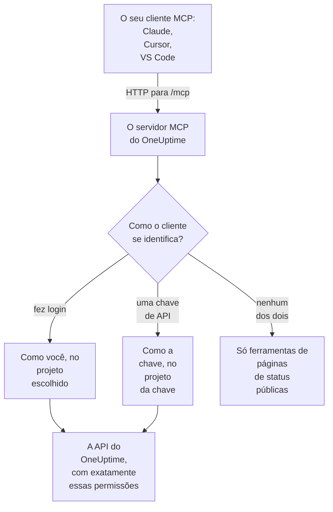

# Servidor MCP

O servidor MCP do OneUptime permite que um assistente de IA trabalhe diretamente com o seu projeto do OneUptime. Conecte o Claude, o Cursor, o VS Code com GitHub Copilot ou qualquer outro cliente do Model Context Protocol (MCP) e peça que ele analise um incidente, consulte logs e traces, reconheça um alerta ou configure um monitor: ele chama as ferramentas do OneUptime com as suas permissões, ou com as de uma chave de API.

:::cards
- [Conectar um cliente](#conectar-um-cliente): Dê ao seu cliente o endereço do servidor e faça login.
- [Fazer login com o OneUptime](#fazer-login-com-o-oneuptime): O que um cliente conectado pode fazer, e como desconectá-lo.
- [Obter a sua chave de API](#obter-a-sua-chave-de-api): Para um agente que roda sem supervisão.
- [Solução de problemas](#solução-de-problemas): Problemas de login, de permissão e de conexão.
:::

Esta página trata dos assistentes de IA que se conectam ao OneUptime. Para o OneUptime AI usar as ferramentas de outros servidores MCP, como os da AWS ou do GitHub, veja [Servidores MCP externos](/docs/ai/external-mcp-servers).

## Como funciona

O servidor MCP faz parte de toda instância do OneUptime, em `/mcp` no mesmo endereço do painel, e usa o transporte streamable HTTP. Não há nada para instalar.

- **OneUptime Cloud**: `https://oneuptime.com/mcp`
- **Auto-hospedado**: `https://your-oneuptime-domain.com/mcp`



O servidor não guarda estado: ele não emite ids de sessão e cada requisição é independente, então funciona atrás de balanceadores de carga e com várias réplicas.

## O que as ferramentas cobrem

- **Monitores**: criar e configurar monitores, verificar o status deles e revisar o histórico.
- **Resposta a incidentes**: criar, reconhecer e resolver incidentes, adicionar notas internas ou públicas e acompanhá-los até a resolução.
- **Alertas**: reconhecer e resolver alertas, adicionar notas e gerenciar estados e severidades de alertas.
- **Equipes e plantão**: gerenciar equipes e políticas de plantão.
- **Páginas de status**: gerenciar páginas de status e publicar anúncios.
- **Manutenção programada**: criar e gerenciar eventos de manutenção.
- **Telemetria**: consultar logs, métricas, traces, exceções, logs de monitores, eventos de segurança e mais, somente leitura.

Há ferramentas de criar, obter, listar, atualizar, excluir e contar para 42 tipos de registro, ferramentas de listar e contar para 9 tipos de telemetria e ferramentas feitas para a resposta a incidentes. As ferramentas somente leitura levam `readOnlyHint`, toda ferramenta que altera algo leva `destructiveHint` e só as ferramentas de páginas de status públicas levam `openWorldHint`, então um cliente pode executar sozinho as chamadas somente leitura e perguntar a você antes de qualquer alteração. Uma chamada de ferramenta que falha volta como resultado da ferramenta (`isError: true`) com um `statusCode`, os detalhes e uma sugestão, não como um erro do protocolo MCP, então o agente consegue ler a falha e se corrigir.

## Antes de começar

- Uma instância do OneUptime: OneUptime Cloud ou auto-hospedada.
- Um cliente MCP, como Claude Code, Claude, VS Code com GitHub Copilot ou Cursor.
- Uma conta do OneUptime para fazer login, ou uma chave de API do OneUptime para um agente que roda sem supervisão. As ferramentas de páginas de status públicas não precisam de nenhum dos dois.
- No OneUptime Cloud, o plano Growth ou superior: conectar um cliente MCP está disponível nos mesmos planos que as chaves de API.

## Conectar um cliente

Dê ao cliente o endereço do servidor e nada mais. Na primeira vez que precisar dos seus dados, ele abre o OneUptime no seu navegador para você fazer login (veja [Fazer login com o OneUptime](#fazer-login-com-o-oneuptime)). Em uma instância auto-hospedada, use `https://your-oneuptime-domain.com/mcp` no lugar de `https://oneuptime.com/mcp`.

:::tabs
@tab Claude Code
```bash
claude mcp add --transport http oneuptime https://oneuptime.com/mcp
```
Depois execute `/mcp` dentro do Claude Code e escolha **oneuptime** para fazer login.
@tab Claude
No Claude, abra **Customize → Connectors**, escolha **Add custom connector** e informe `https://oneuptime.com/mcp`. O Claude pede que você faça login no OneUptime na primeira vez que precisa dos seus dados.
@tab VS Code
Adicione isto à sua configuração de MCP (veja [VS Code com GitHub Copilot](#vs-code-com-github-copilot) para saber onde ela fica). O VS Code abre o OneUptime para você fazer login quando inicia o servidor:
```json
{
  "servers": {
    "oneuptime": {
      "type": "http",
      "url": "https://oneuptime.com/mcp"
    }
  }
}
```
@tab Cursor
```json
{
  "mcpServers": {
    "oneuptime": {
      "url": "https://oneuptime.com/mcp"
    }
  }
}
```
:::

Qualquer outro cliente que suporte a autorização do MCP funciona do mesmo jeito: dê a ele o endereço e ele descobre todo o resto. Veja [Fazer login (OAuth 2.1)](#fazer-login-oauth-21) para o protocolo.

O painel também tem estes passos, com o endereço da sua instância já preenchido: **Configurações do projeto → IA → Servidor MCP**. E a partir de qualquer recurso (um monitor, um incidente, uma página de status e assim por diante), expanda **Desenvolvedores** no menu lateral dele e escolha **Assistentes de IA**: essa página também sugere prompts que citam o recurso e o ID dele, para o assistente encontrá-lo na hora. Para um recurso para o qual o servidor MCP ainda não tem ferramentas, como um fluxo de trabalho, a página mostra como um assistente capaz de executar comandos pode trabalhar com ele pela API REST.

## Fazer login com o OneUptime

A forma mais simples de conectar é dar ao seu cliente MCP o endereço do servidor e nada mais. Na primeira vez que o cliente precisa dos seus dados, ele abre uma página do OneUptime no seu navegador:

:::steps
1. Faça login no OneUptime, se ainda não estiver conectado.
2. Escolha o projeto em que o cliente deve trabalhar.
3. Escolha **Leitura e gravação** ou **Somente leitura**.
4. Clique em **Autorizar**.
:::

O cliente então age como você nesse projeto. Não há chave de API para criar, copiar ou rotacionar, e nada secreto é guardado em um arquivo de configuração.

O que um cliente conectado pode fazer:

- **Ele tem as suas permissões, e nunca mais.** O que as suas equipes permitem que você faça no projeto é o que o cliente pode fazer. Se o seu papel muda ou você sai do projeto, isso vale a partir da próxima requisição do cliente. Sair do projeto também desconecta o cliente: a autorização dele é excluída, e você o conecta de novo se voltar ao projeto.
- **Somente leitura significa somente leitura.** Um cliente autorizado como somente leitura pode usar as ferramentas `get_`, `list_` e `count_`. Ferramentas que criam, atualizam, excluem, reconhecem ou resolvem são recusadas, pelo servidor MCP e pela API do OneUptime por trás dele. Você nunca pode dar a um cliente mais acesso do que ele pediu.
- **Ele vale para um projeto.** Para usar um segundo projeto, conecte o cliente de novo e escolha esse projeto.
- **Ele só funciona pelo servidor MCP.** O token de acesso do cliente é aceito pelo endpoint MCP e em nenhum outro lugar. Ele não pode ser usado para chamar diretamente a API REST do OneUptime.
- **Administradores da instância não recebem tratamento especial.** Um cliente conectado por um administrador master tem o que as equipes dessa pessoa concedem no projeto, não acesso à instância inteira.

### Gerenciar os clientes conectados

Todo cliente conectado por login aparece em **Configurações do projeto → IA → Servidor MCP**, em **Clientes MCP conectados**, com quem o conectou, o que ele pode fazer e quando foi usado pela última vez. Você vê os clientes que você conectou; os proprietários e administradores do projeto veem os de todos.

Clique em **Desconectar** para desconectar um cliente. Ele para de funcionar na hora.

Um cliente continua conectado enquanto for usado. Um que não é usado há 30 dias precisa fazer login de novo.

### Controlar quem pode conectar clientes

Por padrão, todo membro do projeto pode conectar um cliente MCP. Para impedir os membros de uma equipe, abra a página **Permissões** da equipe, abra **Mais configurações** no fim e adicione a permissão **Authorize MCP Client** em **Bloquear permissões**. Os clientes que esses membros já tinham conectado param de funcionar na hora.

Se o projeto exige login único, faça login no projeto com SSO no seu navegador antes de autorizar um cliente. A conexão do cliente dura tanto quanto esse login SSO; quando ele expira, ou o provedor de SSO com que você fez login é desativado ou excluído, conecte o cliente de novo.

No OneUptime Cloud, conectar um cliente MCP está disponível nos mesmos planos que as chaves de API (Growth e superiores).

Na Enterprise Edition, toda mudança feita por um cliente conectado fica registrada no log de auditoria em nome da pessoa que o conectou, com o nome do cliente. Mudanças feitas com uma chave de API mostram o nome da chave.

## Obter a sua chave de API

Use uma chave de API para um agente que roda sem supervisão, como um job agendado ou um pipeline de CI, em que não há ninguém para fazer login.

:::steps
### Crie a chave

Vá para **Configurações do projeto → Avançado → Chaves de API** e clique em **Criar: Chave de API**. Dê um nome a ela, como "MCP Server".

### Escolha o que ela pode fazer

Em **Acesso**, escolha **Visualizador** para um agente que só lê, ou **Administrador do projeto** para um que também cria, atualiza e exclui (veja [Permissões das chaves de API](#permissões-das-chaves-de-api)).

### Copie a chave

Clique em **Criar: Chave de API**: a página da chave se abre. Copie a chave de lá.
:::

As chaves de API pertencem a um projeto: o servidor MCP pega o projeto da chave, então as ferramentas de criação nunca precisam de um argumento `projectId`.

> [!WARNING]
> Nunca dê uma chave master a um agente de IA. Uma chave de API master do OneUptime também é aceita neste cabeçalho e concede acesso de administrador à instância inteira. Use sempre uma chave de API de projeto com o mínimo de que o agente precisa: uma chave somente leitura basta para todas as ferramentas `get_`, `list_` e `count_`.

## Conectar com uma chave de API

Envie a chave no cabeçalho `x-api-key`. Uma requisição que leva uma chave de API nunca é solicitada a fazer login. Em uma instância auto-hospedada, use o seu próprio domínio no lugar de `oneuptime.com`.

:::tabs
@tab Claude Code
```bash
claude mcp add --transport http oneuptime https://oneuptime.com/mcp --header "x-api-key: your-api-key-here"
```
@tab Claude Desktop
Adicione isto a `claude_desktop_config.json`, em `~/Library/Application Support/Claude/` no macOS, `%APPDATA%\Claude\` no Windows ou `~/.config/Claude/` no Linux:
```json
{
  "mcpServers": {
    "oneuptime": {
      "transport": "streamable-http",
      "url": "https://oneuptime.com/mcp",
      "headers": {
        "x-api-key": "your-api-key-here"
      }
    }
  }
}
```
@tab VS Code
A variável de entrada com `"password": true` pede a chave quando o servidor inicia, em vez de guardá-la em texto simples:
```json
{
  "servers": {
    "oneuptime": {
      "type": "http",
      "url": "https://oneuptime.com/mcp",
      "headers": {
        "x-api-key": "${input:oneuptime-api-key}"
      }
    }
  },
  "inputs": [
    {
      "type": "promptString",
      "id": "oneuptime-api-key",
      "description": "OneUptime API Key",
      "password": true
    }
  ]
}
```
@tab Cursor
```json
{
  "mcpServers": {
    "oneuptime": {
      "url": "https://oneuptime.com/mcp",
      "headers": {
        "x-api-key": "your-api-key-here"
      }
    }
  }
}
```
:::

## VS Code com GitHub Copilot

O VS Code 1.99 e versões posteriores suportam servidores MCP nativamente no GitHub Copilot Chat.

:::steps
### Verifique o que você precisa

VS Code 1.99 ou posterior, com a extensão GitHub Copilot instalada e conectada, e o GitHub Copilot Chat ativado.

### Abra a configuração de MCP

Pressione `Ctrl+Shift+P` (`Cmd+Shift+P` no macOS), digite "MCP: Open User Configuration" e pressione Enter. Isso abre, ou cria, o arquivo `mcp.json`. Para um único workspace, crie em vez disso `.vscode/mcp.json` dentro dele.

### Adicione o OneUptime

Cole a configuração do VS Code acima: a sem chave, para fazer login, ou a com uma chave de API.

### Inicie o servidor

Pressione `Ctrl+Shift+P` (`Cmd+Shift+P` no macOS), digite "MCP: List Servers" e escolha **oneuptime** para iniciá-lo. O VS Code pede na primeira vez que você confie no servidor e depois que faça login ou informe a sua chave de API.

### Pergunte ao Copilot

Abra o GitHub Copilot Chat no modo agente e pergunte, por exemplo, "Quais monitores eu tenho no OneUptime?", "Mostre os incidentes recentes" ou "Crie um novo monitor para https://example.com".
:::

## Autenticação

O servidor MCP funciona de três formas.

### Ferramentas públicas (sem autenticação)

Sem uma chave de API nem um login, um cliente pode usar as ferramentas públicas:

- **`oneuptime_help`**: ajuda e orientação sobre as ferramentas MCP do OneUptime
- **`oneuptime_list_resources`**: os recursos e o que você pode fazer com cada um
- **`get_public_status_page_overview`**: a visão geral de uma página de status pública
- **`get_public_status_page_incidents`**: os incidentes de uma página de status pública
- **`get_public_status_page_scheduled_maintenance`**: os eventos de manutenção programada dela
- **`get_public_status_page_announcements`**: os anúncios dela

As ferramentas de páginas de status públicas recebem o ID de uma página de status (um UUID) ou o nome de domínio dela. Para usar só essas, conecte com o endereço e sem credenciais:

```json
{
  "mcpServers": {
    "oneuptime": {
      "transport": "streamable-http",
      "url": "https://oneuptime.com/mcp"
    }
  }
}
```

Os proprietários de uma página de status podem desativar o acesso MCP para essa página: na página de status, abra **MCP** na seção **IA** do menu lateral dela e desative **Habilitar servidor MCP**. A chave é salva assim que é acionada. O acesso MCP vem ativado por padrão. Enquanto ele estiver desativado, as quatro ferramentas `get_public_status_page_*` retornam um erro para essa página de status; o site da página de status, o feed RSS dela e a API JSON pública dela não são afetados, e as ferramentas de página de status que exigem login (`get_status_page`, `list_status_pages` e assim por diante) continuam funcionando para o próprio projeto da página.

### Fazer login (OAuth 2.1)

Todas as outras ferramentas precisam saber quem está chamando. Um cliente que não envia credenciais e chama uma delas recebe `401 Unauthorized` com um cabeçalho `WWW-Authenticate` que aponta para os metadados de recurso protegido do servidor. Esse é o sinal a que um cliente MCP reage para fazer o seu login; `initialize`, `tools/list` e as ferramentas públicas nunca pedem isso.

O servidor implementa a [especificação de autorização do MCP](https://modelcontextprotocol.io/specification/latest/basic/authorization):

- **Fluxo**: authorization code do OAuth 2.1 com PKCE (somente `S256`). Os tokens de acesso são enviados como `Authorization: Bearer`.
- **Descoberta**: metadados de recurso protegido (RFC 9728) e metadados do servidor de autorização (RFC 8414). O emissor e o recurso são ambos `https://<host>/mcp`.
- **Identidade do cliente**: um Client ID Metadata Document (o ID do cliente é uma URL `https` que o servidor busca) ou o registro dinâmico de clientes (RFC 7591). Nenhum cliente precisa ser registrado por um administrador.
- **Escopos**: `mcp:read` para as ferramentas `get_`, `list_` e `count_`; `mcp:write` adiciona toda ferramenta que muda algo e inclui `mcp:read`. Um token somente leitura que chama uma ferramenta de escrita recebe `403` com `error="insufficient_scope"`.
- **Duração dos tokens**: um token de acesso dura uma hora. Um token de atualização dura 30 dias e é substituído a cada uso; usar um token de atualização que já foi substituído encerra a conexão.
- **Indicadores de recurso** (RFC 8707): um token é emitido para `https://<host>/mcp` e não é aceito em nenhum outro lugar.
- **Revogação** (RFC 7009): revogar qualquer um dos dois tokens encerra a conexão.

### Chave de API

Um agente que roda sem supervisão envia uma chave de API do OneUptime em um destes cabeçalhos:

- `x-api-key`: a sua chave de API do OneUptime
- `Authorization`: um token bearer com a sua chave de API (por ex. `Bearer your-api-key-here`)

O esquema `Bearer` não diferencia maiúsculas de minúsculas. Uma requisição que leva uma chave de API nunca é solicitada a fazer login.

No OneUptime Cloud, as chaves de API só funcionam enquanto o projeto está no **Growth** ou acima. Abaixo disso, toda ferramenta que precisa da chave responde `402` com uma mensagem que cita o plano, e o agente é orientado a não tentar de novo. Nada é excluído: a chave volta a funcionar como está assim que o projeto volta ao Growth, sem nada para reconectar. Um cliente conectado por login age como uma pessoa e continua funcionando ([Chaves de API e SCIM abaixo do plano](/docs/api-reference/api-reference#chaves-de-api-e-scim-abaixo-do-plano)).

## Endpoints disponíveis

| Endpoint | Método | Descrição |
| --- | --- | --- |
| `/mcp` | POST | Requisições JSON-RPC para chamadas de ferramentas e outras operações |
| `/mcp` | GET | Sem um cabeçalho SSE `Accept`: uma descrição JSON curta do servidor. Com um: `405`, porque o servidor sem estado não oferece um stream SSE independente (clientes que seguem a especificação continuam sem ele) |
| `/mcp` | DELETE | Não faz nada: o servidor não guarda estado, então não há sessão para encerrar |
| `/mcp/health` | GET | Verificação de saúde |
| `/mcp/tools` | GET | A lista de ferramentas, como REST simples |

Os clientes MCP que fazem login também usam os endpoints OAuth abaixo. Um cliente os encontra sozinho; eles estão listados para quem escreve um cliente ou configura um proxy.

| Endpoint | Método | Descrição |
| --- | --- | --- |
| `/mcp/.well-known/oauth-protected-resource` | GET | Metadados de recurso protegido (RFC 9728). Também em `/.well-known/oauth-protected-resource/mcp` |
| `/.well-known/oauth-authorization-server/mcp` | GET | Metadados do servidor de autorização (RFC 8414). Também em `/mcp/.well-known/oauth-authorization-server` |
| `/mcp/oauth/authorize` | GET | Endpoint de autorização: para onde o cliente envia o seu navegador para fazer login |
| `/mcp/oauth/token` | POST | Endpoint de token: troca um código de autorização ou um token de atualização |
| `/mcp/oauth/register` | POST | Registro dinâmico de clientes (RFC 7591) |
| `/mcp/oauth/revoke` | POST | Revogação de tokens (RFC 7009) |

Para verificar se o servidor está rodando e listar as ferramentas dele:

```bash
curl https://oneuptime.com/mcp/health
curl https://oneuptime.com/mcp/tools
```

## Ferramentas para a resposta a incidentes

Além das ferramentas para cada tipo de registro, o servidor tem ferramentas feitas para responder a incidentes e alertas:

- **`acknowledge_incident`** / **`resolve_incident`**: mover um incidente para o estado Acknowledged ou Resolved do projeto, como faz o botão do painel
- **`acknowledge_alert`** / **`resolve_alert`**: o mesmo para alertas
- **`add_incident_note`**: adicionar uma nota a um incidente com `visibility: "internal"` (só a equipe, o padrão) ou `visibility: "public"` (publicada na página de status). Markdown é suportado
- **`add_alert_note`**: adicionar uma nota interna a um alerta

Um ciclo típico: `list_incidents` → `acknowledge_incident` → investigar com `list_logs` → `add_incident_note` (pública) → `resolve_incident`.

A ferramenta **`oneuptime_whoami`** retorna o projeto a que pertencem as suas credenciais (o ID e o nome dele). Para um cliente que fez login, ela também diz com qual usuário ele está conectado e se pode fazer alterações. É uma boa primeira chamada para um agente se situar, e como as ferramentas de criação pegam `projectId` das credenciais, o agente nunca precisa passar um ID de projeto.

## Consultar a telemetria

Logs, métricas, traces (spans), exceções, logs de monitores e os outros tipos de telemetria vêm como ferramentas `list_` e `count_` somente leitura (`list_logs`, `list_metrics`, `list_spans`, `list_exception_instances`, `list_monitor_logs` e as gêmeas `count_` delas). A telemetria chega pelo OpenTelemetry, então não há ferramentas de criação.

Consulte sempre a telemetria com um intervalo de tempo. Um campo de consulta recebe um valor, ou um objeto de operador:

```json
{
  "query": {
    "time": { "_type": "GreaterThan", "value": "2026-07-04T00:00:00.000Z" }
  },
  "sort": { "time": "DESC" },
  "limit": 50
}
```

Os operadores são `EqualTo`, `NotEqual`, `IsNull`, `NotNull`, `EqualToOrNull`, `GreaterThan`, `LessThan`, `GreaterThanOrEqual`, `LessThanOrEqual`, `InBetween`, `Search` e `Includes`. Os valores de ordenação são `"ASC"` ou `"DESC"`.

## Seleção de campos e paginação

As ferramentas `get_` e `list_` recebem um array `select` opcional de nomes de campos. Por padrão, todo campo legível volta, exceto os pesados (colunas JSON, de texto muito longo e HTML), que precisam ser pedidos em `select`.

As ferramentas de listagem paginam com `limit` (10 por padrão, 100 no máximo) e `skip`, e toda resposta de listagem diz exatamente o que retornou:

```json
{
  "returnedCount": 10,
  "totalCount": 42,
  "skip": 0,
  "limit": 10,
  "hasMore": true,
  "data": ["..."]
}
```

## Exemplos de uso

### Perguntas do dia a dia

```text
"What's the current status of all my monitors?"
"Show me incidents from the last 24 hours"
"List the teams in this project"
"Show me our on-call policies"
```

### Monitores e incidentes

```text
"Create a new website monitor for https://example.com that checks every 5 minutes"
"Set up an API monitor for https://api.example.com/health with a 30-second timeout"
"Disable the monitor for staging.example.com while we're doing maintenance"
"Create a high-priority incident for the database outage affecting user authentication"
"Add a note to incident #123 saying 'Database connection restored, monitoring for stability'"
"Mark incident #456 as resolved"
```

### Páginas de status

```text
"Update our status page to show 'Investigating Payment Issues' for the payment service"
"Create a status page announcement about scheduled maintenance this weekend"
```

### Consultas a páginas de status públicas (sem chave de API)

Estas funcionam sem credenciais, só com as ferramentas de páginas de status públicas:

```text
"What's the current status of status.example.com?"
"Show me recent incidents from the OneUptime status page"
"Are there any scheduled maintenance events on status.acme.com?"
"Get the latest announcements from my public status page with ID abc123-..."
```

### Vários passos de uma vez

```text
"Create a scheduled maintenance window for Saturday 2-4 AM, disable all monitors for api.example.com during that time, and update the status page"
"Show me all monitors that have been down in the last hour, create incidents for any that don't already have one"
```

## Permissões das chaves de API

| O que o agente faz | Escolha em **Acesso** |
| --- | --- |
| Só lê | **Visualizador**, ou adicione permissões de leitura na página da chave |
| Também cria, atualiza e exclui | **Administrador do projeto**, ou adicione o papel Project Admin na página da chave |

Dê a cada chave o mínimo de que ela precisa, rotacione as chaves com regularidade, mantenha uma chave separada para cada ambiente e acompanhe no OneUptime o que cada chave faz.

## Configuração auto-hospedada

O login funciona de imediato em uma instância auto-hospedada. Duas configurações o alteram:

| Variável de ambiente | Valor do Helm | O que faz |
| --- | --- | --- |
| `DISABLE_MCP_OAUTH` | `mcpOAuth.disabled` | Defina como `true` para desligar o login. Os endpoints OAuth deixam de ser servidos e o servidor MCP passa a aceitar só chaves de API. Nada é excluído; os clientes conectados voltam a funcionar quando ele é religado. |
| `DISABLE_MCP_OAUTH_CLIENT_ID_METADATA_DOCUMENTS` | `mcpOAuth.disableClientIdMetadataDocuments` | Defina como `true` em uma instância que não alcança a internet. Um cliente pode se identificar com uma URL que o OneUptime busca; com esta configuração, os clientes se registram diretamente na sua instância, o que não precisa de nenhuma requisição de saída. |

Se você usa o seu próprio proxy reverso na frente do OneUptime, encaminhe `/.well-known/oauth-protected-resource` e `/.well-known/oauth-authorization-server` (e tudo abaixo deles) para o OneUptime junto com `/mcp`. O ingress incluído já faz isso.

O servidor monta toda URL OAuth a partir das configurações `HOST` e `HTTP_PROTOCOL`, então elas precisam corresponder ao endereço que as pessoas usam para chegar à sua instância.

## Solução de problemas

### Problemas de login

- **O cliente nunca me pede para fazer login**: talvez o cliente não suporte a autorização do MCP, ou esteja configurado com um cabeçalho de chave de API, que tem prioridade. Remova o cabeçalho para fazer login em vez disso.
- **Meu projeto aparece em cinza na página de autorização**: a página diz o motivo ao lado do nome do projeto: o plano do projeto não inclui conectar clientes MCP, o projeto exige SSO e este navegador não fez login nele com SSO, ou a sua equipe está bloqueada para conectar clientes.
- **Uma ferramenta é recusada como "read-only"**: o cliente foi autorizado como somente leitura. Conecte-o de novo e escolha **Leitura e gravação**.
- **O cliente parou de funcionar**: ele foi desconectado, não foi usado por 30 dias, você foi removido do projeto, ou o login SSO do projeto expirou ou o provedor dele foi desativado. Conecte-o de novo.
- **Auto-hospedado - o cliente diz que não encontra o servidor de autorização**: verifique se `HOST` e `HTTP_PROTOCOL` correspondem ao seu endereço público e se o seu proxy encaminha os caminhos `/.well-known/oauth-*`.

### Erros de permissão

A chave de API, ou a sua própria conta no caso de um cliente que fez login, precisa das permissões certas: acesso de leitura para listar registros, acesso de escrita para criá-los e atualizá-los, e acesso de exclusão para removê-los.

### Problemas de conexão

Verifique se o endereço do OneUptime está certo e acessível, se a chave de API é válida e se o endpoint de saúde responde (veja [Endpoints disponíveis](#endpoints-disponíveis)).

### Chave de API inválida

- Verifique a chave de API nas suas configurações do OneUptime, sem espaços ou caracteres a mais
- Verifique se a chave não expirou
- No OneUptime Cloud, um `402` dizendo que as chaves de API precisam do plano Growth significa que o projeto está abaixo dele: faça upgrade do projeto em **Configurações do projeto → Cobrança e faturas → Cobrança**, e a mesma chave volta a funcionar

### Erros de sessão

O servidor MCP não guarda estado: ele nem emite nem rastreia ids de sessão, então toda requisição funciona em qualquer réplica. Um cliente que envia um cabeçalho `mcp-session-id` de uma versão anterior do servidor pode omiti-lo; ele é ignorado. Atualize uma configuração de cliente antiga que espere que o servidor retorne um id de sessão.

## Recursos disponíveis

| Área | Registros com ferramentas de criar, obter, listar, atualizar, excluir e contar |
| --- | --- |
| Monitoramento | Monitor, Monitor Status, Monitor Status Event |
| Incidentes | Incident, Incident State, Incident Severity, Incident State Timeline, Incident Public Note, Incident Internal Note, Incident Alert, Postmortem Status |
| Alertas | Alert, Alert State, Alert Severity, Alert State Timeline, Alert Internal Note |
| Páginas de status | Status Page, Status Page Announcement |
| Manutenção programada | Scheduled Maintenance Event, Scheduled Maintenance State, Scheduled Maintenance State Timeline |
| Equipes e plantão | Team, On-Call Policy |
| Rótulos | Label |
| Segurança | Security Case, Security Case Evidence, Security Case Note, Security Case Priority, Security Case Status, Security Case Task, Security Detection, Security Playbook |
| Segurança de dados | Data Store, Data Store Finding, Data Store Access Entry, Data Flow, Data Security Issue, Data Security Scan, Data Security Setting, Check Setting, Custom Data Type, Residency Rule |

| Área | Telemetria só com ferramentas de listar e contar |
| --- | --- |
| Observabilidade | Log, Metric, Span, Exception Instance, Monitor Log |
| Segurança | Security Event, Threat Intel Indicator |
| Mudanças e custos | Change Event, Kubernetes Cost Allocation |

As ferramentas têm nomes em snake case: `create_incident`, `get_incident`, `list_incidents`, `update_incident`, `delete_incident` e `count_incidents`, ou `list_logs` e `count_spans` para a telemetria.

## Próximos passos

:::cards
- [Pergunte à IA](/docs/ai/ask-ai): Pergunte sobre o seu projeto dentro do próprio OneUptime.
- [Referência da API do OneUptime](/docs/api-reference/api-reference): A API REST por trás de cada ferramenta.
- [Permissões](/docs/permissions/index): O que um papel, uma equipe ou uma chave de API pode fazer.
:::
