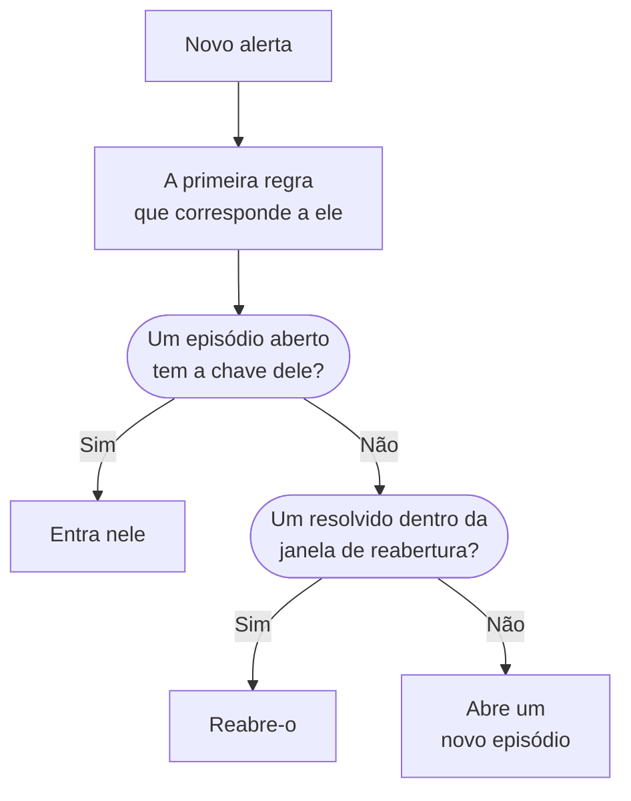

# Episódios de alertas e regras de agrupamento

Quando um banco de dados cai, vinte monitores podem gerar vinte alertas em poucos minutos. Um episódio os reúne em um único registro que sua equipe confirma e resolve de uma vez, e uma regra de agrupamento decide quais alertas entram nele. Esta página mostra como o agrupamento funciona, como configurar uma regra e como um episódio se comporta depois de aberto.

:::cards
- [Como o agrupamento funciona](#como-o-agrupamento-funciona): Regras, chaves de agrupamento e janelas de tempo.
- [Criar uma regra de agrupamento](#criar-uma-regra-de-agrupamento): A partir de um modelo com um clique, ou a sua própria.
- [Como um episódio se comporta](#como-um-episódio-se-comporta): Sua gravidade, seus estados e quando ele é resolvido.
- [Quem um episódio aciona](#quem-um-episódio-aciona): As políticas de plantão da regra e as dos próprios alertas.
:::

## Como o agrupamento funciona

O agrupamento é executado uma vez para cada novo alerta, logo depois que suas políticas de plantão são executadas. O alerta é comparado com suas regras de agrupamento habilitadas, de cima para baixo na lista, e a primeira regra que corresponde a ele decide seu episódio. Um alerta ao qual nenhuma regra corresponde fica sozinho.



- **As condições da regra** decidem a quais alertas ela se aplica. Uma regra sem condições se aplica a todo alerta novo.
- **A chave de agrupamento** decide quais alertas compartilham um episódio: os que têm o mesmo monitor, a mesma gravidade, o mesmo título ou a combinação pela qual a regra agrupa. Uma regra que não agrupa por nada coloca em um único episódio todo alerta que corresponde a ela.
- **A janela de tempo** decide por quanto tempo um episódio continua aceitando alertas. Ativada, um alerta só entra se chegar dentro da janela após o último alerta do episódio. Desativada, os alertas correspondentes continuam entrando até o episódio ser resolvido.

O agrupamento acontece quando um alerta é criado. Uma regra que você adiciona hoje agrupa os alertas criados depois dela; ela não reagrupa os que já existem.

> [!NOTE]
> Um alerta criado já confirmado pode entrar em um episódio aberto, mas nunca abre um, e um alerta criado resolvido não é agrupado de forma alguma. Veja [Criado já confirmado ou resolvido](/docs/alerts/index#criado-já-confirmado-ou-resolvido).

## Criar uma regra de agrupamento

Vá para **Alertas → Regras → Regras de agrupamento**. A seção **Regras** do menu lateral começa recolhida, então expanda-a primeiro.

### Começar por um modelo

Um projeto sem regras de agrupamento vê quatro regras prontas em vez de uma lista vazia; depois que você tem regras, **Criar a partir de modelo** no cartão as abre. **Adicionar regra** salva uma com um único clique, habilitada, no fim da lista e aplicada a todo alerta novo. Edite-a depois como qualquer outra regra.

| Modelo                                        | Agrupa                                                                    | Janela de tempo |
| --------------------------------------------- | ------------------------------------------------------------------------- | --------------- |
| **Agrupar alertas do mesmo monitor**          | Um episódio por monitor                                                   | 30 minutos      |
| **Agrupar alertas que acontecem juntos**      | Um episódio compartilhado, seja qual for o monitor                        | 10 minutos      |
| **Agrupar alertas por gravidade**             | Um episódio por gravidade                                                 | 30 minutos      |
| **Agrupar repetições do mesmo alerta**        | Um episódio por título de alerta, ignorando números e maiúsculas          | 1 hora          |

### Criar a sua

:::steps
#### Responder como agrupar

Clique em **Criar regra personalizada** abaixo dos modelos, ou em **Criar regra de agrupamento de alertas** no cartão quando já tiver regras. Na etapa **Agrupamento**, **Agrupar alertas por** faz uma única pergunta: **Monitor**, **Tudo junto**, **Gravidade**, **Título** ou **Personalizado**. O **Nome** acompanha sua resposta até você digitar um seu.

#### Definir a janela de tempo

**Agrupar apenas alertas que chegam próximos** está ativado, com uma janela de 30 minutos. Altere os minutos, ou desative-o para manter um episódio aberto até ser resolvido.

#### Combinar campos, para Personalizado

**Personalizado** adiciona uma etapa **Agrupar Por** com cinco interruptores: **Agrupar Por Monitor**, **Agrupar Por Severidade de Alerta**, **Agrupar Por Título de Alerta**, **Agrupar Por Rótulos de Alerta** e **Agrupar Por Rótulos de Monitor**. Os rótulos agrupam pelo seu conjunto exato.

#### Restringir

Em **Quais alertas**, **Todos os alertas**, onde uma regra nova começa, agrupa todo alerta novo. Para restringi-la, escolha **Somente os alertas que atendem às condições** e adicione condições sobre monitores, gravidades, rótulos, títulos e descrições. Depois clique em **Criar regra de agrupamento de alertas**.
:::

Todo o resto que uma regra pode fazer fica recolhido em **Mais campos**, no fim da etapa **Agrupamento**, em três grupos. Recolhido, seu cabeçalho nomeia o que contém e diz o valor de cada configuração que a regra usa, para que editar uma regra nunca esconda o que ela faz.

| Grupo                            | Configurações                                                                                              |
| -------------------------------- | ---------------------------------------------------------------------------------------------------------- |
| **Plantão e propriedade**        | **Políticas de plantão** a executar quando a regra abre um episódio, e **Proprietários do episódio**.      |
| **Ciclo de vida do episódio**    | **Reabrir episódios resolvidos recentemente**, **Aguardar antes de resolver um episódio** e **Resolver episódios inativos**, cada um com um interruptor e seus minutos. |
| **Detalhes**                     | A **Descrição** da regra, o **Modelo de título do episódio**, o **Modelo de descrição do episódio** e os **Rótulos do episódio**. |

As regras são verificadas de cima para baixo na lista, e a primeira correspondência vence: arraste uma regra para mudar sua posição. Coloque regras específicas acima das amplas. A coluna **Agrupamento** da lista diz em uma frase o que cada regra faz, como "Um episódio por monitor".

## Títulos dos episódios

Sem um modelo, um episódio recebe o nome do monitor do seu primeiro alerta, ou os primeiros 50 caracteres do título do alerta quando ele não tem monitor. Com um **Modelo de título do episódio** ou um **Modelo de descrição do episódio**, estas variáveis são preenchidas. Digite `{{` em qualquer um dos dois campos para escolher uma.

| Variável               | Preenchida com                                                                                  |
| ---------------------- | ----------------------------------------------------------------------------------------------- |
| `{{alertTitle}}`       | O título do primeiro alerta.                                                                    |
| `{{alertDescription}}` | A descrição do primeiro alerta.                                                                 |
| `{{alertSeverity}}`    | A gravidade do primeiro alerta.                                                                 |
| `{{monitorName}}`      | O nome do monitor do primeiro alerta.                                                           |
| `{{alertCount}}`       | Quantos alertas o episódio contém, reescrito à medida que alertas entram ou saem.               |

Uma variável para a qual o primeiro alerta não tem valor, ou uma que não está nesta lista, é omitida. Quando o primeiro alerta é privado, `{{alertTitle}}` e `{{alertDescription}}` mostram "Private alert", porque o episódio não é privado.

## Como um episódio se comporta

Um episódio percorre seus estados de alerta, a mesma lista que os alertas usam, e tem seus próprios proprietários, notas, causa raiz e notas de remediação.

- **Sua gravidade sobe com seus alertas.** Ele começa com a gravidade do seu primeiro alerta e assume a de qualquer alerta mais grave que entre nele, sendo "mais grave" o que está mais acima em **Alertas → Configurações → Severidade do alerta**.
- **Seu estado move seus alertas.** Confirme ou resolva um episódio, ou leve-o a um estado seu, e cada alerta dentro dele se move também, exceto um alerta que já esteja nesse estado ou depois dele.
- **Ele se resolve sozinho** quando todos os seus alertas estão resolvidos. **Aguardar antes de resolver um episódio** o mantém aberto antes por esse número de minutos, caso um alerta volte.
- **Ele pode reabrir.** Com **Reabrir episódios resolvidos recentemente** ativado, um alerta correspondente que chega dentro dos minutos após a resolução do episódio o reabre, em vez de abrir outro. É o único passo de volta para cima na lista de estados, e ele não reabre os alertas do episódio.

> [!WARNING]
> **Resolver episódios inativos** resolve um episódio quando nenhum alerta novo entrou nele durante os minutos que você definir, e resolve também cada alerta ainda aberto nele. Use isso para ruído que você tem certeza de que não precisa de resposta.

## Quem um episódio aciona

As políticas de plantão próprias de um alerta são executadas quando ele é criado, antes do agrupamento, entre ou não em um episódio. Um episódio adiciona as suas:

```mermaid title="Um alerta que abre um episódio aciona duas vezes; um que entra nele, uma vez"
flowchart TB
    alert["Novo alerta"] --> own["As políticas do<br/>alerta são executadas"]
    own --> grouped{"Agrupamento"}
    grouped -->|"Abre um episódio"| ep["As do episódio também<br/>são executadas"]
    grouped -->|"Entra em um episódio"| none["Nada mais é executado"]
```

- **Um novo episódio** executa as **Políticas de plantão** da regra, mais as de qualquer regra correspondente na aba **Episode Rules** de **Alertas → Regras → Regras de Plantão**.
- **Um alerta que entra em um episódio aberto** executa apenas suas próprias políticas. As do episódio não são executadas de novo.
- **Responder ao acionamento de um episódio** confirma o episódio e, com ele, cada alerta que ele contém.

> [!TIP]
> Para acionar uma vez por problema em vez de uma vez por alerta, coloque as políticas de plantão nas suas regras de agrupamento e tire-as dos alertas: dos critérios do monitor, do formulário de criação e das suas regras de plantão de alertas.

Os proprietários do episódio também ficam sabendo: **Episódio de alerta criado**, **Estado do episódio de alerta alterado** e **Alerta adicionado ao episódio de alerta** ficam ativados por e-mail por padrão, em **Configurações do usuário → Configurações de notificação**, na aba **Alertas**. Os **Proprietários do episódio** da regra passam a ser proprietários de cada episódio que ela abre, e são notificados como qualquer outro proprietário.

## Criar um episódio manualmente

:::steps
### Abrir o formulário

Vá para **Alertas → Todos os episódios** e clique em **Criar episódio**. O formulário **Criar novo episódio de alerta** abre.

### Descrever o episódio

Em **Detalhes do episódio**, preencha o **Título** e, se quiser, uma **Severidade do alerta** e uma **Descrição**. **Estado Inicial** e **Rótulos** ficam em **Mais campos**.

### Escolher quem é acionado e quem é o proprietário

Em **Plantão e proprietários**, escolha uma **Política de plantão** a executar quando o episódio for criado, e seus **Proprietários**. Depois clique em **Criar episódio**.

Cada equipe da qual você é membro está a um clique abaixo de **Proprietários**, e o resumo lista as regras de proprietário que vão adicionar mais.

### Adicionar os alertas

Abra a página **Alertas de membros** do episódio, clique em **Adicionar alertas** e marque os alertas que pertencem a ele, quantos precisar de uma vez. Para começar pelos alertas, selecione-os na lista **Alertas** e escolha **Adicionar a um novo episódio** em **Ações em massa** (veja [Episódios](/docs/incidents/episodes)).
:::

Um episódio que você cria não tem regra de agrupamento, então a lista mostra sua **Regra de Agrupamento** como **Manual**, e nenhuma configuração de ciclo de vida se aplica a ele. Ainda assim, ele se resolve sozinho quando todos os seus alertas estão resolvidos.

## O que cada página de um episódio mostra

| Seção do menu lateral | Páginas                                                                     |
| --------------------- | --------------------------------------------------------------------------- |
| **Visão geral** | **Visão geral**, **Linha do tempo de estado** |
| **Investigação** | **Descrição**, **Causa raiz**, **Notas de remediação** |
| **Equipe** | **Proprietários** |
| **Alertas** | **Alertas de membros** |
| **Notas** | **Notas privadas** |
| **Desenvolvedores** | **Terraform**, **API**, **Assistentes de IA** |
| **Avançado** | **Registros de auditoria**, **Excluir episódio** |

**Desenvolvedores** e **Avançado** começam recolhidas. Na **Visão geral**, o cabeçalho mostra os **Proprietários** do episódio, equipes primeiro, e o primeiro bloco, **Criado**, diz quando o episódio foi criado — **Automaticamente**, quando uma regra de agrupamento o abriu. O cartão **O que aconteceu** abre a página — a descrição do episódio e a sua **Causa raiz** — depois **Alerts in this episode** e o **Feed do episódio**, ao lado do cartão **Detalhes do episódio**: seu número, estado, gravidade, quantidade de alertas, regra de agrupamento e políticas de plantão. Seu cabeçalho tem **Confirmar** e **Resolver**, e **Mover episódio para** no menu **⋯**.

**Alertas → Episódios ativos** lista os episódios que ainda não foram resolvidos, e o selo ao lado os conta.

## Solução de problemas

:::details Um novo alerta não entrou no episódio que eu esperava
Verifique, nesta ordem: se a regra está habilitada; se nenhuma regra acima dela correspondeu antes ao alerta; se o alerta atende às condições da regra; se ele tem a mesma chave de agrupamento que os alertas do episódio, como o mesmo monitor; e, com a janela de tempo ativada, se ele chegou dentro da janela após o último alerta do episódio. Um alerta criado já confirmado nunca abre um episódio, e um criado resolvido nunca é agrupado.
:::

:::details Fomos acionados duas vezes por um único problema
A política de plantão própria do alerta foi executada, e a do novo episódio também. Mantenha as políticas na regra de agrupamento e tire-as dos critérios, do formulário ou das regras de plantão do alerta.
:::

:::details Um episódio se resolveu sozinho
Todos os seus alertas estavam resolvidos, então o episódio foi resolvido quando a espera terminou. Quando **Resolver episódios inativos** está ativado, ele também resolve um episódio que não recebeu nenhum alerta novo durante esse tempo.
:::

## Próximos passos

:::cards
- [Regras e configurações de alertas](/docs/alerts/settings): As outras regras que atuam sobre novos alertas e episódios.
- [Estados e severidades de alertas](/docs/alerts/states-and-severities): Os estados pelos quais um episódio passa.
- [Regras de escalonamento](/docs/on-call/escalation-rules): Como as políticas que um episódio executa acionam as pessoas.
- [Configurações e automação de incidentes](/docs/incidents/settings): Regras de agrupamento para incidentes.
:::
