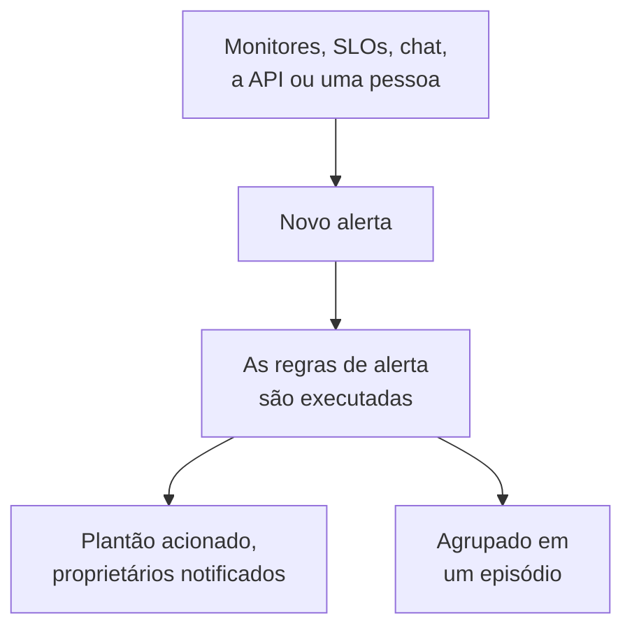

# Visão geral dos alertas

Um alerta avisa sua equipe sobre um problema que deve ser examinado antes que seus usuários percebam: um disco enchendo, um certificado prestes a expirar, uma taxa de erros subindo aos poucos. Ele pode acionar quem está de plantão e notificar seus proprietários, mas nunca aparece em uma página de status e nunca avisa seus assinantes. Esta página explica de onde vêm os alertas, onde eles ficam no painel e como sua equipe trabalha com eles.

:::cards
- [Alertas e incidentes](#alertas-e-incidentes): O que um problema deve ser e como os dois se relacionam.
- [De onde vêm os alertas](#de-onde-vêm-os-alertas): Monitores, SLOs, chat, a API ou manualmente.
- [Criar um alerta manualmente](#criar-um-alerta-manualmente): Duas etapas no painel.
- [Responder a um alerta](#responder-a-um-alerta): Confirme, resolva ou declare um incidente.
:::

## Como funciona

A maioria dos alertas é gerada por um monitor cujos critérios correspondem. Alguns vêm de um SLO consumindo seu orçamento de erros, de uma regra de segurança, de um acionamento enviado pelo Slack ou pelo Microsoft Teams, ou de uma pessoa. Seja qual for a origem, um alerta é sempre o mesmo registro, e as mesmas regras são executadas nele.

- **As regras dão forma a ele.** As regras de privacidade, de proprietário, de rótulos e de plantão são executadas no momento em que um alerta é criado, e as regras de runbook iniciam os procedimentos correspondentes. Veja [Regras e configurações de alertas](/docs/alerts/settings).
- **As políticas de plantão acionam as pessoas.** As políticas que o alerta indica, mais as que suas regras de plantão adicionam, acionam suas pessoas até que alguém confirme o alerta.
- **Os episódios agrupam o ruído.** Uma regra de agrupamento reúne alertas relacionados em um episódio, para que vinte alertas de uma mesma queda sejam uma única coisa a tratar. Veja [Episódios de alertas e regras de agrupamento](/docs/alerts/episodes).

## Alertas e incidentes

Ambos registram um problema, e ambos podem acionar quem está de plantão. O que muda é quem o problema afeta.

|                                  | Alerta                                                 | Incidente                                         |
| -------------------------------- | ------------------------------------------------------ | ------------------------------------------------- |
| **O que é**                      | Um problema que sua equipe deve examinar antes que os usuários sejam afetados | Um problema que afeta seus usuários, como uma queda |
| **Em páginas de status**         | Nunca                                                  | Pode aparecer e avisa os assinantes               |
| **Notas**                        | Notas privadas, só para sua equipe                     | Notas públicas para clientes e notas privadas     |
| **Estados iniciais**             | **Identificado**, **Confirmado**, **Resolvido**          | **Identificado**, **Confirmado**, **Resolvido**     |
| **Gravidades iniciais**          | **Alto**, **Baixo**                                      | Critical Incident, Major Incident, Minor Incident |
| **Números em um projeto novo**   | `ALT-42`, e `AE-42` para episódios                     | `INC-42`, e `IE-42` para episódios                |

Gere um alerta quando sua equipe deve olhar antes que alguém de fora perceba, e declare um incidente quando os usuários forem afetados. Se um alerta se revelar parte de uma queda, declare um incidente a partir dele ou vincule-o ao incidente que o explica: veja [Alertas vinculados](/docs/incidents/linked-alerts).

## De onde vêm os alertas

- **Os critérios de um monitor.** Em **Ações** de um critério, ative **Quando os filtros corresponderem, criar um alerta.** e preencha o alerta que ele cria: **Título do alerta** e **Gravidade**, depois, cada um recolhido, **Descrição**, **Propriedade e rótulos**, **Plantão** e **Mais campos**, que contém **Resolver alerta automaticamente**, **Alerta privado** e **Notas de remediação**. Um critério mantém um alerta aberto por vez, um por série em um monitor que agrupa por um campo, e **Resolver alerta automaticamente** o resolve quando o critério deixa de corresponder. Veja [Criar um monitor](/docs/monitor/create-monitor) e [Modelos de incidentes e alertas](/docs/monitor/incident-alert-templating).
- **Manualmente.** Clique em **Criar alerta** na lista de alertas, ou na aba **Alertas** de um monitor, host, dispositivo de rede ou outro recurso, que escolhe esse recurso para você. Veja [Criar um alerta manualmente](#criar-um-alerta-manualmente).
- **A taxa de consumo de um SLO.** Uma regra de taxa de consumo pode criar um alerta quando um SLO gasta seu orçamento de erros rápido demais. Veja [Alertas e incidentes de taxa de consumo](/docs/slo/burn-rate-alerts).
- **Sites de rede e eventos de segurança.** Um site de rede configurado para alertar quando não está saudável abre um alerta quando seu resumo deixa de estar operacional, e suas regras de detecção de eventos de segurança também abrem alertas. Veja [Sites de rede (resumo de saúde e tempo de atividade)](/docs/monitor/network-sites) e [Eventos de segurança (SIEM)](/docs/telemetry/security-events).
- **Um acionamento.** `/oneuptime page` no Slack ou no Microsoft Teams abre um alerta cujo título é a sua mensagem e aciona as pessoas que você indicar. Os blocos de acionamento de um workflow fazem o mesmo com o título e a mensagem que você fornecer. Veja [Acionar alguém pelo Slack](/docs/workspace-connections/slack#acionar-alguém-pelo-slack) e [Paging](/docs/workflows/components#paging).
- **A API, o Terraform e os workflows.** Alertas são um recurso comum: `/api/alert`, o recurso Terraform `oneuptime_alert` e a etapa **Create One Alert** de um workflow.

## Onde os alertas ficam no painel

Abra **Alertas** no menu **Produtos** da barra superior. A lista de alertas fica em `/dashboard/{projectId}/alerts`, e seu menu lateral reúne tudo sobre alertas:

| Seção                  | O que você faz ali                                                                                                        |
| ---------------------- | ------------------------------------------------------------------------------------------------------------------------- |
| **Alertas**            | **Todos os alertas** e **Alertas ativos**, cujo selo vermelho conta os alertas que ainda não foram resolvidos.              |
| **Episódios** | **Todos os episódios** e **Episódios ativos**: alertas relacionados, agrupados em um único problema para trabalhar. |
| **IA**                 | **Insights**, **Registros** e **Configurações**: o que o OneUptime AI aprendeu com seus alertas, tudo o que fez e o que pode fazer. |
| **Espaço de trabalho** | **Slack** e **Microsoft Teams**, conforme o que o projeto conectou, ou **Conectar Slack ou Teams** quando não tem nenhum dos dois. |
| **Regras**             | **Regras de agrupamento**, **Regras de Plantão**, **Regras de proprietário**, **Regras de runbook**, **Regras de privacidade**, **Regras de Rótulos**, **Reminder Rules**. |
| **Configurações**      | **Estado do alerta**, **Severidade do alerta**, **Modelos de notas**, **Campos personalizados**, **Medições**, **Participação em episódios**, **Numeração**. |

**Alertas** e **Episódios** ficam abertas; **IA**, **Espaço de trabalho**, **Regras**, **Configurações** e **Desenvolvedores** começam recolhidas, e uma seção se abre sozinha quando você está em uma de suas páginas. A configuração dos alertas fica aqui, não em **Configurações do projeto**.

A lista mostra **Número do alerta**, **Título**, **Estado**, **Gravidade**, **Recursos afetados** (primeiro o monitor do alerta), **Criado**, **Duração**, **Rótulos** e **Proprietários**. Selecione alertas para agir em vários de uma vez: **Confirmar**, **Resolver**, **Alterar estado**, **Alterar gravidade**, **Atribuir a mim**, **Adicionar proprietário**, **Remover proprietário**, **Adicionar rótulos**, **Remover rótulos**, **Vincular a incidente**, **Declarar incidente** ou excluí-los.

O menu **⋯** no fim da linha de cada alerta faz o mesmo só para esse alerta: **Confirmar** e **Resolver** enquanto o alerta puder dar esse passo, **Alterar estado**, **Alterar gravidade**, **Atribuir a mim** até você ser o proprietário e **Adicionar proprietário** para passá-lo a outra pessoa.

## Criar um alerta manualmente

:::steps
### Abrir o formulário

Vá para **Alertas → Todos os alertas** e clique em **Criar alerta**. O formulário **Criar novo alerta** abre na primeira etapa, **Detalhes do alerta**.

### Descrever o alerta

Preencha o **Título** e escolha uma **Severidade do alerta**; ambos são obrigatórios. Adicione uma **Descrição** se ajudar. Em **Mais campos**, recolhido, você pode escolher um **Estado Inicial**, adicionar **Rótulos** ou ativar **Alerta privado**. **Proprietários** também está lá: você se torna proprietário do alerta que cria de qualquer forma, e cada equipe da qual você é membro está a um clique abaixo do seletor. Um administrador mestre, que gerencia toda a instalação, é a única exceção: ele não se torna proprietário do que cria.

### Escolher o que ele afeta e quem é acionado

Clique em **Próximo** para chegar a **Recursos e plantão**. Escolha o **Monitor** de que se trata e quaisquer **Outros recursos afetados**, como hosts, dispositivos de rede, clusters Kubernetes ou serviços. Em **Política de plantão**, escolha as políticas que serão executadas quando o alerta for criado.

### Criá-lo

Clique em **Próximo** para revisar o resumo e depois em **Criar alerta**. A página do alerta abre e as regras começam a ser executadas. No resumo, a linha **Proprietários** lista cada regra de proprietário que vai adicionar alguém, e quem: veja [Quem será o proprietário](/docs/incidents/declaring-incidents#quem-será-o-proprietário).
:::

Se você deixar **Estado Inicial** vazio, o alerta começa onde todo alerta novo começa: no seu estado de criação, **Identificado** em um projeto novo. Escolher um estado posterior registra um alerta do qual alguém já está cuidando, ou que já terminou; veja [Criado já confirmado ou resolvido](#criado-já-confirmado-ou-resolvido).

## O que acontece quando um alerta é criado

No momento em que um alerta é criado, o OneUptime percorre estas etapas, nesta ordem:

1. **Ele recebe um número e um estado.** O número do alerta vem de um contador por projeto e é exibido com o seu prefixo (`ALT-42`). O alerta começa no seu estado de criação, a menos que o formulário, a API ou um workflow tenha escolhido outro.
2. **As regras de privacidade são executadas primeiro**, para que tudo o que vem depois saiba se o alerta é privado.
3. **O feed e suas ferramentas de chat ficam sabendo.** Uma entrada **Alerta criado** é escrita em **Alerta Feed**, e os canais indicados por suas regras do Slack e do Microsoft Teams são avisados; uma regra pode criar um canal para o alerta.
4. **Proprietários e rótulos são adicionados**: os que os critérios do monitor ou a solicitação indicam, depois os das regras de proprietário e de rótulos correspondentes.
5. **As regras de plantão adicionam suas políticas**, depois as regras de runbook iniciam os runbooks correspondentes.
6. **As políticas de plantão são executadas.** Cada política do alerta aciona suas pessoas em paralelo; a falha de uma não interrompe as outras.
7. **As regras de agrupamento o colocam em um episódio**, quando alguma corresponde. Veja [Episódios de alertas e regras de agrupamento](/docs/alerts/episodes).
8. **Os lembretes são agendados**, quando uma regra de lembrete corresponde, e o **OneUptime AI** investiga o alerta quando **Investigar novos alertas** está ativado em **Alertas → IA → Configurações**, e o corrige quando **Corrigir novos alertas automaticamente** está ativado. Veja [AI SRE](/docs/ai/ai-sre).

Um job em segundo plano avisa os proprietários do alerta em até um minuto, e o gatilho de workflow **On Create Alert** inicia qualquer workflow construído sobre ele.

### Criado já confirmado ou resolvido

Um alerta que começa em um estado posterior registra um problema do qual alguém já está cuidando, então não é tratado como uma nova emergência:

- **No seu estado confirmado ou depois dele**, nenhuma política de plantão é executada. O alerta mantém suas políticas, e seu feed diz em uma linha por que ninguém foi acionado. Ele pode entrar em um episódio aberto, mas nunca abre um, porque isso acionaria pelas políticas do episódio.
- **No seu estado resolvido ou depois dele**, o alerta terminou: não é agrupado em um episódio, nenhum runbook ou remediação automática atua sobre ele, o OneUptime AI não o investiga e nenhum canal do Slack ou do Microsoft Teams é criado para ele.

Suas regras, seus proprietários, seu feed e seu primeiro estado acontecem mesmo assim nos dois casos. Os incidentes seguem a mesma regra: veja [Declarado já confirmado ou resolvido](/docs/incidents/declaring-incidents#declarado-já-confirmado-ou-resolvido).

## Responder a um alerta

Abra o alerta. O cabeçalho mostra seu estado, sua gravidade, quanto tempo já dura, seus proprietários e o monitor e o episódio a que pertence, com os botões de que seu próximo passo precisa:

- **Confirmar** indica que alguém está cuidando dele. Impede que as políticas de plantão do alerta acionem o próximo nível.
- **Resolver** o encerra. O alerta sai de **Alertas ativos** e seus lembretes param.
- **Alterar estado para**, no menu **⋯** ao lado, leva-o a um estado seu, como "Investigando".
- **Declarar incidente** abre um novo incidente pré-preenchido a partir do alerta, quando o problema se revela algo que afeta os usuários. Veja [Alertas vinculados](/docs/incidents/linked-alerts).

Mudar para outro estado pede uma confirmação, com uma nota privada opcional recolhida em **Adicionar uma nota privada**. O que cada estado faz está em [Estados e severidades de alertas](/docs/alerts/states-and-severities).

Enquanto trabalha nele, registre o que descobrir como **Notas privadas**, preencha suas páginas **Causa raiz** e **Remediação** e adicione **Proprietários**. O menu **Ações** do **Alerta Feed** também executa um runbook com **Execute Runbook**, ou aciona mais pessoas com **Executar política de plantão**.

## O que cada página de um alerta mostra

| Seção do menu lateral | Páginas                                                                                                    |
| --------------------- | ---------------------------------------------------------------------------------------------------------- |
| **Visão geral** | **Visão geral** e **Linha do tempo de estado** |
| **Investigação** | **Descrição**, **Causa raiz**, **Remediação**, **Runbooks**, **Incidentes vinculados** |
| **Equipe** | **Execuções de plantão** e **Proprietários**: quem foi acionado para o alerta e quem é o proprietário dele |
| **Notificações**         | **Logs de notificação** e **Registros de IA**: cada mensagem enviada sobre o alerta e tudo o que a IA fez por ele |
| **Notas**   | **Notas privadas**                                                                                         |
| **Desenvolvedores**   | **Terraform**, **API** e **Assistentes de IA**: o alerta gerenciado por código                             |
| **Avançado** | **Campos personalizados**, **Configurações**, **Registros de auditoria**, **Excluir alerta** |

**Visão geral**, **Investigação**, **Equipe** e **Notas** ficam abertas; as outras seções ficam recolhidas até você clicar nelas.

- **Visão geral** — o cabeçalho mostra os **Proprietários** do alerta, equipes primeiro, ao lado do seu monitor e do seu episódio. O bloco **Criado** mostra quando e pelo que foi criado, e outros dois quanto tempo o alerta levou para ser confirmado e resolvido; a duração é o primeiro dado do cabeçalho. O cartão **O que aconteceu** abre a página — a descrição do alerta e a sua **Causa raiz** — depois o cartão **AI Investigation**, com **Ask OneUptime AI** no rodapé, e o **Alerta Feed** registra tudo o que aconteceu com o alerta. Ao lado ficam o cartão **Recursos afetados**, o cartão **Detalhes do alerta** e as medições do alerta.
- **Linha do tempo de estado** — cada estado em que o alerta esteve, quando e por quanto tempo. Veja [A linha do tempo de estados](/docs/alerts/states-and-severities#a-linha-do-tempo-de-estados).
- **Incidentes vinculados** — os incidentes de que este alerta faz parte, com **Vincular incidente** e **Declarar incidente**.
- **Configurações** — **Quem pode ver este alerta**, com o interruptor **Alerta privado**, e **Lembretes**, com **Enviar lembretes**. Cada interruptor salva no momento em que você o alterna.

## Alertas privados

Um alerta privado só é visto por seus proprietários, ou seja, os usuários proprietários e os membros de suas equipes proprietárias, e pelos administradores e proprietários do seu projeto. Ninguém mais no projeto pode abri-lo.

Torne um alerta privado com **Alerta privado** em **Mais campos** no formulário de criação ou nos critérios de um monitor, com **Alertas → Regras → Regras de privacidade**, ou depois na página **Configurações** dele, que pergunta **Tornar este alerta privado?** antes de ocultá-lo. Se você não for nenhuma dessas pessoas, também perde o acesso.

Um episódio aberto por um alerta privado não é privado, então nunca mostra o título nem a descrição do alerta: onde o título ou a descrição os incluiriam, aparece "Private alert".

## Quem fica sabendo de um alerta

- **O plantão.** As políticas de plantão do alerta acionam suas pessoas, cada uma do jeito que configurou em **Configurações do usuário → Regras de Plantão**, na aba **Alertas**. Responder ao acionamento confirma o alerta, e os acionamentos param.
- **Seus proprietários.** Por e-mail, a menos que tenham escolhido outros canais em **Configurações do usuário → Configurações de notificação**, na aba **Alertas**: **Alerta criado**, **Estado do alerta alterado** e **Alert reminder** ficam ativados por padrão, e **Nota do alerta publicada** e **Adicionado como proprietário do alerta** ficam desativados até que alguém os ative. Um alerta sem proprietários notifica, em vez disso, os proprietários do projeto.
- **Suas ferramentas de chat.** **Alertas → Espaço de trabalho** contém as regras do Slack e do Microsoft Teams que publicam alertas e episódios em canais. Veja [Slack](/docs/workspace-connections/slack) e [Microsoft Teams](/docs/workspace-connections/microsoft-teams).

## Solução de problemas

:::details Ninguém foi acionado para um novo alerta
Abra a página **Execuções de plantão** do alerta. Se estiver vazia, o alerta não tinha política de plantão: nenhuma foi escolhida no formulário nem nos critérios do monitor, e nenhuma regra de plantão correspondeu a ele. Se o alerta foi criado já confirmado ou resolvido, seu feed diz que ninguém foi acionado, e por quê.
:::

:::details O monitor continua falhando, mas nenhum alerta novo aparece
Um critério mantém um alerta aberto por vez. Até que esse alerta seja resolvido, o monitor não adiciona nada novo para o mesmo critério. Resolva-o, ou ative **Resolver alerta automaticamente** para que o monitor o resolva quando o critério deixar de corresponder.
:::

:::details Um colega consegue abrir um alerta que eu não encontro
O alerta provavelmente é privado. Peça a um administrador do projeto que adicione você como proprietário ou que desative **Alerta privado** na página **Configurações** do alerta.
:::

## Próximos passos

:::cards
- [Estados e severidades de alertas](/docs/alerts/states-and-severities): O que confirmar e resolver fazem, e como adicionar seus próprios estados.
- [Episódios de alertas e regras de agrupamento](/docs/alerts/episodes): Transforme uma enxurrada de alertas em uma única coisa a tratar.
- [Regras e configurações de alertas](/docs/alerts/settings): Acione, atribua, rotule e lembre automaticamente.
- [Alertas vinculados](/docs/incidents/linked-alerts): Vincule alertas ao incidente que os explica.
:::
