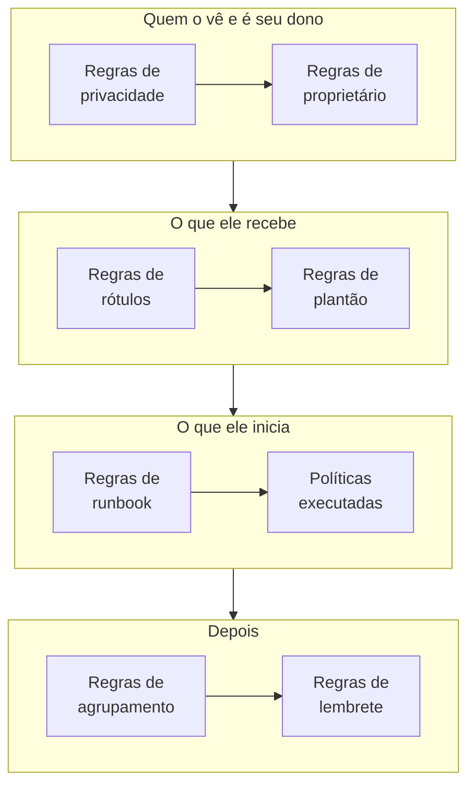

# Regras e configurações de alertas

A configuração dos alertas fica dentro de **Alertas**, não em **Configurações do projeto**: as regras que atuam sobre cada novo alerta e as configurações que dão forma a cada alerta do projeto. Esta página é a referência de cada uma delas, e do que é executado sozinho quando um alerta é criado.

:::cards
- [As regras pelas quais um novo alerta passa](#as-regras-pelas-quais-um-novo-alerta-passa): Em ordem, e o que cada uma faz.
- [Regras de plantão](#regras-de-plantão): Acione as pessoas certas sem escolher uma política a cada vez.
- [Regras de lembrete](#regras-de-lembrete): Lembre os proprietários enquanto um alerta continua aberto.
- [Configurações](#configurações): Modelos de notas, campos personalizados, medições e prefixos de número.
:::

## Onde ficam as configurações de alertas

Abra **Alertas** no menu **Produtos** da barra superior. As seções **Regras** e **Configurações** do menu lateral começam recolhidas, então expanda-as primeiro. Cada página aqui vale para todo o projeto, em endereços que começam com `/dashboard/{projectId}/alerts/settings/`.

| Página de regras             | O que faz                                                                                      |
| ---------------------------- | ---------------------------------------------------------------------------------------------- |
| **Regras de agrupamento**    | Reúne alertas relacionados em episódios. Veja [Episódios de alertas e regras de agrupamento](/docs/alerts/episodes). |
| **Regras de Plantão**        | Executa políticas de plantão para os alertas e episódios correspondentes.                      |
| **Regras de proprietário**   | Adiciona proprietários aos alertas e episódios correspondentes.                                |
| **Regras de runbook**        | Inicia runbooks para os alertas correspondentes.                                               |
| **Regras de privacidade**    | Torna privados os alertas e episódios correspondentes.                                         |
| **Regras de Rótulos**        | Adiciona rótulos aos alertas e episódios correspondentes.                                      |
| **Reminder Rules**           | Lembra os proprietários em intervalos enquanto um alerta está aberto.                          |

A seção **Configurações** contém **Estado do alerta** e **Severidade do alerta**, tratados em [Estados e severidades de alertas](/docs/alerts/states-and-severities), e depois **Modelos de notas**, **Campos personalizados**, **Medições** e **Prefixo do número**, tratados abaixo.

Outras duas seções atuam sobre os alertas. **Alertas → IA → Configurações** decide o que o OneUptime AI faz por conta própria: **Investigar novos alertas**, ativado em projetos novos, e **Corrigir novos alertas automaticamente**, desativado até você ativá-lo. Veja [AI SRE](/docs/ai/ai-sre). **Alertas → Espaço de trabalho** contém as regras do Slack e do Microsoft Teams que publicam alertas e episódios em canais, e sua aba **Summary**. Veja [Slack](/docs/workspace-connections/slack).

## As regras pelas quais um novo alerta passa

As regras diferem na forma como várias correspondências são resolvidas:

- **Regras de agrupamento** e **Reminder Rules** são verificadas de cima para baixo na lista, e a primeira correspondência vence. Arraste uma regra para mudar sua posição; uma regra nova vai para o fim.
- **Regras de Plantão**, **Regras de proprietário**, **Regras de Rótulos**, **Regras de privacidade** e **Regras de runbook** atuam todas quando correspondem. Políticas de plantão, proprietários e rótulos que várias regras adicionam são adicionados uma única vez.

**Regras de Plantão**, **Regras de proprietário**, **Regras de Rótulos** e **Regras de privacidade** têm duas abas: **Alert Rules**, para alertas, e **Episode Rules**, que atuam da mesma forma sobre cada novo episódio de alerta. Uma regra nova começa habilitada; desative **Habilitado** no formulário de edição para pausá-la, e a lista mostra um **Habilitado** verde ou um **Desabilitado** vermelho para cada regra.

A maioria das regras atua sobre alertas e episódios criados depois que você as salva. Para aplicar uma regra de proprietário, de rótulos ou de privacidade aos que você já tem, use **Run Now**: veja [Executar regras em recursos existentes](/docs/configuration/run-rules-now). As regras de lembrete são a exceção: salvar uma faz todos os alertas abertos corresponderem novamente.

### Condições

As condições de uma regra decidem sobre quais alertas ela atua, e se leem como frases: "Se **Título do alerta** contém `database`", "E **Rótulos do Monitor** tem algum de *Production*". Uma regra sem condições corresponde a todo alerta.

| Condição                                                      | Compara com                                                                                                    |
| ------------------------------------------------------------- | -------------------------------------------------------------------------------------------------------------- |
| **Monitores**, **Alerta Severidades**, **Rótulos de alerta**, **Rótulos do Monitor** | **Tem algum de**, **Tem todos os** ou **Não tem nenhum de** os valores que você escolher.         |
| **Título do alerta**, **Descrição do alerta**, **Nome do Monitor**, **Descrição do Monitor** | **Contém**, **Não contém**, **Igual a**, **Diferente de**, **Começa com**, **Termina com**, sem diferenciar maiúsculas, ou **Corresponde ao padrão** e **Não corresponde ao padrão**, para uma expressão regular ou um curinga `*`. |

Com duas ou mais condições, escolha **Corresponder a todas**, em que todas precisam valer, ou **Corresponder a qualquer**, em que uma basta. As regras de episódio correspondem, em vez disso, à gravidade, aos rótulos, ao título e à descrição de um episódio.

## Regras de plantão

**Alertas → Regras → Regras de Plantão** torna os acionamentos automáticos. Cada regra correspondente adiciona suas políticas ao novo alerta, e o alerta as executa junto com as políticas que já tinha, cada uma uma vez.

:::steps
### Dar um nome à regra

Clique em **Criar: Alert On-Call Rule**. Em **Informações básicas**, dê a ela um **Nome**, como "Acionar a equipe de banco de dados para qualquer alerta de BD", e uma **Descrição** se quiser.

### Escolher os alertas

Em **Critérios de Correspondência**, adicione as condições que um alerta precisa atender. Deixe-as vazias para corresponder a todo alerta novo.

### Escolher as políticas

Em **Políticas de plantão**, escolha as **Políticas de plantão** que a regra executa e depois crie a regra.
:::

Uma gravidade sozinha não aciona ninguém: uma regra de plantão que corresponde a **Alerta Severidades** é a forma de configurar "acionar a equipe de banco de dados para cada alerta High". Para ver o que foi executado para um alerta, abra a página **Execuções de plantão** dele. Cada pessoa é então contatada do jeito que configurou em **Configurações do usuário → Regras de Plantão**, na aba **Alertas**; veja [Regras de escalonamento](/docs/on-call/escalation-rules).

## Regras de proprietário e de rótulos

As **Regras de proprietário** adicionam usuários e equipes proprietários aos novos alertas que correspondem, e as **Regras de Rótulos** adicionam rótulos. Criar uma leva duas etapas: **Corresponder**, as condições, e depois **Proprietários** ou **Rótulos**, o que a regra adiciona. O **Nome** da regra acompanha o que você escolhe até você digitar um seu.

- **Uma regra pode herdar.** Recolhidos em **Herdar Proprietários** ou **Herdar Rótulos**, seis interruptores repassam os proprietários ou rótulos do monitor, dos hosts, dos clusters Kubernetes, dos hosts Docker, dos hosts Podman e dos serviços do alerta. As regras de episódio não têm esses interruptores.
- **Uma regra nova precisa adicionar algo**: escolha pelo menos um proprietário ou rótulo, ou ative um interruptor.
- **Notificar proprietários**, em **Mais campos** de uma regra de proprietário, decide se as pessoas adicionadas são avisadas.

[Regras de rótulos e proprietários](/docs/configuration/label-and-owner-rules) explica o formulário passo a passo, para cada tipo de recurso.

## Regras de privacidade e de runbook

As **Regras de privacidade** tornam privados os novos alertas que correspondem, antes que qualquer outra coisa seja executada: só seus proprietários e os administradores e proprietários do projeto podem vê-los. Uma regra tem uma etapa **Informações básicas** e uma etapa **Critérios de Correspondência**, e torna privado todo alerta que corresponde a ela. Veja [Alertas privados](/docs/alerts/index#alertas-privados).

As **Regras de runbook** iniciam um runbook quando um novo alerta corresponde, a menos que o alerta tenha sido criado resolvido. Veja [Regras de runbook](/docs/runbooks/rules).

## Regras de lembrete

**Alertas → Regras → Reminder Rules** lembra os proprietários de um alerta enquanto ele continua aberto. Cada alerta novo recebe a primeira regra que corresponde a ele, de cima para baixo na lista.

:::steps
### Dar um nome à regra de lembrete

Clique em **Criar: Alert Reminder Rule**. Em **Rule Info**, dê a ela um **Nome**, como "Critical Alert Reminders".

### Escolher sobre quais alertas lembrar

Em **Critérios de Correspondência**, escolha as **Alerta Severidades** e os **Rótulos** aos quais ela se aplica. Deixe-os vazios para lembrar sobre todo alerta.

### Definir o intervalo

Em **Reminder Settings**, defina **Reminder Interval (minutes)**, com que frequência os proprietários são lembrados, e **Stop Reminders When**: **Resolvido**, o padrão, ou **Confirmado**. Depois crie a regra.
:::

Os proprietários recebem cada lembrete como **Alert reminder**, que fica ativado por e-mail por padrão. A regra de um alerta volta a corresponder quando sua gravidade ou seus rótulos mudam. Para parar os lembretes de um alerta, desative **Enviar lembretes** na página **Configurações** dele; isso é salvo no momento em que você alterna o interruptor.

## Configurações

### Modelos de notas

**Alertas → Configurações → Modelos de notas** contém textos prontos para notas privadas. O cartão **Modelos de nota privada para alertas** os lista; **Criar: Alerta Nota Modelo** pede um **Nome do modelo**, uma **Descrição do modelo** e a **Nota**. Um modelo é oferecido quando alguém escreve uma nota privada em um alerta ou episódio, e quando confirma ou resolve um, e seu texto pode ser editado antes de ser publicado. Os modelos de notas de alerta são texto simples: ao contrário dos modelos de notas de incidente, eles não preenchem variáveis.

### Campos personalizados

**Alertas → Configurações → Campos personalizados** adiciona seus próprios campos a cada alerta, como um nível de cliente ou uma referência de ticket. Preencha-os na página **Campos personalizados** de um alerta, ou pela API como `customFields`. Um campo pode copiar seu valor de um campo personalizado do monitor em vez de ser digitado: veja [Campos copiados de um monitor](/docs/incidents/settings#campos-copiados-de-um-monitor), que funciona da mesma forma para alertas.

### Medições

**Alertas → Configurações → Medições** mede quanto tempo as coisas levam em cada alerta. Escolha **Tempo até a confirmação** ou **Tempo até a resolução**, ou dois momentos seus, como quando **O alerta é criado** e quando ele entra em um estado que você escolher. Cada medição aparece na página do alerta e nos gráficos como `oneuptime.alert.measurement.<key>`. Veja [Medições](/docs/incidents/settings#medições), que funciona da mesma forma para alertas.

### Prefixo do número

**Alertas → Configurações → Prefixo do número** define o texto antes dos números de alerta e de episódio: `ALT-` e `AE-` em um projeto novo, ou `#` sem nenhum. **Atualizar** abre **Prefixo do número do alerta** e **Prefixo do número do episódio de alerta**, com uma prévia enquanto você digita. Apenas os alertas e episódios criados depois recebem o novo prefixo. As regras de um prefixo estão em [Prefixos de número](/docs/incidents/settings#prefixos-de-número).

> [!NOTE]
> No OneUptime Cloud, os modelos de notas e os campos personalizados exigem o plano **Growth** ou superior.

## Workflows

Cada modelo de alerta tem gatilhos e ações de workflow com o seu nome: **On Create Alert**, **On Update Alert** e **On Delete Alert**, o mesmo para **Alerta Episódio**, **Alerta Estado Linha do tempo** e os demais, e ações como **Create One Alert** e **Update One Alert**. As definições de campos personalizados de alerta são a única exceção: elas não têm gatilhos de workflow. Veja [Visão geral dos workflows](/docs/workflows/index).

## Quem pode alterar isso

Regras, campos personalizados e medições exigem um Project Owner ou Project Admin, ou uma função personalizada com a permissão própria dessa regra. **Alert Member** trabalha com alertas e episódios, suas notas, proprietários e linhas do tempo de estado, e com os modelos de notas, e **Alert Admin** também gerencia os estados e as gravidades de alertas. Veja [Usuários, equipes e permissões](/docs/permissions/index).

## Próximos passos

:::cards
- [Episódios de alertas e regras de agrupamento](/docs/alerts/episodes): As regras de agrupamento, em detalhe.
- [Regras de escalonamento](/docs/on-call/escalation-rules): O que acontece depois que uma regra de plantão executa uma política.
- [Regras de rótulos e proprietários](/docs/configuration/label-and-owner-rules): O formulário de regras, passo a passo.
- [AI SRE](/docs/ai/ai-sre): Investigar e corrigir novos alertas automaticamente.
:::
