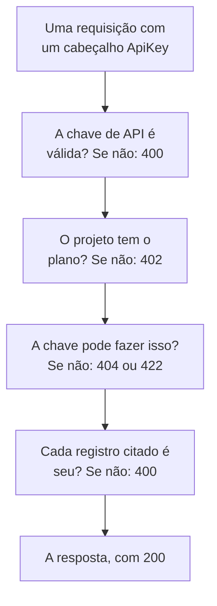

# Referência da API OneUptime

Tudo o que você pode fazer no painel do OneUptime também pode fazer pela sua API REST: automatizar trabalho repetitivo, conectar o OneUptime às suas outras ferramentas ou criar as suas próprias integrações. Esta página mostra como fazer a sua primeira requisição e as regras que toda requisição segue. Cada endpoint e cada campo estão na [referência completa da API](/reference).

:::cards
- [Faça a sua primeira requisição](#faça-a-sua-primeira-requisição): Uma chave de API, um cabeçalho e um comando curl.
- [Requisições e respostas](#requisições-e-respostas): As seis requisições que todo recurso tem e o que cada código de status significa.
- [Os planos e a API](#os-planos-e-a-api): O que um plano vende e o que continua funcionando abaixo dele.
- [Nomear e gravar registros](#nomear-e-gravar-registros): IDs, referências, chaves liga/desliga e os campos que o OneUptime define.
- [Estados e episódios](#estados-e-episódios): O estado em que um registro começa e os que ele percorre.
- [O que uma requisição alcança](#o-que-uma-requisição-alcança): Leituras, alterações e exclusões, um projeto por vez.
:::

## Como uma requisição é respondida

A API é organizada segundo o REST: métodos e códigos de status HTTP padrão, JSON na entrada e na saída. Cada requisição leva uma chave de API e passa por algumas verificações. A primeira verificação em que ela falha responde com um código de status e `{ "message": "..." }`, então a mensagem diz o que a impediu.



## Faça a sua primeira requisição

Todas as requisições à API são autenticadas com uma chave de API. Uma chave pertence a um projeto e faz o que as suas permissões permitem.

:::steps
### Criar uma chave de API

Abra **Configurações do projeto → Avançado → Chaves de API** e clique em **Criar: Chave de API**. Dê a ela um **Nome** e, em **Acesso**, escolha o que ela pode fazer: **Administrador do projeto**, **Membro do projeto**, **Visualizador**, ou **Escolher as permissões depois** para adicionar permissões avulsas na página da chave. A chave expira daqui a um ano, a menos que você escolha outra data em **Avançado**.

### Copiar a chave

A página da chave se abre. Copie a **Chave de API** do cartão **Detalhes da chave de API** e mantenha-a fora do seu código:

```bash
export ONEUPTIME_API_KEY="your-api-key"
```

### Enviar uma requisição

Liste os dez primeiros monitores. A chave lê o próprio projeto, então a requisição não cita nenhum projeto:

```bash
curl -X POST 'https://oneuptime.com/api/monitor/get-list?skip=0&limit=10' \
  -H "ApiKey: $ONEUPTIME_API_KEY" \
  -H 'Content-Type: application/json' \
  -d '{ "select": { "name": true } }'
```

A resposta é `{ "data": [...], "count": ... }`: os monitores e quantos existem no total. Em uma instalação auto-hospedada, use o seu próprio endereço do OneUptime no lugar de `https://oneuptime.com`.
:::

### Exemplos para cada recurso

Cada recurso do painel do OneUptime tem uma seção **Desenvolvedores** no menu lateral, recolhida até você abri-la. A página **API** dela traz comandos `curl` prontos para usar com esse recurso, apontados para o seu OneUptime e preenchidos com dados do seu próprio projeto: ler, alterar e excluir o recurso na página dele, ou listar, contar e criar em uma página de lista (por exemplo **Monitores**). Os comandos leem a sua chave de API da variável de ambiente `ONEUPTIME_API_KEY`.

Os exemplos são escritos para o recurso. Na lista **Incidentes**, por exemplo, a requisição de lista mostra a resposta com o seu primeiro incidente, os filtros encontram incidentes não resolvidos, de uma gravidade, sobre um monitor ou dos últimos sete dias, usando os seus próprios estados, gravidades e monitores, e a requisição de criação declara um incidente com uma das suas gravidades, com uma linha sobre para que serve cada campo. A página de um incidente o lê com a resposta real, o move para outra das suas gravidades e traz as tarefas comuns: reconhecê-lo e resolvê-lo (com os estados do seu projeto) e adicionar notas internas ou públicas. Cada página de API termina com os endpoints do recurso.

## Requisições e respostas

Todo recurso tem as mesmas requisições, em `https://oneuptime.com/api` e no caminho do recurso, como `/monitor` ou `/incident`:

| Requisição | Método e caminho | O que vai no corpo |
| --- | --- | --- |
| Listar | `POST /api/<resource>/get-list` | `query`, `select` e `sort` |
| Contar | `POST /api/<resource>/count` | `query` |
| Ler um | `POST /api/<resource>/<id>/get-item` | `select` |
| Criar | `POST /api/<resource>` | `{ "data": { ... } }` |
| Alterar um | `PUT /api/<resource>/<id>` | `{ "data": { ... } }`, os campos a alterar |
| Excluir um | `DELETE /api/<resource>/<id>` | Nada |

`POST /api/<resource>/<id>/update-item` e `POST /api/<resource>/<id>/delete-item` também alteram e excluem um registro, para clientes que só enviam `POST`.

### Filtrar, ordenar e paginar

Uma lista ou uma contagem recebe uma `query`. Um campo com um valor corresponde a esse valor; um objeto com um `_type` compara:

| `_type` | Corresponde a |
| --- | --- |
| `Search` | Texto que contém `value` |
| `NotEqual` | Tudo menos `value` |
| `GreaterThan`, `LessThan` | Datas posteriores ou números maiores, ou anteriores e menores |
| `InBetween` | Datas ou números entre `startValue` e `endValue` |
| `Includes` | Qualquer um dos valores em `value` |
| `IsNull`, `NotNull` | Nenhum valor, ou qualquer valor |

Um campo de um registro que o recurso cita é filtrado sob a sua relação: `"user": { "name": { "_type": "Search", "value": "ada" } }` encontra os membros da equipe cujo usuário tem um nome que contém “ada”. Filtrar por um campo exige permissão para lê-lo, por uma relação como no próprio recurso: um filtro em um campo que você não pode ler é recusado com um `422` que cita o campo.

Um recurso com proprietários - um monitor, um incidente, uma política de plantão e qualquer outro com proprietários usuários e equipes - também é filtrado por quem o possui, sob `owners`: `"owners": { "_type": "OwnedBy", "userIds": ["..."], "teamIds": ["..."] }` encontra os registros dos quais uma ou mais dessas pessoas e equipes são proprietárias. `match` é `AnyOf`, a menos que você o defina: `NoneOf` encontra os registros dos quais nenhuma delas é proprietária, incluindo os registros sem proprietários, e `AnyOwner` e `NoOwner` encontram os registros com algum proprietário ou sem nenhum, sem citar ninguém. Os membros de uma equipe não são proprietários do que a equipe possui. Um filtro cita no máximo 1.000 pessoas e equipes no total, um recurso sem proprietários o recusa com um `400`, e filtrar por proprietários sem permissão para lê-los é recusado com um `422`.

`select` cita os campos a devolver, e `_id` sempre volta. `sort` os ordena, `ASC` ou `DESC`; sem ordenação, os mais recentes vêm primeiro. Uma lista devolve 10 registros, a menos que você defina `limit`, até 10.000, e `skip` pula essa quantidade antes: continue aumentando `skip` por `limit` até ter `count` deles. Adicione `?output-type=csv` a uma requisição de lista para receber CSV em vez de JSON.

Por exemplo, os monitores cujo nome contém “checkout”, criados desde o início de 2026, os mais recentes primeiro:

```bash
curl -X POST 'https://oneuptime.com/api/monitor/get-list' \
  -H "ApiKey: $ONEUPTIME_API_KEY" \
  -H 'Content-Type: application/json' \
  -d '{
    "query": {
      "name": { "_type": "Search", "value": "checkout" },
      "createdAt": { "_type": "GreaterThan", "value": "2026-01-01T00:00:00.000Z" }
    },
    "select": { "name": true, "createdAt": true },
    "sort": { "createdAt": "DESC" },
    "limit": 100
  }'
```

Datas e IDs que não sejam `_id` voltam embrulhados, como `{ "_type": "DateTime", "value": "..." }` e `{ "_type": "ObjectID", "value": "..." }`: leia-os de `value`.

Cada ID pelo qual uma solicitação filtra ou que ela escreve - `_id`, um campo como `monitorId` e cada registro que uma relação lista, como `"labels": [{ "_id": "..." }]` - é um UUID, enviado como texto ou embrulhado do jeito que volta. Qualquer outra coisa, como um texto que não é um UUID ou um objeto no lugar de um ID, é recusada com um `400` que nomeia o campo e diz se ele estava em `query` ou em `data`, e nada é lido nem escrito:

```text
Invalid ID for "currentIncidentStateId" in the query: "resolved". An ID is a UUID, such as "550e8400-e29b-41d4-a716-446655440000".
```

### Códigos de status

| Código | O que significa | Saiba mais |
| --- | --- | --- |
| `200` | Deu certo. Uma lista ou uma contagem responde com os registros que você pode ler, nenhum quando não há. | [Ler um registro pelo seu ID](#ler-um-registro-pelo-seu-id) |
| `400` | A requisição está errada: a chave de API é inválida, um valor não é permitido, um campo não pode ser gravado, um registro citado não é seu, ou ela altera vários projetos de uma vez. A mensagem diz o que está errado. | [Os registros que uma requisição cita](#os-registros-que-uma-requisição-cita) |
| `402` | O plano do projeto não inclui o que a requisição usa. A mensagem cita o plano. | [Recursos que o seu plano não inclui](#recursos-que-o-seu-plano-não-inclui) |
| `404` | O registro não existe, está em outro projeto ou é um que você não pode ler: a mesma resposta em cada caso. | [Alterar ou excluir um registro que você não pode ler](#alterar-ou-excluir-um-registro-que-você-não-pode-ler) |
| `422` | Você não pode fazer isso: a chave de API não tem permissão para esse tipo de registro, você pode ler o registro mas não alterá-lo, ou os rótulos de uma permissão o deixam de fora. A mensagem diz por quê. | [Alterar ou excluir um registro que você não pode ler](#alterar-ou-excluir-um-registro-que-você-não-pode-ler) |
| `500` | Algo falhou no servidor. Quando o proprietário de um novo registro não pode ser gravado, o registro é removido de novo, então a criação pode ser tentada outra vez. | [Os registros que uma requisição cita](#os-registros-que-uma-requisição-cita) |

## Os planos e a API

### Recursos que o seu plano não inclui

No OneUptime Cloud, alguns recursos são vendidos em um plano: provedores de login único e conexões SCIM no **Scale**; chaves de API, escalas de plantão, e regras de notificação e resumos do Slack e do Microsoft Teams no **Growth**, entre outros. Criar um, alterá-lo ou ativá-lo exige esse plano. Abaixo dele, a requisição é recusada com `402 Payment Required`, e a mensagem cita o plano.

Algumas configurações de um recurso são vendidas em um plano da mesma forma. Por exemplo: uma página de status privada, que oculta uma das suas listas ou que tem HTML, CSS ou JavaScript personalizados, relatórios por e-mail, assinantes de SMS, Slack, Microsoft Teams ou webhook, ou uma lista de IPs permitidos; um painel compartilhado publicamente, ou a sua lista de IPs permitidos; a lista de IPs permitidos de um formulário; os registros de auditoria de um projeto. O guia de cada um, e o painel ao lado da configuração, citam o plano necessário. Uma configuração assim exige o seu plano sempre que é gravada - quando o recurso é criado com ela e quando ela é alterada depois -, então uma criação que ativa uma delas abaixo do plano também é recusada com `402`. Uma configuração deixada no padrão, ou devolvida a ele, funciona em todos os planos: uma criação que não mexe nessas configurações passa, e o mesmo vale para uma configuração do Terraform que não as define.

O que um projeto já tem continua gerenciável seja qual for o plano, por exemplo depois que um período de teste termina ou o plano cai:

- você pode excluir esses registros;
- você pode desativar um, em um recurso com um campo `isEnabled`, enviando `"isEnabled": false` e mais nada;
- você pode listar e ler os que um projeto precisa encontrar depois que o plano cai - para desativá-los, ou para ver o que parou: provedores de login único, conexões SCIM, chaves de API e as suas permissões, escalas de plantão, e regras de notificação e resumos do Slack e do Microsoft Teams.

As permissões de sempre continuam decidindo quem pode fazer cada coisa, exatamente como no plano. Ler os outros recursos que um plano vende, como modelos, campos personalizados, grupos de monitores, registros de plantão e envios de formulários, continua exigindo o plano: lê-los é usar o recurso. As permissões de uma chave de API não são excluídas uma a uma abaixo do **Growth**, porque excluir uma permissão de bloqueio daria mais acesso à chave; exclua a chave em vez disso.

### Chaves de API e SCIM abaixo do plano

No OneUptime Cloud, as chaves de API de um projeto só funcionam enquanto o projeto está no **Growth** ou superior, e as suas conexões SCIM - as do próprio projeto e as das suas páginas de status - só funcionam por completo enquanto ele está no **Scale** ou superior. Quando o projeto fica abaixo desse plano:

- Toda requisição feita com uma das chaves de API do projeto é recusada com `402 Payment Required`, seja qual for o pedido: a API REST e tudo o que a chama com uma chave de API - o Terraform, a CLI `oneuptime`, clientes MCP conectados com uma chave de API, workflows que enviam uma em um cabeçalho de requisição e os seus próprios scripts. A mensagem cita o plano: `API keys need the Growth plan. This project's plan does not include them, so its API keys stopped working. The keys are kept: upgrade the project to Growth in Project Settings > Billing and Invoices > Billing and they work again.`
- As suas conexões SCIM só removem pessoas. Desativar e excluir pessoas, e tirá-las de grupos, continua funcionando, então quem sai ainda perde o acesso; toda requisição SCIM que adicionaria ou alteraria pessoas ou grupos é recusada com `402`, no formato de erro do SCIM, para que o seu provedor de identidade mostre o motivo ([SCIM abaixo do plano Scale](/docs/identity/scim#abaixo-do-plano-scale)).

Nada é excluído ou desativado. As chaves e as conexões são mantidas e voltam a funcionar por completo, como estão, assim que o projeto volta ao plano: nenhuma chave nova para criar, nada para configurar de novo no seu provedor de identidade. Uma mudança de plano entra em vigor em até um minuto.

Abaixo do **Growth**, **Configurações do projeto** > **Avançado** > **Chaves de API** lista as chaves que o projeto ainda tem e diz que elas pararam, então qualquer uma delas pode ser excluída (revogada) em qualquer plano. Criar ou alterar chaves exige o **Growth**. **Configurações do projeto** > **Cobrança e faturas** > **Cobrança** informa quantas chaves de API um plano inferior para e quantas conexões SCIM ele limita, em cada plano que você pode escolher, e o que o plano do projeto parou; os proprietários do projeto recebem um e-mail quando uma mudança de plano as para. Os proprietários de projetos que já estavam abaixo desses planos quando isso começou recebem um único e-mail dizendo o que parou e como reativar.

Só as chaves de API e as conexões SCIM de um projeto são afetadas. As pessoas não: entrar no painel, e os clientes MCP conectados por login, funcionam como antes. Chaves de ingestão de telemetria, chaves de sonda e chaves de agente não são chaves de API e continuam funcionando. As instalações auto-hospedadas não têm planos, então nada muda para elas.

## Nomear e gravar registros

### Encontrar o ID de um recurso

As requisições que leem, alteram ou excluem um recurso o citam pelo seu ID, um UUID. Na página do recurso, o cartão de detalhes termina com uma pequena linha **ID** que mostra o começo do ID: clique no ID, ou no botão de copiar ao lado, para copiar o ID inteiro. As listas que oferecem isso têm **Mostrar ID** no menu **⋯** de uma linha, e o ID também é a última parte do endereço da página. O ID do seu projeto é a primeira coisa no cartão **Detalhes do projeto** em **Configurações do projeto → Projeto**.

### Os registros que uma requisição cita

Muitos recursos citam outros registros: um monitor os seus rótulos e sondas, um assinante de uma página de status a sua página de status, um dispositivo de rede o seu site, um membro de um incidente o incidente e a função. Cada regra abaixo vale igualmente para a API, o Terraform e os workflows:

| Quando uma requisição | ela precisa | Senão |
| --- | --- | --- |
| cita um registro pelo seu ID | citar um registro do seu projeto | `400` |
| cria um registro que é lido por meio de outro, como uma nota | criá-lo sob um que você pode ler | `400`, ou `422` sem permissão para ler esse tipo de registro |
| move um registro para baixo de outro | movê-lo para baixo de um que você pode ler | `400` |
| lista registros, ou cita um em um campo próprio | citar registros que a sua permissão de leitura alcança | `400` |
| cita uma configuração que guarda credenciais | vir de alguém que pode ler esse tipo de configuração | `400` |
| cria ou rerrotula um registro com uma permissão restrita a rótulos | dar ao registro um desses rótulos | `422` |
| cita um registro de duas formas | citar o mesmo registro nas duas vezes | `400` |

#### Todo ID precisa ser do seu projeto

Todo ID que você envia para um registro que um recurso cita precisa ser um registro do seu projeto — os seletores do painel não oferecem outra coisa — e as requisições do Terraform e dos workflows seguem a mesma regra. Um ID de um registro de outro projeto e um ID que não existe são recusados da mesma forma, com um `400` que cita o campo e o ID:

```text
This network device references records that are not in this project: Network Site "…". Please pick values from this project and try again.
```

As pessoas são verificadas pela participação: alguém que não é membro do projeto é recusado da mesma forma. Uma sonda global, que qualquer projeto pode usar, conta como do seu projeto. Alterar um recurso só verifica os IDs que a alteração acrescenta, então um recurso que cita algo que já não existe ainda pode ser salvo.

#### Registros lidos por meio de outro

Um registro lido por meio de outro - as notas e a linha do tempo de estados de um incidente ou de um alerta, os anúncios, domínios e grupos de uma página de status - também precisa citar um que você pode ler, pela regra que a leitura dele segue: um incidente fora dos rótulos ou proprietários que a sua permissão de ler incidentes alcança, com um rótulo que um bloqueio de leitura de incidentes retira, ou marcado como privado sem que você esteja entre os seus proprietários, diretamente ou por uma equipe (os proprietários e administradores do projeto veem todo incidente, alerta e episódio privado), é recusado com o mesmo `400`, e nada é gravado. Cada página de status que um anúncio cita precisa ser uma que você pode ler, e uma chave cuja permissão de ler páginas de status alcança só algumas precisa citar pelo menos uma. Uma permissão para criar um registro assim exige uma para ler o registro sob o qual ele é criado; sem ela, a criação é recusada com um `422` que cita as permissões que a permitiriam:

```text
You do not have permissions to create Incident Internal Note. It is read through its Incident, and you need one of these permissions to read Incidents: …
```

Uma alteração que move um registro assim segue a mesma regra: cada registro que ela acrescenta como pai - outra página de status para um anúncio, outro serviço para um registro lido por meio do seu serviço - precisa ser um que você pode ler, senão a alteração é recusada com o mesmo `400` e nada é gravado. Os pais que um registro já tem não são verificados de novo, e uma alteração que o deixa sem nenhum exige uma permissão de leitura desse tipo de registro que alcance todos eles, como uma criação que não cita nenhum.

#### Proprietários

Os proprietários de um recurso - os registros de proprietários usuários e equipes de um monitor, de uma política de plantão, de um painel e de qualquer outro recurso com proprietários - são lidos por meio do recurso que possuem da mesma forma: listá-los, lê-los, adicioná-los e removê-los exige uma permissão para ler esse recurso, sob os seus rótulos e proprietários, e um registro de proprietário de um recurso que você não pode ler é respondido como se não existisse. Adicioná-los e removê-los também segue o escopo da permissão que o permite: uma com o escopo `Owned` só alcança os proprietários dos recursos dos quais você ou uma das suas equipes são proprietários, e adicionar um proprietário a qualquer outro recurso é recusado com um `422` que diz isso.

#### Registros que uma gravação lista ou cita

Os registros que uma criação ou alteração lista - os monitores e as políticas de plantão de um incidente, os serviços de um alerta, as páginas de status de um evento de manutenção programada, os runbooks de uma regra - respeitam a sua permissão de ler esse tipo de registro quando você tem uma, e em todo caso um bloqueio com rótulos sobre a leitura dele: um que fique de fora é recusado com o mesmo `400`. Uma alteração só verifica os registros que acrescenta a uma lista, então os que a lista já contém permanecem.

O único registro que uma criação ou alteração cita em um campo próprio - o monitor de um alerta, o monitor que um recurso de página de status mostra, o serviço de um orçamento de custos, o incidente a que uma execução de runbook está ligada - segue a mesma regra, com qualquer um dos seus dois nomes: um fora da sua permissão de ler esse tipo de registro, ou com um rótulo que um bloqueio de leitura retira, é recusado com o mesmo `400`. Uma alteração só o verifica quando cita um registro diferente do que o campo já contém. As sondas globais e os agentes de IA do OneUptime, que qualquer projeto pode usar, continuam abertos a todos os projetos. Os registros que um modelo preenche para você são verificados da mesma forma depois de preenchidos, antes de qualquer coisa ser salva: os monitores, as páginas de status e as políticas de plantão que um modelo de incidente acrescenta a um incidente declarado a partir dele precisam ser registros que você pode ler, como se você os tivesse escolhido.

#### Configurações que guardam credenciais

Uma configuração que guarda credenciais - um servidor SMTP, um provedor de chamadas e SMS, credenciais SNMP, uma conexão de videochamada, uma chave de API, um servidor MCP externo - só é citada por quem pode ler esse tipo de configuração: `smtpConfig` e `callSmsConfig` de uma página de status, `projectCallSMSConfig` de uma política de chamadas recebidas, `snmpCredentialProfile` de um dispositivo de rede ou de um site, a conexão de videochamada `videoCallConnection` de um incidente ou alerta, `apiKey` de uma permissão de chave de API e `externalMcpServers` de uma regra de IA. Citar uma sem permissão para ler esse tipo de configuração - ou com uma que um bloqueio sem rótulos retira - é recusado com o mesmo `400`, com qualquer um dos seus dois nomes; uma alteração que mantém a configuração que um registro já cita não é questionada. A busca de números e a lista de números próprios de uma política de chamadas recebidas exigem a mesma leitura da configuração de chamadas e SMS que citam.

#### Rótulos e proprietários na criação

Uma permissão de criação restrita a rótulos só cria registros que tenham um dos seus rótulos - para um registro sem rótulos próprios, registros sob um que tenha um -, a menos que outra permissão para criar esse tipo de registro alcance o projeto inteiro, e um bloqueio com rótulos sobre uma permissão de criação recusa um registro que tenha um dos seus rótulos. Uma criação fora deles é recusada com um `422` que cita os rótulos:

```text
Your access lets you create Status Pages only with one of these labels: Production. Add one of them and try again.
```

Uma permissão de criação com escopo **Owned** cria um monitor, uma página de status ou outro registro com proprietários próprios só para uma pessoa, que se torna um dos seus proprietários, e uma nota ou outro registro que herda os proprietários do registro a que pertence só sob um que você ou uma das suas equipes possuem.

O criador passa a ser proprietário logo depois que o registro é salvo, antes que qualquer outra coisa aconteça com ele. Se a linha do proprietário não puder ser gravada, o registro é removido de novo e a criação é recusada com um `500`, para que não sobre nenhum registro que o seu criador não consiga alcançar.

#### Uma mudança de rótulos

Uma mudança dos rótulos que um registro tem - os seus próprios rótulos ou, para um registro sem rótulos próprios, os registros que ele cita - respeita da mesma forma a sua permissão de alterar esse tipo de registro: com uma restrita a rótulos, o registro mantém pelo menos um deles, a menos que outra permissão para alterá-lo alcance o projeto inteiro, e um bloqueio com rótulos sobre uma permissão de alteração recusa dar a ele um dos seus rótulos. Uma mudança assim é recusada com um `422` que cita os rótulos:

```text
Your access lets you change Monitors only with one of these labels: Production. Keep one of them and try again.
```

#### Citar um registro de duas formas

Um registro pode ser citado de duas formas: pelo seu campo de ID (`monitorId`), ou pela relação (`"monitor": { "_id": "…" }`), que é o que os formulários do painel enviam. Envie uma delas. Se uma requisição enviar as duas, elas precisam citar o mesmo registro: uma requisição em que as duas não coincidem — dois IDs diferentes, ou um ID e um valor vazio — é recusada com um `400` que cita os dois campos:

```text
Conflicting Monitor references were provided. monitorId and monitor are names for the same field and must hold the same value: send only one of them, or the same id in each.
```

Os dois nomes são verificados da mesma forma. As regras sobre o registro que você cita valem com qualquer nome que você usar: o grupo pai de um grupo de página de status precisa estar na mesma página de status, uma página de status aceita no máximo três links de cabeçalho, e o nome de um grupo precisa ser único na sua página de status.

### Chaves liga/desliga

Um campo que está ligado ou desligado - `isEnabled`, `isVisibleOnStatusPage`, `isArchived` e qualquer outro campo `true` ou `false` - recebe `true` ou `false`. Texto e números que o banco de dados lê como um deles são tomados como esse valor, da mesma forma para a API, o Terraform e os workflows: `"true"`, `"yes"`, `"on"`, `"1"` e `1` são `true`, e `"false"`, `"no"`, `"off"`, `"0"` e `0` são `false`, em maiúsculas ou minúsculas. Tudo o que o OneUptime faz com o registro também o trata como esse valor: um evento de manutenção programada enviado com `"isVisibleOnStatusPage": "true"` mostra as suas imagens na página de status, e `"isEnabled": "false"` desativa um recurso abaixo do seu plano como `false` faz. Qualquer outro valor, como `"maybe"`, `""` ou `2`, é recusado com um `400` que cita o campo:

```text
isVisibleOnStatusPage must be true or false.
```

Uma atualização que grava os valores de um registro como eles já estão não muda nada: não inicia os workflows **On Update** do registro, não envia atualizações ao vivo nem adiciona uma entrada ao registro de auditoria. `false` gravado sobre `false` conta como o mesmo valor, assim como `"false"` gravado sobre `false`, um número escrito como texto, um horário escrito como o mesmo instante em outro formato e rótulos escritos como os mesmos rótulos em qualquer ordem. Quando uma atualização altera alguns valores e grava outros de volta como estão, a sua entrada no registro de auditoria lista só os valores que mudaram, e o **Fields to watch** de um workflow só ouve esses.

### Onde um projeto foi comprado

O revendedor, o plano do revendedor e a licença do revendedor de um projeto (`resellerId`, `resellerPlanId`, `resellerLicenseId`, e as relações `reseller` e `resellerPlan`) são definidos só pelo OneUptime: quando um projeto é criado com o código promocional de um revendedor, e quando o revendedor muda o plano. Uma criação ou alteração de um projeto que envie um deles é recusada com um `400` que cita o campo, seja quem for que a envie:

```text
User is not allowed to create on resellerId column of Project. No permission allows it: the column is set by the server, not by a request.
```

### Quem criou um registro

O OneUptime registra quem criou um registro — e quem o arquivou, resolveu, reconheceu ou disparou — a partir da própria requisição: a pessoa que entrou, ou ninguém quando a requisição vem com uma chave de API ou de um workflow. Esses campos (`createdByUserId` e os outros campos que terminam em `ByUserId`, com as suas relações como `createdByUser`) são somente leitura, assim como o momento em que um registro foi arquivado ou resolvido (`archivedAt`, `markedAsResolvedAt`, `markedAsArchivedAt`): ligar `isArchived` ou `isResolved` registra quem fez isso e quando, e desligar apaga os dois. Enviar uma chave liga/desliga como ela já está mantém quem a mudou, e quando.

A referência da API marca esses campos como somente leitura. Um valor que uma requisição envia para um deles junto com outras alterações é ignorado, então o resto da alteração passa; uma atualização que não envia mais nada é recusada com uma mensagem que cita os campos. Os registros que o próprio OneUptime cria em nome de alguém — uma nota publicada pelo Slack ou pelo Microsoft Teams, uma conta criada por um convite — citam essa pessoa.

## Estados e episódios

### O estado em que um novo registro começa

Um incidente, um alerta, um episódio de incidente e um episódio de alerta podem ser criados em qualquer estado do seu projeto, como faz o campo **Estado Inicial** dos seus formulários de criação: envie `currentIncidentStateId` (incidentes e episódios de incidente) ou `currentAlertStateId` (alertas e episódios de alerta), ou a relação. O registro começa nesse estado e a sua linha do tempo de estados começa com ele. Se você o omitir, ele começa no estado de criação do seu projeto, o marcado com `isCreatedState` — ou, para um incidente declarado a partir de um modelo que tem um estado inicial, no do modelo. Um estado de outro projeto é recusado como qualquer outro registro. `current_incident_state_id` e `current_alert_state_id` do Terraform funcionam da mesma forma. Um registro criado no seu estado de reconhecido ou depois dele não aciona ninguém, e um criado já resolvido também não é agrupado, corrigido automaticamente nem investigado pela IA e não ganha canal no Slack ou no Microsoft Teams — veja [Declarado já reconhecido ou resolvido](/docs/incidents/declaring-incidents#declarado-já-confirmado-ou-resolvido).

### Mudar o estado de um registro

O estado de um registro muda por uma linha da sua linha do tempo de estados - `POST /api/incident-state-timeline`, `/api/alert-state-timeline`, `/api/incident-episode-state-timeline`, `/api/alert-episode-state-timeline` ou `/api/scheduled-maintenance-state-timeline` - ou por uma atualização que grava o seu estado atual (`currentIncidentStateId`, `currentAlertStateId`, `currentScheduledMaintenanceStateId`, ou a relação), que registra a mesma linha. De qualquer jeito, uma regra rege a mudança, para um episódio como para um incidente, um alerta ou um evento de manutenção programada: um estado anterior, na ordem do seu projeto, ao estado atual do registro é recusado antes que qualquer coisa seja salva, assim como o estado em que ele já está:

```text
Episode cannot transition to Acknowledged state from Resolved state because Acknowledged is before Resolved in the order of incident states.
```

Um estado definido por engano é corrigido excluindo a linha dele da linha do tempo de estados do registro. Veja [A ordem é uma restrição real](/docs/incidents/states-and-severities#a-ordem-é-uma-restrição-real-não-uma-preferência-de-exibição).

### O episódio em que um incidente ou alerta está

`incidentEpisodeId` de um incidente e `alertEpisodeId` de um alerta — e as suas relações `incidentEpisode` e `alertEpisode` — citam o episódio mais recente a que ele foi adicionado e do qual ainda é membro, ou nada. São somente leitura: o OneUptime os define a partir dos membros do episódio. Para colocar um incidente em um episódio, crie um Incident Episode Member (`POST /api/incident-episode-member` com `incidentEpisodeId` e `incidentId`); para tirá-lo, exclua esse membro, e o incidente passa a citar o episódio mais recente em que ainda está, ou nenhum. Os alertas funcionam da mesma forma por meio de Alert Episode Members (`/api/alert-episode-member`, com `alertEpisodeId` e `alertId`). As regras de agrupamento adicionam incidentes e alertas aos episódios da mesma forma. Uma criação ou atualização de um incidente ou alerta que envie o seu episódio é recusada, seja quem for que a envie — a API, o Terraform, as ferramentas MCP ou um workflow. No Terraform, `incident_episode_id` e `alert_episode_id` podem ser lidos, mas não definidos; os recursos `oneuptime_incident_episode_member` e `oneuptime_alert_episode_member` gerenciam a participação.

## O que uma requisição alcança

### Alterar ou excluir um registro que você não pode ler

Uma alteração ou exclusão só alcança os registros que a chave de API - ou a pessoa que entrou - pode ler. Um registro fora dos seus rótulos ou proprietários, atrás de um bloqueio de leitura, ou lido por meio de outro registro que ela não pode ler (a nota de um incidente, o anúncio de uma página de status) também não pode ser alterado nem excluído. Uma permissão para alterar ou excluir um tipo de registro funciona junto com a permissão para lê-lo, e uma para alterar as notas de um incidente junto com uma para ler incidentes.

Uma requisição que altera ou exclui um registro pelo seu ID - `PUT /api/<resource>/<id>` ou `POST /api/<resource>/<id>/update-item`, `DELETE /api/<resource>/<id>` ou `POST /api/<resource>/<id>/delete-item` - e não alcança nada responde:

- `404` quando o registro não existe, está em outro projeto ou é um que você não pode ler - a mesma resposta em cada caso:

```text
Incident not found.
```

- `422` quando você pode ler o registro mas não alterá-lo ou excluí-lo, com o motivo:

```text
You do not have permission to update this incident.
```

Uma exclusão que não alcançava nada respondia antes `200`. Atualizações e exclusões por consulta, como as etapas de atualizar e excluir de um workflow, respondem com quantos registros alteraram, `0` quando não alcançaram nenhum. O Terraform interpreta um `404` em `terraform destroy` como um recurso que já não existe.

A telemetria segue a mesma regra. Uma exclusão de logs, traces, métricas, exceções, perfis ou gravações de sessão alcança as linhas dos recursos - serviços, hosts, clusters e afins - cuja telemetria você pode tanto ler quanto excluir, e é feita em um projeto por vez: uma requisição em todos os seus projetos é recusada. Uma exclusão de uma linha pelo seu ID que não alcança nada responde `404` ou `422` como acima.

### As alterações são feitas em um projeto por vez

Uma atualização ou exclusão dos registros de um projeto é feita no projeto que a requisição cita: o cabeçalho `tenantid` ou, para uma chave de API, o próprio projeto da chave. Uma atualização ou exclusão de um usuário que entrou que não cita nenhum projeto, ou que pergunta em todos os seus projetos com o cabeçalho `is-multi-tenant-query`, é recusada com `400`:

```text
Changes to incidents are made in one project at a time. Please pass the project ID in the 'tenantid' header.
```

Uma requisição assim falhava antes com `500`. As leituras ainda podem perguntar em todos os seus projetos.

### Ler um registro pelo seu ID

Uma leitura de um registro pelo seu ID - `POST /api/<resource>/<id>/get-item` - responde `404` quando o registro não existe, está em outro projeto ou é um que você não pode ler, a mesma resposta em cada caso:

```text
Incident not found.
```

Antes respondia `200` com um corpo vazio. Uma lista (`get-list`) e uma contagem continuam respondendo `200` com os registros que você pode ler, nenhum quando não há. O provedor do Terraform interpreta um `404` na atualização do estado como um recurso que já não existe e o remove do state, então o próximo plan o cria de novo: dê à chave de API que ele usa as permissões, e os rótulos, para ler cada recurso que ele gerencia. As ferramentas MCP respondem a um `404` com um erro que aponta para a ferramenta de lista correspondente, e a CLI sai com o código `3`.

## A referência completa de endpoints

Cada recurso, endpoint e campo está na [referência da API OneUptime](/reference). Ela está disponível em vários idiomas: o seu idioma vem do seu navegador, e você pode trocá-lo a qualquer momento com o seletor no topo da página.

## Solução de problemas

:::details Toda requisição responde 400 Invalid API Key
O cabeçalho `ApiKey` está vazio, não é uma chave ou cita uma chave que expirou ou foi redefinida. Copie a chave de novo da página dela em **Configurações do projeto → Avançado → Chaves de API**, onde também fica a data em **Expira**.
:::

:::details Toda requisição responde 402 Payment Required
No OneUptime Cloud, as chaves de API só funcionam enquanto o projeto está no plano **Growth** ou superior. As chaves são mantidas e voltam a funcionar como estão assim que o projeto volta ao plano: veja [Chaves de API e SCIM abaixo do plano](#chaves-de-api-e-scim-abaixo-do-plano).
:::

:::details Toda requisição responde 422 You do not have permissions
A chave de API não tem permissão para esse tipo de registro. Uma chave criada com **Escolher as permissões depois** não pode fazer nada até receber uma: abra-a em **Configurações do projeto → Avançado → Chaves de API** e clique em **Adicionar função** ou **Adicionar permissão**. A mensagem cita as permissões que deixariam a requisição passar.
:::

:::details Um registro que vejo no painel responde 404
A chave de API só lê o que as suas permissões, e os rótulos delas, alcançam, e uma chave pode alcançar menos que a sua própria conta. Dê à chave uma permissão que alcance o registro: veja [Ler um registro pelo seu ID](#ler-um-registro-pelo-seu-id).
:::

:::details Uma atualização responde 400 Invalid request body
Uma atualização envia os campos a alterar dentro de `data`, como `{ "data": { "name": "New name" } }`. Um corpo sem isso é recusado, em vez de responder `200` sem alterar nada:

```text
Invalid request body. The update payload should be an object of the form { "data": { ...fields to update... } }.
```
:::

:::details Uma gravação responde 400 e cita um campo e um ID
O ID cita um registro de outro projeto, um que não existe ou um que as suas permissões não alcançam. Veja [Os registros que uma requisição cita](#os-registros-que-uma-requisição-cita).
:::

## Próximos passos

:::cards
- [Usuários, equipes e permissões](/docs/permissions/index): O que as permissões e os rótulos de uma chave de API alcançam.
- [Provedor do Terraform](/docs/terraform/index): Gerenciar os recursos do OneUptime como código, pela mesma API.
- [CLI do OneUptime](/docs/cli/index): Chamar a API do seu terminal e dos seus scripts.
- [Servidor MCP](/docs/ai/mcp-server): Deixar assistentes de IA trabalharem com o seu projeto.
:::
