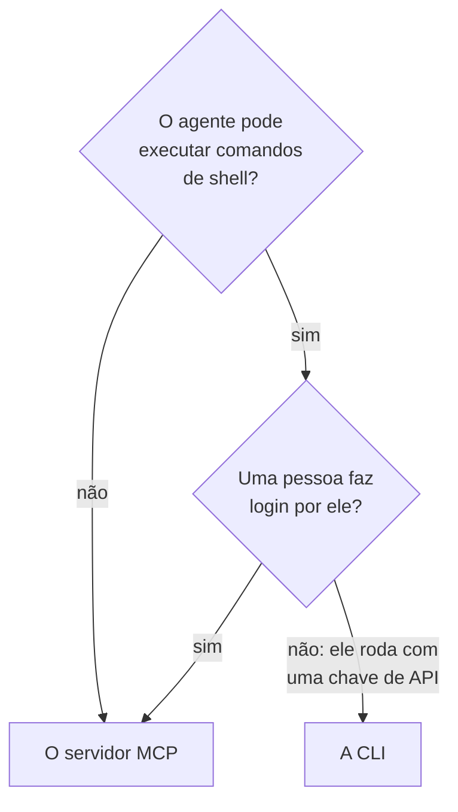

# CLI para agentes de IA

Um agente de IA que pode executar comandos de shell, como um agente de programação no seu editor ou um job do seu pipeline, pode trabalhar com o OneUptime pela CLI em vez do [servidor MCP](/docs/ai/mcp-server). Esta página diz quando cada um se encaixa, e como um agente instala a CLI, se orienta e lê as respostas dela.

:::cards
- [A CLI ou o servidor MCP](#a-cli-ou-o-servidor-mcp): Qual dos dois um agente deve usar.
- [Preparar para um agente](#preparar-para-um-agente): Instale a CLI e dê a ela uma chave no ambiente.
- [Como um agente se orienta](#como-um-agente-se-orienta): Os recursos, os campos deles e a ajuda.
- [Ler as respostas](#ler-as-respostas): JSON de todo comando, incluindo os erros.
:::

## A CLI ou o servidor MCP

Os dois chegam à API do OneUptime e fazem o que as credenciais deles permitem. Eles diferem no que o agente precisa para chegar a eles:



| | A CLI | O servidor MCP |
| --- | --- | --- |
| O agente precisa de | Um shell e Node.js 22 ou posterior | Um cliente MCP, como Claude ou Cursor |
| Faz login com | Uma chave de API do projeto, em `ONEUPTIME_API_KEY` | Sua conta do OneUptime, ou uma chave de API |
| Alcança | Cada recurso da API, 450 e mais | Os registros e a telemetria para os quais tem ferramentas, e ferramentas de resposta a incidentes |
| É indicado para | Scripts que o agente escreve para as pessoas guardarem, verificações em um pipeline e trabalho com muitos registros | Uma conversa: investigar um incidente, configurar um monitor |

Use a CLI quando o agente já executa comandos, como faz um agente de programação, ou quando o que ele constrói deve continuar rodando sem ele: um script em um repositório, uma etapa de um pipeline. Use o servidor MCP quando uma pessoa conversa com o agente em um cliente de chat, para que o agente trabalhe com as permissões dela e o cliente pergunte antes de uma mudança.

## Preparar para um agente

Cada OneUptime serve o script de instalação da CLI da sua própria versão: os comandos abaixo o baixam de `https://oneuptime.com`, então, em um OneUptime auto-hospedado, substitua esse endereço pela sua URL. O script é salvo primeiro como `install.sh`, para que você possa lê-lo antes de executá-lo:

```bash
curl -fsSL https://oneuptime.com/install/cli -o install.sh
ONEUPTIME_URL=https://oneuptime.com bash install.sh
```

Dê ao agente uma chave de API do projeto com apenas o acesso de que o trabalho dele precisa, no ambiente e não na linha de comando, e faça-o verificar a chave primeiro:

```bash
export ONEUPTIME_API_KEY="your-api-key"
export ONEUPTIME_URL=https://oneuptime.com
oneuptime whoami --check -o json
```

Crie a chave em **Configurações do projeto → Avançado → Chaves de API**: veja [Criar uma chave de API](/docs/api-reference/api-reference#criar-uma-chave-de-api). Uma chave que só pode ler deixa o agente olhar, e nada mais.

## Como um agente se orienta

A CLI diz o que sabe fazer, sem chave de API e sem requisição:

| Comando | O que ele responde |
| --- | --- |
| `oneuptime resources -o json` | Cada recurso: o comando, os nomes, o caminho de API, as operações e as ações dele |
| `oneuptime incident fields -o json` | Os campos de um recurso: para que serve cada um, o tipo, se uma criação precisa dele e a flag dele |
| `oneuptime incident create --help` | Os argumentos e as flags de um comando |

Um campo que guarda um ID diz de qual recurso é o ID que recebe, então o agente lista esse recurso primeiro: `incidentSeverityId` recebe um ID de `oneuptime incident-severity list`. Um campo que nomeia uma pessoa também aceita o endereço de e-mail dela, como em `--user-email`.

## Ler as respostas

Faça o agente acrescentar `-o json`, ou `--json`, a todo comando. Todo comando responde então com JSON, incluindo aqueles cuja resposta é uma frase, e um erro é um único objeto JSON na saída de erro padrão:

```bash
oneuptime incident acknowledge 6f1c2a40-3b1e-4c55-9a0b-3e2f8d7c1a11 -o json
```

```json
{
  "_id": "6f1c2a40-3b1e-4c55-9a0b-3e2f8d7c1a11",
  "action": "acknowledge",
  "changed": true,
  "state": {
    "_id": "0b7d5e2c-8f4a-4d1b-9c3e-5a6f7b8c9d0e",
    "name": "Acknowledged"
  }
}
```

O código de saída diz o que aconteceu: `0` quando funcionou, `1` quando falhou, `2` quando a chave de API falta ou é recusada, e `3` quando o registro não existe. O JSON de um erro tem o mesmo código em `exitCode` e, em `hint`, o que fazer em seguida. Veja [Formatos de saída](/docs/cli/output-formats#json) e [Códigos de saída](/docs/cli/scripting#códigos-de-saída).

## Próximos passos

:::cards
- [Operações de recursos](/docs/cli/resource-operations): Cada operação, com as flags e os filtros dela.
- [Referência de comandos](/docs/cli/command-reference): Cada comando, opção e valor padrão.
- [Servidor MCP](/docs/ai/mcp-server): Conecte um cliente de chat ao OneUptime em vez disso.
:::
