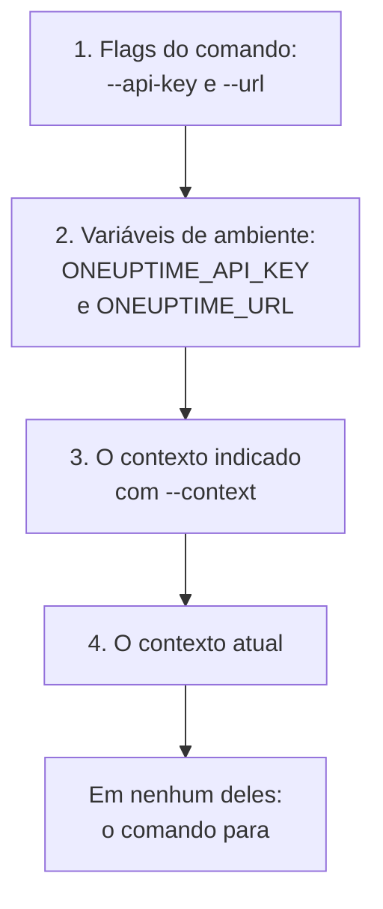

# Autenticação

Cada requisição que a CLI envia leva uma chave de API do seu projeto. Salve as chaves uma vez com `oneuptime login`, um contexto para cada ambiente, ou passe-as a um comando em flags ou variáveis de ambiente, como fazem os scripts. Esta página mostra cada forma, e qual delas um comando usa quando há várias.

:::cards
- [Fazer login](#fazer-login): Salvar uma chave de API e o endereço do seu OneUptime.
- [Contextos](#contextos): Um login salvo para cada projeto ou ambiente, e a troca entre eles.
- [Quais credenciais um comando usa](#quais-credenciais-um-comando-usa): Primeiro as flags, depois as variáveis de ambiente, depois os contextos.
- [Solução de problemas](#solução-de-problemas): Credenciais não encontradas, chaves inválidas e recusas.
:::

## Antes de começar

Você precisa de uma chave de API do seu projeto. Crie uma em **Configurações do projeto → Avançado → Chaves de API** com **Criar: Chave de API**, e dê a ela o acesso de que seus comandos precisam: veja [Criar uma chave de API](/docs/api-reference/api-reference#criar-uma-chave-de-api). Uma chave faz o que suas permissões permitem: uma chave que só pode ler registros pode listá-los e lê-los, mas não alterá-los.

No OneUptime Cloud, as chaves de API só funcionam enquanto o projeto está no plano **Growth** ou superior. Abaixo dele, todo comando responde `API error (402)` com uma mensagem que nomeia o plano, até que o projeto seja atualizado; então a mesma chave volta a funcionar. Veja [Chaves de API e SCIM abaixo do plano](/docs/api-reference/api-reference#chaves-de-api-e-scim-abaixo-do-plano).

## Fazer login

`oneuptime login` salva uma chave de API e o endereço do seu OneUptime como um contexto, e o torna o contexto atual:

```bash
oneuptime login <api-key> <instance-url> [--context-name <name>]
```

| Argumento ou opção | O que é |
| --- | --- |
| `<api-key>` | Uma chave de API do seu projeto |
| `<instance-url>` | O endereço do seu OneUptime: `https://oneuptime.com`, ou o do seu próprio servidor, como `https://oneuptime.example.com` |
| `--context-name <name>` | O nome com que o contexto é salvo. Padrão: `default` |

Por exemplo, um contexto chamado `production`:

```bash
oneuptime login <api-key> https://oneuptime.com --context-name production
```

Ela responde `Logged in successfully. Context "production" is now active.` Uma barra no fim do endereço é removida, e fazer login de novo com o mesmo nome substitui esse contexto.

> [!NOTE]
> O `login` salva a chave sem consultá-la no OneUptime. Execute um comando, como `oneuptime incident count`, para ver que a chave funciona.

## Contextos

Um contexto é um login salvo: um nome, um endereço e uma chave de API. Salve um para cada projeto ou ambiente e depois escolha um para todos os comandos seguintes, ou para um único comando.

:::steps
### Salvar um contexto para cada ambiente

```bash
oneuptime login <production-api-key> https://oneuptime.com --context-name production
oneuptime login <staging-api-key> https://oneuptime.example.com --context-name staging
```

Cada login torna o seu contexto o atual, então agora o atual é `staging`.

### Listá-los

```bash
oneuptime context list
```

```text
┌───┬────────────┬───────────────────────────────┐
│   │ Name       │ URL                           │
├───┼────────────┼───────────────────────────────┤
│   │ production │ https://oneuptime.com         │
├───┼────────────┼───────────────────────────────┤
│ * │ staging    │ https://oneuptime.example.com │
└───┴────────────┴───────────────────────────────┘
```

O `*` marca o contexto atual. As chaves de API nunca são listadas.

### Trocar para outro contexto

```bash
oneuptime context use production
```

Ela responde `Switched to context "production".` e os comandos seguintes o usam.

### Usar um contexto para um único comando

```bash
oneuptime incident list --context staging
```

O contexto atual continua como estava.
:::

| Comando | O que faz |
| --- | --- |
| `oneuptime context list` | Lista os contextos salvos; `*` marca o atual. Com `-o json`, o `name`, o `apiUrl` e o `isCurrent` de cada contexto, nunca a chave dele |
| `oneuptime context use <name>` | Torna atual um contexto salvo |
| `oneuptime context current` | Mostra o nome, a URL e a chave de API do contexto atual, com a chave oculta exceto os quatro primeiros e os quatro últimos caracteres |
| `oneuptime context delete <name>` | Exclui um contexto salvo. Se era o atual, o primeiro contexto restante passa a ser o atual |

## Quais credenciais um comando usa

Um comando precisa de uma chave de API e de uma URL. Ele pega cada uma das duas do primeiro destes lugares que a tiver:



Então você pode combiná-los: por exemplo, uma chave de API de uma variável de ambiente com a URL do contexto atual. Variáveis de ambiente combinam com scripts e jobs de CI, que não têm contextos salvos:

:::tabs
@tab Linux
```bash
export ONEUPTIME_API_KEY=<api-key>
export ONEUPTIME_URL=https://oneuptime.com
oneuptime incident list
```
@tab macOS
```bash
export ONEUPTIME_API_KEY=<api-key>
export ONEUPTIME_URL=https://oneuptime.com
oneuptime incident list
```
@tab Windows
```powershell
$env:ONEUPTIME_API_KEY = "<api-key>"
$env:ONEUPTIME_URL = "https://oneuptime.com"
oneuptime incident list
```
:::

As flags vêm antes de tudo, para um único comando:

```bash
oneuptime --api-key <api-key> --url https://oneuptime.com incident list
```

> [!WARNING]
> Uma chave passada como flag fica no histórico do seu shell, e outros usuários da máquina podem vê-la na lista de processos. Em uma máquina compartilhada, use um contexto ou uma variável de ambiente.

## Verificar o que a CLI vai usar

`oneuptime whoami` mostra a URL e a chave de API que o próximo comando vai usar, e o contexto de onde elas vêm:

```bash
oneuptime whoami
```

```text
URL:     https://oneuptime.com
API Key: 4f1c****0a13
Context: production
```

Só os quatro primeiros e os quatro últimos caracteres da chave são mostrados. A linha `Context` aparece apenas quando a URL e a chave são as do próprio contexto, e não valores que uma flag ou uma variável de ambiente substituiu. O `whoami` lê suas configurações sem chamar o OneUptime: ele mostra o que um comando vai enviar, não se o OneUptime aceita. Sem nada salvo nem definido, ele responde:

```text
Not authenticated. Run `oneuptime login` to authenticate.
```

## O arquivo de configuração

`oneuptime login` salva os contextos em `~/.oneuptime/config.json`, na sua pasta pessoal (`%USERPROFILE%\.oneuptime\config.json` no Windows). A CLI o cria de forma que só o seu usuário possa lê-lo e gravá-lo (modo `0600`):

```json title="~/.oneuptime/config.json"
{
  "currentContext": "production",
  "contexts": {
    "production": {
      "name": "production",
      "apiUrl": "https://oneuptime.com",
      "apiKey": "<api-key>"
    },
    "staging": {
      "name": "staging",
      "apiUrl": "https://oneuptime.example.com",
      "apiKey": "<api-key>"
    }
  }
}
```

O arquivo guarda as chaves de API como elas são: mantenha-o fora de pastas compartilhadas, backups e repositórios. Para sair de um contexto, exclua-o com `oneuptime context delete <name>`; para sair de todos, exclua o arquivo. Uma chave que possa ter vazado continua válida até que você a exclua no OneUptime, em **Configurações do projeto → Avançado → Chaves de API**.

Os formatos de saída e os tamanhos de lista não são salvos aqui: passe `-o` e `--limit` a cada comando.

## Solução de problemas

:::details A mensagem "No credentials found"
`Authentication error: No credentials found.` significa que nenhuma flag, variável de ambiente ou contexto salvo deu ao comando sua chave de API e sua URL. Execute `oneuptime login`, ou defina tanto `ONEUPTIME_API_KEY` quanto `ONEUPTIME_URL`. O comando termina com o código `2`.
:::

:::details A mensagem "API error (400): Invalid API Key"
A chave não é uma chave de API do OneUptime, expirou ou foi redefinida. Copie-a de novo da página dela em **Configurações do projeto → Avançado → Chaves de API**, onde também está a data dela em **Expira**, e faça login de novo com o mesmo nome de contexto. O comando termina com o código `2`.
:::

:::details A mensagem "API error (402): API keys need the Growth plan"
No OneUptime Cloud, o projeto está abaixo do plano **Growth**, então as chaves de API dele pararam de funcionar. Atualize o plano do projeto, e a mesma chave volta a funcionar: nada a mudar na CLI.
:::

:::details A mensagem "API error (422): You do not have permissions"
As permissões da chave não alcançam o que o comando pede. Dê à chave uma função ou uma permissão na página dela em **Configurações do projeto → Avançado → Chaves de API**: a mensagem nomeia as permissões que deixariam a requisição passar.
:::

:::details A mensagem "Context "staging" does not exist"
Nenhum contexto com esse nome está salvo. `oneuptime context list` mostra os nomes que existem.
:::

:::details O whoami mostra outra URL ou outra chave que não as do contexto
Uma variável de ambiente ou uma flag substitui o valor do contexto. `env | grep ONEUPTIME` mostra as variáveis definidas, e `unset ONEUPTIME_API_KEY ONEUPTIME_URL` volta aos seus contextos.
:::

:::details A requisição para o endereço falha
`Error: Request failed to https://...` significa que a CLI não conseguiu alcançar o OneUptime nesse endereço. Verifique a URL com `oneuptime whoami`: é o endereço em que você abre o OneUptime, com `https://`, como `https://oneuptime.com`.
:::

## Próximos passos

:::cards
- [Operações de recursos](/docs/cli/resource-operations): Listar, ler, criar, alterar, excluir e contar registros.
- [Scripts e CI/CD](/docs/cli/scripting): Dar a um pipeline sua chave em variáveis de ambiente.
- [Referência da API OneUptime](/docs/api-reference/api-reference): O que uma chave de API pode fazer, e o que cada resposta significa.
:::
