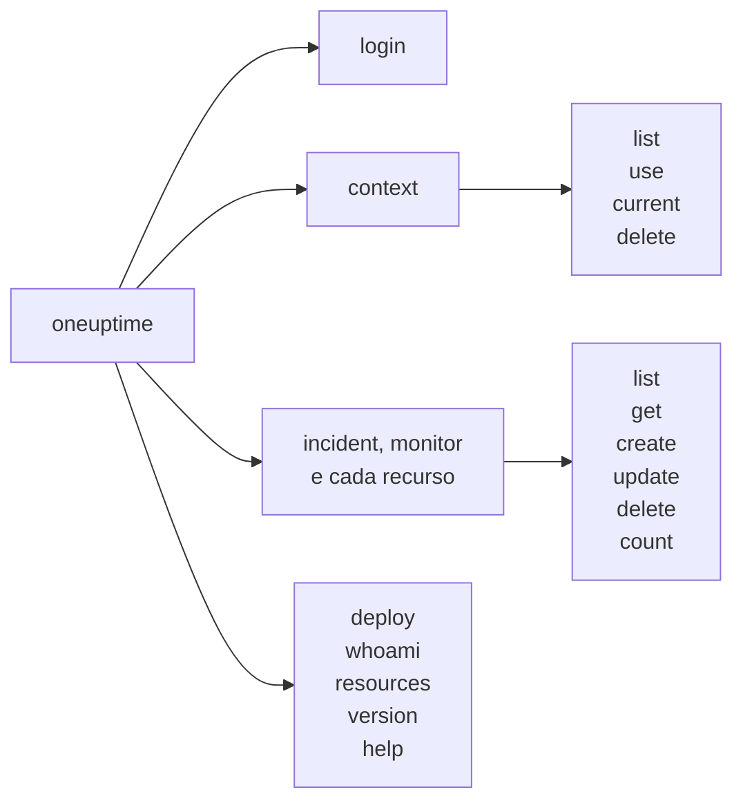

# Referência de comandos

Cada comando da CLI `oneuptime`, com seus argumentos, opções e valores padrão. Adicione `--help` a qualquer comando para ver o mesmo no seu terminal.

:::cards
- [Opções globais](#opções-globais): As opções que todo comando aceita.
- [Login e contextos](#login-e-contextos): login e os comandos context.
- [Comandos de recursos](#comandos-de-recursos): list, get, create, update, delete e count.
- [Outros comandos](#outros-comandos): deploy, whoami, resources, version e help.
:::

## Os comandos



## Opções globais

| Opção | O que faz | Padrão |
| --- | --- | --- |
| `--api-key <key>` | A chave de API para este comando | `ONEUPTIME_API_KEY`, depois a chave do contexto |
| `--url <url>` | O endereço do seu OneUptime para este comando | `ONEUPTIME_URL`, depois a URL do contexto |
| `--context <name>` | O contexto salvo a usar para este comando | O contexto atual |
| `-o, --output <format>` | `json`, `table` ou `wide` | `table` em um terminal, `json` em um pipe |
| `--no-color` | Imprime sem cores | Cores, a menos que `NO_COLOR` esteja definida |
| `-V, --version` | Imprime a versão da CLI | |
| `-h, --help` | Mostra a ajuda de um comando | |

As opções vão antes ou depois do comando: `oneuptime --context staging incident list` e `oneuptime incident list --context staging` fazem o mesmo.

## Login e contextos

### `oneuptime login`

Salva uma chave de API e um endereço como um contexto, e o torna o atual. Veja [Fazer login](/docs/cli/authentication#fazer-login).

```bash
oneuptime login <api-key> <instance-url> [--context-name <name>]
```

| Argumento ou opção | Obrigatório | O que é | Padrão |
| --- | --- | --- | --- |
| `<api-key>` | Sim | Uma chave de API do seu projeto | |
| `<instance-url>` | Sim | O endereço do seu OneUptime, como `https://oneuptime.com` | |
| `--context-name <name>` | Não | O nome com que o contexto é salvo | `default` |

### `oneuptime context list`

Lista os contextos salvos; `*` marca o atual. As chaves de API nunca são listadas.

```bash
oneuptime context list [-o <format>]
```

| Opção | Obrigatório | O que é |
| --- | --- | --- |
| `-o, --output <format>` | Não | `json`, `table` ou `wide`. O JSON dá o `name`, o `apiUrl` e o `isCurrent` de cada contexto |

### `oneuptime context use`

Torna atual um contexto salvo.

```bash
oneuptime context use <name>
```

| Argumento | Obrigatório | O que é |
| --- | --- | --- |
| `<name>` | Sim | O nome de um contexto salvo |

### `oneuptime context current`

Mostra o nome e a URL do contexto atual, e a chave de API dele oculta exceto os quatro primeiros e os quatro últimos caracteres.

```bash
oneuptime context current
```

### `oneuptime context delete`

Exclui um contexto salvo. Se era o atual, o primeiro contexto restante passa a ser o atual.

```bash
oneuptime context delete <name>
```

| Argumento | Obrigatório | O que é |
| --- | --- | --- |
| `<name>` | Sim | O nome de um contexto salvo |

## Comandos de recursos

`<resource>` é o comando de um tipo de registro, das tabelas de [Recursos](#recursos), como `incident` ou `monitor`. Veja [Operações de recursos](/docs/cli/resource-operations) para exemplos.

### `oneuptime <resource> list`

Lista registros, os mais recentes primeiro. Os rótulos, por sua vez, são listados por nome, primeiro os numerados (`2. Team` antes de `10. Owner`).

```bash
oneuptime <resource> list [--query <json>] [--limit <n>] [--skip <n>] [--sort <json>] [-o <format>]
```

| Opção | O que faz | Padrão |
| --- | --- | --- |
| `--query <json>` | Um filtro, em JSON | Todos os registros que a chave pode ler |
| `--limit <n>` | O máximo de registros a retornar, até 10.000 | `10` |
| `--skip <n>` | Quantos registros pular primeiro | `0` |
| `--sort <json>` | A ordem, em JSON: `{"<field>":"ASC"}` ou `{"<field>":"DESC"}` | Os mais recentes primeiro |
| `-o, --output <format>` | `json`, `table` ou `wide` | `table` em um terminal, `json` em um pipe |

### `oneuptime <resource> get`

Lê um registro. Só registros: a telemetria não tem `get`.

```bash
oneuptime <resource> get <id> [-o <format>]
```

| Argumento ou opção | Obrigatório | O que é |
| --- | --- | --- |
| `<id>` | Sim | O ID do registro, um UUID |
| `-o, --output <format>` | Não | `json`, `table` ou `wide` |

### `oneuptime <resource> create`

Cria um registro e o imprime.

```bash
oneuptime <resource> create (--data <json> | --file <path>) [-o <format>]
```

| Opção | Obrigatório | O que é |
| --- | --- | --- |
| `--data <json>` | Uma das duas | O registro, em JSON |
| `--file <path>` | Uma das duas | Um arquivo JSON com o registro. Informado junto com `--data`, o arquivo é usado |
| `-o, --output <format>` | Não | `json`, `table` ou `wide` |

### `oneuptime <resource> update`

Altera os campos que você informar. Só registros: a telemetria não tem `update`.

```bash
oneuptime <resource> update <id> --data <json> [-o <format>]
```

| Argumento ou opção | Obrigatório | O que é |
| --- | --- | --- |
| `<id>` | Sim | O ID do registro |
| `--data <json>` | Sim | Os campos a alterar, em JSON |
| `-o, --output <format>` | Não | `json`, `table` ou `wide` |

### `oneuptime <resource> delete`

Exclui um registro na hora, sem perguntar. Só registros: a telemetria não tem `delete`.

```bash
oneuptime <resource> delete <id> [--force]
```

| Argumento ou opção | Obrigatório | O que é |
| --- | --- | --- |
| `<id>` | Sim | O ID do registro |
| `--force` | Não | Aceita e não muda nada: `delete` nunca pede confirmação |

### `oneuptime <resource> count`

Conta registros e imprime o número.

```bash
oneuptime <resource> count [--query <json>] [-o <format>]
```

| Opção | Obrigatório | O que é |
| --- | --- | --- |
| `--query <json>` | Não | Um filtro, em JSON. Sem ele, todos os registros que a chave pode ler |
| `-o, --output <format>` | Não | `json`, `table` ou `wide` |

### Recursos

Os registros aceitam `list`, `get`, `create`, `update`, `delete` e `count`:

| Área | Comandos |
| --- | --- |
| Monitoramento | `monitor`, `monitor-status`, `monitor-status-event` |
| Incidentes | `incident`, `incident-state`, `incident-severity`, `incident-state-timeline`, `incident-public-note`, `incident-internal-note`, `incident-alert`, `postmortem-status` |
| Alertas | `alert`, `alert-state`, `alert-severity`, `alert-state-timeline`, `alert-internal-note` |
| Páginas de status | `status-page`, `status-page-announcement` |
| Manutenção programada | `scheduled-maintenance-event`, `scheduled-maintenance-state`, `scheduled-maintenance-state-timeline` |
| Equipes e plantão | `team`, `on-call-policy` |
| Segurança | `security-case`, `security-case-evidence`, `security-case-note`, `security-case-priority`, `security-case-status`, `security-case-task`, `security-detection`, `security-playbook` |
| Segurança de dados | `data-store`, `data-store-finding`, `data-store-access-entry`, `data-flow`, `data-security-issue`, `data-security-scan`, `custom-data-type`, `check-setting`, `residency-rule`, `data-security-setting` |
| Rótulos | `label` |

A telemetria aceita `list`, `create` e `count`:

| Área | Comandos |
| --- | --- |
| Observabilidade | `log`, `metric`, `span`, `exception-instance`, `monitor-log` |
| Segurança | `security-event`, `threat-intel-indicator` |
| Mudanças e custos | `change-event`, `kubernetes-cost-allocation` |

A CLI é lançada junto com o OneUptime, então `oneuptime resources` lista os comandos da versão que você instalou.

### Requisições à API

Cada operação é uma requisição à API, com a chave no cabeçalho `APIKey`. `<path>` é o caminho de API do recurso, informado por `oneuptime resources`: `/incident` para `incident`, `/on-call-duty-policy` para `on-call-policy`.

| Operação | Requisição | Corpo |
| --- | --- | --- |
| `list` | `POST /api/<path>/get-list` | `query`, `select`, `skip`, `limit` e `sort` |
| `get` | `POST /api/<path>/<id>/get-item` | `select` |
| `create` | `POST /api/<path>` | `{"data": ...}` |
| `update` | `PUT /api/<path>/<id>/` | `{"data": ...}` |
| `delete` | `DELETE /api/<path>/<id>/` | Nenhum |
| `count` | `POST /api/<path>/count` | `query` |

## Outros comandos

### `oneuptime deploy`

Registra um deploy, ou outra alteração, a partir de um pipeline: ele aparece nos gráficos do serviço e é lido pela OneUptime AI quando ela investiga um incidente. Ele grava com uma chave de ingestão de telemetria, não com uma chave de API. Veja [Deploys e alterações](/docs/telemetry/change-events).

```bash
oneuptime deploy [--service <name>] [--service-version <version>] [--previous-version <version>] [--commit <sha>] [--repository <url>] [--branch <name>] [--pull-request <number>] [--environment <name>] [--title <title>] [--description <text>] [--type <type>] [--time <time>] [--attribute <key=value...>] [--ingestion-key <key>]
```

| Opção | Obrigatório | O que é | Padrão |
| --- | --- | --- | --- |
| `--service <name>` | Não | O serviço que recebeu o deploy | Uma alteração do projeto inteiro |
| `--service-version <version>` | Não | A versão implantada | |
| `--previous-version <version>` | Não | A versão que ela substituiu | |
| `--commit <sha>` | Não | O commit implantado | |
| `--repository <url>` | Não | O repositório em que o commit está | |
| `--branch <name>` | Não | A branch implantada | |
| `--pull-request <number>` | Não | O pull request implantado | |
| `--environment <name>` | Não | O ambiente em que foi feito o deploy | |
| `--title <title>` | Não | O título da alteração; um tipo que não seja deploy precisa de um | `Deploy <version>` |
| `--description <text>` | Não | Detalhes da alteração | |
| `--type <type>` | Não | O tipo de alteração, como `config-change` ou `rollback` | `deployment` |
| `--time <time>` | Não | Quando aconteceu, como `2026-10-19T10:00:00Z` | Agora |
| `--attribute <key=value...>` | Não | Mais atributos, como `key=value`, um ou mais | |
| `--ingestion-key <key>` | Não | Uma chave de ingestão de telemetria do projeto | `ONEUPTIME_TELEMETRY_INGESTION_KEY` |

### `oneuptime whoami`

Mostra a URL e a chave de API que o próximo comando vai usar, com a chave mascarada, e o contexto de onde elas vêm. Ele não chama o OneUptime. Veja [Verificar o que a CLI vai usar](/docs/cli/authentication#verificar-o-que-a-cli-vai-usar).

```bash
oneuptime whoami
```

### `oneuptime resources`

Lista cada tipo de registro para o qual a CLI tem um comando: o comando, os nomes no singular e no plural, o tipo e o caminho de API dele, e o total.

```bash
oneuptime resources [--type <type>] [-o <format>]
```

| Opção | Obrigatório | O que é | Padrão |
| --- | --- | --- | --- |
| `--type <type>` | Não | `database` para registros, `analytics` para telemetria | Ambos |
| `-o, --output <format>` | Não | `json`, `table` ou `wide`. O JSON dá o `name`, o `singularName`, o `pluralName`, o `modelType` e o `apiPath` de cada um | `table` em um terminal, `json` em um pipe |

### `oneuptime version`

Imprime a versão da CLI, como faz `oneuptime --version`.

```bash
oneuptime version
```

### `oneuptime help`

Mostra a ajuda da CLI, ou a de um comando.

```bash
oneuptime help [command]
```

## Variáveis de ambiente

| Variável | O que faz |
| --- | --- |
| `ONEUPTIME_API_KEY` | A chave de API, quando nenhuma flag `--api-key` informa uma |
| `ONEUPTIME_URL` | O endereço do seu OneUptime, quando nenhuma flag `--url` informa um |
| `ONEUPTIME_TELEMETRY_INGESTION_KEY` | A chave de ingestão de telemetria com que `oneuptime deploy` grava, quando nenhuma flag `--ingestion-key` informa uma |
| `NO_COLOR` | Definida com qualquer valor, desativa as cores |

## Arquivos

| Arquivo | O que contém |
| --- | --- |
| `~/.oneuptime/config.json` | Os contextos salvos, as chaves de API deles e o contexto atual |

## Códigos de saída

| Código | Significado |
| --- | --- |
| `0` | Funcionou |
| `1` | Falhou: o OneUptime recusou a requisição, ou o comando estava errado |
| `2` | Nenhuma chave de API utilizável: nenhuma encontrada, inválida ou abaixo do seu plano |
| `3` | Não encontrado: o OneUptime respondeu `404` |

Veja [Códigos de saída](/docs/cli/scripting#códigos-de-saída) para exemplos.

## Próximos passos

:::cards
- [Visão geral da CLI](/docs/cli/index): Instalar a CLI e executar seus primeiros comandos.
- [Operações de recursos](/docs/cli/resource-operations): Exemplos de cada operação.
- [Scripts e CI/CD](/docs/cli/scripting): A CLI em scripts e pipelines.
:::
