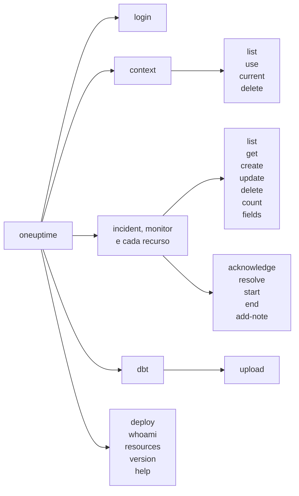

# Referência de comandos

Cada comando da CLI `oneuptime`, com seus argumentos, opções e valores padrão. Adicione `--help` a qualquer comando para ver o mesmo no seu terminal.

:::cards
- [Opções globais](#opções-globais): As opções que todo comando aceita.
- [Login e contextos](#login-e-contextos): login e os comandos context.
- [Comandos de recursos](#comandos-de-recursos): As operações, os campos e as ações de cada recurso.
- [Outros comandos](#outros-comandos): deploy, dbt upload, data-checks apply, whoami, resources, version e help.
:::

## Os comandos



## Opções globais

| Opção | O que faz | Padrão |
| --- | --- | --- |
| `--api-key <key>` | A chave de API para este comando | `ONEUPTIME_API_KEY`, depois a chave do contexto |
| `--url <url>` | O endereço do seu OneUptime para este comando | `ONEUPTIME_URL`, depois a URL do contexto |
| `--context <name>` | O contexto salvo a usar para este comando | O contexto atual |
| `-o, --output <format>` | `json`, `table` ou `wide` | `table` em um terminal, `json` em um pipe |
| `--json` | O mesmo que `-o json` | |
| `--no-color` | Imprime sem cores | Cores, a menos que `NO_COLOR` esteja definida |
| `-V, --version` | Imprime a versão da CLI | |
| `-h, --help` | Mostra a ajuda de um comando | |

As opções vão antes ou depois do comando: `oneuptime --context staging incident list` e `oneuptime incident list --context staging` fazem o mesmo.

Todo comando aceita `-o` e `--json`, então as tabelas abaixo os deixam de fora. Um comando cuja resposta é uma frase, como `delete`, imprime a frase a menos que `-o json` ou `--json` peça JSON: veja [Formatos de saída](/docs/cli/output-formats#json).

## Login e contextos

### `oneuptime login`

Salva uma chave de API e um endereço como um contexto, e o torna o atual. Veja [Fazer login](/docs/cli/authentication#fazer-login).

```bash
oneuptime login <api-key> <instance-url> [--context-name <name>]
```

| Argumento ou opção | Obrigatório | O que é | Padrão |
| --- | --- | --- | --- |
| `<api-key>` | Sim | Uma chave de API do seu projeto | |
| `<instance-url>` | Sim | O endereço do seu OneUptime, como `https://oneuptime.com` | |
| `--context-name <name>` | Não | O nome com que o contexto é salvo | `default` |

### `oneuptime context list`

Lista os contextos salvos; `*` marca o atual. As chaves de API nunca são listadas: o JSON dá de cada contexto `name`, `apiUrl` e `isCurrent`.

```bash
oneuptime context list
```

### `oneuptime context use`

Torna atual um contexto salvo.

```bash
oneuptime context use <name>
```

| Argumento | Obrigatório | O que é |
| --- | --- | --- |
| `<name>` | Sim | O nome de um contexto salvo |

### `oneuptime context current`

Mostra o nome e a URL do contexto atual, e a chave de API dele oculta exceto os quatro primeiros e os quatro últimos caracteres.

```bash
oneuptime context current
```

### `oneuptime context delete`

Exclui um contexto salvo. Se era o atual, o primeiro contexto restante passa a ser o atual.

```bash
oneuptime context delete <name>
```

| Argumento | Obrigatório | O que é |
| --- | --- | --- |
| `<name>` | Sim | O nome de um contexto salvo |

## Comandos de recursos

`<resource>` é o comando de um tipo de registro, da tabela de [Recursos](#recursos), como `incident` ou `monitor`. Um recurso tem as operações que a API aceita para ele, a maioria todas as seis, e `oneuptime <resource> --help` lista as dele. Veja [Operações de recursos](/docs/cli/resource-operations) para exemplos.

### `oneuptime <resource> list`

Lista registros, os mais recentes primeiro. Os rótulos, por sua vez, são listados por nome, primeiro os numerados (`2. Team` antes de `10. Owner`).

```bash
oneuptime <resource> list [--query <json>] [--limit <n>] [--skip <n>] [--sort <json>] [--fields <names>] [--all]
```

| Opção | O que faz | Padrão |
| --- | --- | --- |
| `--query <json>` | Um filtro, em JSON | Todos os registros que a chave pode ler |
| `--limit <n>` | O máximo de registros a retornar, até 10.000 | `10` |
| `--skip <n>` | Quantos registros pular primeiro | `0` |
| `--sort <json>` | A ordem, em JSON: `{"<field>":"ASC"}` ou `{"<field>":"DESC"}` | Os mais recentes primeiro |
| `--fields <names>` | Os campos a retornar, separados por vírgulas; um campo de um registro relacionado depois de um ponto, como em `currentIncidentState.name` | Todos os campos que a chave pode ler |
| `--all` | Todos os registros que correspondem, 100 por vez, até 100.000, no lugar de `--limit` e `--skip`. Só registros: a telemetria não tem `--all` | |

### `oneuptime <resource> get`

Lê um registro.

```bash
oneuptime <resource> get <id> [--fields <names>]
```

| Argumento ou opção | Obrigatório | O que é |
| --- | --- | --- |
| `<id>` | Sim | O ID do registro, um UUID |
| `--fields <names>` | Não | Os campos a retornar, separados por vírgulas. Padrão: todos os campos que a chave pode ler |

### `oneuptime <resource> create`

Cria um registro e o imprime.

```bash
oneuptime <resource> create [--<field> <value>]... [--data <json>] [--file <path>]
```

| Opção | Obrigatório | O que é |
| --- | --- | --- |
| `--<field> <value>` | Os campos que uma criação precisa informar | O valor de um campo: `--title <text>`, `--incident-severity-id <id>`, `--labels <ids>`. `oneuptime <resource> create --help` lista essas flags. Só registros |
| `--data <json>` | Não | O registro, como JSON |
| `--file <path>` | Não | Um arquivo JSON com o registro. Informado junto com `--data`, o arquivo é usado |

As flags se aplicam por cima de `--data` ou `--file`. Um campo que nomeia uma pessoa pelo ID de usuário também tem uma flag que a nomeia pelo endereço de e-mail: `--user-email` ao lado de `--user-id`.

### `oneuptime <resource> update`

Altera os campos que você informa.

```bash
oneuptime <resource> update <id> [--<field> <value>]... [--data <json>] [--file <path>]
```

| Argumento ou opção | Obrigatório | O que é |
| --- | --- | --- |
| `<id>` | Sim | O ID do registro |
| `--<field> <value>` | Não | Um campo a alterar: `oneuptime <resource> update --help` lista essas flags. Só registros |
| `--data <json>` | Não | Os campos a alterar, como JSON |
| `--file <path>` | Não | Um arquivo JSON com os campos a alterar. Informado junto com `--data`, o arquivo é usado |

### `oneuptime <resource> delete`

Exclui um registro na hora, sem perguntar.

```bash
oneuptime <resource> delete <id> [--force]
```

| Argumento ou opção | Obrigatório | O que é |
| --- | --- | --- |
| `<id>` | Sim | O ID do registro |
| `--force` | Não | Aceita e não muda nada: `delete` nunca pede confirmação |

### `oneuptime <resource> count`

Conta registros e imprime o número.

```bash
oneuptime <resource> count [--query <json>]
```

| Opção | Obrigatório | O que é |
| --- | --- | --- |
| `--query <json>` | Não | Um filtro, em JSON. Sem ele, todos os registros que a chave pode ler |

### `oneuptime <resource> fields`

Lista os campos do recurso: para que serve cada um, o tipo, se uma criação precisa informá-lo e a flag que o define. Ele os lê da própria CLI, sem chave de API e sem requisição.

```bash
oneuptime <resource> fields
```

### `oneuptime <resource> acknowledge`

Move um incidente, um alerta ou um episódio de um deles para o estado de confirmado do seu projeto, como faz o botão do painel. Um registro já confirmado, ou além disso, fica como está.

```bash
oneuptime <resource> acknowledge <id>
```

| Argumento | Obrigatório | O que é |
| --- | --- | --- |
| `<id>` | Sim | O ID do registro |

### `oneuptime <resource> resolve`

Move um incidente, um alerta ou um episódio de um deles para o estado de resolvido do seu projeto.

```bash
oneuptime <resource> resolve <id>
```

| Argumento | Obrigatório | O que é |
| --- | --- | --- |
| `<id>` | Sim | O ID do registro |

### `oneuptime <resource> start`

Move um evento de manutenção para o estado em andamento do seu projeto.

```bash
oneuptime <resource> start <id>
```

| Argumento | Obrigatório | O que é |
| --- | --- | --- |
| `<id>` | Sim | O ID do evento |

### `oneuptime <resource> end`

Move um evento de manutenção para o estado de encerrado do seu projeto.

```bash
oneuptime <resource> end <id>
```

| Argumento | Obrigatório | O que é |
| --- | --- | --- |
| `<id>` | Sim | O ID do evento |

### `oneuptime <resource> add-note`

Adiciona uma nota a um incidente, um alerta, um episódio de um deles ou um evento de manutenção.

```bash
oneuptime <resource> add-note <id> --note <markdown> [--public]
```

| Argumento ou opção | Obrigatório | O que é |
| --- | --- | --- |
| `<id>` | Sim | O ID do registro |
| `--note <markdown>` | Sim | A nota, em Markdown |
| `--public` | Não | Publica a nota nas páginas de status do registro, onde os assinantes dele são avisados. Só incidentes, os episódios deles e manutenções programadas |

### Recursos

Cada recurso da API do OneUptime é um comando, com as operações que a API aceita para ele, `fields` e as ações dos registros que as têm:

{{CLI_RESOURCE_COMMANDS}}

A CLI é lançada junto com o OneUptime, então `oneuptime resources` lista os comandos da versão que você instalou.

### Requisições à API

Cada operação é uma requisição à API, com a chave no cabeçalho `APIKey`. `<path>` é o caminho de API do recurso, informado por `oneuptime resources`: `/incident` para `incident`, `/on-call-duty-policy` para `on-call-policy`.

| Operação | Requisição | Corpo |
| --- | --- | --- |
| `list` | `POST /api/<path>/get-list` | `query`, `select`, `skip`, `limit` e `sort` |
| `get` | `POST /api/<path>/<id>/get-item` | `select` |
| `create` | `POST /api/<path>` | `{"data": ...}` |
| `update` | `PUT /api/<path>/<id>/` | `{"data": ...}` |
| `delete` | `DELETE /api/<path>/<id>/` | Nenhum |
| `count` | `POST /api/<path>/count` | `query` |

Uma ação lê os estados do seu projeto e o registro, e depois cria uma linha na linha do tempo de estados do registro, como faz o botão do painel: `acknowledge` em um incidente cria um `incident-state-timeline`. `add-note` cria um `incident-internal-note`, ou, com `--public`, um `incident-public-note`. Uma flag de e-mail lista primeiro os membros de equipe do projeto com esse endereço. Quando o OneUptime recusa um campo que a chave não pode ler, uma listagem ou uma leitura pede de novo sem ele.

## Outros comandos

### `oneuptime deploy`

Registra um deploy, ou outra alteração, a partir de um pipeline: ele aparece nos gráficos do serviço e é lido pela OneUptime AI quando ela investiga um incidente. Ele grava com uma chave de ingestão de telemetria, não com uma chave de API. Veja [Deploys e alterações](/docs/telemetry/change-events).

```bash
oneuptime deploy [--service <name>] [--service-version <version>] [--previous-version <version>] [--commit <sha>] [--repository <url>] [--branch <name>] [--pull-request <number>] [--environment <name>] [--title <title>] [--description <text>] [--type <type>] [--time <time>] [--attribute <key=value...>] [--ingestion-key <key>]
```

| Opção | Obrigatório | O que é | Padrão |
| --- | --- | --- | --- |
| `--service <name>` | Não | O serviço que recebeu o deploy | Uma alteração do projeto inteiro |
| `--service-version <version>` | Não | A versão implantada | |
| `--previous-version <version>` | Não | A versão que ela substituiu | |
| `--commit <sha>` | Não | O commit implantado | |
| `--repository <url>` | Não | O repositório em que o commit está | |
| `--branch <name>` | Não | A branch implantada | |
| `--pull-request <number>` | Não | O pull request implantado | |
| `--environment <name>` | Não | O ambiente em que foi feito o deploy | |
| `--title <title>` | Não | O título da alteração; um tipo que não seja deploy precisa de um | `Deploy <version>` |
| `--description <text>` | Não | Detalhes da alteração | |
| `--type <type>` | Não | O tipo de alteração, como `config-change` ou `rollback` | `deployment` |
| `--time <time>` | Não | Quando aconteceu, como `2026-10-19T10:00:00Z` | Agora |
| `--attribute <key=value...>` | Não | Mais atributos, como `key=value`, um ou mais | |
| `--ingestion-key <key>` | Não | Uma chave de ingestão de telemetria do projeto | `ONEUPTIME_TELEMETRY_INGESTION_KEY` |

### `oneuptime dbt upload`

Envia os artefatos de um projeto dbt depois de um build, a partir da CI ou de um job do dbt Cloud, para a Observabilidade de dados. Os modelos do projeto aparecem nas tabelas que eles constroem, com a sua linhagem, os testes aparecem ao lado das verificações do OneUptime e podem gerar alertas, e cada build é uma execução do pipeline do projeto. Ele lê `manifest.json` e `run_results.json` da pasta de destino do dbt, envia só o que a Observabilidade de dados lê deles e grava com uma chave de ingestão de telemetria, não com uma chave de API. A página Documentação da Observabilidade de dados, no seu painel, mostra o comando em um job de CI.

```bash
oneuptime dbt upload [--target-path <dir>] [--manifest <file>] [--run-results <file>] [--project <name>] [--ingestion-key <key>]
```

| Opção | Obrigatório | O que é | Padrão |
| --- | --- | --- | --- |
| `--target-path <dir>` | Não | A pasta em que o dbt gravou os seus artefatos | `target` |
| `--manifest <file>` | Não | O manifesto a enviar | `manifest.json` na pasta de destino |
| `--run-results <file>` | Não | Os resultados da execução a enviar | `run_results.json` na pasta de destino |
| `--project <name>` | Não | O nome do projeto dbt, necessário só quando nenhum manifesto é enviado | O projeto do manifesto |
| `--ingestion-key <key>` | Não | Uma chave de ingestão de telemetria do projeto | `ONEUPTIME_TELEMETRY_INGESTION_KEY` |

### `oneuptime data-checks apply`

Faz as verificações de dados do projeto corresponderem a um arquivo YAML, para que fiquem em um repositório e sejam revisadas como código. Um erro em qualquer parte do arquivo não aplica nada e termina com um erro. O formato do arquivo está em [Verificações e reconciliações](/docs/data-observability/checks).

```bash
oneuptime data-checks apply <file> [--dry-run] [--prune]
```

| Opção | Obrigatório | O que é | Padrão |
| --- | --- | --- | --- |
| `--dry-run` | Não | Diz o que mudaria, e não muda nada | Desativado |
| `--prune` | Não | Exclui as verificações que uma aplicação anterior criou e que o arquivo não cita mais | Desativado |

### `oneuptime whoami`

Mostra a URL e a chave de API que o próximo comando vai usar, com a chave mascarada, e o contexto de onde elas vêm. Sem `--check`, ele não chama o OneUptime. Veja [Verificar o que a CLI vai usar](/docs/cli/authentication#verificar-o-que-a-cli-vai-usar).

```bash
oneuptime whoami [--check]
```

| Opção | Obrigatório | O que é |
| --- | --- | --- |
| `--check` | Não | Pergunta ao OneUptime se ele aceita a chave, e mostra o projeto da chave, a versão do seu OneUptime e a da CLI |

### `oneuptime resources`

Lista cada tipo de registro para o qual a CLI tem um comando: o comando, os nomes no singular e no plural, o tipo e o caminho de API, e o total. O JSON dá de cada um `name`, `singularName`, `pluralName`, `modelType`, `apiPath`, `operations` e `actions`.

```bash
oneuptime resources [--type <type>]
```

| Opção | Obrigatório | O que é | Padrão |
| --- | --- | --- | --- |
| `--type <type>` | Não | `database` para registros, `analytics` para telemetria | Ambos |

### `oneuptime version`

Imprime a versão da CLI, como faz `oneuptime --version`.

```bash
oneuptime version
```

### `oneuptime help`

Mostra a ajuda da CLI, ou a de um comando.

```bash
oneuptime help [command]
```

## Variáveis de ambiente

| Variável | O que faz |
| --- | --- |
| `ONEUPTIME_API_KEY` | A chave de API, quando nenhuma flag `--api-key` informa uma |
| `ONEUPTIME_URL` | O endereço do seu OneUptime, quando nenhuma flag `--url` informa um |
| `ONEUPTIME_TELEMETRY_INGESTION_KEY` | A chave de ingestão de telemetria com que `oneuptime deploy` grava, quando nenhuma flag `--ingestion-key` informa uma |
| `NO_COLOR` | Definida com qualquer valor, desativa as cores |

## Arquivos

| Arquivo | O que contém |
| --- | --- |
| `~/.oneuptime/config.json` | Os contextos salvos, as chaves de API deles e o contexto atual |

## Códigos de saída

| Código | Significado |
| --- | --- |
| `0` | Funcionou |
| `1` | Falhou: o OneUptime recusou a requisição, ou o comando estava errado |
| `2` | Nenhuma chave de API utilizável: nenhuma encontrada, inválida ou abaixo do seu plano |
| `3` | Não encontrado: o OneUptime respondeu `404` |

Veja [Códigos de saída](/docs/cli/scripting#códigos-de-saída) para exemplos.

## Próximos passos

:::cards
- [Visão geral da CLI](/docs/cli/index): Instalar a CLI e executar seus primeiros comandos.
- [Operações de recursos](/docs/cli/resource-operations): Exemplos de cada operação.
- [Scripts e CI/CD](/docs/cli/scripting): A CLI em scripts e pipelines.
:::
