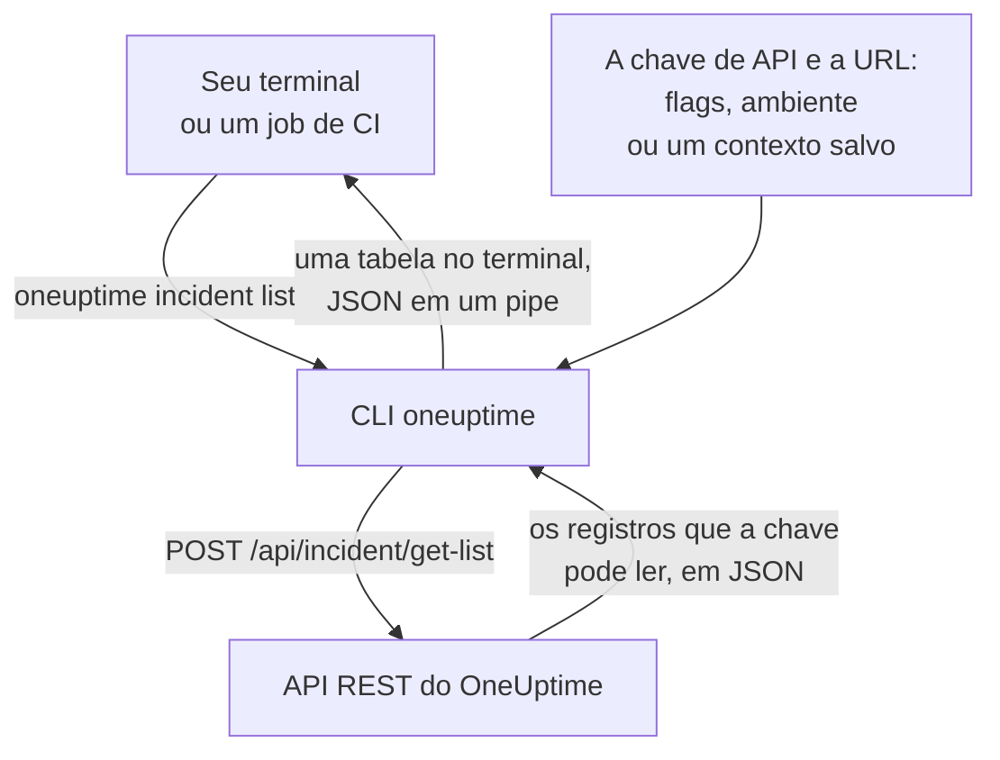

# Visão geral da CLI

A CLI do OneUptime, `oneuptime`, gerencia o seu projeto do OneUptime a partir de um terminal ou de um script. Ela lista, lê, cria, altera, exclui e conta monitores, incidentes, alertas, páginas de status e os outros registros que a API do OneUptime oferece, com uma chave de API do seu projeto.

:::cards
- [Como a CLI funciona](#como-a-cli-funciona): Um comando, uma requisição à API, uma resposta.
- [Instalar a CLI](#instalar-a-cli): Um comando npm, e a versão a escolher.
- [Executar seus primeiros comandos](#executar-seus-primeiros-comandos): Salve sua chave de API e depois liste seus incidentes.
- [Os comandos em resumo](#os-comandos-em-resumo): Cada comando, e a página que o explica.
:::

## Como a CLI funciona

Cada comando envia uma requisição à API REST do OneUptime e imprime a resposta. A CLI pega a chave de API e o endereço do seu OneUptime de flags, variáveis de ambiente ou de um contexto que o `oneuptime login` salvou. A chave decide o que um comando pode ler e alterar, exatamente como na API.



Os comandos dos registros vêm com a CLI: cada tipo de registro que a API do OneUptime abre para ferramentas tem um, os mesmos registros para os quais o [servidor MCP](/docs/ai/mcp-server) tem ferramentas. Execute `oneuptime resources` para listá-los.

## Antes de começar

- **Node.js e npm**, em uma versão LTS atual, para instalar a CLI.
- **Uma chave de API do seu projeto.** Crie uma em **Configurações do projeto → Avançado → Chaves de API** com **Criar: Chave de API**: veja [Criar uma chave de API](/docs/api-reference/api-reference#criar-uma-chave-de-api).
- **No OneUptime Cloud, o plano Growth ou superior.** As chaves de API de um projeto só funcionam nele: veja [Chaves de API e SCIM abaixo do plano](/docs/api-reference/api-reference#chaves-de-api-e-scim-abaixo-do-plano).

## Instalar a CLI

Instale o pacote `@oneuptime/cli` pelo npm. Ele adiciona o comando `oneuptime`, e `--version` imprime a versão instalada:

```bash
npm install -g @oneuptime/cli
oneuptime --version
```

A CLI é lançada junto com o OneUptime e tem o mesmo número de versão. Em um OneUptime auto-hospedado, instale a CLI da versão do seu OneUptime, para que os comandos dela correspondam aos registros do seu servidor:

```bash
npm install -g @oneuptime/cli@<your-oneuptime-version>
```

> [!WARNING]
> As versões da CLI anteriores à 14.0.64 param assim que iniciam, com um erro como `Cannot find module 'Common/Models/DatabaseModels/Index'`. Instale a 14.0.64 ou posterior com `npm install -g @oneuptime/cli@latest`. Em um OneUptime auto-hospedado anterior à 14.0.64, [atualize primeiro o OneUptime](/docs/installation/upgrading#como-atualizar) e depois instale a CLI da versão para a qual atualizou.

## Executar seus primeiros comandos

:::steps
### Salvar sua chave de API

Faça login com a chave e o endereço do seu OneUptime. A CLI os salva como um contexto chamado `default` e o usa a partir de agora:

```bash
oneuptime login <your-api-key> https://oneuptime.com
```

Ela responde `Logged in successfully. Context "default" is now active.` Em um OneUptime auto-hospedado, use o endereço dele no lugar de `https://oneuptime.com`.

### Listar seus incidentes

```bash
oneuptime incident list
```

Os dez incidentes mais recentes aparecem como uma tabela. O `login` salva a chave sem verificá-la, então este é o primeiro comando que mostra que a chave funciona: se ela for recusada, veja [Solução de problemas](/docs/cli/authentication#solução-de-problemas).

### Ver o que mais você pode gerenciar

```bash
oneuptime resources
```

A lista mostra cada tipo de registro com que você pode trabalhar, e o comando dele, como `monitor`, `status-page` ou `on-call-policy`.
:::

## Os comandos em resumo

| Comando | O que faz | Saiba mais |
| --- | --- | --- |
| `oneuptime login <api-key> <instance-url>` | Salva uma chave de API e um endereço como contexto | [Autenticação](/docs/cli/authentication#fazer-login) |
| `oneuptime context list`, `use`, `current`, `delete` | Lista, troca, mostra e exclui contextos salvos | [Autenticação](/docs/cli/authentication#contextos) |
| `oneuptime whoami` | Mostra a URL e a chave de API que o próximo comando vai usar | [Autenticação](/docs/cli/authentication#verificar-o-que-a-cli-vai-usar) |
| `oneuptime deploy` | Registra um deploy, ou outra alteração, para os gráficos e a OneUptime AI | [Deploys e alterações](/docs/telemetry/change-events) |
| `oneuptime <resource> list`, `get`, `create`, `update`, `delete`, `count` | Trabalha com um tipo de registro | [Operações de recursos](/docs/cli/resource-operations) |
| `oneuptime resources` | Lista os tipos de registro, com seus comandos | [Referência de comandos](/docs/cli/command-reference#oneuptime-resources) |
| `oneuptime version` | Imprime a versão da CLI | [Referência de comandos](/docs/cli/command-reference#oneuptime-version) |
| `oneuptime help [command]` | Mostra a ajuda de um comando | [Obter ajuda](#obter-ajuda) |

## Opções globais

Estas opções funcionam com todos os comandos, antes ou depois deles:

| Opção | O que faz |
| --- | --- |
| `--api-key <key>` | A chave de API para este comando, no lugar da salva |
| `--url <url>` | O endereço do seu OneUptime para este comando |
| `--context <name>` | Um contexto salvo para este comando, no lugar do atual |
| `-o, --output <format>` | `table`, `json` ou `wide`: veja [Formatos de saída](/docs/cli/output-formats) |
| `--no-color` | Imprime sem cores |
| `-V, --version` | Imprime a versão da CLI |
| `-h, --help` | Mostra a ajuda do comando |

## Obter ajuda

Cada comando tem sua própria ajuda, com seus argumentos, opções e valores padrão:

```bash
oneuptime --help
oneuptime help incident
oneuptime incident list --help
```

## Próximos passos

:::cards
- [Autenticação](/docs/cli/authentication): Contextos para cada ambiente, e qual chave um comando usa.
- [Operações de recursos](/docs/cli/resource-operations): Listar, ler, criar, alterar, excluir e contar registros.
- [Formatos de saída](/docs/cli/output-formats): Tabelas para pessoas, JSON para scripts.
- [Scripts e CI/CD](/docs/cli/scripting): Códigos de saída, jq e pipelines.
- [Referência de comandos](/docs/cli/command-reference): Cada comando, opção e valor padrão.
:::
