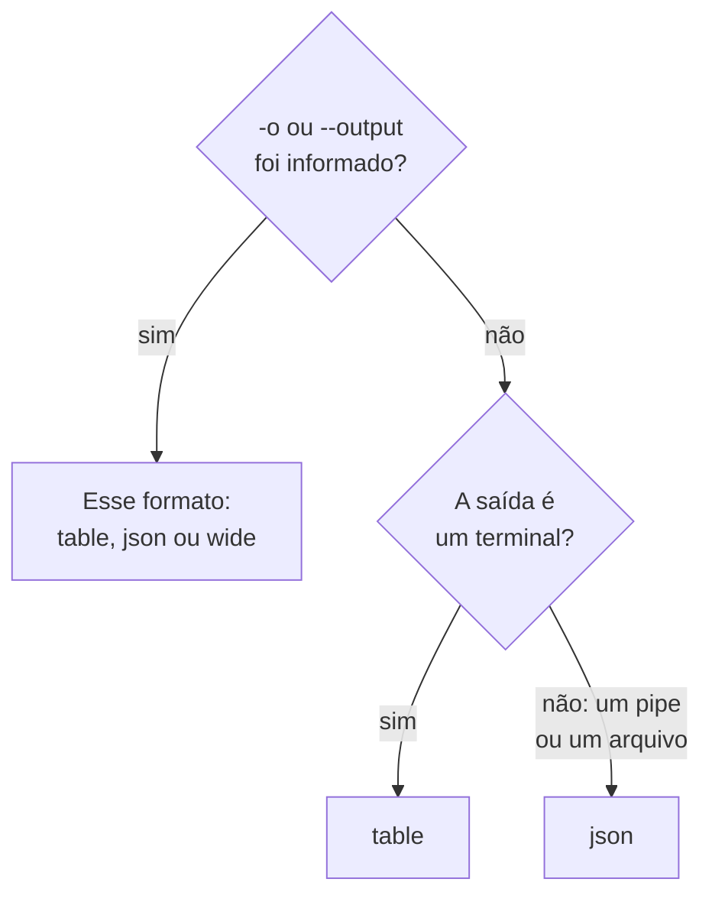

# Formatos de saída

A CLI imprime uma tabela quando você lê a resposta dela em um terminal, e JSON quando um script ou outro programa a lê. Escolha o formato de qualquer comando com `-o` ou `--output`.

:::cards
- [Como o formato é escolhido](#como-o-formato-é-escolhido): Um terminal recebe uma tabela, um pipe recebe JSON.
- [Tabela](#tabela): Seis colunas, cada valor cortado em 60 caracteres.
- [JSON](#json): Cada campo, inteiro, para scripts e jq.
- [Largo](#largo): Uma tabela com todas as colunas.
:::

## Como o formato é escolhido



| Formato | O que imprime | Ideal para |
| --- | --- | --- |
| `table` | Uma tabela de até seis colunas; um único registro como uma linha por campo | Ler em um terminal |
| `json` | A resposta como o OneUptime a enviou, recuada em dois espaços | Scripts, `jq` e arquivos |
| `wide` | Uma tabela com uma coluna para cada campo | Comparar muitos campos de uma vez |

`-o` funciona em todo comando que imprime registros: `list`, `get`, `create`, `update` e `count` de um recurso, `oneuptime resources` e `oneuptime context list`. Ele pode ficar em qualquer lugar da linha de comando. Qualquer outro valor é recusado antes de uma requisição ser enviada:

```text
error: option '-o, --output <format>' argument 'yaml' is invalid. Allowed choices are json, table, wide.
```

## Tabela

A tabela é o padrão em um terminal. `oneuptime resources --type analytics`, por exemplo, imprime esta:

```text
┌────────────────────────────┬────────────────────────────┬─────────────────────────────┬───────────┬─────────────────────────────┐
│ Command                    │ Singular                   │ Plural                      │ Type      │ API Path                    │
├────────────────────────────┼────────────────────────────┼─────────────────────────────┼───────────┼─────────────────────────────┤
│ log                        │ Log                        │ Logs                        │ analytics │ /logs                       │
├────────────────────────────┼────────────────────────────┼─────────────────────────────┼───────────┼─────────────────────────────┤
│ span                       │ Span                       │ Spans                       │ analytics │ /span                       │
├────────────────────────────┼────────────────────────────┼─────────────────────────────┼───────────┼─────────────────────────────┤
│ metric                     │ Metric                     │ Metrics                     │ analytics │ /metrics                    │
├────────────────────────────┼────────────────────────────┼─────────────────────────────┼───────────┼─────────────────────────────┤
│ exception-instance         │ Exception Instance         │ Exception Instances         │ analytics │ /exceptions                 │
├────────────────────────────┼────────────────────────────┼─────────────────────────────┼───────────┼─────────────────────────────┤
│ monitor-log                │ Monitor Log                │ Monitor Logs                │ analytics │ /monitor-log                │
├────────────────────────────┼────────────────────────────┼─────────────────────────────┼───────────┼─────────────────────────────┤
│ kubernetes-cost-allocation │ Kubernetes Cost Allocation │ Kubernetes Cost Allocations │ analytics │ /kubernetes-cost-allocation │
├────────────────────────────┼────────────────────────────┼─────────────────────────────┼───────────┼─────────────────────────────┤
│ security-event             │ Security Event             │ Security Events             │ analytics │ /security-events            │
├────────────────────────────┼────────────────────────────┼─────────────────────────────┼───────────┼─────────────────────────────┤
│ change-event               │ Change Event               │ Change Events               │ analytics │ /change-events              │
├────────────────────────────┼────────────────────────────┼─────────────────────────────┼───────────┼─────────────────────────────┤
│ threat-intel-indicator     │ Threat Intel Indicator     │ Threat Intel Indicators     │ analytics │ /threat-intel-indicators    │
└────────────────────────────┴────────────────────────────┴─────────────────────────────┴───────────┴─────────────────────────────┘

Total: 9 resources
```

Para uma lista de registros, uma tabela mostra até seis colunas: primeiro `_id`, `name`, `title`, `status`, `createdAt` e `updatedAt`, as que os registros tiverem, e depois os próximos campos dos registros, em ordem. As colunas são tiradas do primeiro registro. Um valor com mais de 60 caracteres é cortado nos seus 57 primeiros, seguidos de `...`.

Um único registro, como `get` e `create` o imprimem, é uma tabela de duas colunas: o nome do campo e o valor dele, uma linha por campo.

O OneUptime envia as datas e os IDs de outros registros como objetos, como `{"_type":"DateTime","value":"2026-10-14T09:12:44.000Z"}`, e uma tabela os mostra como esse texto. O valor deles está em `value`: veja [JSON](#json).

## JSON

JSON é a resposta como o OneUptime a enviou, recuada em dois espaços: uma lista é um array de registros, e um único registro é um objeto.

```bash
oneuptime incident list --limit 1 -o json
```

```json
[
  {
    "_id": "6f1c2a40-3b1e-4c55-9a0b-3e2f8d7c1a11",
    "createdAt": {
      "_type": "DateTime",
      "value": "2026-10-14T09:12:44.000Z"
    },
    "title": "Checkout API is down",
    "currentIncidentStateId": {
      "_type": "ObjectID",
      "value": "0b7d5e2c-8f4a-4d1b-9c3e-5a6f7b8c9d0e"
    }
  }
]
```

Um registro tem cada campo que a chave pode ler; este foi reduzido a quatro. O `_id` do próprio registro é texto, e os outros IDs e as datas são objetos cujo `value` os contém:

```bash
oneuptime incident list -o json | jq -r '.[] | "\(.createdAt.value)  \(.title)"'
```

Quando a saída não é um terminal, como em `oneuptime incident list | jq '.[].title'`, a CLI imprime JSON sem `-o json`. Escreva `-o json` nos scripts mesmo assim, para que eles não dependam disso.

## Largo

`-o wide` é uma tabela com uma coluna para cada campo dos registros. Cada valor continua cortado em 60 caracteres, e os registros têm muitos campos, então uma tabela larga é muito larga: percorra-a com `less -S`.

```bash
oneuptime incident list -o wide | less -S
```

## Cores

Os cabeçalhos das tabelas são ciano; as mensagens são verdes quando algo funcionou, azuis para informações e vermelhas para erros. Desative as cores com `--no-color`, ou definindo `NO_COLOR` com qualquer valor:

```bash
oneuptime incident list --no-color
NO_COLOR=1 oneuptime incident list
```

## O que cada comando imprime

Registros e contagens vão para a saída padrão, e os erros para a saída de erro padrão, então um pipe lê só a resposta.

| Comando | Em uma tabela | Em JSON |
| --- | --- | --- |
| Um `list` que não encontra nada | `No results found.` | `[]` |
| Um `get` ou um `create` | Uma linha por campo | O registro |
| Um `count` | O número | O número |
| Um `update` | Uma linha vazia | `{}` |
| Um `delete` | `Monitor <id> deleted successfully.` | A mesma linha |

## Próximos passos

:::cards
- [Scripts e CI/CD](/docs/cli/scripting): Ler o JSON com jq em scripts e pipelines.
- [Operações de recursos](/docs/cli/resource-operations): As operações das quais estas são as respostas.
- [Referência de comandos](/docs/cli/command-reference): Cada comando e cada opção.
:::
