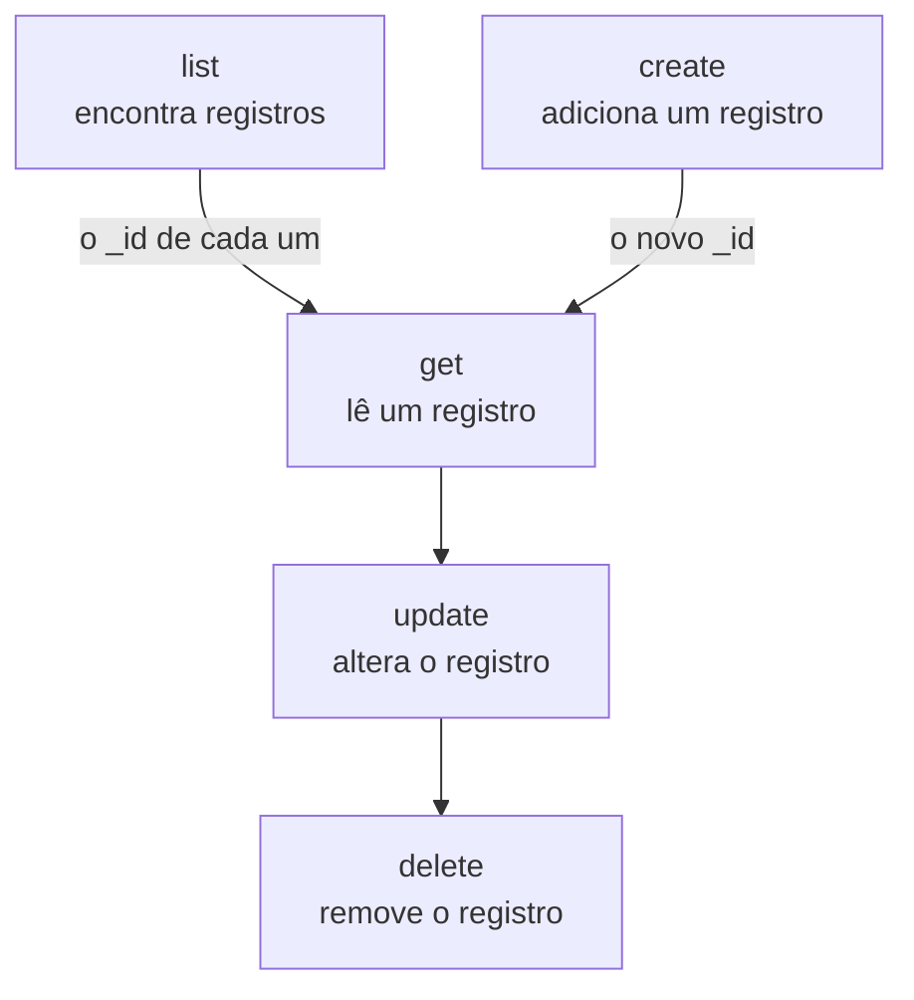

# Operações de recursos

Cada tipo de registro é um comando próprio, como `incident`, `monitor` ou `status-page`, e cada um aceita as mesmas operações: `list`, `get`, `create`, `update`, `delete` e `count`. Esta página mostra cada operação, com filtros, paginação e o JSON em que um registro é escrito.

:::cards
- [Encontrar o comando de um registro](#encontrar-o-comando-de-um-registro): oneuptime resources lista todos eles.
- [Listar registros](#listar-registros): Filtrar, ordenar e paginar.
- [Criar um registro](#criar-um-registro): A partir de JSON na linha de comando ou em um arquivo.
- [Excluir um registro](#excluir-um-registro): Na hora, sem desfazer.
:::

## Como as operações se encaixam

Ler, alterar e excluir um registro precisam do ID dele. Listar, contar e criar não precisam de nenhum, e uma listagem ou uma criação dão a você os IDs que as outras usam:



Um ID é um UUID, como `6f1c2a40-3b1e-4c55-9a0b-3e2f8d7c1a11`. Você também pode copiar um da página do registro no OneUptime: veja [Encontrar o ID de um recurso](/docs/api-reference/api-reference#encontrar-o-id-de-um-recurso).

## Encontrar o comando de um registro

```bash
oneuptime resources
```

A lista mostra cada tipo de registro com o comando, os nomes, o tipo e o caminho de API dele. Há dois tipos:

| Tipo | O que contém | Operações |
| --- | --- | --- |
| `database` | Registros que você gerencia: monitores, incidentes, alertas, páginas de status, equipes e mais | `list`, `get`, `create`, `update`, `delete`, `count` |
| `analytics` | Telemetria: logs, spans, métricas, exceções e outros eventos | `list`, `create`, `count` |

Mostre um só tipo com `oneuptime resources --type database` ou `--type analytics`. A [Referência de comandos](/docs/cli/command-reference#recursos) lista todos os comandos.

## Listar registros

```bash
oneuptime <resource> list [--query <json>] [--limit <n>] [--skip <n>] [--sort <json>] [-o <format>]
```

| Opção | O que faz | Padrão |
| --- | --- | --- |
| `--query <json>` | Retorna só os registros que correspondem: veja [Filtrar uma lista](#filtrar-uma-lista) | Todos os registros que a chave pode ler |
| `--limit <n>` | O máximo de registros a retornar, até 10.000 | `10` |
| `--skip <n>` | Quantos registros correspondentes pular primeiro | `0` |
| `--sort <json>` | A ordem, como `{"createdAt":"ASC"}`, ou `"DESC"` para os mais recentes primeiro | Os mais recentes primeiro |
| `-o, --output <format>` | `table`, `json` ou `wide` | `table` em um terminal, `json` em um pipe |

```bash
# The ten newest incidents
oneuptime incident list

# The oldest monitors first, 50 at a time: the second page
oneuptime monitor list --sort '{"createdAt":"ASC"}' --limit 50 --skip 50

# Every field of each incident, as JSON
oneuptime incident list -o json
```

Uma listagem pede ao OneUptime cada campo de cada registro que a chave pode ler. Uma tabela mostra seis deles; o JSON mostra todos (veja [Formatos de saída](/docs/cli/output-formats)). Para percorrer todos os registros, aumente `--skip` em `--limit` até que uma página volte vazia; `count` diz quantos são.

### Filtrar uma lista

`--query` aceita o mesmo filtro da API: um campo com um valor corresponde a esse valor, e um objeto com um `_type` compara.

| Filtro | Corresponde a |
| --- | --- |
| `{"title":"Checkout API is down"}` | Registros com exatamente esse valor |
| `{"title":{"_type":"Search","value":"checkout"}}` | Texto que contém o valor |
| `{"createdAt":{"_type":"GreaterThan","value":"2026-10-01T00:00:00.000Z"}}` | Datas posteriores, ou números maiores |
| `{"currentIncidentState":{"isResolvedState":false}}` | Um campo de um registro que o recurso nomeia: aqui, os incidentes que não estão resolvidos |

```bash
oneuptime incident list --query '{"title":{"_type":"Search","value":"checkout"}}'
```

[Filtrar, ordenar e paginar](/docs/api-reference/api-reference#filtrar-ordenar-e-paginar) na referência da API lista cada `_type`.

## Ler um registro

```bash
oneuptime <resource> get <id> [-o <format>]
```

```bash
oneuptime incident get 6f1c2a40-3b1e-4c55-9a0b-3e2f8d7c1a11
```

Uma tabela mostra uma linha para cada campo do registro, com cada valor cortado em 60 caracteres; `-o json` mostra os valores inteiros. Um ID que não nomeia nenhum registro que sua chave possa ler responde `Not found`, e o comando termina com o código `3`.

## Criar um registro

```bash
oneuptime <resource> create --data <json> [-o <format>]
oneuptime <resource> create --file <path> [-o <format>]
```

`--data` recebe o registro como JSON, e `--file` o lê de um arquivo JSON. Informe um dos dois; se informar ambos, o arquivo é usado. Os campos são os da API, e a [referência da API](/reference) lista os de cada recurso. O projeto vem da chave de API, então um registro nunca o nomeia.

```bash
# A manual monitor
oneuptime monitor create --data '{"name":"Checkout API","monitorType":"Manual"}'

# An incident with one of your severities
oneuptime incident create --data '{"title":"Checkout API is down","incidentSeverityId":"<severity-id>"}'

# The same incident, from a file
oneuptime incident create --file incident.json
```

A CLI imprime o novo registro, com o `_id` dele. Um incidente começa no estado de criado do seu projeto, a menos que `currentIncidentStateId` nomeie outro: veja [O estado em que um novo registro começa](/docs/api-reference/api-reference#o-estado-em-que-um-novo-registro-começa). Para encontrar os IDs das suas severidades:

```bash
oneuptime incident-severity list -o json | jq -r '.[] | "\(._id)  \(.name)"'
```

> [!TIP]
> No Windows, coloque o JSON em um arquivo e use `--file`: o PowerShell e o Prompt de Comando colocam aspas no JSON na linha de comando de forma diferente do Bash.

## Atualizar um registro

```bash
oneuptime <resource> update <id> --data <json> [-o <format>]
```

`--data` é obrigatório e contém só os campos a alterar:

```bash
# Rename a monitor
oneuptime monitor update <monitor-id> --data '{"name":"Checkout API (EU)"}'

# Move an incident to your resolved state
oneuptime incident update <incident-id> --data '{"currentIncidentStateId":"<resolved-state-id>"}'
```

O OneUptime responde a uma atualização com um objeto vazio: a CLI imprime uma linha vazia, ou `{}` com `-o json`. Execute `get` para ver o registro como ele está agora. Mover um incidente para outro estado dessa forma registra a mudança na linha do tempo dele, como faz o painel, e um estado anterior ao atual é recusado. Para encontrar o ID do estado resolvido, o primeiro na ordem do seu projeto:

```bash
oneuptime incident-state list --query '{"isResolvedState":true}' --sort '{"order":"ASC"}' --limit 1 -o json | jq -r '.[0]._id'
```

## Excluir um registro

```bash
oneuptime <resource> delete <id>
```

```bash
oneuptime monitor delete 6f1c2a40-3b1e-4c55-9a0b-3e2f8d7c1a11
```

Ela responde `Monitor 6f1c2a40-3b1e-4c55-9a0b-3e2f8d7c1a11 deleted successfully.`

> [!CAUTION]
> `delete` remove o registro na hora. A CLI não pede confirmação, e não há como desfazer. Ela aceita `--force`, para os scripts escritos com ele, e `--force` não muda nada.

## Contar registros

```bash
oneuptime <resource> count [--query <json>]
```

```bash
# Every incident
oneuptime incident count

# Incidents that are not resolved
oneuptime incident count --query '{"currentIncidentState":{"isResolvedState":false}}'
```

A CLI imprime um único número, o mesmo em uma tabela e em JSON, então um script pode lê-lo como ele é.

## O que cada tipo aceita

| Operação | `database` | `analytics` |
| --- | --- | --- |
| `list` | Sim | Sim |
| `get` | Sim | Não |
| `create` | Sim | Sim |
| `update` | Sim | Não |
| `delete` | Sim | Não |
| `count` | Sim | Sim |

## Solução de problemas

:::details A mensagem "Not found: API error (404)"
O registro não existe, está em outro projeto, ou a chave não pode lê-lo: o OneUptime responde da mesma forma em cada caso. Verifique o ID com `list`, e as permissões da chave. O comando termina com o código `3`.
:::

:::details A mensagem "API error (422): You do not have permissions to select on"
Uma listagem ou uma leitura pede cada campo do registro, e a chave não pode ler um deles: a mensagem nomeia o campo e as permissões que podem lê-lo. Dê à chave uma dessas permissões.
:::

:::details A mensagem "Error: Invalid JSON"
O valor de `--query`, `--sort` ou `--data` não é JSON. No Bash e no zsh, coloque-o entre aspas simples; no Windows, coloque um registro em um arquivo e use `--file`.
:::

:::details API error (400) em uma criação ou atualização
O OneUptime recusou um campo: a mensagem o nomeia. `No fields to update` significa que `--data` não tinha nenhum campo a alterar.
:::

## Próximos passos

:::cards
- [Formatos de saída](/docs/cli/output-formats): Ler as respostas como tabelas ou como JSON.
- [Scripts e CI/CD](/docs/cli/scripting): Usar estas operações em scripts e pipelines.
- [Referência de comandos](/docs/cli/command-reference): Cada comando, opção e valor padrão.
:::
