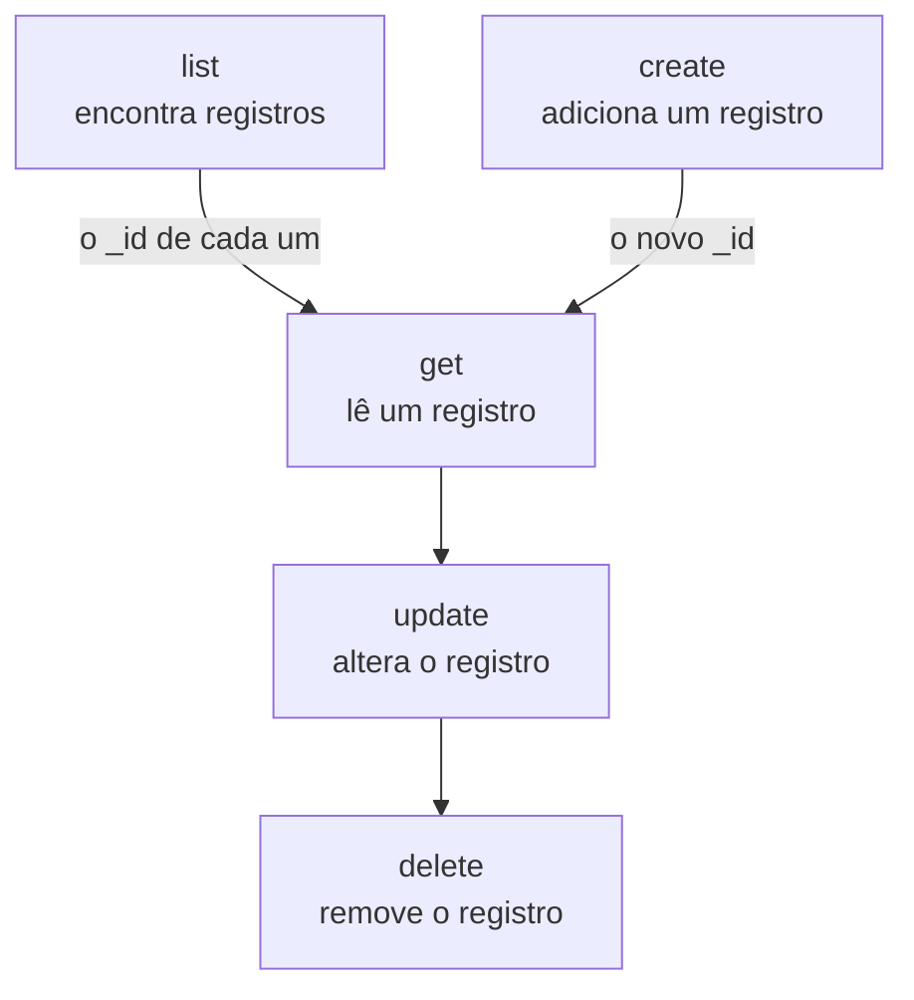

# Operações de recursos

Cada tipo de registro é um comando próprio, como `incident`, `monitor` ou `status-page`, com as operações que a API aceita para ele: para a maioria, `list`, `get`, `create`, `update`, `delete` e `count`. Esta página mostra cada operação, com filtros, paginação e as flags com que um registro é escrito, e os comandos que fazem o que os botões do painel fazem.

:::cards
- [Encontrar o comando de um registro](#encontrar-o-comando-de-um-registro): oneuptime resources lista todos eles.
- [Listar registros](#listar-registros): Filtrar, ordenar e paginar.
- [Criar um registro](#criar-um-registro): Uma flag para cada campo, ou o registro como JSON.
- [Confirmar, resolver e adicionar notas](#confirmar-resolver-e-adicionar-notas): Os botões do painel, como comandos.
- [Excluir um registro](#excluir-um-registro): Na hora, sem desfazer.
:::

## Como as operações se encaixam

Ler, alterar e excluir um registro precisam do ID dele. Listar, contar e criar não precisam de nenhum, e uma listagem ou uma criação dão a você os IDs que as outras usam:



Um ID é um UUID, como `6f1c2a40-3b1e-4c55-9a0b-3e2f8d7c1a11`. Você também pode copiar um da página do registro no OneUptime: veja [Encontrar o ID de um recurso](/docs/api-reference/api-reference#encontrar-o-id-de-um-recurso).

## Encontrar o comando de um registro

```bash
oneuptime resources
```

A lista mostra cada tipo de registro com o comando, os nomes, o tipo e o caminho de API dele. Há dois tipos:

| Tipo | O que ele contém |
| --- | --- |
| `database` | Registros que você gerencia: monitores, incidentes, alertas, páginas de status, equipes e mais |
| `analytics` | Telemetria: logs, spans, métricas, exceções e outros eventos |

Mostre um só tipo com `oneuptime resources --type database` ou `--type analytics`. A [Referência de comandos](/docs/cli/command-reference#recursos) lista todos os comandos.

Um recurso aceita as operações que a API aceita para ele. A maioria aceita todas as seis; um que o próprio OneUptime escreve, como um log de e-mails, é somente leitura. `oneuptime <resource> --help` lista os subcomandos de um recurso.

## Ver os campos de um recurso

`fields` lista os campos de um recurso a partir da própria CLI, sem chave de API e sem requisição:

```bash
oneuptime incident fields
```

Cada campo tem o seu tipo, para que serve, se uma criação precisa informá-lo e a flag que o define. Um campo que guarda um ID nomeia o recurso a que o ID pertence: `incidentSeverityId` recebe um de `oneuptime incident-severity list`. Com `-o json`, um script ou um agente de IA lê o mesmo, com as mesmas chaves para cada campo: `name`, `title`, `type`, `description`, `required`, `create`, `update`, `read`, `flag`, `emailFlag` e `relatedResource`.

## Listar registros

```bash
oneuptime <resource> list [--query <json>] [--limit <n>] [--skip <n>] [--sort <json>] [--fields <names>] [--all] [-o <format>]
```

| Opção | O que faz | Padrão |
| --- | --- | --- |
| `--query <json>` | Retorna só os registros que correspondem: veja [Filtrar uma lista](#filtrar-uma-lista) | Todos os registros que a chave pode ler |
| `--limit <n>` | O máximo de registros a retornar, até 10.000 | `10` |
| `--skip <n>` | Quantos registros correspondentes pular primeiro | `0` |
| `--sort <json>` | A ordem, como `{"createdAt":"ASC"}`, ou `"DESC"` para os mais recentes primeiro | Os mais recentes primeiro |
| `--fields <names>` | Os campos a retornar, separados por vírgulas, como `title,createdAt` | Todos os campos que a chave pode ler |
| `--all` | Todos os registros que correspondem, página após página, no lugar de `--limit` e `--skip`. Só registros | |
| `-o, --output <format>` | `table`, `json` ou `wide` | `table` em um terminal, `json` em um pipe |

```bash
# The ten newest incidents
oneuptime incident list

# The oldest monitors first, 50 at a time: the second page
oneuptime monitor list --sort '{"createdAt":"ASC"}' --limit 50 --skip 50

# Every field of each incident, as JSON
oneuptime incident list -o json

# The title, the state and the creation date of every incident
oneuptime incident list --all --fields title,currentIncidentState.name,createdAt -o json
```

Uma listagem pede ao OneUptime cada campo de cada registro que a chave pode ler. `--fields` pede, em vez disso, os que nomeia e, depois de um ponto, um campo de um registro relacionado, como em `currentIncidentState.name`. Uma tabela mostra seis campos; o JSON mostra todos (veja [Formatos de saída](/docs/cli/output-formats)). `--all` lê todas as páginas, 100 registros por vez, até 100.000; `count` diz quantos são.

Os rótulos são listados por nome, e não dos mais recentes para os mais antigos: primeiro os rótulos cujo nome começa com um número, na ordem desse número (`2. Team` antes de `10. Owner`), depois os demais em ordem alfabética. Para listá-los em outra ordem, informe `--sort`.

### Filtrar uma lista

`--query` aceita o mesmo filtro da API: um campo com um valor corresponde a esse valor, e um objeto com um `_type` compara.

| Filtro | Corresponde a |
| --- | --- |
| `{"title":"Checkout API is down"}` | Registros com exatamente esse valor |
| `{"title":{"_type":"Search","value":"checkout"}}` | Texto que contém o valor |
| `{"createdAt":{"_type":"GreaterThan","value":"2026-10-01T00:00:00.000Z"}}` | Datas posteriores, ou números maiores |
| `{"currentIncidentState":{"isResolvedState":false}}` | Um campo de um registro que o recurso nomeia: aqui, os incidentes que não estão resolvidos |

```bash
oneuptime incident list --query '{"title":{"_type":"Search","value":"checkout"}}'
```

[Filtrar, ordenar e paginar](/docs/api-reference/api-reference#filtrar-ordenar-e-paginar) na referência da API lista cada `_type`.

## Ler um registro

```bash
oneuptime <resource> get <id> [--fields <names>] [-o <format>]
```

```bash
oneuptime incident get 6f1c2a40-3b1e-4c55-9a0b-3e2f8d7c1a11
```

Uma tabela mostra uma linha para cada campo do registro, com cada valor cortado em 60 caracteres; `-o json` mostra os valores inteiros. Um ID que não nomeia nenhum registro que sua chave possa ler responde `Not found`, e o comando termina com o código `3`.

## Criar um registro

```bash
oneuptime <resource> create [--<field> <value>]... [--data <json>] [--file <path>] [-o <format>]
```

Cada campo que uma criação aceita tem uma flag: `--title <text>`, `--incident-severity-id <id>`, `--labels <ids>` para IDs separados por vírgulas, `--is-visible-on-status-page [true|false]` para um campo de sim ou não, verdadeiro quando informado sozinho, e `--monitor-steps <json>` para um campo que guarda JSON. `oneuptime <resource> create --help` lista essas flags, e [`fields`](#ver-os-campos-de-um-recurso) diz para que serve cada uma. O projeto vem da chave de API, então um registro nunca o nomeia.

```bash
# A manual monitor
oneuptime monitor create --name "Checkout API" --monitor-type Manual

# An incident with one of your severities
oneuptime incident create --title "Checkout API is down" --incident-severity-id <severity-id>

# The same incident, from a file
oneuptime incident create --file incident.json
```

`--data` recebe o registro como JSON, e `--file` o lê de um arquivo JSON, com os campos da API: a [referência da API](/reference) lista os de cada recurso. Se os dois forem informados, o arquivo é usado, e as flags se aplicam por cima de qualquer um deles.

Um campo que nomeia uma pessoa pelo ID de usuário tem uma segunda flag que a nomeia pelo endereço de e-mail: `--user-email` ao lado de `--user-id`, `--owner-user-emails` ao lado de `--owner-users`. A CLI procura a pessoa entre os membros do projeto da chave de API e as pessoas convidadas para ele. Um membro de equipe nomeado por um endereço que ninguém no projeto tem é convidado para o projeto, como acontece ao convidá-lo pelo painel:

```bash
oneuptime team-member create --team-id <team-id> --user-email alice@example.com
```

A CLI imprime o novo registro, com o `_id` dele. Um incidente começa no estado de criado do seu projeto, a menos que `currentIncidentStateId` nomeie outro: veja [O estado em que um novo registro começa](/docs/api-reference/api-reference#o-estado-em-que-um-novo-registro-começa). Para encontrar os IDs das suas severidades:

```bash
oneuptime incident-severity list -o json | jq -r '.[] | "\(._id)  \(.name)"'
```

> [!TIP]
> No Windows, informe os campos com as flags deles, ou coloque o JSON em um arquivo e use `--file`: o PowerShell e o Prompt de Comando colocam aspas no JSON na linha de comando de forma diferente do Bash.

## Atualizar um registro

```bash
oneuptime <resource> update <id> [--<field> <value>]... [--data <json>] [--file <path>] [-o <format>]
```

Informe só os campos a alterar, com as flags deles ou como JSON:

```bash
# Rename a monitor
oneuptime monitor update <monitor-id> --name "Checkout API (EU)"

# Record an incident's root cause
oneuptime incident update <incident-id> --root-cause "A full disk on the primary database"
```

O OneUptime responde a uma atualização com um objeto vazio: a CLI imprime uma linha vazia, ou `{}` com `-o json`. Execute `get` para ver o registro como ele está agora. Para mover um incidente para outro estado, informe `--current-incident-state-id`: a mudança é registrada na linha do tempo dele, como faz o painel, e um estado anterior ao atual é recusado. [`acknowledge` e `resolve`](#confirmar-resolver-e-adicionar-notas) encontram o estado para você. Para encontrar o ID do estado resolvido, o primeiro na ordem do seu projeto:

```bash
oneuptime incident-state list --query '{"isResolvedState":true}' --sort '{"order":"ASC"}' --limit 1 -o json | jq -r '.[0]._id'
```

## Confirmar, resolver e adicionar notas

Incidentes, alertas, os episódios deles e eventos de manutenção têm comandos para o que os botões do painel fazem neles:

| Comando | O que ele faz | Recursos |
| --- | --- | --- |
| `acknowledge <id>` | Move o registro para o estado de confirmado do seu projeto | `incident`, `alert`, `incident-episode`, `alert-episode` |
| `resolve <id>` | Move-o para o estado de resolvido do seu projeto | Os mesmos quatro |
| `start <id>` | Move o evento para o estado em andamento do seu projeto | `scheduled-maintenance-event` |
| `end <id>` | Move-o para o estado de encerrado do seu projeto | `scheduled-maintenance-event` |
| `add-note <id> --note <markdown>` | Adiciona uma nota que só quem pode ver o registro pode ler, ou, com `--public`, uma nas páginas de status do registro | Os cinco |

```bash
oneuptime incident acknowledge 6f1c2a40-3b1e-4c55-9a0b-3e2f8d7c1a11
oneuptime incident add-note 6f1c2a40-3b1e-4c55-9a0b-3e2f8d7c1a11 --note "Rolled back the 14:05 deploy."
oneuptime incident resolve 6f1c2a40-3b1e-4c55-9a0b-3e2f8d7c1a11
```

`acknowledge` responde `Incident 6f1c2a40-3b1e-4c55-9a0b-3e2f8d7c1a11 acknowledged: it is in Acknowledged now.` Um registro que já está nesse estado, ou além dele, fica como está: o comando diz isso e termina com `0`. Com `-o json`, ele responde com o `_id` do registro, a `action`, se algo mudou (`changed`) e o estado `state` em que o registro está. Alertas e episódios de alertas aceitam só notas internas.

## Excluir um registro

```bash
oneuptime <resource> delete <id>
```

```bash
oneuptime monitor delete 6f1c2a40-3b1e-4c55-9a0b-3e2f8d7c1a11
```

Ela responde `Monitor 6f1c2a40-3b1e-4c55-9a0b-3e2f8d7c1a11 deleted successfully.` Com `-o json`, ela responde com o `_id` do registro e `"deleted": true`.

> [!CAUTION]
> `delete` remove o registro na hora. A CLI não pede confirmação, e não há como desfazer. Ela aceita `--force`, para os scripts escritos com ele, e `--force` não muda nada.

## Contar registros

```bash
oneuptime <resource> count [--query <json>]
```

```bash
# Every incident
oneuptime incident count

# Incidents that are not resolved
oneuptime incident count --query '{"currentIncidentState":{"isResolvedState":false}}'
```

A CLI imprime um único número, o mesmo em uma tabela e em JSON, então um script pode lê-lo como ele é.

## Solução de problemas

:::details A mensagem "Not found: API error (404)"
O registro não existe, está em outro projeto, ou a chave não pode lê-lo: o OneUptime responde da mesma forma em cada caso. Verifique o ID com `list`, e as permissões da chave. O comando termina com o código `3`.
:::

:::details A mensagem "Left out fields this API key may not read"
Uma listagem ou uma leitura pede cada campo do registro, e o OneUptime recusa um campo que a chave não pode ler: a CLI pede de novo sem ele e nomeia os campos deixados de fora na saída de erro padrão. Dê à chave uma permissão que os leia, ou nomeie os campos de que precisa com `--fields`: um campo nomeado que a chave não pode ler interrompe o comando com `API error (422)`.
:::

:::details A mensagem "Error: Invalid JSON"
O valor de `--query`, `--sort` ou `--data` não é JSON. No Bash e no zsh, coloque-o entre aspas simples; no Windows, informe os campos com as flags deles, ou coloque um registro em um arquivo e use `--file`.
:::

:::details API error (400) em uma criação ou atualização
O OneUptime recusou um campo: a mensagem o nomeia, e `oneuptime <resource> fields` lista os campos com as flags que os definem. Um comando que não informa nenhum campo é recusado antes de ser enviado, com as flags a informar.
:::

:::details A mensagem "No one in this project, or invited to it, has the email address"
Uma flag de e-mail nomeia alguém que não é membro do projeto da chave de API nem foi convidado para ele. Convide a pessoa com `oneuptime team-member create --team-id <team-id> --user-email <email>`, ou nomeie-a pelo ID de usuário.
:::

## Próximos passos

:::cards
- [Formatos de saída](/docs/cli/output-formats): Ler as respostas como tabelas ou como JSON.
- [Scripts e CI/CD](/docs/cli/scripting): Usar estas operações em scripts e pipelines.
- [Referência de comandos](/docs/cli/command-reference): Cada comando, opção e valor padrão.
:::
