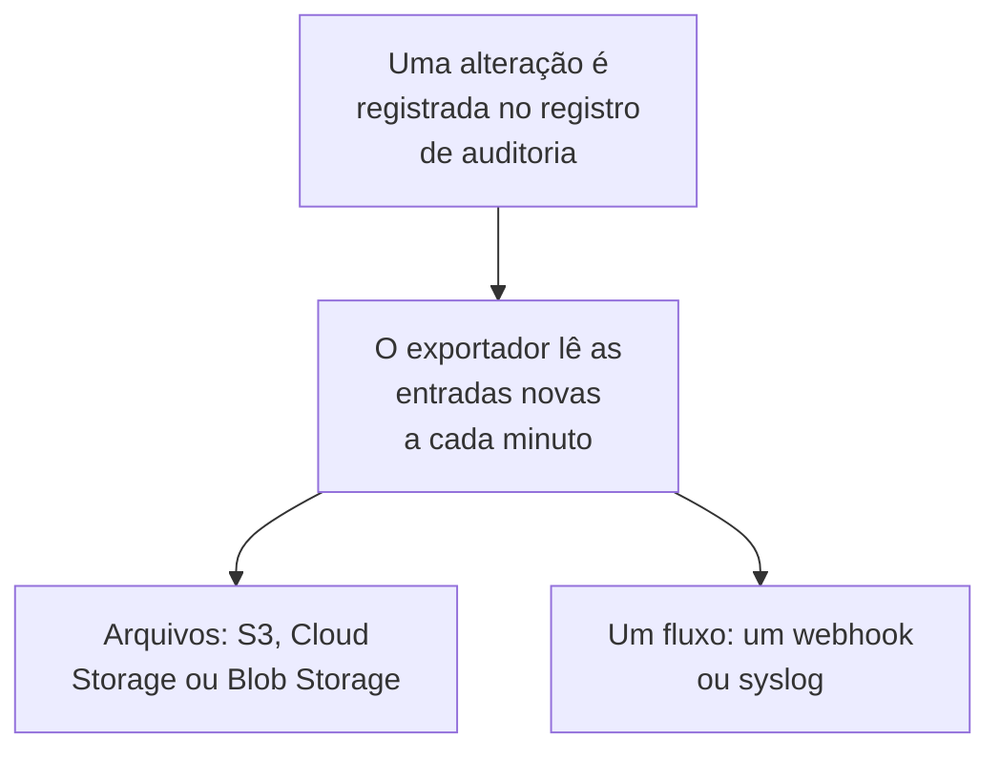

# Exportação do registro de auditoria

Envie o registro de auditoria, à medida que ele é registrado, para o armazenamento ou o serviço que você escolher: Amazon S3 ou um armazenamento compatível com S3, Google Cloud Storage, Azure Blob Storage, um webhook ou syslog. Mantenha as entradas lá pelo tempo que suas revisões de conformidade exigirem, e pesquise-as no seu SIEM. Os proprietários e administradores de um projeto exportam o registro de auditoria dele a partir das configurações do projeto, e os administradores mestres exportam o de todos os projetos a partir do Admin Dashboard. Ele faz parte do plano Enterprise no OneUptime Cloud, e da Enterprise Edition quando você hospeda o OneUptime.

:::cards
- [Configurar uma exportação](#configurar-uma-exportação): Escolher um destino, testá-lo e salvá-lo.
- [O que é enviado](#o-que-é-enviado): Um objeto JSON por entrada, em um esquema estável.
- [Quando as entradas são enviadas](#quando-as-entradas-são-enviadas): A cada minuto, cada entrada uma vez, em ordem.
- [Quando um destino falha](#quando-um-destino-falha): As novas tentativas, o erro, e nada é pulado.
:::

## Como uma entrada chega ao seu destino



- **Uma exportação, um destino.** Um projeto pode ter várias exportações, e cada uma envia todas as entradas para o próprio destino.
- **A de um projeto, ou a da instância.** A exportação de um projeto envia as entradas desse projeto. Uma exportação configurada no Admin Dashboard envia as entradas de todos os projetos que registram auditoria.
- **A partir de quando é salva.** Uma exportação envia o que é registrado depois de ser salva, a menos que você defina **Exportar a partir de** para uma data anterior.

## Antes de começar

- **No OneUptime Cloud, o plano Enterprise.** Nos outros planos, a página mostra o que o recurso faz e como obtê-lo.
- **Quando você hospeda o OneUptime, a Enterprise Edition**, com uma licença que inclua os registros de auditoria. Veja [Edição Enterprise](/docs/self-hosted/enterprise).
- **O registro de auditoria ativado** em cada projeto que você exporta. Veja [Registros de auditoria](/docs/configuration/audit-logs).
- **Um Project Owner ou um Project Admin** para exportar o registro de auditoria de um projeto, ou um administrador mestre para exportar o da instância.

## Configurar uma exportação

:::steps
### Abrir a página de exportação

Para um projeto, vá para **Configurações do projeto → Registros de auditoria → Exportar**. Para a instância inteira, vá para **Configurações → Exportação do registro de auditoria** no Admin Dashboard.

### Escolher um destino

Clique em **Adicionar exportação** e escolha um dos seis destinos abaixo. O destino de uma exportação não pode ser alterado depois.

### Informar como alcançá-lo

Preencha o que o destino pede. As configurações que a maioria das pessoas deixa como estão ficam em **Mais campos**, e **Guia de configuração** abre a seção do destino nesta página.

### Enviar um teste

Clique em **Gravar um arquivo de teste** ou **Enviar uma entrada de teste**. Um armazenamento recebe o arquivo `oneuptime-audit-log-export-test.ndjson.gz` na pasta dele, e um webhook ou syslog recebe uma entrada cuja ação é `Test`. Um teste que falha diz o que corrigir.

### Começar a exportar

Clique em **Próximo**, dê um nome à exportação e clique em **Começar a exportar**. As primeiras entradas chegam em poucos minutos.
:::

A linha da exportação mostra como ela está: **Exportando**, **Com falha**, **Pausado**, **Aguardando entradas** ou **Iniciando**. **Envie um teste** envia um teste com as configurações salvas, e **Editar** as altera: uma credencial que você deixa vazia mantém a que está salva.

## Destinos

| Destino | O que chega | Entra com |
| --- | --- | --- |
| [Amazon S3](#amazon-s3) | Arquivos NDJSON compactados | Uma chave de acesso |
| [Armazenamento compatível com S3](#armazenamento-compatível-com-s3) | Arquivos NDJSON compactados | Uma chave de acesso |
| [Google Cloud Storage](#google-cloud-storage) | Arquivos NDJSON compactados | Uma chave de conta de serviço |
| [Azure Blob Storage](#azure-blob-storage) | Arquivos NDJSON compactados | Um token SAS ou uma chave de acesso |
| [Webhook](#webhook) | Requisições HTTPS | Um cabeçalho e um segredo de assinatura opcionais |
| [Syslog](#syslog) | Mensagens RFC 5424 | Nada |

### Amazon S3

| Campo | O que informar |
| --- | --- |
| **Bucket** | O bucket em que os arquivos são gravados. |
| **Região** | A região do bucket. Começa em `us-east-1`. |
| **ID da chave de acesso** | Uma chave de acesso que possa gravar objetos no bucket. |
| **Chave de acesso secreta** | O segredo da chave. |
| **Pasta** | Em **Mais campos**. Se ficar vazia, os arquivos vão para `oneuptime/audit-logs/`. |

A chave precisa apenas de `s3:PutObject` na pasta:

```json
{
  "Version": "2012-10-17",
  "Statement": [
    {
      "Effect": "Allow",
      "Action": "s3:PutObject",
      "Resource": "arn:aws:s3:::my-audit-logs/oneuptime/audit-logs/*"
    }
  ]
}
```

### Armazenamento compatível com S3

Os mesmos campos do Amazon S3, depois de um **Endpoint**: o endereço S3 do armazenamento, como `https://minio.example.com:9000` ou `https://<account>.r2.cloudflarestorage.com`. Defina **Região** como a que o armazenamento espera: `us-east-1` para o MinIO e o padrão do Wasabi, `auto` para o Cloudflare R2.

### Google Cloud Storage

Informe o **Bucket** e cole uma **Chave da conta de serviço** (JSON) cuja conta de serviço tenha o papel Storage Object Creator no bucket. **Pasta** fica em **Mais campos**.

### Azure Blob Storage

Informe a **Conta de armazenamento** e o **Contêiner**, e escolha em **Entrar com** como entrar: um **Token SAS** com permissão Create e Write no contêiner, ou uma **Chave de acesso** da conta de armazenamento. Um token SAS pode ser limitado a este contêiner, então é a escolha mais segura. **Nuvem** e **Pasta** ficam em **Mais campos**.

### Webhook

O OneUptime envia cada lote com POST para a **URL**, como um array JSON (`application/json`) ou uma entrada por linha (`application/x-ndjson`), conforme **Formato do corpo**, com estes cabeçalhos:

| Cabeçalho | Valor |
| --- | --- |
| `X-OneUptime-Event` | `audit-log-export` |
| `X-OneUptime-Batch-Id` | O id da primeira entrada do lote: o mesmo lote enviado de novo traz o mesmo id. |
| `X-OneUptime-Entry-Count` | Quantas entradas o corpo contém. |
| `X-OneUptime-Signature` | `sha256=` e o HMAC-SHA256 do corpo, com o **Segredo de assinatura**, quando há um. |

A **Credencial**, como `Bearer <token>`, é enviada no cabeçalho que você escolhe em **Nome do cabeçalho**, `Authorization` se você não o alterar. **Formato do corpo**, **Nome do cabeçalho** e **Segredo de assinatura** ficam em **Mais campos**. Qualquer resposta 2xx conta como entrega. Um `413` divide o lote em dois, e qualquer outra recusa envia o lote inteiro de novo mais tarde.

### Syslog

Cada entrada é uma mensagem RFC 5424 para o **Host** e a **Porta**, por TLS na porta `6514`, a menos que **Protocolo** diga TCP, com facility 13 (log audit) e severity 6 (informational):

```text
<110>1 2026-10-24T09:15:03.000Z oneuptime.example.com oneuptime - audit-log - {"schemaVersion":1,"id":"..."}
```

As mensagens são delimitadas por contagem de octetos (RFC 5425), a menos que **Delimitação** diga uma mensagem por linha. Um receptor cujo certificado foi assinado por uma CA privada precisa do certificado dessa CA em **Certificado da CA**. Os dois ficam em **Mais campos**.

## O que é enviado

Cada entrada é um objeto JSON, com as chaves sempre nesta ordem:

| Chave | O que contém |
| --- | --- |
| `schemaVersion` | `1`. Uma mudança no esquema vem com uma nova versão. |
| `id` | O id da entrada. A mesma entrada enviada duas vezes tem o mesmo id. |
| `createdAt` | Quando a alteração foi registrada, em UTC. |
| `projectId` | O projeto em que a alteração foi feita. |
| `action` | `Create`, `Update`, `Delete` ou `Download`. |
| `resourceType`, `resourceId`, `resourceName` | O que foi alterado. |
| `rootResourceType`, `rootResourceId` | O recurso ao qual pertence, como um SLO para a regra dele. |
| `userId`, `userName`, `userEmail`, `userType` | Quem fez a alteração. |
| `apiKeyId`, `apiKeyName` | A chave de API com que foi feita, se houver. |
| `mcpOAuthGrantId`, `mcpClientName` | O cliente MCP pelo qual foi feita, se houver. |
| `workflowId`, `workflowName` | O workflow que a fez, se houver. |
| `changes` | Cada campo alterado: `field`, com `oldValue` e `newValue`. |

Um arquivo contém uma entrada por linha, compactado com gzip, e é arquivado pela hora da primeira entrada: `oneuptime/audit-logs/2026/10/24/09/20261024T091503Z_<first entry id>.ndjson.gz`.

Chaves, tokens e senhas nunca saem: são registrados como `[REDACTED]`, e os campos que ninguém pode ler ficam fora de todas as entradas.

## Quando as entradas são enviadas

- **A cada minuto.** As entradas registradas há mais de um minuto são lidas da mais antiga para a mais recente e enviadas em lotes: até 5.000 entradas ou 16 MB por arquivo, e 500 entradas por requisição de webhook ou conexão de syslog.
- **Não se grava um arquivo para cada entrada.** Um arquivo é gravado quando um lote está cheio ou a primeira entrada dele tem cinco minutos.
- **Cada entrada uma vez, em ordem.** Depois de cada entrega, a exportação guarda a última entrada enviada, então uma reinicialização ou outro worker continua dali.
- **Uma repetição pode ser reconhecida.** Um lote enviado de novo depois de uma falha grava o mesmo nome de arquivo ou traz o mesmo `X-OneUptime-Batch-Id`, e cada entrada traz o próprio `id`.

## Quando um destino falha

Um lote é tentado três vezes, com poucos segundos de intervalo, e então a exportação espera antes de tentar de novo: um minuto, depois dois, quatro e assim por diante, até uma hora. A linha dela diz **Com falha**, e **Ver erro** mostra o que o destino respondeu e quando será a próxima tentativa.

Nada é pulado: as entradas esperam no registro de auditoria, e a próxima entrega que funcionar recupera o atraso a partir da mais antiga. Uma entrada mais antiga que a retenção do registro de auditoria do projeto dela é excluída antes de poder ser enviada, então corrija uma exportação com falha dentro desse prazo.

Para pausar uma exportação, escolha **Desativar** no menu da linha dela: ela mantém a posição, e **Ativar** envia o que foi registrado nesse meio-tempo. No OneUptime Cloud, um projeto que sai do plano Enterprise para de exportar, e as exportações dele esperam sob o cartão de upgrade, onde podem ser desativadas ou excluídas. Quando você hospeda o OneUptime, a exportação para enquanto a licença não inclui os registros de auditoria, e continua de onde parou assim que uma licença os inclui.

## Solução de problemas

:::details O teste diz que o acesso foi negado
A chave, o token ou a conta de serviço não pode gravar onde a exportação grava. Dê a ela permissão para criar objetos na pasta, como mostra acima a seção de cada destino, e envie o teste de novo.
:::

:::details O teste não alcança o endereço
A exportação de um projeto no OneUptime Cloud não pode alcançar um endereço de rede privada. Quando você hospeda o OneUptime, ela pode, a menos que `DATA_SOURCE_BLOCK_PRIVATE_ADDRESSES` seja `true`, e uma exportação configurada no Admin Dashboard sempre pode. Endereços de loopback e link-local nunca são alcançados.
:::

:::details Nada chega
Verifique se o registro de auditoria está ativado no projeto e se alguém alterou algo depois que a exportação foi salva. Um armazenamento só recebe um arquivo quando um lote está cheio ou tem cinco minutos.
:::

## Próximos passos

:::cards
- [Registros de auditoria](/docs/configuration/audit-logs): O que é registrado e por quanto tempo é mantido.
- [Usuários, equipes e permissões](/docs/permissions/index): Decidir quem pode configurar uma exportação.
- [Edição Enterprise](/docs/self-hosted/enterprise): Registros de auditoria em uma instalação auto-hospedada.
:::
