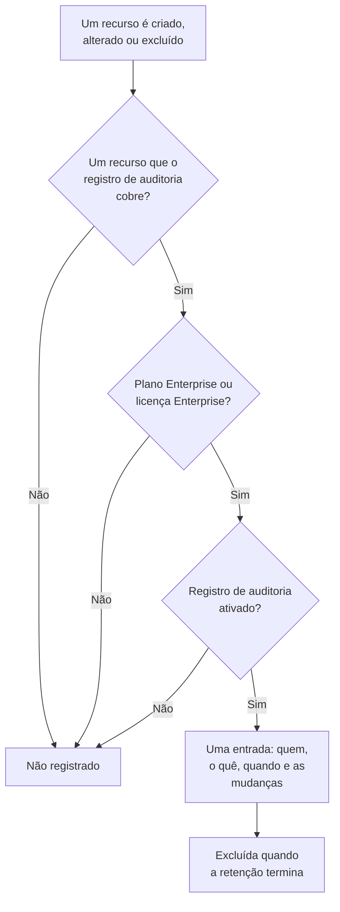

# Registros de auditoria

O registro de auditoria guarda quem mudou o quê no seu projeto: cada criação, alteração e exclusão dos recursos que ele cobre, com os valores de antes e de depois. Use-o para descobrir quem desativou um monitor ou mudou uma chave de API, e para manter um registro para revisões de conformidade. Ele faz parte do plano Enterprise no OneUptime Cloud, e da Enterprise Edition quando você hospeda o OneUptime.

:::cards
- [Ativar o registro de auditoria](#ativar-o-registro-de-auditoria): Ele começa desativado em todo projeto.
- [Ler o registro de auditoria](#ler-o-registro-de-auditoria): Quem mudou o quê, e quando.
- [O que é registrado](#o-que-é-registrado): Os recursos e as ações que ele cobre.
- [Por quanto tempo as entradas ficam](#por-quanto-tempo-as-entradas-ficam): De 7 a 180 dias.
:::

## Como uma mudança vira uma entrada

- **Ele começa desativado.** Um projeto não registra nada até alguém ativar o registro de auditoria, e nada de antes desse momento.
- **Ele registra o que as pessoas fazem.** Uma mudança feita por uma pessoa, uma chave de API, um cliente MCP ou um workflow é registrada. Uma mudança que o OneUptime faz por conta própria, como a de uma tarefa em segundo plano, fica de fora, a menos que você ative **Armazenar Eventos do Sistema**.
- **As entradas não podem ser alteradas.** Ninguém pode editar nem excluir uma entrada, no painel ou pela API. Uma entrada só sai quando a retenção dela termina.

## Antes de começar

- **No OneUptime Cloud, o plano Enterprise.** Nos outros planos, as páginas do registro de auditoria mostram o que o recurso faz e como obtê-lo.
- **Quando você hospeda o OneUptime, a Enterprise Edition**, com uma licença que inclua os registros de auditoria. Veja [Edição Enterprise](/docs/self-hosted/enterprise).
- **Uma função que pode ler o registro de auditoria.** Project Owner, Project Admin, Settings Admin ou a permissão **Read Audit Log**. Ativar o registro de auditoria e mudar as configurações dele exige um Project Owner, um Project Admin ou a permissão para editar o projeto.

## Ativar o registro de auditoria

:::steps
### Abrir as configurações do registro de auditoria

Acesse **Configurações do projeto → Registros de auditoria → Configurações**. **Registros de auditoria** começa recolhido no menu lateral: clique nele para abri-lo.

### Editar as configurações

Clique em **Edit Audit Log Settings**.

### Ativá-lo

Ative **Habilitar registros de auditoria**, defina **Retenção (dias)** e escolha se quer **Armazenar Eventos do Sistema**. Clique em **Salvar alterações**.
:::

| Configuração | Valor inicial | O que faz |
| --- | --- | --- |
| **Habilitar registros de auditoria** | Desativado | Registra a partir de agora as mudanças nos recursos do projeto. |
| **Retenção (dias)** | 7 | Por quantos dias cada entrada é mantida: de 7 a 180. |
| **Armazenar Eventos do Sistema** | Desativado | Também registra as mudanças que o OneUptime faz por conta própria, que nenhuma pessoa ou chave iniciou. |

Uma mudança nessas configurações vale em até um minuto.

## Ler o registro de auditoria

**Configurações do projeto → Registros de auditoria → Registros de auditoria** lista cada entrada do projeto, as mais recentes primeiro:

| Coluna | O que mostra |
| --- | --- |
| **Quando** | Há quanto tempo, com a data e a hora. |
| **Ação** | `Create`, `Update` ou `Delete`, ou `Download` para um arquivo de captura de pacotes que alguém baixou. |
| **Recurso** | O nome do recurso, que o abre enquanto ele existe, e o tipo dele. |
| **Ator** | Quem fez a mudança: uma pessoa, uma chave de API, um workflow ou `System` para uma mudança que o OneUptime fez por conta própria. A mudança de uma pessoa feita por um cliente MCP indica qual. |
| **Alterações** | Quantos campos mudaram, ou foram capturados em uma criação ou exclusão. Clique para ver cada campo. |

Filtre por **Tipo de recurso**, **Nome do recurso**, **Ação**, **E-mail do Usuário** ou **Hora**. Uma alteração lista só os campos que mudaram, antes e depois, e um salvamento que não muda nada não adiciona entrada.

Monitores, incidentes, alertas, páginas de status, SLOs e muitos outros recursos também têm a própria página **Registros de auditoria**, em uma seção recolhida do menu lateral deles, como **Avançado**. Ela lista só as entradas daquele recurso, junto com as do que pertence a ele: a página de um SLO mostra também as regras e os proprietários dele.

## O que é registrado

Tudo o que as pessoas criam, alteram ou excluem em um projeto é registrado: monitores, incidentes, alertas, páginas de status, fluxos de trabalho e seus passos, filas, painéis, políticas de plantão, equipes e quem está nelas, chaves de API e cada configuração. **Tipo de recurso** diz do que trata uma entrada, por exemplo `Monitor`, `Workflow` ou `Queue`.

| Não registrado | Por quê |
| --- | --- |
| Registros de mensagens | Cada um já é o registro de um e-mail, SMS, chamada, notificação push ou mensagem de chat que o OneUptime enviou ou recebeu. |
| Registros de execuções | Cada um já é o registro de uma execução de fluxo de trabalho, um escalonamento de plantão, uma verificação, uma importação ou uma execução de IA. |
| O que os agentes e a telemetria informam | Recursos descobertos, leituras e uso mudam a cada informe, não porque alguém os alterou. |
| Feeds de atividade | Um feed mostra alterações que o registro de auditoria já registra. |
| O estado de trabalho do OneUptime | Sessões, tarefas na fila e outros estados que o OneUptime mantém enquanto trabalha. |
| A configuração de notificações própria de uma pessoa | Os endereços, números e regras de plantão pessoais de cada pessoa são só dela. |

Também fica registrado quando um administrador adiciona ou remove um método de notificação ou uma regra de plantão pessoal na conta de outra pessoa, sem o endereço ou o número em si.

Os campos que só o OneUptime escreve, como quando um host foi visto pela última vez, ficam de fora de toda entrada, assim como os campos que ninguém pode ler. Quando o OneUptime escreve um deles porque alguém pediu, como ao mesclar uma exceção a outra ou redefinir a URL de um webhook, a entrada o registra como uma alteração dessa pessoa. Chaves, tokens e senhas são registrados como `[REDACTED]`: a entrada mostra que mudaram, nunca o seu valor. Os passos de um fluxo de trabalho são registrados como o que mudou, com os nomes das configurações de um passo, mas nunca o que foi digitado nelas, e mover um passo na tela de edição não é registrado.

O que o OneUptime faz porque alguém pediu também é registrado como alteração dessa pessoa, quer o projeto armazene eventos do sistema ou não: iniciar, aprovar, concluir, pular e cancelar uma execução de runbook, os rótulos que uma regra de rótulos adiciona quando alguém a executa nos registros que já existem, redefinir o link de um feed de calendário e as equipes em que alguém entra ao fazer login com SSO. As etapas de uma execução de runbook são registradas como o que foi feito com cada uma, por exemplo `Approved "Restart the API" (step 3)`, nunca com o que uma etapa imprimiu. Os rótulos que uma regra adiciona quando um registro é criado são uma alteração do próprio OneUptime, registrada com **Armazenar Eventos do Sistema** ativado.

## Por quanto tempo as entradas ficam

Cada entrada fica pela **Retenção (dias)** que o projeto tinha quando ela foi registrada, e depois é excluída. Uma nova retenção vale para as novas entradas: as já registradas mantêm as datas delas.

Para manter entradas por mais de 180 dias, envie-as para o seu próprio armazenamento ou SIEM à medida que são registradas: veja [Exportação do registro de auditoria](/docs/configuration/audit-log-export). Você também pode lê-las pela API com uma chave de API que tenha **Read Audit Log** e guardá-las onde precisar. Veja [Referência da API OneUptime](/docs/api-reference/api-reference).

## Quando o plano ou a licença não inclui mais os registros de auditoria

- **No OneUptime Cloud**, um projeto que sai do plano Enterprise para de registrar, e as páginas do registro de auditoria dele mostram o cartão de upgrade até ele voltar ao plano.
- **Quando você hospeda o OneUptime**, o registro de auditoria para de registrar quando o teste do Enterprise ou o período de carência termina sem licença, ou quando a licença não inclui os registros de auditoria. O registro de auditoria avisa isso em vermelho. As entradas já registradas são mantidas, e o registro recomeça com as mesmas configurações assim que uma licença é ativada. Veja [Quando uma licença expira ou está ausente](/docs/self-hosted/enterprise#quando-uma-licença-expira-ou-está-ausente).

## Solução de problemas

:::details O registro de auditoria está vazio
O registro de auditoria começa desativado e não registra nada de antes de ser ativado. Se a lista disser que o registro de auditoria está desativado, siga o link dela para as configurações e ative-o. Caso contrário, mude um monitor ou um incidente e atualize a lista.
:::

:::details Falta uma mudança no registro de auditoria
Confira se o recurso está em [O que é registrado](#o-que-é-registrado), e se a mudança foi feita depois que o registro de auditoria foi ativado. Uma mudança que o OneUptime fez por conta própria só é registrada com **Armazenar Eventos do Sistema** ativado.
:::

## Próximos passos

:::cards
- [Exportação do registro de auditoria](/docs/configuration/audit-log-export): Enviar o registro de auditoria para o seu próprio armazenamento ou SIEM.
- [Usuários, equipes e permissões](/docs/permissions/index): Decidir quem pode ler o registro de auditoria.
- [Configurações do projeto](/docs/configuration/project-settings): As demais configurações do projeto.
- [Cobrança e uso](/docs/configuration/billing): Mudar o plano do projeto.
- [Edição Enterprise](/docs/self-hosted/enterprise): Registros de auditoria em uma instalação auto-hospedada.
:::
