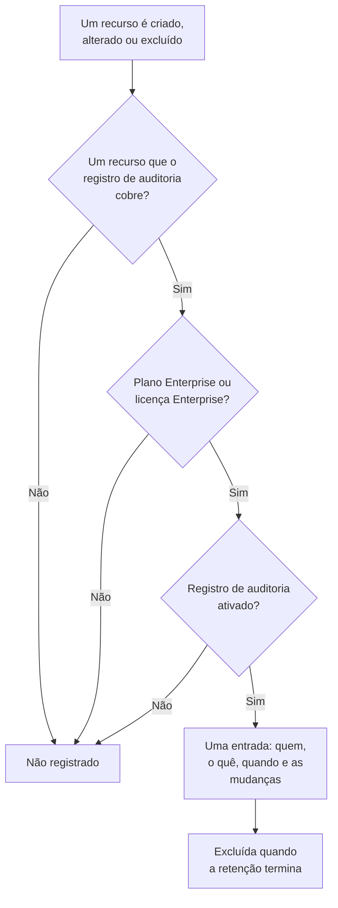

# Registros de auditoria

O registro de auditoria guarda quem mudou o quê no seu projeto: cada criação, alteração e exclusão dos recursos que ele cobre, com os valores de antes e de depois. Use-o para descobrir quem desativou um monitor ou mudou uma chave de API, e para manter um registro para revisões de conformidade. Ele faz parte do plano Enterprise no OneUptime Cloud, e da Enterprise Edition quando você hospeda o OneUptime.

:::cards
- [Ativar o registro de auditoria](#ativar-o-registro-de-auditoria): Ele começa desativado em todo projeto.
- [Ler o registro de auditoria](#ler-o-registro-de-auditoria): Quem mudou o quê, e quando.
- [O que é registrado](#o-que-é-registrado): Os recursos e as ações que ele cobre.
- [Por quanto tempo as entradas ficam](#por-quanto-tempo-as-entradas-ficam): De 7 a 180 dias.
:::

## Como uma mudança vira uma entrada

- **Ele começa desativado.** Um projeto não registra nada até alguém ativar o registro de auditoria, e nada de antes desse momento.
- **Ele registra o que as pessoas fazem.** Uma mudança feita por uma pessoa, uma chave de API, um cliente MCP ou um workflow é registrada. Uma mudança que o OneUptime faz por conta própria, como a de uma tarefa em segundo plano, fica de fora, a menos que você ative **Armazenar Eventos do Sistema**.
- **As entradas não podem ser alteradas.** Ninguém pode editar nem excluir uma entrada, no painel ou pela API. Uma entrada só sai quando a retenção dela termina.

## Antes de começar

- **No OneUptime Cloud, o plano Enterprise.** Nos outros planos, as páginas do registro de auditoria mostram o que o recurso faz e como obtê-lo.
- **Quando você hospeda o OneUptime, a Enterprise Edition**, com uma licença que inclua os registros de auditoria. Veja [Edição Enterprise](/docs/self-hosted/enterprise).
- **Uma função que pode ler o registro de auditoria.** Project Owner, Project Admin, Settings Admin ou a permissão **Read Audit Log**. Ativar o registro de auditoria e mudar as configurações dele exige um Project Owner, um Project Admin ou a permissão para editar o projeto.

## Ativar o registro de auditoria

:::steps
### Abrir as configurações do registro de auditoria

Acesse **Configurações do projeto → Registros de auditoria → Configurações**. **Registros de auditoria** começa recolhido no menu lateral: clique nele para abri-lo.

### Editar as configurações

Clique em **Edit Audit Log Settings**.

### Ativá-lo

Ative **Habilitar registros de auditoria**, defina **Retenção (dias)** e escolha se quer **Armazenar Eventos do Sistema**. Clique em **Salvar alterações**.
:::

| Configuração | Valor inicial | O que faz |
| --- | --- | --- |
| **Habilitar registros de auditoria** | Desativado | Registra a partir de agora as mudanças nos recursos do projeto. |
| **Retenção (dias)** | 7 | Por quantos dias cada entrada é mantida: de 7 a 180. |
| **Armazenar Eventos do Sistema** | Desativado | Também registra as mudanças que o OneUptime faz por conta própria, que nenhuma pessoa ou chave iniciou. |

Uma mudança nessas configurações vale em até um minuto.

## Ler o registro de auditoria

**Configurações do projeto → Registros de auditoria → Registros de auditoria** lista cada entrada do projeto, as mais recentes primeiro:

| Coluna | O que mostra |
| --- | --- |
| **Quando** | Há quanto tempo, com a data e a hora. |
| **Ação** | `Create`, `Update` ou `Delete`, ou `Download` para um arquivo de captura de pacotes que alguém baixou. |
| **Recurso** | O nome do recurso, que o abre enquanto ele existe, e o tipo dele. |
| **Ator** | Quem fez a mudança: uma pessoa, uma chave de API, um workflow ou `System` para uma mudança que o OneUptime fez por conta própria. A mudança de uma pessoa feita por um cliente MCP indica qual. |
| **Alterações** | Quantos campos mudaram, ou foram capturados em uma criação ou exclusão. Clique para ver cada campo. |

Filtre por **Tipo de recurso**, **Nome do recurso**, **Ação**, **E-mail do Usuário** ou **Hora**. Uma alteração lista só os campos que mudaram, antes e depois, e um salvamento que não muda nada não adiciona entrada.

Monitores, incidentes, alertas, páginas de status, SLOs e muitos outros recursos também têm a própria página **Registros de auditoria**, em uma seção recolhida do menu lateral deles, como **Avançado**. Ela lista só as entradas daquele recurso, junto com as do que pertence a ele: a página de um SLO mostra também as regras e os proprietários dele.

## O que é registrado

| Recurso | **Tipo de recurso** no registro |
| --- | --- |
| Monitores | `Monitor` |
| Incidentes | `Incident` |
| Alertas | `Alert` |
| Páginas de status | `Status Page` |
| Eventos de manutenção programada | `Scheduled Maintenance Event` |
| Políticas de plantão | `On-Call Policy` |
| SLOs | `Service Level Objective` |
| As regras e os proprietários de um SLO | `SLO Burn Rate Rule`, `SLO Monitor Rule`, `Service Level Objective User Owner`, `Service Level Objective Team Owner` |
| Equipes | `Team` |
| Funções personalizadas, e as equipes e chaves de API que recebem uma | `Custom Role`, `Team Custom Role`, `API Key Custom Role` |
| Rótulos | `Label` |
| Estados e severidades de incidente | `Incident State`, `Incident Severity` |
| Estados e severidades de alerta | `Alert State`, `Alert Severity` |
| Status de monitor | `Monitor Status` |
| Estados de manutenção programada | `Scheduled Maintenance State` |
| Funções de incidente | `Incident Role` |
| Status de post-mortem | `Postmortem Status` |
| Chaves de API | `API Key` |
| Clientes MCP que as pessoas conectam | `MCP Client Authorization` |
| Itens do inventário | `Inventory Item` |
| Configurações do coletor | `Collector Config` |
| vCenters | `vCenter` |
| Capturas de pacotes, e os downloads delas | `Packet Capture` |
| Casos de segurança e as suas prioridades e status, playbooks e as suas execuções, entidades protegidas, criticidade de entidades, e o risco de uma entidade quando alguém o redefine | `Security Case`, `Security Case Priority`, `Security Case Status`, `Security Playbook`, `Security Playbook Run`, `Protected Entity`, `Entity Criticality`, `Entity Risk` |
| Exceções de regra | `Rule Exception` |
| Listas de observação | `Watchlist` |
| Valores da lista de observação | `Watchlist Value` |
| Tarefas e evidências dos casos de segurança | `Security Case Task`, `Security Case Evidence` |
| Repositórios de dados e as suas descobertas, e os problemas, as configurações, as configurações das verificações, os tipos de dados personalizados e as regras de residência da Segurança de dados | `Data Store`, `Data Store Finding`, `Data Security Issue`, `Data Security Setting`, `Check Setting`, `Custom Data Type`, `Residency Rule` |
| Exportações do registro de auditoria | `Audit Log Export` |

Também fica registrado quando um administrador adiciona ou remove um método de notificação ou uma regra de plantão pessoal na conta de outra pessoa, sem o endereço ou o número em si.

Outros dados não estão no registro de auditoria, como quem está em uma equipe ou uma permissão adicionada sozinha a uma equipe. Os campos que ninguém pode ler ficam de fora de toda entrada, e chaves, tokens e senhas são registrados como `[REDACTED]`: a entrada mostra que mudaram, nunca o seu valor.

## Por quanto tempo as entradas ficam

Cada entrada fica pela **Retenção (dias)** que o projeto tinha quando ela foi registrada, e depois é excluída. Uma nova retenção vale para as novas entradas: as já registradas mantêm as datas delas.

Para manter entradas por mais de 180 dias, envie-as para o seu próprio armazenamento ou SIEM à medida que são registradas: veja [Exportação do registro de auditoria](/docs/configuration/audit-log-export). Você também pode lê-las pela API com uma chave de API que tenha **Read Audit Log** e guardá-las onde precisar. Veja [Referência da API OneUptime](/docs/api-reference/api-reference).

## Quando o plano ou a licença não inclui mais os registros de auditoria

- **No OneUptime Cloud**, um projeto que sai do plano Enterprise para de registrar, e as páginas do registro de auditoria dele mostram o cartão de upgrade até ele voltar ao plano.
- **Quando você hospeda o OneUptime**, o registro de auditoria para de registrar quando o teste do Enterprise ou o período de carência termina sem licença, ou quando a licença não inclui os registros de auditoria. O registro de auditoria avisa isso em vermelho. As entradas já registradas são mantidas, e o registro recomeça com as mesmas configurações assim que uma licença é ativada. Veja [Quando uma licença expira ou está ausente](/docs/self-hosted/enterprise#quando-uma-licença-expira-ou-está-ausente).

## Solução de problemas

:::details O registro de auditoria está vazio
O registro de auditoria começa desativado e não registra nada de antes de ser ativado. Se a lista disser que o registro de auditoria está desativado, siga o link dela para as configurações e ative-o. Caso contrário, mude um monitor ou um incidente e atualize a lista.
:::

:::details Falta uma mudança no registro de auditoria
Confira se o recurso está em [O que é registrado](#o-que-é-registrado), e se a mudança foi feita depois que o registro de auditoria foi ativado. Uma mudança que o OneUptime fez por conta própria só é registrada com **Armazenar Eventos do Sistema** ativado.
:::

## Próximos passos

:::cards
- [Exportação do registro de auditoria](/docs/configuration/audit-log-export): Enviar o registro de auditoria para o seu próprio armazenamento ou SIEM.
- [Usuários, equipes e permissões](/docs/permissions/index): Decidir quem pode ler o registro de auditoria.
- [Configurações do projeto](/docs/configuration/project-settings): As demais configurações do projeto.
- [Cobrança e uso](/docs/configuration/billing): Mudar o plano do projeto.
- [Edição Enterprise](/docs/self-hosted/enterprise): Registros de auditoria em uma instalação auto-hospedada.
:::
