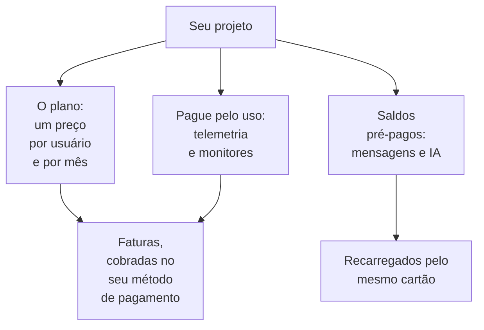

# Cobrança e uso

No OneUptime Cloud, um projeto paga pelo plano, por usuário, e pelo que usa: telemetria, monitores ativos, e as mensagens e o trabalho de IA que paga com saldos pré-pagos. Esta página mostra onde ver e mudar cada um deles, e quem pode. Uma instalação auto-hospedada não tem cobrança, nem nenhuma destas páginas.

:::cards
- [Seu plano e seus assentos](#seu-plano-e-seus-assentos): Quanto custa o plano, e quem conta como assento.
- [Métodos de pagamento](#métodos-de-pagamento): O cartão em que suas faturas são cobradas.
- [Faturas](#faturas): Pagar, baixar e conferir o que você usou.
- [Saldos pré-pagos](#saldos-pré-pagos): Mensagens e IA, recarregados à mão ou automaticamente.
:::

## O que um projeto paga

| O quê | Como é cobrado |
| --- | --- |
| O plano | Um preço por usuário e por mês, cobrado mensal ou anualmente. Cada pessoa do projeto é um assento. |
| Telemetria | $0.10 por GB ingerido, com 15 dias de retenção. Uma retenção maior custa mais, e uma retenção de menos de 7 dias é cobrada como 7 dias: veja [Quanto custa a retenção](/docs/telemetry/data-retention#quanto-custa-a-retenção). |
| Session Replays | $2 por GB, com 15 dias de retenção. |
| Monitores ativos | $1 por monitor por mês. Todo monitor, exceto um manual, é ativo, mesmo quando está desativado. |
| SMS, chamadas, WhatsApp e Telegram | Pagos com o saldo do projeto conforme cada mensagem é enviada. |
| OneUptime AI | Paga com os créditos de IA do projeto, a não ser que rode no seu próprio provedor de LLM. |

A [página de preços](https://oneuptime.com/pricing) compara os planos.

## Antes de começar

- **OneUptime Cloud.** A seção **Cobrança e faturas** das **Configurações do projeto** só existe no OneUptime Cloud e começa recolhida: clique no título dela para abri-la.
- **Uma função que pode ler a cobrança.** Project Owners, pessoas com **Manage Billing** e as três funções de cobrança leem todas as páginas de cobrança. Veja [Quem pode fazer o quê](#quem-pode-fazer-o-quê).

## Seu plano e seus assentos

Acesse **Configurações do projeto → Cobrança e faturas → Cobrança**. O cartão **Plano Atual** mostra o plano do projeto e o preço por usuário, e **Assentos**: um para cada pessoa do projeto.

Uma pessoa conta como assento a partir do momento em que você a convida, antes mesmo de aceitar, até você removê-la. Para mudar o número de assentos, convide ou remova pessoas: veja [Convidar pessoas](/docs/permissions/inviting-people).

## Mudar o plano

:::steps
### Adicionar primeiro um método de pagamento

Uma mudança de plano precisa de um método de pagamento. Sem um, **Change Plan** abre **Add a Payment Method** no lugar: veja [Métodos de pagamento](#métodos-de-pagamento).

### Clicar em Change Plan

No cartão **Plano Atual**, clique em **Change Plan**. **Plano anual** começa ativado: desative para ver os preços mensais.

### Escolher o plano

Cada plano mostra o preço por usuário. A nota abaixo dos planos diz o que acontece com o seu teste: **Your free trial carries over** enquanto o projeto ainda está no período de teste, e **Changing plan does not start a free trial** quando não está mais.

### Salvar a mudança

Clique em **Salvar alterações**. Um plano pago é cobrado a partir do momento em que você muda para ele, e cada pessoa que você convida nele é cobrada no momento do convite.
:::

As chaves de API só funcionam a partir do plano Growth, e abaixo do plano Scale as conexões SCIM só removem pessoas. Um plano que as interrompe diz quantas antes de você escolhê-lo, e a página **Cobrança** mostra **Não incluído neste plano** enquanto estiverem interrompidas. Nada é excluído: elas voltam a funcionar em um plano que as inclua.

> [!NOTE]
> Comprou o OneUptime por um revendedor ou por um marketplace de nuvem (AWS Marketplace, Microsoft Marketplace, Google Cloud Marketplace ou Vercel Marketplace)? A página **Cobrança** informa isso. Um revendedor muda o seu plano por você, e um marketplace cobra o plano e o uso do projeto na sua fatura de nuvem.

## Métodos de pagamento

O cartão **Métodos de pagamento** lista os cartões do projeto. As faturas são cobradas automaticamente no padrão.

:::steps
### Clicar em Adicionar método de pagamento

No cartão **Métodos de pagamento**, clique em **Adicionar método de pagamento**.

### Informar o cartão

Informe os dados de pagamento e clique em **Save payment method**. O método que você adiciona passa a ser o padrão, e adicionar um ativa a cobrança pelo uso. Isso não muda o seu plano.
:::

- **Definir como padrão** faz de outro método da lista aquele em que as faturas são cobradas.
- **Re-sync Autopay**, no método padrão, corrige uma renovação que ainda cobra um cartão antigo.
- O projeto mantém pelo menos um método de pagamento: adicione outro antes de excluir o último.

## Endereço de cobrança e e-mail das faturas

O cartão **Detalhes da empresa / Endereço de cobrança** reúne o que suas faturas dizem sobre você. Clique em **Atualizar** e preencha duas etapas:

| Etapa | Campos |
| --- | --- |
| **Endereço de cobrança** | **Detalhes da empresa / Endereço de cobrança**: a razão social da sua empresa, o endereço e o número fiscal ou de IVA. **País**: o seu país de cobrança. |
| **Faturas** | **E-mail de Finanças / Contabilidade**: para onde vão as faturas, os recibos e os avisos de cobrança, vários endereços separados por vírgulas. **Enviar faturas por e-mail**: enviar cada fatura para lá assim que é emitida. |

## Faturas

**Configurações do projeto → Cobrança e faturas → Faturas** lista as faturas do projeto, cada uma com **Número da Fatura**, **Data da Fatura**, **Valor** e **Status da Fatura**.

- **Pagar fatura** paga uma fatura que ainda está em aberto.
- **Baixar** abre a fatura em PDF. Em uma fatura ainda em aberto, a opção fica no menu **⋯** da linha.

Quando o seu banco ainda está processando um pagamento, o OneUptime avisa: alguns bancos levam até 2 dias para confirmar um pagamento com cartão, e a fatura se atualiza sozinha. Não pague de novo.

## Histórico de uso

**Configurações do projeto → Cobrança e faturas → Histórico de uso** mostra a telemetria que o projeto enviou, uma linha por produto, serviço e dia:

| Coluna | O que mostra |
| --- | --- |
| **Produto** | Logs, traces, métricas e os outros tipos de telemetria. |
| **Dia** | O dia em que foi enviada. |
| **Serviço** | O serviço, ou o host, o cluster ou outro recurso, que a enviou. |
| **Dados Ingeridos (em GB)** | Quanto chegou. |
| **Retenção de Dados (em Dias)** | Por quanto tempo é mantida. |
| **Custo total** | Quanto custou, em dólares americanos. |

O uso de um dia aparece quando o dia termina. Filtre por **Produto**, **Dia** ou **Serviço** para encontrar o que cresceu.

## Saldos pré-pagos

Mensagens de SMS, chamadas, WhatsApp e Telegram são pagas com o saldo do projeto, e o OneUptime AI com os créditos de IA dele. Você recarrega cada um com antecedência:

| Saldo | Onde |
| --- | --- |
| SMS, chamadas, WhatsApp e Telegram | **Configurações do projeto → Notificações → Configurações de notificação** |
| OneUptime AI | **Configurações do projeto → IA → Créditos de IA** |

:::steps
### Recarregar agora

No cartão **Saldo Atual** da página, clique em **Recarregar Saldo**. Informe um valor de $20 a $1,000 e clique em **Recarregar**. O valor é cobrado no cartão do projeto.

### Ou deixar recarregar sozinho

No cartão **Recarga automática**, clique em **Editar: Recarga automática** e ative **Habilitar recarga automática**. Ela começa desativada. Depois de ativada, o OneUptime adiciona $20 sempre que o saldo cai para $10, ou os valores que você escolher.
:::

Quando um saldo não consegue pagar, a mensagem não é enviada ou o OneUptime AI para, e os proprietários do projeto recebem um e-mail. Veja [Quando um acionamento não é enviado](/docs/on-call/escalation-rules#quando-um-acionamento-não-é-enviado) e [Quando os créditos de IA acabam](/docs/ai/ai-sre#quando-os-créditos-de-ia-acabam).

## Quem pode fazer o quê

| Para | É preciso |
| --- | --- |
| Ler as páginas de cobrança: o plano, as faturas, o uso, os saldos e os métodos de pagamento | Project Owner, **Manage Billing**, **Billing Admin**, **Billing Member** ou **Billing Viewer** |
| Baixar uma fatura | Project Owner, Project Admin, **Manage Billing**, **Read Invoices**, **Billing Admin** ou **Billing Member** |
| Mudar o endereço de cobrança e o e-mail das faturas | Project Owner, **Manage Billing**, **Billing Admin** ou **Billing Member** |
| Ativar ou desativar SMS, chamadas, WhatsApp ou Telegram | Project Owner, **Manage Billing** ou **Billing Admin** |
| Adicionar um método de pagamento | Project Owner, **Manage Billing** ou **Create Payment Method** |
| Pagar uma fatura | Project Owner, **Manage Billing** ou **Edit Invoices** |
| Mudar o plano, recarregar um saldo ou mudar a recarga automática | Project Owner ou **Manage Billing** |

Um botão que você não pode usar aparece bloqueado e diz quem pode. Veja [Usuários, equipes e permissões](/docs/permissions/index#equipes) para as funções de cobrança.

## Configurações que precisam de um plano

No OneUptime Cloud, estas configurações de administração precisam de um plano. Uma página cujo plano você não tem mostra o que o recurso faz e o plano de que precisa.

| Configuração | O plano de que precisa |
| --- | --- |
| Rótulos | Growth |
| Chaves de API | Growth |
| Seus próprios servidores SMTP e contas Twilio | Growth |
| Seus próprios provedores de LLM | Growth |
| Conectar clientes MCP | Growth |
| Criar equipes | Scale |
| SSO, OIDC e SCIM | Scale |
| Substituições de retenção | Scale |
| Registros de auditoria | Enterprise |

## Cancelar o plano

Para parar de pagar por um projeto, exclua-o: a cobrança para quando ele é excluído. Veja [Excluir o projeto](/docs/configuration/project-settings#excluir-o-projeto). Um projeto comprado por um revendedor é cancelado com o revendedor, e um comprado por um marketplace de nuvem, no marketplace.

## Solução de problemas

:::details "Add a payment method in Project Settings > Billing and Invoices > Billing before using paid monitoring or telemetry"
Um projeto no plano Free precisa de um método de pagamento antes de criar monitores ativos ou enviar telemetria, porque eles são pagos pelo uso. Adicione um em [Métodos de pagamento](#métodos-de-pagamento). Monitores manuais continuam gratuitos.
:::

:::details Um aviso vermelho diz que há faturas não pagas
Um projeto com faturas não pagas fica inativo, e é excluído se elas continuarem sem pagamento. Abra **Faturas** e clique em **Pagar fatura** em cada uma que ainda está em aberto.
:::

:::details Change Plan abre Add a Payment Method
O projeto ainda não tem método de pagamento. Adicione um e depois mude o plano.
:::

:::details O histórico de uso está vazio
O uso é contado por dia, e um dia aparece quando termina. Um projeto que não enviou telemetria não tem linhas.
:::

## Próximos passos

:::cards
- [Configurações do projeto](/docs/configuration/project-settings): Todo o resto que vale para o projeto inteiro.
- [Convidar pessoas](/docs/permissions/inviting-people): Adicionar as pessoas para quem são os seus assentos.
- [Retenção de dados](/docs/telemetry/data-retention): Manter a telemetria pelo tempo necessário, e não mais.
- [Filtros de descarte e regras de mascaramento](/docs/telemetry/drop-filters-and-scrub-rules): Parar de pagar por telemetria que você não usa.
:::
