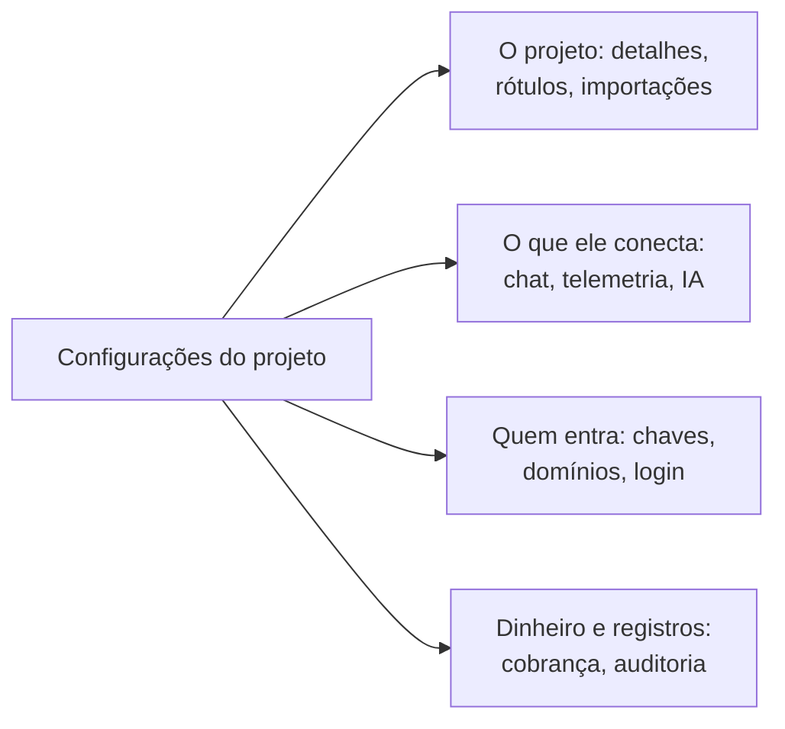

# Configurações do projeto

As configurações do projeto reúnem o que vale para o projeto inteiro: o nome dele, as ferramentas a que se conecta, as chaves, como as pessoas entram, a cobrança e a trilha de auditoria. Quase tudo você configura uma vez e revisita raramente. Esta página é um mapa delas e cobre as configurações que não têm página própria: os detalhes do projeto, os rótulos, os sinalizadores de recursos e a exclusão do projeto.

:::cards
- [Encontrar uma configuração](#encontrar-uma-configuração): O que cada seção do menu lateral contém.
- [Os detalhes do projeto](#os-detalhes-do-projeto): O nome, o ID e o acesso do suporte.
- [Rótulos](#rótulos): Marcadores para recursos, permissões e regras.
- [Excluir o projeto](#excluir-o-projeto): O que exige, e o que vai junto.
:::

## Abrir as configurações do projeto

Acesse **Produtos → Configurações → Configurações do projeto**. O menu lateral agrupa as páginas em seções, e só **Básico** começa aberta: clique no título de uma seção para abri-la. Uma seção se abre sozinha em qualquer página dela.

## Antes de começar

- **Uma função que pode mudar o projeto.** Project Owners e Project Admins mudam a maioria dessas configurações. Cobrança, canais de notificação e a exclusão do projeto exigem mais, como cada seção diz.
- **No OneUptime Cloud, o plano que inclui uma configuração.** Algumas configurações precisam de um plano: veja [Configurações que precisam de um plano](/docs/configuration/billing#configurações-que-precisam-de-um-plano).

## Encontrar uma configuração

| Seção | Páginas | Onde ler mais |
| --- | --- | --- |
| **Básico** | **Projeto**, **Rótulos** | [Os detalhes do projeto](#os-detalhes-do-projeto), [Rótulos](#rótulos) |
| **Espaço de trabalho** | **Slack**, **Microsoft Teams**, **Video Calls** | [Slack](/docs/workspace-connections/slack), [Microsoft Teams](/docs/workspace-connections/microsoft-teams), [Videochamadas](/docs/workspace-connections/video-calls) |
| **Telemetria e APM** | **Chaves de ingestão**, **Retenção de dados** | [Chaves de ingestão](/docs/telemetry/ingestion-keys), [Retenção de dados](/docs/telemetry/data-retention) |
| **Notificações** | **Configurações de notificação**, **Logs de notificação**, **Aplicativos móveis** | [Notificações](#notificações) |
| **IA** | **AI Features**, **Provedores LLM**, **Servidores MCP externos**, **Créditos de IA**, **Registros de IA**, **Servidor MCP** | [Provedores de LLM](/docs/ai/llm-provider), [Servidores MCP externos](/docs/ai/external-mcp-servers), [Servidor MCP](/docs/ai/mcp-server), [AI SRE](/docs/ai/ai-sre#controle-de-custos) |
| **Avançado** | **Domínios**, **Chaves de API**, **Sinalizadores de recursos**, **Importar de outra ferramenta** | [Domínios personalizados](/docs/status-pages/branding-and-domains#domínios-personalizados), [Chaves de API](/docs/permissions/index#chaves-de-api), [Sinalizadores de recursos](#sinalizadores-de-recursos), [Migrar do Opsgenie](/docs/moving-to-oneuptime/opsgenie) e os outros guias de migração |
| **Segurança** | **SSO**, **SCIM** | [SSO](/docs/identity/sso), [SCIM](/docs/identity/scim) |
| **Cobrança e faturas** | **Cobrança**, **Histórico de uso**, **Faturas** | [Cobrança e uso](/docs/configuration/billing) |
| **Registros de auditoria** | **Registros de auditoria**, **Configurações**, **Exportar** | [Registros de auditoria](/docs/configuration/audit-logs), [Exportação do registro de auditoria](/docs/configuration/audit-log-export) |
| **Zona de perigo** | **Zona de perigo** | [Excluir o projeto](#excluir-o-projeto) |

**Cobrança e faturas** e **Créditos de IA** só existem no OneUptime Cloud: uma instalação auto-hospedada não tem cobrança.

## Os detalhes do projeto

**Configurações do projeto → Básico → Projeto** tem dois cartões.

**Detalhes do projeto** mostra o nome do projeto e o ID dele:

- **Nome do projeto**: clique em **Editar: Projeto** para renomear o projeto. Um nome tem pelo menos 2 caracteres. Renomear exige um Project Owner, ou a permissão para editar o projeto ou para gerenciar a cobrança.
- **ID do Projeto**: copie-o para a API, a CLI e o Terraform, ou quando escrever ao suporte.
- **Data Residency**: no OneUptime Cloud, onde os dados do seu projeto devem ficar, quando o OneUptime registrou isso. Só o OneUptime define esse valor.

**Acesso do suporte ao cliente**, no OneUptime Cloud, decide se a equipe de suporte do OneUptime pode abrir o projeto. Ative **Permitir que o suporte da OneUptime acesse este projeto** quando quiser ajuda: o OneUptime pergunta antes, porque o suporte poderá ver e mudar tudo no projeto, e você clica em **Deixar o suporte entrar**. Desative quando terminarem: isso é salvo na hora. Project Owners e Project Admins mudam essa opção.

## Rótulos

Rótulos são marcadores que você coloca em monitores, incidentes, páginas de status e outros recursos. Eles filtram e agrupam listas, e limitam até onde chegam as permissões de uma equipe e as regras do projeto.

:::steps
### Abrir os rótulos

Acesse **Configurações do projeto → Básico → Rótulos**.

### Criar um rótulo

Clique em **Criar: Rótulo**. Dê a ele um **Nome** e, se quiser, uma **Descrição**. **Cor do Rótulo** já vem escolhida, uma cor que nenhum rótulo da página usa ainda: escolha outra se preferir. Clique em **Criar: Rótulo** para salvá-lo.
:::

No OneUptime Cloud, criar e mudar rótulos exige o plano Growth. Veja [Rótulos](/docs/permissions/index#rótulos) para entender como os rótulos limitam permissões, e [Regras de rótulos e proprietários](/docs/configuration/label-and-owner-rules) para rotular recursos quando são criados.

Em uma lista, os rótulos de um registro aparecem um abaixo do outro; quando há mais de quatro, aparecem os três primeiros com um link para os demais. Onde quer que rótulos sejam listados (nas listas, na página de um registro e em todo seletor de rótulos), eles ficam em ordem natural: primeiro os rótulos cujo nome começa com um número, na ordem desse número (`2. Team` antes de `10. Owner`), depois os demais em ordem alfabética, sem diferenciar maiúsculas e minúsculas. Para escolher a ordem dos seus rótulos, comece o nome deles com um número, como `1. Category` e `2. Subcategory`.

### Arquivar um rótulo

Para aposentar um rótulo, arquive-o pelo menu **⋯** da sua linha em vez de excluí-lo. Tudo o que tem o rótulo o mantém e você ainda pode filtrar por ele, mas ninguém pode adicioná-lo a mais nada: todo seletor de rótulos o deixa de fora, e a API, o Terraform e o MCP o recusam. A caixa de diálogo lista as regras e permissões configuradas para usar o rótulo, que continuam usando-o até que você as altere. Os rótulos arquivados são listados à parte, na seção recolhida **Rótulos arquivados**, onde **Desarquivar** devolve um. **Excluir** lista primeiro tudo de onde o rótulo seria removido e oferece **Arquivar em vez disso**.

## Notificações

**Configurações do projeto → Notificações** reúne como o projeto envia notificações:

- **Configurações de notificação**: o cartão **Canais de notificação** ativa ou desativa SMS, chamadas telefônicas, WhatsApp e Telegram para o projeto. Os quatro começam desativados. Quem os ativa é um Project Owner, um **Administrador de cobrança** ou alguém com **Manage Billing**. A página também reúne, recolhidos em **Mais configurações**, os servidores de e-mail próprios do projeto, em **Configurações SMTP Personalizadas** (veja [SMTP](/docs/emails/smtp)), e a conta Twilio própria dele (veja [Integração do Twilio](/docs/self-hosted/twilio-integration)). No OneUptime Cloud, ela mostra o saldo que paga essas mensagens: veja [Saldos pré-pagos](/docs/configuration/billing#saldos-pré-pagos).
- **Logs de notificação**: cada notificação que o projeto enviou, com uma aba por canal: **E-mail**, **SMS**, **WhatsApp**, **Telegram**, **Webhook**, **Chamada**, **Push** e **Espaço de trabalho**.
- **Aplicativos móveis**: onde obter os aplicativos para iOS e Android. Veja [Visão geral dos aplicativos](/docs/mobile-desktop-apps/index).

## Sinalizadores de recursos

**Configurações do projeto → Avançado → Sinalizadores de recursos** ativa ou desativa recursos opcionais do projeto. Cada um é uma chave que salva quando você a aciona. Hoje há **Grupos de monitores**, desativado em um projeto novo: ative-o para adicionar os grupos de monitores ao menu Monitores. Desativá-lo não exclui nenhum grupo. Veja [Grupos de monitores](/docs/monitor/monitor-groups).

## Excluir o projeto

Excluir um projeto exclui tudo o que há nele, para todos os membros: monitores, incidentes, páginas de status, configuração de plantão e telemetria. Nada o traz de volta.

:::steps
### Abrir a zona de perigo

Acesse **Configurações do projeto → Zona de perigo**.

### Clicar em Excluir: Projeto

Clique em **Excluir: Projeto**. Uma caixa de diálogo pede confirmação.

### Digitar o nome do projeto

Digite o nome exatamente como ele é. **Excluir: Projeto** fica bloqueado até você fazer isso. No OneUptime Cloud, a caixa de diálogo também pergunta por que você está saindo: a resposta é opcional.

### Confirmar

Clique em **Excluir: Projeto**. O OneUptime exclui o projeto e tira você dele.
:::

> [!CAUTION]
> A exclusão do projeto não pode ser desfeita. Ela exige um Project Owner, ou a permissão para excluir o projeto.

No OneUptime Cloud, excluir o projeto é a forma de cancelar o plano dele: a cobrança para quando o projeto é excluído. Um projeto cobrado por um marketplace de nuvem recebe uma última cobrança pelo uso, e a compra no marketplace continua ativa até você cancelá-la lá.

## Solução de problemas

:::details Parece faltar uma seção do menu lateral
Todas as seções, exceto **Básico**, começam recolhidas. Clique no título da seção para abri-la. Em uma instalação auto-hospedada não há a seção **Cobrança e faturas** nem a página **Créditos de IA**.
:::

:::details Editar: Projeto está bloqueado
Renomear o projeto exige um Project Owner, ou a permissão para editar o projeto ou para gerenciar a cobrança. O botão bloqueado indica a permissão de que você precisa.
:::

:::details Excluir: Projeto continua bloqueado na caixa de diálogo
Digite o nome do projeto exatamente como a caixa de diálogo o mostra: maiúsculas e minúsculas contam.
:::

## Próximos passos

:::cards
- [Convidar pessoas](/docs/permissions/inviting-people): Trazer sua equipe para o projeto.
- [Cobrança e uso](/docs/configuration/billing): Seu plano, formas de pagamento, faturas e uso.
- [Registros de auditoria](/docs/configuration/audit-logs): Ver quem mudou o quê no projeto.
- [SSO](/docs/identity/sso): Deixar as pessoas entrarem com seu provedor de identidade.
:::
