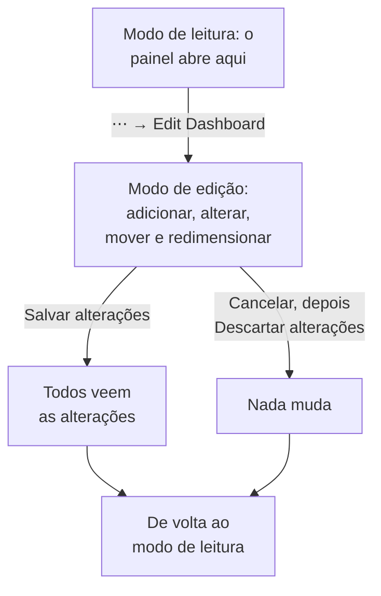

# Criar um painel

Para criar um painel, abra **Produtos → Painéis** e clique em **Criar painel**. A caixa de diálogo **Criar um painel** pergunta como você quer começar e depois um nome. **Começar do zero** dá a você um painel vazio; um modelo cria os widgets dele, e muitas vezes as variáveis, para você, e preenche o nome (numerado, como "Kubernetes Dashboard 2", quando o projeto já tem um). Clique em **Criar painel** e o novo painel se abre. Um painel vazio abre na tela dele, com um botão **Adicionar widget** para o primeiro widget.

:::cards
- [Criar o painel](#criar-o-painel): Começar do zero ou a partir de um modelo.
- [Editar e salvar](#editar-e-salvar): Nada muda para ninguém até você clicar em Salvar alterações.
- [Adicionar um widget](#adicionar-um-widget): Escolha-o no catálogo, configure-o e coloque-o no lugar.
- [Aplicar zoom em um pico](#aplicar-zoom-em-um-pico): Arraste sobre um gráfico para ler o painel inteiro naquele momento.
:::

## Antes de começar

Os proprietários e administradores do projeto podem criar e editar todos os painéis. Os demais precisam de uma permissão de equipe: `CreateDashboard` para criar painéis e `EditDashboard` para alterá-los. Membros e visualizadores do projeto podem ler os painéis sem nenhuma das duas. Quem não pode editar um painel ainda abre o menu **⋯** dele, onde **Editar painel** fica bloqueado e informa qual permissão é necessária.

## Criar o painel

:::steps
### Escolha como começar

Abra **Produtos → Painéis** e clique em **Criar painel**. A caixa de diálogo **Criar um painel** abre em **Começar do zero**, um painel vazio para os seus próprios widgets. Abaixo, **Ou começar a partir de um modelo** lista seis modelos **Recomendados**.

### Escolha um modelo

Clique em um modelo para ver o que ele adiciona: os widgets dele, com os nomes de **Adicionar widget**, e as variáveis com que você o restringe na barra de ferramentas dele. Para os outros, escolha uma categoria ao lado da caixa de pesquisa, ou **Todos os modelos**, ou digite em **Pesquisar modelos…**: cada palavra que você digita tem de corresponder. Depois clique em **Usar este modelo**, ou clique duas vezes no modelo. Na caixa de pesquisa, as setas escolhem um modelo e **Enter** o usa.

### Dê um nome ao painel

O nome de um modelo já vem preenchido, numerado depois dos nomes que o projeto já tem. **Começar do zero** o deixa vazio: digite um. A descrição é opcional, fica recolhida em **Mais campos**, e você pode adicioná-la depois na página **Visão geral** do painel. **Voltar** leva você de volta aos modelos como você os deixou.

### Crie-o

Clique em **Criar painel**. O novo painel se abre: com os widgets de um modelo na hora, ou com uma tela vazia com **Adicionar widget** nela.
:::

Os modelos, pela categoria em que o seletor os lista:

| Categoria | Modelos |
| --- | --- |
| Monitoramento e APM | Monitor Dashboard, Metrics Dashboard, Real User Monitoring Dashboard, SLO Dashboard |
| Resposta a incidentes | Incident Dashboard, Alert Dashboard |
| Infraestrutura | Kubernetes Dashboard, Kubernetes Cost Dashboard, Hosts Dashboard, Proxmox Dashboard, VMware Dashboard, Ceph Dashboard, Storage Array Dashboard, Docker Swarm Dashboard, Network Dashboard |

**Recomendados** reúne Monitor Dashboard, Incident Dashboard, Alert Dashboard, Kubernetes Dashboard, Hosts Dashboard e Metrics Dashboard. Um modelo é um ponto de partida, não um vínculo: depois de criado o painel, mude-o como quiser. O modelo não o atualiza mais depois.

## Editar e salvar

Um painel abre no modo de leitura. Para alterá-lo, abra o menu **⋯** da barra de ferramentas dele e escolha **Editar painel**. A barra de ferramentas mostra **Editando** ao lado do nome e troca o intervalo de tempo e os outros controles por **Adicionar widget**, **Variáveis**, **Cancelar** e **Salvar alterações**, com uma linha abaixo para o **Período padrão** e a **Atualização automática padrão** do painel.

Suas alterações são só suas até você salvá-las. Nada é salvo enquanto você edita, então as outras pessoas continuam vendo o painel como ele estava.

- **Salvar alterações** salva os widgets, suas posições e tamanhos, as variáveis, e o período e a atualização automática padrão, tudo de uma vez, e volta ao modo de leitura. Se o salvamento for recusado, por exemplo porque você perdeu a permissão nesse meio-tempo, você continua no modo de edição com suas alterações, e o motivo aparece acima da grade.
- **Cancelar** pergunta antes, porque descarta suas alterações: **Descartar alterações** volta ao painel como ele foi salvo, e **Continuar Editando** devolve você ao seu trabalho.

Durante a edição, a atualização automática fica em pausa, e um intervalo de tempo com zoom volta ao intervalo que você escolheu.

## Adicionar um widget

:::steps
### Abra o catálogo de widgets

Clique em **Adicionar widget**: na barra de ferramentas durante a edição, ou na tela de um painel vazio. O catálogo agrupa os widgets pelo que eles mostram. Digite na caixa de pesquisa para encontrar um pelo nome ou pela finalidade ("error budget", "pods"), e pressione Enter para adicionar o primeiro resultado.

### Escolha um widget

Clique nele. O widget vai para o primeiro espaço livre da grade em que ele cabe, e as configurações dele se abrem.

### Defina o que ele mostra

A caixa de diálogo de configurações mostra uma **Live Preview** do widget acima das configurações, e a prévia acompanha cada alteração que você faz. Escolha o que o widget lê (uma consulta de métricas, um filtro, um texto) e a aparência dele, depois clique em **Concluído**.

### Coloque-o no lugar

Arraste o widget para movê-lo, e arraste as bordas ou os cantos dele para redimensioná-lo. Veja [Widgets na grade](#widgets-na-grade).
:::

[Widgets de painel](/docs/dashboards/widgets) lista cada widget e as configurações dele.

## Widgets na grade

A tela é uma grade de doze colunas de largura. Os widgets se encaixam nela, e a página cresce para baixo à medida que você adiciona linhas. Enquanto você arrasta um widget, um contorno tracejado mostra onde ele vai ficar, com a coluna e a linha dele; enquanto você redimensiona um, o contorno mostra o tamanho dele em unidades da grade. Os widgets que estão no caminho se afastam, então dois widgets nunca se sobrepõem.

Cada tipo de widget tem um tamanho mínimo, para que o que ele desenha continue legível: um gráfico tem pelo menos seis colunas de largura e três linhas de altura, enquanto um único número cabe em uma célula.

Para alterar um widget depois, clique nele durante a edição. As configurações dele se abrem de novo, com mais dois botões embaixo:

- **Duplicate Widget** adiciona uma cópia, com as mesmas configurações, no primeiro espaço livre.
- **Excluir widget** o remove, depois que você confirma.

## Intervalo de tempo e atualização automática

No modo de leitura, o seletor de intervalo de tempo da barra de ferramentas define a janela que todos os widgets de gráfico, número, log e trace leem. Escolha uma predefinição, dos últimos 5 minutos aos últimos 3 meses, ou um início e um fim personalizados. O painel abre no seu período padrão: a última hora, a menos que quem o edita defina outro.

As listas de incidentes, alertas, monitores e recursos mostram o estado atual, seja qual for o intervalo de tempo.

Ao lado do intervalo de tempo, o menu de atualização automática lê cada widget de novo a cada 5 segundos, 10 segundos, 30 segundos, 1 minuto, 5 minutos ou 15 minutos, com uma contagem regressiva até a próxima atualização. Deixe-a desligada enquanto investiga, para a visualização ficar parada. O painel abre com a sua atualização automática padrão: desligada, a menos que quem o edita defina outra.

O seletor de intervalo de tempo, as variáveis e a atualização automática aparecem assim que o painel tem um widget.

### Os padrões do painel

Enquanto você edita o painel, a linha abaixo dos botões da barra de ferramentas define com o que todos o abrem: **Período padrão**, uma predefinição dos últimos 5 minutos aos últimos 3 meses, e **Atualização automática padrão**. **Salvar alterações** os salva com o resto do painel, tanto para a sua equipe quanto para os visitantes do link público dele. Um início e um fim personalizados não podem ser um padrão: o painel ficaria parado naquele momento para sempre. A linha aparece assim que o painel tem um widget.

Os painéis salvos antes dessas configurações abrem na última hora, com a atualização automática que tinham. Pela API e pelo Terraform, os dois ficam no `dashboardViewConfig` do painel: `timeRange`, uma predefinição escrita como na referência da API, por exemplo `Past 1 Day`, e `refreshInterval`, por exemplo `1m`. Qualquer outro valor é recusado.

### As suas escolhas

O intervalo de tempo e a atualização automática que você escolhe no modo de leitura são só seus, e o seu navegador os lembra para cada painel: um recarregamento, um reinício do navegador ou o de uma tela de parede abre o painel como você o deixou. Só uma predefinição é lembrada. Um intervalo personalizado ou um zoom dura até você sair da página, para que o painel nunca fique parado num momento passado.

A primeira opção de cada seletor mostra o padrão do painel, como em Padrão (Past 1 Day). Escolha-a para voltar ao padrão: o navegador esquece a sua escolha, e o painel volta a seguir o seu padrão, mesmo quando alguém o muda depois. Quando você mesmo salva novos padrões, já os vê na hora.

### Aplicar zoom em um pico

Você não precisa recorrer ao seletor de intervalo de tempo para examinar um pico. Arraste sobre o trecho interessante de qualquer gráfico de linhas ou de áreas e **o painel inteiro** passa para essa janela, exatamente como se você a tivesse escolhido no seletor de intervalo de tempo: todo widget que usa o intervalo de tempo refaz a consulta junto, então você lê um mesmo momento no painel todo, em vez de um gráfico numa escala diferente da dos vizinhos. As listas ao vivo continuam mostrando o que está acontecendo agora, como sempre.

**Clique duas vezes em qualquer gráfico** para desfazer: o painel volta ao intervalo que tinha antes de você começar o zoom, não importa quantas vezes você tenha aprofundado. Um botão **Redefinir zoom** aparece ao lado do seletor de intervalo de tempo enquanto um zoom está ativo, e clicar duas vezes num painel sem zoom não faz nada.

Uma janela com zoom é fixa, então ela para de avançar enquanto a atualização automática está ligada; isso é proposital, porque uma janela que escapasse no meio de uma investigação seria pior. Redefina o zoom para que ela volte a avançar.

O zoom só funciona no modo de leitura; no modo de edição, arrastar move e redimensiona os widgets. Gráficos de barras aplicam zoom do mesmo jeito (arraste sobre as barras), e clicar duas vezes em um deles redefine o painel como qualquer outro gráfico. Só um arraste aplica zoom: um clique simples num gráfico nunca muda o intervalo do painel. Os mesmos gestos funcionam nos gráficos de todo o OneUptime; veja [Aplicar zoom em um intervalo de tempo](/docs/telemetry/charts-and-time-ranges).

## Tela cheia

**⋯ → Tela cheia** mostra os widgets do painel na tela inteira, para um monitor na parede ou uma reunião. Pressione Esc para sair.

## Dicas para painéis que envelhecem bem

- **Um assunto por painel.** Alguns painéis focados valem mais do que uma página com tudo o que você acompanha.
- **Coloque o widget mais importante no topo.** As pessoas leem de cima para baixo, então faça a primeira coisa que elas veem responder "está tudo saudável?"
- **Nomeie as seções com widgets de Texto.** Um título curto a cada poucas linhas ("Latência", "Erros", "Capacidade") deixa a página fácil de percorrer mesmo do outro lado da sala.
- **Use variáveis em vez de cópias.** Se você está prestes a criar o mesmo painel para um segundo serviço, adicione uma variável `service`. Veja [Variáveis e filtros de painel](/docs/dashboards/variables).
- **Faça uma cópia antes de uma grande mudança.** **Duplicar: Painel**, na página **Configurações** do painel, cria uma cópia segura para testar suas ideias.

## Próximos passos

:::cards
- [Widgets de painel](/docs/dashboards/widgets): Cada widget, as configurações dele e qual escolher.
- [Variáveis e filtros de painel](/docs/dashboards/variables): Um painel para cada serviço, host ou cliente.
- [Compartilhamento e painéis públicos](/docs/dashboards/sharing): Compartilhe o painel fora da sua equipe.
- [Configuração e permissões de painel](/docs/dashboards/configuration): Proprietários, rótulos, arquivamento e quem pode fazer o quê.
:::
