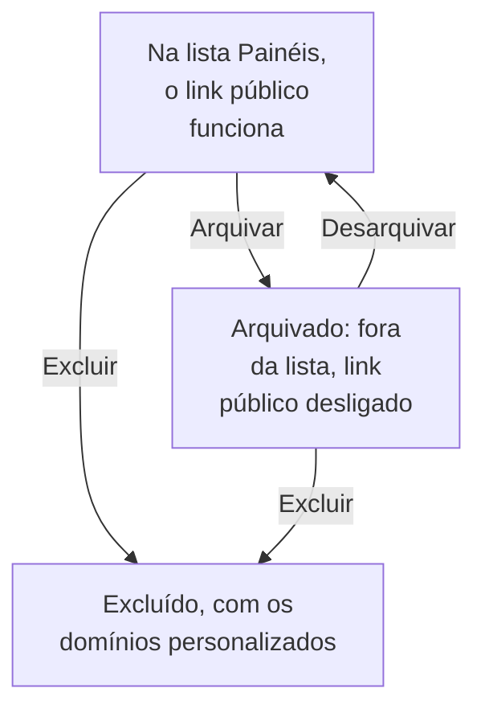

# Configuração e permissões de painel

Quando você tem um painel que vale a pena manter, esta página explica quem pode lê-lo e alterá-lo, como os proprietários e os rótulos organizam os seus painéis, e como copiar, exportar, arquivar e excluir um.

:::cards
- [Quem pode fazer o quê](#quem-pode-fazer-o-quê): As permissões por trás de cada ação, e quem as tem.
- [Proprietários](#proprietários): Os usuários e as equipes a que um painel pertence.
- [Duplicar um painel](#duplicar-um-painel): Uma cópia segura, já numerada.
- [Arquivar um painel](#arquivar-um-painel): Guardar um painel sem excluí-lo.
:::

## Quem pode fazer o quê

Os painéis seguem as [permissões](/docs/permissions/index) do seu projeto. Cada ação exige uma destas, obtida por meio de uma equipe:

| Para | É preciso |
| --- | --- |
| Ler painéis | `ReadDashboard`, ou um papel no projeto: Project Owner, Project Admin, Project Member, Viewer ou um papel Settings |
| Criar painéis | `CreateDashboard`, Project Owner ou Project Admin |
| Alterar um painel: os widgets, as variáveis, o compartilhamento e a marca dele, e arquivá-lo | `EditDashboard`, Project Owner ou Project Admin |
| Excluir um painel | `DeleteDashboard`, Project Owner ou Project Admin |
| Adicionar e remover proprietários | As permissões de proprietários de painel, Project Owner, Project Admin ou Project Member |
| Adicionar e alterar domínios personalizados | As permissões de domínios de painel, Project Owner, Project Admin, Project Member, Settings Admin ou Settings Member |
| Criar regras de proprietário e regras de rótulos | As permissões de regras, Project Owner ou Project Admin |

Então um Project Member lê todos os painéis, mas precisa de `CreateDashboard` e `EditDashboard` para montá-los. Ler, editar e excluir podem, cada um, ser limitados aos painéis que uma equipe possui, ou aos painéis que têm certos rótulos: veja [Escopo: até onde vai uma permissão concedida](/docs/permissions/index#escopo-até-onde-vai-uma-permissão-concedida).

Atribua-as na página **Permissões** de uma equipe: abra **Produtos → Equipes** e escolha a equipe.

Quem pode ver um painel fora do projeto é outra questão, respondida na página **Compartilhamento** dele: veja [Acesso a painéis públicos](#acesso-a-painéis-públicos).

## Proprietários

Os **proprietários** de um painel são os usuários e as equipes a que ele pertence. Adicione-os na página **Proprietários** do painel, ou selecione vários painéis na lista **Painéis** e adicione proprietários a todos de uma vez.

Os proprietários restringem o acesso quando você pede: uma permissão de equipe limitada aos painéis que a equipe possui só alcança os painéis que têm essa equipe, ou a pessoa que está agindo, como proprietária. A propriedade sozinha não concede nada.

A lista **Painéis** mostra os proprietários de cada painel, e o filtro **Proprietário** dela encontra os painéis de uma pessoa ou de uma equipe.

## Rótulos

Os rótulos são etiquetas para organizar os painéis. Adicione-os na página **Visão geral** do painel, onde você também edita o nome e a descrição dele, ou a vários painéis de uma vez pela lista **Painéis**.

Padrões comuns:

- **Por equipe**: `team:platform`, `team:checkout`, `team:growth`.
- **Por ambiente**: `env:prod`, `env:staging`.
- **Por finalidade**: `purpose:oncall`, `purpose:exec`, `purpose:investigation`.

O filtro **Rótulos** da lista **Painéis** é o jeito mais rápido de encontrar um painel num projeto que acumulou muitos. Os rótulos também limitam as permissões: uma permissão de equipe restrita a certos rótulos só alcança os painéis que têm um deles.

## Regras de proprietário e de rótulos

Em vez de adicionar proprietários e rótulos à mão, deixe as regras fazerem isso. Em **Configurações**, no menu lateral de **Painéis**, as **Regras de proprietário** adicionam proprietários e as **Regras de Rótulos** adicionam rótulos a cada painel novo que corresponde a elas: pelos rótulos que ele já tem, ou por um padrão no nome ou na descrição dele. [Regras de rótulos e proprietários](/docs/configuration/label-and-owner-rules) explica como as regras correspondem, e como aplicar uma aos painéis que você já tem.

## Acesso a painéis públicos

Quem pode ver um painel fora do projeto é uma única escolha na página **Compartilhamento** dele (também **⋯ → Partilhar** no próprio painel; veja [Compartilhamento e painéis públicos](/docs/dashboards/sharing)):

1. **Apenas pessoas deste projeto** (o padrão): o painel não tem link público; o endereço público dele mostra uma página de não encontrado.
2. **Qualquer pessoa com o link**: quem tiver o link público pode vê-lo, sem entrar.
3. **Qualquer pessoa com o link e uma senha**: os visitantes digitam uma senha antes de o painel aparecer.

Em **Mais configurações** na mesma página, a **Lista de IPs permitidos** (plano Scale) recusa as requisições ao link público de qualquer endereço IP que não esteja nela. A configuração pública mais fechada é **Qualquer pessoa com o link e uma senha** com uma lista de IPs permitidos, útil para portais de parceiros em que você quer as duas camadas.

## Duplicar um painel

Para copiar um painel, abra-o, vá à página **Configurações** dele e clique em **Duplicar: Painel**. O nome da cópia é preenchido para você: o nome do painel, numerado depois dos nomes que o projeto já tem ("Checkout API" é copiado como "Checkout API 2", e uma cópia dessa como "Checkout API 3"). Mude-o se quiser, confirme com **Duplicar: Painel**, e a cópia se abre. Ela tem os widgets, as variáveis, a descrição e os rótulos do painel. A marca e os domínios personalizados ficam com o original, e o compartilhamento público sempre começa desligado, para você decidir se quer ligá-lo.

É a escolha certa quando você quer derivar de um modelo (como "o nosso painel de plantão") uma cópia específica para um serviço.

## Exportar e importar

Um painel viaja como JSON:

- **Exportar: Painel**, na página **Configurações** do painel, baixa-o como um arquivo JSON. Para exportar vários, selecione-os na lista **Painéis** e escolha **Exportar JSON**.
- **Importar JSON**, acima da lista **Painéis**, cria painéis a partir de um arquivo assim, neste projeto ou em outro.

Uma exportação contém as configurações próprias do painel, entre elas os widgets e as variáveis. Os proprietários e os rótulos ficam de fora, e os widgets que apontam para recursos deste projeto, como um SLO ou uma fonte de dados, podem precisar que eles sejam escolhidos de novo em outro projeto.

## Arquivar um painel

Arquive um painel que você não usa mais, mas quer manter. Um painel arquivado sai da lista **Painéis** e, se for público, o link público dele para de funcionar: a URL e os domínios personalizados dele respondem "Dashboard not found". Os widgets, as variáveis, a marca, os domínios e as configurações públicas dele são todos mantidos, então desarquivá-lo o devolve exatamente como estava, inclusive o link público.

Para arquivar um painel, abra-o, vá à página **Configurações** dele e clique em **Arquivar**. Para arquivar vários, selecione-os na lista **Painéis** e escolha **Arquivar**. Para recuperar um, abra **Painéis → Avançado → Arquivado**, selecione-o e escolha **Desarquivar**, ou abra-o e clique em **Desarquivar** no aviso no topo das páginas dele.

Arquivar é a alternativa reversível a excluir: recorra a isso primeiro quando não tiver certeza.

## Excluir um painel

Abra a página **Excluir** do painel. A exclusão não pode ser desfeita: o painel, os widgets e as variáveis dele, e todos os domínios personalizados associados a ele são removidos. A sua telemetria não é afetada.

Se o painel for público num domínio personalizado, o endereço para de responder assim que você o exclui. Para continuar servindo o endereço, adicione o domínio a outro painel depois de excluir este: um domínio pertence a um único painel por vez.

## Registros de auditoria

A página **Registros de auditoria** do painel lista cada alteração feita no painel, e quem a fez. Os registros de auditoria fazem parte do plano Enterprise e da [Edição Enterprise](/docs/self-hosted/enterprise).

## Retenção de dados e backups

Os painéis em si não expiram. Os dados que eles mostram seguem as configurações de retenção do seu projeto: com o intervalo de tempo nos últimos 3 meses, um projeto que guarda os logs por 15 dias mostra os últimos 15 dias deles.

Se você hospeda o OneUptime por conta própria, um backup regular do banco de dados basta: a configuração de um painel é guardada com o resto do seu projeto. No OneUptime Cloud, os backups são feitos para você. Para ter uma cópia sua, exporte o painel como JSON, ou leia-o pela [API do OneUptime](/docs/api-reference/api-reference).

## Próximos passos

:::cards
- [Compartilhamento e painéis públicos](/docs/dashboards/sharing): Links públicos, senhas, listas de IPs permitidos e domínios personalizados.
- [Usuários, equipes e permissões](/docs/permissions/index): Equipes, papéis, escopos e bloqueios.
- [Variáveis e filtros de painel](/docs/dashboards/variables): Um painel para cada serviço.
- [Visão geral dos painéis](/docs/dashboards/index): O panorama geral.
:::
