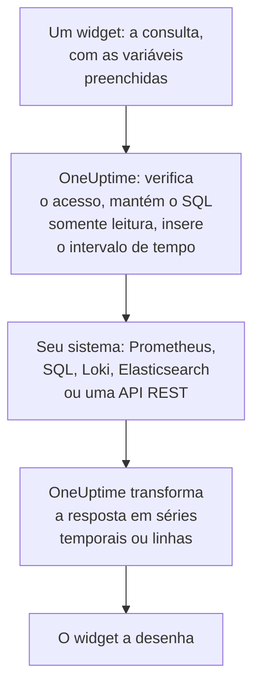

# Fontes de dados externas

Uma fonte de dados externa conecta um sistema fora do OneUptime, como Prometheus, um banco de dados SQL, ClickHouse, Loki, Elasticsearch ou uma API REST, para que os seus painéis possam mostrar os dados dele ao lado dos seus. Você conecta o sistema uma vez; depois, cada widget executa uma consulta somente leitura na própria linguagem desse sistema.

:::cards
- [Conectar uma fonte de dados](#conectar-uma-fonte-de-dados): Escolha o tipo, depois diga onde ele está e como entrar.
- [Escrever uma consulta](#escrever-uma-consulta): PromQL, SQL, LogQL, Query DSL ou uma requisição.
- [Limites](#limites): Os tempos limite e os tetos que protegem os dois lados.
- [Segurança](#segurança): Consultas somente leitura e credenciais somente gravação.
:::

## Como uma consulta é executada

O widget envia a consulta ao OneUptime, com as variáveis já preenchidas. O OneUptime verifica se você pode ler a fonte de dados, insere o intervalo de tempo e consulta o seu sistema com as credenciais que guarda. Depois, transforma a resposta em séries temporais ou linhas para o widget desenhar.



## Antes de começar

- **Um plano que a inclua.** No OneUptime Cloud, criar e alterar fontes de dados exige o plano **Growth**. Excluir uma funciona em todos os planos.
- **Uma permissão para adicioná-las.** Os proprietários e administradores do projeto podem adicionar fontes de dados; os demais precisam de `CreateDataSource`, com `EditDataSource` e `DeleteDataSource` para alterá-las e removê-las. Todos que podem ler as fontes de dados do projeto, inclusive membros e visualizadores, veem os dados dos widgets delas.
- **Uma conta somente leitura.** Os painéis só leem. Conecte os bancos de dados com uma conta que só possa ler, e as fontes HTTP com um token que só possa consultar.
- **Um caminho de acesso.** É o servidor de API do OneUptime que se conecta ao seu sistema, então ele precisa conseguir alcançá-lo: veja [Segurança](#segurança) para os endereços que são recusados.

## Sistemas suportados

| Tipo | Linguagem de consulta | Funciona com |
| --- | --- | --- |
| Prometheus | PromQL | Prometheus, Thanos, Cortex, Mimir, VictoriaMetrics |
| PostgreSQL | SQL | PostgreSQL, TimescaleDB, CockroachDB |
| MySQL | SQL | MySQL, MariaDB |
| Microsoft SQL Server | T-SQL | SQL Server, Azure SQL |
| ClickHouse | SQL | ClickHouse, pela sua interface HTTP |
| Grafana Loki | LogQL | Loki e endpoints compatíveis com o Loki |
| Elasticsearch | Query DSL (JSON) | Elasticsearch, OpenSearch |
| REST API | Requisição (JSON) | Qualquer API HTTP(S) que responda com JSON |

## Conectar uma fonte de dados

:::steps
### Abra as fontes de dados

Abra **Produtos → Painéis**, expanda **Configurações** no menu lateral e clique em **Fontes de dados**.

### Escolha o tipo

Clique em **Criar: Data Source**. A caixa de diálogo **Choose a Data Source Type** agrupa os tipos pelo que eles guardam: métricas, logs, bancos de dados, busca e APIs. Clique em um.

### Dê um nome a ela

Em **Informações básicas**, dê a ela um **Nome**, como "Prometheus de produção", e uma **Descrição**, se quiser.

### Diga onde ela está

Em **Conexão**, uma fonte HTTP recebe a **URL** em que responde. Um banco de dados recebe o seu **Database Host**, a sua **Database Port** (deixe vazia para 5432, 3306, 1433 ou 8123) e o seu **Nome do Banco de Dados**.

### Diga como entrar

Em **Autenticação**, informe um **Nome de usuário** e uma **Senha** ou, para uma fonte HTTP, um **Token de API**, enviado como token bearer. **Mais campos** contém **Custom HTTP Headers**, como `{ "X-Scope-OrgID": "tenant-1" }`, e **Additional Options**: `sslEnabled` e `sslRejectUnauthorized` para bancos de dados, e `elasticsearchIndex` para o Elasticsearch, que sem ele lê todos os índices (`*`).

### Teste-a

Clique em **Criar: Data Source** e depois em **Testar** na linha dela. O OneUptime se conecta com os dados que você informou, e diz se funcionou ou o que deu errado.
:::

Para alterar uma fonte de dados depois, abra-a pela lista. **Editar** em **Data Source Details** altera tudo menos os segredos; **Atualizar credenciais** substitui a senha, o token ou os cabeçalhos, e deixa como estavam os campos que você deixar vazios; **Testar** verifica de novo.

## Usar em um widget

Edite um painel, clique em **Adicionar widget** e escolha um widget do grupo Fontes de dados externas: um **Gráfico**, um **Valor**, um **Medidor** ou uma **Tabela**. Nas configurações dele:

- Escolha a **Data Source** e escreva a **Consulta**. O editor indica a linguagem de consulta e mostra um exemplo para o tipo.
- Num gráfico, **Adicionar consulta** sobrepõe mais consultas nos mesmos eixos, e **Legend (optional)** dá nome a cada série a partir dos rótulos dela: `{{instance}} — errors` escreve na frente o rótulo `instance` da série.
- Num valor ou num medidor, **Reduce** transforma os pontos em um único número: o último valor (o padrão), o primeiro, a média, a soma, o mínimo ou o máximo. **Unit** adiciona um sufixo, e ajusta a escala das unidades conhecidas: `Bytes` aparece como 1.5 MB, e `ms` como 2.4 s.
- Numa tabela, qualquer consulta somente leitura funciona, e as linhas aparecem como chegam.

## Escrever uma consulta

Cada tipo usa a sua própria linguagem, com as mesmas regras sobre o que volta:

- **Gráficos, valores e medidores precisam de séries temporais.** Uma consulta SQL retorna uma coluna de tempo chamada `time`, `timestamp`, `date` ou `ts`, e uma coluna numérica `value` (ou a primeira coluna numérica dela); todas as outras colunas viram rótulos da série. O Elasticsearch precisa de uma agregação `date_histogram`, e o Loki de uma consulta de métricas como `rate()` ou `count_over_time()`.
- **As tabelas mostram linhas** como a consulta as retorna: linhas SQL, séries do Prometheus, linhas de log do Loki, resultados do Elasticsearch, ou os objetos no `rowsPath` de uma API REST.

:::tabs
@tab Prometheus
```text title="PromQL"
sum by (job) (rate(http_requests_total{job=~"{{job}}"}[5m]))
```
@tab SQL
```sql title="SQL"
SELECT date_trunc('minute', created_at) AS time, COUNT(*) AS value
FROM orders
WHERE created_at BETWEEN $__startTime AND $__endTime
GROUP BY 1
ORDER BY 1
```
@tab Loki
```text title="LogQL"
sum by (app) (rate({app="api"} |= "error" [5m]))
```
@tab Elasticsearch
```json title="Query DSL"
{
  "query": { "range": { "@timestamp": { "gte": "$__startTime", "lte": "$__endTime" } } },
  "aggs": {
    "over_time": {
      "date_histogram": { "field": "@timestamp", "fixed_interval": "1m" }
    }
  }
}
```
@tab REST API
```json title="Request"
{
  "path": "/api/stats?from=$__startTimeMs&to=$__endTimeMs",
  "method": "GET",
  "rowsPath": "data.items",
  "timestampField": "time",
  "valueField": "count",
  "seriesField": "service"
}
```
:::

### Macros de tempo

O Prometheus e o Loki recebem o intervalo de tempo do painel em cada requisição, então as consultas deles não precisam de mais nada. Os outros tipos colocam o intervalo de tempo onde você escreve uma macro:

| Macro | Vira | Em |
| --- | --- | --- |
| `$__startTime`, `$__endTime` | O início e o fim do intervalo, em UTC: `'2026-10-13 09:00:00'` no SQL, ISO 8601 nos demais | SQL, Elasticsearch, REST API |
| `$__startTimeMs`, `$__endTimeMs` | O mesmo, em milissegundos desde 1970 | SQL, Elasticsearch, REST API |
| `$__rangeSeconds` | A duração do intervalo, em segundos | SQL |

As macros SQL são escritas em UTC, então execute as sessões do seu banco de dados em UTC, ou faça a conversão na consulta.

### Variáveis do painel

Escreva `{{name}}` em qualquer lugar de uma consulta, e o widget coloca ali o valor da variável antes de enviar a consulta. Vários valores de uma variável de seleção múltipla são unidos com `|`, que é o que um seletor de expressão regular do PromQL ou do LogQL precisa: `job=~"{{job}}"`. Uma variável sem nada escolhido deixa o marcador como está escrito, então o erro o nomeia. [Variáveis e filtros de painel](/docs/dashboards/variables) mostra como adicionar uma.

## Limites

Toda consulta tem limites, para que um painel de vinte widgets atualizado a cada minuto não sobrecarregue o OneUptime nem o seu sistema:

| Limite | Valor |
| --- | --- |
| Conexão | 10 segundos |
| Execução de uma consulta | 30 segundos |
| Pontos numa resposta de série temporal | 11.000 |
| Linhas numa tabela | 1.000 |
| Séries numa resposta | 100 |
| Resposta de uma fonte HTTP | 20 MB |

As consultas de intervalo do Prometheus e do Loki pedem cerca de 250 pontos ao longo do intervalo de tempo, com no mínimo 10 segundos e no máximo um dia entre eles.

## Segurança

- **O SQL continua somente leitura.** Uma consulta precisa ser uma única instrução que comece com `SELECT`, `WITH`, `SHOW`, `EXPLAIN`, `DESCRIBE` ou `DESC`. Palavras que gravam ou alteram uma sessão, como `INSERT`, `UPDATE`, `DELETE`, `DROP`, `INTO` ou `SET`, são recusadas em qualquer lugar fora de strings e de nomes entre aspas, então coloque entre aspas uma coluna com o nome de uma delas. Escreva uma aspa dentro de uma string como duas aspas (`''`): uma barra invertida antes de uma aspa é recusada. As sessões do PostgreSQL, do MySQL e do ClickHouse também são somente leitura. O SQL Server não tem sessão somente leitura, então conecte-o com um login somente leitura.
- **As credenciais são somente gravação.** **Senha**, **Token de API** e **Custom HTTP Headers** são criptografados em repouso, e a API nunca os retorna, nem para você.
- **Os endereços são verificados.** Endereços de loopback, de link local (onde ficam os metadados da nuvem) e outros endereços reservados são recusados em todos os casos. Endereços privados são recusados no OneUptime Cloud, e permitidos numa instalação auto-hospedada, a menos que `DATA_SOURCE_BLOCK_PRIVATE_ADDRESSES` seja `true`: veja [Acesso à rede privada](/docs/self-hosted/private-network-access).
- **Os painéis públicos nunca as executam.** Os widgets de Fontes de dados externas ficam fora de um [painel público](/docs/dashboards/sharing), com consultas e tudo.

## Solução de problemas

:::details Testar diz que não consegue conectar
Verifique a URL, ou o host e a porta, a partir de onde o OneUptime roda: um firewall, um endereço privado no OneUptime Cloud ou um banco de dados que só escuta na própria máquina parecem iguais daqui. Para um banco de dados que exige TLS, adicione `{ "sslEnabled": true }` em **Additional Options**.
:::

:::details "Only read-only queries are allowed"
A consulta não começa com `SELECT`, `WITH`, `SHOW`, `EXPLAIN`, `DESCRIBE` ou `DESC`. Envie uma única instrução que só leia: uma segunda instrução depois de um `;` também é recusada, com "Only a single SQL statement is allowed per query."
:::

:::details "Query contains a keyword that is not allowed"
Uma palavra que grava aparece fora de uma string, muitas vezes como nome de coluna, como `delete` ou `set`. Coloque-a entre aspas como o banco de dados faz: `"delete"` no PostgreSQL, `[delete]` no SQL Server, e entre crases no MySQL e no ClickHouse.
:::

:::details O gráfico fica vazio, mas a tabela mostra linhas
A consulta retorna linhas, mas nenhuma série temporal. Chame a coluna de tempo de `time` e o número de `value` no SQL, adicione uma agregação `date_histogram` no Elasticsearch, ou transforme uma consulta de logs do Loki numa consulta de métricas com `rate()` ou `count_over_time()`.
:::

:::details Faltam alguns dados
A resposta atingiu um [limite](#limites). Restrinja o intervalo de tempo, filtre a consulta ou agregue-a em menos séries.
:::

## Próximos passos

:::cards
- [Widgets de painel](/docs/dashboards/widgets): Cada widget, inclusive o grupo Fontes de dados externas.
- [Variáveis e filtros de painel](/docs/dashboards/variables): Variáveis para usar nas suas consultas.
- [Acesso à rede privada](/docs/self-hosted/private-network-access): Alcance sistemas numa rede privada a partir de uma instalação auto-hospedada.
- [Configuração e permissões de painel](/docs/dashboards/configuration): Quem pode adicionar fontes de dados, e quem as lê.
:::
