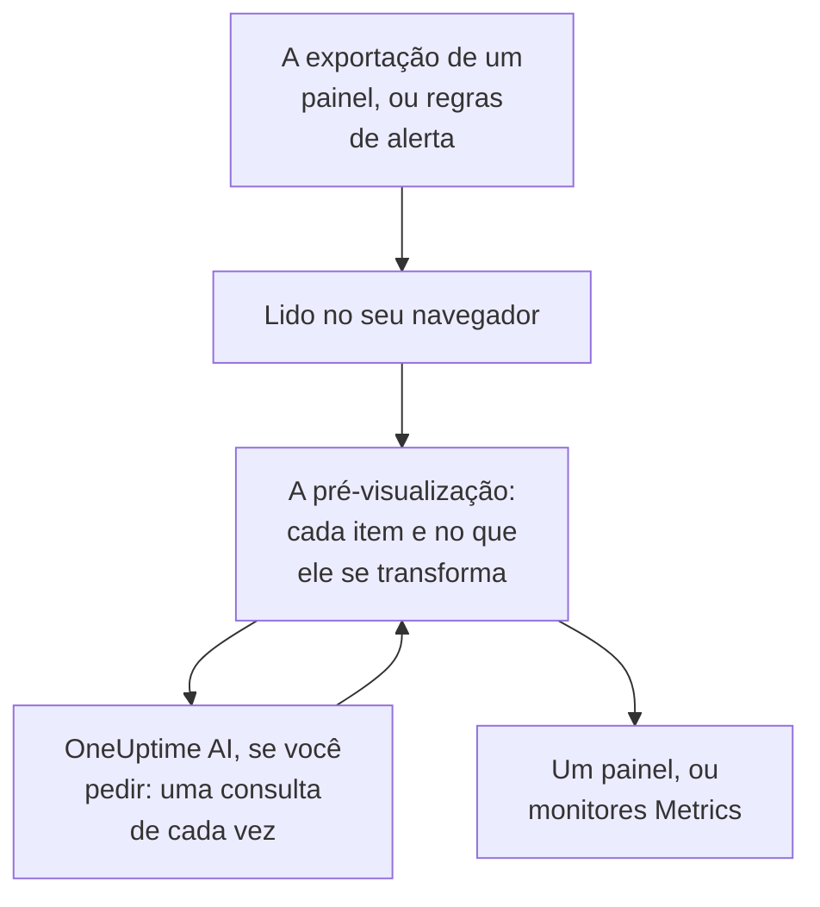

# Importar do Grafana e do Datadog

Traga para o OneUptime um painel que você montou no Grafana ou no Datadog, ou as regras de alerta que escreveu para Prometheus, Grafana ou Datadog. Você cola ou envia o arquivo, vê no que cada painel e cada regra se transforma e só então cria o painel ou os monitores.

:::cards
- [Importar um painel](#importar-um-painel): O modelo JSON de um painel do Grafana, ou a exportação de um painel do Datadog.
- [Importar regras de alerta](#importar-regras-de-alerta): Arquivos de regras do Prometheus, regras de alerta do Grafana e monitores do Datadog.
- [Como cada item é convertido](#como-cada-item-é-convertido): Com exatidão, de forma aproximada ou não, e por quê.
- [Converter uma consulta com o OneUptime AI](#converter-uma-consulta-com-o-oneuptime-ai): Para uma consulta que nenhuma regra converte.
:::

## Como uma importação funciona

O OneUptime lê o arquivo no seu navegador e converte cada painel, widget, variável e regra separadamente. A pré-visualização lista todos com aquilo em que cada um se transforma. Nada é criado até você escolher criar, e então é criado com as suas próprias permissões, como os formulários de painel e de monitor criam.

## Antes de começar

- Os widgets e monitores importados leem as métricas deste projeto com PromQL. Envie-as com Prometheus remote write, OpenTelemetry ou o Datadog Agent, e elas mantêm os nomes que têm lá.
- Importar um painel exige uma função que possa criar painéis, e importar regras de alerta uma função que possa criar monitores.
- Um arquivo pode ter até 10 MB, e são lidos até 500 dos seus painéis ou regras.

## Importar um painel

:::steps
### Abrir a importação de painéis

Abra **Produtos → Painéis** e depois **Mais opções → Import from Grafana or Datadog**.

### Colar o painel

No Grafana, copie o modelo JSON nas configurações do painel. No Datadog, exporte o JSON do painel. Cole-o, ou escolha **Upload a File**, e depois escolha **Pré-visualização**.

### Criar o painel

Confira no que cada painel e cada variável se transforma, dê um nome ao painel e escolha **Criar painel**. O novo painel se abre.
:::

O PromQL do Grafana é mantido como está escrito: o OneUptime preenche `$__interval`, `$__rate_interval` e `$__range` como o Grafana faz, e uma variável em All corresponde a todos os valores. Uma consulta do Datadog vira PromQL sobre as métricas que o Datadog Agent enviou: `avg:system.cpu.user{host:web-1}` lê `system_cpu_user{host="web-1"}`.

## Importar regras de alerta

:::steps
### Abrir a importação de alertas

Abra **Produtos → Monitores** e depois **Mais opções → Import Alerts**.

### Colar as regras

Cole um arquivo de regras do Prometheus ou um recurso PrometheusRule, a exportação das regras de alerta do Grafana ou monitores do Datadog exportados como JSON, e depois escolha **Pré-visualização**.

### Criar os monitores

Desmarque as regras que não quiser, escolha em **When a rule fires** o que uma regra disparada abre e escolha **Criar monitores**.
:::

Cada regra vira um monitor Metrics com uma consulta PromQL, a condição da regra e a sua janela. Ele abre um alerta, ou um incidente, para cada série que ultrapassa o limite, e o resolve quando a série se recupera. O título e a descrição vêm do resumo ou da mensagem da regra, com os rótulos da série preenchidos.

## Como cada item é convertido

| Status | O que significa |
| --- | --- |
| **Converted exactly** | Lê os mesmos dados e os mostra da mesma maneira. |
| **Converted approximately** | É criado, e as suas notas dizem o que muda. |
| **Not converted** | Nada é criado para ele, e as suas notas dizem por quê. |

Não são convertidas as regras de gravação, as regras de alerta sobre logs, os widgets do Datadog que leem logs, traces ou eventos, nem os monitores de anomalias, valores atípicos e previsões do Datadog.

## Converter uma consulta com o OneUptime AI

Uma consulta que nenhuma regra converte mostra **Convert with OneUptime AI**, que exige a IA ativada para o projeto. Só essa consulta, com os nomes das variáveis do painel, vai para o [provedor de LLM](/docs/ai/llm-provider) do seu projeto. A resposta é verificada como qualquer consulta e mostrada a você: escolha **Use This Query** para usá-la. Nada é criado até você criar o painel ou os monitores.

## Próximos passos

:::cards
- [Widgets de painel](/docs/dashboards/widgets): Mude o que um widget importado mostra.
- [Variáveis e filtros de painel](/docs/dashboards/variables): As variáveis que uma importação criou.
- [Monitor de métricas](/docs/monitor/metrics-monitor): Os monitores que uma importação criou.
- [PromQL](/docs/telemetry/promql): A linguagem que os widgets e monitores importados leem.
:::
