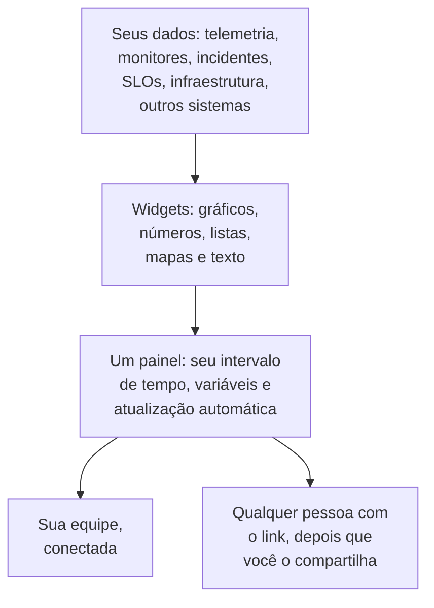

# Visão geral dos painéis

Um painel é uma página de widgets que você mesmo organiza: gráficos das suas métricas, logs e traces, listas de incidentes, alertas e monitores, seus SLOs e sua infraestrutura, e até dados de sistemas fora do OneUptime. Crie um para a tela do plantão, para a checagem matinal de uma equipe ou como página para os seus clientes, e compartilhe-o com o seu projeto ou com qualquer pessoa que tenha o link.

:::cards
- [Como um painel funciona](#como-um-painel-funciona): De onde vêm os dados dele, e quem o vê.
- [Encontre seus painéis](#encontre-seus-painéis): A lista Painéis e as páginas de cada painel.
- [Crie seu primeiro painel](#crie-seu-primeiro-painel): De um modelo a uma página compartilhada em cinco passos.
- [Um exemplo: um painel de plantão](#um-exemplo-um-painel-de-plantão): Uma página que serve para todos os serviços.
:::

## Como um painel funciona

Cada widget lê de uma fonte, dentro do intervalo de tempo do painel e filtrado pelas suas variáveis. Todos que abrem o painel veem os mesmos widgets: sua equipe quando entra, e os visitantes pelo link público dele depois que você o compartilha.

| Termo | O que significa |
| --- | --- |
| Painel | Uma página: um nome, uma grade de widgets, um intervalo de tempo, variáveis e uma configuração de atualização automática. |
| Widget | Um bloco da grade: um gráfico, um número, uma lista, um mapa, um relógio ou um bloco de texto. |
| Variável | Um seletor na barra de ferramentas que restringe cada widget compatível a um serviço, host ou cliente. |
| Intervalo de tempo | A janela que todos os gráficos e números leem. Um painel abre no seu padrão, a última hora a menos que quem o edita defina outro, e cada leitor pode escolher o seu. |
| Atualização automática | Com que frequência os widgets leem seus dados de novo: desligada, ou em intervalos de 5 segundos a 15 minutos. |
| Leitura e edição | Um painel abre para leitura. Editá-lo é uma etapa à parte, que termina salvando ou descartando suas alterações. |

## Para que servem os painéis

- **Uma página de "está tudo bem?"** para quem está de plantão, para a reunião diária de uma equipe ou para uma tela na parede.
- **Ver as conexões**: um pico de CPU ao lado de um aumento de latência e de um incidente aberto fica óbvio numa página só, e passa despercebido espalhado por três.
- **Investigar**: coloque lado a lado os gráficos que você vive reabrindo, e arraste sobre um pico para ler todos os widgets naquele momento.
- **Compartilhar fora da equipe**: uma página de desempenho para um cliente ou parceiro, protegida por uma senha ou por uma lista de IPs permitidos, se quiser.

## Encontre seus painéis

Abra **Produtos → Painéis**. A lista **Painéis** mostra os painéis do projeto com suas descrições, rótulos e proprietários. Pesquise por nome ou descrição, restrinja a lista com os filtros **Proprietário** e **Rótulos**, ou selecione vários painéis para mudar seus rótulos ou proprietários, arquivá-los ou exportá-los como JSON.

O menu lateral da lista tem as páginas que cuidam de todos os seus painéis:

| Página | O que você faz nela |
| --- | --- |
| **Painéis** | Os painéis do projeto. Crie um, ou traga painéis com **Importar JSON**. |
| **Configurações → Regras de proprietário** | Adicionar proprietários aos novos painéis automaticamente. |
| **Configurações → Regras de Rótulos** | Adicionar rótulos aos novos painéis automaticamente. |
| **Configurações → Fontes de dados** | Conectar Prometheus, bancos de dados SQL, ClickHouse, Loki, Elasticsearch ou uma API REST. |
| **Avançado → Arquivado** | Os painéis que você arquivou. Desarquive-os daqui. |

Abra um painel, e o menu lateral dele tem estas páginas. Toda seção, exceto **Básico**, começa recolhida: clique no título dela para abri-la.

| Página | O que você faz nela |
| --- | --- |
| **Painel** | O próprio painel. Leia-o, ou edite-o pelo menu **⋯** dele. |
| **Visão geral** | O nome, a descrição e os rótulos dele. |
| **Compartilhamento** | Quem pode vê-lo, o link público dele e uma lista de IPs permitidos em Mais configurações. |
| **Proprietários** | Os usuários e as equipes a que ele pertence. |
| **Marca** | Título da página, descrição, logotipo, tema e favicon do painel público. |
| **Domínios personalizados** | Hospedar o painel público no seu próprio domínio. |
| **Configurações** | Duplicar, exportar ou arquivar o painel. |
| **Registros de auditoria** | Cada alteração feita no painel, e quem a fez. |
| **Excluir** | Excluir o painel de vez. |

## Crie seu primeiro painel

:::steps
1. **Crie** — escolha um modelo, ou **Começar do zero**. Um modelo preenche o nome e abre com os widgets dele; um painel começado do zero abre vazio, com **Adicionar widget** na tela.
2. **Adicione widgets** — escolha um widget no catálogo, defina nas configurações dele o que ele lê, depois arraste-o para o lugar e redimensione-o.
3. **Adicione variáveis, se precisar** — uma variável `service`, por exemplo, permite que um só painel mostre qualquer serviço.
4. **Salve** — clique em **Salvar alterações**. Nada do que você muda durante a edição é mantido até você fazer isso.
5. **(Opcional) Compartilhe publicamente** — escolha **⋯ → Partilhar** no painel e decida quem pode vê-lo: qualquer pessoa com o link, ou qualquer pessoa com o link e uma senha.
:::

[Criar um painel](/docs/dashboards/authoring) mostra cada passo em detalhe.

## Um exemplo: um painel de plantão

O objetivo: uma página para o serviço de checkout, com a latência, a taxa de erros, os incidentes abertos e os logs mais recentes dele, que funcione também para qualquer outro serviço.

1. Clique em **Criar painel**, escolha **Começar do zero** e chame o painel de "Plantão do checkout".
2. Clique em **Adicionar widget** e adicione um **Gráfico** da sua métrica de latência de requisições, agregada como P95.
3. Ao lado, adicione um **Valor** da sua taxa de erros, com um limite de aviso de 1 e um limite crítico de 5.
4. Abaixo, adicione uma **Lista de incidentes** filtrada para incidentes não resolvidos, e um **Fluxo de registros** com os logs do serviço.
5. Abra **Variáveis**, adicione uma variável chamada `service` com a origem Telemetry Attribute e a chave de atributo `service.name`, e dê a ela o padrão `checkout`.
6. Clique em **Salvar alterações**. Escolha `payments` no seletor `service` da barra de ferramentas: o gráfico, o valor e o fluxo de registros passam para o serviço payments, e a lista de incidentes continua mostrando todos os incidentes não resolvidos.

## Como os painéis se encaixam no resto do OneUptime

- **Monitores e telemetria** são de onde vêm os dados. Cada métrica, log e trace que você envia pode ir para um widget.
- **Incidentes e alertas** aparecem nos widgets **Lista de incidentes** e **Lista de alertas**. Um painel só os mostra: você trabalha neles nas páginas deles.
- **Páginas de status** dizem aos seus clientes se o seu serviço está no ar. Os painéis mostram em detalhe como ele se comporta. Os dois trabalham lado a lado.
- **Workflows** agem sobre o que acontece. Os painéis são onde você lê isso.

## Próximos passos

:::cards
- [Criar um painel](/docs/dashboards/authoring): Crie um painel, edite-o e salve suas alterações.
- [Widgets de painel](/docs/dashboards/widgets): Cada widget, e qual escolher.
- [Variáveis e filtros de painel](/docs/dashboards/variables): Um painel para cada serviço, host ou cliente.
- [Compartilhamento e painéis públicos](/docs/dashboards/sharing): Links públicos, senhas, listas de IPs permitidos e domínios personalizados.
:::
