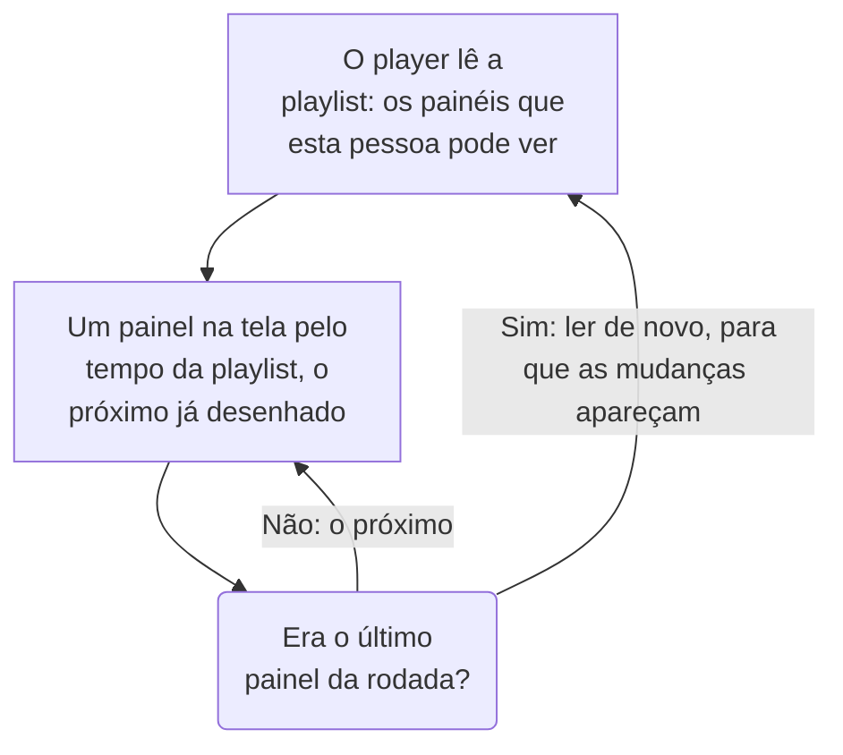

# Playlists de painéis

Uma playlist mostra uma série de painéis um após o outro em uma tela que ninguém toca, como a parede de um NOC ou a TV de uma equipe: cada painel pelo tempo que você escolher, em ciclo, até que alguém a pause. Crie a playlist uma vez, abra o player dela na tela e deixe-o rodando.

:::cards
- [Como uma playlist é reproduzida](#como-uma-playlist-é-reproduzida): A ordem, as vezes de cada um e o que cada painel mostra.
- [Criar uma playlist](#criar-uma-playlist): Um nome, os painéis dela em ordem e por quanto tempo cada um é exibido.
- [Reproduzir em uma tela](#reproduzir-em-uma-tela): A barra do player, os botões e as teclas dele.
- [Quem vê o quê](#quem-vê-o-quê): As permissões, e os painéis que uma pessoa não pode ler.
:::

## Como uma playlist é reproduzida

O player mostra o primeiro painel da playlist, depois o próximo quando o tempo dele acaba, e recomeça pelo primeiro depois do último. Cada painel abre como os editores o salvaram: no próprio intervalo de tempo padrão, na própria atualização automática e com as próprias variáveis, seja qual for o endereço do player. Enquanto um painel está na tela, o player desenha o próximo fora de vista, então a tela nunca fica em branco entre dois deles.

Uma playlist nomeia os painéis dela e nunca os copia: uma mudança que um editor salva em um painel está na tela na próxima vez que chega a vez dele. O player lê a playlist de novo antes de cada rodada, então um painel adicionado, movido ou removido aparece dentro de uma rodada, sem recarregar a tela; se essa leitura falhar, a tela reproduz de novo a rodada que já tem.

## Criar uma playlist

:::steps
### Abrir as playlists
Abra **Produtos → Painéis** e depois **Playlists** no menu lateral. A lista mostra quantos painéis cada playlist tem e por quanto tempo cada um é exibido, com **Reproduzir** em cada linha.

### Dar um nome
Clique em **Criar: Playlist** e dê a ela um **Nome** que diga onde ela é reproduzida, como "Mural do NOC".

### Adicionar os painéis
Em **Painéis**, escolha cada um em **Adicionar um painel**, na ordem em que a tela os mostra. Os botões na linha de um painel o movem para cima ou para baixo, ou o removem. Painéis arquivados não são oferecidos.

### Escolher por quanto tempo cada um é exibido
**Exibir cada painel por** começa em um minuto; escolha um tempo de 15 segundos a uma hora. Clique em **Criar: Playlist**.
:::

A página da playlist lista os painéis dela em ordem, por quanto tempo cada um é exibido e o **Link do player**. **Editar playlist** muda o nome, os painéis, a ordem deles e o tempo. **Excluir: Playlist de painéis**, no fim da página, exclui a playlist e nunca os painéis dela.

Pela API e pelo Terraform, uma playlist é um `name`, os `dashboards` dela como uma lista como `[{"dashboardId": "<id>"}]` na ordem em que são exibidos, no máximo 100, e `intervalInSeconds`, qualquer número inteiro de segundos de 10 a 86400 (um dia). Um valor fora desses limites é recusado, com o que está errado.

## Reproduzir em uma tela

Clique em **Reproduzir** na linha da playlist ou na página dela. O player preenche a janela do navegador, por cima do resto do OneUptime; **Tela cheia** preenche a tela inteira. Para iniciar uma tela sozinha, abra nela o **Link do player** e salve-o nos favoritos: o link abre o player na hora.

A barra do player nomeia o painel na tela, a playlist, em que ponto a rodada está ("2 de 5") e o painel que vem a seguir. Uma linha sob a barra se preenche enquanto um painel está na vez dele. Os botões da barra vão para o painel anterior, pausam ou reproduzem, e vão para o próximo; em um computador, estas teclas fazem o mesmo:

| Teclas | O que faz |
| --- | --- |
| `Space` | **Pausar ou reproduzir**. Pausado, o painel fica na tela e a barra mostra **Pausado**. |
| `Right Arrow` | **Próximo painel**. |
| `Left Arrow` | **Painel anterior**. |
| `F` | **Tela cheia**, ou sair dela. |
| `Esc` | **Sair do player**, de volta à página da playlist. Em tela cheia, o primeiro `Esc` só sai da tela cheia. |
| `?` | **Mostrar atalhos de teclado**. |

Um painel para o qual você vai, o próximo ou o anterior, ganha uma vez inteira. Em uma página lida da direita para a esquerda, como em persa, as setas se invertem: `Left Arrow` vai para o próximo painel. Enquanto reproduz, o player impede que a tela entre em repouso, onde o navegador permite.

## Quem vê o quê

As playlists têm permissões próprias, obtidas por meio de uma equipe como as dos painéis:

| Para | É preciso |
| --- | --- |
| Ver e reproduzir playlists | `ReadDashboardPlaylist`, ou um papel no projeto: Project Owner, Project Admin, Project Member, Viewer ou um papel Settings |
| Criar playlists | `CreateDashboardPlaylist`, Project Owner ou Project Admin |
| Alterar uma playlist: o nome, os painéis e o tempo dela | `EditDashboardPlaylist`, Project Owner ou Project Admin |
| Excluir uma playlist | `DeleteDashboardPlaylist`, Project Owner ou Project Admin |

Uma playlist nunca mostra a ninguém um painel que essa pessoa não pode ler. O player reproduz só os painéis que a pessoa conectada na tela pode ler e que não estão arquivados, e pula o resto: um painel excluído, um arquivado ou um que as permissões dela não deixam ver. A página da playlist diz por que pula cada um. Salvar uma playlist mantém os painéis que ela contém e que o editor não pode ver, então nada do que outra pessoa colocou nela se perde.

| Quando o player encontra | Ele mostra |
| --- | --- |
| Painéis que pode mostrar | Cada um na sua vez. |
| Nenhum painel que pode mostrar | **Nada para mostrar ainda**, e ele olha de novo a cada minuto. |
| A playlist excluída, ou que essa pessoa não pode ler | **Playlist não encontrada**. |
| Uma leitura que falhou | **Não foi possível carregar esta playlist**, e ele tenta de novo a cada minuto, ou em **Tentar novamente**. |

> [!NOTE]
> O player é para alguém conectado ao OneUptime. Para rodar uma playlist em uma tela, entre nessa tela com uma conta que possa ler a playlist e os painéis dela, como um membro da equipe com o papel Viewer.

## Próximos passos

:::cards
- [Criar um painel](/docs/dashboards/authoring): Monte os painéis que uma playlist mostra.
- [Variáveis e filtros de painel](/docs/dashboards/variables): A seleção salva com que cada painel abre.
- [Compartilhamento e painéis públicos](/docs/dashboards/sharing): Mostre um painel a pessoas que não entram na conta.
- [Configuração e permissões de painel](/docs/dashboards/configuration): Proprietários, rótulos e quem pode ler um painel.
:::
