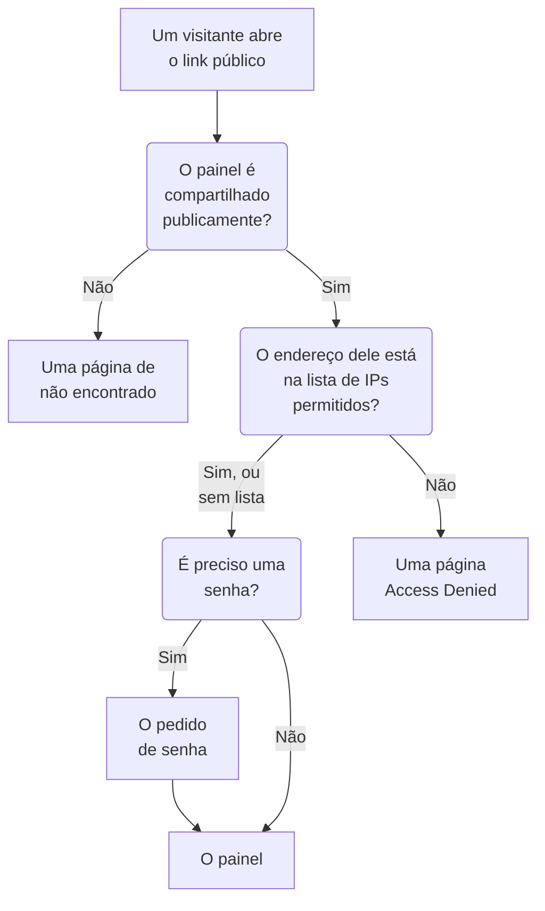

# Compartilhamento e painéis públicos

Por padrão, um painel é privado do seu projeto: só quem entra no seu projeto pode vê-lo. Você também pode compartilhá-lo por um link público, proteger esse link com uma senha, limitá-lo a certos endereços IP e hospedá-lo no seu próprio domínio. Esta página cobre as quatro coisas.

:::cards
- [Quem pode ver um painel](#quem-pode-ver-um-painel): Uma escolha entre três, com o plano que cada uma exige.
- [Compartilhar com uma senha](#compartilhar-com-uma-senha): Compartilhe o link, e depois a senha, com as pessoas que devem vê-lo.
- [Lista de IPs permitidos](#lista-de-ips-permitidos): Abra o link público só para o seu escritório ou a sua VPN.
- [Domínios personalizados](#domínios-personalizados): Sirva o painel no seu próprio domínio, com um certificado gratuito.
:::

## O caminho de um visitante

Um visitante que abre o link público de um painel passa por cada uma destas verificações, em ordem. Os membros do projeto que entram no OneUptime veem o painel dentro do produto, seja qual for a sua escolha aqui.



## Quem pode ver um painel

Abra o painel e escolha **⋯ → Partilhar**, ou abra **Compartilhamento** no menu lateral do painel. O cartão **Quem pode ver este painel** é uma escolha única:

- **Apenas pessoas deste projeto** (o padrão): os membros veem o painel quando entram no OneUptime. Ele não tem link público: o endereço público dele mostra a mesma página de não encontrado que um endereço sem painel, e nada sobre o painel, nem mesmo o nome.
- **Qualquer pessoa com o link**: o painel é público. Quem tiver o link dele pode vê-lo, sem entrar.
- **Qualquer pessoa com o link e uma senha**: os visitantes abrem o link e depois digitam uma senha que você compartilha com eles. Ninguém precisa de conta.

Escolher uma opção pede confirmação, dizendo o que muda para os visitantes, e então se aplica na hora. Escolher **Qualquer pessoa com o link e uma senha** pede a senha na mesma caixa de diálogo quando o painel não tem nenhuma; enquanto essa for a escolha, **Alterar senha** a substitui. Enquanto o painel for público, os endereços em que os visitantes o abrem ficam abaixo da escolha: primeiro seus domínios personalizados, depois seu link público, cada um com **Copiar link**. Um domínio personalizado que ainda não está ativo aparece marcado como **Ainda não ativo**, com o motivo.

Dentro do projeto, os proprietários e os rótulos controlam quem vê o quê: veja [Configuração e permissões de painel](/docs/dashboards/configuration). Quem pode ver o painel mas não editá-lo vê a escolha e pode copiar o link público, mas não pode mudá-la.

No OneUptime Cloud, compartilhar um painel exige o plano **Growth**: num plano inferior, as duas escolhas públicas mostram o plano de que precisam e não podem ser selecionadas. Tornar um painel privado de novo (**Apenas pessoas deste projeto**) funciona em todos os planos, então um painel que ficou público quando um teste terminou, ou depois de uma mudança para um plano inferior, sempre pode deixar de ser compartilhado; a caixa de diálogo diz que compartilhá-lo de novo exige **Growth**. Passar de **Qualquer pessoa com o link** para **Qualquer pessoa com o link e uma senha**, e alterar a senha, funciona em todos os planos. Um painel criado pela API ou pelo Terraform segue os mesmos planos: criado público, ele exige **Growth**, e criado com uma lista de IPs permitidos, **Scale**.

A escolha é guardada em três colunas, que a API e o Terraform leem e gravam como antes: `isPublicDashboard`, `enableMasterPassword` e `masterPassword`. Só um painel público tem link público, e os visitantes dele precisam da senha sempre que `enableMasterPassword` estiver ligado. Um painel público com `enableMasterPassword` ligado mas sem senha definida não deixa ninguém entrar pelo link público: a página **Compartilhamento** o mostra como **Qualquer pessoa com o link e uma senha**, diz que ninguém pode abrir o link ainda e oferece **Definir senha**. Escolher **Apenas pessoas deste projeto** também desliga `enableMasterPassword` e mantém a senha, para que compartilhar com senha de novo possa reutilizá-la.

## Painéis públicos

Um painel público:

- Sempre abre para leitura. Os visitantes não podem editá-lo, e nunca veem os controles de edição dele.
- Inclui as variáveis que você adicionou. Os visitantes escolhem nos mesmos seletores que a sua equipe usa, e podem mudar o intervalo de tempo, aplicar zoom, ligar a atualização automática e entrar em tela cheia. Ele abre com o período e a atualização automática padrão do painel, e o navegador de cada visitante lembra as escolhas dele.
- Permite que os visitantes [ordenem as listas e tabelas dele](/docs/dashboards/widgets#ordenar-listas-e-tabelas) clicando no cabeçalho de uma coluna, como a sua equipe faz. O navegador de cada visitante lembra a própria ordenação, e o OneUptime ordena a lista inteira por conta própria, sempre por uma das colunas do próprio widget.
- Usa a marca que você define na página **Marca** do painel: título da página, descrição, logotipo, tema, favicon.
- Permite que cada visitante alterne entre o painel claro e o escuro com um botão de sol ou de lua na barra de ferramentas; [Tema](#tema) explica como.

Trate compartilhar um painel como publicar uma página na web. Todo widget nele passa a ser legível por qualquer pessoa com o link. Veja o que está na tela antes de compartilhá-lo.

Cada widget publica só o que desenha, e só para os recursos para os quais foi configurado. Um widget SLO, por exemplo, publica os números principais desse SLO, mas nunca a definição dele: veja [SLO](/docs/dashboards/widgets#slo). Os widgets de **Data Source** externa são a exceção: eles são retirados por completo de um painel público em vez de renderizados, porque a configuração deles é a própria consulta. Alguns outros widgets não podem ser mostrados sem uma sessão conectada, e dizem isso no lugar deles: [Em um painel público](/docs/dashboards/widgets#em-um-painel-público) os lista.

## Compartilhar com uma senha

Escolha **Qualquer pessoa com o link e uma senha** e digite a senha na caixa de diálogo. Os visitantes veem um pedido de senha antes de o painel aparecer. O pedido mostra o nome, o título da página e o favicon do painel, no tema do painel, e nada mais: a descrição, o logotipo e os widgets aparecem depois que a senha é digitada. A senha é guardada como hash: ninguém consegue lê-la de volta. Uma senha nova funciona na hora; quem digitou a antiga pode continuar vendo o painel por até 7 dias.

Use uma senha quando:

- Você quer compartilhar com um parceiro ou cliente, mas não quer que a URL sirva para nada se vazar.
- O painel é "semipúblico": aberto o bastante para você não querer convidar cada pessoa como membro da equipe, mas não tão aberto a ponto de colocá-lo na internet.

Para um controle mais forte (contas separadas por pessoa, uma trilha de auditoria de quem viu o quê), mantenha o painel em **Apenas pessoas deste projeto** e convide as pessoas como membros da equipe com acesso somente leitura.

## Lista de IPs permitidos

Em **Mais configurações** na página **Compartilhamento**, a seção **Lista de IPs permitidos** (a coluna `ipWhitelist`) limita o link público aos endereços IP ou faixas IPv4 que você listar, um por linha, por exemplo `203.0.113.7` ou `10.0.0.0/8`. Ela vale com ou sem a senha; os membros do projeto que entram não são afetados. Deixe-a vazia para permitir todos os endereços. Ela é salva separadamente da escolha, e alterá-la exige o plano **Scale** no OneUptime Cloud; esvaziá-la funciona em todos os planos. Enquanto uma lista estiver valendo, o cabeçalho recolhido de **Mais configurações** mostra **Lista de IPs permitidos** com o número de entradas que ela tem. Na hospedagem própria, alterá-la faz parte da Enterprise Edition: na Community Edition, uma lista já definida continua valendo e só pode ser removida.

Use-a quando:

- O painel só deve ser acessível a partir do seu escritório ou da sua VPN.
- Um portal de fornecedor só deve ser acessível a partir dos IPs conhecidos dele.
- Você quer uma proteção extra além de uma senha.

As requisições de qualquer outro IP são recusadas com uma página **Access Denied** que não mostra nada sobre o painel: nem o nome, nem a marca, nem o pedido de senha. Uma linha que não é um endereço IP nem uma faixa IPv4 é recusada ao salvar, porque o servidor a ignoraria.

## Domínios personalizados

De início, um painel público é servido no link público dele, no próprio endereço do OneUptime. Para hospedá-lo num subdomínio seu, como `dashboard.acme.com`, abra **Marca → Domínios personalizados** no menu lateral do painel. Funciona exatamente como a página **Domínios personalizados** de uma página de status.

O cartão se chama **Domínios personalizados** e diz o que fazer: aponte o registro CNAME de cada domínio para o registro CNAME de painéis da sua instalação, e o OneUptime emite o certificado SSL do domínio e o renova para você. A tabela tem duas colunas, **Domínio** e **Status**.

Colocar o painel no seu próprio domínio leva três passos, e só os dois primeiros são com você:

1. **Adicione o domínio**: um subdomínio e um dos seus domínios verificados.
2. **Adicione o registro CNAME dele** no seu provedor de DNS. A caixa de diálogo **Configuração de DNS** abre com o registro assim que você adiciona o domínio.
3. **O certificado SSL gratuito é emitido automaticamente** assim que o registro é encontrado. Não há nenhum botão para apertar.

Depois de verificado, o painel fica acessível tanto no seu domínio personalizado quanto na URL original.

### Adicionar o domínio

Clique em **Criar: Painel Domínio**. A caixa de diálogo tem uma única página:

- **Subdomínio**: só o rótulo, com o exemplo `dashboard (leave blank for root)`. Digite só `dashboard`, não o nome de host inteiro. Deixe-o vazio ou digite `@` para usar o domínio raiz (apex).
- **Domínio**: os domínios verificados em **Configurações do projeto → Avançado → Domínios**, onde você prova com um registro TXT que um domínio é seu. Um domínio que você não verificou não aparece na lista, porque seria recusado. O link **Adicionar um domínio** ao lado do campo abre essa página numa nova aba.
- **Mais campos**: recolhido. Enquanto está recolhido, o cabeçalho dele diz qual certificado o domínio vai usar: "Emitimos um certificado SSL gratuito para este domínio e o renovamos automaticamente." Abra-o só para usar um certificado seu (veja abaixo).

Clique em **Criar: Painel Domínio**. A caixa de diálogo se fecha e a **Configuração de DNS** do novo domínio se abre. O nome completo de um domínio fica fixo quando você o adiciona, então **Editar** muda só o certificado dele. Para usar outro subdomínio, adicione esse domínio e exclua o antigo.

### Configuração de DNS e Verificar agora

A caixa de diálogo **Configuração de DNS** mostra o registro a adicionar no seu provedor de DNS, um campo por linha, cada um com um botão de copiar: **Tipo** `CNAME`, **Nome** o domínio completo que você adicionou, e **Valor** o registro CNAME de painéis da sua instalação. Para um domínio raiz, sem subdomínio, a caixa de diálogo acrescenta uma nota: muitos provedores de DNS não permitem um registro CNAME ali, então use o registro ALIAS, ANAME ou de achatamento de CNAME do seu provedor, com o mesmo valor.

O OneUptime verifica cada domínio não verificado a cada 15 minutos, e quando a verificação encontra o registro, solicita o certificado gratuito do Let's Encrypt para o domínio nessa mesma verificação, quer você volte ou não. Para verificar na hora, clique em **Verificar agora**:

- **O registro ainda não foi encontrado.** A caixa de diálogo continua aberta e diz qual registro procurou. Um registro DNS novo pode demorar um pouco para aparecer. Clique em **Verificar agora** de novo mais tarde, ou deixe para a verificação a cada 15 minutos.
- **O registro foi encontrado.** A caixa de diálogo diz "Seu registro CNAME está verificado." e o que acontece em seguida com o certificado. O certificado gratuito é solicitado nesse momento, e geralmente fica ativo em até 15 minutos.

Até um domínio estar verificado e com o certificado no lugar, a linha dele tem uma ação **Configuração de DNS** que abre a mesma caixa de diálogo. Num domínio verificado cuja solicitação de certificado continua falhando, ou cujo certificado expirou, **Verificar agora** ali solicita de novo e mostra por que a última solicitação falhou. Ele solicita no máximo uma vez por domínio a cada 15 minutos; nesse meio-tempo, o OneUptime continua tentando sozinho, esperando um pouco mais depois de cada falha seguida. A renovação é automática, bem antes de o certificado expirar, e uma verificação de DNS que falha nunca remove um certificado que ainda é válido.

### Ler a coluna Status

A coluna **Status** diz em que ponto cada domínio está a caminho do HTTPS, em um de oito estados, os mesmos das páginas de status. Quando uma solicitação falhou, o motivo fica na linha de baixo.

| O que a coluna Status diz | O que significa |
| --- | --- |
| Aguardando o DNS: adicione o registro CNAME. | O registro CNAME ainda não foi encontrado. Abra **Configuração de DNS** para ver o registro, adicione-o no seu provedor de DNS e depois clique em **Verificar agora** ou espere a verificação a cada 15 minutos. |
| Emitindo um certificado gratuito, geralmente em até 15 minutos. | O registro está verificado, e o certificado está sendo solicitado ou gravado. Não há nada a fazer. |
| Ainda não foi possível emitir um certificado gratuito. Continuamos tentando. | O registro está verificado, mas a solicitação do certificado falhou, pelo motivo na linha de baixo. Corrija a causa, depois abra **Configuração de DNS** e clique em **Verificar agora** para solicitar de novo agora. |
| Certificado expirado. Continuamos tentando renová-lo. | O certificado do domínio expirou porque as renovações falharam. Abra **Configuração de DNS** e clique em **Verificar agora** para renová-lo agora e ver o motivo. |
| Certificado emitido, renovado automaticamente. | Pronto. O domínio serve o certificado por HTTPS, e o OneUptime o renova. |
| Certificado emitido, mas a renovação falhou. Continuamos tentando. | O domínio ainda serve um certificado válido, mas a última renovação falhou, pelo motivo na linha de baixo. O OneUptime tenta de novo bem antes de o certificado expirar. |
| Usa o seu certificado carregado. | O registro está verificado, e o domínio é servido com o certificado que você carregou. |
| Verificado. Usa o HTTPS do seu próprio proxy. | Numa instalação auto-hospedada sem chave de conta do Let's Encrypt, o registro está verificado e o domínio está no ar. O HTTPS dele fica por conta do seu próprio proxy, a menos que você envie um certificado. |

Se uma solicitação falha, as causas comuns são um registro CAA no seu domínio que não permite `letsencrypt.org` e, numa instalação auto-hospedada, um servidor que o Let's Encrypt não consegue alcançar na porta 80.

### Seu próprio certificado, e a reemissão

Para usar o seu próprio certificado, abra **Mais campos** ao adicionar o domínio, ligue **Carregar Certificado Personalizado** e cole o **Certificado** e a **Chave privada do certificado** dele. O OneUptime o serve em até 15 minutos em vez de solicitar um certificado do Let's Encrypt, e ele toma o lugar de qualquer certificado do Let's Encrypt que o domínio tinha antes. Renovar um certificado carregado é com você: edite o domínio e cole o novo. Se o domínio tinha um certificado gratuito antes, o OneUptime continua renovando-o enquanto o seu estiver em uso, então voltar atrás é imediato.

Depois que um certificado gratuito é solicitado para um domínio, a linha mostra **Reissue SSL**, que pede ao Let's Encrypt um certificado totalmente novo quando você quiser um antes da renovação automática. Cada domínio pode ser reemitido uma vez a cada 24 horas.

Numa instalação auto-hospedada, os domínios personalizados de painéis são ligados pela variável de ambiente `DASHBOARD_CNAME_RECORD` (`dashboard.cnameRecord` no chart Helm), que é o destino para o qual os seus registros CNAME apontam. Sem ela, o cartão e a caixa de diálogo **Configuração de DNS** dizem "Custom Domains not enabled for this OneUptime installation" em vez de mostrar um registro, e o OneUptime não verifica domínios nem solicita certificados para painéis. Uma instalação sem chave de conta do Let's Encrypt (`LETS_ENCRYPT_ACCOUNT_KEY`, `letsEncrypt.accountKey` no chart Helm) não solicita certificados: um domínio de painel fica no ar assim que o registro é verificado, servido com o HTTPS do seu próprio proxy ou com um certificado que você carregar.

### Quem pode verificar e reemitir

**Verificar agora**, a solicitação do certificado de um domínio e **Reissue SSL** alteram o domínio, então exigem permissão para editá-lo: **Edit Dashboard Domain**, ou um papel que a inclua (Project Owner, Project Admin, Project Member, Settings Admin ou Settings Member).

Quem só pode ler o domínio, como um Viewer ou um Settings Viewer, ainda vê a coluna **Status** e o registro a adicionar em **Configuração de DNS**. Para essas pessoas, **Verificar agora** e **Reissue SSL** ficam bloqueados, e dizem qual permissão é necessária. O OneUptime continua verificando cada domínio e solicitando o certificado dele sozinho, de qualquer forma.

O mesmo vale para as chaves de API. Uma chave que só pode ler domínios de painéis não pode chamar `verify-cname`, `order-ssl` ou `reissue-ssl` em `/dashboard-domain`. Dê a ela **Read Dashboard Domain** e **Edit Dashboard Domain** se ela precisar.

Um domínio pertence a um único painel do projeto por vez. Você pode associar mais de um domínio personalizado a um único painel se servir o mesmo conteúdo a vários públicos: um painel para clientes com a sua marca, um painel de parceiro com as duas marcas, ou uma página pública de saúde com a própria URL.

## Marca

Na página **Marca** do painel, você pode configurar:

- **Título da página**: o que aparece na aba do navegador e no topo da página.
- **Descrição da página**: a descrição usada pelos mecanismos de busca e pelas prévias em redes sociais.
- **Logotipo**: uma imagem mostrada no cabeçalho do painel público.
- **Logotipo do tema escuro**: um logotipo feito para um fundo escuro, mostrado no lugar do logotipo sempre que o painel público estiver escuro.
- **Tema**: claro, escuro ou conforme o dispositivo de cada visitante está configurado; veja [Tema](#tema).
- **Favicon**: o pequeno ícone na aba do navegador.

O logotipo, o logotipo do tema escuro e o favicon são arquivos carregados no próprio projeto do painel, e isso é verificado sempre que um deles é salvo, seja pelo painel, pela API, pelo Terraform ou por um workflow. Um arquivo carregado em outro projeto é recusado com as mesmas palavras que recebe um arquivo que não existe mais: "The logo's file could not be found. Upload the logo again.", "The dark theme logo's file could not be found. Upload the dark theme logo again." ou "The favicon's file could not be found. Upload the favicon again." O painel público só mostra imagens do próprio projeto.

O título e a descrição da página também ficam no alto da barra de ferramentas do painel para a sua equipe, no lugar do nome e da descrição dele. Os logotipos, o tema e o favicon valem só para o painel público.

Os visitantes só veem a marca depois que podem ver o painel. Antes de a senha ser digitada, um painel compartilhado com senha mostra só o título da página, o favicon e o tema, e os mecanismos de busca e as prévias de links veem o título da página, mas não a descrição da página. Um painel com uma lista de IPs permitidos só mostra a marca para os endereços da lista, e os mecanismos de busca e as prévias de links não veem nada dela.

### Tema

O cartão **Tema**, logo abaixo do logotipo, define como o painel público aparece para os visitantes. Escolha uma das três opções e ela é salva na hora; não há botão **Editar**.

| Opção | O que os visitantes veem |
| ------ | ----------------- |
| **Claro** | O painel claro, seja qual for a configuração do dispositivo deles. Os painéis criados antes de existir essa opção estão em **Claro**, então continuam com a aparência de sempre. |
| **Escuro** | O painel escuro, seja qual for a configuração do dispositivo deles. |
| **Conforme o dispositivo de cada visitante** | Claro ou escuro, conforme o dispositivo deles está configurado, e muda junto com ele enquanto o painel está aberto. |

Seja qual for a sua escolha, um botão de sol ou de lua na barra de ferramentas do painel permite que cada visitante passe para o painel claro ou para o escuro, ou volte ao tema que você definiu, e o navegador dele lembra a escolha para todos os painéis públicos desse endereço. No painel escuro, o logotipo do tema escuro aparece no lugar do logotipo; sem ele, o logotipo fica sobre um fundo claro, então um logotipo feito para uma página branca continua bem visível.

Um painel criado de agora em diante começa com **Conforme o dispositivo de cada visitante**. Pela API e pelo Terraform, o campo é `theme`, com um dos valores `Light`, `Dark` ou `System` (**Conforme o dispositivo de cada visitante**), escritos exatamente assim; qualquer outro valor é recusado. Uma configuração do Terraform que não define nenhum `theme` recebe `Light`, então uma configuração escrita antes dessa opção nunca planeja uma mudança em um painel que gerencia.

O tema vai no HTML do painel, então o painel é desenhado nele desde o início: um painel escuro não pisca em branco enquanto carrega, e o pedido de senha dele também é desenhado nele. Todos os widgets o seguem; o próprio código de um widget HTML pode estilizar o tema escuro, como explica [HTML](/docs/dashboards/widgets#html). As páginas **Access Denied** e de não encontrado não mostram nada de um painel, então seguem o visitante: a escolha dele ou, se não houver, o dispositivo dele.

## Incorporar

Você pode incorporar um painel público no seu próprio site com um iframe, no link público dele ou em um dos domínios personalizados dele:

```html title="embed.html"
<iframe
  src="https://dashboard.acme.com"
  width="100%"
  height="800"
  frameborder="0"
></iframe>
```

Se o painel for compartilhado com uma senha, os visitantes verão o pedido de senha dentro do iframe.

Para dar a um painel incorporado a aparência do seu site, adicione `?theme=light` ou `?theme=dark` ao endereço dele, como em `https://dashboard.acme.com/?theme=dark`: o painel é desenhado nesse tema para todos que abrirem esse endereço, seja qual for o tema dele e a escolha do visitante, e a barra de ferramentas dele não tem botão de tema. `?theme=system` segue o dispositivo de cada visitante. O tema se mantém ao passar pelo pedido de senha.

## Enviar um link

O link público abre o painel com os valores padrão salvos. Para enviar um link que abra num valor específico, adicione a variável a ele como `?var-<name>=<value>`, como a barra de endereços faz quando um visitante escolhe um valor; vários valores são separados por vírgulas. Para abri-lo com um intervalo de tempo ou uma atualização automática próprios, adicione `range` e `refresh` do mesmo jeito: `?range=1d&refresh=1m` abre no último dia, atualizando a cada minuto, como uma tela de parede faria. `range` aceita `5m`, `15m`, `30m`, `1h`, `2h`, `3h`, `1d`, `2d`, `7d`, `14d`, `1mo` ou `3mo`, e `refresh` aceita `off`, `5s`, `10s`, `30s`, `1m`, `5m` ou `15m`. Eles prevalecem sobre os padrões do painel e sobre as escolhas do visitante, que ainda pode mudá-los. Para abrir o painel em um tema, adicione `theme=light`, `theme=dark` ou `theme=system`, como descreve [Incorporar](#incorporar).

## Próximos passos

:::cards
- [Configuração e permissões de painel](/docs/dashboards/configuration): Proprietários, rótulos e quem pode alterar o compartilhamento.
- [Variáveis e filtros de painel](/docs/dashboards/variables): Os seletores que os visitantes usam, e links que mantêm uma seleção.
- [Widgets de painel](/docs/dashboards/widgets): O que cada widget publica num painel público.
- [Visão geral das páginas de status](/docs/status-pages/index): Diga aos seus clientes se o seu serviço está no ar.
:::
