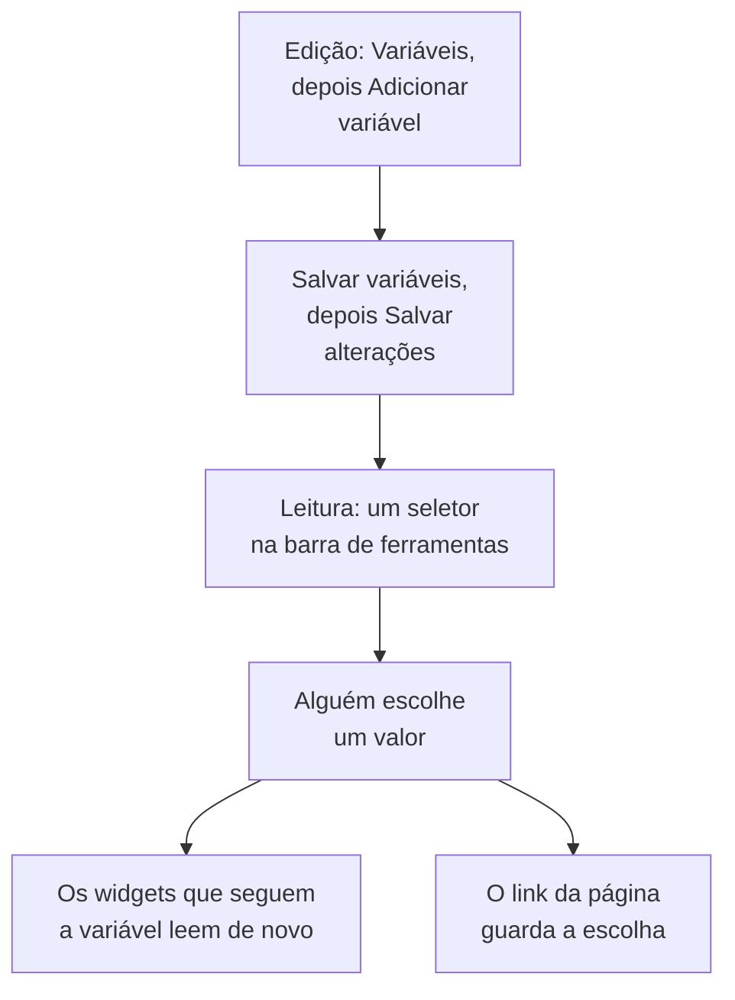

# Variáveis e filtros de painel

Uma variável é um seletor na barra de ferramentas do painel. Adicione uma variável `service` e os mesmos gráficos mostram `checkout`, `payments` ou `search`: as pessoas escolhem na barra de ferramentas em vez de você montar três painéis quase idênticos.

:::cards
- [Adicionar uma variável](#adicionar-uma-variável): Dê um nome a ela, escolha de onde vêm os valores e salve.
- [Origens de variáveis](#origens-de-variáveis): Telemetry Attribute, Project Labels, Custom List e Text Input.
- [Como os widgets usam uma variável](#como-os-widgets-usam-uma-variável): Quais widgets seguem quais variáveis.
- [Links que mantêm a seleção](#links-que-mantêm-a-seleção): Envie um link que abre no mesmo serviço.
:::

## Como uma variável funciona

Você define as variáveis enquanto edita o painel, e elas são salvas com ele. No modo de leitura, cada uma é um seletor na barra de ferramentas. Quando alguém escolhe um valor, cada widget que segue a variável lê seus dados de novo, e o link da página guarda a escolha.



## Adicionar uma variável

:::steps
### Abra a caixa de diálogo de variáveis

Abra o painel, escolha **⋯ → Editar painel** e clique em **Variáveis** na barra de ferramentas. A caixa de diálogo **Variáveis do Painel** lista as variáveis do painel; o botão na barra de ferramentas mostra quantas são.

### Adicione uma

Clique em **Adicionar variável**. Uma nova variável lê um atributo de telemetria; escolha outra **Origem** se precisar.

### Preencha-a

Dê a ela um **Nome**, que os widgets e os links usam, como `service`: letras, dígitos e sublinhados, começando com uma letra ou um sublinhado, e diferente dos outros nomes do painel. Adicione um **Rótulo** para a barra de ferramentas, se quiser, um valor **Padrão** para começar, e marque **Permitir seleção múltipla** para permitir escolher vários valores.

### Salve-a

Clique em **Salvar variáveis** e depois em **Salvar alterações** na barra de ferramentas. O seletor da variável aparece na barra de ferramentas quando o painel volta ao modo de leitura.
:::

Para alterar ou remover uma variável depois, abra a caixa de diálogo de novo: mude os campos dela, ou clique na lixeira ao lado.

## Origens de variáveis

A **Origem** decide de onde vêm os valores de uma variável, e quais widgets a seguem.

| Origem | De onde vêm os valores | Seleção múltipla |
| --- | --- | --- |
| Telemetry Attribute | Os valores de uma chave de atributo nas suas métricas, como `service.name` | Sim |
| Project Labels | Os rótulos do projeto que você permite, de 1 a 1.000 | Sim |
| Custom List | Valores que você digita, separados por vírgulas, como `prod, staging` | Sim |
| Text Input | O que a pessoa digitar | Não |

### Telemetry Attribute

Defina a **Chave do atributo**, como `service.name`, `host.name` ou `k8s.namespace.name`; o campo sugere as chaves que a sua telemetria traz. O seletor oferece até 100 valores dessa chave, lidos das suas métricas do último dia, então um serviço novo aparece nele sem que você edite o painel.

É a origem mais comum, porque não precisa de uma lista própria: os valores são os que você já envia.

### Project Labels

Escolha rótulos de projeto existentes para oferecer como uma lista suspensa do painel. Por exemplo, crie uma variável chamada `UNIT`, defina a origem dela como **Rótulos do projeto** e escolha os rótulos `0660` e `0661`.

O painel salva os IDs e os nomes de exibição dos rótulos escolhidos. A filtragem usa os IDs, então renomear um rótulo do projeto não quebra o vínculo dele. Os nomes de exibição são salvos com o painel; selecione de novo um rótulo renomeado no editor de variáveis para atualizar o nome exibido. Os painéis públicos mostram essas mesmas escolhas salvas.

Num widget **Lista de monitores**, abra **Filtros → Variável de rótulo** e selecione `UNIT`. Escolher `0660` passa a mostrar os monitores que têm esse rótulo. Os outros widgets não são afetados, a menos que suportem e vinculem a variável explicitamente: a **Lista de SLOs** tem a mesma configuração **Variável de rótulo**.

Os filtros fixos do widget continuam valendo. Por exemplo, com um rótulo fixo `network` e `UNIT` definido como `0660`, um monitor precisa ter os dois rótulos. Várias unidades selecionadas correspondem a qualquer uma delas. Escolher **Todos** remove só a condição da variável, mantendo os filtros fixos de rótulo, status e tipo de monitor.

Uma variável ausente ou uma seleção fora das opções configuradas mostra um erro. Um rótulo escolhido sem monitores correspondentes mostra a lista vazia. Remova explicitamente o vínculo do widget quando ele não for mais necessário.

### Custom List e Text Input

Uma Custom List oferece os valores que você digita, separados por vírgulas. Um Text Input deixa a pessoa digitar qualquer valor, como um endereço IP ou um ID de requisição. Nenhum dos dois filtra um widget sozinho: os valores deles vão para onde você escreve `{{name}}` (veja abaixo).

Uma variável Query de um painel mais antigo é mantida e mostra uma caixa de texto na barra de ferramentas: o OneUptime não carrega mais os valores dela a partir de uma consulta.

## Seleção múltipla e valores padrão

Com **Permitir seleção múltipla** marcado, as pessoas escolhem um ou mais valores, e os widgets mostram qualquer um deles. Uma seleção vazia significa **Todos**, e uma variável de seleção múltipla sempre começa em **Todos**, por isso o valor **Padrão** dela fica desativado.

Uma variável de seleção única começa no seu valor **Padrão**, ou em **Todos** quando não tem um. **Todos** remove o filtro da variável, então os widgets mostram tudo.

Use a seleção múltipla para comparar "checkout e payments juntos" sem sair do painel. Evite-a quando os números não se somam entre os valores, como numa média de médias.

## Como os widgets usam uma variável

Cada origem chega aos widgets do seu jeito:

- As variáveis **Atributo de telemetria** filtram widgets sem nada para configurar neles: todo gráfico, valor, medidor e tabela de métricas; o **Gráfico de registros**, o **Fluxo de registros**, o **Gráfico de traços** e a **Tabela de traços**; e as listas de infraestrutura cujos recursos têm o atributo, como `host.name` nas listas de hosts e `k8s.namespace.name` nas listas do Kubernetes. O gráfico de uma métrica sem o atributo não mostra dados enquanto um valor estiver escolhido: escolha **Todos** para vê-lo de novo. A **Lista de traços** e as listas de incidentes e de alertas não as seguem.
- As variáveis **Rótulos do projeto** filtram uma **Lista de monitores** ou uma **Lista de SLOs** cuja **Variável de rótulo** as nomeia.
- **Qualquer variável** pode ser escrita em um texto como `{{name}}`: num [widget HTML](/docs/dashboards/widgets#html), na consulta de uma [fonte de dados externa](/docs/dashboards/data-sources), e no título de uma **Lista de monitores** ou de uma **Lista de SLOs**. Um título como `{{UNIT}} NETWORK` mostra `0660 NETWORK`, `0660, 0661 NETWORK` ou `All NETWORK`. Um título só controla o texto exibido; configure a **Variável de rótulo** para filtrar a consulta de monitores.

O [widget SLO](/docs/dashboards/widgets#slo) pode seguir uma variável Telemetry Attribute na chave `sloName`, para que as pessoas escolham qual SLO ele mostra.

## Links que mantêm a seleção

O link da página leva a escolha de cada variável como `?var-<name>=<value>`, com vários valores separados por vírgulas, então um link que você copia abre com a mesma seleção, inclusive um **Todos** explícito. Um link como este abre no serviço payments:

```text title="A dashboard link with a variable"
https://oneuptime.com/dashboard/<project-id>/dashboards/<dashboard-id>?var-service=payments
```

O link leva também o intervalo de tempo e a atualização automática que você escolheu, como `range` e `refresh`, para que as pessoas que o recebem vejam o que você vê. [Enviar um link](/docs/dashboards/sharing#enviar-um-link) lista os valores deles.

## Um exemplo: um painel para cada serviço

Um painel de serviço costuma ter:

1. Uma variável `service`, origem Telemetry Attribute, chave de atributo `service.name`, tendo como padrão o seu serviço mais movimentado. Deixe a seleção múltipla desligada, para que os gráficos mostrem um serviço de cada vez.
2. Uma variável `namespace`, origem Telemetry Attribute, chave de atributo `k8s.namespace.name`, com a seleção múltipla ligada para comparar namespaces.
3. Uma variável `environment`, origem Custom List, valores `prod, staging`, usada como `{{environment}}` na consulta de uma fonte de dados.
4. Widgets que leem esses atributos: gráficos e valores das métricas do serviço, um fluxo de registros e uma lista de pods do Kubernetes.

O resultado: um painel para cada serviço, com três seletores no topo.

## Próximos passos

:::cards
- [Widgets de painel](/docs/dashboards/widgets): Quais widgets seguem quais variáveis.
- [Fontes de dados externas](/docs/dashboards/data-sources): Coloque uma variável numa consulta PromQL ou SQL.
- [Compartilhamento e painéis públicos](/docs/dashboards/sharing): Variáveis num painel público.
- [Criar um painel](/docs/dashboards/authoring): O modo de edição, o salvamento e o intervalo de tempo.
:::
